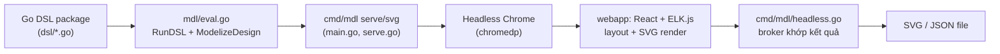
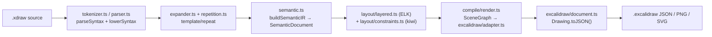
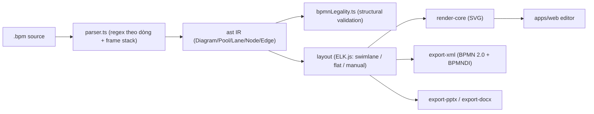
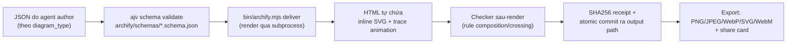

# Weekly scan: Diagram-as-code & visual tooling (2026-08-24)

**Phạm vi**: repos publish/update trong 7 ngày qua (17–24/08/2026) trong domain diagram-as-code, DSL, SVG animation, graph layout, BPMN. Nguồn: GitHub REST search API (topic + keyword fallback theo thứ tự quy định), qua `api.github.com`/`raw.githubusercontent.com` không xác thực (session này không có quyền `gh` CLI hay GitHub MCP ngoài phạm vi repo `kymostudio/kymostudio`, nên không dùng được `mcp__github__search_repositories` cho các repo bên ngoài).

- **Tín hiệu mạnh nhất tuần này nằm ở hai đầu đối lập của cùng một vấn đề mà kymostudio đang tự giải**: `fractalops/xdraw` tách riêng một constraint-solver layer (Cassowary/kiwi) cho align/distribute *trên trên* graph layout — thứ `alignment.py` của kymostudio hiện làm bằng heuristic staggering thay vì linear solve; `IntentGraphs/diagram-as-code` triển khai validator BPMN 3 tầng (syntax → structural legality → geometry) mà `from_bpmn.py` của kymostudio hoàn toàn chưa có.
- **`tt-a1i/archify` có chỉ số sao đáng ngờ** (15.2k star / chỉ 79 watcher — tỷ lệ ~0.5%, tăng +6k sao trong ~30 ngày) nhưng nội dung kỹ thuật (typed JSON IR + Ajv schema + post-render composition checker + "Architecture Delta" diffing) là thật và đáng học riêng phần đó — đọc §4 với con mắt hoài nghi về mức độ phổ biến, không hoài nghi về kiến trúc.
- **`goadesign/model` xác nhận một pattern kymostudio đã dùng đúng** (Diagram IR thô → model đã resolve, hai tầng riêng biệt) nhưng chọn hướng ngược lại về cách render (headless-Chrome + ELK.js trong browser thay vì thư viện thuần) — không đáng port, chỉ đáng tham khảo ý tưởng "ship agent skill cài đặt được" cho `.kymo`.

## Mục lục

1. [goadesign/model](#1-goadesignmodel)
2. [fractalops/xdraw](#2-fractalopsxdraw)
3. [IntentGraphs/diagram-as-code](#3-intentgraphsdiagram-as-code)
4. [tt-a1i/archify](#4-tt-a1iarchify)

---

## 1. goadesign/model

`https://github.com/goadesign/model`

### §1 Quick context

Diagram-as-code cho C4 software architecture, khác biệt lớn nhất: DSL **chính là code Go** (closures lồng nhau, không có text grammar riêng), còn layout + render lại chạy trong một **React + ELK.js app chạy trong headless Chrome**, không phải trong Go binary. Stack: Go 1.26 (`go.mod`), `chromedp` (điều khiển headless browser), `fsnotify`+`lrserver` (watch/live-reload), tái dùng `goa.design/goa/v3` cho DSL eval engine; frontend `cmd/mdl/webapp` là React 19 + elkjs 0.12. Output: SVG, JSON, upload lên Structurizr. Repo health: 466★/23 forks, MIT, CI (`test.yml` + dependency-review) chạy đều, rất active — 10 release trong 3 ngày (v1.16.1→v1.16.10, 19–21/08/2026). Distribution: `go install goa.design/model/cmd/{mdl,stz}`.

### §2 Architecture deep-dive

**A. Component inventory**
- `dsl/*.go` — hàm DSL user-facing (`Design`, `SoftwareSystem`, `Person`, `Uses`, `Views`, `Styles`), đăng ký vào một expression tree toàn cục khi Go code chạy.
- `expr/*.go` — IR thực sự: registry element/relationship. Lưu ý `expr/render.go` **không phải** SVG renderer — đó là logic resolve view-membership (`addAllElements`, `coalesceRelationships`), tên gây hiểu nhầm.
- `mdl/eval.go` — chạy DSL qua `eval.RunDSL()` của goa, rồi `ModelizeDesign()` convert `expr.Root` → model JSON-serializable — đây là **tầng IR thứ hai**, tách biệt khỏi expr-tree.
- `cmd/mdl/{main,serve,headless,watch}.go` — CLI, HTTP server phục vụ webapp, broker khớp kết quả render headless-Chrome, watcher fsnotify (debounce 100ms) + live-reload.
- `cmd/mdl/webapp/` (React 19 + elkjs 0.12 + `svg-editor-tools`) — layout engine và SVG editor thật sự chạy ở đây.

**B. Pipeline (`mdl svg`, happy path)**
1. User viết Go package import `goa.design/model/dsl`, gọi `Design(...)`.
2. `mdl svg <package>` chạy `eval.RunDSL()` → điền `expr.Root`.
3. `ModelizeDesign()` convert expr-tree → `Design` JSON + danh sách view.
4. CLI khởi động headless Chrome (`chromedp`) trỏ vào webapp đã embed, nạp `model.json`.
5. Webapp chạy ELK.js auto-layout, render SVG trong DOM, POST SVG ngược lại broker Go (`headless.go`) theo key view+digest.
6. Broker khớp kết quả về CLI call đang chờ; `mdl` ghi file `.svg` ra `-dir gen`.

**C. Data model/IR**: struct Go (`expr.Design`, `Element`, `Relationship`, `ViewProps`), **mutable** — DSL closures ghi trực tiếp vào registry toàn cục lúc eval (kiểu goa), sau đó một struct "modelized" riêng biệt được sinh ra để export JSON. Hai tầng IR này (expr-tree → JSON model) tương đồng cấu trúc với `Diagram` thô → resolved của kymostudio, dù không đặt tên "lower IR" tường minh.

**D. Input language**: DSL = lời gọi hàm + closure Go, không phải text grammar/EBNF; tận dụng `eval` package chung của goa nên lỗi parse hiện ra dưới dạng lỗi Go compiler hoặc lỗi eval-phase của goa, không phải diagnostics của parser tự viết. `DSL.md` mô tả bằng ví dụ, không có BNF.

**E. Layout**: giao hoàn toàn cho **ELK.js** chạy trong browser — README liệt kê Layered/Hierarchical, Force, Tree, Radial, Disco; đã migrate khỏi Dagre.js. Không có code layout nào ở phía Go.

**F. Rendering/output**: SVG sinh ra ở client-side trong webapp React (qua `svg-editor-tools`), bắt lại bằng `chromedp` headless cho output CLI/batch; lệnh `stz` song song thì upload JSON lên Structurizr để render ở đó. Không tìm thấy animation support. Không phải kiến trúc multi-backend pluggable như kymostudio — một renderer browser-based, một đường thay thế cloud (Structurizr).

**G. Extensibility**: style qua `Styles`/`ElementStyle` DSL block (màu, hình, tag); subcommand `skill` cài "agent skill" (`cmd/mdl/skill.go`, `skills/editing-model-diagrams`) — đáng chú ý vì cho phép AI agent tự author diagram. Có thư mục `plugin/` nhưng nội dung chưa xác định.

**H. Dev experience**: `mdl serve` mở trình biên tập browser (pan/zoom, multi-select, undo/redo, snap-to-grid theo README); kết hợp `watch.go` cho live-reload khi save file; chưa thấy tích hợp IDE/LSP ngoài agent-skill installer mới.

### §3 Architecture diagram

### §4 Verdict

Đáng học: (1) pattern "IR kép" — expr-tree (mutable, phía DSL) rồi một struct modelized/export riêng — xác nhận hướng đi Diagram→resolved mà kymostudio đang dùng là đúng. (2) Ship một "agent skill" cài được (`cmd/mdl/skill.go`) để coding agent tự author diagram trực tiếp — kymostudio có thể làm tương tự cho `.kymo`. (3) broker request/response theo digest (`headless.go`) là pattern sạch nếu sau này kymostudio cần render bất đồng bộ qua browser.

Red flag: đẩy toàn bộ layout+render qua vòng headless-Chrome là nặng (phụ thuộc Chrome, `chromedp`) so với pipeline thuần thư viện của kymostudio — rủi ro regression thật và CLI khởi động chậm; tên `expr/render.go` gây hiểu nhầm cho thấy naming discipline lỏng lẻo. DSL-là-code-Go đánh đổi mất tính di động declarative-text mà `.kymo` đang giữ (không author được bằng ngôn ngữ khác, không có parity story đơn giản với JS).

Open question: chất lượng layout thực tế, khả năng animation, nội dung `plugin/` — không xác định.

**Verdict: glance only** — hay ở ý tưởng agent-skill và IR kép, nhưng kiến trúc render qua headless-Chrome không chuyển giao trực tiếp được cho thiết kế dependency-light, song ngữ Python/TS của kymostudio.

---

## 2. fractalops/xdraw

`https://github.com/fractalops/xdraw`

### §1 Quick context

Compile một text DSL trực tiếp thành **native Excalidraw scene có thể edit tiếp** (không chỉ SVG tĩnh) — pitch chính: "generate rồi vẫn sửa tay được trong Excalidraw". Stack: TypeScript, `elkjs` (graph layout), Shiki (code highlight), MathJax (công thức → SVG), Perfect Freehand (nét vẽ tay), `@resvg/resvg-js` (SVG→PNG), `@lume/kiwi` (Cassowary constraint solver). v0.3.0, MIT, 0 sao/fork (repo rất mới), có CI (`ci.yml`+`release.yml`). Phân phối: CLI kiểu npm (`npm link` từ source; chưa xác nhận đã publish lên registry).

**So sánh trực tiếp**: kymostudio có sẵn `to_excalidraw.py` — đây là repo đáng soi kỹ nhất tuần này vì giải đúng bài toán đó theo hướng khác.

### §2 Architecture deep-dive

**A. Component inventory**
- `src/language/{tokenizer,parser}.ts` — lexer giữ offset gốc + `parseSyntax`/`lowerSyntax` (resolve theo library manifest → `DiagramDocument`).
- `src/language/{expander,repetition}.ts` — expand template/repeat.
- `src/language/semantic.ts` — `buildSemanticIR` → `SemanticDocument` (tài liệu kiến trúc gọi đây là "the seam").
- `src/language/expression.ts` — sublanguage biểu thức bị giới hạn (18 hàm, 3 hằng, 5 toán tử, 1 biến tự do — kiểu Vega-restricted, không có assignment/control-flow).
- `src/layout/constraints.ts` — **linear constraint solver** (qua `@lume/kiwi`) cho align/distribute/match-size/snap.
- `src/layout/{builtin,layered}.ts` + `src/layout/elk/prepare.ts` — layout hàng/cột/lưới/cây (builtin) và graph layout (ELK-backed).
- `src/compile/{pipeline,render,scene}.ts` — orchestrator không chứa logic, scene-graph builder, `SceneGraph`.
- `src/excalidraw/{document,adapter}.ts` — class `Drawing` (mutable, `.toJSON()` xuất native `.excalidraw`), `renderSceneVisuals`/`planFreeText`/`planImage`.
- `src/routing/{renderer,endpoints,clearances}.ts` — routing/label cho connector.
- `src/nodes/` — họ node phong phú (formula, kiến trúc kiểu C4, cartesian, table).

**B. Pipeline (từ `src/compile/pipeline.ts`)**
1. Parse: `parseSyntax`/`lowerSyntax` → `DiagramDocument`.
2. `expandRepeats` → `expandDocument` (template, ID hygienic).
3. `drawPlots` (vẽ đường/công thức toán trước khi validate).
4. `buildSemanticIR` → `SemanticDocument` (validate constraint, index object, resolve ref).
5. Layout: `prepareLayeredLayout` (ELK) chạy song song với chuẩn bị syntax-highlight/formula.
6. `renderCompilation` → `Drawing` → `.toJSON()` → JSON `.excalidraw` native (hoặc PNG/SVG qua resvg-js).

**C. Data model/IR**: IR **hai tầng thật sự** — `SourceDocument` (chỉ cú pháp) → `DiagramDocument` (đã lower theo library manifest) → `SemanticDocument` (đã validate/resolve ref, "the seam") → `SceneGraph` (state mutable lúc layout) → `Drawing` (mutable, `elements[]`/`files`/`appState`, API chainable `.add()`/`.validate()`/`.orderFrames()`, `.toJSON()` xuất `.excalidraw` native). Diagnostics và số đo (measurements) cố tình giữ **ngoài** `.toJSON()` (non-enumerable trên `Drawing`) — tách telemetry render khỏi scene xuất ra.

**D. Input language**: tokenizer+parser tự viết tay kiểu recursive-descent, không dùng parser-generator (không có dependency PEG/combinator trong `package.json`). Có grammar hình thức kiểu EBNF tùy biến trong `docs/spec.md` (`rule = required`, `[optional]`, `{repeat}`, `|` alternatives). Diagnostics cú pháp mang theo token + vị trí nguồn (line/col nhờ token giữ offset); diagnostics semantic nêu tên invariant bị vi phạm + nơi khai báo gốc (`docs/spec.md` §20).

**E. Layout**: `layered.ts` giao diagram dạng graph cho ELK (elkjs) qua `src/layout/elk/prepare.ts`; `builtin.ts` xử lý hàng/cột/lưới/cây không cần ELK. Một solver ràng buộc tuyến tính riêng (`@lume/kiwi`, kiểu Cassowary, trong `src/layout/constraints.ts`) xử lý "measured layout" (align/distribute/match-size/offset/snap) — **cơ chế tách biệt** khỏi ELK, chạy cho hình học cần độ chính xác cao. Chưa có bằng chứng cụ thể về crossing-minimization ngoài routing của ELK.

**F. Rendering/output**: backend chính là JSON `.excalidraw` native, cộng preview PNG/SVG qua `@resvg/resvg-js`. Không tìm thấy animation support. Tầng emit không rõ có pluggable-backend hay không dựa trên README/docs đã đọc.

**G. Extensibility**: `docs/architecture.md` liệt kê 4 "seam" tường minh: layout adapter (builtin vs. layered/ELK), họ node phong phú (formula/cartesian/table/architecture — tức thêm shape family mới), worker host (node/browser), file system (rooted/in-memory). Hệ thống library/import (`use "xdraw/architecture" as arch`) hỗ trợ gói constructor có namespace.

**H. Dev experience**: CLI verb `build`/`check`/`apply`/`list`/`pull` (`check` in ra bounds/path/label-placement/slack/constraint mà không ghi file, có `--format json`); nhận input từ file, stdin, hoặc `-e` inline. `xdraw pull`/`apply`/`list` tích hợp scene Excalidraw+ hosted qua `EXCALIDRAW_API_KEY`. Chưa thấy watch-mode hay browser-preview server trong README.

### §3 Architecture diagram

### §4 Verdict

Đáng học cho `to_excalidraw.py` của kymostudio: (1) tách `SemanticDocument`→`Drawing` tường minh, với diagnostics/measurements giữ **ngoài** `toJSON()` dưới dạng metadata non-enumerable — kymostudio có thể tách telemetry render khỏi scene xuất ra tương tự. (2) một tầng `constraints.ts` (Cassowary/kiwi) riêng cho align/distribute/match-size **đặt trên** graph layout — `alignment.py` của kymostudio hiện làm fan-in/trunk-lane staggering bằng heuristic chứ chưa có linear-constraint solve tổng quát, đây là gap thật. (3) round-trip với Excalidraw+ hosted (`pull`/`apply`/`list`) là khả năng mà exporter của kymostudio hoàn toàn chưa có.

Red flag: 0 sao/fork, release v0.1.0→v0.3.0 trong chưa đầy hai tuần — chưa qua kiểm chứng cộng đồng, API có thể chưa ổn định. Open question: chi tiết crossing-minimization, animation support (chưa tìm thấy), tình trạng publish npm.

**Verdict: study deeper** — cụ thể là `constraints.ts` và pattern tách diagnostics khỏi `toJSON()` — nhưng vẫn coi đây là dự án giai đoạn sớm, chưa được kiểm chứng rộng.

---

## 3. IntentGraphs/diagram-as-code

`https://github.com/IntentGraphs/diagram-as-code`

### §1 Quick context

Diagram-as-code text-first, điểm khác biệt là **validator ba tầng** (syntax → BPMN structural legality → geometry sau layout) trước khi render, và cố tình **không auto-sync** giữa text editor và BPMN visual editor (phải bấm "Import to Text" xác nhận). Stack: TypeScript npm-workspaces monorepo (Node 20-22, npm 10.x), Vitest, ELK.js cho layout. Repo health: 0 sao/fork, 2 contributor, release v1.0.2 (23/08/2026, "maintenance"), CI gồm `ci.yml`/`codeql.yml`/`pages.yml`, tự báo cáo 655/655 unit test + 57/57 Playwright e2e pass (`docs/STATUS.md`). Distribution: **chưa publish package npm** (README xác nhận); dùng qua `npm run bpm --` local hoặc playground hosted trên GitHub Pages (`apps/web`).

**So sánh trực tiếp**: kymostudio có `from_bpmn.py` (import BPMN 2.0 DI) nhưng chưa có validator structural nào — repo này là ví dụ cụ thể cho phần đang thiếu đó.

### §2 Architecture deep-dive

**A. Component inventory** — `packages/`: `ast` (kiểu IR), `parser` (`parser.ts`, `legality.ts`, `bpmnLegality.ts`, `tokens.ts`, `edgeAttrs.ts`), `validate` (`validate/src/index.ts`, single-file), `layout`/`layout-core` + engine riêng cho `swimlane`/`flat`/`manual` (đều đặt trên `layout-elk-base`), `render`/`render-core` (SVG), `export-xml`/`import-xml` (BPMN 2.0), `export-pptx`/`export-docx`/`export-drawio`, `review` (AI review/repair), `cli` (`src/bin.ts`, `commands/{validate,render,export,check,...}.ts`), `diagram-core`/`diagram-runtime` + package riêng theo family (`diagram-architecture`, `diagram-flowchart`, `diagram-gantt`, `diagram-mindmap`), `apps/web` (editor browser, lưu IndexedDB).

**B. Pipeline** (theo `docs/STATUS.md`): "text → `@bpm/parser` → `@bpm/ast` → `@bpm/layout` (engine pluggable trên ELK.js) → `@bpm/render` (SVG) → `apps/web`". Với `bpm validate`: (1) đọc source → (2) `parse()` trong `packages/parser/src/parser.ts` (parser regex theo dòng + stack frame) trả `{diagram, errors, semanticErrors}` → (3) `checkBpmnLegality()` chỉ chạy nếu không có lỗi cú pháp → (4) `validate()` trong `packages/validate/src/index.ts` cộng thêm kiểm tra resource-limit và, sau layout, `metrics`/`warnings` hình học → (5) trả `ValidationResult{valid, errors, semanticErrors, warnings, metrics, inspection}`, có thể xuất JSON/SARIF.

**C. Data model/IR**: `packages/ast/src/index.ts` export node kiểu định danh (`EventNode`, `GatewayNode`, `ActivityNode`, `DataObjectNode`, `DataStoreNode`, `TextAnnotationNode`, `GroupNode`) cùng `Pool`/`Lane`/`DiagramEdge`/`Diagram`, kèm kiểu mang hình học (`Position`, `Side`, `SizeHint`) và style (`NodeVisual`, `EdgeStyle`). Dùng `export type` (interface TS thuần) — mutable hay immutable không xác định chỉ từ export. IR bám sát category của BPMN 2.0 XML dù các family khác cũng dùng chung IR này — cho thấy thiết kế "BPMN-first".

**D. Input language**: `docs/LANGUAGE.md` có các mục File shape, Directives, khai báo node, Pool & lane, khai báo edge, chế độ manual positioning, keyword index, ví dụ hoàn chỉnh. Không có EBNF hình thức — chỉ template cú pháp inline, ví dụ node: `task "Review order" as t1 at (240,120) size (150,60)`; edge: `g1 -> t2: "Approved" [from: right, to: left, via: (280,115)]`. Parser (`parser.ts`) là **regex theo dòng** với stack cho frame lồng (pool/lane/subprocess con), không phải PEG/recursive-descent. Ba tầng validate tách theo code path/field chứ không phải module riêng: syntax = `parser.parse()` (regex-line matching) → `errors[]`; structural BPMN = `checkBpmnLegality()`/`bpmnLegality.ts` (bảng rule: event category/trigger hợp lệ, rule cancel-boundary host, rule target của event-based gateway, cấm self-loop non-association) → `semanticErrors[]`, chỉ chạy khi syntax sạch; geometry = check sau layout trong `validate/src/index.ts` (`ValidationMetrics`, phát hiện overlap/crossing) → `warnings[]`+`metrics`.

**E. Layout**: engine pluggable trên ELK.js (`layout-elk-base`), tự chọn: `layout-engine-swimlane` cho BPMN có pool/lane, `layout-engine-flat` cho trường hợp còn lại, `layout-engine-manual` khi có `positioning: manual` (tọa độ `at (x,y) size (w,h)` trong source, `LANGUAGE.md` §6). Thiết kế đáng chú ý: chế độ text và chế độ BPMN Diagram Editor trong web editor **không sync liên tục** — sửa trong diagram editor export ra BPMN XML và cần xác nhận "Import to Text" tường minh trước khi ghi đè source.

**F. Rendering/output**: SVG (`render`/`render-core`), BPMN 2.0 XML kèm BPMNDI qua `export-xml` (dựng bằng template-literal string, không qua DOM/XML-lib — `shapeXml()`, `edgeXml()`, `collaborationXml()`, namespace extension Camunda thêm có điều kiện), PPTX có thể edit ("editable visual projection, không phải semantic round-trip"), DOCX (chỉ qua CLI, nhúng SVG vector thay vì shape Word native), và package `export-drawio` (chưa xác nhận nội dung qua đọc text). Không có bằng chứng animation ở bất kỳ đâu. `import-xml` cung cấp chiều ngược BPMN XML → IR.

**G. Extensibility**: các package riêng theo family (`diagram-architecture`, `diagram-flowchart`, `diagram-gantt`, `diagram-mindmap`) đặt trên `diagram-core`/`diagram-runtime` dùng chung — ngụ ý vocab node/edge riêng theo family cắm vào chung một pipeline IR+layout+render; BPMN được ưu tiên riêng (có `bpmnLegality.ts`, lệnh CLI `bpmnOnly.ts`, chế độ Diagram Editor chỉ giới hạn cho BPMN). `STATUS.md` ghi rõ: hợp đồng AI capability "family-neutral" fail-closed cho family khác BPMN.

**H. Dev experience**: CLI (`packages/cli`, gọi qua `bpm`/`npm run bpm --`) gồm `validate`/`check` (alias), `render`, `export`, `review`, `generate`, `importDiagram`, `freeze`, `capabilities`, cộng biến thể chỉ-BPMN; `validate --json` và `check --changed --format sarif` hỗ trợ gate CI/CD. Editor browser (`apps/web`) lưu project vào IndexedDB, có "Workspace Tour" 6 diagram mẫu, Save/Open qua bundle `.bpm-project.json` di động. Không thấy bằng chứng có watch-mode.

### §3 Architecture diagram

### §4 Verdict

Đáng học cho `from_bpmn.py`: (1) shape kết quả tường minh `errors`/`semanticErrors`/`warnings` ba tầng, xuất SARIF, là pattern cụ thể cho một BPMN structural validator mà kymostudio hiện chưa có — có thể làm một `bpmn_validate.py` mới sinh report ba tầng tương tự, gate sao cho structural check chỉ chạy khi syntax đã sạch; (2) bộ rule legality cụ thể (hợp lệ category/trigger của event, rule host cancel-boundary, rule target của event-based gateway, cấm self-loop non-association) là checklist sẵn có thể port sang. Cho thiết kế `.kymo`: cặp "manual/auto positioning" (`positioning: manual` + `at (x,y) size (w,h)`) giống đúng cơ chế manual/auto-layout mà `.kymo` đã có — không có gì mới nhưng xác nhận hướng đi đúng.

Red flag: 0 sao, 2 contributor, chưa publish package, PPTX/DOCX không round-trip thật, parser regex-theo-dòng (rủi ro tương đương chứ không vượt trội parser line-oriented của `.kymo`), hoàn toàn không có animation output — điểm khác biệt cốt lõi của kymostudio vắng mặt ở đây. Open question: độ bền của parser regex khi lồng sâu (subprocess/lane) chưa kiểm chứng; chưa đọc chi tiết implementation của `bpmnLegality.ts`.

**Verdict: study deeper chỉ cho shape report ba tầng + checklist rule của validator; còn lại glance-only** — cộng đồng còn mỏng, không có kỹ thuật render/layout độc đáo nào kymostudio đang thiếu.

---

## 4. tt-a1i/archify

`https://github.com/tt-a1i/archify`

### §1 Quick context

Skill cài qua agent (`npx skills add tt-a1i/archify -g`) biến mô tả codebase/spec thành diagram HTML tự chứa (self-contained), đã validate, có animation (5 loại: architecture/workflow/sequence/dataflow/lifecycle), điểm khác biệt so với Mermaid là **typed-JSON IR + schema validation**. Stack: Node ≥18, **0 runtime dependency** (dev dep: `ajv`, `simple-icons`), CLI ESM. Repo health: 15.2k sao/1.1k fork nhưng chỉ 79 watcher (tỷ lệ ~0.5% — bất thường), tăng từ 9.1k→15.2k sao trong khoảng 1 tháng (25/07→24/08/2026). Có commit đa tác giả thật và issue song ngữ thật (không giống farm thuần túy), nhưng độ lệch sao/watcher vẫn là dấu hiệu cần cảnh giác khi trích dẫn độ phổ biến.

### §2 Architecture deep-dive

**A. Component inventory**
- `archify/schemas/*.schema.json` — JSON Schema riêng theo loại: `architecture`, `workflow`, `sequence`, `dataflow`, `lifecycle`, `common` (chứa `$defs` dùng chung: id, componentType, variant, point, brandMark, legendMode, guidedViews, cards).
- `archify/bin/archify.mjs` — CLI entry; `archify/bin/{open-artifact,preview,visual-check}.mjs` script hỗ trợ.
- `archify/SKILL.md` — tài liệu quy trình author dành cho agent.
- `archify/package.json` — `archify@2.15.0`, MIT, bin trỏ `./bin/archify.mjs`, không có prod dependency.
- `docs/authoring-cookbook.md`, `DESIGN.md`, `CHANGELOG.md`, `PRODUCT.md`, `ROADMAP.md` ở root.

**B. Pipeline (happy path)**: 1) agent author JSON đúng schema (`validate <type> <file.json> --quality showcase`) → 2) `doctor` kiểm tra môi trường (Node version, template, validator, renderer có sẵn) → 3) `deliver` load/parse spec, resolve output path an toàn, render qua subprocess vào file tạm/staging → 4) script checker validate **SVG đã render** (crossing corridor, khả năng đọc, độ rộng segment) — một gate thứ hai sau render → 5) tính SHA256 receipt + composition metrics → 6) atomic rename staging→final, tùy chọn `--open`.

**C. Data model/IR**: JSON typed theo `diagram_type`, có version schema (`schema_version: 1`) — artifact đã author, **immutable**, không phải graph runtime mutable. Ví dụ `agent-tool-call.workflow.json` (đọc toàn bộ) có `lanes`, `phases`, `groups`, `nodes` (mỗi node có `lane`+`col`), `edges` (`fromSide`/`toSide`/`route` enum), `mainPath`, `views` (tập con focus có tên), `cards`. Không phải freeform lỏng lẻo — được Ajv validate.

**D. Input language**: không có DSL text riêng — "ngôn ngữ" chính là JSON Schema (Ajv-backed), agent author trực tiếp theo quy trình trong `SKILL.md` (chọn type → đọc schema/ví dụ → viết JSON với ID ổn định → validate → deliver). Tính "verifiable" đạt được qua validate hai giai đoạn: schema (cấu trúc) + checker sau-render (hình học/thị giác), mô tả là "fail-closed" — từ chối input mơ hồ thay vì đoán. Mermaid có thể nhận làm input nhưng bị convert thành JSON Archify mới, không render cơ học trực tiếp.

**E. Layout**: **không auto-compute** graph layout — node mang sẵn `lane`+`col` được author (hoặc `row`/`col`/`pos` cho chế độ `grid` của architecture, tham số `cols` 1-12, `gapX/gapY`, `cellW/cellH`). Routing edge theo directive chứ không phải solver crossing-minimization: enum `route` (`auto`, `straight`, `orthogonal-h/v`, cộng các giá trị riêng cho workflow như `drop`, `return-left`, `outside-right`, `bottom-channel`) kết hợp `fromSide`/`toSide`. Comment "Renderer Rules" trong ví dụ: "cross-lane path dùng orthogonal routing", "link ngắn giữa node liền kề thì không gắn label".

**F. Rendering/output**: HTML tự chứa, SVG inline, animation tùy chọn `animation: "trace"` (enum schema `["trace","none"]`); `DESIGN.md`: "state transition dài 140–200ms; story motion do người author định nghĩa có thể dài hơn nhưng luôn hữu hạn và người đọc điều khiển được". Export: PNG/JPEG/WebP/SVG/WebM + share-card 1200×630, xử lý client-side. **"Architecture Delta"**: lệnh `compare architecture <base.json> <head.json> [out.html] --json` — validate độc lập cả hai snapshot, fail-closed nếu không có component ID chung, không bao giờ suy đoán rename theo label/endpoint, xuất HTML Before/Delta/After xác định + receipt kèm theo (thông tin này lấy từ WebSearch tổng hợp, không fetch trực tiếp được source module compare — cần đọc lại để xác nhận).

**G. Extensibility**: 5 loại diagram là cặp schema+renderer (`archify/schemas/<type>.schema.json`); enum `visual_preset` (`classic`, `signal-flow`, `blueprint`, `editorial`) + theme dark/light cho phép mở rộng styling không cần code mới (`DESIGN.md`). "Semantic Radar" (issue #98/#100) và "Intent Trace" (issue #90) gợi ý một tầng viewer tương tác để trace route vượt ra ngoài SVG tĩnh, nhưng chưa fetch được source — không xác định chi tiết implementation.

**H. Dev experience**: cài qua `npx skills add tt-a1i/archify -g` (phạm vi agent, không phải npm global thường), hoặc `npx skills use ...@archify --agent codex` để dùng thử. CLI verb: `doctor`, `validate`, `preview` (dev server live), `deliver`, `compare`, `check`, `visual-check`, `guide`, `brands`, `demo`, `inspect`. Toggle theme và menu export nằm client-side ngay trong HTML sinh ra (`CHANGELOG.md` v2.0.0).

### §3 Architecture diagram

### §4 Verdict

Đáng học: (1) mô hình validate hai cổng — schema-validate IR **và** validate hình học của SVG đã render (crossing corridor, khả năng đọc) — resolver `alignment.py` của kymostudio có thể thêm một sanity-checker sau-layout tương tự trước khi `to_svg.py` commit output. (2) "Architecture Delta" (`compare`, fail-closed khi không có ID chung, artifact Before/Delta/After) áp dụng được thẳng cho `Diagram` dataclass của kymostudio — một `kymo diff a.kymo b.kymo` sinh before/after có thể tái dùng luôn hạ tầng golden-SVG hiện có. (3) `views` có tên (tập con focus overlay) là ý tưởng seed tốt cho `--animate`.

Red flag: tỷ lệ watcher (79) / sao (15.2k) bất thường cho quy mô claim; +6k sao trong ~30 ngày là rất nhanh kể cả tính đến xu hướng agent-skills marketplace đang hot. Giảm nhẹ nghi ngờ: lịch sử commit đa tác giả thật (6+ author khác nhau), issue song ngữ thật với phản hồi nhanh, không thấy issue kiểu template rỗng.

**Verdict**: study deeper phần pattern IR/validation/delta; nhưng đọc chỉ số độ phổ biến với sự hoài nghi, không dùng số sao làm tín hiệu uy tín khi trích dẫn lại.
