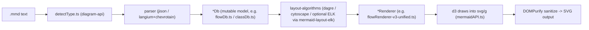
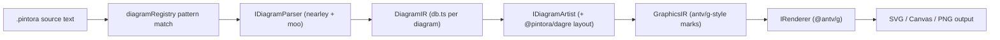
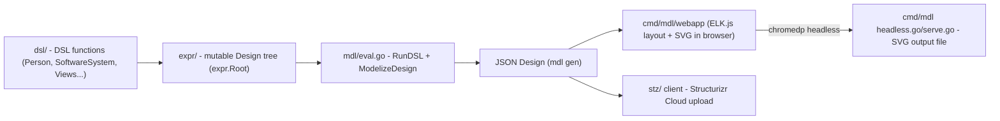
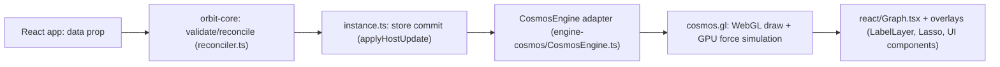

# Weekly Scan — Diagram Tooling (2026-08-25)

**Executive summary:**
- Tuần này không có repo "diagram-as-code" mới nào nổi bật vượt qua bộ lọc chất lượng (topic search chủ yếu trả về README-profile/portfolio); tín hiệu đáng chú ý nhất đến từ **ecosystem activity** — mermaid.js ra `11.17.0`/`11.17.1` (19–24/08) với renderer routing mới và nâng cấp ELK layout — nên báo cáo tuần này nghiêng về fallback #3 (ecosystem release) thay vì #1 (topic search).
- `hikerpig/pintora` là repo "diagram-as-code" thực thụ đáng học nhất tuần này: tách hai tầng IR (DiagramIR đặc thù ↔ GraphicsIR đồ hoạ chung) — một ý tưởng kymostudio chưa có và có thể áp dụng trực tiếp.
- `goadesign/model` (Go-as-DSL, C4 model) và `ModernRelay/orbit` (WebGL graph rendering, repo rất non trẻ) được đưa vào để đối chiếu hai thái cực: DSL nhúng ngôn ngữ host vs. custom parser, và rendering-at-scale vs. SVG tĩnh — cả hai ở mức "glance/study có chọn lọc", không phải trọng tâm.

**Mục lục**
1. [mermaid-js/mermaid — v11.17.0/11.17.1](#1-mermaid-jsmermaid)
2. [hikerpig/pintora](#2-hikerpigpintora)
3. [goadesign/model](#3-goadesignmodel)
4. [ModernRelay/orbit](#4-modernrelayorbit)

Ghi chú phương pháp: topic-based search (`topic:diagram-as-code`, `topic:graph-visualization`, `topic:layout-algorithm`, `topic:svg-animation`, `pushed:>2026-08-18`) qua GitHub public search API chủ yếu trả về profile-README/portfolio repos (bị loại theo bộ lọc exclusions) hoặc dự án quá non trẻ để đánh giá. Vì vậy báo cáo dùng thêm fallback #3 (ecosystem release scan: mermaid, d2lang, plantuml, excalidraw, elkjs, dagre, structurizr) — chỉ mermaid có release notable trong 7 ngày (d2 gần nhất là 2025-08-19, excalidraw gần nhất là 2026-04-21, cả hai ngoài cửa sổ 7 ngày). Số lượng repo trình bày chi tiết: 4 (dưới mức 8-10 khuyến nghị, do thiếu ứng viên đạt relevance filter trong tuần này — không độn thêm repo yếu để đủ số).

---

## 1. mermaid-js/mermaid

### §1 Quick Context

Mermaid khác các tool diagram khác ở chỗ nó biến **văn bản kiểu Markdown** thành diagram trực tiếp trong trình duyệt (client-side, không cần server render), tích hợp sẵn trong GitHub/nhiều Markdown renderer, để chống "doc-rot". Tech stack: TypeScript, dùng `d3` (v7) để vẽ SVG, `dagre-d3-es` cho layout mặc định, `cytoscape` (+ `cose-bilkent`, `fcose`) cho một số diagram, `chevrotain`/`@mermaid-js/parser` (Langium) cho parser mới, `jison` cho parser cũ (đang deprecated), `roughjs` cho theme "hand-drawn". Output: SVG (chính), có thể export PNG/PDF qua ecosystem (`mermaid-cli`). Repo health: ~90-92k sao, ~9.2k fork, MIT license, ~156 contributor hoạt động/quý, hơn 20 workflow CI (test, e2e, lint, codeql, scorecard...), release gần nhất **11.17.0 (2026-08-19)** + patch **11.17.1 (2026-08-24)** — nhịp release rất nhanh. Phân phối: npm (`mermaid`), CDN (jsDelivr), Mermaid Live Editor (mermaid.live), CLI riêng (`mermaid-cli`), gói layout ELK tách riêng (`@mermaid-js/layout-elk`, ~259k download/tuần).

### §2 Architecture Deep-Dive

**A. Component inventory**
- `Diagram` orchestrator (`packages/mermaid/src/Diagram.ts`) — điểm vào parse + giữ tham chiếu diagram đã parse.
- `mermaidAPI` (`packages/mermaid/src/mermaidAPI.ts`) — pipeline render tổng (config → parse → style → SVG DOM → renderer.draw → sanitize).
- `diagram-api` (`packages/mermaid/src/diagram-api/`): `detectType.ts` (nhận diện loại diagram từ text), `diagram-orchestration.ts` (đăng ký sẵn diagram built-in), `diagramAPI.ts` (`registerDiagram(id, diagram, detector)` — API mở rộng), `loadDiagram.ts` (lazy-load).
- `diagrams/*` (35 thư mục: `flowchart/`, `class/`, `sequence/`, `c4/`, `er/`...) — mỗi loại là module độc lập: `*Db.ts` (data model), `*Detector.ts`, `parser/` (jison hoặc langium), `*Renderer*.ts` (vẽ SVG).
- `rendering-util/` — hạ tầng render dùng chung: `layout-algorithms/` (`dagre/`, `cose-bilkent/`, `ddlt/`, `swimlanes/`, `common/`), `rendering-elements/`, `createGraph.ts`, `createText.ts`, `render.ts`.
- Gói tách riêng `packages/mermaid-layout-elk` — layout engine ELK, đăng ký runtime qua `mermaid.registerLayoutLoaders(elkLayouts)`, không phải dependency mặc định.
- `packages/mermaid/src/themes/` — theme CSS-in-JS.

**B. Pipeline (happy path, dựa trên `mermaidAPI.ts`)**
1. `processAndSetConfigs(text)` — tách frontmatter/directive, set config.
2. `Diagram.fromText(code)` — `detectType` chọn diagram module đúng, gọi `parser.parse()` (jison hoặc langium/chevrotain) để đổ dữ liệu vào `*Db` (đóng vai trò IR).
3. `createUserStyles(...)` — build CSS (theme + user + classDef) tách biệt khỏi cấu trúc.
4. `appendDivSvgG(...)` — dựng khung DOM `div > svg > g` rỗng.
5. `diag.renderer.draw(text, id, version, diag)` — renderer riêng của diagram loại đó chạy layout algorithm (dagre/elk/cytoscape tuỳ diagram) rồi vẽ node/edge vào `<g>` bằng d3.
6. `addA11yInfo` + `serializeSvg()/cleanUpSvgCode()` + `DOMPurify.sanitize()` — trả chuỗi SVG cuối cùng.

**C. Data model/IR**: Mỗi diagram có một `*Db` (ví dụ `flowDb.ts`, `classDb.ts`) — object **mutable**, tích luỹ state qua callback mà parser gọi trong lúc parse (pattern "visitor/builder", không phải AST bất biến). Parser không trả cây cú pháp riêng để duyệt lại; nó build thẳng model đồ hoạ (nodes/edges/subgraphs) trong Db, renderer đọc trực tiếp từ đó.

**D. Input language design**: Không có grammar EBNF chính thức chung — mỗi diagram type có parser riêng. Đang trong giai đoạn di chuyển: parser cũ dùng **Jison** (`.jison`, có section `%lex`/`%%`), parser mới dùng **Langium** (chạy trên **Chevrotain**) qua `@mermaid-js/parser`, có typed AST + LSP support; Jison bị coi là unmaintained, không nhận diagram mới. Chiến lược báo lỗi chi tiết: không xác định.

**E. Layout algorithm**: Mặc định **dagre** (qua `dagre-d3-es`) cho layered/directed graph. Từ v9.4 có renderer thử nghiệm **ELK** cho flowchart; ở v11.17.0 ELK được nâng cấp thêm (`elk.keepEntryNodeOnTop`, `elk.nodePlacementAlignment`) — nhưng ELK là **gói tách riêng, pluggable** (`@mermaid-js/layout-elk`), đăng ký runtime, không bundle mặc định. Một số diagram khác (state, mindmap...) dùng `cytoscape`/`cose-bilkent`/`fcose` (force-directed). Chi tiết crossing-minimization: không xác định (kế thừa từ dagre/ELK upstream).

**F. Rendering/output**: Backend chính SVG qua d3 (DOM trực tiếp). Không có cơ chế animation dựng sẵn trong core (khác kymostudio — mermaid xuất SVG tĩnh). Renderer **per-diagram-type**, không phải một emitter đơn: mỗi loại có `*Renderer*.ts` riêng; naming "v2/v3-unified" cho thấy mermaid đã re-route nhiều diagram cũ sang renderer "unified" dùng chung `rendering-util`, và 11.17.0 tiếp tục route `classDiagram` sang v2 renderer mặc định (giữ config để rollback).

**G. Extensibility**: API công khai `registerDiagram(id, diagramDefinition, detector)` để thêm diagram type mới (definition gồm `db`, `parser`, `renderer`, `styles`, optional `injectUtils`). Theme mở rộng qua `themes/` + config. Layout engine mở rộng qua `registerLayoutLoaders`. Plugin system rõ ràng ở 3 trục: diagram type / theme / layout algorithm.

**H. Dev experience**: Live Editor (mermaid.live) preview tức thời; CLI riêng (`mermaid-cli`, sibling repo) render batch; tích hợp VS Code qua cộng đồng (không phải extension chính chủ trong repo này). Watch-mode chính thức trong core repo: không xác định.

### §3 Architecture Diagram

### §4 Verdict

Kỹ thuật kymostudio nên học: (1) **Pluggable layout engine qua registration** — `registerLayoutLoaders` tách ELK thành gói riêng, không ép mọi user gánh chi phí bundle của layout engine họ không dùng; kymostudio có thể áp dụng tương tự nếu thêm layout engine thứ hai mà không phình `to_svg.py`. (2) **Renderer routing theo version có config rollback** — route `classDiagram` sang renderer "v2/unified" mặc định nhưng vẫn cho fallback qua config là pattern an toàn khi thay renderer lớn mà không phá golden/breaking user hiện tại — kymostudio có gotcha golden-SVG byte-for-byte tương tự, pattern "route-with-escape-hatch" đáng tham khảo khi đổi alignment/layout engine. (3) `registerDiagram(id, detector, definition)` là API mở rộng gọn, tách rời `Db`/`parser`/`renderer`/`styles` — đáng so sánh với cách kymostudio tổ chức `icons.py`/emitters.

Red flag: parser bị chia hai công nghệ song song (Jison cũ + Langium/Chevrotain mới) trong nhiều năm — nợ kỹ thuật rõ rệt, tăng bundle size, bất nhất giữa diagram type; kymostudio (một DSL, một parser) đang tránh được vấn đề này. Câu hỏi mở: chiến lược báo lỗi parse cụ thể — không xác định; performance dagre vs ELK trên diagram lớn — không xác định.

**Kết luận: study deeper** phần layout-plugin architecture và pattern renderer-routing-with-fallback; phần parser (Jison/Langium) chỉ glance vì không áp dụng được cho single-parser DSL của kymostudio.

---

## 2. hikerpig/pintora

### §1 Quick Context

Pintora là thư viện text-to-diagram JS "heavily inspired by Mermaid.js và PlantUML", khác Mermaid chủ yếu ở kiến trúc plugin tường minh (interface `IDiagram` với parser/artist/pattern đăng ký qua `diagramRegistry.registerDiagram()`) và ở việc renderer dựa trên thư viện đồ hoạ `@antv/g` thay vì tự viết SVG serializer. Tech stack: TypeScript, monorepo pnpm-workspace + turbo.json, parser sinh bằng nearley.js (grammar `.ne`) + lexer moo (bản fork `@hikerpig/moo`/`@hikerpig/nearley`), layout bằng `@pintora/dagre` (fork của dagrejs/dagre) + `@pintora/graphlib`. Repo health: 1.3k stars, 37 forks, MIT, CI qua `ci-check.yml`/`update-tests.yml` (Jest), publish gần đây (`@pintora/standalone` v0.8.1, ~2 ngày trước lúc tra cứu). Phân phối: npm scope `@pintora/*` (`standalone`, `core`, `diagrams`, `renderer`, `cli`), có CLI `pintora render`, VSCode extension, plugin Gatsby/Obsidian, bản Web Components (`pintora-stencil`).

### §2 Architecture Deep-Dive

**A. Component inventory** — `pintora-core` (`src/config-engine.ts`, `diagram-registry.ts`, `symbol-registry.ts`, `type.ts` — định nghĩa interface lõi `IDiagram`/`IDiagramParser`/`IDiagramArtist`/`IRenderer`); `pintora-diagrams` (`src/{sequence,er,class,activity,component,mindmap,gantt,dot}/` mỗi loại có `parser.ts`, `db.ts`, `artist.ts`, `config.ts`; `shared-grammars/*.ne` cho đoạn grammar dùng chung như bind.ne, comment.ne, config.ne, style.ne, whitespace.ne); `pintora-renderer` (`src/renderers/`, `event.ts`, `type.ts` — bọc `@antv/g` để xuất canvas/SVG); `pintora-cli` (`bin/`, `src/` — lệnh `pintora render`); `pintora-standalone` (bundle browser); `pintora-target-wintercg` (target runtime edge/WinterCG).

**B. Pipeline**: (1) người dùng gọi API/CLI với text nguồn `.pintora`; (2) `diagramRegistry` khớp `pattern` (regex đầu dòng, vd `sequenceDiagram`) để chọn `IDiagram` phù hợp; (3) `IDiagramParser.parse()` dùng grammar nearley (compile từ `.ne`) + lexer moo sinh `DiagramIR` (mỗi loại diagram có `db.ts` riêng lưu model semantic); (4) `IDiagramArtist.draw()` chuyển `DiagramIR` → `GraphicsIR` (cây `Group`/mark kiểu SVG: text, path, rect…), tính layout tại bước này (gọi `@pintora/dagre` cho đồ thị có node/edge); (5) `IRenderer` (bọc `@antv/g`) duyệt `GraphicsIR` để vẽ ra canvas hoặc SVG DOM; (6) CLI/browser xuất PNG/JPG/SVG hoặc chèn vào DOM.

**C. Data model/IR** — hai tầng IR tách biệt rõ: `DiagramIR` (đặc thù từng loại diagram, sinh bởi parser+db) và `GraphicsIR` (tầng đồ hoạ chung, mô phỏng theo mark system của `@antv/g`/thuật ngữ SVG) — đúng là khái niệm "lower IR" mà đề bài hỏi. Mutable/immutable: không xác định.

**D. Input language** — parser sinh bằng nearley.js (thuật toán Earley, context-free grammar viết trong `.ne`), lexer moo tách token; tài liệu chính thức xác nhận "shared grammars" tái dùng giữa diagram (bind/comment/config/style/whitespace). Với cú pháp custom đơn giản, tài liệu "write-a-custom-diagram" gợi ý dùng regex thay vì nearley. Cơ chế báo lỗi cú pháp (error recovery, vị trí lỗi): không xác định.

**E. Layout** — dùng `@pintora/dagre` (fork `dagrejs/dagre`, layered/Sugiyama-style auto layout cho đồ thị có hướng), kết hợp `@pintora/graphlib`. Thuật toán crossing-minimization riêng ngoài mặc định của dagre: không xác định.

**F. Rendering/output** — renderer bọc `@antv/g`, hỗ trợ cả canvas và SVG output từ cùng một `GraphicsIR` — pluggable emitter thực sự (không tự viết SVG string trực tiếp mà qua abstraction đồ hoạ chung). Cơ chế animation: không xác định (có thể `@antv/g` hỗ trợ nhưng tài liệu Pintora không đề cập).

**G. Extensibility** — thêm diagram type mới bằng cách implement `IDiagram` (pattern regex + parser + artist) rồi gọi `diagramRegistry.registerDiagram(name, diagram)`; config riêng của diagram mở rộng qua TypeScript module augmentation lên `PintoraConfig`. Plugin system tường minh, tách rõ ba mối quan tâm (match → parse → draw).

**H. Dev experience** — CLI `pintora render -i input.pintora -o out.png` (`--theme`, `--pixel-ratio`, `--background-color`, `--width`); Live Editor/playground tại pintorajs.vercel.app/demo/live-editor; VSCode extension (`pintora-vscode`) preview trong editor. Watch-mode CLI: không xác định.

### §3 Architecture Diagram

### §4 Verdict

Kỹ thuật đáng học: (1) tách rõ hai tầng IR (DiagramIR đặc thù ↔ GraphicsIR chung) — kymostudio hiện chỉ có một `Diagram` model đi thẳng vào `to_svg.py`, có thể cân nhắc thêm tầng graphics-IR trung gian để tái dùng khi thêm backend mới. (2) grammar chia sẻ (`shared-grammars/*.ne` cho comment/whitespace/config/style) giữa các loại diagram — DSL của kymostudio cũng có thể tách phần cú pháp chung (style, config directive) khỏi từng "diagram type" nếu mở rộng nhiều biến thể. (3) interface `IDiagram` (pattern+parser+artist) đăng ký qua registry là mô hình plugin gọn để tham khảo khi cân nhắc front-end DSL thứ ba.

Red flags: monorepo fork riêng cả `dagre`, `graphlib`, `moo`, `nearley` dưới scope `@pintora`/`@hikerpig` — gánh nặng bảo trì fork lớn; không tìm thấy bằng chứng về animation hay error-reporting chất lượng cao (điểm yếu so với kymostudio vốn có `--animate` native). Câu hỏi mở: cơ chế animation (nếu có) nằm ở đâu trong `@antv/g`; chiến lược error message khi parse fail; có golden/regression test suite kiểu byte-for-byte như kymostudio không (chỉ thấy Jest, không thấy bằng chứng).

**Kết luận: study deeper** phần tách IR hai tầng và cấu trúc plugin `IDiagram`; phần còn lại (fork ecosystem, thiếu animation) mức "glance only".

---

## 3. goadesign/model

### §1 Quick Context

**model** là DSL kiến trúc phần mềm theo C4 Model, nhưng thay vì tự viết grammar (như PlantUML C4 hay `.kymo` của kymostudio), nó **dùng chính Go làm host language**: các phần tử được khai báo bằng function call lồng closure Go, không có parser riêng. Tech stack: Go 1.26, phụ thuộc `goa.design/goa/v3` (cơ chế `eval` DSL vay mượn từ Goa), `chromedp` (headless Chrome), `fsnotify`+`lrserver` (live-reload), và một webapp TypeScript nội bộ dùng **ELK.js** để layout/render SVG. Repo health: 466 sao, MIT license, release rất dồn dập (v1.16.1 → v1.16.10 chỉ trong 19–21/08/2026), số contributor không xác định. Phân phối qua `go install goa.design/model/cmd/mdl` và `.../cmd/stz` — không có binary release rời rạc được xác nhận.

### §2 Architecture Deep-Dive

**A. Component inventory** — `dsl/` (`design.go`, `elements.go`, `person.go`, `relationship.go`, `styles.go`, `views.go`, `deployment.go`) — API DSL công khai; `expr/` (`design.go`, `model.go`, `person.go`, `system.go`, `container.go`, `component.go`, `relationship.go`, `views.go`, `registry.go`, `render.go`, `view_props.go`, `filtered_views.go`) — cây expression/mô hình dữ liệu thật (mutable struct, singleton `expr.Root`); `mdl/` (`eval.go`, `model.go`, `elements.go`, `views.go`, `relationship.go`, `deployment.go`) — cầu nối `eval.RunDSL()` → `ModelizeDesign()` để serialize JSON; `cmd/mdl/` (`main.go`, `serve.go`, `headless.go`, `watch.go`, `skill.go` + `webapp/`) — CLI `mdl` và webapp TypeScript dùng ELK.js (Layered/Force/Tree/Radial/Disco/Stress) để auto-layout và dựng SVG trong trình duyệt; `stz/` + `cmd/stz` — client/CLI tương tác Structurizr Cloud (`stz gen/put/get`); `codegen/json.go` — sinh JSON design.

**B. Pipeline (happy path)**
1. Người dùng viết package Go (vd. `examples/basic/model/model.go`) gọi `dsl.Person(...)`, `dsl.SoftwareSystem(...)`, `dsl.Views(...)` với closure lồng nhau — các lời gọi này chỉ *đăng ký* DSL vào bộ máy `eval` của Goa, chưa thực thi ngay.
2. Driver (CLI `mdl`, hoặc `main.go` gọi `stz.RunDSL()`) kích hoạt `eval.RunDSL()`, duyệt và evaluate các định nghĩa đã đăng ký, điền vào `expr.Root`.
3. `mdl/eval.go` gọi `ModelizeDesign(expr.Root)` chuyển cây expr thành struct `*Design` để serialize JSON (output của `mdl gen`).
4. `mdl svg`/`mdl serve` mở HTTP server cục bộ, phục vụ JSON design cho webapp TS, dùng `chromedp` (`headless.go`) điều khiển Chrome headless nạp webapp đó.
5. Webapp dùng ELK.js auto-layout theo view rồi dựng SVG trong DOM.
6. Webapp POST SVG kết quả về server Go (khớp qua view ID/digest), ghi ra file — hoặc song song, `stz gen/put` gửi cùng JSON lên Structurizr Cloud để lưu trữ/render ở đó.

**C. Data model/IR**: `expr.Root` là singleton **mutable** Go struct tree, ánh xạ trực tiếp 4 cấp C4: `Person`, `SoftwareSystem`, `Container`, `Component` (không có "Code" level riêng). `Design` là root, xuất hiện đúng một lần.

**D. Input language**: DSL nhúng Go — không grammar tùy biến. `Person(name, desc, func(){...})` là hàm Go bình thường, nesting closure = cây, đăng ký qua `eval` package của Goa. So với `.kymo` của kymostudio (grammar dòng-lệnh tự viết, parser riêng `dsl.py`/`dsl.ts`), model đổi lấy toàn bộ tooling Go (gofmt, autocomplete, refactor, type-check compile-time) và khả năng chia sẻ model như package Go bình thường, đổi lại phải cài Go toolchain, cú pháp cồng kềnh hơn, lỗi cú pháp bắt bởi Go compiler (không phải thông báo domain-specific) trước khi DSL kịp chạy.

**E. Layout**: Không tính trong Go/expr — hoàn toàn ủy quyền cho webapp TS dùng **ELK.js** (chọn được Layered/Force/Tree/Radial/Disco/Stress; flag `-direction`, `-compact`). Edge routing cũng do ELK.js xử lý.

**F. Rendering**: Hai đường tách biệt rõ ràng — (1) local SVG: Go **không** tự render, chỉ sinh JSON rồi điều khiển Chrome headless chạy webapp JS/ELK.js dựng SVG trong DOM, gửi ngược lại qua HTTP; (2) `stz` chỉ upload cùng JSON (định dạng workspace Structurizr) lên cloud Structurizr — render ở đó nằm ngoài repo, hoàn toàn tùy chọn.

**G. Extensibility**: Loại phần tử C4 cố định trong `dsl`/`expr`; tùy biến qua `Tag()` + `ElementStyle`/`RelationshipStyle`; view tùy chỉnh qua `FilteredView`, `RemoveTagged`, `Add`/`Link`/`AddContainers`. Vì là Go, người dùng còn có thể viết hàm Go bọc DSL để tái sử dụng.

**H. Dev experience**: Cài qua `go install`; `mdl serve` mở editor đồ họa tương tác; `watch.go` + fsnotify + lrserver cho live-reload; IDE support "miễn phí" nhờ là Go thuần. Đáng chú ý: `mdl skill install` cài skill cho AI coding agent (`cmd/mdl/skills/editing-model-diagrams/`) — tính năng rất mới (release 19–21/08/2026).

### §3 Architecture Diagram

### §4 Verdict

Kỹ thuật đáng học: (1) tách bạch triệt để "sinh model" (Go, đồng bộ) khỏi "render" (JS/ELK.js, ủy quyền hoàn toàn ra ngoài) — kymostudio có thể cân nhắc để layout engine thay thế được dễ hơn. (2) đầu tư sớm vào "skill cho AI coding agent" là tín hiệu xu hướng đáng theo dõi. Về tradeoff host-language-DSL vs custom-parser: cách của model tận dụng tooling Go miễn phí nhưng mất tính di động/độc lập ngôn ngữ và cú pháp gọn nhẹ — đây chính là lý do `.kymo` (custom parser của kymostudio) hợp hơn cho một *file diagram* độc lập, không đòi hỏi cài Go. Mô hình 4 cấp C4 (Person/System/Container/Component) là khung phân loại ngữ nghĩa rõ ràng kymostudio hiện chưa có, đáng cân nhắc mượn làm "profile" tùy chọn.

Red flag: render pipeline phụ thuộc headless Chrome + roundtrip HTTP — nặng và giòn hơn renderer native. Câu hỏi mở: hiệu năng/độ ổn định của bước chromedp ở quy mô lớn — không xác định.

**Kết luận: study deeper** riêng về mô hình C4 và cơ chế tách model/render, nhưng không cần theo cách tiếp cận Go-as-DSL.

---

## 4. ModernRelay/orbit

### §1 Quick Context

`orbit` khác các thư viện graph rendering khác ở chỗ nó hoàn toàn declarative (graph là một prop, không có imperative canvas code) và tách biệt rõ "headless core" (validation, reconciliation, projection) khỏi engine WebGL — engine mặc định (`orbit-engine-cosmos`) chỉ là lớp adapter bọc quanh thư viện có sẵn `@cosmos.gl/graph` (v3.4.0), không tự viết WebGL từ đầu. Tech stack: React 18+, TypeScript, pnpm monorepo (5 package versioned lockstep, hiện `0.15.0`), Playwright cho E2E. Repo health: **rất non trẻ** — 5 stars, 0 forks, ~22 commit hiển thị, toàn bộ trong tháng 8/2026, MIT license, CI có 3 job (check/e2e/package) trông khá đầy đủ. Phân phối qua npm (`@modernrelay/orbit-*`).

### §2 Architecture Deep-Dive

**A. Component inventory** — `packages/core/src/` — headless core, không import React/engine: `instance.ts`, `reconciler.ts`, `projection.ts`, `validate.ts`/`columnarValidate.ts`, `crossfilter.ts`, `filter.ts`, `degrade.ts`, `svgExport.ts`, `imageAtlas.ts`, `workerProtocol.ts`, `engine/` (contract `GraphEngine`), `testing/` (`FakeEngine`); `packages/engine-cosmos/src/CosmosEngine.ts` — WebGL engine adapter (cosmos.gl wrapper); `packages/react/src/Graph.tsx`, `GraphProvider.tsx`, `LabelLayer.tsx`, `Lasso.tsx`, `hooks.ts`, `components/` (13 UI package: Search, Minimap, Table, Histogram, Timeline, Legend, Toolbar, ContextMenu...); `packages/data/` — adapter dữ liệu (rows/CSV/JSON, Arrow/Parquet subpath); `packages/omnigraph/` — server adapter riêng (streaming export, schema `.pg`); `apps/demo/src/App.tsx` — demo app dùng `<Graph/>`.

**B. Pipeline (happy path)**
1. Developer cung cấp `data` (typed snapshot/columnar/CSV/streaming) cho `<Graph<NodeAttrs,EdgeAttrs>/>` cùng `engine={engineFactory}`.
2. `orbit-core` validate + reconcile dữ liệu (`reconciler.ts`, `columnarValidate.ts`), giữ stable identity qua các update, phát diagnostics theo batch thay vì throw.
3. `createGraphInstance` build instance headless, publish store; `applyHostUpdate` → một store publication → tối đa một atomic engine commit.
4. `CosmosEngine` coalesce các channel commit (structure/buffers/config), stage rồi apply **một** render atomic (`setPointColors`, `setPointSizes`, `setLinkColors`...).
5. Cosmos.gl chạy GPU force simulation + vẽ WebGL; "activity clock" tự quản lý vòng lặp rAF (free-run khi có `sim`/`drag`/`transition`, dừng hẳn khi rest — zero rAF khi idle).
6. Overlay layer (labels, lasso, minimap...) đọc lại state qua sample post-draw, position readback per-event chứ không per-tick.

**C. Data model/IR** — snapshot dạng object hoặc columnar, có validation diagnostics; instance/store mutable nhưng update đi qua cơ chế commit atomic có kiểm soát (rule "một `applyHostUpdate` = một store publication = tối đa một atomic engine commit"). Cấu trúc IR nội bộ (buffers): không xác định.

**D. Input language design** — không có DSL văn bản; đây thuần là **component/props API** của React (`<Graph data={...} engine={...} layout="force" nodeColor={...} ... />`), style/scale channel nhận accessor function hoặc "Scale descriptor". Có API imperative song song qua ref (`GraphHandle`: `focusNode`, `emphasizeNode`, `getViewState`/`setViewState`, `getPerfSnapshot`) và một core API không React (`createGraphInstance`).

**E. Layout & scale** — layout mặc định GPU force-directed (qua cosmos.gl), hoặc fixed coordinates; thuật toán crossing-minimization/edge-routing cụ thể: không xác định (không thấy bằng chứng edge routing ngoài đường thẳng point-to-point ngầm định của cosmos). Scale 100K+ node: GPU rendering + point-sprite atlas (`imageAtlas.ts`), incremental crossfilter brushing giữ chi phí ~1ms/brush (theo README, chưa kiểm chứng độc lập), degrade ladder khi dữ liệu lỗi (`degrade.ts`), off-main-thread data ingestion (`worker/`, `workerProtocol.ts`). Thuật toán force simulation cụ thể (Barnes-Hut, ForceAtlas2...): không xác định — trách nhiệm của cosmos.gl bên thứ ba, không phải code orbit tự viết.

**F. Rendering/output** — WebGL qua cosmos.gl (native picking, `pointsInPolygon`/`pointsInRect` cho lasso). Context-loss recovery: pause simulation, deadline diagnostics (mặc định 10s), rebuild Graph instance khi restore, re-upload atlas từ CPU mirror. Export: SVG (`svgExport.ts`)/JSON/PNG. Không thấy fallback Canvas2D. Animation: transitions + simulation tunables live (không cần restart).

**G. Extensibility** — `GraphEngine` contract cho phép swap engine (có `FakeEngine` test double); mỗi UI component là entry point riêng ("headless-styleable"); custom node label renderer (`renderNodeLabel`). Plugin system rộng hơn (custom node/edge shape renderer ngoài label): không xác định.

**H. Dev experience** — TypeScript generic đầy đủ (`<Graph<NodeAttrs,EdgeAttrs>/>`), demo app thực tế nhiều mode (declarative/CSV/semantic/omnigraph), CI check gồm lint/typecheck/test/perf-gate/build + E2E Playwright + package matrix (Node 22/24). Docs site riêng tồn tại trong repo nhưng nội dung chưa được kiểm tra trực tiếp — chất lượng không xác định.

### §3 Architecture Diagram

### §4 Verdict

Kỹ thuật đáng học cho kymostudio (dù kymostudio xuất SVG, không WebGL): (1) tách bạch "headless core / engine seam" với `FakeEngine` double — cho phép test logic layout/reconciliation mà không cần render thật; kymostudio có thể áp dụng ý tưởng này cho pipeline `alignment.py`/`layout.py`. (2) coalesce nhiều update thành một commit atomic trước khi vẽ lại — tránh render thừa, liên quan tới cách kymostudio batch thay đổi trước khi gọi `to_svg.py:render()`. (3) "degrade ladder" — dữ liệu lỗi degrade có kiểm soát thay vì crash, hợp với triết lý DSL "parsing không validate" của kymostudio. (4) activity-clock kiểu gated rAF (chạy khi cần, dừng hẳn khi rest) là ý tưởng chung cho animation engine, ít liên quan trực tiếp tới SVG tĩnh.

Red flags: repo cực kỳ non trẻ (5 sao, 0 fork, ~22 commit, toàn bộ trong 1 tháng), chưa có release history dài hạn, chưa xác minh được số contributor thực. Tuy nhiên mã nguồn có bằng chứng thực chất (nhiều file logic cụ thể: crossfilter, projection, imageAtlas, workerProtocol, context-loss recovery chi tiết) — không phải README marketing rỗng. Câu hỏi mở: chưa xác định thuật toán force-layout cụ thể (thuộc cosmos.gl, không phải orbit tự viết); chưa kiểm chứng độc lập số liệu hiệu năng "1ms/brush".

**Kết luận: glance only** — ghi nhận ý tưởng kiến trúc (engine seam, atomic commit, degrade ladder) nhưng không đầu tư sâu vì repo còn quá non trẻ/chưa kiểm chứng để rút bài học layout-algorithm cụ thể.
