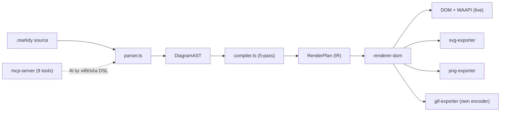
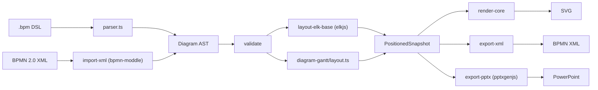
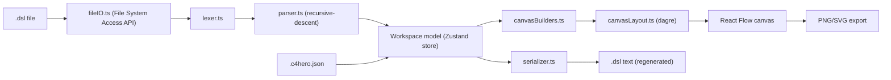

```mermaid
flowchart LR
    Text["Family DSL text"] --> Preprocess["dsl-preprocess"]
    Preprocess --> Detect["detectPlugin()"]
    Detect --> FParser["family parser.ts (×52)"]
    FParser --> FAST["family AST"]
    FAST --> FLayout["family layout.ts + core/bk.ts"]
    FLayout --> LR["LayoutResult"]
    LR --> FRenderer["family renderer.ts + core/svg.ts"]
    FRenderer --> SVGOut["SVG string"]
    SVGOut --> PNGExp["resvg-js (PNG export)"]
```

# Weekly scan: diagram-as-code & visual tooling (2026-08-26)

**Executive summary:**
- Hai đối thủ trực tiếp với kymostudio xuất hiện tuần này (`markdy-com`, `IntentGraphs/diagram-as-code`), nhưng cả hai đều rất non trẻ (`markdy-com` ~5 tháng tuổi, `IntentGraphs/diagram-as-code` mới 9 commit/3 ngày) — không phải mối đe dọa cạnh tranh ngay, nhưng đáng theo dõi vì chọn kiến trúc gần giống kymo (DSL riêng → IR → layout → SVG/BPMN).
- `markdy-com` quảng cáo "17 layout engines" nhưng code thực chất chỉ có ~5 thuật toán (rank-sweep, tree-centering, circular/trig, fixed-lane grid) áp cho 17 preset loại diagram — một bài học marketing-vs-code cần tránh khi viết docs cho kymo.
- `SchemaTex` chọn hướng kiến trúc ngược hẳn kymo: 52 diagram family, mỗi family có parser/layout/renderer **hoàn toàn độc lập**, chỉ share `DiagramPlugin` interface + SVG builder + một thuật toán Brandes-Köpf — trái với triết lý "renderer dumb, một `Diagram` model dùng chung" của kymo (`model.py`/`alignment.py`/`to_svg.py`). Đây là data point tốt để so sánh trade-off khi kymo cân nhắc mở rộng sang các diagram family lạ (genogram, ladder logic...).

**Mục lục:**
1. [HoangYell/markdy-com](#1-hoangyellmarkdy-com)
2. [IntentGraphs/diagram-as-code](#2-intentgraphsdiagram-as-code)
3. [SchemaTex/SchemaTex](#3-schematexschematex)
4. [c4hero/c4hero](#4-c4heroc4hero)

---

## 1. HoangYell/markdy-com

**Nguồn:** https://github.com/HoangYell/markdy-com — TypeScript, MIT, 84 sao, tạo 2026-04-05, push gần nhất 2026-08-25.

### §1 — Quick context

Diagram-as-code compile ra **DOM + Web Animations API** ("kinetic diagrams") thay vì SVG tĩnh, kèm MCP server để AI agent tự viết/sửa diagram. Stack: TypeScript monorepo (pnpm workspaces), core parser/compiler zero runtime dependency. Output: DOM/WAAPI (chính), SVG, PNG, GIF. Repo health: 84 sao, 3 fork, 0 issue mở, CI đầy đủ (`test && gate && verify:examples`), nhưng cadence release bất thường (10+ tag trong 3 ngày, giống auto-publish hơn release có chủ đích) — không xác định số contributor thực (contributor graph không load được, khả năng là dự án một người). Distribution: npm scoped packages (`@markdy/core`, `@markdy/cli`, `@markdy/renderer-dom`, `@markdy/mcp-server`, v.v.) + VS Code extension.

### §2 — Architecture deep-dive

**A. Component inventory** — `packages/core/src/parser.ts` (MarkdyScript → `DiagramAST`); `compiler.ts` (`DiagramAST` → `RenderPlan`, 5 pass: collect edges → `layoutNodes()` → `computeGroupBoundaries()` → `scheduleBeats()` → `buildSequencePlan()`); `renderer-dom/src/{diagram,nodes,edges,groups,annotations,theme,presentation-controller}.ts` (render DOM+WAAPI); các layer riêng per diagram type (`constellation, gantt, quadrant, radar, sequence, swimlane, timeline, tree`); `geometry/{path,rect}.ts` với `routeOrthogonal()`; `export/{svg,png,gif}-exporter.ts`; `mcp-server/src/tools.ts` (9 MCP tool).

**B. Pipeline** — 1) `markdy render file.markdy` gọi CLI. 2) `parse(source)` quét theo dòng, tách comment/indent, thay `var`, dispatch theo keyword → `DiagramAST`. 3) `compilePlan(ast, theme)` chạy 5 pass ở trên → `RenderPlan`. 4) `renderer-dom` build DOM node/edge từ `RenderPlan`, dùng `routeOrthogonal()` để vẽ path, mount layer riêng theo loại diagram (vd `mountSequenceLayer`). 5) CLI mở server/browser để phát trực tiếp (`--port`), hoặc exporter rasterize ra SVG/PNG/GIF tĩnh.

**C. Data model/IR** — Hai tầng IR thuần TS interface (không class): `DiagramAST` → `RenderPlan` (`nodes, edges, groupBoundaries, annotations, cues, beats, groups, treeBuses, sequenceMessages, duration`). Mỗi pass là pure function trả object mới — về bản chất immutable giữa các pass, không có khái niệm "compile xuống IR thấp hơn" kiểu TALA của D2.

**D. Input language** — Parser hand-rolled, line-based + regex, kiểu recursive-descent tự chế (không PEG/ANTLR). Xử lý cả indentation lẫn block dấu ngoặc nhọn. Lỗi qua class `ParseError` (line/column), cảnh báo không-fatal tích vào mảng `diagnostics` (`validateReferences()`, `detectFlowCycles()`). **Không có grammar hình thức (BNF/EBNF)** — chỉ có `docs/SYNTAX.md` dạng văn xuôi, khác hẳn `docs/DSL.md` normative của kymo.

**E. Layout algorithm** — Claim "17 layout engines" **là marketing thổi phồng**: `layoutNodes()` chỉ là switch trên ~16 loại diagram, dispatch vào một bộ nhỏ thuật toán dùng chung — `layoutRanked()` (rank theo topological sweep, dùng cho flowchart/sequence/state/medallion), `layoutTree()` (căn giữa subtree đệ quy), một hàm circular/trig chung (`angle = idx·2π/N`, dùng cho constellation/loop/flywheel/radar/venn), và vài công thức lane/tier/grid cố định (swimlane, pyramid, layers, gantt...). Routing: orthogonal/Manhattan thật (`routeOrthogonal()`) có tránh vật cản (node rect + label rect) và tách làn cho edge song song (`nextEdgeLane()`). Không có crossing-minimization kiểu Sugiyama/barycenter — rank chỉ là forward-sweep longest-path đơn giản.

**F. Rendering/output** — Target chính là DOM sống + WAAPI, điều khiển bằng `presentation-controller.ts` (cố tình dùng `currentTime` thủ công thay vì autoplay timeline WAAPI native để tránh xung đột animation chồng chéo) — đáng chú ý cho kymo vì đây chính là vấn đề animate mà `--animate` của kymo cũng phải giải quyết. Export tĩnh: SVG/PNG/GIF (tự viết encoder GIF), không có MP4/WebM. Không phải kiến trúc plugin-emitter tổng quát — mỗi loại diagram có "layer" riêng, export là file riêng chứ không qua interface chung.

**G. Extensibility** — Thêm loại diagram mới = thêm case trong switch `layoutNodes()` + hàm layout + file layer render riêng — không phải plugin đăng ký, đụng trực tiếp vào core switch. Theme data-driven (8 preset + `theme-generator.ts`).

**H. Dev experience** — CLI tự parse argv (không dùng commander/yargs), subcommand phong phú: `lint, fmt, render, explain, import, diff, share, suggest, ai, check-all`. Không có `watch` command rõ ràng. Có `@markdy/language-server` + VS Code extension. **MCP server** đáng chú ý nhất: 9 tool bao gồm `transpile` (Mermaid/Docker Compose/K8s/Terraform/draw.io → MarkdyScript), `generate-prompt` (prompt chuẩn để LLM viết DSL đúng), `get-architecture-catalog`, `ai-healing`/`fix` tự sửa lỗi cú pháp bằng LLM.

### §3 — Architecture diagram

### §4 — Verdict

Đáng học nhất: `presentation-controller.ts` điều khiển `currentTime` WAAPI thủ công thay vì autoplay — kymo's `--animate` (SVG SMIL/CSS) có thể tham khảo cách tránh cascade-conflict này nếu sau này chuyển sang JS-driven playback. `routeOrthogonal()` với obstacle list gộp cả label rect (không chỉ node rect) là chi tiết routing nhỏ nhưng thực dụng, kymo's `to_svg.py` có thể chưa làm điều này. Red flag: "17 layout engines" không khớp code — bài học tránh over-claim trong docs/README của kymo. Câu hỏi mở: MCP server transpile từ Mermaid/Terraform/K8s có độ trung thực đến đâu — chưa kiểm chứng. **Verdict: glance only** — kiến trúc gọn nhưng không có kỹ thuật đột phá nào vượt qua cái kymo đã có, trừ chi tiết animation-timeline control đáng ghi chú.

---

## 2. IntentGraphs/diagram-as-code

**Nguồn:** https://github.com/IntentGraphs/diagram-as-code — TypeScript monorepo (package `bpm`), 0 sao, 9 commit, 4 release trong 3 ngày (v1.0.0→v1.0.3, 23–24/8).

### §1 — Quick context

DSL dòng-lệnh biên dịch ra BPMN/architecture/flowchart/mindmap/Gantt, xuất SVG, BPMN 2.0 XML, và **PowerPoint có thể edit được** (qua `pptxgenjs`) + DOCX. Repo cực non trẻ (9 commit, 0 sao/fork, release đầu tiên hôm qua theo mốc hôm nay) — nhiều khả năng là prototype AI-scaffold, chưa qua kiểm chứng thực tế. CI có (`ci.yml`, `codeql.yml`, `pages.yml`), test bằng Vitest + Playwright. **Chưa publish npm** — chỉ chạy từ source hoặc dùng playground web tĩnh (`apps/web`, IndexedDB, không backend).

### §2 — Architecture deep-dive

**A. Component inventory** — monorepo `packages/`: `parser` (`parser.ts`, `tokens.ts`, `legality.ts`, `bpmnLegality.ts`); `diagram-core` (`geometry.ts`, `anchors.ts`, `overlap.ts`, `pagination.ts`, `timeline.ts`, `routing/`); `diagram-{architecture,flowchart,gantt,mindmap}` (model/adapter riêng từng family; Gantt có `parser/layout/render/date.ts` riêng); `layout-core` + `layout-elk-base` (`toElkGraph.ts`, `runElkLayout.ts`, `fromElkLayout.ts` — bọc elkjs) + `layout-engine-{flat,manual,swimlane}` (swimlane có `channelRouting.ts`, `laneBanding.ts`, `portAllocation.ts`); `import-xml` (BPMN import qua `bpmn-moddle`, có `fidelity.ts`); `export-xml` (`collaboration.ts`, `diagramInterchange.ts`, `elements.ts`, `eventDefinitions.ts`); `export-pptx`, `export-docx`, `export-drawio`; `render-core`/`render`; `validate`; `cli`.

**B. Pipeline** — 1) `bpm render file.bpm -o out.svg`. 2) Text → `parser.ts` (regex/line-based, stack indentation) → AST + `ParseError[]`/`semanticErrors[]`. 3) `validate` chạy check cấu trúc/ngữ nghĩa/chất lượng layout (giới hạn 500 node/1000 edge/25.000 layout work unit). 4) Layout engine phù hợp chạy — ELK (`layered`, `edgeRouting: ORTHOGONAL`) cho architecture/flowchart/BPMN cơ bản; `layout-engine-swimlane` xử lý riêng pool/lane BPMN; Gantt dùng layout tự viết hoàn toàn. 5) `render`/`render-core` duyệt `PositionedSnapshot` → SVG (hoặc exporter khác cho BPMN XML/PPTX/DOCX). 6) File output ghi ra.

**C. Data model/IR** — AST từ `parser` được làm giàu dần thành `PositionedSnapshot` (exporter nhận trực tiếp type này) — tương tự pattern `Diagram` → `resolve_alignments()` của kymo. Với BPMN: import đi XML → object graph `bpmn-moddle` → `mapNode()`/`mapEdge()` → AST nội bộ, có **re-base tọa độ tuyệt đối DI sang khung lane-relative** sau khi xác định lane — giống hệt cách kymo xử lý "BPMN DI coordinates already absolute" (`cli.py` skip `layout()`/`resolve_alignments()` cho `.bpmn`). Điểm kymo chưa có: `LossAccumulator`/`ImportLossEntry` (cap 256) theo dõi phần tử preserved/transformed/dropped khi import — một tầng "fidelity tracking" tường minh.

**D. Input language** — Parser line-based/regex tự chế, không PEG/ANTLR/recursive-descent hình thức. `docs/LANGUAGE.md` **tự nhận không phải EBNF/BNF** — chỉ là bảng + văn xuôi "verified against those implementations". Lỗi có line/column/code, tách `errors` (cú pháp) vs `semanticErrors` (BPMN). "Deterministic validation" thực chất kiểm: resource limit, BPMN structural legality, node mồ côi, thiếu end event, cycle, gateway phức tạp, **và cả layout-quality metric** (số crossing, overlap, edge xuyên node, route fallback) gộp thành điểm A–D.

**E. Layout algorithm** — Dựa hẳn vào ELK (elkjs) `layered` + `ORTHOGONAL` cho phần lớn family — chọn thư viện layered-graph đã publish thay vì tự viết thuật toán. Swimlane có engine riêng (lane banding, channel routing, port allocation). Gantt hoàn toàn bespoke: `timeCoordinate()`/`periodWidth()` tự chọn timescale (ngày/tuần/tháng/quý/nửa năm theo span), dependency arrow là polyline cong lệch theo index để tránh chồng.

**F. Rendering/output** — SVG qua `render-core` (primitive: escape XML, đo/wrap text, dựng path polyline). **PPTX export không phải OOXML tự viết** — bọc `pptxgenjs`, map shape kind sang `shapeMap` rồi gọi `addShape/addText/addConnector`. BPMN export dựng đầy đủ BPMNDI qua `collaboration.ts`/`eventDefinitions.ts`/`diagramInterchange.ts`.

**G. Extensibility** — Cấu trúc package-per-family gợi ý thêm family = thêm package `diagram-*` + wiring layout-engine, nhưng không có API đăng ký plugin hay theming tường minh.

**H. Dev experience** — CLI có `bpm check --changed --format sarif` (tích hợp CI/lint qua SARIF) — điểm hay. Playground web (`apps/web`) có chế độ text + visual BPMN nhưng **không sync liên tục** — sửa visual phải bấm "Import to Text" thủ công.

### §3 — Architecture diagram

### §4 — Verdict

Đáng học nhất cho kymo: **`LossAccumulator`/fidelity-tracking khi import BPMN** — kymo's `from_bpmn.py` hiện không có cơ chế báo cáo tường minh phần tử BPMN nào bị drop/transform khi import; đây là ý tưởng dễ áp dụng và hữu ích cho debug corpus MIWG. Việc dựa vào ELK (`layered`+`ORTHOGONAL`) thay vì tự viết thuật toán layout cũng là data point — kymo tự viết `alignment.py`, có thể so sánh chất lượng orthogonal routing. Red flag lớn: 9 commit, 0 sao, "deterministic validation" nhưng grammar không hình thức — coi như prototype, chưa phải công cụ đã kiểm chứng. Câu hỏi mở: layout-quality grading (A–D) có đáng tin không khi chưa có người dùng thực. **Verdict: study deeper** (riêng phần fidelity-tracking BPMN), phần còn lại glance only.

---

## 3. SchemaTex/SchemaTex

**Nguồn:** https://github.com/SchemaTex/SchemaTex — TypeScript, ~70 sao, 369 commit, npm package `schematex` (v1.0.13, 38 bản).

### §1 — Quick context

Thư viện render **52 family diagram chuyên ngành** (y khoa: genogram/pedigree; điện: ladder logic, SLD; pháp lý, quản lý dự án...) từ DSL text nhỏ gọn ra SVG thuần, zero runtime dependency. Repo health: ~70 sao, 3 fork, CI + npm auto-publish workflow, test suite lớn (65 thư mục con trong `tests/`). Distribution: npm only, **chưa có CLI** (`npx schematex` ghi "coming"), có playground web + MCP server riêng (`packages/mcp/`). Lưu ý: mô tả brief ban đầu ghi "20 diagram" nhưng repo hiện tại đã lên **52** — dự án phát triển nhanh.

### §2 — Architecture deep-dive

**A. Component inventory** — `src/core/api.ts` (orchestration `render()`/`parse()`, dispatch plugin); `src/core/types.ts` (`DiagramPlugin` interface dùng chung); `src/core/layered/bk.ts` (Brandes–Köpf x-coordinate, phỏng theo `bk.js` của dagre); `src/core/svg.ts` (SVG builder API thay vì string template); `src/core/{diagnostics,dsl-preprocess,dsl-suggest,legend,theme,editing,revision}.ts`; **52 thư mục `src/diagrams/<family>/{parser,layout,renderer,index}.ts`** hoàn toàn độc lập (vd genogram có thêm `legend.ts`, `symbols.ts`); `src/{browser,react,export,ai}.ts`; `packages/mcp/`.

**B. Pipeline** — 1) Gọi `render(text, config?)`. 2) `preprocess(text)` chuẩn hóa DSL thô. 3) `detectPlugin()` chọn family (theo `config.type` hoặc quét `detect(text)` của từng plugin). 4) Parser riêng của family đó → AST riêng của family. 5) `layout.ts` riêng tính vị trí → `LayoutResult`. 6) `renderer.ts` riêng duyệt `LayoutResult` qua `core/svg.ts` dùng chung → trả string SVG.

**C. Data model/IR** — **Không có IR thống nhất.** Mỗi trong 52 family tự định nghĩa AST riêng (`LadderAST`, `FaultTreeAST`, `BpmnAst`...) và `LayoutResult` riêng. Chỉ 5 family quan hệ-gia đình (genogram, pedigree, ecomap, phylo, sociogram) share một `DiagramAST` chung (`individuals`, `relationships`) vì cùng ngữ nghĩa kinship. Kiến trúc thực chất là "shared core utility + 52 code path hoàn toàn tách biệt", chỉ hợp nhất ở mức interface `DiagramPlugin{type, detect, render, parse?, lint?}` — **khác hẳn** triết lý "một `Diagram` model dùng chung, renderer dumb" của kymo.

**D. Input language** — Parser hand-written, line-based, regex, single-pass không backtrack — xác nhận ở cả genogram lẫn ladder. Không grammar hình thức. Cú pháp khác nhau hoàn toàn giữa các family (genogram dùng operator `--`, `-x-`, `-/-`; ladder dùng `rung N:`, `OP(args)`) — chỉ chung triết lý thiết kế ghi trong `docs/DESIGN-SYSTEM.md`, không chung token grammar. Điểm thú vị: parser **cố tình khoan dung lỗi cú pháp do LLM sinh ra** (vd ladder chấp nhận thiếu dấu `:`) — trade-off "LLM-friendly" có chủ đích, không phải cẩu thả.

**E. Layout algorithm** — Kết hợp: (1) một primitive layered-graph dùng chung — `bkXCoords()` implement Brandes & Köpf (2001), tái sử dụng cho flowchart/entity/ERD/block-diagram sau bước layering riêng của từng family; (2) layout hoàn toàn bespoke ở nơi khác — genogram dùng BFS gán thế hệ từ root, sắp cặp đôi theo giới/năm sinh, coi couple là khối atomic, căn giữa con dưới trung điểm cha mẹ, "gỡ rối" sibling để tránh anh em họ đan chéo; ladder tính chiều cao mỗi rung theo không gian label, xếp trái-phải từ rail cố định (`LEFT_RAIL_X=60`). Không có crossing-minimization kiểu Sugiyama ngoài bước BK.

**F. Rendering/output** — Chỉ SVG thuần, qua builder `core/svg.ts` dùng chung (bắt buộc theo `CONTRIBUTING.md`, không cho string-concat trực tiếp). Mỗi family có `renderer.ts` riêng — pluggable-per-family chứ không phải generic emitter. **Không có animation** (không CSS keyframes, không SMIL, không JS loop) — xác nhận ở renderer genogram. PNG/PDF chỉ là hậu xử lý (`@resvg/resvg-js`, browser print), không phải renderer backend.

**G. Extensibility** — Có kiến trúc plugin hình thức (`DiagramPlugin`, registry mảng, subpath export tree-shakable như `schematex/genogram`) nhưng **`CONTRIBUTING.md` nói rõ thêm family mới cần thảo luận/duyệt trước với maintainer** — không mở cho cộng đồng tự do như tên gọi "plugin" gợi ý. Theming: token-based, 3 preset (default/monochrome/dark), family công nghiệp (ladder, SLD) bị ép monochrome theo chuẩn IEEE/IEC.

**H. Dev experience** — Chưa có CLI. Có playground web (schematex.js.org/playground) + component React `<InteractiveSchematexDiagram>` cho edit tương tác. `npm run dev` chỉ là watch-mode cho phát triển thư viện, không phải watch-mode cho người dùng viết diagram.

### §3 — Architecture diagram

### §4 — Verdict

Data point quan trọng nhất cho kymo là **kiến trúc trade-off ngược chiều**: 52 diagram engine gần như độc lập thay vì một model/layout/render chung — cho phép mỗi family tối ưu semantics riêng (vd BFS thế hệ cho genogram) nhưng trả giá bằng trùng lặp code lớn và không có "một DSL, nhiều family" thật sự (mỗi family gần như một ngôn ngữ riêng). Nếu kymo mở rộng sang diagram family lạ (không phải flowchart/BPMN kiểu box-and-arrow), nên cân nhắc học `bkXCoords()` (Brandes-Köpf, port thẳng từ dagre `bk.js`) làm primitive dùng chung thay vì tự phát minh lại. Chi tiết hay: chủ động khoan dung lỗi cú pháp LLM sinh — đáng cân nhắc cho `dsl.py` của kymo nếu muốn thân thiện hơn với AI-authoring. Red flag: nhiều claim "standards-compliant" (IEC 61131-3, IEEE 315...) chưa kiểm chứng được ở mức code. **Verdict: study deeper** (riêng phần Brandes-Köpf + genogram layout), phần plugin "mở" chỉ là hình thức.

---

## 4. c4hero/c4hero

**Nguồn:** https://github.com/c4hero/c4hero — TypeScript/React 19, Apache-2.0, 45 sao, 7 fork, tạo 2026-03-16, push gần nhất 2026-08-20.

### §1 — Quick context

Trình soạn thảo C4 architecture diagram **chạy hoàn toàn trong browser**, đọc/ghi trực tiếp file Structurizr DSL (`.dsl`) làm định dạng nguồn — sửa bằng kéo-thả nhưng lưu ra plain text DSL tương thích chuẩn có sẵn, không phải DSL riêng. Stack: React 19 + Vite + Zustand/Immer + `@xyflow/react` (canvas) + `@dagrejs/dagre` (auto-layout); AI tùy chọn (BYOK, gọi thẳng từ browser). Output: `.dsl` text, PNG/SVG, sidecar `.c4hero.json`. Repo health: 45 sao, Apache-2.0, một người bảo trì ("spare time"), CI có, test suite lớn gồm cả `structurizr-conformance.test.ts`. Distribution: web app (app.c4hero.com), không có package npm — build ra static SPA tự host được.

### §2 — Architecture deep-dive

**A. Component inventory** — `src/types/model.ts` (Workspace/Model/View); `src/lib/dsl/lexer.ts` (tokenizer tay, track line/column) + `parser.ts` (+ `parser-{model,views,styles,relationship,deployment}.ts`, recursive-descent `ContextAwareParser`); `src/lib/dsl/serializer.ts` (`serialize(workspace)`, full-regeneration); `src/lib/dsl/auto-views.ts`; `src/store/` (Zustand+Immer, 11 slice: element/group/relationship/view/tag-style/filter/ui/selection/navigation/undo/lifecycle); `src/components/canvas/canvasBuilders.ts` + `nodes/*`; `src/lib/canvasLayout.ts` (bọc dagre); `src/lib/{fileIO,folderIO}.ts` (File System Access API); `src/lib/sidecar.ts` (`.c4hero.json` — layout/lock/status không biểu diễn được trong DSL); `src/lib/workspaceDocument.ts` (orchestration load).

**B. Pipeline** — 1) Mở file `.dsl` (native picker/drop) → `fileIO.ts` đọc text + sidecar JSON nếu có. 2) `workspaceDocument.ts`: `lex()` → `ContextAwareParser.parse()` → `Workspace` đã type; merge sidecar (`applySidecar()`). 3) Workspace nạp vào Zustand store. 4) `canvasBuilders.ts` chiếu view đang active thành node/edge React Flow; `canvasLayout.ts` chỉ chạy dagre cho node **chưa có vị trí đã lưu** (node khác bị "đóng băng"). 5) Người dùng sửa trực tiếp trên canvas → action mutate `Workspace` (đây mới là state chính tắc, không phải text DSL). 6) `useAutoSave.ts` debounce 1s rồi `serializeDSL()` + `extractSidecar()` ghi cả file và `localStorage`.

**C. Data model/IR** — IR chính tắc, **mutable**, là object `Workspace` (people/softwareSystems→containers→components, relationships, views) trong Zustand store. **DSL text không phải state sống song song** — nó là artifact phái sinh, quy lại (regenerate) toàn bộ từ model mỗi lần save (model→text một chiều khi save; text→model chỉ khi load/import). Metadata không biểu diễn được trong DSL chuẩn (vị trí, pin/lock, style đường) nằm ở sidecar riêng `.c4hero.json`, tự nhận là "migration fallback" — có thể lệch nếu mất file này.

**D. Input language** — Lexer + recursive-descent parser viết tay thật sự (không PEG/ANTLR, không file EBNF hình thức). Parser thu thập `ParseError[]` (message/line/column) thay vì throw — lỗi không chặn, có vị trí rõ. Xử lý escape string cố tình mô phỏng đúng hành vi "Structurizr Java 5.0.2". Coverage rộng: identifier phân cấp, group, implied relationship, deployment environment, dynamic view, style/theme, directive `!include`/`!script`/`!docs` — có bộ test named riêng cho từng tính năng (roundtrip, hierarchical-identifiers, deployment-roundtrip, dynamic-view-roundtrip, structurizr-conformance).

**E. Layout algorithm** — `@dagrejs/dagre` (`rankdir` TB/BT/LR/RL, `ranksep:300`, `nodesep:250`), chỉ áp cho node chưa có tọa độ; node đã khóa/đã lưu vị trí được giữ nguyên và dagre "khâu" quanh chúng. Vị trí có thể kéo tự do (snap lưới 32px), lưu vào sidecar JSON — vì Structurizr DSL gốc **không có cú pháp x/y**.

**F. Rendering/output** — Một đường render duy nhất: React Flow (SVG/DOM) cho canvas tương tác; export PNG/SVG qua `html-to-image`, cộng "deterministic DSL export for clean diffs". Không có kiến trúc emitter pluggable, không phải CLI/renderer headless.

**G. Extensibility** — Không có plugin system. Thêm level/view C4 mới đòi sửa code ở nhiều nơi (`types/model.ts`, `parser-*`, thêm store slice, `canvasBuilders.ts`). Điểm pluggable duy nhất là AI layer (interface `AiProvider` cho anthropic/openai/gemini/http).

**H. Dev experience** — "Local-first, no server" là thật: File System Access API (`showOpenFilePicker`/`showSaveFilePicker`) đọc/ghi file thật trên Chromium; fallback file-input/download cho Firefox/Safari; `localStorage` (cap ~4MB) làm crash-recovery. Không có editor text DSL trong app — chỉnh sửa chỉ qua canvas visual, DSL thuần là định dạng lưu/export, hơi trái với hình ảnh "công cụ text-DSL".

### §3 — Architecture diagram

### §4 — Verdict

Đáng học nhất: mô hình **"model là canonical, DSL text là artifact phái sinh một chiều khi save"** — nếu kymo từng muốn xây visual editor cho `.kymo`, đây là mẫu tránh vấn đề đồng bộ hai chiều text↔visual (khỏi phải parse lại liên tục, khỏi lo diff bẩn). Chi tiết layout hay: dagre chỉ chạy cho node chưa có vị trí, node đã khóa được "khâu" quanh — pattern hữu ích nếu kymo thêm chế độ vị trí thủ công xen kẽ auto-layout trong `layout.py`. Red flag: không nhiều — claim khớp code, test roundtrip/conformance đáng tin. Câu hỏi mở: sidecar JSON có thể lệch khỏi `.dsl` nếu mất file, tác giả đã tự nhận đây là fallback tạm. **Verdict: study deeper** (riêng phần model-canonical/DSL-derived + partial auto-layout), phần còn lại glance only.
