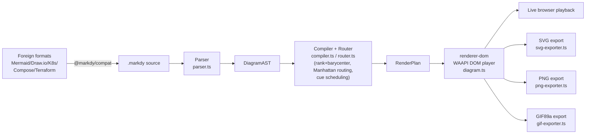
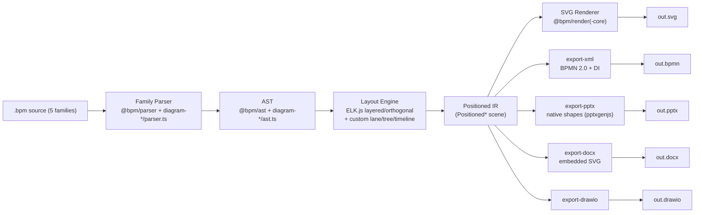
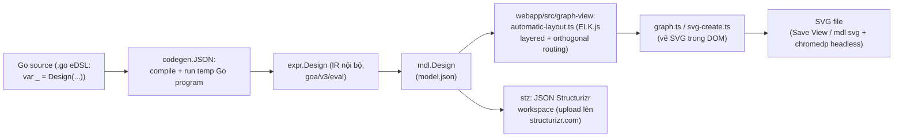
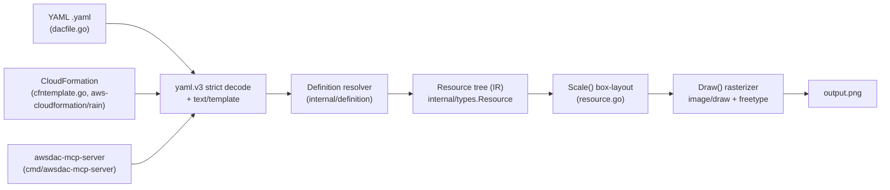

# Weekly scan: diagram-as-code & visual tooling — 2026-08-27

Nguồn: GitHub search (topic-based, cửa sổ 7 ngày `pushed:>2026-08-20`) qua REST API công khai, đọc trực tiếp source clone `--depth 1` cho từng repo. Loại trừ agent-skill wrapper mỏng (archify, excalidraw-skill-pack, swe-architect...), chart/dashboard/network-viz generic (networkx, codebase-memory-mcp...) theo tiêu chí relevance filter.

**Tóm tắt điều hành:**
- **`markdy-com`** là repo gần với kymostudio nhất về mục tiêu (animated diagram-as-code), nhưng chọn kiến trúc DOM+WAAPI thay vì SVG server-side thuần — điểm học được lớn nhất là tầng **AI-native tooling** (self-healing bằng fuzzy-match, AST diff, MCP server) chứ không phải layout/render core.
- **`IntentGraphs/diagram-as-code`** là repo pre-alpha (4 ngày tuổi, 0 sao, có vẻ 1 tác giả AI-assisted) nhưng có **kiến trúc adapter-registry rõ ràng** cho 5 family diagram và **PPTX export shape thật** — ý tưởng đáng vay mượn dù bản thân dự án chưa đáng tin.
- **`goadesign/model`** và **`awslabs/diagram-as-code`** là hai dự án trưởng thành, cho thấy hai trường phái layout khác nhau (ELK Sugiyama-layered vs. box-stacking heuristic tự viết) đáng đối chiếu với `alignment.py`/`alignment.ts` của kymostudio, dù không dự án nào nhắm tới animated SVG.

## Mục lục
1. [HoangYell/markdy-com](#hoangyellmarkdy-com)
2. [IntentGraphs/diagram-as-code](#intentgraphsdiagram-as-code)
3. [goadesign/model](#goadesignmodel)
4. [awslabs/diagram-as-code](#awslabsdiagram-as-code)

---

## HoangYell/markdy-com

### §1 — Bối cảnh nhanh

Markdy khác biệt bằng cách biên dịch DSL khai báo thành **hoạt ảnh 60fps chạy trực tiếp trong trình duyệt** qua Web Animations API, thay vì xuất SVG tĩnh như Mermaid/kymostudio.

**Tech stack**: TypeScript thuần (pnpm monorepo, tsup build), `@markdy/core` zero runtime deps; output chính là DOM/HTML animation (WAAPI), có thể export sang SVG/PNG/GIF89a qua rasterize canvas trong browser thật.

**Sức khỏe repo**: 84 stars, 3 forks, tạo 2026-04-05, push gần nhất 2026-08-25; CI đầy đủ (GitHub Actions: quality/typecheck, test matrix Node 20/22, Chrome DevTools E2E, website build); `CHANGELOG.md` có **103 mục phát hành** trong ~4.5 tháng (gần như hằng ngày) nhưng git log/tác giả chỉ thấy `hoangyell` — có vẻ dự án một tác giả chính, tốc độ ra bản rất nhanh.

**Phân phối**: npm (`@markdy/core`, `cli`, `renderer-dom`, `mcp-server`, `compat`, `astro`, `mdx`, `language-server`), CLI qua `npx`, VS Code extension riêng. Không có PyPI/cargo/binary.

### §2 — Kiến trúc chi tiết

**A. Component inventory**
- Parser (`packages/core/src/parser.ts`, ~1140 dòng) — line/indentation-based, build `DiagramAST`.
- AST & registry (`packages/core/src/ast.ts`, `registry.ts`) — type union + bảng keyword/operator.
- Compiler (`packages/core/src/compiler.ts`, ~1566 dòng) — `assignRanks`, `layoutRanked` (barycenter), `scheduleBeats` → `RenderPlan`.
- Router (`packages/core/src/router.ts`) — `routeOrthogonalEdge` (Manhattan elbow).
- Arch-lint (`arch-lint.ts`), Diff engine (`diff.ts`), self-healing (`ai-healing.ts`, `syntax-diagnostics.ts`).
- Renderer WAAPI (`packages/renderer-dom/src/diagram.ts`, `nodes.ts`, `edges.ts`, `sequence.ts`, `tree.ts`, `theme.ts`).
- Export layer (`packages/renderer-dom/src/export/{svg,png,gif}-exporter.ts`) — capture DOM đã render, không phải renderer SVG độc lập.
- Compat importers (`packages/compat/src`), CLI (`packages/cli/src/index.ts`), MCP server (`packages/mcp-server`), VS Code ext + LSP (`packages/vscode/src`, `packages/markdy-language-server/src`).

**B. Pipeline (happy path)**
1. `npx @markdy/cli render system.markdy --out scene.html`.
2. CLI gọi `parse(source)` — line-oriented, indentation-aware → `DiagramAST`.
3. `compile(ast)`: `assignRanks` (longest-path sweep theo LR/TB) + barycenter ordering trong rank, `routeOrthogonalEdge` vẽ đường gấp khúc giữa từng cặp box, `scheduleBeats` gán timeline cho cue → `RenderPlan`.
4. `createDiagram()` trong renderer-dom dựng DOM thật + SVG edge overlay, tạo WAAPI `Animation` (paused, `fill:"forwards"`).
5. Vòng lặp rAF cập nhật `sceneMs` và set `anim.currentTime` mỗi frame (workaround 2 bug browser nêu trong `docs/ARCHITECTURE.md`).
6. Lệnh `render` serialize thành file `.html` độc lập; các lệnh export khác rasterize canvas trong browser thật ra file xuất hiện.

**C. Data model/IR**: `DiagramAST` là plain TS interface (không class), `parse()` tạo mới không mutate; `compile()` không sửa AST mà build `RenderPlan` riêng — có khái niệm lower-IR rõ (AST khai báo → RenderPlan đã layout+schedule, renderer chỉ "play back").

**D. Input language**: parser tự viết tay, line-oriented + indentation, không PEG/ANTLR/combinator. Không có EBNF hình thức (`docs/SYNTAX.md` là prose+ví dụ, khác `docs/DSL.md` của kymostudio). Lỗi: `ParseError(line[, column])`; có "soft-body recovery" khi MDX/JSX làm mất indentation; tầng chẩn đoán riêng dùng Damerau-Levenshtein fuzzy match để tự sửa lỗi gõ và sinh prompt sửa cho AI agent.

**E. Layout**: rank-based kiểu Sugiyama đơn giản — `assignRanks` (longest-path sweep) + `layoutRanked` (barycenter heuristic, group-aware). Edge routing: orthogonal Manhattan, chọn cổng bằng delta lớn nhất rồi vẽ 2-3 đoạn elbow với margin cố định — README tự nhận "collision-aware" nhưng code đọc được chỉ là elbow theo cặp box, **không xác định** có tránh node khác thật sự không. Crossing minimization: chỉ 1 pass barycenter, không phải Sugiyama đầy đủ nhiều pass hay ILP.

**F. Rendering/output**: backend sống duy nhất là DOM+CSS+WAAPI (không Canvas cho playback). Export SVG/PNG/GIF là "chụp" DOM đã render trong browser thật (clone + copy computed style, rasterize canvas, inline base64 để tránh tainted-canvas) — khác hẳn kiến trúc emitter độc lập server-side của kymostudio.

**G. Extensibility**: quy trình thêm node/cue/operator được viết rõ trong `docs/ARCHITECTURE.md`, sửa trực tiếp các bảng trong `registry.ts`/`system-vocabulary.ts`/`ast.ts`; theme là token set trong `themes.ts` (8 theme có sẵn). Không thấy plugin runtime nạp ngoài.

**H. Dev experience**: CLI phong phú (`lint/fmt/render/explain/import/diff/share/new/docs/ai/suggest/check-all`), lỗi có số dòng; VS Code extension + LSP riêng cho autocomplete/diagnostics; chạy `markdy` không tham số mở playground server local (port 4242). MCP server chính thức cho Claude/Cursor là điểm mạnh AI-native rõ rệt.

### §3 — Sơ đồ kiến trúc

### §4 — Nhận định

**Đáng học**: (1) tầng self-healing/AI (`ai-healing.ts`, fuzzy Damerau-Levenshtein sửa typo keyword/node) — kymostudio chưa có gì tương tự để giúp AI agent tự sửa DSL sai; (2) `diffDiagramASTs` cho visual AST diff trong PR — kymostudio chưa có tính năng diff giữa 2 phiên bản diagram; (3) content-adaptive canvas sizing dựa trên rank depth/lifeline count đáng đối chiếu với auto-canvas của `alignment.py`.

**Cờ đỏ**: pipeline export SVG/PNG/GIF phụ thuộc DOM+browser thật (canvas rasterize, nguy cơ tainted-canvas) — yếu hơn hẳn kiến trúc emitter server-side thuần Python/TS của kymostudio về khả năng chạy headless/CI. 103 bản phát hành trong ~4.5 tháng, có vẻ một tác giả — tốc độ nhanh bất thường, rủi ro thiếu review.

**Câu hỏi mở**: router có thực sự tránh vật cản (obstacle-aware) hay chỉ elbow 2-3 đoạn theo cặp box — cần đọc thêm `geometry/path.ts`.

**Kết luận**: study deeper phần AI-native tooling (MCP + self-healing + AST diff); glance only phần layout/routing core.

---

## IntentGraphs/diagram-as-code

### §1 — Bối cảnh nhanh

DSL text-first cho 5 "family" (BPMN, flowchart, architecture, mind map, Gantt) với validate xác định (deterministic) và export PowerPoint có shape thật, nhưng **không** xuất SVG animated. Tech stack: TypeScript thuần (npm workspaces, ~20 package con); dependency lõi gồm `elkjs` (layout), `bpmn-moddle`/`bpmn-js`/`camunda-bpmn-moddle` (BPMN interop), `pptxgenjs` (PPTX), `saxes` (XML). Output: SVG, BPMN 2.0 XML+DI, PPTX (editable), DOCX (CLI-only, SVG nhúng), draw.io XML. Repo health: **0 stars/forks/watchers**, tạo ngày 2026-08-23 (mới ~4 ngày tuổi), chỉ thấy 1 tác giả (`pravinsail`) trong lịch sử, 12 issue mở, có CI (`ci.yml`: build + coverage + Playwright e2e + `npm audit` + dependency-review). Phân phối: **chưa publish lên npm/PyPI/cargo nào** (README nói rõ), chỉ có playground web (GitHub Pages) và CLI nội bộ `npm run bpm`.

### §2 — Kiến trúc chi tiết

**A. Kiểm kê component**:
- `@bpm/ast` (`packages/ast/src/types.ts`) — type/interface chung cho BPMN (Diagram, Pool, Lane, DiagramNode…).
- `@bpm/parser` (`packages/parser/src/parser.ts`, `tokens.ts`, `bpmnLegality.ts`) — parser DSL BPMN dựa regex theo dòng.
- `@bpm/layout` + `layout-core` + `layout-engine-{swimlane,flat,manual}` + `layout-elk-base` — pipeline layout BPMN, có registry engine (`registerEngine`/`selectEngine`).
- `@bpm/render` + `render-core` — sinh SVG cho BPMN (`edges.ts`, `shapes.ts`, `icons.ts`).
- `@bpm/diagram-runtime` (`registry.ts`) — **composition root** đăng ký adapter cho từng family; tự chú thích "the intentional single composition root; new diagram families register here".
- `@bpm/diagram-{architecture,flowchart,gantt,mindmap}` — 4 package family độc lập, mỗi cái có `ast.ts`/`parser.ts`/`layout.ts`/`render.ts`/`adapter.ts` riêng.
- `@bpm/diagram-core` — geometry/routing/pagination dùng chung (`routing/router.ts` có `createSequentialRouter`).
- `@bpm/import-xml` (`bpmn-moddle`) — BPMN XML → **DSL text** (qua `@bpm/print-dsl`), không đi thẳng vào AST.
- `@bpm/export-xml`, `export-pptx` (dùng `pptxgenjs`, tạo shape/connector PPTX thật), `export-docx` (nhúng SVG vector, không phải shape Word gốc), `export-drawio`.
- `@bpm/validate`, `@bpm/review` (AI review/repair tuỳ chọn, BYOK), `@bpm/cli` (`bin.ts`, `sarif.ts`).
- `apps/web` — playground trình duyệt (Vite + IndexedDB + tích hợp `bpmn-js` cho chế độ vẽ trực quan).

**B. Pipeline** (vd `bpm render foo.bpm -o out.svg`):
1. CLI đọc source, `diagram-runtime/header.ts` phát hiện family qua directive `diagram:` (mặc định `bpmn`).
2. Adapter của family tương ứng parse text → AST family-specific (regex/theo dòng).
3. Layout: nếu `positioning: manual` thì dùng toạ độ ghim sẵn; ngược lại chạy engine tự động (BPMN dùng ELK.js "layered" + băm lane/route kênh riêng; flowchart/architecture dùng ELK.js trực tiếp; mindmap dùng layout cây tự viết; Gantt dùng layout timeline theo ngày) → sinh IR "Positioned*" có toạ độ cụ thể.
4. Renderer family-specific chuyển Positioned IR → chuỗi SVG; có thể phân trang qua `diagram-core/page.ts`.
5. `bpm validate/check` chạy thêm inspection (overlap, route fallback) và xuất SARIF cho CI.
6. `bpm export` dùng lại kết quả execute rồi đưa Positioned scene cho emitter đích (export-xml/pptx/docx/drawio) → ghi file qua `safeWrite.ts`.

**C. Data model/IR**: interface TS thuần (không class), theo quy ước bất biến — mỗi pha tạo object mới (AST chưa định vị → "Positioned*" đã có toạ độ) thay vì mutate tại chỗ; có khái niệm hạ IR rõ ràng (AST → scene đã định vị dùng chung cho mọi exporter).

**D. Thiết kế ngôn ngữ đầu vào**: parser tự viết, dựa regex theo dòng (không PEG/ANTLR/combinator) — cùng nhóm cách tiếp cận với `.kymo` của kymostudio. Không có file EBNF hình thức; `docs/LANGUAGE.md` là tài liệu văn xuôi + bảng. Lỗi là object có cấu trúc `{line, column, message, code}`, xuất ra JSON/SARIF cho CI.

**E. Thuật toán layout**: ELK.js (`elkjs`) thuật toán `layered` (kiểu Sugiyama, có crossing-minimization sẵn) với `elk.edgeRouting: ORTHOGONAL`, dùng thống nhất cho BPMN, flowchart, architecture; BPMN swimlane băm lane/route kênh riêng trên kết quả ELK (`laneBanding.ts`, `channelRouting.ts`, `portAllocation.ts`). Mind map dùng layout cây theo độ sâu tự viết (không ELK). Gantt dùng layout timeline theo ngày, không phải graph layout. Chế độ `positioning: manual` (toạ độ tuyệt đối) có ở mọi family.

**F. Rendering/output**: một backend SVG chính (tự viết chuỗi SVG, không Canvas), theo mẫu emitter pluggable từ IR "Positioned" dùng chung: SVG, BPMN 2.0 XML+DI, draw.io XML, PPTX (shape/connector thật qua `pptxgenjs`), DOCX (SVG nhúng, chỉ CLI). **Không tìm thấy cơ chế animation nào** (grep "animat" trong toàn bộ mã render/export không ra kết quả) — output hoàn toàn tĩnh.

**G. Khả năng mở rộng**: thêm family mới = implement `DiagramFamilyAdapter` (ast/parser/layout/render + capabilities) rồi đăng ký tại `diagram-runtime/registry.ts` — registry tường minh, tập trung, không auto-discover. Layout engine trong BPMN cũng pluggable qua `registerEngine`. Không thấy hệ thống icon/theme tổng quát (icons.ts chỉ phục vụ glyph BPMN).

**H. Trải nghiệm dev**: CLI có `--help`/`--version`, nhiều subcommand (validate/render/export/review/fix/generate/import-diagram/freeze/check/capabilities), xuất SARIF cho CI. Playground web có preview trực tiếp, click-to-select SVG↔DSL. Không có VS Code extension/LSP nào trong repo. Không có watch/hot-reload mode trong CLI (đã grep xác nhận vắng mặt).

### §3 — Sơ đồ kiến trúc

### §4 — Nhận định

**Có thể học hỏi cho kymostudio**: (1) mẫu registry/adapter tập trung ở `diagram-runtime/registry.ts` là cách tổ chức plugin family rõ ràng, tường minh — đáng tham khảo nếu kymostudio từng mở rộng sang family khác ngoài BPMN. (2) Việc giao layout cho ELK.js (layered + orthogonal, có crossing-minimization sẵn) thay vì tự viết là một trade-off thực dụng so với `alignment.py` 5-pass tự viết của kymostudio — nhưng ELK.js chỉ khả dụng cho `packages/js`, và sẽ phá vỡ ràng buộc "dependency-free library" của `packages/js` (theo CLAUDE.md), nên chỉ tham khảo ý tưởng, không nên vay mượn dependency. (3) Chiến lược import BPMN khác hẳn: họ chuyển XML → **DSL text** (qua print-dsl) để cho phép round-trip/"Import to Text", trong khi `from_bpmn.py` của kymostudio đi thẳng vào Diagram đã resolve — đáng cân nhắc nếu muốn hỗ trợ tái nhập BPMN ngoại lai dạng text. (4) Export PPTX của họ tạo **shape/connector PPTX thật** (qua `pptxgenjs`) chứ không nhúng ảnh — mạnh hơn bộ emitter Figma/Excalidraw/WebP hiện tại của kymostudio về khía cạnh PowerPoint cụ thể; có thể là gợi ý bổ sung một emitter PPTX gốc.

**Cờ đỏ**: repo mới toanh (tạo 2026-08-23, 0 sao/fork, dường như 1 tác giả), nên mọi tuyên bố về độ trưởng thành chưa được kiểm chứng thực tế; CHANGELOG dày đặc theo từng ngày và file `SESSION-CHANGELOG-2026-08-24.md` đọc như log của agent AI tự động phát triển. Dù phạm vi rất rộng (5 family, PPTX/DOCX/drawio export), **hoàn toàn không có animation** — điểm yếu trực diện so với thế mạnh cốt lõi "animated SVG" của kymostudio. Chưa publish lên bất kỳ registry nào.

**Câu hỏi mở**: hiệu năng/quy mô thực tế chưa rõ (không có benchmark); không có VS Code/LSP; số lượng contributor thực ngoài 1 người — không xác định.

**Kết luận**: study deeper (đáng nghiên cứu kỹ mẫu ELK-layout, PPTX-shape-thật, và kiến trúc adapter-registry), nhưng bản thân dự án còn ở giai đoạn pre-alpha, chưa phải mối đe doạ cạnh tranh.

---

## goadesign/model

### §1 — Bối cảnh nhanh

Model dùng **Go làm eDSL thực thụ** (không phải cú pháp text riêng) để mô tả kiến trúc theo C4 model, rồi render qua một trình soạn thảo đồ họa chạy trong trình duyệt — khác kymostudio ở chỗ layout là tương tác/thủ công (ELK.js) chứ không phải một resolver thuần tự động.

- **Tech stack**: Go 1.26 (dsl/expr/mdl/cmd, dựa trên `goa.design/goa/v3/eval`), TypeScript + React 19 (webapp editor), ELK.js (layout), chromedp/headless Chrome (xuất SVG hàng loạt). Output: SVG (qua editor), JSON (Structurizr workspace schema).
- **Repo health**: 466 sao, 23 forks, 27 open issues, tổ chức `goadesign`; CI (`test.yml`) chạy `lint` + `test` trên mọi PR/push; commit gần nhất 2026-08-21.
- **Phân phối**: `go install goa.design/model/cmd/mdl` (và `cmd/stz`) — không có gói PyPI/npm/binary riêng; cũng dùng được như Goa plugin.

### §2 — Kiến trúc chi tiết

**A. Component inventory**
- `dsl/*.go` (`design.go`, `elements.go`, `views.go` 2298 dòng, `styles.go`, `relationship.go`, `deployment.go`) — các hàm Go (`Design()`, `SoftwareSystem()`, `Person()`, `Uses()`, `Views()`, `Styles()`...) nhận closure `func()` lồng nhau, đăng ký element vào registry toàn cục khi hàm module-level chạy lúc khởi động (Go `var _ = Design(...)`).
- `expr/*.go` (`design.go`, `model.go`, `views.go`, `render.go`, `registry.go`) — internal representation (IR) sau khi DSL "eval": `expr.Root *Design`, dùng `goa.design/goa/v3/eval` (cùng framework với Goa API DSL) để chạy 2 pha "expr" rồi "finalize".
- `mdl/eval.go` — `RunDSL()` gọi `eval.RunDSL()` rồi convert `expr.Design` → `mdl.Design` (struct JSON-serializable).
- `codegen/json.go` — bộ sinh mã: viết một `main.go` tạm import `_ pkg` (side-effect DSL) + `mdl.RunDSL()`, **biên dịch và chạy Go binary đó** để lấy `model.json`.
- `cmd/mdl/{main,serve,watch,headless}.go` — CLI (`gen`/`serve`/`svg`/`skill`), file-watcher (`fsnotify` + `lrserver` live-reload), và headless renderer dùng `chromedp`.
- `cmd/mdl/webapp/src/graph-view/{automatic-layout,layout,geometry,graph,shapes,svg-create}.ts` — engine layout + render thực sự (React/TS trong trình duyệt), dùng thư viện `elkjs`.
- `stz/*.go` — client upload workspace JSON lên dịch vụ Structurizr (không tự render).

**B. Pipeline (happy path, `mdl serve pkg`)**
1. Người dùng chạy `mdl serve goa.design/model/examples/basic/model`.
2. `codegen.JSON()` viết + **biên dịch + chạy** một chương trình Go tạm import package DSL (kích hoạt các `var _ = Design(...)` toàn cục) → in ra `model.json`.
3. `mdl.RunDSL()` convert `expr.Design` (IR nội bộ) sang `mdl.Design` (struct JSON).
4. Server Go phục vụ `model.json` cho webapp React qua HTTP; `fsnotify` theo dõi file nguồn, tự rebuild + live-reload (`lrserver`) khi sửa DSL.
5. Trong trình duyệt: `automatic-layout.ts` dựng cây ELK từ model đã đo kích thước, gọi `elkjs` (thuật toán "layered") để tính vị trí node/edge.
6. `graph.ts`/`svg-create.ts` vẽ SVG trong DOM; người dùng chỉnh tay (kéo thả, align) rồi bấm "Save View" → SVG ghi ra thư mục (mã hoá luôn vị trí để lần sau khôi phục layout thủ công). Với `mdl svg`, bước 5-6 chạy headless qua `chromedp` để xuất hàng loạt không cần người dùng.

**C. Data model/IR**: `expr.Design` là con trỏ struct Go mutable, được các hàm DSL append trực tiếp trong lúc "eval" (2 passes của `goa/v3/eval`: register rồi finalize/validate). Sau đó **convert một chiều, immutable** sang `mdl.Design` (JSON-tag struct) — đây là ranh giới "compile xuống IR thấp hơn" rõ ràng. Phía frontend, model đã đo kích thước → ELK trả về layout đã resolve (node/group/edge đã có toạ độ tuyệt đối) — một IR hình học riêng, tách khỏi model IR của Go.

**D. Input language**: Go eDSL thuần (builder pattern qua closures lồng nhau), **không có** grammar BNF/EBNF hình thức — chỉ có file `.go` mẫu minh hoạ toàn bộ cú pháp bằng code thật. Lỗi được báo qua cơ chế validate của `goa/v3/eval` (thường là lỗi biên dịch Go nếu sai kiểu, hoặc lỗi runtime `eval.RunDSL()` nếu vi phạm ràng buộc DSL như tên trùng).

**E. Layout algorithm**: Auto-layout dùng **ELK "layered"** (Sugiyama-style) — xác nhận tại `automatic-layout.ts`: `elk.algorithm=layered`, `elk.edgeRouting=ORTHOGONAL`, `nodePlacement.strategy=NETWORK_SIMPLEX`, `crossingMinimization.strategy=LAYER_SWEEP` (barycenter/median heuristic chuẩn Sugiyama), cộng `favorStraightEdges`. Ngoài ra editor hỗ trợ vị trí do người dùng đặt tay được lưu lại (`manual-layout.ts`) và khôi phục ở lần chạy sau — mô hình lai auto+manual chứ không thuần tự động như `alignment.py` của kymostudio.

**F. Rendering/output**: Chỉ một backend chính — SVG (vẽ DOM trong trình duyệt), xuất batch qua headless Chrome. Ngoài ra `stz` xuất JSON theo schema Structurizr (không phải renderer, chỉ để upload lên dịch vụ ngoài render hộ). Không thấy cơ chế animation trong SVG xuất ra; không phải kiến trúc pluggable-emitter — SVG là output duy nhất tự render.

**G. Extensibility**: Thêm style/tag qua `ElementStyle`/`RelationshipStyle` trong DSL (`dsl/styles.go`); thêm shape mới cần sửa `shapes.ts` (danh sách hard-code: cylinder/person/folder/robot/webbrowser...). Không có plugin system cho renderer; nhưng bản thân package có thể dùng làm Goa plugin để nhúng model kiến trúc vào Goa API design.

**H. Dev experience**: CLI có `--help`, thông báo lỗi khá rõ. Có watch mode + live reload (`fsnotify`+`lrserver`) và trình soạn thảo trực quan đầy đủ (undo/redo, phím tắt, snap-to-grid). Có Cursor/Claude Code "skill" cài đặt qua `mdl skill install`. Không có VS Code extension/LSP.

### §3 — Sơ đồ kiến trúc

### §4 — Nhận định

**Bài học cho kymostudio**: (1) Tách rõ IR hình học (layout đã resolve với node/group/edge có toạ độ tuyệt đối) khỏi IR model — kymostudio đã làm tương tự qua `alignment.py`, nhưng cách ELK expose "measured size → layout tree → resolved layout" theo các lớp interface tách bạch là mẫu đáng tham khảo. (2) Cơ chế lưu vị trí thủ công đè lên auto-layout (Save View ghi toạ độ, đọc lại lần sau) — một dạng "layout override" mà kymostudio's DSL `layout {}` tree đã có nhưng có thể học thêm UX vòng lặp auto→manual→auto. (3) `elk.edgeRouting=ORTHOGONAL` + `NETWORK_SIMPLEX` là cấu hình đáng thử nếu kymostudio muốn thêm orthogonal routing option.

**Red flag**: Kiến trúc "biên dịch và chạy một Go binary tạm" (`codegen/json.go`) để lấy JSON là cách làm nặng nề, chậm, và có rủi ro (chạy code Go tuỳ ý từ package người dùng) — không phù hợp làm thư viện nhúng nhẹ như `packages/js` của kymostudio. Việc dùng Go làm "DSL" cũng có nghĩa không thể parse/lint diagram bằng công cụ ngoài Go, và không có textual grammar để đối chiếu tương tự `docs/DSL.md`.

**Câu hỏi mở**: không rõ animation SVG có được hỗ trợ không (không tìm thấy bằng chứng); không rõ BPMN/import từ định dạng khác có được hỗ trợ không.

**Kết luận**: study deeper phần layout ELK (cấu hình + tách IR hình học), phần còn lại (Go eDSL, kiến trúc compile-and-run) chỉ nên glance vì không áp dụng trực tiếp cho mô hình dual-implementation Python/TS của kymostudio.

---

## awslabs/diagram-as-code

### §1 — Bối cảnh nhanh

Công cụ CLI Go biên dịch **YAML khai báo** (không phải DSL text tùy biến) thành **ảnh PNG raster tĩnh** cho kiến trúc AWS — khác kymostudio ở chỗ không có SVG/animation, chỉ vẽ ảnh bitmap qua Go `image/draw`. Tech stack: Go 1.25, phụ thuộc chính `aws-cloudformation/rain` (đọc CloudFormation), `golang/freetype` (font), `mark3labs/mcp-go` (MCP server), `spf13/cobra`, `gopkg.in/yaml.v3`, `golang.org/x/image`. Repo health: 1559 sao, 100 fork, 35 issue mở, tạo 2024-02-21, push gần nhất 2026-08-26 (đang hoạt động tích cực), giấy phép Apache-2.0, CI đầy đủ (`fmt-check.yml`, `unit_test.yaml`, `func_test.yaml`, `release.yml`, cộng cron `get-aws-icons.yml` hàng tuần). Phân phối: `go install`, Homebrew (`brew install awsdac`), binary đa nền tảng (linux/darwin/windows × amd64/386/arm/arm64) đính kèm mỗi tag `v*`; không có PyPI/npm.

### §2 — Kiến trúc chi tiết

**A. Component inventory**
- CLI entry (`cmd/awsdac/main.go`) — cobra command, parse flags (`-c/-d/-t/-o/--width/--height`).
- MCP server (`cmd/awsdac-mcp-server/main.go`) — bọc cùng logic ctl thành MCP tool cho AI assistant.
- Control/orchestration (`internal/ctl/dacfile.go`, `create.go`, `cfntemplate.go`) — load → associate → link → draw.
- Definition resolver (`internal/definition/definition.go`, `definition_structure.go`, `url_allowlist.go`) — nạp file định nghĩa icon/type, tải & giải nén Zip, allowlist URL.
- Data model (`internal/types/types.go`, `resource.go` [1206 dòng], `link.go` [2429 dòng], `vertical_stack.go`, `horizontal_stack.go`).
- Vector math (`internal/vector/vector.go`), font resolver theo OS (`internal/font/{linux,macos,windows}.go`), cache HTTP/zip (`internal/cache/cache.go`).
- Tooling: `tools/make-definition-from-pptx-reimp.go` (sinh file định nghĩa icon), `tools/mapcheck` (linter tự viết, chặn truy cập map không an toàn, chạy trong CI).

**B. Pipeline** (chạy `awsdac foo.yaml`):
1. Cobra parse args → validate file tồn tại → gọi `ctl.CreateDiagramFromDacFile` (`dacfile.go`).
2. Đọc YAML vào `TemplateStruct` bằng `yaml.v3` với `KnownFields(true)` (strict), tùy chọn tiền xử lý qua Go `text/template` (`-t`).
3. `loadDefinitionFiles`: tải/giải nén definition file (icon source có thể là Zip AWS PPTX icon deck chính thức, cache qua `internal/cache`).
4. `loadResources` dựng `map[string]*types.Resource`; `associateChildren` nối parent/child, BorderChildren, SpanResources; `loadLinks` dựng `Link` với vị trí windrose (16 hướng).
5. `canvas.Scale(nil,nil)` tính bounding box đệ quy bottom-up (margin/padding theo mô hình box), `canvas.ZeroAdjust()`, rồi resolve auto-position của link.
6. `canvas.Draw(nil,nil)` rasterize icon/khung/label vào `image.RGBA`, vẽ overlay (SpanResources), resize nếu có `--width/--height`, `png.Encode` ra `output.png`.

**C. Data model/IR**: một cây `types.Resource` **mutable duy nhất** (con trỏ parent + slice children), không có IR trung gian tách biệt — cùng struct được ghi đè qua cả pass layout (`Scale`) lẫn pass render (`Draw`). Có phát hiện cycle qua `visited map[*Resource]bool`.

**D. Input language**: schema YAML do Go struct định hình (`TemplateStruct{Diagram{DefinitionFiles, Resources map[string]Resource, Links []Link}}` trong `internal/ctl/dacfile.go`), không có EBNF/BNF hình thức — tài liệu hóa bằng bảng thuộc tính trong `doc/resource-types.md`. Parser = `yaml.v3.Decode` strict mode; lỗi không rõ field sẽ fail decode (kèm gợi ý "có phải bạn quên `-t`?"). Không phải regex/PEG/recursive-descent tự viết.

**E. Layout**: mô hình **box-stacking kiểu flexbox** (`direction: vertical/horizontal`, `align: left/center/right/top/bottom/expand`, margin/padding mặc định theo `defaultResourceValues(hasChild, hasIcon)`) — không phải force-directed/Sugiyama/constraint-solver. Routing cạnh: `straight` hoặc `orthogonal` (thuật toán tự viết `calculateOrthogonalPath`, "convergent" control points). Giảm chồng chéo cạnh chỉ có heuristic `UnorderedChildren`/`ReorderChildrenByLinks` (sắp lại children theo topology link) — không có barycentric/ILP thật sự.

**F. Rendering**: xác nhận **chỉ raster PNG** (`image/draw` + `golang/freetype` + `png.Encode`), không SVG/PDF/Canvas, không animation, không kiến trúc emitter pluggable (`createDiagram` hardcode PNG).

**G. Extensibility**: thêm icon/shape mới bằng cách mở rộng `definitions/*.yaml` (ánh xạ `AWS::Service::Resource` → `Icon.Path` từ nguồn `Directory`/`Zip`); không có plugin runtime. Điểm hay: file định nghĩa chính thức được **tự động sinh lại hàng tuần** (`get-aws-icons.yml` + `tools/make-definition-from-pptx-reimp.go`) bằng cách tải bộ PPTX icon chính thức của AWS và trích xuất `ppt/media/*`.

**H. Dev experience**: CLI cobra có `--help`/`--verbose`, thông báo lỗi khá rõ ("Input file '%s' does not exist"); không tìm thấy LSP/VS Code extension/watch mode/browser preview trong repo này — điểm nhấn UX hiện đại là MCP server (`awsdac-mcp-server`) tích hợp AI assistant thay vì editor tooling.

### §3 — Sơ đồ kiến trúc

### §4 — Nhận định

**Bài học cụ thể cho kymostudio**: (1) cách sinh manifest icon tự động hàng tuần từ bộ PPTX chính thức của AWS (`get-aws-icons.yml`) là ý hay — kymostudio's `icons.py` hiện scan thư mục `icons/` tĩnh đã commit; có thể học mô hình "cron tự làm mới nguồn icon từ upstream" nếu có nguồn icon bên ngoài cần đồng bộ. (2) `UnorderedChildren`/`ReorderChildrenByLinks` — heuristic sắp lại thứ tự con dựa trên topology link để giảm cắt cạnh — là ý tưởng nhẹ, dễ áp dụng cho `alignment.py`/`alignment.ts` của kymostudio nếu muốn giảm giao cắt mà chưa cần thuật toán Sugiyama đầy đủ. (3) `SpanResources` (overlay vẽ đè lên nhiều resource) là pattern đáng tham khảo cho các Region/nhóm chồng lấp trong kymostudio.

**Cờ đỏ / code smell**: không có IR tách biệt giữa layout và render — một struct mutable bị ghi đè hai lần (Scale rồi Draw) khiến khó test/replay riêng từng pha, ngược hẳn triết lý "renderer dumb, data-only" của kymostudio. Không có kiến trúc emitter pluggable dù README quảng cáo "extensible" — chỉ PNG cứng.

**Câu hỏi mở**: không rõ hiệu năng khi số resource lớn (không thấy benchmark); không rõ có golden-image regression test hay không (`func_test.yaml` tồn tại nhưng chưa xem chi tiết assertion).

**Kết luận**: study deeper phần *icon-manifest auto-refresh* và *UnorderedChildren heuristic*; phần renderer/IR thì chỉ glance — không đáng theo vì đi ngược mô hình SVG/animation + dumb-renderer của kymostudio.
