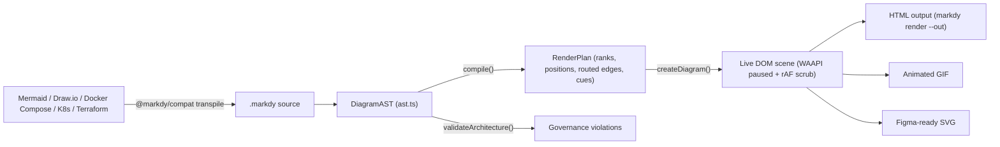
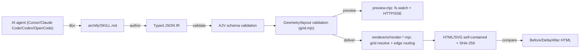

```mermaid
flowchart LR
    A["Go source (dsl package calls)"] --> B["codegen: compile+run temp Go program"]
    B --> C["eval.RunDSL() -> expr.Design"]
    C --> D["ModelizeDesign() -> mdl.Design"]
    D --> E["mdl serve: HTTP server + /data/model.json"]
    E --> F["webapp React + ELK.js layout (browser)"]
    F --> G["chromedp headless Chrome (mdl svg)"]
    G --> H["SVG POST về renderBroker"]
    H --> I["SVG file ghi ra -dir"]
```

```mermaid
flowchart LR
    A["Author code: plain Graph object"] --> B["createGraph() + structuredClone"]
    B --> C["normalizeGraph(): validateGraph() + defaults + stable edge IDs"]
    C --> D["ElkLayoutEngine.layout(): elkjs layered + ORTHOGONAL routing"]
    D --> E["flattenShapes/flattenEdges -> Scene (tọa độ tuyệt đối)"]
    E --> F["SvgRenderer.renderSvg(): shape + ARIA + theme CSS vars"]
    F --> G["SVG string output"]
    G -.->|browser only| H["mountSvgViewport / mountSvgInteraction"]
```

# Weekly Scan — Diagram Tooling (2026-08-28)

**Executive summary:**
- Tuần này nổi bật nhất là **markdy-com** — một đối thủ cạnh tranh gần như trực tiếp với kymostudio (DSL text → animated diagram qua Web Animations API), đáng đọc kỹ nhất vì kiến trúc pipeline `parse → DiagramAST → compile → RenderPlan → render` gần như song song với pipeline của kymostudio, và có bài học cụ thể về animation engineering (WAAPI paused + rAF scrub) cùng MCP server cho AI agent.
- **goadesign/model** vừa ra loạt release (v1.16.1–v1.16.10, 19-21/08) đáng chú ý gồm tính năng `mdl skill install` (cài agent-skill vào `.claude/skills/` / `.agents/skills/` của user) và một chuỗi fix về SVG headless export (canvas clipping, `<defs>`/arrowhead bị thiếu khi export standalone) — đúng class bug mà kiến trúc "server-side pure renderer" của kymostudio miễn nhiễm sẵn.
- **archify** (23.6k sao) và **orbweaver** (0 sao) là hai thái cực: archify có tín hiệu sao/star đáng ngờ (cần đọc phần red-flag trước khi tin số liệu popularity), còn orbweaver là project rất mới nhưng có kiến trúc ELK-based layout đáng học (tách biệt triệt để "semantic graph" khỏi "geometry").

**Mục lục**
1. [markdy-com](#1-hoangyellmarkdy-com)
2. [goadesign/model](#2-goadesignmodel)
3. [archify](#3-tt-a1iarchify)
4. [orbweaver](#4-semanticintentorbweaver)

---

## 1. HoangYell/markdy-com

### §1 — Quick context
MarkdyScript → animated diagram 60fps chạy thẳng trên trình duyệt bằng Web Animations API thay vì xuất file SVG tĩnh — khác biệt cốt lõi với kymostudio và Mermaid là output "sống" (live DOM), không phải file render sẵn. Tech stack: TypeScript, pnpm monorepo 10 packages (`core`, `renderer-dom`, `cli`, `mcp-server`, `compat`, `astro`, `mdx`, `language-server`, `stdlib-systems`, `vscode`), core ~14kB, test bằng vitest. Repo health: 84 sao, 3 fork, MIT, release rất dồn dập (v1.0.20→v1.0.30 chỉ trong 3 ngày 23-25/08/2026), CI 4 job (Quality/Test/DevTools E2E headless Chrome/Website) đều xanh. Distribution: npm (`@markdy/core`, `@markdy/cli`...), CLI global `markdy`, playground trên `markdy.com/playground`, VS Code extension published qua CI riêng.

### §2 — Architecture deep-dive
**A. Component inventory** — `packages/core/src/ast.ts` (định nghĩa `DiagramAST`), `parser.ts` (`parse()`), `compiler.ts` (`compile()`/`compilePlan()` — layout + scheduling), `router.ts` (orthogonal edge routing), `registry.ts` (bảng hằng số loại diagram/operator/cue), `arch-lint.ts` (governance rule engine), `themes.ts` (8 theme built-in), `diff.ts` (AST diffing cho evolution), `ai-healing.ts` (tự sinh repair-prompt cho LLM). `packages/renderer-dom/src/` chia theo loại diagram (`nodes.ts`, `edges.ts`, `sequence.ts`, `tree.ts`...) cộng `diagram.ts` là public API + vòng lặp `requestAnimationFrame`.

**B. Pipeline** — (1) user chạy `markdy render diagram.markdy --out out.html`; (2) `parse()` đọc source → `DiagramAST` (ném `ParseError` có số dòng nếu sai cú pháp); (3) `compile(ast)` gom edge, tính kích thước canvas thích ứng, chạy `layoutNodes()` (rank-based cho kiến trúc/flowchart, đo subtree đệ quy cho tree, đặt góc quỹ đạo cho loop/hub), lên lịch `beats`/`cues` → trả về `RenderPlan`; (4) `renderer-dom` build DOM scene sống (node `
`, `<svg>` edge overlay, animation WAAPI); (5) vòng lặp rAF set `anim.currentTime` thủ công mỗi frame; (6) CLI ghi HTML ra `--out`. Đường nhập universal (`markdy import --from mermaid|drawio|docker-compose|k8s|terraform`) transpile về MarkdyScript rồi đi lại từ bước (2).

**C. Data model/IR** — `DiagramAST` là plain TypeScript `type` (không phải class, không `readonly`) — cấu trúc mutable tương tự dataclass Python của kymostudio nhưng không có kỷ luật immutability ở type-level. Có khái niệm "compile xuống IR thấp hơn" rõ ràng: `DiagramAST` (chưa resolve vị trí) → `compile()` → `RenderPlan` (đã layout + route + schedule) — cùng triết lý hai tầng như kymostudio (`Diagram` → `layout()`/`resolve_alignments()`), chỉ khác là markdy gộp layout+alignment vào một hàm `compile()` duy nhất thay vì tách hai file như `layout.py`/`alignment.py`.

**D. Input language design** — Parser hand-rolled hybrid: tokenize theo dòng + strip comment → regex match statement cấp cao → xử lý kiểu recursive-descent cho block thụt lề (beat/pattern/group) → state machine nhỏ cho flow-chain (`FLOW_OP_RE`). Có cơ chế "indentation-recovery fallback" đáng chú ý (vì host MDX/JSX hay strip khoảng trắng đầu dòng). **Không có grammar hình thức** (EBNF/BNF) — `docs/SYNTAX.md` chỉ là prose + bảng ví dụ, khác hẳn `docs/DSL.md` của kymostudio vốn có EBNF chuẩn hóa dual-sourced với `dsl.py`. Error: `ParseError` có `line`/`column`, cộng `diagnostics[]` cho warning không-fatal.

**E. Layout algorithm** — Auto-layout theo rank (kiểu Sugiyama đơn giản hóa): `assignRanks()` lan truyền BFS-like theo hướng LR/RL/TB/BT, đặt x/y trong rank bằng "barycenter heuristic" tham chiếu vị trí cha, snap về lưới 4-unit. Có **18 loại layout riêng biệt** hand-written trong `registry.ts` (marketing nói "17 layout engines" — lệch 1, một dấu hiệu tài liệu marketing không khớp source of truth). Edge routing: `routeOrthogonalEdge()` chọn port rồi build waypoint Manhattan với margin cố định 20px. **Red flag quan trọng**: comment header của `router.ts` tự gọi là "collision-aware" nhưng code thực tế **không có logic phát hiện va chạm** với node khác — chỉ có margin cố định giữa 2 box được nối — mâu thuẫn trực tiếp với README/landing page.

**F. Rendering/output** — Backend chính: DOM + SVG overlay qua `createDiagram()`, không phải kiến trúc multi-emitter tách biệt như kymostudio (`to_svg.py`/`to_figma.py`/`to_excalidraw.py`/`to_webp.py` cùng ăn một IR). Có xuất phụ: `encodeGifSequence()` → GIF89a, `exportDiagramAsVectorSvg()` → SVG "Figma-ready". Animation: WAAPI, nhưng **cố tình không dùng playback native** — mọi animation tạo với `fill:"forwards"` rồi giữ paused vĩnh viễn, một vòng rAF tự set `anim.currentTime = sceneMs` mỗi frame để né 2 bug trình duyệt đã biết (paused animation không chuyển play-state đáng tin cậy qua `startTime`; `fill:"both"` gây animation tạo sau "thắng" cascade WAAPI ở before-phase). Đây là kỹ thuật đáng học nếu kymostudio từng làm target animated DOM/JS runtime.

**G. Extensibility** — `docs/ARCHITECTURE.md` có mục "Extension Points" liệt kê numbered recipe rõ ràng cho từng trục mở rộng (thêm node kind → sửa `system-vocabulary.ts`; thêm cue → sửa `registry.ts` + `ast.ts` + `compiler.ts` + `edges.ts`; thêm edge operator tương tự). Theming: 8 theme built-in + `theme-generator.ts` sinh theme lập trình được. Đặc biệt có **governance rule engine** (`arch-lint.ts`): 5 loại rule (cannot-connect, must-connect, forbidden-cycle, must-have-role, role-count-limit) với preset đặt tên sẵn (`cleanArchitecture`, `microservicesGovernance`) — kymostudio chưa có tương đương.

**H. Dev experience** — CLI phong phú: `lint`, `fmt`, `render`, `explain --json`, `import --from`, `diff --evolution`, `share` (nén state vào URL hash), `new`, `docs`, `ai` (in agent guide), `suggest`, `check-all`. VS Code extension riêng (`packages/vscode` + LSP package `markdy-language-server`) có CI publish riêng. Playground web tại `markdy.com/playground`. Không tìm thấy bằng chứng watch-mode/live-reload rõ ràng cho `render` command. AI-agent-first là điểm khác biệt thật sự: MCP server 8 tool (validate/diagnose/fix/transpile/explain/generate-prompt/catalog/intellicode) + 4 resource + `docs/AGENT.md` — sâu hơn hẳn so với những gì kymostudio hiện có.

### §3 — Architecture diagram

### §4 — Verdict
Điểm học được cụ thể: (1) kỹ thuật WAAPI-paused-scrub-bằng-rAF là lời giải đã kiểm chứng cho 2 bug trình duyệt cụ thể, đáng tham khảo trước nếu kymostudio làm target animated DOM; (2) format tài liệu "Extension Points" (numbered recipe theo từng trục mở rộng) là mẫu DX tốt kymostudio chưa có; (3) MCP server với validate/fix/explain tool là gap tính năng thật sự đáng cân nhắc cho kymostudio (vốn cũng là target dùng bởi AI agent). Red flag: nhãn "collision-aware" trên router không khớp code thực tế (không có collision detection), và số liệu "17 layout engines" lệch với registry thực (18) — nên nghi ngờ thêm các superlative khác trong README (ví dụ "zero runtime dependencies" chưa verify độc lập ở cấp package `core`). Câu hỏi mở: chưa xác nhận được số lượng contributor thực và liệu có crossing-minimization thật ngoài "barycenter heuristic". **Verdict: study deeper** — đây là đối thủ gần nhất về domain và có nhiều chi tiết kỹ thuật animation/DX đáng đọc code trực tiếp thay vì chỉ đọc báo cáo này.

---

## 2. goadesign/model

### §1 — Quick context
DSL viết bằng Go thật (không phải text DSL riêng) để mô tả kiến trúc theo C4 model, tương thích Structurizr — khác kymostudio ở chỗ "compile-and-run Go code" là cơ chế parse, không có lexer/parser riêng. Tech stack: Go 1.26 (CLI/DSL/model), TypeScript + React 19 + ELK.js 0.12.0 (webapp layout/render chạy trong browser), headless Chrome qua `chromedp` cho export. Repo health: 466 sao, 23 fork, MIT, CI xanh (static checks + Dependabot auto-merge), vừa có loạt 10 release liên tiếp trong 19-21/08/2026 (v1.16.1→v1.16.10). Distribution: `go install goa.design/model/cmd/mdl` và `cmd/stz`, không có binary release sẵn hay web app hosted.

### §2 — Architecture deep-dive
**A. Component inventory** — `dsl/` (bề mặt DSL công khai: `Person()`, `SoftwareSystem()`, `Uses()`, `Views()`...), `expr/` (IR tầng cao, mutable, được build trong lúc DSL eval — gồm cả `render.go` thực chất là view composition/filter logic, không phải graphics), `mdl/` (IR tầng thấp — `mdl.Design`/`mdl.Model`, JSON-serializable, `MarshalJSON` sort tên/ID để output ổn định), `codegen/json.go` (generate + compile + chạy một chương trình Go tạm để invoke `mdl.RunDSL()`), `cmd/mdl/` (CLI: `serve`/`svg`/`gen`/`skill install`/`watch`), `cmd/mdl/webapp/` (React+TS+ELK.js — nơi layout và render SVG thật sự xảy ra), `cmd/stz/` (CLI tích hợp Structurizr service).

**B. Pipeline** — Với `mdl svg PACKAGE`: (1) user viết Go package gọi `dsl` functions; (2) `codegen.JSON`-style generate+compile+run một chương trình Go tạm để lấy `expr.Design`; (3) `eval.RunDSL()` (multi-pass evaluator của Goa) build `expr.Design`; (4) `ModelizeDesign()` convert `expr.*` → `mdl.*`; (5) `mdl svg` khởi động HTTP server local + `renderBroker`, mở headless Chrome thật qua `chromedp`, navigate vào server; (6) webapp React chạy **ELK.js trong trình duyệt** để layout, serialize ra chuỗi SVG, POST ngược về broker; (7) CLI ghi SVG ra `-dir`. `mdl serve` thì mở editor tương tác cho user tự mở trình duyệt, có `/data/save` để persist layout chỉnh tay.

**C. Data model/IR** — Hai tầng: `expr.Design` (build trong lúc eval, mutable, theo mô hình Prepare→Walk→Validate→Finalize kinh điển của Goa) và `mdl.Design` (output tầng thấp, gần như immutable snapshot, có `MarshalJSON` custom để đảm bảo thứ tự output xác định). Không tìm thấy layout-IR ở phía Go — vị trí layout sống trong `/data/layout.json` do phía browser (ELK.js) sở hữu, không có struct Go tương ứng trong `pkg/`/`expr/`/`mdl/`.

**D. Input language design** — Không phải text DSL: "source" là code Go thật, compiler Go chính là "parser". Không có grammar hình thức (`DSL.md` chỉ dẫn bằng ví dụ code + GoDoc). Error reporting dựa vào lỗi compile Go cộng cơ chế validate tích lũy lỗi của package `eval` (Goa) — chưa xác nhận được format message chính xác.

**E. Layout algorithm** — Auto-layout qua ELK.js (đã migrate từ Dagre.js sang ELK.js v0.10.0 rồi lên 0.12.0), chạy **phía browser**, không phải Go. Release v1.16.2 thêm content-based node sizing + bảo toàn nhóm ownership lồng nhau khi re-layout (để boundary hệ thống không bị vỡ). v1.16.3/v1.16.4 thêm pass đặt label quan hệ tránh va chạm node/label khác — đây là logic bespoke đắp thêm sau ELK, không phải tính năng có sẵn của ELK. v1.16.6 tách rõ 2 đường đi hoàn toàn riêng cho auto-layout và layout chỉnh tay, có validate trước khi vẽ/lưu (trước đó có thể chấp nhận layout dở dang một cách âm thầm). Không có bằng chứng cụ thể về cấu hình crossing-minimization của ELK.

**F. Rendering/output** — Chỉ có SVG (không PNG/PDF/WebP). Rendering **xảy ra trong trình duyệt thật** (React app trong Chrome headless do `chromedp` điều khiển), Go CLI chỉ đóng vai trò điều phối — khác hẳn kiến trúc server-side thuần của kymostudio. Model có hỗ trợ "AnimationStep" (`modelizeAnimationSteps()`) — metadata cho viewer tương tác duyệt tuần tự, **không phải** xuất file SVG animated như target `--animate` của kymostudio. Loạt fix v1.16.4-v1.16.8 đáng chú ý: v1.16.7 sửa canvas bị clip khi export standalone, v1.16.8 sửa `<defs>`/arrowhead bị thiếu khi export headless riêng lẻ (đúng class bug "shared page chrome rò vào export tưởng standalone" mà CLAUDE.md của kymostudio đã tự nêu và có golden-SVG test để chặn), v1.16.5 tách cổng LiveReload để editor đang mở không làm gián đoạn render headless đang chạy.

**G. Extensibility** — Style/theme qua `Styles(){ ElementStyle(tag){...} }` gắn tag → màu/shape, định nghĩa ngay trong code Go. Không tìm thấy hệ icon-library pluggable như `icons/` + `icons.py`/manifest của kymostudio. Không có bằng chứng về pluggable-renderer/format-plugin ngoài tích hợp plugin Goa framework (chưa verify độc lập).

**H. Dev experience** — CLI: `mdl serve|gen|svg|skill install|watch`, `stz gen|put|get`. Watch mode thật: `cmd/mdl/watch.go` dùng `fsnotify`, debounce 100ms, kích hoạt LiveReload server bundled sẵn (`lrserver`). `mdl serve` mở editor đồ họa tương tác thật trong browser, round-trip chỉnh tay layout về `/data/save`. Không có VS Code extension riêng.

### §3 — Architecture diagram

### §4 — Verdict
Đáng học nhất tuần này: tính năng `mdl skill install` — embed một `SKILL.md` (`//go:embed`) rồi ghi vào repo **của user** tại đường dẫn quy ước theo từng agent (`.claude/skills/...` cho Claude Code, `.agents/skills/...` cho Cursor/Codex), detect agent đang dùng qua cả config-dir lẫn executable trên PATH, và **từ chối ghi đè im lặng** nếu file đã bị sửa tay (báo lỗi yêu cầu `-force`). Đây là pattern rẻ, hiệu quả cao mà kymostudio có thể copy gần như nguyên bản (`kymo skill install` dạy agent các invariant riêng của kymostudio: region auto-bounds, khi nào `layout{}` áp dụng, golden-SVG byte-exact, Python là reference impl cho conformance). Loạt fix SVG headless export (v1.16.4-v1.16.8) là bằng chứng gián tiếp xác nhận kiến trúc server-side-pure của kymostudio (không phụ thuộc browser/Chrome) là lợi thế thật, không phải lý thuyết suông — nên nêu thẳng điều này trong so sánh cạnh tranh. Red flag: rendering phụ thuộc Chrome/Chromium thật qua `chromedp` — bất lợi về portability/CI so với `kymostudio-core` (resvg, không phụ thuộc runtime ngoài). Câu hỏi mở: không xác định được số contributor thực; không có bằng chứng xuất animated-SVG file thật (chỉ có animation-step metadata cho viewer). **Verdict: study deeper**, riêng cho phần `skill install` — nên đọc trực tiếp `cmd/mdl/skill.go` và cân nhắc port ý tưởng.

---

## 3. tt-a1i/archify

### §1 — Quick context
Không phải renderer/library độc lập mà là **agent skill**: cài vào Cursor/Claude Code/Codex CLI/OpenCode để AI agent tự author JSON đã type-hoá, rồi Node CLI validate và compile deterministic ra HTML/SVG self-contained (5 loại: architecture, workflow, sequence, data-flow, lifecycle) — khác biệt cốt lõi là không có DSL text, "author" là chính AI agent viết JSON theo schema. Tech stack: Node.js ≥18, `.mjs` thuần không framework, AJV (draft 2020-12, compile sẵn validator để không cần network runtime), parse5, saxes. Repo health: 23.6k sao, 1.5k fork nhưng **chỉ 98 watcher** (~0.4% — bất thường thấp so với repo nhiều sao thật), 181 commit, 2 contributor theo Trendshift (mâu thuẫn với 6 tác giả commit khác nhau xuất hiện trong lịch sử gần đây), release đầu tiên (v2.0.0) chỉ mới 15/04/2026 và là fork/rewrite của `Cocoon-AI/architecture-diagram-generator`. Sao tăng vọt gần như hoàn toàn trong 3 tuần trending (Trendshift #14 ngày 08/08 → GitHub Trending #1 ngày 26/08), chỉ 23 issue/18 PR mở — tỉ lệ không tương xứng với 23.6k sao. **Đánh giá: nhiều khả năng có yếu tố thao túng sao (bought/bot stars), không nên trích dẫn số sao như bằng chứng market validation mà không kèm cảnh báo này.** Distribution: cài qua `npx skills add tt-a1i/archify -g` hoặc copy vào thư mục skill của từng agent tool, không có evidence npm-publish package chuẩn (root `package.json` trả 404).

### §2 — Architecture deep-dive
**A. Component inventory** — `archify/SKILL.md` (tài liệu hướng dẫn agent), `archify/schemas/*.schema.json` (5 schema theo loại diagram + `common.schema.json` dùng chung), `archify/renderers/{architecture,workflow,sequence,dataflow,lifecycle,shared}/` (một renderer module riêng mỗi loại diagram + utility dùng chung — đã đọc `render-architecture.mjs` và `grid.mjs`), `archify/delta/architecture-delta.mjs` (tính năng so sánh Before/Delta/After), `archify/bin/archify.mjs` (CLI entry: `doctor/demo/guide/validate/preview/deliver/compare`), `archify/bin/preview.mjs` (live preview server), `archify/bin/visual-check.mjs` (kiểm tra chất lượng ảnh xuất tự động).

**B. Pipeline** — (1) agent AI đọc `SKILL.md`; (2) agent tự viết file JSON theo schema (`schema_version`, `diagram_type`, `meta`, mảng cấu trúc như `components`/`connections`); (3) chạy `validate <type> <file.json>` — AJV kiểm schema (`additionalProperties: false` chặt), cộng lớp validate riêng về hình học/chất lượng layout trong renderer (kiểm crossing/flow/border/rhythm); (4) tùy chọn `preview` mở server local với SSE để xem live; (5) `deliver` đóng băng spec, gọi renderer module tương ứng emit HTML self-contained kèm SHA-256 checksum; (6) `visual-check.mjs` chạy bộ "9 artifact checks" trước khi coi là đạt chuẩn, luôn yêu cầu review bằng mắt người thêm; (7) tùy chọn `compare` sinh HTML Before/Delta/After.

**C. Data model/IR** — JSON Schema chặt (`additionalProperties: false`), validate bằng AJV compile sẵn (không cần mạng lúc runtime). IR là JSON tĩnh thuần, không có API mutate — `deliver` coi input là frozen, không có object model/class hierarchy lộ ra cho agent; schema chính là contract. Hai lớp validate riêng biệt: schema-level (AJV) và renderer-internal (hình học/chất lượng).

**D. Input language design** — **Không có text DSL.** README xác nhận rõ input là "typed JSON... không phải domain-specific language dạng text". SKILL.md cho phép agent nhận yêu cầu ngôn ngữ tự nhiên hoặc Mermaid dán vào làm prompt khởi đầu, nhưng artifact thật sự agent phải viết và tool thật sự tiêu thụ là JSON theo schema.

**E. Layout algorithm** — Phát hiện quan trọng nhất: **không có thuật toán auto-layout graph nào trong code** (không dagre/ELK/force-directed/constraint solver). `grid.mjs` chỉ là bộ resolver tọa độ lưới cố định: `origin + (row/col) × (cellSize+gap)` từ `row`/`col` đã có sẵn trong JSON do agent tự đặt — không tự động sắp xếp/tránh chồng lấp; `validateGridPlacement()` chỉ báo lỗi cấu hình (index ngoài biên, trùng ô). "Layout judgment" trong copy marketing thực chất nói về **việc chính AI agent quyết định x/y lúc author**, theo quy tắc cứng trong `SKILL.md` ("never accept edge crossings/label collisions/overflow"), không phải thuật toán bên trong Archify — công cụ chỉ validate/reject phán đoán đó. Ngược lại, **edge routing thật sự có nội dung đáng kể**: nhiều chiến lược route (thẳng/orthogonal-h/orthogonal-v/automatic), sinh candidate path theo hướng cổng nối, kiểm tra obstacle-clearance, và các detector chuyên biệt cho crossing/flow/border/rhythm problem.

**F. Rendering/output** — HTML self-contained (SVG inline + JSON embed + CSS/animation) là artifact chính. README/SKILL.md còn nhắc PNG/SVG/WebM/"share card" 1200×630 nhưng có vẻ là export phía client từ HTML đã deliver, không verify được code export riêng. Animation: CSS/SVG-native, `animateAttr()` chèn animation attribute có điều kiện theo `meta.animation` ("trace" = có chuyển động) — về tinh thần gần giống cách kymostudio dùng CSS-class-driven animation, dù archify tách riêng theo từng loại diagram thay vì dùng chung renderer. Không có plugin/extension API để thêm loại diagram mới — mỗi loại là một renderer module riêng.

**G. Extensibility** — Thêm loại diagram mới đòi hỏi thêm schema + renderer module hoàn toàn mới + wiring CLI thủ công — friction cao, không phải extension point khai báo. Theming: đúng 4 preset cố định (`classic`, `signal-flow`, `blueprint`, `editorial`) trong enum đóng của schema, cộng dark/light toggle. Không có registry plugin, custom-shape API hay cơ chế icon-library mở rộng.

**H. Dev experience** — CLI: `doctor/demo/guide/validate/preview/deliver/compare`. Watch mode/live preview thật: `preview.mjs` dùng `fs.watch()` + polling fallback, HTTP server local với SSE stream `/events` cho hot update — pattern dependency-free đáng học cho `kymo watch` nếu kymostudio muốn có lệnh tương tự. Phân phối chủ yếu qua cài "skill" trực tiếp vào từng agent tool, không có playground web hosted (khác `kymo.studio/app/`).

### §3 — Architecture diagram

### §4 — Verdict
Đáng học thật sự nếu bỏ qua vấn đề sao: (1) ngôn ngữ ràng buộc cho agent trong `SKILL.md` (quy tắc cứng "never accept edge crossings/label collisions/overflow", trả repair suggestion máy đọc được thay vì stack trace) là mẫu hợp đồng tốt cho input do LLM sinh ra — đáng cân nhắc nếu kymostudio muốn câu chuyện "sinh `.kymo` bằng LLM agent"; (2) lớp validator edge-routing (crossing/border/rhythm problem detector) là named quality gate rõ ràng mà pipeline `alignment.py`/`to_svg.py` của kymostudio hiện chưa có tương đương tường minh; (3) tính năng Before/Delta/After compare là khác biệt kymostudio chưa có. Red flag (nhắc lại, đã nêu ở §1): tỉ lệ sao/watcher/commit/contributor bất thường, sao tăng vọt trong cửa sổ trending 3 tuần trên repo mới ~4.5 tháng tuổi và là fork của project khác — **không nên coi số sao là tín hiệu độ trưởng thành**. Câu hỏi mở: chưa xác nhận được star-history timeline trực tiếp; chưa rõ archify (unscoped) có publish npm chính thức hay chỉ phân phối qua skill-zip. **Verdict: glance only cho phần "sản phẩm"/độ phổ biến (vì tín hiệu sao không đáng tin), nhưng study deeper cho riêng phần edge-routing validator và ngôn ngữ ràng buộc agent trong SKILL.md** — hai phần này có giá trị kỹ thuật độc lập với vấn đề sao ảo.

---

## 4. semanticintent/orbweaver

### §1 — Quick context
Triết lý cốt lõi: "Authors declare meaning. Orbweaver owns geometry." — author khai báo entity/relationship thuần (không tọa độ), thư viện tự động suy ra layout bằng ELK (Eclipse Layout Kernel qua elkjs) và render ra SVG có accessibility markup. Tech stack: TypeScript, ESM-only, Node ≥20, phụ thuộc runtime duy nhất là `elkjs ^0.12.0`. Repo health: 0 sao, 32 commit, phiên bản `0.2.0-alpha.4`, CI đơn giản (1 job: typecheck + vitest + build + browser-bundle check) — xác nhận đây là project rất mới, gần như chưa có cộng đồng. Distribution: chỉ qua npm (`@semanticintent/orbweaver`), không có `bin` field → thuần thư viện, không CLI; có playground/gallery hosted tại `orbweaver.semanticintent.dev` (chưa verify độc lập vì chỉ đọc doc mô tả, không browse trực tiếp).

### §2 — Architecture deep-dive
**A. Component inventory** — `src/model/types.ts` (IR chính: `Graph`, `Node`, `Edge`, `Group`, `Annotation`), `src/model/{create,clone,normalize}.ts` (`createGraph()`, `cloneGraph()` dùng `structuredClone`, `normalizeGraph()` validate + set default), `src/validation/validate.ts` (`validateGraph()` trả `{valid, errors, warnings}`), `src/graph/queries.ts` (query semantic read-only), `src/layout/elk.ts` (`ElkLayoutEngine` — adapter ELK), `src/layout/sizing.ts` (`estimateNodeSize()` ước lượng kích thước node xác định trước khi đưa cho ELK), `src/scene/types.ts` (IR hình học `Scene`), `src/render/svg.ts` (`SvgRenderer`/`renderSvg()`), `src/theme/{types,defaults}.ts` (theme), `src/accessibility/summarize.ts` (`summarizeGraph()` sinh mô tả cho `<desc>`), `src/interaction/{controller,inspection,viewport}.ts` (helper DOM: chọn, inspect, pan/zoom), `src/proposal/{schema,validate}.ts` (JSON Schema `GraphProposal` cho input từ AI agent, giới hạn 1MiB/250 node/500 edge).

**B. Pipeline** — (1) author viết object `Graph` thuần (nodes/edges/groups, không tọa độ); (2) `createGraph()` → `cloneGraph()` deep-copy qua `structuredClone`, chưa validate; (3) `renderGraph()`/`layoutGraph()` gọi `normalizeGraph()` — validate bên trong, ném `GraphValidationError` nếu sai, set default `edge.direction`, sinh `edge.id` ổn định; (4) khởi tạo `ElkLayoutEngine`, build cây `ElkNode` (group lồng thành container ELK), gọi `elk.layout()`; (5) `flattenShapes`/`flattenEdges` gộp tọa độ nested ELK thành `Scene` tọa độ tuyệt đối phẳng, ném `LayoutError` nếu thiếu/không hợp lệ tọa độ nào; (6) `renderSvg(scene)` duyệt `Scene` (vẫn giữ back-reference đến `NormalizedGraph`) emit chuỗi SVG: stylesheet, `<title>`/`<desc>`, shape theo loại node, path edge có marker, group; (7) tùy chọn trong browser, `mountSvgInteraction`/`mountSvgViewport` gắn tương tác chọn/pan/zoom vào SVG DOM.

**C. Data model/IR** — Hai IR tách biệt rõ rệt ở type-level: `Graph` (authoring, không tọa độ, không dimension) → `NormalizedGraph` (đã validate, edge có `id`/`direction` bắt buộc, `docs/architecture.md` gọi đây là "immutable internal/publicly readable representation") → `Scene` (geometry: `{width, height, nodes/edges/groups đã có x/y/width/height}`, vẫn giữ field `graph` trỏ về `NormalizedGraph` — thiết kế cố ý để "rendering không bao giờ tái tạo lại ý nghĩa từ hình học"). Mọi bước dùng `structuredClone` nên về hiệu quả là pipeline immutable/functional dù kiểu dữ liệu là interface thường.

**D. Input language design** — **API lập trình, không phải text DSL.** Không tìm thấy file grammar, parser, hay định dạng source tùy biến nào — author dựng object TypeScript (cũng là JSON hợp lệ) rồi gọi `createGraph()`. Có "ngôn ngữ" thứ hai riêng cho input AI: `GraphProposal` — JSON Schema có version, validate bằng `validateGraphProposal()` với giới hạn kích thước rõ ràng. Error reporting: `validateGraph()` trả structured diagnostics (severity/code/message/entity reference) thay vì throw ngay; `normalizeGraph()` mới throw `GraphValidationError` mang theo list lỗi đó; `ElkLayoutEngine` bọc lỗi ELK/tọa độ thiếu vào `LayoutError` với message mô tả cụ thể.

**E. Layout algorithm** — ELK.js (`elkjs/lib/elk.bundled.js`), thuật toán cố định `'elk.algorithm': 'layered'` (kiểu Sugiyama) — không thấy config `force`/`stress`/`mrtree` nào khác, không expose cho author chọn. `'elk.edgeRouting': 'ORTHOGONAL'` cố định (không spline/bezier/polyline). `'elk.hierarchyHandling': 'INCLUDE_CHILDREN'` — group lồng thành container ELK, layout toàn bộ hierarchy trong một pass. **Điểm đáng chú ý nhất**: `'elk.layered.crossingMinimization.forceNodeModelOrder': 'true'` kết hợp `considerModelOrder.strategy: 'NODES_AND_EDGES'` — **cố tình ép thứ tự node theo đúng thứ tự khai báo trong input, ghi đè/tắt hẳn heuristic crossing-minimization gốc của ELK** để đổi lấy tính xác định (deterministic), chấp nhận đánh đổi có thể nhiều crossing hơn mức tối ưu. Kích thước node được tự tính trước (`estimateNodeSize()`, ước lượng xác định, không đo DOM text) rồi mới đưa cho ELK — ELK chỉ đặt vị trí, không tự đo leaf node.

**F. Rendering/output** — **Chỉ SVG**, không canvas/PNG/PDF khác. Accessibility là first-class: root `<svg>` có `role="img" aria-labelledby`, `<title>`/`<desc>` (fallback về `summarizeGraph()` tự sinh nếu author không cung cấp), node có `aria-label`, `role="list"/"listitem"/"group"` — accessibility dựa trên DOM/ARIA thật, không chỉ contrast màu. Animation: **không có** animation diagram thật (không SMIL/`<animate>`/`@keyframes`) — chỉ có CSS `transition` 0.16s cho hover/focus/select, gated sau `prefers-reduced-motion` — khác biệt rõ với target `--animate` của kymostudio (cần sửa lại nếu ai nhầm tưởng orbweaver có animated SVG). Renderer: interface `LayoutEngine` pluggable thật (`{id, layout(graph, options)}`, có thể swap `ElkLayoutEngine`), nhưng phía render chỉ có `SvgRenderer` duy nhất dù có interface `Renderer<TOutput>` tổng quát.

**G. Extensibility** — `Node.type`/`Edge.type` là string tự do, không enum/registry — type lạ vẫn render được qua shape generic mặc định (fallback graceful theo thiết kế). Shape cố định hard-code trong `renderNode()` (diamond cho decision, folded-corner cho document, cylinder cho database...) — không có `registerShape()` hay plugin registry để thêm shape mới thật sự. Theming qua object `OrbweaverTheme` (màu/typography/geometry) swappable mỗi lần render — extension point thật. Layout engine swappable qua interface nhưng chỉ có 1 implementation (`ElkLayoutEngine`) tồn tại trong repo.

**H. Dev experience** — Không có CLI (không `bin` field) — thuần thư viện gọi từ code Node/TS. Không IDE integration (hợp lý vì không có text DSL cần language service). Có script build showcase tĩnh (`examples/generate-showcase.mjs` → gallery HTML) và `examples:serve` để xem local. Playground/gallery hosted có tích hợp WebMCP cho ChatGPT (6 tool qua `document.modelContext?.registerTool`, hoàn toàn client-side, không cần API key) — chưa browse trực tiếp để xác nhận hoạt động thật.

### §3 — Architecture diagram

### §4 — Verdict
Đáng học nhất là cách orbweaver tách triệt để "semantic IR" (`Graph`, không tọa độ) khỏi "geometry IR" (`Scene`, có tọa độ nhưng vẫn giữ back-reference tới graph gốc) thành hai type export riêng biệt, có invariant tài liệu hóa tường minh ("rendering never reconstructs meaning from geometry"). kymostudio hiện gộp cả hai vào chung dataclass `Component`/`Region`/`Edge` (đã mang tọa độ resolved sau `alignment.py`) — nếu tương lai kymostudio muốn có "diagram model không tọa độ" cho use-case khác (ví dụ feed sang layout backend khác), pattern tách type của orbweaver đáng tham khảo. `src/layout/elk.ts` (~180 dòng) là reference ngắn gọn, dễ đọc cho cách tích hợp elkjs: build cây `ElkNode` với layoutOptions string, gọi `elk.layout()`, flatten tọa độ nested về tuyệt đối — nếu kymostudio từng cân nhắc dùng ELK cho một số loại diagram graph-dày thay vì alignment resolver tự viết, đây là điểm khởi đầu cụ thể. Lựa chọn `forceNodeModelOrder: true` minh họa rõ: "auto layout" qua ELK vẫn cần override option thủ công để có output dự đoán được, không phải hộp đen "cho ra diagram đẹp" ngay lập tức. Red flag: routing chỉ orthogonal, thuật toán chỉ layered — hẹp hơn hẳn khả năng thật của elkjs; hoàn toàn không có CLI/text DSL/IDE tooling nên không so sánh ngang hàng về DX với kymostudio (một `.kymo` text DSL + CLI); nhiều file doc kiểu `ORBWEAVER_BIOMIMICRY.md` gợi ý đây là project cá nhân/thử nghiệm hơn là OSS đã cứng cáp. Câu hỏi mở: chưa browse trực tiếp playground/gallery hosted; chưa đọc `docs/adr/` để biết liệu `force`/`stress` ELK algorithm có từng được cân nhắc rồi loại bỏ. **Verdict: study deeper riêng phần `src/layout/elk.ts`** (tham khảo kỹ thuật, không phải đối thủ cạnh tranh do quá sớm và thiếu DX layer).
