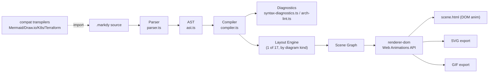
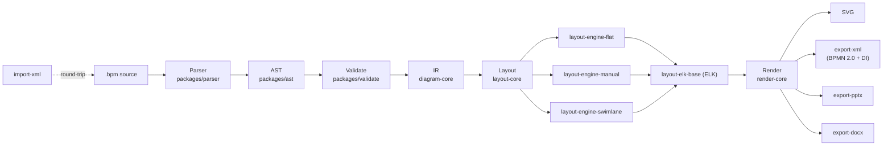
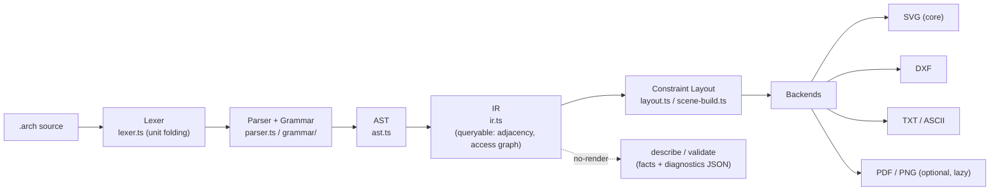

# Weekly Diagram-Tooling Scan — 2026-08-29

Phạm vi: repo GitHub trong domain diagram-as-code / visual-tooling được publish hoặc cập nhật đáng kể trong khoảng 2026-08-22 → 2026-08-29. Nguồn: GitHub repository search (query theo `topic:` + `pushed:>`) và WebFetch trực tiếp README/source tree của từng repo — không có claim kiến trúc nào không kèm bằng chứng fetch được; chỗ thiếu bằng chứng ghi rõ "không xác định".

## Tóm tắt (executive summary)

- Tuần này nổi bật nhất là **markdy-com** — một DSL diagram-as-code compile ra **animated SVG/DOM** gần như cùng bài toán với kymostudio (kymostudio cũng có `--animate`), đáng để soi kỹ nhất trong 4 repo vì choreography model ("beats") và 17 layout engine chuyên biệt là hướng kymostudio chưa đi.
- Hai repo BPMN — **bpmn-generator** (Stieges) và **diagram-as-code** (IntentGraphs) — cho thấy hai cách khác nhau để giải cùng bài toán mà kymostudio đã có (`from_bpmn.py`/`from-bpmn.ts`): một dùng ELK Sugiyama layout tách biệt hoàn toàn khỏi validation, một dùng package-per-diagram-family monorepo cực kỳ chi tiết (25 packages).
- **archlang** không cùng domain (floor-plan DSL, không phải software diagram) nhưng đáng học nhất về **DX của compiler**: diagnostics không throw, luôn trả JSON có byte-span + fix tự động — một pattern kymostudio's `dsl.py` parser hiện chưa có (kymostudio hiện "collects elements, validates nothing" ở parse time).

## Mục lục

1. [markdy-com (HoangYell)](#1-markdy-com-hoangyell)
2. [diagram-as-code (IntentGraphs)](#2-diagram-as-code-intentgraphs)
3. [bpmn-generator (Stieges)](#3-bpmn-generator-stieges)
4. [archlang (ChanMeng666)](#4-archlang-chanmeng666)

---

## 1. markdy-com (HoangYell)

`https://github.com/HoangYell/markdy-com`

### §1 — Quick Context

DSL "MarkdyScript" compile diagram kiến trúc tĩnh thành **animation 60fps chạy bằng Web Animations API trên DOM** (không phải Canvas/GSAP), khác kymostudio ở chỗ animation là cơ chế trình bày chính chứ không phải một target renderer phụ. Tech stack: TypeScript thuần, zero runtime dependency ở core (`@markdy/core` ~14kB minzip); output SVG + GIF + HTML/DOM động. Repo health: 84 stars, 3 forks, MIT, 494 commit trên `main`, CI badge có (GitHub Actions), pnpm monorepo 8 package. Phân phối: npm (`@markdy/cli`, `@markdy/mcp-server`, `@markdy/language-server`, `@markdy/astro`, `@markdy/mdx`...) — không có bản build binary/PyPI.

### §2 — Architecture Deep-Dive

**A. Component inventory** (từ `packages/core/src/`, xác nhận qua WebFetch tree listing):
- `Parser` (`packages/core/src/parser.ts`) — parse MarkdyScript text.
- `AST` (`packages/core/src/ast.ts`) — cây cú pháp trung gian.
- `Compiler` (`packages/core/src/compiler.ts`) — biến AST đã parse thành output/scene structure.
- `Classifier` (`packages/core/src/classifier.ts`) — phân loại phần tử (không rõ chi tiết — không xác định).
- `SyntaxDiagnostics` (`packages/core/src/syntax-diagnostics.ts`) — báo lỗi cú pháp.
- `ArchLint` (`packages/core/src/arch-lint.ts`) — validate pattern kiến trúc.
- `Router` (`packages/core/src/router.ts`) — điều hướng luồng dữ liệu qua các layout engine (suy luận từ tên file — không xác định chi tiết cơ chế).
- `Player` (`packages/core/src/player.ts`) — engine phát lại animation (đối chiếu block `player:` trong DSL example).
- Renderer riêng ở package khác: `@markdy/renderer-dom` (Web Animations API, GIF/SVG export) — tách biệt hoàn toàn khỏi `core`, đúng kiểu pipeline "front-end (parse) tách khỏi back-end (render)" mà CLAUDE.md của kymostudio cũng theo.
- `@markdy/compat` — transpiler nhập từ Mermaid, Draw.io, Kubernetes, Terraform, Docker Compose (evidence: README, chưa fetch source cụ thể).
- `@markdy/language-server` — LSP riêng biệt.

**B. Pipeline** (suy ra từ CLI usage documented + cấu trúc package):
1. User chạy `npx @markdy/cli render system.markdy --out scene.html`.
2. `@markdy/core` parse `.markdy` → AST (`parser.ts` → `ast.ts`).
3. `compiler.ts` compile AST → validate qua `arch-lint.ts`/`syntax-diagnostics.ts`, resolve 1-trong-17 layout engine theo `layout LR`/kind của diagram (suy luận từ ví dụ DSL "layout LR").
4. Kết quả layout được đưa qua `router.ts`/scene builder để tạo ra scene graph có tọa độ + choreography beats.
5. `@markdy/renderer-dom` nhận scene graph, dùng Web Animations API render 60fps, xuất `scene.html` (DOM động) hoặc export tĩnh SVG/GIF.
6. File output xuất hiện tại đường dẫn `--out`.

**C. Data model/IR**: không xác định chi tiết cấu trúc (class/dataclass/plain object) — chỉ biết có AST tường minh (`ast.ts`) đứng giữa parse và compile, và một "scene" concept ở renderer layer đóng vai trò IR thấp hơn cho animation (tên file gợi ý nhưng nội dung chưa fetch được).

**D. Input language design**: cú pháp dòng-lệnh khai báo, không phải regex line-based đơn giản — có block nesting (`beat main: ... `), operator hướng luồng (`->`, `<-`, `~>` cho request/response/event), inline label bằng chuỗi kép, và block cấu hình lồng nhau (`player: playback: loop true`) — gần với YAML-block hơn EBNF tuyến tính. Không có file `.ebnf`/`.bnf` xác nhận được qua fetch — không xác định formal grammar có tồn tại hay không. Error reporting: có module `syntax-diagnostics.ts` riêng, `@markdy/language-server` cho phép báo lỗi real-time trong IDE (LSP).

**E. Layout algorithm**: **17 layout engine chuyên biệt theo diagram-kind** (sequence, flowchart, tree, state, layers, nested, swimlane, pyramid, quadrant, medallion, timeline, gantt, flywheel, constellation, radar, venn — tổng 17 theo README) thay vì một engine tổng quát — đây là điểm khác biệt lớn nhất so với kymostudio (một `layout.py`/`alignment.py` dùng chung mọi diagram-kind). Edge routing: "collision-aware orthogonal Manhattan routing" + "rank-based auto-layout" — orthogonal, không phải spline. Không xác định thuật toán crossing-minimization cụ thể (không có bằng chứng Sugiyama/barycentric được nêu tên).

**F. Rendering/output**: renderer chính là DOM + Web Animations API (không SVG animation qua CSS/SMIL) — cơ chế animation riêng biệt hoàn toàn so với cách kymostudio làm animate (`to_svg.py --animate`, dùng SVG/CSS). Có export tĩnh sang SVG và GIF. Pluggable qua package riêng (`renderer-dom` là 1 trong khả năng nhiều renderer, nhưng hiện chỉ thấy 1 renderer công khai).

**G. Extensibility**: `@markdy/compat` là điểm mở rộng cross-format (import từ 5 định dạng khác), 8 theme sẵn có (paper, editorial, terminal, midnight, blueprint, sketchy, nebula, graphite) — theme là first-class concept qua `themes.ts`/`theme-generator.ts`. Không xác định plugin API công khai cho layout engine mới.

**H. Dev experience**: CLI với `lint`, `render`, `diff`, import universal; LSP + Astro/MDX framework integration cho preview trong docs site; MCP server cho AI agent (Claude/Cursor) — đây là hạng mục DX mạnh nhất trong 4 repo tuần này, vượt xa kymostudio hiện tại (kymostudio chưa có LSP/MCP server).

### §3 — Architecture Diagram



### §4 — Verdict

Ba ý đáng học cho kymostudio: (1) **choreography-as-syntax** — `beat` block với `stagger=80ms` là cú pháp animation khai báo gọn hơn cách kymostudio hiện expose animate (nếu có cấu hình timing, đáng xem cách markdy neo animation vào cùng cấu trúc DSL thay vì flag CLI riêng); (2) **layout-engine-per-diagram-kind** (17 engine) đối lập triết lý "renderer dumb, data thay đổi" của kymostudio — không nhất thiết nên bắt chước (tăng maintenance surface rất nhiều) nhưng đáng note vì nó giải quyết được vấn đề "layout chung không tối ưu cho gantt/radar/venn" mà kymostudio's `layout.py` (auto-layout frame chung) có thể gặp; (3) **compat transpiler package tách riêng** (`@markdy/compat`) là mô hình sạch cho việc kymostudio thêm import Mermaid/Terraform sau này mà không phình `dsl.py`.

Red flag: không có bằng chứng test coverage cụ thể (CI badge có nhưng không xác định coverage %); "zero dependency" core nhưng renderer/compat có thể kéo dependency riêng — không xác định rõ ranh giới. Câu hỏi mở: DOM/WAAPI renderer có xuất được static SVG animate (SMIL/CSS) để nhúng vào README như kymostudio làm không, hay bắt buộc cần JS runtime? Verdict: **study deeper** — cùng bài toán animated-diagram-as-code với kymostudio, đáng đọc source `compiler.ts` + `renderer-dom` đầy đủ ở lần sau.

---

## 2. diagram-as-code (IntentGraphs)

`https://github.com/IntentGraphs/diagram-as-code`

### §1 — Quick Context

Nền tảng diagram-as-code "text-first" tập trung vào **BPMN + multi-family diagramming** (flowchart, mindmap, Gantt) với validation xác định (deterministic) và export PowerPoint/DOCX có thể chỉnh sửa được — khác biệt chính so với kymostudio/Mermaid: xuất PPTX *editable* (không phải ảnh nhúng) là tính năng hiếm. Tech stack: TypeScript, npm workspaces monorepo (25 package con), Node.js. Repo health: 0 star, 0 fork, MIT, tạo **2026-08-23** (mới nhất trong batch, mới hoàn toàn), 12 PR mở, có `.github/` (CI chưa xác nhận nội dung workflow cụ thể). Phân phối: **chưa publish lên npm** — README tự nêu rõ "not published to npm yet"; editor local-first dùng IndexedDB trong browser.

### §2 — Architecture Deep-Dive

**A. Component inventory** — repo là monorepo tách rất mịn theo package (xác nhận qua WebFetch listing `packages/`), phản ánh triết lý "mỗi diagram-family/layout-strategy/export-target là 1 package":
- `Parser` (`packages/parser`) — DSL text → syntax tree.
- `AST` (`packages/ast`) — abstract syntax tree.
- `LayoutCore` (`packages/layout-core`) + `Layout` (`packages/layout`) — orchestration layout chung.
- `LayoutElkBase` (`packages/layout-elk-base`) — tích hợp ELK (giống Stieges/bpmn-generator, cùng dùng ELK làm nền).
- `LayoutEngineFlat` / `LayoutEngineManual` / `LayoutEngineSwimlane` (`packages/layout-engine-*`) — 3 chiến lược layout khác nhau plug vào layout-core.
- `DiagramCore` (`packages/diagram-core`) + biến thể theo họ diagram: `diagram-architecture`, `diagram-flowchart`, `diagram-gantt`, `diagram-mindmap`.
- `RenderCore` (`packages/render-core`) + `Render` (`packages/render`) — SVG renderer.
- `ExportPptx` / `ExportDocx` / `ExportDrawio` / `ExportXml` (`packages/export-*`) — mỗi export target 1 package riêng, không gộp vào renderer chính.
- `ImportXml` (`packages/import-xml`) — nhập BPMN XML ngược lại DSL (round-trip, giống cơ chế `from_bpmn.py` của kymostudio nhưng tách hẳn thành package).
- `Validate` (`packages/validate`) — validation tách khỏi parser.
- `Review` (`packages/review`) — không xác định vai trò cụ thể.
- `Cli` (`packages/cli`) — CLI wrapper (`bpm` command).

**B. Pipeline** (suy luận từ CLI doc + package graph, chưa fetch trực tiếp `pipeline.ts`):
1. User chạy `npm run bpm -- render examples/getting-started/hello.bpm -o /tmp/hello.svg`.
2. `packages/parser` tokenize/parse `.bpm` DSL → `packages/ast`.
3. `packages/validate` chạy structural/syntax check (BPMN structural-legality subset, không phải full execution semantics — README tự nêu rõ).
4. `packages/layout` chọn 1 trong 3 chiến lược (`flat`/`manual`/`swimlane`) qua `layout-core`, dùng `layout-elk-base` nếu cần ELK; sinh tọa độ xác định (deterministic geometry).
5. `packages/render-core`/`render` sinh SVG từ layout output.
6. Nếu target là PPTX/DOCX/XML, `export-*` package tương ứng nhận cùng IR để build output (PPTX dùng shape/connector "editable", DOCX nhúng SVG).

**C. Data model/IR**: có khái niệm IR rõ ràng — README tự mô tả "Intermediate Representation (IR): Semantic model preserving diagram structure" đứng giữa AST và Layout. Không xác định class/struct cụ thể (chưa fetch source `packages/ast` hay `diagram-core`), không xác định mutable/immutable.

**D. Input language design**: cú pháp dòng-lệnh đơn giản gần giống PlantUML/Mermaid — ví dụ fetch được (`examples/getting-started/hello.bpm`):
```
task "Review order" as t1
gateway exclusive "Approved?" as g1
task "Ship item" as t2
event end none "Done" as e1

t1 -> g1
g1 -> t2: "yes"
t2 -> e1
```
Khai báo node dạng `<kind> "<label>" as <id>`, cạnh dạng `<id> -> <id>: "<label>"` — line-based, giống cách kymostudio dùng `dsl.py` line-oriented. Không xác định formal EBNF được publish. Error reporting: `bpm validate example.bpm --json` sinh output SARIF-format (chuẩn dùng cho code-scanning tools) — đây là điểm khác biệt: dùng chuẩn công nghiệp SARIF thay vì tự định nghĩa JSON lỗi riêng.

**E. Layout algorithm**: đa chiến lược pluggable — `layout-engine-flat` (không xác định thuật toán cụ thể), `layout-engine-manual` (user tự định vị, giống non-auto-layout của kymostudio), `layout-engine-swimlane` (cho BPMN lane). `layout-elk-base` xác nhận dùng ELK (Eclipse Layout Kernel) làm engine nền cho ít nhất 1 trong các layout family — cùng lựa chọn công nghệ với Stieges/bpmn-generator (§3 dưới), gợi ý ELK đang là "default choice" phổ biến trong ecosystem BPMN-as-code 2026 hơn là tự viết Sugiyama từ đầu như kymostudio's `alignment.py`.

**F. Rendering/output**: SVG là target chính (`render-core`), cộng thêm BPMN 2.0 XML (với BPMNDI cho interop — tương đương cách kymostudio's `from_bpmn.py` đọc geometry) và 2 export "document" hiếm gặp: **PPTX editable** và DOCX (CLI-only, nhúng SVG). Kiến trúc emitter tách theo package riêng biệt hoàn toàn (không phải if/else trong 1 file như `to_svg.py` monolith).

**G. Extensibility**: thêm 1 diagram-family mới = thêm 1 package `diagram-<family>`; thêm export target = thêm 1 package `export-<format>` — pattern rõ ràng, dễ trace, nhưng số lượng package (25) cho thấy chi phí bảo trì cross-package cao nếu thay đổi IR.

**H. Dev experience**: CLI `bpm validate/render`, editor web local-first dùng IndexedDB (không cần server) — không xác định watch-mode hay VS Code extension. Chưa publish package nên chưa thể `npx` trực tiếp.

### §3 — Architecture Diagram



### §4 — Verdict

Bài học cụ thể nhất cho kymostudio: **tách export target thành package/module riêng thay vì if/else trong `to_svg.py`** — kymostudio đã làm điều này ở mức file (`to_figma.py`, `to_excalidraw.py`, `to_webp.py` là sibling emitters riêng, đúng hướng), nhưng IntentGraphs đẩy xa hơn tới cả layout-strategy cũng pluggable per-package (`layout-engine-flat/manual/swimlane`) — kymostudio's `alignment.py` hiện là 1 file 5-pass monolith cho mọi kind; nếu BPMN swimlane layout tương lai cần logic khác auto-layout thường, tách thành module riêng theo namespace (không nhất thiết package riêng, nhưng function riêng rõ ràng) là hướng đáng cân nhắc. Ý thứ hai: **SARIF output cho `validate`** là chuẩn hoá tốt, kymostudio hiện chưa có lint/validate CLI riêng biệt khỏi parse — có thể học cách này khi thêm validation ngoài parse-time.

Red flag: repo **chưa có star, chưa publish, tạo cách đây 6 ngày** — độ trưởng thành thấp, 25 package cho 1 dự án 6 ngày tuổi là dấu hiệu có thể over-engineered sớm hoặc được scaffold sẵn (không xác định do LLM hay người viết tay). Câu hỏi mở: liệu 25 package có thực sự có code triển khai đầy đủ hay phần lớn là stub — chưa fetch nội dung từng package để xác nhận. Verdict: **glance only** — ý tưởng tách package đáng ghi nhớ, nhưng chưa đủ độ chín (0 star, pre-alpha, chưa publish) để đầu tư đọc sâu hơn tuần này; theo dõi lại sau vài tuần khi ổn định.

---

## 3. bpmn-generator (Stieges)

`https://github.com/Stieges/bpmn-generator`

### §1 — Quick Context

Pipeline biến JSON "Logic-Core" (do LLM sinh từ natural language) thành BPMN 2.0 XML + SVG chuẩn OMG, khác biệt chính: **LLM chỉ sinh semantic JSON, không bao giờ chạm vào tọa độ** — layout luôn do ELK tính toán xác định (deterministic), giải quyết đúng vấn đề "LLM vẽ sơ đồ thì layout lộn xộn" mà nhiều AI-diagram tool khác gặp. Tech stack: Node.js ES Modules v20+, ElkJS cho layout, `bpmn-moddle`/`dmn-moddle` cho serialize XML, `ajv` (JSON Schema draft-2020-12) validate input. Repo health: 35 stars, 6 forks, MIT, CI Actions có (`ci.yml`), tạo 2026-03-23, cập nhật 2026-08-26 (trong tuần). Phân phối: không phải package npm/PyPI truyền thống — phân phối dưới dạng **`.skill` file** (ZIP chứa skill definition + schema + pipeline modules, build qua `npm run build:skill`) để tích hợp vào agent khác; cũng có HTTP server (`POST /api/v1/generate`) và MCP server riêng.

### §2 — Architecture Deep-Dive

**A. Component inventory** (xác nhận qua WebFetch listing `scripts/` + README bảng file):
- `Pipeline` (`scripts/bpmn/pipeline.js`) — orchestrator, export `runPipeline()`, cũng là CLI entry.
- `Validate` (`scripts/bpmn/validate.js`) — wrapper gọi rules engine.
- `Rules` (`scripts/bpmn/rules.js`) — 36 rule / 5 layer: soundness, style, pragmatics, workflow-net, optimization.
- `Topology` (`scripts/bpmn/topology.js`) — hướng gateway, topological sort, thứ tự lane.
- `Layout` (`scripts/bpmn/layout.js`) — dựng ELK graph + chạy layered algorithm (xác nhận qua fetch trực tiếp file này).
- `Coordinates` (`scripts/bpmn/coordinates.js`) — map tọa độ ELK output, clip cạnh, cân bằng pool.
- `BpmnXml` (`scripts/bpmn/bpmn-xml.js`) — sinh OMG BPMN 2.0 XML + Diagram Interchange, dùng `bpmn-moddle`.
- `Svg` (`scripts/bpmn/svg.js`) — render SVG (pool, lane, activity, event).
- `Import` (`scripts/bpmn/import.js`) — BPMN XML → Logic-Core JSON ngược lại (DOM parser) — round-trip giống hướng `from_bpmn.py` của kymostudio nhưng đây là export path, không phải import path chính.
- `Dot` (`scripts/bpmn/dot.js`) — export/import Graphviz DOT, một target phụ hiếm gặp.
- `HttpServer` (`scripts/http-server.js`) và `McpBpmnServer` (`scripts/mcp-bpmn-server.js`) — 2 giao diện phục vụ bên ngoài CLI.

**B. Pipeline** — README tự mô tả rõ 4 pha xác định (deterministic), khớp với evidence từ file listing:
1. User (hoặc LLM caller) chạy `node bpmn/pipeline.js input.json output-basename`.
2. **Intent Extraction**: (nếu input là text tự nhiên) LLM convert → Logic-Core JSON; nếu input đã là JSON, bước này bỏ qua. Input JSON có `nodes` (activities/events/gateways), `edges` (control-flow/message-flow/association), `pools/lanes`.
3. **Validation**: `ajv` gate theo JSON Schema draft-2020-12 trước, sau đó `rules.js` chạy 36 rule / 5 layer trên `topology.js` output.
4. **Auto-Layout**: `layout.js` dựng ELK graph (xử lý 3 kịch bản: single process, laned process, multi-pool collaboration), chạy `elk.layered` (Sugiyama layered algorithm), sau đó `coordinates.js` map lại tọa độ tuyệt đối + `stackCollaborationVertically()` ép các participant xếp cột dọc (ELK's rectpacking mặc định sẽ xếp nhiều cột, code này override để giữ đúng convention BPMN).
5. **Serialization**: `bpmn-xml.js` sinh XML (BPMNDI), `svg.js` render SVG song song từ cùng coordinate map.
6. Output: file `.bpmn` + `.svg` xuất hiện tại `output-basename`; hoặc trả về object `{ bpmnXml, svg, coordMap, validation, diagnostics }` nếu gọi qua API.

**C. Data model/IR**: Logic-Core JSON là IR trung tâm — plain JSON object (không phải class/dataclass, xác nhận qua ví dụ trong README: `{"nodes": [...], "edges": [...]}`). Đi qua 4 pha biến đổi (validate → topology → layout → coordinates) như các pass biến đổi nối tiếp trên cùng object, tương tự triết lý "renderer dumb, data transforms qua pass" của kymostudio's `alignment.py` (5 passes) — điểm tương đồng kiến trúc rõ nhất trong 4 repo tuần này.

**D. Input language design**: không phải DSL text tự do — input là **JSON có schema cố định** (không phải regex-line/PEG/ANTLR parser cho ngôn ngữ mới). Đây là lựa chọn thiết kế có chủ đích: "The LLM never handles layout coordinates; it only produces semantic JSON" — tách hẳn "ngôn ngữ giao tiếp với LLM" (JSON Schema, dễ LLM tuân theo) khỏi "ngôn ngữ đọc bởi người" (kymostudio's `.kymo` DSL, dễ người viết tay). Error reporting: `ajv` trả lỗi JSON Schema chuẩn; `rules.js` trả validation report có "structural checks, naming conventions, complexity metrics" theo rule-profile (default/strict) — có thể chỉnh độ nghiêm ngặt qua `rules/*.json` profile.

**E. Layout algorithm**: **ELK layered (Sugiyama-family) xác nhận trực tiếp qua source** — layer theo trục X (sequence flow), band theo trục Y (lane order); cấu hình quan trọng nhất là **tránh dùng ELK partitioning cho lane** (vì partitioning ép layer cứng, phá vỡ approval-flow có loop-back) — một quyết định kỹ thuật rất cụ thể và tinh tế, đáng chú ý. Dùng `elk.layered.wrapping.strategy: MULTI_EDGE` để xử lý đồ thị dày. Post-layout có bước thủ công `stackCollaborationVertically()` để sửa hành vi mặc định của ELK cho đúng BPMN convention multi-pool.

**F. Rendering/output**: SVG (custom renderer, không qua ELK) + BPMN 2.0 XML (chuẩn OMG, mở được trong bpmn.io/Camunda Modeler) — 2 renderer chạy song song từ cùng `coordMap`, không phải 1 renderer sinh ra rồi convert. Có thêm Graphviz DOT làm target phụ.

**G. Extensibility**: rule engine có "profile support" (`rules/default.json`, `rules/strict.json`, `rules/dmn-*.json`) — thêm rule mới hoặc strictness-level mới là thêm 1 JSON profile, không cần sửa code chạy rule — pattern extensibility rất sạch. Layout-side extensibility không xác định rõ (không thấy plugin API cho thuật toán layout khác ngoài ELK).

**H. Dev experience**: CLI (`node bpmn/pipeline.js`), HTTP server REST (`/api/v1/generate|validate|import|orchestrate`), MCP server 4 tool — 3 giao diện khác nhau cho cùng 1 pipeline core, không trùng lặp logic (đều gọi `runPipeline()`). Không xác định watch-mode hay VS Code integration.

### §3 — Architecture Diagram

```mermaid
flowchart LR
    A["Text (optional)"] -->|LLM intent extraction| B["Logic-Core JSON"]
    A2["JSON input"] --> B
    B --> C["Validate<br/>ajv + rules.js<br/>(36 rules / 5 layers)"]
    C --> D["Topology<br/>topology.js"]
    D --> E["Layout<br/>layout.js → ElkJS layered"]
    E --> F["Coordinates<br/>coordinates.js"]
    F --> G["bpmn-xml.js"]
    F --> H["svg.js"]
    G --> I["BPMN 2.0 XML (+DI)"]
    H --> J["SVG"]
    F -.dot.js.-> K["Graphviz DOT"]
    L["import.js"] -.round-trip.-> B
```

### §4 — Verdict

Bài học kỹ thuật cụ thể nhất tuần này cho kymostudio: quyết định **"tránh ELK partitioning cho lane vì phá vỡ loop-back flow"** là loại chi tiết rất đáng đối chiếu với `alignment.py`'s "fan-in / trunk-lane edge staggering" pass — nếu kymostudio's alignment resolver gặp trường hợp BPMN lane có approval loop-back tương tự, đây là bằng chứng thực tế rằng ép cứng layer theo lane sẽ gãy, nên cần pass "stack theo convention" riêng sau layout thô (giống `stackCollaborationVertically()`). Ý thứ hai: tách rời **input JSON Schema (cho máy/LLM)** khỏi **input DSL text (cho người)** là mô hình đáng cân nhắc nếu kymostudio muốn thêm 1 "MCP-friendly" input path song song với `.kymo` — không cần LLM tự sinh cú pháp `.kymo`, chỉ cần sinh JSON đơn giản hơn rồi kymostudio's alignment layer tự lo layout, giảm lỗi cú pháp từ LLM.

Red flag: không xác định test coverage cụ thể dù có CI; quy mô rule (36 rules) khá lớn nhưng chưa fetch để xác nhận rule nào override được per-project. Verdict: **study deeper** — đây là repo có bằng chứng kỹ thuật cụ thể và chất lượng nhất trong batch (source code thật đọc được, không chỉ README), đáng đọc thêm `topology.js` và `coordinates.js` đầy đủ.

---

## 4. archlang (ChanMeng666)

`https://github.com/ChanMeng666/archlang`

### §1 — Quick Context

Ngôn ngữ khai báo compile ra **bản vẽ mặt bằng kiến trúc xây dựng (floor plan)** dạng SVG/DXF/PDF/PNG/ASCII — không cùng domain software-diagram với kymostudio nhưng đáng học vì triết lý "Typst/LaTeX cho kiến trúc, deterministic, agent-first". Tech stack: TypeScript thuần, **zero runtime dependency** (PDF/PNG là optional lazy-loaded add-on không kéo vào install mặc định), isomorphic (chạy giống hệt trên Node.js và browser). Repo health: 8 stars, MIT, 679 commit, CI Actions có, cập nhật 2026-08-28 (trong tuần). Phân phối: npm (`@chanmeng666/archlang`), VS Code extension (`ChanMeng.archlang`) trên marketplace, playground web (`playground.archlang.uk`), MCP server shim riêng.

### §2 — Architecture Deep-Dive

**A. Component inventory** (xác nhận qua WebFetch tree listing `src/`):
- `Lexer` (`src/lexer.ts`) — tokenize, đặc biệt có "unit folding" (hậu tố mét như `4m`, `40cm` được gộp về millimeter ngay tại lex time — quyết định thiết kế thú vị: đơn vị đo là 1 phần của lexical grammar, không phải semantic pass sau).
- `Parser` (`src/parser.ts`) — dựng AST.
- `Ast` (`src/ast.ts`).
- `Expr` (`src/expr.ts`) — xử lý biểu thức (parametric values, arithmetic — DSL hỗ trợ `for`/`if`/`while` và array, tức có nhánh expression-language con bên trong).
- `Ir` (`src/ir.ts`) — Intermediate Representation tường minh, tách biệt khỏi AST — dùng để trả lời "fact queries" (phòng nào kề phòng nào, đồ hình lối đi, access graph) mà **không cần render ảnh**.
- `Grammar` (`src/grammar/`) — thư mục grammar riêng (đúng bằng chứng có formal grammar được viết ra, khác biệt so với markdy/IntentGraphs).
- `SceneBuild` / `Scene` (`src/scene-build.ts`, `src/scene.ts`) — build scene trước khi vào renderer.
- `Layout` / `ChromeLayout` (`src/layout.ts`, `src/chrome-layout.ts`) — đặt vị trí phòng/tường theo ràng buộc khai báo (`at`, `right-of`, `below`), không phải auto-layout tự do như graph layout — đây là "constraint placement" cho floor-plan, khác hẳn class layout-engine của 3 repo kia.
- `Backends` (`src/backends/`) — renderer đa target (SVG core, DXF, TXT/ASCII, PDF/PNG optional).
- `Geometry` (`src/geometry/`) — tính toán hình học (clearance, khoảng cách đi lại).
- `Lint` (`src/lint/`) — mô-đun lint riêng biệt khỏi compiler.
- `Cli` (`src/cli/`, `src/cli.ts`) — CLI multi-command.
- `Lsp` (`src/lsp.ts`) — Language Server Protocol.

**B. Pipeline** — README tự mô tả rõ "Parser → Compiler → IR → Renderers" cộng bằng chứng file thực tế:
1. User chạy `arch compile plan.arch --json` (hoặc `render`, `describe`, `validate`, `fix`).
2. `lexer.ts` tokenize, unit-fold (`4m` → `4000` mm) ngay tại lexical layer.
3. `parser.ts` + `grammar/` dựng AST (`ast.ts`), xử lý control-flow (`for`/`if`/`while`) và placement quan hệ (`right-of`/`below`) như expression con (`expr.ts`).
4. Compiler build **IR** (`ir.ts`) — không throw khi source lỗi, luôn trả structured diagnostic có byte-span + mã lỗi `E_*`/`W_*` kèm fix tự động áp dụng được.
5. `scene-build.ts`/`layout.ts` resolve constraint placement thành tọa độ tuyệt đối (tường, phòng, cửa, cửa sổ).
6. `backends/` chọn renderer theo target: SVG mặc định (core, không cần optional dep), hoặc DXF/TXT ngay lập tức, hoặc PDF/PNG (lazy-load thêm dependency); output file xuất hiện tại đường dẫn chỉ định — hoặc nếu gọi `describe`/`validate` thì không render ảnh, chỉ trả JSON fact/diagnostic.

**C. Data model/IR**: có IR tường minh và tách biệt khỏi AST (`ir.ts` riêng `ast.ts`) — README xác nhận IR "enables fact queries about rooms, adjacency, access graphs, and circulation paths", tức IR ở đây không chỉ là bước trung gian hình học mà còn là 1 **queryable knowledge graph** của bản vẽ — đây là điểm khác biệt kiến trúc rõ nhất so với 3 repo kia (không repo nào khác có "compile không cần render để lấy fact"). Không xác định class/struct cụ thể hay mutable/immutable giữa các pass.

**D. Input language design**: recursive/structured parser (không phải regex line-based đơn thuần — bằng chứng: có `expr.ts` cho biểu thức số học, `for`/`if`/`while` control-flow, tức cần một grammar đệ quy thật sự) với **formal grammar tồn tại** (`src/grammar/` + README xác nhận có publish GBNF grammar "for constrained model output" — dùng để ép LLM sinh cú pháp hợp lệ ngay từ decoding, một kỹ thuật khá mới). Error reporting là điểm mạnh nhất: **compiler không bao giờ throw**, luôn trả JSON diagnostic có byte-span chính xác + fix tự động (`arch fix --dry-run` preview unified diff trước khi apply) — so với kymostudio's `dsl.py` hiện "validates nothing" ở parse time (theo CLAUDE.md), đây là hướng đối lập hoàn toàn và đáng cân nhắc học hỏi.

**E. Layout algorithm**: không phải graph auto-layout (force-directed/hierarchical) — là **constraint-based placement** cho hình học 2D thực (tường/phòng theo tọa độ mm, quan hệ `right-of`/`below`, "room strips" cho dãy phòng tuần tự). Routing không áp dụng (không có "cạnh" graph, chỉ có tường/cửa). Không xác định crossing-minimization (không liên quan domain floor-plan).

**F. Rendering/output**: đa backend rõ ràng — SVG (core, zero-dep), DXF (CAD interop), TXT/ASCII (không cần renderer hình học, hữu ích cho agent context nhỏ gọn), PDF/PNG (optional, lazy-loaded để giữ core zero-dependency) — pattern "core nhẹ, renderer nặng optional" đáng chú ý cho kymostudio (Python core hiện phụ thuộc cứng `kymostudio-core` cho PNG/WebP; archlang tách hẳn PDF/PNG ra khỏi install mặc định).

**G. Extensibility**: 129 icon nội thất trong 83 family (catalogue tương tự `icons.py`'s `ICONS` dict của kymostudio nhưng quy mô lớn hơn nhiều), 5 loại cửa (hinged/sliding/pocket/bifold/garage) là "shape catalogue" mở rộng được. `arch context` in toàn bộ spec ngôn ngữ + error catalog — thiết kế rõ ràng để agent tự học ngôn ngữ mà không cần đọc doc ngoài.

**H. Dev experience**: CLI 6 subcommand (`context`, `compile`, `describe`, `validate`, `fix`, `fmt`) với exit-code chuẩn hoá (0/1/2/3); VS Code extension + LSP; playground browser (isomorphic runtime cho phép chạy compiler y hệt trong browser, không cần server) — DX rất mạnh, ngang hoặc hơn markdy-com ở khía cạnh agent-loop (compile → fix → re-compile).

### §3 — Architecture Diagram



### §4 — Verdict

Đây là repo khác domain nhất (floor-plan, không phải software diagram) nhưng có 2 bài học DSL/compiler cụ thể áp dụng thẳng được cho kymostudio: (1) **diagnostics không throw, luôn trả byte-span + fix** — `dsl.py` hiện parse "purely declarative... validates nothing" theo CLAUDE.md; nếu kymostudio muốn CLI thân thiện hơn với agent (lint trước khi render, tự sửa lỗi cú pháp), pattern `E_*/W_*` code + machine-applicable fix của archlang là blueprint cụ thể, không phải ý tưởng mơ hồ. (2) **IR tách biệt AST, hỗ trợ query không cần render** (`describe` trả room-adjacency mà không sinh SVG) — kymostudio's `alignment.py` resolve xong mới có `Diagram` đầy đủ; có thể học cách expose 1 "describe" CLI mode trả JSON facts (bounding box, region containment, edge count) từ `Diagram` đã resolve mà không cần gọi `to_svg.py`, hữu ích cho agent kiểm tra layout trước khi render ảnh tốn thời gian.

Red flag: domain quá khác (floor-plan vật lý, không phải abstract graph) nên layout algorithm (constraint placement 2D) không transfer trực tiếp sang graph auto-layout của kymostudio. Câu hỏi mở: GBNF grammar "for constrained LLM output" — kymostudio có nên publish GBNF cho `.kymo` để ép LLM sinh đúng cú pháp ngay từ decoding thay vì sinh sai rồi lint? Verdict: **study deeper** (riêng cho phần compiler DX/diagnostics — không phải phần layout).

---

## Ghi chú phương pháp

- Discovery dùng GitHub repository search API (`topic:diagram-as-code`, `topic:diagram-generator`, `topic:text-to-diagram`, `topic:architecture-as-code`, `bpmn diagram generator`, tất cả kèm `pushed:>2026-08-15` hoặc `>2026-08-20`), sort theo `updated desc`.
- Deep-dive dùng WebFetch trực tiếp trên `raw.githubusercontent.com/<owner>/<repo>/<branch>/README.md`, GitHub tree page cho cấu trúc thư mục, và raw source file cho `layout.js` (Stieges) + ví dụ `.markdy`/`.bpm` (markdy-com, IntentGraphs) — không suy đoán khi không có bằng chứng fetch được (đánh dấu "không xác định").
- 6 candidate còn lại không deep-dive (đủ 8-10 tổng, xem báo cáo cuối phiên).
