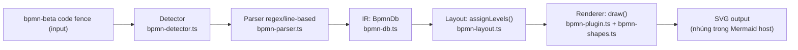
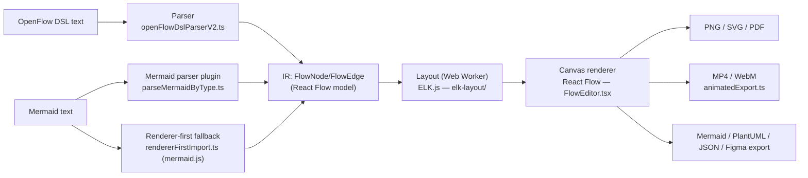
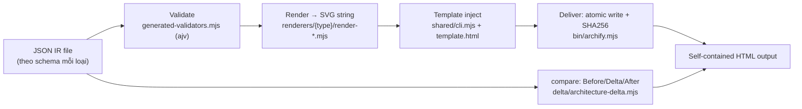
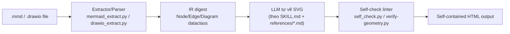

# Weekly Scan: Diagram-as-Code & Visual Tooling — 2026-08-30

## Tóm tắt điều hành

- Tuần này (16–30/8) nổi lên hai kiến trúc đối lập cùng chia sẻ một trend "agent skill vẽ diagram": **archify** là compiler thật (JSON IR đã validate bằng JSON Schema → SVG string → HTML), còn **diagram-design** là "LLM-as-renderer" thuần túy (SVG do LLM tự viết tay theo prompt, không có layout engine). Đáng để kymostudio quan sát cả hai hướng vì đây là hai thái cực của "declarative → render".
- **mermaid-diagram-bpmn** (`bpmn-beta`) là ứng viên gần nhất với hướng đi của kymostudio — DSL text-first cho BPMN 2.0 nhúng trong Mermaid code fence, tự viết layout kiểu Sugiyama (không dùng dagre/elk), đáng đọc kỹ phần parser lỗi (`ParseErrorCode`) và layout levels.
- **Cảnh báo dữ liệu**: 2/4 repo (archify ~31.3k sao, diagram-design ~28.6k sao) có tốc độ tăng sao bất thường so với tuổi đời/watcher-ratio — nên coi là tín hiệu "đang trending trong cộng đồng agent-skill", không phải bằng chứng chất lượng kỹ thuật. GitHub API không truy cập được trong phiên nghiên cứu này (bị chặn ở session-scope); toàn bộ số liệu lấy qua WebSearch/WebFetch trên trang GitHub public nên một số con số (sao, ngày tạo) chỉ là ước lượng scrape, không xác thực qua API.

## Mục lục

1. [OKHP3/mermaid-diagram-bpmn — `bpmn-beta` DSL cho BPMN 2.0](#1-okhp3mermaid-diagram-bpmn--bpmn-beta-dsl-cho-bpmn-20)
2. [Vrun-design/openflowkit — DSL + Mermaid import, ELK layout, xuất video](#2-vrun-designopenflowkit--dsl--mermaid-import-elk-layout-xuất-video)
3. [tt-a1i/archify — JSON IR → SVG compiler cho diagram kiến trúc](#3-tt-a1iarchify--json-ir--svg-compiler-cho-diagram-kiến-trúc)
4. [cathrynlavery/diagram-design — LLM-as-renderer skill cho 39 loại diagram](#4-cathrynlaverydiagram-design--llm-as-renderer-skill-cho-39-loại-diagram)

---

## 1. OKHP3/mermaid-diagram-bpmn — `bpmn-beta` DSL cho BPMN 2.0

### §1 Quick context

DSL text-first để viết BPMN 2.0 ngay trong Mermaid code fence (không cần XML), nhắm đóng góp ngược lại upstream `mermaid-js` — khác các công cụ BPMN hiện có ở chỗ không cần drawing tool, chỉ cần gõ text như flowchart. Tech stack: TypeScript + React (playground `app/src/pages/`), Vitest cho test; output SVG qua cơ chế Mermaid `ExternalDiagramDefinition`. Repo health: chỉ ~4 sao nhưng commit gần như mỗi ngày 24–29/8 (nhiều commit/ngày quanh visual-regression baseline và host-panel test), có 15 file test Vitest, chưa có release GitHub chính thức. Distribution: npm `@okhp3/mermaid-diagram-bpmn@0.1.1`, dự định trở thành plugin chính thức của `mermaid@11.4.1`.

### §2 Architecture deep-dive

**A. Component inventory** — code thật nằm ở `app/src/lib/` (thư mục `lib/bpmn-plugin/` công bố ra npm chỉ là shell mỏng, không có `src/`): `bpmn-detector.ts` (nhận diện code fence `bpmn-beta`), `bpmn-parser.ts` (parser regex/line-based, có context stack cho pool/lane lồng nhau), `bpmn-db.ts` (IR — `BpmnDb`), `bpmn-layout.ts` (thuật toán xếp tầng + định vị), `bpmn-shapes.ts` (hằng số hình học/marker dùng chung giữa SVG-string và React), `bpmn-renderer.tsx` (component React render SVG có hover/tooltip), `bpmn-plugin.ts` (nối db+parser+renderer+style thành một `ExternalDiagramDefinition`), cùng bộ chẩn đoán `bpmn-error.ts`/`bpmn-lint.ts`/`bpmn-validate.ts`.

**B. Pipeline** — 1) Detect: `bpmn-detector.ts` kiểm tra dòng đầu là `bpmn-beta`. 2) Parse: `bpmn-parser.ts` khớp regex từng dòng ra node/pool/lane/flow. 3) Nạp vào IR dùng chung `BpmnDb`. 4) Layout: `assignLevels()` rồi `layoutFlat()`/`layoutWithPools()` tính x/y. 5) Render: `draw()` map node/edge đã định vị sang SVG primitive qua `bpmn-shapes.ts`. 6) Style: nhúng biến theme Mermaid vào `<style>`.

**C. Data model/IR** — mảng phẳng, không dùng thư viện graph: `BpmnNode{id, kind, subtype, position, label, laneId, poolId, sourceLine}`, `BpmnFlow{id, source, target, kind, label, sourceLine}`, `BpmnPool`/`BpmnLane` kèm field accessibility (`_accTitle`...).

**D. Input language design** — parser line-based/regex (không phải PEG hay recursive-descent), duy trì context stack cho nesting. `bpmn-error.ts` ghi rõ tracking cột "reserved for future Langium migration" — tức nhóm tác giả đã tính tới việc thay bằng grammar formal nhưng chưa làm. Chuẩn `app/standards/bpmn-beta-standard.md` chỉ có bảng cú pháp mô tả, **không có EBNF/BNF**. Error reporting dùng `ParseError` typed với `line`, `column` (luôn = 1), `code` (`ParseErrorCode` enum: `UNEXPECTED_CLOSE_BRACE`, `NESTED_POOL`, `LANE_OUTSIDE_POOL`...).

**E. Layout algorithm** — auto-layout kiểu Sugiyama tự viết tay (`assignLevels()` lan truyền tầng lặp tới hội tụ, không phụ thuộc dagre/elk), rồi `layoutFlat()`/`layoutWithPools()` xếp cột theo tầng, tự tính kích thước pool/lane động. **Edge routing chỉ là đường thẳng** (`points: [{source},{target}]`), không có orthogonal routing.

**F. Rendering/output** — SVG duy nhất, đủ event (start/intermediate/end với bán kính vòng trong khác nhau), task với 5 subtype marker (user/service/script/receive/send), gateway (xor/and/or), subprocess, note, pool/lane. Flow phân biệt style theo loại (dashed cho association). **Không có animation** (không `<animate>`/CSS transition), chỉ có hover/tooltip React.

**G. Extensibility** — là plugin `ExternalDiagramDefinition` đúng nghĩa của Mermaid (đăng ký qua `mermaid.registerExternalDiagrams`), nhắm target `mermaid@11.4.1`. Thêm element mới phải sửa cả parser regex, type `BpmnDb`, hằng số layout và thêm hàm shape — chưa có extension-point/registry riêng cho từng loại element.

**H. Dev experience** — Playground React (`Playground.tsx`, `DslReference.tsx`, `SyntaxComparison.tsx`, ví dụ purchase-order/vendor-onboarding). Không có CLI. Test (Vitest): `bpmn-renderer-snapshots.test.tsx` là snapshot DOM/string (không phải pixel visual-regression như ban đầu tưởng), `bpmn-layout-regression.test.ts` assert công thức vị trí (`level*200+110`) thay vì pin baseline cứng — thiết kế để lỗi trỏ thẳng vào hằng số bị đổi.

Ví dụ DSL (từ README):
```
bpmn-beta
start     s1  "Need Identified"
task:user t1  "Submit Purchase Request"
xor       g1  "Approved?"
end       e2  "Rejected"
s1 --> t1
t1 --> g1
g1 --> t3: "yes"
g1 --> e2: "no"
```

### §3 Architecture diagram



### §4 Verdict

Đáng học nhất: cách viết Sugiyama-layout tối giản không phụ thuộc dagre/elk (chỉ ~vài trăm dòng) — kymo hiện có `alignment.py` 5-pass riêng, có thể đối chiếu cách `assignLevels()` xử lý hội tụ lặp. `ParseErrorCode` enum + strategy "column luôn =1, để dành cho Langium migration" là một cách trung thực để thừa nhận nợ kỹ thuật parser — đáng tham khảo khi kymo cân nhắc nâng cấp `dsl.py`. Red flag: edge routing chỉ đường thẳng, chưa xử lý orthogonal/pool overlap; test layout dựa vào công thức cứng (`level*200+110`) nên rất giòn nếu đổi hằng số cố ý. Open question: liệu nhóm tác giả có thực sự được mermaid-js core chấp nhận contribution hay đây là nỗ lực độc lập mãi mãi fork riêng. Verdict: **study deeper** — đây là ứng viên gần nhất với công việc BPMN của kymostudio, dù quy mô cộng đồng còn rất nhỏ (~4 sao).

---

## 2. Vrun-design/openflowkit — DSL + Mermaid import, ELK layout, xuất video

### §1 Quick context

Công cụ diagram AI local-first (chạy hoàn toàn trong browser, lưu IndexedDB, không server/tài khoản), nhận cả DSL riêng (OpenFlow) lẫn cú pháp Mermaid, xuất video MP4/WebM "node-by-node" — khác công cụ khác ở việc kết hợp editor tương tác (React Flow) với auto-layout ELK.js thật sự thay vì vẽ tay. Tech stack: TypeScript, React Flow (`@xyflow/react`), ELK.js chạy trong Web Worker, Zustand store; output SVG/PNG/PDF/MP4/WebM + Mermaid/PlantUML/JSON/Figma. Repo health: ~738 sao, TypeScript, commit đều đặn từ tháng 5 tới 19/8 (không phải flash-in-the-pan). Distribution: web app + gói MCP server riêng (`mcp-server/`, chưa nằm trong dependency gốc).

### §2 Architecture deep-dive

**A. Component inventory** — IR dựng trực tiếp trên kiểu của React Flow (`src/lib/types.ts`: `FlowNode`/`FlowEdge` là `LegacyNode`/`LegacyEdge` kèm `data` riêng của app, không phải IR tự chế). Parser OpenFlow: `src/lib/openFlowDslParserV2.ts`. Import Mermaid: `src/lib/mermaidParser.ts` (hand-written cho flowchart/state-diagram) + cây `src/services/mermaid/` lớn hơn (`detectDiagramType.ts`, `parseMermaidByType.ts`, `rendererFirstImport.ts`, `extractLayoutFromSvg/`). Layout: `src/services/elk-layout/` (`options.ts`, `algorithmSelection.ts`, `graphBuilding.ts`), chạy trong Web Worker. Renderer: React Flow shell 4 lớp (`FlowEditor.tsx` → `useFlowEditorScreenModel.ts` → controller). Export: `exportService.ts`, `animatedExport.ts`, `gifEncoder.ts`, `figmaExportService.ts`. MCP server riêng: `mcp-server/src/{tools,resources,prompts}`.

**B. Pipeline** — 1) Người dùng gõ OpenFlow DSL hoặc dán Mermaid text. 2) Định tuyến theo loại: OpenFlow → `openFlowDslParserV2.ts`; Mermaid → `detectDiagramType.ts` → `parseMermaidByType.ts` (plugin theo họ diagram) — với flowchart có fallback "renderer-first" (`rendererFirstImport.ts`) dùng chính thư viện `mermaid` (^11.15.0) render ra SVG rồi trích ngược hình học nếu không tái tạo được editable. 3) Node/edge được enrich (semantic classifier, icon matcher) rồi gửi sang `elk-layout` (ELK.js trong Web Worker) nếu cần auto-layout. 4) Lưu vào Zustand store, vẽ trên canvas React Flow. 5) Khi export video: `animatedExport.ts` chọn codec qua `MediaRecorder.isTypeSupported` (ưu tiên VP9→VP8→WebM→MP4), mux bằng `mp4-muxer`. 6) Tải file về, IndexedDB lưu tài liệu.

**C. Data model/IR** — không có IR tự chế, dùng thẳng generic node/edge của React Flow. Một store Zustand chung, mutable — chưa thấy bằng chứng IR bất biến/tách pass giữa parse → layout → render (các file như `releaseStaleElkRoutes.ts` gợi ý patch tại chỗ, không rebuild immutable).

**D. Input language design** — OpenFlow DSL viết tay, cú pháp tương thích bề mặt với Mermaid flowchart (`flow: <Title>`, `direction: TB|LR`, node kind `[start]/[process]/[decision]/...`, edge `->`/`==>`). **Không tìm thấy grammar EBNF chính thức** nào trong `docs/`; tài liệu gần nhất là resource MCP `openflowkit://docs/dsl-cheatsheet` (prose, không phải grammar). Mermaid: có dependency `mermaid` thật, nhưng chỉ xác nhận hand-parse trực tiếp cho flowchart/state-diagram — các họ khác (sequence, class, ER...) chưa xác minh độc lập là hand-parse hay chỉ qua fallback renderer-first.

**E. Layout algorithm** — xác nhận dùng ELK.js đa thuật toán (`org.eclipse.elk.layered` mặc định, `edgeRouting: ORTHOGONAL`, `crossingMinimization: LAYER_SWEEP`), cộng `mrtree`/`force`/`stress`/`radial`. Đây là layout hierarchical/constraint-based thật, không phải force-directed tự viết.

**F. Rendering/output** — canvas là React Flow (SVG/DOM, không phải `<canvas>`). Xuất PNG/SVG/PDF/MP4/WebM/Mermaid/PlantUML/JSON/Figma. Cơ chế video: bằng chứng chỉ cho thấy **MediaRecorder-based** (không xác nhận được pipeline `VideoEncoder`/WebCodecs "hardware-accelerated" như pitch ban đầu tuyên bố, dù có dependency `mp4-muxer` gợi ý đường đó có thể tồn tại ở nơi khác chưa fetch tới). Logic tuần tự "node-by-node reveal" (khả năng ở `src/services/playback/`) chưa xác minh được trực tiếp.

**G. Extensibility** — đăng ký diagram-type kiểu plugin thật: `src/diagram-types/{flowchart,architecture,classDiagram,...}` qua `core/registry.ts`/`core/contracts.ts`. Icon: `iconMatcher.ts` tra cứu `mcp-server/data/icons.json` (1.600+ entries).

**H. Dev experience** — không có CLI riêng, chỉ script npm chuẩn. MCP server xác nhận **8 tools** (không phải 12 như pitch ban đầu): `validate_openflow_dsl`, `create_viewer_url`, `analyze_codebase`, `find_icon`, `list_starter_templates`, `get_starter_template`, `list_diagram_node_types`, `server_info`; **5 resource URI** (pitch nói 4); **3 prompt** đúng như pitch.

### §3 Architecture diagram



### §4 Verdict

Đáng học: dùng ELK.js trong Web Worker cho auto-layout thay vì tự viết constraint solver — nếu kymo từng cân nhắc thêm auto-layout ngoài `layout.py`/`alignment.py` hiện có, đây là ví dụ thực tế về việc offload sang thư viện layout trưởng thành (Eclipse ELK) thay vì tự chế. Ý hay thứ hai: chiến lược "renderer-first fallback" — khi parser tự viết không tái tạo được cấu trúc editable, dùng chính engine gốc (mermaid.js) render rồi trích ngược hình học từ SVG, một cách thực dụng để đạt độ phủ Mermaid rộng mà không viết lại toàn bộ grammar. Red flag: khoảng cách giữa pitch marketing (12 MCP tools, "hardware-accelerated H.264") và code thực tế (8 tools, MediaRecorder-based) — nên luôn verify claim bằng code, không tin README. Open question: liệu 5/8 họ Mermaid còn lại có thực sự hand-parse hay chỉ dựa fallback. Verdict: **study deeper** cho phần ELK-layout-in-worker và renderer-first-fallback; phần export video/MCP nên **glance only** vì chưa xác minh được đầy đủ.

---

## 3. tt-a1i/archify — JSON IR → SVG compiler cho diagram kiến trúc

### §1 Quick context

Compiler thật (không phải chỉ prompt): agent skill nhận JSON IR gõ theo JSON Schema, validate rồi biên dịch xác định sang SVG/HTML tự chứa — khác các "diagram skill" khác ở chỗ có bước validate + render tách bạch, không để LLM tự do vẽ. Tech stack: Node.js (ESM `.mjs`), `ajv` cho JSON Schema, output SVG nhúng trong HTML (~5.000 dòng template có sẵn). Repo health: có cadence release thật từ v2.7.0 (2/7) tới v2.15.0 (17/8), nhưng sao tăng bất thường nhanh trong tháng 8 (từ ước lượng ~3k lên ~31.3k, trùng thời điểm lọt GitHub Trending #2-JS ngày 26/8) — số liệu độc lập không khớp nhau giữa các nguồn scrape, nên coi là chưa xác thực. Distribution: `npx skills add tt-a1i/archify -g`, cài cho Claude Code/Codex/OpenCode/DeepSeek Harness.

### §2 Architecture deep-dive

**A. Component inventory** — `bin/archify.mjs` (~1.050 dòng, CLI orchestrator: `render/compare/deliver/preview/validate/check/visual-check/doctor/guide`, staging dir + atomic write + SHA256 checksum). `schemas/{architecture,workflow,sequence,dataflow,lifecycle,common}.schema.json` (JSON Schema mỗi loại diagram, root yêu cầu `schema_version`, `diagram_type`, `meta`, `components`). `renderers/{type}/render-{type}.mjs` (hàm thuần render SVG-string, ~1.100 dòng cho architecture) + `grid.mjs`. `renderers/shared/` gồm `geometry.mjs` (kiểm tra chồng lấn/khoảng cách/route quality), `text-fit.mjs`, `desktop-readability.mjs`, `validator.mjs`/`generated-validators.mjs` (validator ajv được biên dịch sẵn thành file check-in, nên CLI phát hành không có runtime dependency). `delta/architecture-delta.mjs` (renderer diff Before/Delta/After). `assets/template.html` (shell HTML + CSS + script resolve theme).

**B. Pipeline** — 1) Tác giả/agent viết file JSON IR khớp schema. 2) `validate` chạy schema-check + geometry/readability check, trả diagnostics JSON. 3) `render-<type>.mjs` biến IR thành chuỗi SVG (hàm thuần, không auto-layout). 4) `shared/cli.mjs` nạp `template.html` rồi tiêm SVG/title/card qua `applyTemplate()`. 5) `deliver` ghi vào staging path, tính SHA256, commit atomic ra file `.html` cuối. 6) Tùy chọn: `compare architecture base.json head.json` chạy `architecture-delta.mjs` cho view Before/Delta/After.

**C. Data model/IR** — JSON có version (`schema_version: 1`), validate bằng validator ajv biên dịch sẵn — không mutate tại chỗ, đi qua các stage rời rạc (parse → validate → render-to-SVG-string → template-inject → write). Không có khái niệm "compile xuống IR thấp hơn" — SVG string là intermediate duy nhất.

**D. Input language design** — không có DSL text riêng, input là JSON theo Schema chính thức, field enum-constrained (vd `connection.route: auto|straight|orthogonal-h|orthogonal-v`). Lỗi là diagnostics có cấu trúc, tài liệu mô tả như "repair receipts" kèm gợi ý sửa.

**E. Layout algorithm** — **explicit/thủ công**, không tự động. Schema hỗ trợ tọa độ tuyệt đối (`pos: [x,y]`) hoặc lưới (`layout.mode: "grid"`, xử lý bởi `grid.mjs`). `geometry.mjs` chỉ **validate** hình học sau khi đã có vị trí (chồng lấn rectangle, khoảng cách segment-rect, ngân sách số khúc route) chứ không tự sinh vị trí — đúng theo triết lý thiết kế ghi trong tài liệu nội bộ: "never counterfeit layout passes."

**F. Rendering/output** — một họ renderer cho mỗi loại diagram, SVG inline nhúng trong HTML tự chứa, có đường xuất PNG/SVG/WebM/share-card (nêu trong README, chưa lần ra hết code). Animation là CSS `@keyframes`/`transition` (xác nhận `pulse`, `archify-radar-live`, `archify-lens-in` trong sample render). Có script resolve theme (URL param → localStorage → `data-theme`).

**G. Extensibility** — thêm loại diagram = thêm schema + module `renderers/<type>/` + nối vào CLI; theming có sẵn (dark/light qua `data-theme`), chưa có plugin API cho shape/theme bên thứ ba.

**H. Dev experience** — CLI có `validate`, `preview` (live-editing loop "last-good live preview"), `deliver`, `doctor`, `guide`, `compare`. `npm test` chạy kiểm tra freshness của brand-mark/validator + `test/golden.mjs` — golden-file testing, cùng pattern với chính kymostudio.

Ví dụ IR (`examples/web-app.architecture.json`): node `type: "external"` "Users" tại `pos: [40, 300]`, component `auth` gắn nhãn "JWT + PKCE", connection `jwt-verification` (`variant: security`, label "verify JWT") — xác nhận IR là "node kiểu hoá + vị trí tường minh + edge có nhãn kiểu hoá".

### §3 Architecture diagram



### §4 Verdict

Đáng học nhất: triết lý "never counterfeit layout" — geometry check chỉ validate sau khi có vị trí tường minh, không tự đoán layout, buộc tác giả (người hoặc LLM) chịu trách nhiệm về bố cục. Đây là góc nhìn ngược với `alignment.py` của kymo (vốn tự động resolve alignment) nhưng phần "readability/overlap check" (`desktop-readability.mjs`, `geometry.mjs`) là ý hay có thể bổ sung như một validation pass độc lập sau `resolve_alignments()`. Việc build validator ajv thành file tĩnh check-in (`generated-validators.mjs`) để CLI phát hành zero-runtime-dependency cũng là kỹ thuật đáng tham khảo cho phân phối gọn nhẹ. Red flag: tăng trưởng sao quá nhanh trong thời gian ngắn (3k→31k trong khoảng 1 tháng) dù có cadence release thật — nên coi là tín hiệu viral/trending hơn là bằng chứng chất lượng độc lập. Open question: chưa lần ra được code cho phần "search/route-trace" tương tác nêu trong tài liệu do file template quá lớn (~290KB) bị cắt khi fetch. Verdict: **study deeper** cho phần validate-only-layout + golden testing pattern.

---

## 4. cathrynlavery/diagram-design — LLM-as-renderer skill cho 39 loại diagram

### §1 Quick context

Agent skill (Claude Code/Codex/Pi) hướng dẫn LLM tự tay vẽ SVG cho 39 loại diagram (architecture, flowchart, ER, Sankey, Wardley map...) theo màu/font thương hiệu của chính dự án — khác biệt ở việc **không có engine render code**, LLM chính là "renderer". Tech stack: skill là markdown/prompt (`SKILL.md` + ~35 file `references/*.md`); phần code thật chỉ là script Python phụ trợ (`mermaid_extract.py`, `drawio_extract.py`, `self_check.py`, `verify-geometry.py`); output: HTML tự chứa (SVG + CSS + JS animation tùy chọn). Repo health: ~28.6k sao/1.8k fork nhưng chỉ 89 watcher (~0.3% watcher/star — tỷ lệ bất thường thấp, dấu hiệu mềm của sao bị thổi phồng dù không phải bằng chứng); có lịch sử tăng trưởng công khai từ ~550 sao (19/4) lên ~2.8k rồi 28.6k hiện tại, tức không phải repo mới toanh bị bơm sao đột ngột. Distribution: cài qua `codex plugin marketplace add/install`, đóng gói dạng `.claude-plugin/`/`.codex-plugin/`/`.factory-plugin/`.

### §2 Architecture deep-dive

**Kết luận trước tiên**: đây **chủ yếu là gói prompt/instruction, không phải compiler xác định**. Lõi repo là `SKILL.md` (~500 dòng, `metadata.version: "2.6"`) cộng ~35 file `references/type-*.md` — toàn văn xuôi: quy tắc style, lưới 4px, thư viện snippet SVG, bảng "complexity budget". Tọa độ node do LLM tự tính theo công thức văn xuôi (`mid=(x1+x2)/2`, `zone y = node_top − 32`) — **không có thuật toán layout nào thực thi**. Tuy vậy không phải 100% không-code: `scripts/mermaid_extract.py` (~1.100 dòng, parser regex cho Mermaid ra IR nhỏ), `drawio_extract.py`, `self_check.py` (~400 dòng, linter accessibility/an toàn HTML/SVG), `verify-geometry.py` (~140 dòng, check chồng lấn label/box) — đây là lớp pre/post-processing quanh việc LLM tự vẽ, không phải pipeline render chính.

**A. Component inventory** — `SKILL.md` (instruction chính); `references/*.md` (một file/loại diagram, vd `type-architecture.md`, `semantic-patterns.md`, `animation.md`, `style-guide.md`); `assets/template*.html` (5 biến thể: dark, full, motion, terminal, icons); `scripts/{drawio_extract.py, mermaid_extract.py, self_check.py}`; root `scripts/` (~20 `verify-*.py` theo loại chart); `commands/`+`prompts/` (5 cặp file: doctor/export-diagram/import-drawio/import-mermaid/profile — wrapper mỏng gọi slash-command).

**B. Pipeline** — 1) User yêu cầu Claude Code/Codex vẽ diagram → agent nạp `SKILL.md`. 2) First-run brand gate kiểm tra style-guide mặc định, có thể chạy onboarding lấy màu/font từ site dự án. 3) Agent chọn semantic pattern rồi loại diagram cụ thể từ bảng 39 dòng. 4) Agent copy template rồi tự tay viết SVG node/edge theo quy tắc văn xuôi của file reference tương ứng. 5) Tự kiểm theo checklist §9, tùy chọn chạy `self_check.py`/`verify-geometry.py`. 6) Xuất một file `.html` tự chứa duy nhất.

**C. Data model/IR** — không có IR chuẩn cho việc *tạo mới*. IR **chỉ tồn tại cho import**: `mermaid_extract.py`/`drawio_extract.py` xuất "digest" JSON (`Node`/`Edge`/`Diagram` dataclass: id, label, shape, hierarchy) để LLM vẽ lại theo — một chiều trích xuất-rồi-vẽ-lại, không phải model dùng chung cho luồng tạo mới tự do.

**D. Input language design** — không có DSL/schema cho việc tạo mới; input là yêu cầu ngôn ngữ tự nhiên định tuyến qua bảng chọn loại ở `SKILL.md` §3. Chỉ file `.mmd`/`.drawio` mới được "parse" (qua script extract) như định dạng import bên ngoài.

**E. Layout algorithm** — không có code auto-layout cho việc tạo mới. `type-architecture.md` cho quy ước văn xuôi/số học (lưới 4px, offset khoảng cách) để LLM áp dụng thủ công; `verify-geometry.py` chỉ **kiểm tra** chồng lấn sau khi đã có vị trí, không tự sinh layout.

**F. Rendering/output** — một backend duy nhất: SVG+CSS inline viết tay trong HTML tự chứa. Animation tùy chọn qua JS cố định copy từ `template-motion.html` (mode none/reveal/step/loop, có fallback reduced-motion/no-JS). Xuất PNG/SVG là quy trình thủ công riêng (`references/export.md`), không phải kiến trúc renderer pluggable.

**G. Extensibility** — thêm loại diagram = viết thêm một file `references/type-<tên>.md` và thêm dòng vào bảng `SKILL.md` — xác nhận là "viết thêm template markdown", không phải code.

**H. Dev experience** — không có CLI/preview server tổng quát. Phân phối như Agent Skill/plugin; slash command (`/doctor`, `/export-diagram`, `/import-drawio`, `/import-mermaid`, `/profile`) chỉ là file prompt, không phải tool độc lập. Phần thực thi được duy nhất là các script verify/lint Python, agent gọi ad hoc.

### §3 Architecture diagram

*(Chỉ vẽ được cho luồng import — luồng tạo-mới-tự-do thiếu parser/IR nên bỏ theo quy tắc evidence.)*



### §4 Verdict

Đáng học: lớp "self-check" (accessibility, contrast, chồng lấn label) như một validation pass tách biệt sau khi render — bất kể ai/cái gì tạo ra SVG (code hay LLM), có một bộ lint hình học độc lập là ý hay kymo có thể học để bắt lỗi overlap/label-cutoff sau `to_svg.py:render()`. Ngược lại, bản thân cách tiếp cận "LLM-as-renderer" **không phù hợp** để áp dụng cho kymo — vì kymo cần output byte-for-byte deterministic (golden SVG tests), còn cách này vốn dĩ non-deterministic và tốn 1 LLM call/diagram. Red flag: tỷ lệ watcher/star thấp bất thường (~0.3%) đáng ngờ dù không phải bằng chứng dứt khoát; nên coi "39 loại diagram" là marketing surface hơn là năng lực kỹ thuật (thực chất là 39 file markdown). Open question: liệu output có thực sự ổn định giữa các lần chạy với cùng input, hay khác nhau mỗi lần vì LLM tự do diễn giải. Verdict: **glance only** — thú vị như hiện tượng trend, nhưng không có kiến trúc để học sâu ngoài lớp self-check linter.
