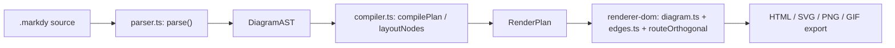
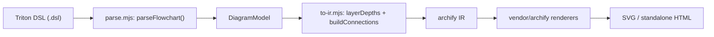
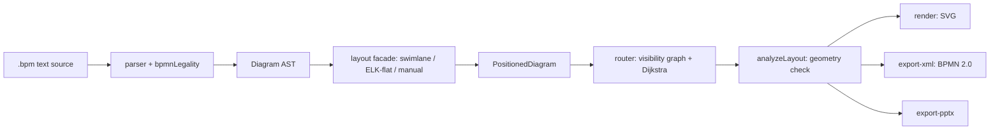
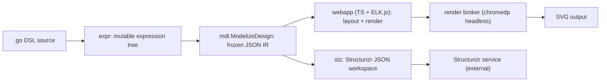

# Weekly scan — diagram-as-code & visual tooling (2026-08-31)

Nguồn dữ liệu: GitHub REST search, tier 1 (`topic:diagram-as-code` sort theo `updated`, cross-check với `topic:graph-visualization`/`topic:layout-algorithm`/`topic:svg-animation`) — tier 1 đã cho ≥4 kết quả liên quan nên không cần fallback sang tier 2/3. Đã loại các repo agent-skill wrapper mỏng (không có engine riêng), profile-README SVG, chart/dashboard, và các repo suspicious star-count.

**Tóm tắt 3 điểm:**
- Hai dự án cùng tầm nhìn "animated diagram-as-code" như kymo xuất hiện tuần này — `markdy-com` (WAAPI) và `triton2` (vendor hoá renderer khác) — nhưng cả hai đều **rất trẻ** (lịch sử commit/release dồn trong 1–2 ngày); có vài kỹ thuật cụ thể đáng chôm nhưng đọc tuyên bố marketing của họ với sự dè dặt.
- `IntentGraphs/diagram-as-code` có router orthogonal (visibility-graph + Dijkstra) chặt chẽ hơn heuristic fan-in/trunk-lane hiện tại của kymo, cùng pattern `DiagramFamilyAdapter` đáng tham khảo khi kymo cần mở rộng multi-family.
- `goadesign/model` — dự án trưởng thành duy nhất trong 4 (466 sao, 6 năm tuổi) — mang ý tưởng DSL giá trị nhất tuần này ("view là subgraph suy ra từ 1 model chung"), nhưng phần render/layout của họ phụ thuộc hoàn toàn trình duyệt/ELK.js, ngược triết lý "renderer dumb, deterministic" của kymo.

**Mục lục**
1. [HoangYell/markdy-com](#1-hoangyellmarkdy-com)
2. [devpilgrin/triton2](#2-devpilgrintriton2)
3. [IntentGraphs/diagram-as-code](#3-intentgraphsdiagram-as-code)
4. [goadesign/model](#4-goadesignmodel)

---

## 1. HoangYell/markdy-com

### §1 Quick context

"MarkdyScript" — DSL compile ra kinetic diagram chạy trên Web Animations API (WAAPI) ngay trong browser, khác kymo ở chỗ animation là cơ chế browser-native thay vì SVG SMIL/CSS tĩnh. Stack: TypeScript monorepo (pnpm), core compiler zero runtime deps. Output: HTML standalone + export SVG/PNG/GIF. 87 sao, CI thật (typecheck/lint/test/E2E headless-Chrome), nhưng changelog 1.0.31→1.2.0 dồn trong 2 ngày (2026-08-29/30) — dự án còn rất trẻ. Distribution: npm đa package (core/renderer-dom/cli/compat/mcp-server/vscode-ext/language-server).

### §2 Architecture deep-dive

**A. Component inventory**: `parser.ts` (parse DSL → AST), `ast.ts` (định nghĩa `DiagramAST`/`RenderPlan`), `compiler.ts` (1389 dòng — engine layout chính, ~14 hàm `layout*`), `router.ts` (router orthogonal đơn giản, **export công khai nhưng không được gọi ở đâu trong pipeline thật**), `themes.ts` (10 theme), `renderer-dom/diagram.ts` + `edges.ts` + `geometry/path.ts` (routing thật + WAAPI runtime), `cli/index.ts`, `compat/*-transpiler.ts` (Mermaid/Docker/K8s/Terraform → MarkdyScript), `vscode/`, `markdy-language-server/`, `mcp-server/` (tool cho AI agent tự chẩn đoán/sửa lỗi DSL).

**B. Pipeline**: (1) `markdy render file.markdy` → CLI đọc file; (2) `parse()` → `DiagramAST` (chưa có toạ độ); (3) `compilePlan(ast, theme)` trong `compiler.ts` dispatch theo loại diagram vào 1 trong ~14 `layout*`, tính group boundary + lịch beat/cue → `RenderPlan` (đã có vị trí + timeline, nhưng cạnh vẫn chưa có toạ độ); (4) CLI nhúng `RenderPlan` + bundle renderer vào 1 file HTML độc lập; (5) khi mở browser, `createDiagram()` dựng DOM, và **routing cạnh thật sự xảy ra ở bước này** qua `routeOrthogonal()`; (6) vòng lặp `requestAnimationFrame` set `currentTime` cho từng WAAPI `Animation` (luôn paused) mỗi frame → hoạt ảnh scrubbable.

**C. Data model/IR**: hai tầng, đều TS interface thuần (không class): `DiagramAST` → `RenderPlan`. Không bất biến tuyệt đối — `compilePlan()` sửa trực tiếp `ast.meta.width` (mutate input AST).

**D. Input language design**: parser tự viết, dòng-theo-dòng, nhận biết indentation — không PEG/ANTLR, không có EBNF/BNF hình thức (`docs/SYNTAX.md` chỉ mô tả bằng văn xuôi + ví dụ). Lỗi cứng ném `ParseError(line,col)`; lỗi mềm (tham chiếu treo, chu trình flow) đẩy vào `ast.diagnostics[]`, không chặn render.

**E. Layout algorithm**: tuyên bố "17 layout engines" — thực tế `registry.ts` có 18 `DIAGRAM_TYPES` nhưng `compiler.ts` chỉ có ~14 hàm `layout*` khác nhau thật sự, nhiều loại (flowchart/state/sequence/default) dùng chung `layoutRanked` với tham số khác nhau → gần "14 thuật toán thật sau 1 bảng dispatch" hơn là 17 engine riêng biệt. Thứ tự trong rank dùng barycenter 1-pass (Sugiyama đơn giản hoá). Routing cạnh không nằm ở layout mà dời sang lúc render (`routeOrthogonal` chấm điểm nhiều route ứng viên theo obstacle).

**F. Rendering/output**: một backend DOM+SVG duy nhất, không có kiến trúc emitter cắm-được như `to_svg.py`/`to_figma.py` của kymo; export SVG/PNG/GIF lấy từ serialize DOM đã render. Animation WAAPI đáng chú ý: mọi `Animation` tạo ở trạng thái paused (`fill:"forwards"`), vòng rAF tự set `currentTime` mỗi frame thay vì gọi `play()` — workaround được tài liệu hoá cho 2 bug WAAPI cross-browser thật (`docs/ARCHITECTURE.md`).

**G. Extensibility**: không có plugin runtime — thêm node kind/cue/edge operator đòi sửa lần lượt file cố định (`system-vocabulary.ts` → `registry.ts` → `ast.ts` → `compiler.ts`), tài liệu rõ trong "Extension Points" của `docs/ARCHITECTURE.md`.

**H. Dev experience**: CLI khá đầy đủ (`lint/fmt/render/explain/import/diff/share/check`); VS Code extension tự viết preview/CodeLens riêng, dường như không dùng chung package `markdy-language-server` (2 đường tích hợp IDE song song); MCP server có tool `validate/diagnose/fix/transpile` — tích hợp AI-agent khá sâu.

### §3 Architecture diagram

### §4 Verdict

Đáng học: (1) kỹ thuật scrub WAAPI thủ công (animation paused + rAF set `currentTime`) — giải pháp thật cho bug WAAPI cross-browser, hữu ích nếu kymo mở rộng `--animate` sang target cần seek/scrub; (2) `TimedCue[]` là data thuần trong IR chứ không phải code mệnh lệnh — dễ test hơn; (3) tài liệu "Extension Points" kiểu "sửa file nào theo thứ tự nào" đáng bắt chước cho `icons.py`/`model.py`.

Red flag: `router.ts` export công khai nhưng không được dùng (routing thật nằm ở nơi khác); `compilePlan()` mutate AST đầu vào; 2 đường tích hợp IDE song song không rõ đồng bộ; toàn bộ changelog dồn trong 2 ngày.

**Verdict: study deeper** (kỹ thuật animation + tài liệu hoá), nhưng đừng tin production-readiness.

---

## 2. devpilgrin/triton2

### §1 Quick context

Trình soạn thảo diagram gắn "Triton DSL" (port từ 1 repo khác chưa public) vào thư viện SVG-render vendor hoá tên `archify` — khác kymo ở chỗ layout tự nhận là "placeholder tạm". Stack: JavaScript thuần (Node ESM), CLI `triton2` qua npm. Output: HTML/SVG/PNG-APNG. 0 sao, toàn bộ commit + 3 tag phát hành dồn trong 1 ngày (2026-08-18). CI có (`ci.yml`), nhưng "test" chỉ là 1 script smoke, không phải unit test thật.

### §2 Architecture deep-dive

**A. Component inventory**: `bin/triton2.mjs` (CLI: render/validate/edit/demo), `src/convert/parse.mjs` (parser DSL, comment ghi rõ port từ `triton-diagram-editor`), `src/convert/to-ir.mjs` (layout `layerDepths()` + convert sang archify IR), `src/convert/archimate.mjs` (bảng tra cứu ArchiMate hard-code), `src/core/index.mjs` (API công khai, dispatch renderer), `src/cli/edit-server.mjs` (server local cho `triton2 edit`), `vendor/archify/renderers/**` (**thư viện bên thứ ba vendor hoá — nơi vẽ SVG thật sự xảy ra**).

**B. Pipeline**: (1) `triton2 render f.dsl`; (2) `parseFlowchart()` → `DiagramModel` (object JS thuần); (3) `modelToArchitectureIR()` gọi `layerDepths()` tính vị trí, sinh archify IR; (4) `renderDiagram('architecture', ir)` dispatch tới renderer vendor → SVG; (5) CLI overlay CSS/icon rồi nhúng vào template HTML; (6) ghi file output.

**C. Data model/IR**: hai tầng JSON thuần (`DiagramModel` → archify IR), bất biến theo quy ước (spread/map, không mutate tại chỗ).

**D. Input language design**: parser regex dòng-theo-dòng, port nguyên văn từ dự án khác, không có EBNF nào. Không báo lỗi cú pháp — dòng sai định dạng bị bỏ qua âm thầm (`if (!current) continue`). `validateDiagram` không phải 1 pass validate riêng mà thử render thật và bắt exception của renderer vendor — validate-by-execution.

**E. Layout algorithm**: 1 thuật toán duy nhất, `layerDepths()` — xếp theo lớp kiểu BFS tôpô, và chính comment trong code tự nhận: *"a deliberate spike stand-in for the ELK layout that V1 will reuse"* — tác giả tự thừa nhận đây chỉ là chỗ giữ tạm; cạnh vẽ thẳng, không có crossing minimization.

**F. Rendering/output**: toàn bộ việc vẽ SVG nằm ở thư viện vendor `archify` (không phải code của repo này); lớp riêng của triton2 chỉ thêm HTML template, 1 side-channel override CSS theo `data-node-id` (`styleOverridesForModel`), và icon ArchiMate. Không có cơ chế animation thật dù có field `meta.animation:'trace'` truyền qua.

**G. Extensibility**: thêm loại diagram = thêm renderer ở archify + 1 dòng trong bảng dispatch, không có plugin API; ArchiMate hard-code bảng tra cứu.

**H. Dev experience**: CLI nhỏ gọn; `triton2 edit` mở server local + browser tự động; đồng bộ code↔canvas là re-parse + re-render toàn bộ sau debounce 350ms, không phải patch tăng dần.

### §3 Architecture diagram

### §4 Verdict

Đáng học: (1) mẫu validate-by-execution — thử render thật rồi bắt lỗi thay vì viết 1 pass schema-validate riêng, rẻ tiền nếu renderer đã tự throw khi IR sai; (2) side-channel CSS override theo `data-node-id` khi IR không biểu diễn được style ad-hoc — cách thoát hiểm gọn khi không muốn thêm field mới vào toàn pipeline.

Red flag nghiêm trọng: cả parser lẫn layout đều là placeholder mượn từ 1 repo khác chưa public, tác giả tự thừa nhận trong code; parser không báo lỗi cú pháp; 0 sao, 0 fork, toàn bộ lịch sử dồn trong 1 ngày, "test" chỉ là smoke script.

**Verdict: glance only** — chỉ 2 kỹ thuật nhỏ đáng ghi chú, phần còn lại là placeholder/mượn code.

---

## 3. IntentGraphs/diagram-as-code

### §1 Quick context

Monorepo TypeScript "bpm" — diagram-as-code có validate xác định (deterministic) cho BPMN và nhiều "họ" diagram khác (flowchart/architecture/mindmap/gantt) trên cùng 1 CLI. Stack: ~25 package npm workspaces, layout dùng elkjs + router orthogonal tự viết (visibility-graph + Dijkstra), export BPMN 2.0 XML/SVG/PPTX/DOCX. 0 sao nhưng rất thực chất (không phải stub) — CI thật, 655 unit test + 57 e2e Playwright (tự báo cáo), nhưng 4 release dồn trong 2 ngày. Chưa publish npm, chỉ chạy qua git clone.

### §2 Architecture deep-dive

**A. Component inventory**: `packages/parser` (`parser.ts` + `bpmnLegality.ts` — ~6 rule hard-code kiểm tra hợp lệ cấu trúc BPMN), `packages/ast` (định nghĩa IR), `packages/diagram-core/routing/{visibilityGraph,router,pathfind}.ts` (router orthogonal thật: dựng visibility graph Manhattan từ obstacle rồi chạy Dijkstra), `packages/layout-core` (`analyzeLayout` — kiểm tra hồi quy hình học: overlap/crossing), `packages/layout-elk-base` (adapter elkjs) + `layout-engine-{flat,swimlane,manual}`, `packages/render` (SVG, icon BPMN vẽ tay), `packages/export-xml` (BPMN 2.0 + BPMNDI, kiểm chứng round-trip qua chính `bpmn-js` thật), `export-pptx`/`export-docx`, `packages/diagram-runtime` (registry `registerFamily`/`getFamily`/`resolveDiagramFamily`), mỗi family (`diagram-flowchart`, `-architecture`, `-mindmap`, `-gantt`) tự có `ast.ts/parser.ts/layout.ts/render.ts/adapter.ts` riêng, `apps/web` (editor nhúng `bpmn-js` Modeler thật).

**B. Pipeline**: (1) `bpm validate|render|export`; (2) parser tokenize + parse ra `Diagram` AST, chạy luôn `bpmnLegality` inline; (3) facade `@bpm/layout` chọn engine — swimlane cho pool/lane, ELK cho trường hợp còn lại, hoặc manual nếu khai `positioning: manual` — ra `PositionedDiagram`; (4) router visibility-graph+Dijkstra gán waypoint orthogonal cho từng cạnh, `analyzeLayout` chấm điểm overlap/crossing còn sót; (5) `@bpm/render` vẽ SVG (hoặc export-xml/pptx/docx từ cùng 1 `PositionedDiagram`); (6) CLI ghi file / web render vào `#preview`.

**C. Data model/IR**: TS interface thuần, **không enforce bất biến** (không thấy `freeze()` nào trong `packages/ast`) — khoảng hở so với kỷ luật dataclass đông cứng của kymo. Rõ 2 tầng: `Diagram` (AST) → `PositionedDiagram`/`RoutedEdge`.

**D. Input language design**: parser tự viết dòng-theo-dòng, không có EBNF/BNF hình thức (`docs/LANGUAGE.md` chỉ narrative), bắt buộc indent đúng 2 space. Báo lỗi 3 tầng tách biệt trong 1 lần gọi `validate()`: `errors` (cú pháp) / `semanticErrors` (vi phạm BPMN) / `warnings` (hình học) — sạch hơn 1 mảng lỗi phẳng.

**E. Layout algorithm**: nhiều engine cắm được (swimlane/ELK-flat/manual), tự động chọn theo hình dạng diagram hoặc ép bằng directive. Routing cạnh là thuật toán thật: visibility graph + Dijkstra, thử lại với clearance giảm dần `[10,6,4,2,0]px` trước khi fallback về góc L thô; `createSequentialRouter` biến cạnh đã route thành obstacle cho cạnh sau. Crossing minimization dựa ELK có sẵn + `analyzeLayout` chỉ đo/track số crossing còn sót như 1 metric (STATUS.md công khai số crossing sót theo fixture) chứ không tự loại bỏ bằng thuật toán riêng.

**F. Rendering/output**: kiến trúc emitter cắm-được thật sự trên cùng 1 `PositionedDiagram` — SVG/BPMN-XML (verify bằng `bpmn-js` thật)/PPTX/DOCX. Không thấy cơ chế animation.

**G. Extensibility ("multi-family")**: có registry `DiagramFamilyAdapter` thật (`registerFamily`), nhưng mỗi family tự có AST/parser/layout/render riêng — không phải 1 IR chung cho mọi family, chỉ hợp nhất ở tầng registry+CLI. Gần giống triết lý "2 impl song song, không port" của chính kymo hơn là 1 IR vạn năng.

**H. Dev experience**: CLI phong phú (`validate/render/export/review/fix/generate/import/freeze/capabilities`, output SARIF cho CI). Không có watch mode CLI. `apps/web` là editor 2 chế độ (SVG preview + `bpmn-js` Modeler thật), có `DiagramSourceMap` ánh xạ SVG↔dòng DSL — nền tảng cho LSP tương lai nhưng chưa có LSP/VS Code extension thật.

### §3 Architecture diagram

### §4 Verdict

Đáng học nhất cho kymo: (1) router orthogonal visibility-graph + Dijkstra với retry clearance giảm dần — chặt chẽ hơn nhiều so với heuristic fan-in/trunk-lane hiện tại của `alignment.py`, đáng so sánh trực tiếp; (2) hợp đồng lỗi 3 tầng (`errors`/`semanticErrors`/`warnings`) — map gọn vào các stage parse/layout/render của kymo; (3) `DiagramFamilyAdapter` + `registerFamily()` — đáng tham khảo nếu kymo muốn thay if/else theo extension trong `cli.py` bằng registry thật; (4) verify export BPMN qua chính `bpmn-js`, bổ sung tốt cho golden-byte test hiện có.

Red flag: IR không enforce bất biến; "multi-family" quảng cáo hợp nhất nhưng thực chất là 5 codebase riêng ghép ở registry; 0 sao/0 contributor rõ, 4 release/48h — mọi con số tự báo cáo chưa được cộng đồng kiểm chứng.

**Verdict: study deeper**, đặc biệt phần routing và error contract.

---

## 4. goadesign/model

### §1 Quick context

Thư viện Go "model" (hệ sinh thái Goa) — DSL C4 kiểu Structurizr nhưng nhúng thẳng trong Go (closure builder), không phải text DSL riêng. 466 sao, hoạt động liên tục từ 2020 đến nay (push gần nhất 2026-08-21) — khác hẳn 3 repo trên về độ trưởng thành. Điểm lạ: **không có renderer Go nào cả** — mọi pixel SVG do 1 webapp TypeScript/ELK.js nhúng sẵn vẽ, chạy trong browser thật hoặc Chrome headless (`chromedp`). Phân phối qua `go install`, có CI thật.

### §2 Architecture deep-dive

**A. Component inventory**: `dsl/*.go` (hàm builder Go — `Design`/`Person`/`SoftwareSystem`/`Container`/`AutoLayout`, dựa trên engine `eval` dùng chung với chính Goa), `expr/*.go` (cây expression mutable con trỏ khi build; `expr/render.go` quyết định view chứa gì: `AddAll`/`AddNeighbors`/`tagged`/`unreachable`/`coalesceRelationships`), `mdl/model.go` (`ModelizeDesign` — 1 pass thuần duy nhất đóng băng cây expr thành `mdl.Design` JSON bất biến), `stz/` (cầu nối sang Structurizr JSON, đẩy sang SaaS ngoài), `cmd/mdl/{serve,headless,watch,skill}.go` (CLI + render broker khớp kết quả browser↔request bằng `viewID+modelDigest` + live-reload `fsnotify`/`lrserver` + cài SKILL.md cho AI agent), `cmd/mdl/webapp` (TS/Webpack, ELK.js v0.10 — nơi duy nhất sinh pixel SVG, nhúng qua `go:embed`).

**B. Pipeline**: (1) viết package Go gọi `Design(...)`; (2) `RunDSL()` chạy mọi closure lên cây `expr.Root` toàn cục mutable; (3) `expr/render.go` giải quyết view chứa element/relationship nào; (4) `ModelizeDesign` duyệt 1 lần, đóng băng thành `mdl.Design` (JSON, phục vụ ở `/data/model.json`); (5a) tương tác: `mdl serve` mở browser chạy webapp, ELK.js auto-layout, lưu vị trí bằng cách nhúng JSON layout ngay trong file SVG đã lưu; (5b) headless: `mdl svg` dùng `chromedp` chạy cùng webapp không giao diện, `renderBroker` khớp kết quả về đúng request CLI; (5c) hoặc `stz put` đẩy `mdl.Design` sang Structurizr JSON workspace, layout+render giao hết cho dịch vụ ngoài.

**C. Data model/IR**: 3 tầng rõ rệt — `expr` (mutable, con trỏ) → `mdl.Design` (bất biến, JSON, qua đúng 1 pass chuyển đổi thuần) → (tuỳ chọn) Structurizr JSON workspace (schema khác hẳn, ngoài repo).

**D. Input language design**: không phải text DSL — là DSL Go nhúng (closure builder) trên engine `eval` dùng chung với Goa (`eval.Current()` ép kiểu theo ngữ cảnh, `eval.Execute` chạy đệ quy closure con, `eval.ReportError` gom lỗi tập trung). Cơ chế báo lỗi chi tiết nằm ở package `goa/v3/eval` ngoài repo — không xác định sâu hơn.

**E. Layout algorithm**: 0 dòng code layout bằng Go — `AutoLayout` chỉ lưu config (rank direction, rank/node/edge sep), thực thi 100% ở webapp ELK.js (Layered/Force/Tree/Radial), chạy browser thật hoặc headless. Vị trí thủ công round-trip bằng cách nhúng JSON ngay trong SVG output. Không có code crossing-minimization nào trong repo Go (nằm trong ELK.js, chưa xác minh).

**F. Rendering/output**: hoàn toàn không có renderer SVG native bằng Go — hoặc dùng webapp nhúng (2 chế độ) hoặc giao hẳn cho Structurizr SaaS. "Animation" trong model là chuỗi bước reveal cho Dynamic View (kiểu build-step PowerPoint), khác hẳn bản chất so với SVG animation của kymo.

**G. Extensibility**: thêm element/view type đòi sửa song song 3 package (`expr`/`dsl`/`mdl`, đặt tên file gương nhau); style là data theo tag (`Styles`/`ElementStyle`), áp dụng ở renderer JS; cơ chế plugin là import Go (import `model/dsl` cùng `goa/v3/dsl` trong 1 Goa service design → `goa gen` sinh thêm `design.json`); đáng chú ý: `mdl skill install` tự cài `SKILL.md` cho Cursor/Codex/Claude Code — kênh phân phối nhắm thẳng vào AI agent.

**H. Dev experience**: CLI (`serve/gen/svg/skill`, `stz gen/put/get`) chỉ qua `go install`; `mdl serve` watch file `.go` bằng `fsnotify`, live-reload qua websocket (`lrserver`); browser editor tự viết đầy đủ (undo/redo, align, snap-to-grid) — không phải Structurizr Lite; không có VS Code extension/LSP ngoài cơ chế AI-skill.

### §3 Architecture diagram

### §4 Verdict

Đáng học nhất: "view là tập con suy ra từ 1 model chung" (`AddAll`/`AddNeighbors`/`tagged`/`unreachable`/`coalesceRelationships` trong `expr/render.go`) — khai báo model 1 lần, N view là subgraph được lọc ra, không cần khai lại diagram; có lẽ là ý tưởng giá trị nhất tuần này, áp dụng trực tiếp vào DSL của kymo nếu chưa hỗ trợ multi-view trên 1 graph. Cũng đáng chú ý: ranh giới đóng băng IR rõ ràng (`expr` mutable → đúng 1 pass → `mdl.Design` bất biến) — kymo có thể học để tách rõ hơn giữa object mà `alignment.py` mutate và artifact được golden-compare. Ý tưởng nhỏ khác: reference element theo path (`S/CO/C`), và `mdl skill install` như kênh phân phối cho AI agent.

Red flag: không có renderer xác định (deterministic) bằng ngôn ngữ chính — toàn bộ layout/render phụ thuộc Node/Chrome/ELK.js, khó test golden-byte như kymo đang làm.

**Verdict: study deeper** cho phần DSL/view, **glance only** cho phần render/layout.
