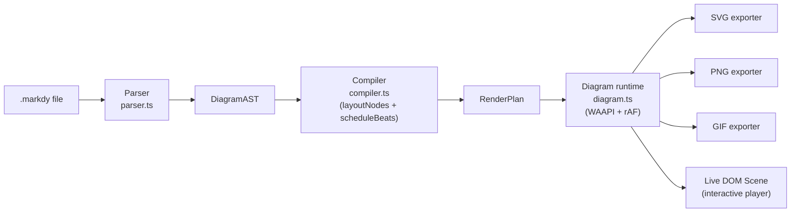
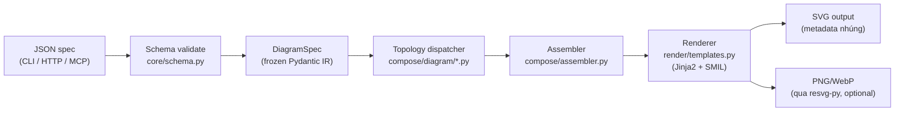
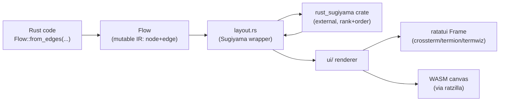

# Weekly Scan — Diagram Tooling (tuần 2026-08-25 → 2026-09-01)

Quét GitHub cho các repo diagram-as-code / DSL / SVG-animation / graph-layout tooling mới nổi hoặc hoạt động mạnh trong 7 ngày qua (`pushed:>2026-08-25`). Đây là một scan hàng tuần, không phải benchmark hay khuyến nghị chọn công cụ — mục đích là theo dõi prior art có thể mượn ý tưởng cho kymo.

## Tóm tắt điều hành

- **Không có repo "diagram-as-code" cổ điển nào bùng nổ tuần này** — tín hiệu mạnh nhất đến từ ba vùng lân cận: một DSL diagram-động cho web (`markdy-com`, rất gần pitch của kymo), một "artifact layer" agent-native sinh SVG từ JSON spec (`hyperweave`), và một widget graph-layout cho terminal UI viết bằng Rust (`rataflow`, bọc thuật toán Sugiyama).
- **Bộ lọc loại trừ hoạt động đúng như dự kiến**: `tt-a1i/archify` (38.964★ trên repo 5 tháng tuổi) và `DeusData/codebase-memory-mcp` (41.536★ trên repo 6 tháng tuổi) gần như chắc chắn là star-farming, đã loại; hầu hết repo topic `diagram-as-code`/`svg-animation` còn lại là "AI-agent skill wrapper" mỏng (đã xác nhận trực tiếp với `yulonghe97/draw-architecture` — 502 byte code, chỉ là một Claude skill trỏ tới demo trên `artifact.cafe`) hoặc gimmick GitHub-profile-README, không có parser/layout engine thật.
- **`markdy-com` đáng chú ý nhất cho kymo cụ thể**: cùng pitch "diagram-as-code DSL → animated SVG", cùng kiến trúc `parse → IR → layout → render` tách package, nhưng chọn Web Animations API + DOM/HTML làm renderer chính (SVG chỉ là một export backend) thay vì SVG-native như kymo — đáng để đọc kỹ phần routing cạnh và multi-format export.

## Mục lục

- [1. markdy-com (HoangYell)](#1-markdy-com-hoangyell)
- [2. hyperweave (InnerAura)](#2-hyperweave-inneraura)
- [3. rataflow (furkankly)](#3-rataflow-furkankly)
- [Phụ lục: ứng viên khác đã xem xét](#phụ-lục-ứng-viên-khác-đã-xem-xét)

---

## 1. markdy-com (HoangYell)

### §1 — Quick context

Diagram-as-code DSL sinh diagram kiến trúc **hoạt hình 60fps** bằng Web Animations API trong DOM, thay vì SVG tĩnh hoặc SMIL — điểm khác biệt cốt lõi so với Mermaid/D2/kymo. Tech stack: TypeScript, monorepo pnpm 10 package (`core` không dependency, `renderer-dom` chỉ phụ thuộc `core`), output SVG/PNG/GIF qua `renderer-dom/src/export/`. Repo health: 87★, 3 fork, 582 commit, license MIT, CI (`CI`/`Release`/`Publish VS Code Extension` workflow) đang xanh, release gần nhất v1.2.0 (30/08/2026) tự động qua workflow `Release`. Phân phối: npm (`@markdy/core`, đã publish tới 1.2.0), VS Code Marketplace (`hoangyell.markdy-vscode`), CLI `markdy`, MCP server cho AI agent.

### §2 — Architecture deep-dive

**A. Component inventory**
- `Parser` (`packages/core/src/parser.ts`) — parse text `.markdy` → AST, có class `ParseError` mang `line`/`column`.
- `Compiler` (`packages/core/src/compiler.ts`) — hàm `compilePlan()` orchestrator: gọi `layoutNodes()`, `scheduleBeats()`, tính `computeAdaptiveDimensions()`.
- `Diagram runtime` (`packages/renderer-dom/src/diagram.ts`) — tạo animation qua `element.animate()`, đồng bộ bằng `anim.currentTime`.
- `Presentation controller` (`packages/renderer-dom/src/presentation-controller.ts`) — điều khiển beat/seek/play/pause, gọi vào `Diagram`.
- `Exporters` (`packages/renderer-dom/src/export/{svg,png,gif}-exporter.ts`) — xuất file tĩnh/động từ cùng một render plan.
- `CLI` (`packages/cli`) — lệnh `render`/`lint`/`fmt`/`import`/`diff`/`explain`/`ai`.
- `MCP server` (`packages/mcp-server`) — cầu nối cho coding agent.

**B. Pipeline / control flow** (theo `docs/ARCHITECTURE.md`, nguyên văn "parse produces a DiagramAST; compile lays out nodes, routes edges, and schedules cues into a RenderPlan; the renderer just plays it back"):
1. User chạy `markdy render scene.markdy`.
2. `parser.ts` đọc file → `DiagramAST`.
3. `compiler.ts` tính layout (rank/tree/topology chuyên biệt), route cạnh orthogonal, lên lịch beat animation → `RenderPlan`.
4. `renderer-dom` dựng DOM node/edge, khởi tạo animation WAAPI ở trạng thái pause.
5. Exporter tương ứng (`svg-exporter`/`png-exporter`/`gif-exporter`) chụp lại state → ghi file output.

**C. Data model / IR** — `DiagramAST` (bước 1) rồi `RenderPlan` (bước 2, đã có toạ độ x/y/width/height tuyệt đối) là hai IR tách biệt, đúng mô hình "compile xuống IR thấp hơn". Không xác định rõ mutable/immutable (không đọc được định nghĩa TypeScript type cụ thể).

**D. Input language design** — parser dòng lệnh (line-based) kết hợp recursive descent thủ công, không tokenizer riêng: `stripComment()` tiền xử lý, `readBlocks()` gom block theo indent, rồi `parse()`/`parseCueLine()`/`parseFlowChain()` đệ quy xuống. Nhận dạng token bằng regex (`/^(\w[\w.-]*)\s+(\w[\w.-]*)(.*)$/`). **Không có grammar hình thức (BNF/EBNF)** — `docs/SYNTAX.md` chỉ trình bày bằng prose + ví dụ theo từng mục (Scenes, Nodes, Beats, Patterns…). Lỗi báo qua `ParseError(message, line, column?)` cộng mảng `diagnostics` tích luỹ để không dừng parse sớm.

**E. Layout algorithm** — không phải một thuật toán duy nhất mà là **dispatch theo loại diagram** trong `layoutNodes()`: layered/ranked (`layoutRanked()`, có barycenter sort để giảm crossing) cho architecture/flowchart/state, `layoutTree()` cho cây, cộng ~12 layout chuyên biệt khác (constellation, medallion, quadrant, swimlane, pyramid, radar, timeline, gantt, venn, layers, nested containment) — README quảng cáo "17 layout engines" tương ứng con số này. Edge routing: orthogonal có tránh vật cản ("obstacle clearance", theo `ARCHITECTURE.md`).

**F. Rendering/output strategy** — renderer chính là **DOM/HTML**, không phải SVG-native: node/edge là DOM element, animation là WAAPI (`element.animate()` với keyframe opacity/transform), vòng lặp `requestAnimationFrame` tự set `anim.currentTime` để tua chính xác (comment trong code: WAAPI native playback không đáng tin cậy cross-browser khi set `startTime` trên animation đang pause). SVG/PNG/GIF chỉ là **export backend** phái sinh từ cùng render plan, không phải đường render chính.

**G. Extensibility** — không xác định rõ plugin API hình thức, nhưng kiến trúc package tách theo layer (`core` → `renderer-dom` → integration layer `astro`/`mdx`/`cli`) gợi ý thêm target mới (ví dụ backend render khác) là thêm package mới phụ thuộc `core`. Theme qua `themes.ts`/`theme-generator.ts` trong `core`.

**H. Dev experience** — CLI đầy đủ (`lint`, `fmt`, `diff` AST, `explain`, `new` scaffold, `ai` sinh prompt context cho LLM), VS Code extension + `markdy-language-server` package riêng (LSP thật, không chỉ syntax highlight), web playground live tại markdy.com/playground.

### §3 — Architecture diagram

### §4 — Verdict

Đáng học nhất cho kymo: **tách IR thành hai tầng rõ ràng** (`DiagramAST` bất biến từ parser, `RenderPlan` đã có toạ độ tuyệt đối từ compiler) — kymo hiện gộp việc này qua `layout.py` → `alignment.py` (5 pass) rồi `to_svg.py` đọc thẳng `Diagram` đã resolve; markdy đặt ranh giới package cứng giữa hai tầng đó (`core` publish `RenderPlan` như một API công khai), điều này ép tách biệt parse/layout khỏi render triệt để hơn — có thể tham khảo khi cân nhắc pluginise `layout.py`. Ý tưởng đáng cân nhắc thứ hai: markdy CLI có `diff` (so AST hai file) và `explain` (in thống kê AST) — kymo chưa có lệnh tương đương, hữu ích khi debug golden-SVG test regression. Red flag: không có grammar hình thức nào được viết ra — parser dựa nhiều vào regex dòng-đơn, rủi ro edge-case khi cú pháp phức tạp hơn (kymo cũng line-oriented nhưng `docs/DSL.md` có EBNF, kỷ luật hơn). Verdict: **study deeper** — đặc biệt phần orthogonal edge routing và tách IR hai tầng.

---

## 2. hyperweave (InnerAura)

### §1 — Quick context

"Artifact layer for agent-human representations": nhận **JSON/dict spec** (không phải text DSL có cú pháp riêng) qua CLI/HTTP/MCP, validate bằng Pydantic, sinh **SVG tự-chứa kèm metadata máy đọc được nhúng trong chính file** (badge, diagram, matrix, chart, card, receipt…) để AI agent có thể trích xuất/verify/regenerate mà không cần parse pixel. Stack: Python ≥3.12, Pydantic 2, Typer, Jinja2, FastAPI (optional), FastMCP (optional). Output chính SVG; PNG/WebP qua extra `[raster]` (resvg-py). Repo health: 36★, 8 fork, 180 commit, 0 open issue/PR, license Apache-2.0, test suite lớn (14+ thư mục test dưới `tests/`, pytest). Phân phối: PyPI (`hyperweave`, bản mới nhất 0.4.6, phát hành 15/07/2026), lệnh `hyperweave`/`hw`.

### §2 — Architecture deep-dive

**A. Component inventory**
- `Schema/Contract layer` (`src/hyperweave/core/schema.py`, `contract.py`, `models.py`) — Pydantic model validate spec đầu vào thành `DiagramSpec`.
- `ComposeSpec` (`src/hyperweave/core/models.py`) — wrapper frame-level bọc `DiagramSpec | MatrixSpec | ...`.
- `Topology dispatcher` (`src/hyperweave/compose/diagram/*.py`) — 42 module layout riêng theo topology (`fan.py`, `lanes.py`, `layered.py`, `radial.py`, `graph.py`, `sequence.py`, `loop_lanes.py`…), cộng `solver.py`, `collide.py`, `route.py`.
- `Assembler` (`src/hyperweave/compose/assembler.py`) — lắp ráp kết quả layout thành artifact cuối.
- `Renderer` (`src/hyperweave/render/{templates,glyphs,motion,css_finish}.py`) — Jinja2 template → SVG string, `motion.py` sinh SMIL animation.
- `CLI` (`src/hyperweave/cli.py`, Typer) — `compose`, `validate`, `genomes`, `mcp`, `serve`, `doctor`.
- `Connectors` (`src/hyperweave/connectors/`) — 9 nguồn dữ liệu sống (GitHub, PyPI, npm, Docker Hub, HuggingFace, arXiv…) để badge/card tự cập nhật.

**B. Pipeline / control flow**:
1. User gọi `hyperweave compose diagram --spec-file spec.json -g primer -o out.svg` (hoặc HTTP GET, hoặc MCP tool `hw_compose`).
2. `core/schema.py` validate JSON thành `DiagramSpec` (frozen Pydantic model — "Diagram frame IR").
3. `compose/engine.py` chọn topology (`"fanout"`, `"pipeline"`, `"dag"`, `"tree"`…) và gọi module tương ứng trong `compose/diagram/` (ví dụ `lanes.py` cho swimlane).
4. Module layout tính toạ độ tuyệt đối (band × row cho `lanes.py`) rồi `route.py` vẽ path cạnh theo khoảng cách lane.
5. `compose/assembler.py` ráp node/edge đã định vị + theme (`palette.py`, `chromatic.py`) thành cấu trúc render.
6. `render/templates.py` (Jinja2) xuất chuỗi SVG kèm metadata nhúng, `motion.py` thêm SMIL nếu cần animation; file `.svg` xuất hiện.

**C. Data model / IR** — **frozen (immutable) Pydantic `BaseModel`** trên toàn domain layer (docstring: "Domain models -- all frozen Pydantic BaseModels", class gốc `FrozenModel` trong `core/base.py`). `DiagramSpec` (nodes + edges + topology) là IR đầu vào; kết quả layout (toạ độ) là một cấu trúc trung gian riêng trước khi vào template — không đọc được tên class chính xác của IR-đã-layout.

**D. Input language design** — **không phải grammar text tự viết**: input là JSON validate qua **Pydantic schema**, không có tokenizer/parser văn bản, không BNF/EBNF (vì không có cú pháp text để đặc tả). Lỗi báo qua Pydantic `ValidationError` chuẩn (không xác định thêm chi tiết về error message tuỳ biến).

**E. Layout algorithm** — **hình học xác định (deterministic), không phải force-directed hay Sugiyama**. Dẫn chứng từ `lanes.py`: tổ chức node vào các "band" (cột theo category) rồi xếp hàng trong band (`cy = rows_top + r * pitch + row_h / 2`), cạnh route theo khoảng cách lane ("same band is a short vertical; adjacent bands cross the gutter" — trích docstring). Có 42 module topology khác nhau (`fan.py`, `radial.py`, `layered.py`, `graph.py`…) — mỗi loại một hàm định vị riêng, không phải một engine tổng quát. Không xác định có crossing-minimization thật (barycenter…) cho `graph.py`/`layered.py` — không đọc trực tiếp hai file này.

**F. Rendering/output strategy** — **SVG là output chính và duy nhất bắt buộc**; PNG/WebP là raster hoá tuỳ chọn qua `resvg-py` (extra `[raster]`, cùng công nghệ resvg mà kymo dùng cho `to_png.py`). Animation trong SVG dùng **SMIL** (`render/motion.py`), khác markdy (WAAPI/DOM) và khác kymo (animated SVG + WebP riêng).

**G. Extensibility** — "genome" là cơ chế theme/style: `validate-genome` CLI subcommand validate genome JSON qua "shared custom-genome boundary" — theming là first-class, có schema riêng thay vì CSS tự do. Thêm topology mới = thêm module trong `compose/diagram/` + đăng ký dispatcher (không đọc được registry cụ thể).

**H. Dev experience** — không có ngôn ngữ text để có IDE/LSP; trải nghiệm dev là CLI (`doctor` để chẩn đoán cấu hình, `validate` để lint spec không render) + HTTP server (`serve`) cho live-fetch qua URL + MCP server cho agent. Không xác định watch-mode hay browser preview tương tác.

### §3 — Architecture diagram

### §4 — Verdict

Ý tưởng đáng cân nhắc rõ nhất cho kymo: **nhúng metadata máy-đọc-được vào chính file SVG output** để agent/tool khác có thể trích xuất lại spec gốc mà không cần parse hình học — kymo hiện xuất SVG "câm" (chỉ hình, không mang lại thông tin nguồn); nếu kymo muốn phục vụ tốt hơn các agent pipeline (đã có MCP server riêng theo CLAUDE.md), đây là hướng cụ thể để thử. Thứ hai: mô hình **immutable IR xuyên suốt pipeline** (frozen Pydantic) là kỷ luật tốt hơn so với dataclass mutable thường gặp — đáng đối chiếu với `model.py` của kymo (`Component`/`Region`/`Edge`/`Diagram` là dataclass, không rõ có bị mutate qua các pass của `alignment.py` hay không — nên kiểm tra). Không có gì để học về DSL cú pháp text vì hyperweave không có DSL text thật (input là JSON). Red flag/câu hỏi mở: 42 file layout riêng biệt cho từng topology là dấu hiệu code trùng lặp tiềm tàng, không có bằng chứng về một layout engine tổng quát (kiểu Sugiyama) cho đồ thị tự do — chỉ phù hợp khi topology đã biết trước (fanout, lanes…). Verdict: **glance only** — độc đáo ở khía cạnh "agent-native artifact", nhưng layout kỹ thuật kém tổng quát hơn kymo.

---

## 3. rataflow (furkankly)

### §1 — Quick context

Thư viện Rust dựng **UI node-based tương tác ngay trong terminal** (kéo-thả, pan/zoom, multi-select) trên nền `ratatui`, lấy cảm hứng từ xyflow/React Flow — khác biệt cốt lõi: đây không phải công cụ sinh file diagram mà là **widget engine để nhúng flow-editor vào TUI app**. Stack: Rust 1.88+, dependency chính `ratatui` 0.30, layout qua crate `rust-sugiyama` 0.4 (optional feature), hỗ trợ backend `crossterm`/`termion`/`termwiz` và WebAssembly qua `ratzilla`. Output: không phải file tĩnh mà **frame terminal / canvas WASM** render trực tiếp. Repo health: 131★, 2 fork, chỉ 10 commit (repo 2 tuần tuổi, tạo 18/08/2026, tác giả đơn lẻ), 0 open issue, license MIT, có CI (`.github/workflows/`) + `release-plz`/`cliff.toml` cho changelog tự động. Phân phối: crates.io (`rataflow` 0.1.0, phát hành 18/08/2026, **4.058 lượt tải** tính đến khi quét — tín hiệu adoption thật, không chỉ sao ảo).

### §2 — Architecture deep-dive

**A. Component inventory**
- `Flow` (IR chính, không rõ file định nghĩa cụ thể — dựng qua `Flow::from_edges()` trong `lib.rs`/`types/`) — tập hợp node + edge.
- `Layout` (`src/layout.rs`) — struct `Sugiyama { direction, node_spacing, rank_spacing, margin, auto_size }`, method `apply_layout(&mut self, layout: Sugiyama)`.
- `State` (`src/state/`) — quản lý trạng thái tương tác (selection, drag) — không đọc chi tiết file.
- `UI renderer` (`src/ui/`) — vẽ node/edge ra `ratatui::Frame`.
- `Input` (`src/input.rs`) — xử lý sự kiện chuột/phím cho pan/zoom/drag.
- `Actions` (`src/actions.rs`) — API mutation runtime (thêm/xoá node giữ layout nhất quán).

**B. Pipeline / control flow**:
1. Dev viết Rust code gọi `Flow::from_edges(&[("A","B","step 1"), ...], Sugiyama::horizontal())`.
2. `Flow` dựng đồ thị nội bộ từ danh sách cạnh (id + label).
3. `layout.rs` chuyển cạnh thành cặp vertex số, gọi `rust_sugiyama::from_edges()` (thư viện ngoài) để tính rank + vị trí sibling.
4. Kết quả Sugiyama (x = vị trí anh em, y = rank/layer) được ánh xạ sang toạ độ canvas theo `direction`.
5. Vòng lặp ứng dụng (ví dụ `examples/basic.rs`) gọi render loop của `ratatui`, `ui/` vẽ node/edge lên `Frame` mỗi tick, xử lý event qua `input.rs`.
6. Không có bước "output file" — kết quả là terminal UI sống (hoặc canvas WASM qua `ratzilla`), tương tác liên tục.

**C. Data model / IR** — `Flow` là struct Rust giữ node/edge (mutable — có API `mutations.rs`/`actions.rs` để thêm/xoá runtime, tài liệu nói rõ giữ "layout, hierarchy, and indices consistent" qua các mutation, tức đây là **IR mutable xuyên suốt**, ngược hẳn hyperweave). Không có khái niệm "compile xuống IR thấp hơn" tách biệt — layout ghi trực tiếp toạ độ vào cùng struct.

**D. Input language design** — **không phải text DSL**: input là Rust code gọi builder API (`Flow::from_edges(&[(src, dst, label), ...], layout)`), tương tự API-as-DSL kiểu embedded DSL chứ không có parser/tokenizer/grammar riêng. Không xác định (không áp dụng — không có ngôn ngữ text để phân tích).

**E. Layout algorithm** — **Sugiyama/layered layout**, nhưng **không tự cài đặt** — bọc crate ngoài `rust_sugiyama::from_edges` (dependency, không phải code gốc của rataflow). README/doc tự nhận "minimize edge crossings", phù hợp DAG (flowchart, dependency graph). `layout.rs` của rataflow chỉ làm lớp chuyển đổi: build graph số từ edge list → gọi thư viện → map kết quả về toạ độ canvas theo hướng layout (horizontal/vertical). Có API `custom_layout` (thấy trong ví dụ `examples/custom_layout.rs`) cho phép cắm thuật toán khác qua `set_node_positions`.

**F. Rendering/output strategy** — **không sinh file tĩnh** (không SVG/PNG) — render trực tiếp ra terminal buffer qua `ratatui`, đa backend: `crossterm`/`termion`/`termwiz` cho terminal thật, `ratzilla` (WASM) cho trình duyệt. Animation: có ví dụ `animating_edges.rs`, nhưng không xác định cơ chế animation cụ thể (không đọc file này) — có thể chỉ là hiệu ứng theo tick render loop chứ không phải animation engine riêng.

**G. Extensibility** — custom node/edge render qua `custom_nodes.rs`/`custom_edges.rs`, custom layout qua `set_node_positions` (bỏ qua Sugiyama mặc định), theme qua `theme.rs`. Cơ chế plugin hình thức không xác định — có vẻ là Rust trait/callback thay vì registry.

**H. Dev experience** — không có CLI/LSP (đây là library, không phải công cụ dòng lệnh cho end-user) — trải nghiệm dev là viết Rust, biên dịch, chạy binary; 26 file ví dụ trong `examples/` đóng vai trò tài liệu sống. Có tài liệu kiến trúc riêng dưới `docs/` (architecture + internals) theo listing thư mục gốc, chưa đọc nội dung chi tiết.

### §3 — Architecture diagram

### §4 — Verdict

Bài học rõ nhất cho kymo: rataflow chọn **không tự viết Sugiyama** mà bọc crate `rust_sugiyama` có sẵn — đối lập với `layout.py`/`alignment.py` của kymo (tự viết fan-in/trunk-lane staggering và auto-canvas sizing). Đây không hẳn là gợi ý "kymo nên đi vay thư viện" (Python không có crate Sugiyama chất lượng tương đương phổ biến), nhưng xác nhận lại rằng đường ranh "layout engine tách biệt khỏi authoring layer" là mô thức phổ biến, và JS impl của kymo có thể cân nhắc bọc `elkjs`/`dagre` cho các trường hợp layout phức tạp thay vì tự triển khai lại toàn bộ, nếu parity với Python cho phép. Điểm thứ hai đáng chú ý: **IR mutable với API mutation runtime tường minh** (`actions.rs` giữ layout/hierarchy/index nhất quán qua add/remove) là mô hình khác hẳn kymo (parse một lần, resolve một lần, render). Không liên quan trực tiếp vì kymo không có use-case "chỉnh sửa runtime tương tác", nhưng đáng ghi nhận nếu kymo từng cân nhắc một trình soạn thảo tương tác. Red flag: chỉ 10 commit/2 tuần tuổi/1 tác giả — 131★ hơi cao so với độ chín, nhưng 4.058 lượt tải crates.io và CI/changelog nghiêm túc làm giảm nghi ngờ farming. Verdict: **glance only** (thú vị vì góc nhìn "graph layout cho TUI", nhưng miền ứng dụng khác kymo — không sinh file SVG, không phải diagram-as-code theo nghĩa văn bản).

---

## Phụ lục: ứng viên khác đã xem xét

Loại vì **star ảo/farmed** (tăng bất thường so với tuổi repo, không tương xứng fork/issue/commit):
- `tt-a1i/archify` — 38.964★, repo tạo 15/04/2026 (topic `diagram-as-code`).
- `DeusData/codebase-memory-mcp` — 41.536★, repo tạo 24/02/2026 (topic `graph-visualization`).

Loại vì **AI-agent skill wrapper mỏng**, không có parser/layout engine thật:
- `yulonghe97/draw-architecture` — xác nhận trực tiếp: chỉ 502 byte code, là một Claude skill trỏ tới demo `artifact.cafe`, không có logic dựng diagram riêng.
- `isatimur/excalidraw-skill-pack`, `saifullahseodeveloper/archify`, `rasmusgabrielle12-create/codex-architecture-diagram-studio`, `georgelu-creator/diagram-skills`, `sentimental37/lumeflow`, `No1Joon/archdraw`, `dkharlanau/visual-workbench` — không kiểm tra sâu (0-1★, cùng mẫu hình "Claude/Codex skill để vẽ box", đúng như mô tả loại trừ trong đề bài).

Loại vì **không phải "mới" hoặc "hoạt động mạnh trong tuần"** dù có chất lượng kỹ thuật thật:
- `plantuml/plantuml` (13.286★) — phát triển liên tục nhưng đã 20 năm tuổi, không có sự kiện nổi bật tuần này.
- `awslabs/diagram-as-code` (1.564★, Go, AWS) — kiểm tra commit log 7 ngày qua: chỉ có 1 hotfix merge + 1 dependabot bump, không đủ để gọi là "hoạt động mạnh" tuần này dù dự án nghiêm túc.
- `graphistry/pygraphistry` (2.551★, Python) — hoạt động thật (nhiều PR GFQL/GPU merge trong tuần), nhưng đây là thư viện graph-analytics GPU-accelerated + query DSL (GFQL) hướng exploratory data analysis, khác miền "diagram-as-code authoring" của kymo đủ xa để bài học rút ra sẽ chung chung.
- `blitzarx1/egui_graphs` (698★, Rust) — hoạt động tuần này chỉ có 1 commit bump dependency `egui`, không đủ "significantly active".

Loại vì **không liên quan dù khớp topic search**:
- Phần lớn kết quả topic `svg-animation` (43 kết quả) là gimmick GitHub-profile-README (đồng hồ thời tiết SVG, comet trên contribution graph, hiệu ứng CRT) hoặc tooling AI-agent không liên quan diagram.
- `pinoox/neuromesh` (76★, "Biomimetic Context Engine") — không phải công cụ diagram.
- `InnerAura/hyperweave` **đã chọn** vào danh sách chính (không loại) sau khi xác minh có layout engine thật.

---

*Phạm vi truy vấn: `topic:diagram-as-code`, `topic:svg-animation`, `topic:graph-visualization stars:>30`, `topic:layout-algorithm`, `topic:dsl`, `(diagram OR visualization OR layout-engine) created:>2026-08-02 stars:>100`, cộng kiểm tra release/commit log thủ công cho mermaid-js/mermaid, terrastruct/d2, plantuml/plantuml, excalidraw/excalidraw, eclipse-elk/elk, awslabs/diagram-as-code, graphistry/pygraphistry, blitzarx1/egui_graphs. Ngày truy cập: 2026-09-01. Dữ liệu sao/fork/commit lấy từ GitHub REST API công khai (không xác thực) và raw.githubusercontent.com tại thời điểm quét — có thể lệch nếu repo cập nhật sau đó.*
