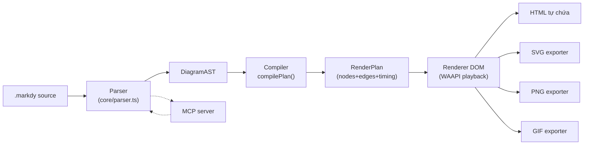
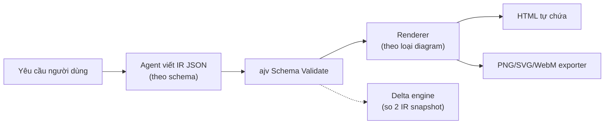
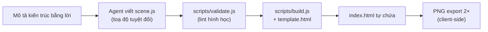

# Weekly scan: diagram-as-code / visual tooling (2026-09-02)

Phạm vi: repo GitHub mới/hoạt động trong 7-30 ngày qua liên quan đến diagram-as-code, DSL, layout algorithm, SVG animation — phục vụ nghiên cứu cho kymostudio.

## Tóm tắt điều hành

- **Đối thủ trực tiếp gần nhất xuất hiện tuần này là `HoangYell/markdy-com` (Markdy)** — một DSL diagram-as-code TypeScript có kiến trúc pipeline gần như song song với kymostudio (parse → AST → compile → RenderPlan → render), nhưng đi xa hơn ở animation timeline (`beat`/cue qua Web Animations API), MCP server, và language server — đáng để đọc sâu nhất trong 3 repo.
- **Hai repo còn lại (`tt-a1i/archify`, `yulonghe97/draw-architecture`) không phải "DSL parser" theo nghĩa cổ điển** mà là *agent skill*: cả hai để AI agent tự tay ghi toạ độ/IR JSON thay vì auto-layout, chỉ dùng script để validate + render tĩnh — một triết lý ngược hẳn với hướng auto-layout của kymostudio, đáng để đối chiếu (contrast) hơn là sao chép.
- **Cảnh báo dữ liệu:** `tt-a1i/archify` hiển thị 42,100 sao / 2,700 fork cho một repo skill mới, chỉ 214 commit, package `private:true` (chưa publish npm) — tỷ lệ sao/commit bất thường, nên xem số liệu sao này với sự hoài nghi, không dùng làm tín hiệu chất lượng kỹ thuật.

## Mục lục

1. [Markdy — HoangYell/markdy-com](#1-markdy--hoangyellmarkdy-com)
2. [Archify — tt-a1i/archify](#2-archify--tt-a1iarchify)
3. [draw-architecture — yulonghe97/draw-architecture](#3-draw-architecture--yulonghe97draw-architecture)

---

## 1. Markdy — HoangYell/markdy-com

**Repo:** https://github.com/HoangYell/markdy-com · **Stars:** 88 · **Forks:** 3 · **License:** MIT · **Pushed:** 2026-09-02

### §1 — Quick context

Markdy là DSL diagram-as-code cho **kiến trúc hệ thống có animation choreography** (beat/cue) chạy bằng Web Animations API thay vì SVG/CSS tĩnh, khác kymostudio ở chỗ animation là first-class syntax chứ không phải chế độ render phụ. Tech stack: TypeScript monorepo (pnpm workspaces), zero-dependency core parser (~14KB), `@modelcontextprotocol/sdk` cho MCP server. Output: HTML tương tác (WAAPI), SVG/PNG/GIF tĩnh, Astro SSR wrapper. Sức khoẻ repo: 88 sao/3 fork/13 PR mở, có CI (`ci.yml`, `release.yml`, `publish-vscode.yml`), version 1.2.0. Phân phối: npm (`@markdy/core`, `@markdy/cli`, `@markdy/renderer-dom`...) + VS Code/Cursor/Windsurf marketplace extension.

### §2 — Architecture deep-dive

**A. Component inventory**
- `Parser` (`packages/core/src/parser.ts`) — tokenizer dòng-theo-dòng kết hợp regex (`FLOW_OP_RE`, `TOP_LEVEL_KEYWORDS_RE`) và recursive descent cho khối lồng nhau (beat/group/pattern); sinh `DiagramAST` + mảng `diagnostics`.
- `Compiler` (`packages/core/src/compiler.ts`) — hàm `compilePlan(ast, theme)` biến AST thành `RenderPlan`: tính kích thước canvas thích ứng, layout node theo mode (ranked/tree/circular), route cạnh trực giao (orthogonal) tránh vật cản, lập lịch animation.
- `Registry` (`packages/core/src/registry.ts`) — cấu hình tĩnh 18 "diagram mode" (architecture, flowchart, tree, sequence, gantt, radar, swimlane, quadrant, timeline, venn, pyramid...), 4 edge operator (`->`,`<-`,`~>`,`--`), alias node, từ khoá cue (show/hide/glow/focus).
- `Renderer DOM` (`packages/renderer-dom/src/*.ts`) — mỗi loại diagram một file render riêng (`tree.ts`, `sequence.ts`, `gantt.ts`, `radar.ts`, `swimlane.ts`...), cộng `geometry/{path,rect}.ts` cho hình học và `presentation-controller.ts` điều khiển `currentTime` của WAAPI.
- `Export backends` (`packages/renderer-dom/src/export/{svg,png,gif}-exporter.ts`, `inline-resources.ts`) — xuất tĩnh từ cùng RenderPlan.
- `CLI` (`packages/cli/src/index.ts`) — 13 subcommand: `lint`, `fmt`, `render`, `explain`, `import` (từ Mermaid/Docker Compose/K8s/Terraform/Draw.io), `diff`, `share`, `suggest`, `new`, `docs`, `ai`, `check`, `check-all`; có `--help` đầy đủ.
- `MCP server` (`packages/mcp-server`) — dùng `@modelcontextprotocol/sdk`, expose validate/transpile/generate cho Claude/Cursor.
- `Language server` (`packages/markdy-language-server`), `VS Code extension` (`packages/vscode`) — tồn tại theo cấu trúc thư mục, nội dung chi tiết không xác định (chưa đọc source).
- `Compat/ingestion` (`packages/compat`) — chuyển đổi từ định dạng khác sang MarkdyScript.

**B. Pipeline (happy path)**
1. Người dùng viết `.markdy` (vd `examples/01-first-diagram.markdy`: `scene theme=paper`, `layout LR`, khai báo node, khối `beat main: show $nodes stagger=80ms` + flow chain).
2. `markdy render file.markdy` gọi `parse()` từ `@markdy/core` → `DiagramAST` (kèm diagnostics dòng/cột).
3. `compilePlan(ast, theme)` → `RenderPlan` (node đã có toạ độ pixel, `RoutedEdge[]` đã route trực giao, animation keyframe theo beat).
4. `@markdy/renderer-dom` dựng DOM/SVG theo RenderPlan, gắn WAAPI keyframes qua từng module theo loại diagram.
5. CLI xuất HTML tự chứa (mặc định) hoặc gọi exporter SVG/PNG/GIF tĩnh.
6. File output xuất hiện trên đĩa / mở trình duyệt qua `--open`.

**C. Data model/IR:** `DiagramAST` (interface TypeScript có `meta`, `nodes` (map theo id), `edges[]`, `groups`, `patterns`, `beats`, `diagnostics`) là IR đầu, `RenderPlan` là IR thấp hơn (toạ độ tuyệt đối + timing) — một chiều AST→RenderPlan, không thấy bằng chứng có bước hạ cấp kiểu TALA (D2) xa hơn RenderPlan.

**D. Input language design:** hybrid dòng-theo-dòng + regex + recursive descent cho cấu trúc lồng — không phải PEG/ANTLR/parser-combinator thuần. Không tìm thấy file EBNF chính thức trong repo (có `docs/SYNTAX.md` nhưng nội dung chưa đọc — không xác định độ hình thức). Báo lỗi: `ParseError(message, line, column?)`, `diagnostics[]` phân biệt severity, warning không dừng parse còn error thì dừng.

**E. Layout:** theo mode (ranked/tree/circular) — tức layout theo *template riêng cho từng loại diagram*, không phải một solver tổng quát (force-directed/constraint) áp dụng cho mọi loại. Route cạnh: trực giao (orthogonal), tránh vật cản xác định (deterministic obstacle clearance). Không có bằng chứng cụ thể về thuật toán giảm giao cắt kiểu Sugiyama/ILP.

**F. Rendering:** một renderer sống chính (DOM + Web Animations API, `requestAnimationFrame` loop điều khiển `currentTime`), quanh đó là các exporter tĩnh pluggable (SVG/PNG/GIF) cùng đọc từ RenderPlan; `packages/astro` làm SSR placeholder + hydrate khi vào viewport. Animation là cú pháp DSL tường minh (`beat`, cue `show/hide/glow/focus/frame`), không phải CSS suy luận ngầm.

**G. Extensibility:** thêm node kind mới = cập nhật registry `TECHNICAL_NODE_TYPES` + role map; thêm cue mới = đăng ký từ khoá + parse + lên lịch + animate; thêm flow operator = thêm vào `EDGE_OPERATORS`. Theo `docs/ARCHITECTURE.md`, mọi mở rộng đi qua đúng 3 giai đoạn pipeline "không sửa logic render lõi". Theme qua `themes.ts`/`theme-generator.ts` ("10 editorial theme"). Không có plugin API dạng load động — mở rộng bằng sửa registry trong core.

**H. Dev experience:** CLI có `--help`, subcommand phong phú (`lint`, `fmt --write/--check`, `diff`, `suggest` kiểu IntelliCode, `check`/`check-all` quét đệ quy `.markdy`/`.md`/HTML). IDE: extension VS Code/Cursor/Windsurf/VSCodium với live preview. MCP server cho agent AI. Watch mode: không xác định (không thấy flag watch trong tóm tắt CLI). Browser preview: có, qua HTML tự chứa mở bằng `--open`, cộng Astro SSR.

### §3 — Architecture diagram

### §4 — Verdict

Đáng học sâu nhất trong 3 repo vì cùng hình dạng pipeline với kymostudio (parse→IR→layout→render) nên so sánh trực tiếp được. Ý tưởng cụ thể đáng tham khảo: (1) cú pháp `beat`/cue tường minh cho animation — kymostudio hiện có `--animate` nhưng theo CLAUDE.md dường như animation là chế độ render, không phải cú pháp DSL riêng; một khối kiểu `beat` có thể là cách hay để người dùng kymo choreography animation tường minh thay vì suy luận ngầm. (2) route cạnh trực giao với "obstacle clearance xác định" đáng đối chiếu với `alignment.py`'s fan-in/trunk-lane staggering. (3) `suggest`/IntelliCode + `arch-lint` (governance rule trên DSL) là ý tưởng dev-tooling mới kymo chưa có. Red flag: 18 loại diagram được cài bằng 18 file renderer tay riêng biệt (tree.ts, gantt.ts, radar.ts...) — nguy cơ trùng lặp code cao, khác với model "renderer dumb + Region/Component chung" của kymostudio. Câu hỏi mở: RenderPlan có giải constraint chung hay chỉ là template cố định theo mode — chưa có bằng chứng. Verdict: **study deeper**.

---

## 2. Archify — tt-a1i/archify

**Repo:** https://github.com/tt-a1i/archify · **Stars:** 42,100 (đáng ngờ, xem cảnh báo) · **Forks:** 2,700 · **License:** MIT · **Pushed:** 2026-09-02

### §1 — Quick context

Archify khác biệt ở chỗ **từ chối auto-layout tổng quát**: agent AI tự viết IR JSON (schema-validated) chọn hierarchy/spacing, tool chỉ auto-route cạnh + validate + render ra HTML tự chứa. Tech: Node.js/JavaScript thuần, `ajv` (JSON Schema validation), `parse5`, `saxes`, `simple-icons`; output HTML + tuỳ chọn PNG/SVG/WebM + social card 1200×630. Sức khoẻ: 42.1k sao/2.7k fork nhưng chỉ 214 commit và `package.json` có `"private": true` (không publish npm) — tỷ lệ sao/quy mô rất bất thường, nên nghi ngờ số liệu này (có thể do cơ chế "skill marketplace" gây phồng số liệu chứ không phản ánh mức độ engineering). Có test script (brand-mark validation, validator check, golden file test). Phân phối: cài như "agent skill" qua `npx skills add tt-a1i/archify -g` hoặc clone thủ công vào `~/.raven/workspace/skills` — không phải thư viện npm thông thường.

### §2 — Architecture deep-dive

**A. Component inventory**
- `Schemas` (`archify/schemas/{architecture,workflow,sequence,dataflow,lifecycle,common}.schema.json`) — JSON Schema định nghĩa IR cho từng loại diagram, kiểm bằng `ajv`.
- `Renderers` (`archify/renderers/{architecture,workflow,sequence,dataflow,lifecycle,shared}/`) — thư mục render riêng theo loại; nội dung file bên trong không xác định (chỉ xác nhận cấu trúc thư mục, chưa đọc source vì `SKILL.md` chủ động khuyến cáo agent không đọc renderer/validator source trước khi tạo candidate đầu tiên).
- `CLI` (`archify/bin/archify.mjs`) — subcommand `render`, `compare`, `deliver`, `preview`, `validate`, `migrate`, `inspect`, `check`, `visual-check`, `guide`, `brands`, `examples`, `doctor`, `demo`; có `--help`/`usage()` theo từng lệnh.
- `Delta engine` (`archify/delta/`) — so sánh 2 snapshot IR ("Architecture Delta"), sinh "validation receipt" liệt kê added/removed/changed/moved/rerouted.
- `Visual check` (`archify/bin/visual-check.mjs`) — đo đạc HTML đã render bằng trình duyệt headless để xác nhận kết quả thị giác.
- `SKILL.md` — tài liệu vận hành cấp prompt cho agent (không phải code) mô tả vòng lặp authoring bắt buộc.

**B. Pipeline (agent-in-the-loop)**
1. Agent phân loại yêu cầu vào 1 trong 5 loại cố định (architecture/workflow/sequence/dataflow/lifecycle), chỉ đọc schema + ví dụ JSON tương ứng.
2. Agent tự viết file `<candidate>.json` (ID mới, "không lên kế hoạch toạ độ chính xác trong prose" — mặc định dùng route tự động).
3. `node bin/archify.mjs validate <type> <candidate.json>` — kiểm schema (ajv) + 9 tiêu chí "showcase" (composition, không lỗi/cảnh báo).
4. `node bin/archify.mjs deliver <type> <candidate.json> <output.html>` — render → check → trích "receipt" (bằng chứng nguồn) → commit atomically vào đường dẫn đích.
5. `visual-check` chạy đo đạc trình duyệt trên HTML cuối để xác nhận không lỗi bố cục.
6. HTML tự chứa (+ tuỳ chọn PNG/SVG/WebM/social card) là kết quả cuối, có thể mở bằng `--open`.

**C. Data model/IR:** JSON document được validate bằng JSON Schema theo từng loại diagram (vd `examples/web-app.architecture.json` mô tả CDN/LB/API/Redis/Postgres/SQS/Worker với 3 "view" luồng request); IR được agent viết một lần, xem như bất biến khi vào renderer — không thấy bước hạ IR thấp hơn kiểu TALA, dù README tự nhận "deterministic compilation".

**D. Input language design:** không có cú pháp văn bản tuỳ biến — "ngôn ngữ" chính là *shape* JSON được ràng buộc bởi JSON Schema (schema đóng vai trò văn phạm), do agent LLM viết trực tiếp, không qua parser tự viết. Không có BNF/EBNF (không áp dụng — JSON Schema thay thế). Báo lỗi: lỗi validate của `ajv` được lộ qua lệnh `validate`; "receipt" cho kết quả pass/fail có bằng chứng kèm theo.

**E. Layout:** theo `SKILL.md`, mặc định là "automatic routes and labels" (một auto-router nội bộ không rõ tên thuật toán) mà agent không được ghi đè bằng toạ độ tay trừ khi dùng control hình học có tên (`via`, `channelX`, `labelAt`), tối đa "một control hình học mỗi lần sửa lỗi". "Automatic Port Spread" xử lý port song song tự động. Thuật toán layout cụ thể (force-directed/Sugiyama/ILP?) **không xác định** — source renderer chưa được đọc (do SKILL.md ngăn cản đọc trước, và giới hạn thời gian nghiên cứu).

**F. Rendering:** một renderer JSON-IR→HTML cho mỗi loại diagram, output là 1 file HTML tự chứa có "built-in motion" — cơ chế animation cụ thể không xác định. Có exporter phụ: PNG, SVG, WebM, social card cố định — dạng pluggable exporter quanh 1 renderer HTML chính, tương tự hình dạng của Markdy.

**G. Extensibility:** cố định 5 loại diagram theo thiết kế; `SKILL.md` khuyến cáo tường minh "không đọc renderer/validator source" trước khi authoring — không có cơ chế plugin/shape tuỳ biến bên thứ ba được tài liệu hoá. Theme: "dark/light, 4 preset, brand mark tích hợp" (`brand-marks/`, dùng `simple-icons`) — preset cố định, không phải theme do người dùng tự định nghĩa.

**H. Dev experience:** CLI có `--help`/`usage()` theo lệnh, có `doctor` (chẩn đoán hệ thống), `preview.mjs` cho dev cục bộ — chưa xác nhận có hot-reload/watch thật sự. Không có VS Code extension/LSP; "IDE" thực chất là chat của coding agent (Cursor/Claude Code/Codex/OpenCode) cài qua `npx skills add`, không phải editor riêng cho người dùng cuối.

### §3 — Architecture diagram

### §4 — Verdict

Ý tưởng đáng học không nằm ở thuật toán layout (không xác định, source bị gatekeep) mà ở **quy trình validate→deliver→commit atomically kèm "receipt"** — có thể áp dụng vào kỷ luật golden-SVG của kymostudio: một bước "receipt" ghi rõ bằng chứng (git-verified source line) trước khi commit output có thể là ý tưởng mới cho tính năng "trace kymo component về source code". Ngược lại, layout algorithm cụ thể không có bằng chứng nên không thể rút bài học kỹ thuật trực tiếp. Red flag rõ ràng: 42.1k sao/2.7k fork cho repo `private:true`, 214 commit, chưa publish npm — tỷ lệ này bất thường và nên nghi ngờ là hiệu ứng marketplace/bot hơn là tín hiệu chất lượng thật; đọc thận trọng, không dùng số sao để đánh giá. Câu hỏi mở: renderer/layout thật sự dùng thuật toán gì (source bị SKILL.md ngăn đọc). Verdict: **glance only**.

---

## 3. draw-architecture — yulonghe97/draw-architecture

**Repo:** https://github.com/yulonghe97/draw-architecture · **Stars:** 141 · **Forks:** 10 · **License:** MIT · **Created:** 2026-08-11

### §1 — Quick context

Không có parser DSL và không auto-layout: agent tự tay ghi toạ độ tuyệt đối vào một scene object JS (`scene.js`), script chỉ validate hình học + build HTML — khác biệt là "manual placement + static lint" thay vì layout engine. Tech: JavaScript thuần (Node ≥18), template HTML/CSS/JS cố định, phụ thuộc runtime duy nhất là Google Fonts (JetBrains Mono). Output: HTML canvas tự chứa (pan/zoom/click-to-isolate), PNG xuất 2× phía client. Sức khoẻ: 141 sao/10 fork, MIT, chỉ 10 commit, có CI workflow + `evals/evals.json` (test prompt cho agent). Phân phối: npm (`npx draw-architecture`), skills.sh (`npx skills add yulonghe97/draw-architecture`), hoặc clone thủ công + symlink vào `~/.claude/skills`.

### §2 — Architecture deep-dive

**A. Component inventory**
- `CLI installer` (`bin/cli.js`) — trình cài đặt npx, hỏi vị trí cài (global/agents/project/custom path).
- `Build script` (`scripts/build.js`) — gộp `scene.js` đã validate vào `assets/template.html`, xuất `index.html`; nhận flag `--scene/--out/--title/--kicker/--sub/--slug`.
- `Validator` (`scripts/validate.js`) — lint hình học: dangling reference, box lệch band, chồng lấn (overlap), tràn chữ (text overflow), cạnh chéo (diagonal edge), mũi tên đặt sai vị trí.
- `Viewer template` (`assets/template.html`) — renderer thực sự: pan/zoom/pinch (có neo theo con trỏ), click-to-isolate (làm mờ phần không liên quan + panel mô tả), toggle dark/light (phím `t`), trạng thái pan/zoom lưu ở URL hash, xuất PNG 2×.
- `Scene format spec` (`references/scene-format.md`) — tài liệu mô hình dữ liệu (chưa đọc nội dung chi tiết, chỉ biết mô tả 9 hằng số).
- `Eval harness` (`evals/evals.json`) — test prompt & assertion cho hành vi agent.

**B. Pipeline**
1. Người dùng mô tả kiến trúc bằng lời (vd "Turn docs/architecture.md into an explorable diagram").
2. Agent (theo hướng dẫn `SKILL.md`, chưa đọc trực tiếp) viết `scene.js`: object JS phẳng với 9 hằng số `W, H, PLANES, BANDS, BOXES, EDGES, TEXTS, SWATCHES, CHIPS`, toạ độ tuyệt đối trong "world coordinates".
3. `node scripts/validate.js examples/x-scene.js` — lint tĩnh phát hiện lỗi hình học trước khi build.
4. `node scripts/build.js --scene x-scene.js --out index.html --title ... --kicker ... --sub ...` — chèn scene đã validate vào template cố định.
5. `index.html` tự chứa (chỉ gọi ngoài tới Google Fonts) xuất hiện, mở trực tiếp trong trình duyệt hoặc publish qua artifact.cafe.
6. (tuỳ chọn) nút export trong viewer tự rasterize trạng thái pan/zoom/theme hiện tại thành PNG 2×.

**C. Data model/IR:** một object JS phẳng (plain object, không phải class/dataclass), 9 mảng/hằng số trong một hệ toạ độ world duy nhất; về bản chất là ghi một lần rồi đọc — không có nhiều pass biến đổi, không có khái niệm "hạ IR" vì scene chính là hình học gần-cuối-cùng (template chỉ "vẽ" lại).

**D. Input language design:** không có văn phạm văn bản nào — "ngôn ngữ" là shape cố định của một object JS (9 field có tên), do agent LLM viết trực tiếp chứ không parse từ cú pháp riêng; do đó không có BNF/EBNF, không có parser tự viết. Báo lỗi: `validate.js` xuất báo cáo lint hình học (overlap, tràn chữ, cạnh chéo, mũi tên sai) — giống static-analysis hơn là parse-error recovery.

**E. Layout:** **không auto-layout** — mọi box/edge đặt bằng toạ độ x/y/w/h tuyệt đối do agent tự chọn; "bands" chỉ áp một quy ước xếp lớp thô theo chiều ngang (causal order). Route cạnh: fixed "side gutter" cho feedback loop (label xoay), còn lại route thẳng/trực giao giữa toạ độ tường minh — thuật toán chính xác không xác định (không có trong nội dung đã fetch). Không có bước giảm giao cắt (không cần vì vị trí là thủ công).

**F. Rendering:** một backend duy nhất — template HTML/CSS cố định (canvas hay SVG cụ thể không xác định); animation giới hạn ở tương tác pan/zoom/theme-toggle, không có timeline choreography như Markdy. Output: HTML tự chứa (chính) + PNG (xuất phía client qua nút trong viewer, không phải CLI exporter riêng). Kiến trúc một-backend, không phải pluggable emitter.

**G. Extensibility:** thêm "diagram" mới = viết scene mới, không phải mở rộng tool; mở rộng chính tool nghĩa là sửa trực tiếp `assets/template.html` hoặc `scripts/validate.js` (tài liệu hoá rõ trong mục Contributing) — không có hệ plugin, không có registry icon/shape. Theme: chỉ có toggle dark/light tích hợp sẵn, không có theme do người dùng định nghĩa.

**H. Dev experience:** CLI installer chỉ hỏi vị trí cài, không có flag authoring — việc "viết diagram" thực chất diễn ra qua hội thoại với agent chứ không qua CLI DSL cho người. Không có IDE extension/LSP. Không thấy watch mode. Browser preview: có — mọi output là HTML browsable, cộng tích hợp artifact.cafe cho link demo chia sẻ không cần đăng nhập.

### §3 — Architecture diagram

### §4 — Verdict

Đây là ca nghiên cứu "âm bản" hữu ích: một số nhóm chủ động từ bỏ auto-layout hoàn toàn, chấp nhận đặt tay toạ độ theo "band/plane" rồi bù lại bằng lint tĩnh (dangling ref, overlap, tràn chữ, cạnh chéo, mũi tên sai) — đúng là loại việc mà `alignment.py` của kymostudio đã tự động hoá (auto anchoring, auto-canvas, fan-in staggering). Điều này xác nhận gián tiếp rằng hướng tiếp cận auto-layout của kymo giải quyết một nỗi đau thật. Ý tưởng cụ thể đáng lấy: danh mục lint hình học của `validate.js` (overlap/text-overflow/diagonal-edge/misplaced-arrowhead) có thể trở thành một bước QA hậu-render tuỳ chọn cho kymo, bất kể ai tính toạ độ. Red flag: đây không thực sự là "DSL" theo nghĩa diagram-as-code (không có parser) mà là renderer cho dữ liệu do agent tự soạn tay — quy mô nhỏ (10 commit, 141 sao, mới 3 tuần). Câu hỏi mở: `validate.js` dùng heuristic hình học hay tính toán chính xác — chưa xác nhận. Verdict: **glance only**.
