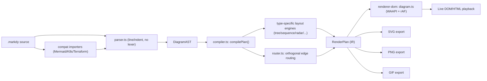
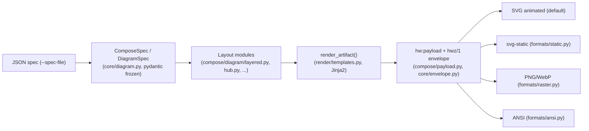
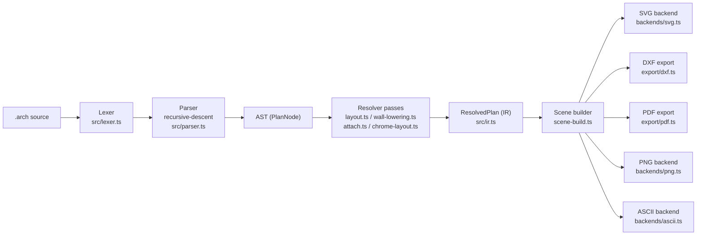
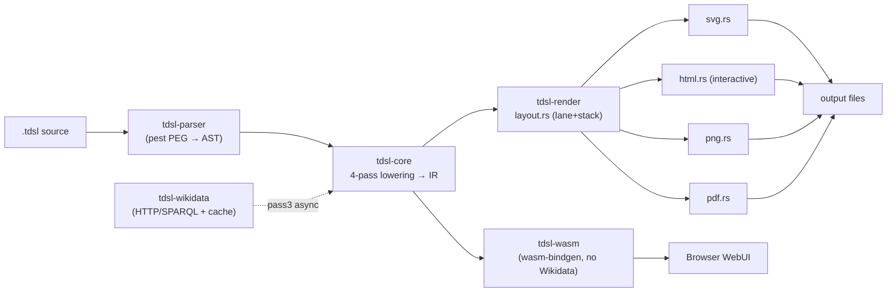

# Weekly Scan — Diagram Tooling (2026-09-03)

**Nguồn**: GitHub topic search (`diagram-as-code`, `dsl`, `svg-animation`, `graph-visualization`, `layout-algorithm`) + web search, lọc theo hoạt động trong 7 ngày qua (27/08–03/09/2026), loại bỏ profile-README/chart-lib/portfolio noise.

## Executive summary

- **Không có đối thủ trực diện mới nào đe doạ kymo về mặt tính năng** — 4 repo được chọn đều lệch khỏi tổ hợp "DSL + auto-layout + animated SVG" của kymo theo ít nhất một trục (markdy dùng DOM/WAAPI thay vì SVG-first, hyperweave là JSON-spec không có DSL văn bản, archlang/timeline-dsl là domain hẹp phi kiến trúc-hệ-thống).
- **Hai ý tưởng kỹ thuật đáng đưa vào backlog kymo**: (1) two-tier self-describing artifact (payload JSON + digest hash nhỏ nhúng trong SVG) từ hyperweave — giúp agent verify/re-render mà không cần giữ `.kymo` gốc; (2) `pinned_orders()`-style "giữ thứ tự tác giả khi re-layout" từ hyperweave's Sugiyama-based `layered.py`, so sánh trực tiếp được với `alignment.py`.
- **Tín hiệu sức khoẻ đáng ngờ ở cả 4 repo** — sao thấp (0–88), dấu vết rõ rệt của AI-agent-driven development (`.claude/`, `AGENTS.md`, buzzword marketing, nhịp release dồn dập bất thường) — nên đọc kỹ thuật nhưng đừng đánh giá "độ trưởng thành" qua số liệu bề mặt.

## Mục lục

1. [HoangYell/markdy-com](#1-hoangyellmarkdy-com) — study: glance only
2. [InnerAura/hyperweave](#2-inneraurahyperweave) — study: study deeper (payload/envelope + layered.py)
3. [ChanMeng666/archlang](#3-chanmeng666archlang) — study: study deeper (diagnostics-as-data + IR/Scene split)
4. [keroway/timeline-dsl](#4-kerowaytimeline-dsl) — study: glance only

---

## 1. HoangYell/markdy-com

### §1 Quick context

Markdy là DSL diagram-as-code tập trung vào **diễn hoạt (60fps motion graphics qua Web Animations API)** thay vì SVG tĩnh — khác kymostudio ở việc DOM/WAAPI là backend render chính (SVG chỉ là export phụ) và có 17+ layout engine chuyên biệt theo loại diagram thay vì một layout engine chung.

- **Tech stack**: TypeScript monorepo (pnpm workspaces), core zero-dependency (~14 kB); output: DOM/HTML sống, export SVG/PNG/GIF; VS Code extension; MCP server.
- **Repo health**: 88 sao, 3 fork, MIT license, CI badge có, 582 commit; nhịp release rất dồn dập (10 bản từ v1.0.31 → v1.2.0 chỉ trong 2 ngày 29–30/8); 13 PR mở / 0 issue mở; số contributor không xác định (trang contributors lỗi tải).
- **Phân phối**: npm (nhiều package `@markdy/*`), VS Code Marketplace (`hoangyell.markdy-vscode`), web playground (markdy.com/playground).

### §2 Architecture deep-dive

**A. Component inventory**
- `Parser` (`packages/core/src/parser.ts`) — parse MarkdyScript → AST.
- `AST types` (`packages/core/src/ast.ts`) — định nghĩa `DiagramAST`/`RenderPlan`.
- `Compiler` (`packages/core/src/compiler.ts`, hàm `compilePlan`) — điều phối layout + scheduling.
- `Router` (`packages/core/src/router.ts`) — edge routing orthogonal.
- `Renderer DOM` (`packages/renderer-dom/src/diagram.ts`, `index.ts`) — dựng DOM + animate WAAPI.
- Layout/render chuyên biệt theo loại diagram: `sequence.ts`, `tree.ts`, `swimlane.ts`, `quadrant.ts`, `radar.ts`, `gantt.ts`, `timeline.ts`, `constellation.ts`.
- `Compat` (`packages/compat`) — transpiler từ Mermaid/Docker Compose/K8s/Terraform/Draw.io.
- `CLI` (`packages/cli/src/index.ts`); `MCP server` (`packages/mcp-server`).

**B. Pipeline / control flow**
1. Người dùng viết file `.markdy` (hoặc chạy `markdy import` để chuyển từ Mermaid/K8s).
2. `markdy render` gọi `parser.ts` (đọc theo dòng/indent, không lexer riêng) sinh `DiagramAST` + diagnostics.
3. `compilePlan(ast, theme)` trong `compiler.ts`: gom edge, tính kích thước canvas thích ứng, gọi `layoutNodes()` (dispatch theo loại diagram), route edge qua `router.ts`, tính group boundary + tree bus, `scheduleBeats()` định thời animation → sinh `RenderPlan`.
4. `renderer-dom` dựng cây DOM (div, không phải SVG) từ `RenderPlan`, set inline style cho frame đầu.
5. `diagram.ts` tạo animation bằng `element.animate()` (WAAPI) cho từng cue, đồng bộ qua vòng lặp `requestAnimationFrame` set `anim.currentTime`.
6. Tuỳ chọn export tĩnh SVG/PNG/GIF từ cùng `RenderPlan`.

**C. Data model / IR**: `DiagramAST` và `RenderPlan` là plain TS interface/type alias (không phải class), mutable — hai tầng IR rõ rệt (AST → RenderPlan) nhưng không bị ép bất biến giữa các pass.

**D. Input language design**: parser tự viết, dòng+indent-based, không lexer/tokenizer hình thức, dùng regex nhận diện keyword và các hàm đọc block. Có bước thay biến trước khi parse block. Lỗi báo qua `ParseError(message, line, column)`; cảnh báo non-fatal gom vào mảng diagnostics khử trùng lặp. Không có EBNF/grammar hình thức được công bố (`docs/SYNTAX.md` chỉ là prose + ví dụ) — kém nghiêm ngặt hơn `docs/DSL.md` của kymo.

**E. Layout algorithm**: không phải một auto-layout tổng quát, mà 17+ engine chuyên biệt theo loại diagram (ranked, tree, constellation, sequence, radar, quadrant, swimlane, gantt...). Edge routing orthogonal/Manhattan (`router.ts`), chọn port theo trục lệch lớn hơn, tránh va chạm bằng margin cố định (20px) — heuristic đơn giản, không thấy thuật toán giảm crossing kiểu Sugiyama/barycenter.

**F. Rendering / output strategy**: backend chính là **DOM** (thẻ div), không phải SVG. Animation dùng `element.animate()` (WAAPI) điều khiển thủ công qua rAF (scrub/pause/loop). Export tĩnh SVG/PNG/GIF là lớp phái sinh từ cùng `RenderPlan`.

**G. Extensibility**: tài liệu hoá rõ trong `ARCHITECTURE.md` — thêm node kind: đăng ký `TECHNICAL_NODE_TYPES`; thêm cue animation: `BEAT_CUE_KEYWORDS` + `parseCueLine` + `scheduleBeats`; thêm edge operator: `EDGE_OPERATORS` + `EDGE_STYLES`. Theme qua `theme-generator.ts`/`themes.ts` (10 theme). Không có plugin/hook API runtime — mở rộng vẫn phải sửa bảng registry trong source.

**H. Dev experience**: CLI đa lệnh (`lint/render/fmt/import/diff/share/new/explain/suggest/check`), VS Code extension live-preview, `@markdy/language-server` (LSP headless), browser playground, MCP server, và bộ diagnostics "self-healing" nhắm vào việc sửa code do LLM sinh (`ai-healing.ts`, `syntax-diagnostics.ts`).

### §3 Architecture diagram

### §4 Verdict

Ý hay đáng tham khảo cho kymo: (1) tách layout theo **loại diagram chuyên biệt** (sequence/swimlane/quadrant/radar/gantt riêng) thay vì cố nhét vào một auto-layout tổng quát — có thể hợp cho các dạng diagram đặc thù kymo chưa hỗ trợ tốt; (2) mô hình animation "WAAPI + rAF currentTime scrub" cho phép play/pause/seek/loop mượt, đáng so sánh với cách kymo sinh CSS animation trong SVG; (3) các "extension point" ghi rõ trong `ARCHITECTURE.md` (bảng registry cho node kind/cue/edge operator) là mẫu tài liệu hoá extensibility gọn, đáng học.

Red flag: parser không có grammar hình thức (khác `docs/DSL.md` chuẩn EBNF của kymo), routing edge chỉ là heuristic margin-based chưa chứng minh chống crossing; nhịp release 10 bản/2 ngày và marketing nặng buzzword AI ("hallucination-prone", "self-healing") gợi ý dự án còn non/ít review. Câu hỏi mở: có test suite/golden nào đảm bảo tương thích ngược giữa các bản 1.1.x–1.2.0 dồn dập đó không — không xác định.

**Verdict: glance only** — ghi chú ý tưởng animation WAAPI-scrub và layout-per-diagram-type vào research notes, không cần đào sâu code.

---

## 2. InnerAura/hyperweave

### §1 Quick context

HyperWeave sinh SVG "tự mô tả" nhúng sẵn payload JSON + digest sha256, hướng tới giao tiếp agent-to-agent hơn là làm DSL diagram-as-code kiểu kymo.

- **Tech stack**: Python ≥3.10, pydantic v2, Jinja2, typer, httpx, fonttools/brotli; optional FastAPI/uvicorn, fastmcp, resvg-py+pillow. Output: SVG animated (mặc định), svg-static, PNG, WebP, ANSI terminal.
- **Repo health**: 38 sao, 8 fork, 183 commit, Apache-2.0; CI có (`ci.yml`, `deploy.yml`, `publish.yml`, `release-drafter.yml`) nhưng release tag/số contributor cụ thể không xác định; release gần nhất v0.4.6 (31/08/2026).
- **Phân phối**: PyPI (`uv add hyperweave`), HTTP API (`hyperweave.app/v1`), MCP server, Docker.

### §2 Architecture deep-dive

**A. Component inventory**
- `cli.py` (`src/hyperweave/cli.py`, Typer app, entry point `hw`/`hyperweave`).
- Compose engine `compose()` (`compose/engine.py`, orchestrator 7 bước).
- Resolver (`compose/resolver.py`, genome/profile → `ResolvedArtifact`).
- IR models (`core/diagram.py` — `DiagramSpec`/`DiagramNode`/`DiagramEdge`, `Topology` enum 12 giá trị).
- Layout subsystem, ~38 file trong `compose/diagram/` (`graph.py`, `layered.py`, `hub.py`, `fan.py`, `lanes.py`, `loop.py`, `sequence.py`, `radial.py`, `route.py`, `solver.py`, `collide.py`).
- Renderer (`render/templates.py`, `render/css_finish.py`); payload builder (`compose/payload.py`); envelope (`core/envelope.py`).
- Verb grammar (`verbs/{extract,verify,diff,query,transform,patch,lineage,parse}.py`); output backends (`formats/{raster,ansi,static,destinations}.py`).

**B. Pipeline / control flow**
1. User chạy `hw compose diagram --spec-file spec.json --genome primer` (hoặc SDK/HTTP/MCP).
2. CLI dựng `ComposeSpec` (pydantic frozen, validate ngay lúc construct) chứa `DiagramSpec` làm IR.
3. `compose()` chạy state-inference → `resolve()` → assemble CSS → build context → policy enforce → `render_artifact()`.
4. Trong lúc build context, `layered.py`/`hub.py`/... tính rank, thứ tự node, route cạnh, rồi `payload.py`/`envelope.py` nhúng `hw:payload` + `hwz/1` envelope.
5. `formats/` chọn backend xuất SVG/PNG/WebP/ANSI.
6. Ghi file/stdout, emit telemetry (discard-by-design).

**C. Data model / IR**: toàn chuỗi là **frozen pydantic BaseModel** (bất biến) — mọi transform tạo bản ghi mới kèm lineage. Thiết kế hai tầng đáng chú ý nhất repo:
- **Layer 1 `hw:payload`** — JSON nội dung đầy đủ, "content-only" (không mang genome/variant), serialize compact CDATA-safe để hash ổn định (`id = sha256(payload)`; cùng nội dung dưới genome khác nhau chia sẻ cùng id).
- **Layer 2 `hwz/1` envelope** — dict thường (không pydantic) ~200 token, chứa `id`/`k`/`intent`/`prov`, verify roundtrip được (`envelope.id` khớp hash payload → xác thực toàn vẹn).

**D. Input language design**: JSON-only, pydantic-validated, **không có DSL văn bản** trên JSON (khác `.kymo`); preset lưu dạng YAML "content-as-data" (`data/presets/diagram.yaml`). Lỗi báo qua pydantic `ValidationError` + `HwError` wrap thành `ValueError`; có lệnh `hw validate` chạy schema-check riêng không render.

**E. Layout algorithm**: mỗi topology có module riêng, không phải một engine force-directed chung. `layered.py` triển khai Sugiyama-style: `longest_path_ranks()` → `barycenter_orders()` (4 sweep mặc định, giảm crossing) → `pinned_orders()` (giữ thứ tự tác giả đã chọn khi re-layout); self-loop và duplex edge (u→v & v→u) tách riêng để không sai rank; back-edge (state-machine cycle) phát hiện qua DFS. `hub.py` có `_ChannelRoute`/`_ChannelPlan` để route cạnh dọc chu vi hub (compass/axial).

**F. Rendering / output strategy**: renderer Jinja2 duy nhất (`render_artifact`), chọn template theo convention file (`frames/<kind>/<genome>-<slug>.svg.j2` với fallback) — pluggable-by-convention chứ không phải registry class rõ ràng. Animation SMIL/CSS được README nhắc tới nhưng chưa verify sâu trong `templates.py`.

**G. Extensibility**: genome là data (YAML/JSON) kiểm tra qua `hw validate-genome` — thêm genome mới không cần code. Thêm topology mới có vẻ cần sửa `Topology` enum + module mới trong `compose/diagram/` — không có bằng chứng plugin loader động.

**H. Dev experience**: CLI phong phú (`doctor`, `install-hook` tự wire session-receipt hook vào Claude Code/Codex settings.json — DX "agent-native" đáng chú ý). Không thấy watch-mode/browser live-preview trong các file đã fetch — không xác định.

### §3 Architecture diagram

### §4 Verdict

Đáng học nhất: thiết kế **payload+digest hai tầng** — JSON nội dung đầy đủ nhúng CDATA + digest sha256 nhỏ (~200 token) để agent "biết mà không cần mở". kymo hiện chưa có cơ chế tự-mô tả tương tự trong `.svg` xuất ra; thêm một envelope nhỏ (hash + metadata) bên cạnh full model JSON có thể giúp pipeline LLM verify/re-render mà không cần giữ `.kymo` gốc. Thứ hai, `pinned_orders()` trong `layered.py` (giữ thứ tự tác giả khi re-layout) là ý tưởng cụ thể có thể so sánh với cách `alignment.py` xử lý auto-layout frame khi user muốn giữ vị trí thủ công qua nhiều lần re-render.

Cờ đỏ: input JSON-only, không DSL văn bản — viết tay khó hơn `.kymo`, dựa nặng vào preset YAML; `compose/diagram/` có ~38 file nhỏ lẻ, có dấu hiệu over-fragmentation. Câu hỏi mở: hiệu quả crossing-minimization trên đồ thị dày đặc chưa rõ; cơ chế thêm topology mới có thực sự "pluggable" hay phải sửa core enum.

**Verdict: study deeper** riêng phần payload/envelope design và thuật toán `layered.py`; phần còn lại glance only.

---

## 3. ChanMeng666/archlang

### §1 Quick context

ArchLang là DSL khai báo cho bản vẽ mặt bằng kiến trúc, biên dịch sang SVG/DXF/PDF/PNG/ASCII xác định (deterministic), thiết kế ưu tiên cho AI agent hơn con người — khác kymo ở domain (floor plan thay vì system/process diagram) và ở việc hoàn toàn không có animation.

- **Tech stack**: TypeScript thuần, **zero runtime dependency** (xác nhận qua `package.json`: chỉ devDependencies như tsup/vitest/biome/playwright, và optionalDependencies `@resvg/resvg-js`, `pdfkit`, `clipper2-wasm` cho PNG/PDF). Output: SVG/DXF/PDF/PNG/TXT.
- **Repo health**: 8 sao, 1 fork, 743 commit trên `main`, nhiều workflow CI (`ci.yml`, `codeql.yml`, `nightly.yml`, `eval-*.yml`); release rất dày, mới nhất v1.33.0 (02/09/2026).
- **Phân phối**: npm (bin `arch`), VS Code extension, web playground (playground.archlang.uk), MCP server tuỳ chọn.

### §2 Architecture deep-dive

**A. Component inventory**
- `Lexer`/`Parser` (`src/lexer.ts`, `src/parser.ts`) — tokenize + recursive-descent, registry-driven element dispatch → AST (`ast.ts`).
- Resolver passes: `layout.ts` (relational placement), `wall-lowering.ts`, `attach.ts`, `chrome-layout.ts`, `vertical.ts` → IR bất biến (`ir.ts`: `ResolvedPlan`).
- `scene-build.ts`/`scene.ts` dựng một **Scene trung gian độc lập backend** (`ScenePrim`).
- Backends: `src/backends/{svg,ascii,png,error-svg}.ts` và `src/export/{dxf,pdf}.ts`.
- Furniture: dữ liệu ở `fixtures-catalog.ts`, vẽ glyph ở `elements/fixtures-glyphs.ts`.
- Diagnostics/lint: `lint.ts`, `diagnostics.ts`, `error-catalog.ts`, `fix-producers.ts`, `repair.ts`.

**B. Pipeline / control flow** (`arch compile plan.arch --svg out.svg`)
1. Lexer tokenize.
2. Parser (recursive-descent) dựng `PlanNode` AST, gom lỗi thành `Diagnostic` thay vì throw.
3. `layout.ts` + các pass lowering biến AST thành `ResolvedPlan` bất biến, toạ độ mm tuyệt đối.
4. `scene-build.ts` hạ tiếp xuống `Scene` trung gian (backend-agnostic).
5. Một backend (svg/dxf/pdf/png/ascii) serialize Scene.
6. `cli.ts` ghi file, exit code phản ánh mức độ nghiêm trọng của diagnostics.

**C. Data model / IR**: các interface phẳng, bất biến (`RWall`, `RRoom`, `RDoor`, `RWindow`, `RFurniture`, `RDim`...) — không phải class. Resolver **không mutate AST đầu vào**, luôn tạo IR mới. Hai tầng "compile xuống IR thấp hơn": AST → `ResolvedPlan` (mm tuyệt đối, sau grid-snap) → `Scene` (nguyên thủy vẽ).

**D. Input language design**: recursive-descent thuần, registry-driven; **không có BNF/EBNF chính thức** dù `docs/language-reference.md` tồn tại — chỉ pseudocode/prose. Lỗi: `ParseError` nội bộ bị bắt và chuyển thành `Diagnostic` (severity/code/span); `synchronize()` panic-mode recovery giúp parser **không bao giờ throw ra ngoài**, luôn trả về `PlanNode` dù input lỗi một phần.

**E. Layout algorithm**: **không phải constraint solver** — `placeRelational()` là vòng lặp fixpoint/topo đơn giản: quét lặp các room còn `_rel` chưa resolve (right-of/below/align/gap) cho tới khi ổn định hoặc phát hiện chu trình (`E_LAYOUT_CYCLE`); vị trí tính bằng công thức đóng (`x = ref.at.x + ref.size.w + gap`), xử lý theo thứ tự khai báo để đảm bảo determinism. **Không có collision detection** — tác giả ghi rõ "deliberately NOT an optimizer".

**F. Rendering / output strategy**: multi-backend nhưng không có interface plugin hình thức — mỗi backend tự viết, cùng đi qua `Scene` chung. SVG backend tự mô tả "pure serializer... byte-identical". **Không có animation nào** (không SMIL/CSS/JS) — hoàn toàn static.

**G. Extensibility**: thêm furniture = thêm `FixtureSpec` vào `fixtures-catalog.ts` + hàm vẽ ở `fixtures-glyphs.ts`, tách data/draw rõ ràng. Thêm output format = viết module backend mới, đăng ký thủ công trong CLI manifest — không có plugin system chính thức.

**H. Dev experience**: CLI chia rõ 4 nhóm (render/analyze/author/meta), có `watch` mode (resident process duy nhất), gợi ý lỗi gõ nhầm, `--json` khắp nơi cho agent loop, LSP (`src/lsp.ts`), VS Code extension, và web playground xác nhận tuyên bố "isomorphic Node/browser".

### §3 Architecture diagram

### §4 Verdict

Đáng học: (1) tách "errors-as-data" triệt để — `Diagnostic` mang span+code+fix, parser panic-mode recovery luôn trả AST một phần, phù hợp để nâng cấp diagnostics/`--json` của kymo cho agent workflow; (2) hai tầng lowering rõ ràng (AST → IR tuyệt đối-mm → Scene trung gian backend-agnostic) là mẫu tách renderer sạch hơn cách `to_svg.py`/`to_figma.py` hiện tại của kymo trực tiếp đọc `Diagram`. Thuật toán relational placement (fixpoint arithmetic, không constraint solver, không collision) thực chất xác nhận hướng đi mà `alignment.py` của kymo đã chọn — không phải ý tưởng mới nhưng là bằng chứng đối chiếu tốt.

Red flag: `src/` có ~55 file phẳng không chia thư mục con nhất quán (trừ vài dir như `backends/`, `export/`) — dấu hiệu nợ kỹ thuật khi codebase lớn dần. Không có animation dù output đa dạng — SVG động của kymo là lợi thế cạnh tranh thực sự nên nhấn mạnh. Câu hỏi mở: README nói "formal spec" nhưng không có BNF/EBNF thật — trái ngược với `docs/DSL.md` chuẩn hoá của kymo.

**Verdict: study deeper** phần CLI diagnostics-as-data và pattern tách IR/Scene; domain (floor plan) khác kymo nên không phải đối thủ trực tiếp nhưng đáng tham chiếu kỹ thuật.

---

## 4. keroway/timeline-dsl

### §1 Quick context

Timeline DSL là ngôn ngữ khai báo timeline lịch sử/sự kiện, tích hợp import trực tiếp từ Wikidata (QID) và cache offline — khác kymo ở domain hẹp (chỉ timeline, không phải diagram tổng quát) và ở việc coupling chặt với một nguồn dữ liệu bên ngoài.

- **Tech stack**: Rust 2024 workspace 7 crate, parser dùng `pest` PEG, `wasm-bindgen` cho browser, `serde`/`schemars` cho IR JSON, `miette` cho error diagnostics, `tokio`+`reqwest` cho Wikidata client. Output: HTML (interactive)/SVG/PNG/PDF.
- **Repo health**: 0 sao/0 fork nhưng 647 commit, release mới nhất v2.1.0 đúng ngày 02/09/2026, CI dày đặc (CI, CodeQL, osv-scan, secret-scan, Dependabot) — có `.claude/`, `AGENTS.md`, `plans/` cho thấy đây là dự án phát triển nặng bằng AI coding agent, có thể solo.
- **Phân phối**: crates.io, npm (`@keroway/tdsl-wasm`), VS Code Marketplace, script cài đặt binary (curl/brew/cargo-binstall).

### §2 Architecture deep-dive

**A. Component inventory**
- `tdsl-parser` (`crates/tdsl-parser/src/lib.rs`, `grammar.pest`) — PEG grammar → AST, không phụ thuộc crate khác.
- `tdsl-core` (`crates/tdsl-core/src/ir.rs`, `lower/mod.rs`) — AST → IR qua 4 pass, validate, decompile ngược.
- `tdsl-wikidata` — HTTP/SPARQL client độc lập với cache filesystem.
- `tdsl-render` (`src/layout.rs`, `svg.rs`, `html.rs`, `pdf.rs`, `png.rs`) — IR → nhiều định dạng output.
- `tdsl-wasm` — facade wasm-bindgen cho browser.
- `tdsl-cli` (`src/main.rs`) — binary tích hợp tất cả (16 subcommand qua `clap`).
- `tdsl-lsp` — Language Server Protocol (có trong workspace, không nêu rõ trong README).

**B. Pipeline / control flow**
1. `tdsl build/render foo.tdsl` → CLI đọc file.
2. `tdsl-parser` parse PEG → AST (comment bị strip).
3. `tdsl-core::lower` chạy 4 pass tuần tự (pass1–pass2 sync, pass3 async, pass4 sync) → `TimelineIr`.
4. Validate references/ranges.
5. `tdsl-render` build layout (lane→toạ độ, stacking) rồi emit HTML/SVG/PNG/PDF.
6. Ghi file output.

**C. Data model / IR**: `TimelineIr { meta, lanes: Vec<Lane>, items: Vec<Item>, imports, sources }`, `Item` là tagged-union enum (`Span`/`Event`/`EventRange`) qua `#[serde(tag="type")]`. Struct immutable-by-design, mỗi pass tạo/merge dữ liệu mới qua `LoweringContext`. 4 pass: (1) `pass1_declarations` — thu thập metadata + bảng lane, check trùng; (2) `pass2_static_items` — xử lý event/span/range tĩnh, check lane reference + ID uniqueness; (3) `pass3_resolve_imports` — pass async duy nhất, gọi Wikidata client, giới hạn số kết quả; (4) `pass4_apply_maps` — áp map/template rule, gắn origin attribution cho item từ Wikidata.

**D. Input language design**: grammar PEG hình thức (`grammar.pest`) định nghĩa timeline block, lane, group, span/event/event_range decl, import/map/template/apply block, filter expression, time literal (year xuống đến second, BCE, UTC offset). Error reporting dựa vào `miette` (feature "fancy") — tận dụng span-based diagnostics đẹp mắt của pest thay vì tự viết.

**E. Layout algorithm**: toạ độ trục thời gian là fractional-year → pixel qua `year_to_x()` (`left_gutter + (year-year_min)*scale`), hỗ trợ cả orientation ngang/dọc bằng cách trừu tượng hoá primary axis (thời gian) và cross axis (lane). Có 3 tầng collision detection bằng greedy interval coloring: `assign_bar_stack_levels` (chồng lấn span/event_range trong cùng lane), `assign_event_label_stack_levels` (nhãn event chồng lấn theo bề rộng text ước lượng), `assign_period_label_stack_levels` (nhãn start-end của gantt bar).

**F. Rendering / output strategy**: một crate `tdsl-render` duy nhất, nhiều emitter con (svg.rs/html.rs/pdf.rs/png.rs) dùng chung layout đã tính; `tdsl-wasm` gọi lại đúng pipeline core+render này trong browser (Wikidata bị loại trừ khỏi WASM vì `reqwest`/`tokio` không build cho wasm target — import bị "silently skipped").

**G/H. Extensibility & dev experience**: không xác định chi tiết cách thêm output format mới; CLI có watch mode, subcommand `lsp`/`completions`, VS Code extension với syntax highlight + diagnostics + in-editor preview, và có `apps/webui` (trình soạn thảo trên trình duyệt) — dev experience tỏ ra khá đầy đủ dựa trên số lượng subcommand và tooling, nhưng chưa verify chất lượng thực tế.

### §3 Architecture diagram

### §4 Verdict

Đáng học: (1) tách IR thành `serde`-serializable struct trung lập, dùng chung giữa native render và WASM — kymo có thể siết chặt hơn contract giữa `model.py` và model tương ứng bên JS theo hướng này thay vì chỉ dựa vào conformance test riêng lẻ; (2) 3-tầng greedy interval-coloring cho collision (bar stack, event label, period label) là kỹ thuật cụ thể áp dụng được cho auto-layout frame/alignment resolver của kymo khi nhiều component chồng nhau; (3) PEG grammar (pest) cho error span đẹp qua `miette` là tradeoff đáng cân nhắc — kymo dùng parser line-oriented tự viết, được lợi về đơn giản nhưng mất diagnostics tự động theo span; nếu lỗi UX của kymo còn yếu, đây là điểm tham khảo.

Red flag: 0 sao/0 fork dù 647 commit + hạ tầng CI/release rất nặng (CodeQL, osv-scan, secret-scan, 27+ release) và dấu vết `.claude/`, `AGENTS.md`, `plans/` gợi ý dự án agent-driven mạnh, có thể chưa có người dùng thực — cẩn thận khi đánh giá "trưởng thành" chỉ qua số lượng crate/tooling. Câu hỏi mở: pass3 (Wikidata) có rollback/partial-failure behavior ra sao khi network lỗi giữa chừng — không xác định.

**Verdict: glance only** — kỹ thuật layout/IR đáng ghi chú nhanh, nhưng repo quá non-adoption để đầu tư đọc sâu hơn.
