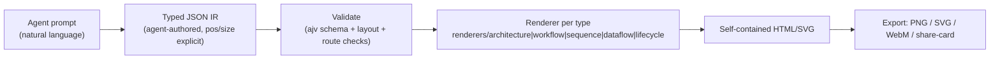
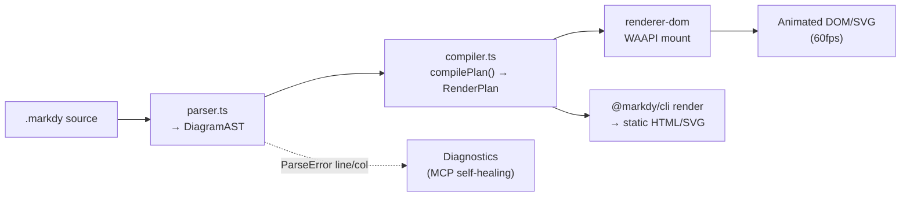
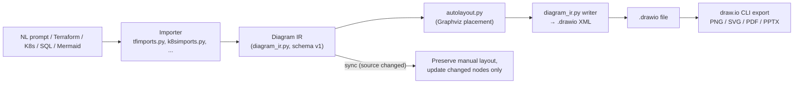
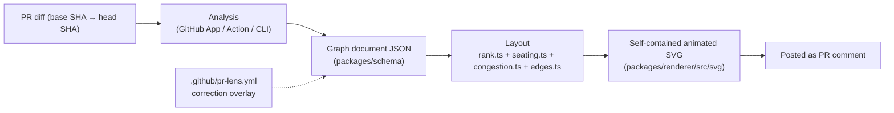

# Weekly Scan — Diagram Tooling (2026-09-04)

Phạm vi: repos diagram-as-code / visual tooling published hoặc updated đáng kể trong 7 ngày qua (từ 2026-08-28), phục vụ kymostudio side project.

## Executive summary

- **Làn sóng "Agent Skill" đang định nghĩa lại category này**: cả `archify`, `drawio-skill` và `pr-lens` đóng gói thành Agent Skill (Claude Code / Cursor / Codex) chứ không phải thư viện gọi trực tiếp — pattern chung lặp lại ở cả ba: agent sinh **JSON IR** → validate bằng schema → **deterministic compile** ra SVG/HTML. Đây là dấu hiệu category "diagram-as-code" đang dịch chuyển từ "con người viết DSL" sang "agent sinh IR, con người review".
- **`markdy-com` là repo gần kiến trúc kymostudio nhất trong tuần này** — DSL riêng (`.markdy`), nhiều layout engine, compile ra **animated SVG/DOM** qua Web Animations API — gần như một "gương soi" trực tiếp cho pipeline `dsl.py → layout.py → alignment.py → to_svg.py` của kymostudio, đáng đọc kỹ nhất trong 4 repo.
- **Auto-layout không còn là mặc định bắt buộc**: `archify` chủ động bỏ auto-layout — để agent tự chọn toạ độ tuyệt đối (pos/size) — trong khi `drawio-skill` ưu tiên "incremental sync giữ nguyên layout thủ công" hơn là recompute toàn bộ mỗi lần build. Cả hai đối lập với cách tiếp cận resolver 5-pass tự động của kymostudio (`alignment.py`) và đáng để đối chiếu.

## Mục lục

1. [archify (tt-a1i/archify)](#1-archify-tt-a1iarchify)
2. [markdy-com (HoangYell/markdy-com)](#2-markdy-com-hoangyellmarkdy-com)
3. [drawio-skill (Agents365-ai/drawio-skill)](#3-drawio-skill-agents365-aidrawio-skill)
4. [pr-lens (coldteadotai/pr-lens)](#4-pr-lens-coldteadotaipr-lens)

---

## 1. archify (tt-a1i/archify)

### §1 — Quick context

Agent skill biến JSON IR do LLM sinh ra thành system-map HTML/SVG tương tác với validation atomic thay vì mermaid theme thông thường. Tech stack: Node.js (ESM, zero heavyweight runtime deps — chỉ `ajv`, `parse5`, `saxes`, `simple-icons` làm devDependencies), output HTML tự chứa (self-contained) kèm export PNG/SVG/WebM/share-card. Repo health: 46.0k stars, 2.9k forks, 149 watchers, có GitHub Actions, version dev hiện tại `v2.17.0-dev.1`, không phải bản ổn định publish riêng lẻ — phân phối qua `npx skills add tt-a1i/archify` (Agent Skills registry), không có trên npm như một package độc lập.

### §2 — Architecture deep-dive

**A. Component inventory**
- CLI/entry point: `archify/bin/archify.mjs` — điều phối các subcommand (`render`, `compare`, `deliver`, `validate`, `inspect`, `guide`, `demo`…).
- Renderers theo diagram type: `archify/renderers/{architecture,workflow,sequence,dataflow,lifecycle}/render-<type>.mjs` — mỗi loại diagram có renderer riêng (không phải một renderer chung tổng quát).
- Schema/validation: `archify/schemas/` + `scripts/generate-validators.mjs` (dựa trên `ajv`) — sinh validator từ schema.
- Delta engine: `archify/delta/` — so sánh hai snapshot IR (Before/After) cho tính năng "Architecture Delta".
- Design tokens: `DESIGN.md` (frontmatter YAML: colors/typography/spacing) — style hệ thống dùng chung cho mọi renderer.

**B. Pipeline / control flow** (happy path):
1. User gõ prompt trong agent chat mô tả hệ thống → agent tự sinh **typed JSON IR** (không phải người viết tay DSL).
2. `archify validate <type> <input.json>` chạy schema + layout + route-clearance checks (atomic — tất cả phải pass).
3. `archify render <type> <input.json> [output.html]` gọi renderer tương ứng, biên dịch IR → HTML/SVG tự chứa.
4. `archify deliver` chỉ thay output cũ bằng output mới khi validation pass ("last-good" guarantee).
5. Optional: `archify preview` mở desktop loop watch 1 file JSON, tự reload khi bản mới pass hết gate.
6. File `.html` xuất hiện, có thể export thêm PNG/SVG/WebM/1200×630 share card qua menu Export.

**C. Data model / IR**: Typed JSON IR, mỗi component có `id`, `type`, `label`, **`pos` và `size` tuyệt đối** (đã kiểm chứng từ ví dụ `docs/cases/mco-runtime.architecture.json`), có thể gắn `sources` (path + line number trỏ vào code thật). IR bất biến theo nghĩa nó được re-validate mỗi lần build; không thấy compile xuống một IR thấp hơn kiểu D2's TALA — chỉ có một tầng IR rồi render thẳng.

**D. Input language design**: Không có "ngôn ngữ" theo nghĩa cú pháp text người viết tay — input là **JSON có schema** (`ajv`-validated), được agent sinh ra từ prompt tự nhiên. Không có grammar BNF/EBNF vì bản chất không phải parser văn bản. Error reporting: `validate --json` trả về "stable rule codes, exact subject, measured evidence, và repair controls" — thiết kế lỗi máy-đọc-được rất kỹ, hướng tới agent tự sửa lỗi chứ không phải human đọc traceback.

**E. Layout algorithm**: **Không có auto-layout engine** — README nói thẳng "Layout judgment over generic auto-layout": agent tự chọn `pos`/`size` cho từng node. Điểm layout duy nhất mà tool tự động hoá là cách các cạnh dùng chung endpoint tự toả ra ("shared automatic endpoints spread deterministically") để tránh chồng mũi tên tại một điểm.

**F. Rendering/output strategy**: Backend SVG/HTML là chính (embed trong file HTML tự chứa), có "finite motion" (animation có điểm dừng, không loop vô hạn) — cơ chế animation cụ thể không xác định (không đọc được code renderer chi tiết). Multi-format export (PNG/SVG/WebM/share-card) qua cùng nguồn IR. Kiến trúc renderer là **pluggable theo diagram type** (5 renderer riêng biệt trong `renderers/`), không phải một emitter tổng quát.

**G. Extensibility**: Thêm brand mark mới qua `scripts/generate-brand-marks.mjs` (check bằng `check:brand-marks`); thêm loại diagram mới đòi hỏi thêm cả schema, validator, và renderer riêng — không có plugin API mô tả rõ trong tài liệu đã đọc.

**H. Dev experience**: CLI khá đầy đủ (`guide`, `doctor`, `examples`, `demo`), có desktop live-preview loop; không xác định có LSP/VS Code extension riêng hay không (không thấy trong structure).

### §3 — Architecture diagram



### §4 — Verdict

Điểm đáng học cho kymostudio: cách archify thiết kế **error reporting máy-đọc-được** (`validate --json` trả rule code + subject + repair control) là ý hay để kymo cân nhắc cho `dsl.py` khi phục vụ agent sinh `.kymo` tự động — hiện tại lỗi parse của kymo hướng tới người đọc, chưa tối ưu cho agent tự sửa. Ý tưởng "shared automatic endpoint spreading" (tự toả cạnh dùng chung điểm) cũng liên quan trực tiếp tới phần fan-in/trunk-lane staggering đã có trong `alignment.py` — đáng so sánh cách archify giải quyết cùng bài toán khi KHÔNG có auto-layout tổng thể. Red flag: hoàn toàn không có auto-layout algorithm — không học được gì về thuật toán layout cụ thể; 46k star trong khi chỉ ~214 commit là dấu hiệu viral do xu hướng "agent skill" hơn là độ trưởng thành kỹ thuật lâu năm. Verdict: **glance only** cho phần renderer, nhưng **study deeper** riêng phần error-schema/repair-receipt design.

---

## 2. markdy-com (HoangYell/markdy-com)

### §1 — Quick context

DSL riêng compile trực tiếp ra **animated 60fps DOM/SVG diagram** dùng Web Animations API thay vì Mermaid tĩnh hay theme lại Mermaid. Tech stack: TypeScript monorepo (pnpm workspaces), core parser ~14kB zero-dependency, output là DOM+CSS/SVG animation (không phải ảnh tĩnh); phân phối qua npm (`@markdy/core`, `@markdy/renderer-dom`, `@markdy/cli`, `@markdy/mcp-server`, `@markdy/astro`, `@markdy/mdx`) + VS Code/Open VSX extension. Repo health: 88 stars, 3 forks, 582 commits, có CI (`ci.yml` badge xanh trên README), version `@markdy/core` hiện tại `1.2.0` — đã publish thật trên npm, không chỉ là dev branch.

### §2 — Architecture deep-dive

**A. Component inventory**
- Parser: `packages/core/src/parser.ts` — parse `.markdy` text thành `DiagramAST`, export `ParseError` với `line`/`column`.
- AST: `packages/core/src/ast.ts` — định nghĩa `NodeDecl`, `EdgeDecl`, `BeatDecl`, `SceneMeta`, `RenderPlan`…
- Compiler/layout: `packages/core/src/compiler.ts` — có hằng số layout cứng (`NODE_W=180`, `NODE_H=76`, `GROUP_PAD=28`…), hàm `computeNodeDimensions`.
- Registry: `packages/core/src/registry.ts` — bảng `NODE_KINDS`, `EDGE_OPERATORS`, `DIAGRAM_TYPES`, `CUE_ALIASES`.
- Renderer DOM: `packages/renderer-dom` (gói riêng, "Motion graphics and 60fps animation").
- Player: `packages/core/src/player.ts` — điều khiển playback/timeline của animation.
- Tích hợp: `packages/{astro,mdx,vscode,cli,mcp-server}` — mỗi target một package riêng trong cùng monorepo.

**B. Pipeline / control flow**:
1. User (qua AI agent) viết prompt mô tả hệ thống.
2. Agent sinh mã `.markdy` (ví dụ cú pháp lấy trực tiếp từ README, xem mục D).
3. `parser.ts` parse text → `DiagramAST`; nếu lỗi, ném `ParseError(message, line, column)`.
4. `compiler.ts` (được `parser.ts` gọi qua `compilePlan`) biến AST → `RenderPlan` đã có toạ độ node, route cạnh, lịch animation (`TimedCue`).
5. `@markdy/renderer-dom` nhận `RenderPlan`, mount vào DOM, phát animation qua WAAPI (60fps).
6. Người dùng chạy `npx @markdy/cli render system.markdy --out diagram.html` để xuất file HTML/SVG tĩnh, hoặc nhúng trực tiếp qua `createDiagram()` trong web app.

**C. Data model / IR**: `DiagramAST` (immutable-by-convention, TypeScript `type`, không phải class) là tầng parse-result; `RenderPlan` là tầng thấp hơn đã compile sẵn layout + animation timeline — **đây chính là kiểu "compile xuống lower IR" giống ý tưởng TALA của D2**: `parser.ts` tách rõ `ast` và `plan` trong `ParseResult { ast, plan }`, và `compilePlan()` là bước biến đổi riêng biệt giữa hai tầng.

**D. Input language design**: Parser tự viết (custom, không phải PEG/ANTLR — dựa trên cấu trúc import/registry cho thấy đây là line-oriented với keyword-based dispatch, tương tự cách tiếp cận của `dsl.py`). Cú pháp mẫu (từ README, xác thực):
```markdy
scene "Cache-Aside Architecture" theme=auto
layout LR
browser Client "Web Client"
cache Redis "Redis Cluster"
beat cache_hit "1. Cache Hit Path":
  show $nodes stagger=60ms
  Client -> Gateway "GET /link" -> Svc "resolve"
  Svc ~> Redis "SETEX key:link (Warm Cache)"
```
— node-type là keyword đứng trước (`browser`, `cache`, `database`…), 3 loại arrow operator (`->`, `<-`, `~>`) mã hoá trực tiếp hướng + kiểu message (đồng bộ/bất đồng bộ), khối `beat` là animation storyboard theo thời gian. Không thấy grammar EBNF chính thức trong repo đã đọc. Error reporting có line/column qua `ParseError`, cộng thêm "self-healing syntax diagnostics" qua MCP server cho agent tự sửa lỗi.

**E. Layout algorithm**: README khẳng định "collision-aware orthogonal Manhattan edge routing và rank-based auto-layout", có **17 layout engine** khác nhau theo loại diagram (architecture/flowchart/tree/sequence/layers/swimlane…) — đa dạng engine hơn hẳn cách tiếp cận layout đơn nhất của kymo. Không đọc được code layout cụ thể (nằm rải trong `compiler.ts` và các file khác chưa fetch) nên thuật toán chính xác (Sugiyama? barycentric?) — **không xác định**.

**F. Rendering/output strategy**: Backend chính là DOM + CSS/SVG transform, animation chạy qua **Web Animations API (WAAPI)** — khác hẳn cách kymo dùng SMIL/CSS animation trực tiếp trong SVG tĩnh xuất ra. Không dùng Canvas, không dùng GSAP — chủ trương "zero-dep". Có "Universal Ingestion": transpiler 1-click từ Mermaid, Draw.io, Docker Compose, Kubernetes manifest, Terraform state sang MarkdyScript — cross-format conversion rất mạnh.

**G. Extensibility**: Theme qua `themes.ts` + `theme-generator.ts`; node kind mới thêm vào `registry.ts` (`NODE_KINDS`); output target mới là package riêng trong monorepo (`renderer-dom`, `astro`, `mdx`).

**H. Dev experience**: VS Code/Cursor extension có live preview side-by-side (`Cmd+K V`), MCP server chính thức cho 6 IDE, Terminal CLI, browser Playground với timeline scrubbing + GIF/SVG export — dev experience rất đầy đủ, ngang hoặc hơn kymo hiện tại (kymo chưa có VS Code/LSP hay live preview trong CLAUDE.md).

### §3 — Architecture diagram



### §4 — Verdict

Đây là repo đáng nghiên cứu sâu nhất tuần này cho kymostudio vì gần như cùng bài toán: DSL text → animated diagram. Ba điểm cụ thể áp dụng được: (1) tách rõ `ParseResult { ast, plan }` với `compilePlan()` là bước biến đổi riêng — kymo hiện gộp phần layout tính toán vào `alignment.py` sau `dsl.py`, có thể học cách đặt tên/tách tầng rõ ràng hơn giữa "AST thô" và "plan đã có toạ độ+animation timeline" để dễ test từng tầng độc lập; (2) `.markdy` dùng arrow operator 3 loại (`->`/`<-`/`~>`) để mã hoá cả hướng lẫn kiểu message ngay trong cú pháp cạnh — đáng so sánh với cú pháp edge hiện tại của `.kymo`; (3) transpiler từ Mermaid/Docker Compose/K8s/Terraform sang MarkdyScript là hướng cross-format-conversion kymo chưa có (kymo mới có BPMN import), có thể là gợi ý roadmap. Open question: 17 "layout engine" nghe khá nhiều cho một core 14kB — cần đọc code thật để biết đây là 17 chiến lược riêng biệt hay 17 preset của cùng 1-2 thuật toán nền. Verdict: **study deeper**.

---

## 3. drawio-skill (Agents365-ai/drawio-skill)

### §1 — Quick context

Agent skill Python thuần biến text/mô tả hệ thống thành file `.drawio` có thể chỉnh sửa lại bằng tay, khác biệt lớn nhất là **incremental sync giữ nguyên layout thủ công** thay vì regenerate toàn bộ mỗi lần. Tech stack: Python stdlib-only cho core (`diagramctl.py`), output chính là `.drawio` XML (+ export PNG/SVG/PDF/PPTX qua draw.io desktop CLI tuỳ chọn). Repo health: 9.0k stars, 634 forks, 27 watchers, 242 commits, có GitHub Actions CI, skill version `3.2.1` theo `SKILL.md`. Phân phối qua Agent Skills registry (`npx skills add`) + Claude Code plugin marketplace, không phải PyPI package độc lập.

### §2 — Architecture deep-dive

**A. Component inventory**
- CLI hợp nhất: `skills/drawio-skill/scripts/diagramctl.py` — entry point cho mọi subcommand (`build/sync/views/query/test/review/whatif/story/publish/transform/doctor`).
- Model dùng chung: `skills/drawio-skill/scripts/diagram_ir.py` — "Shared semantic model", stdlib-only (`xml.etree.ElementTree`, `zlib`, `base64` để đọc/ghi `.drawio` XML nén).
- MCP server: `scripts/diagramctl_mcp.py` — expose 9 tool (`build/sync/views/architecture_test/review/query/whatif/story/doctor`) cho Claude Desktop/Cursor/VS Code/Codex.
- Importer riêng theo nguồn: `tfimports.py`, `k8simports.py`, `composeimports.py`, `sqlerd.py`, `pyimports.py`, `goimports.py`, `jsimports.py`, `rustimports.py`, `openapiimports.py`, `ciimports.py` — mỗi loại input có 1 file converter riêng.
- Layout: `autolayout.py`, `edgeports.py`, `seqlayout.py` (Graphviz-based, theo README).
- Loại diagram chuyên biệt: `c4.py`, `tubemap.py` (metro-map style), `sqlerd.py`.
- Kiểm tra chất lượng: `validate.py`, `drawiodiff.py`, `heatmap.py`, `repair_png.py`, `explain.py`.

**B. Pipeline / control flow**:
1. User mô tả hệ thống bằng ngôn ngữ tự nhiên, hoặc trỏ vào Terraform/K8s/compose/SQL/code repo.
2. Agent chọn route theo bảng trong `SKILL.md` (VD: `diagramctl.py build ./infra --from terraform --group --ir-output architecture.ir.json -o architecture.drawio`).
3. Importer tương ứng (`tfimports.py`…) parse nguồn → **Diagram IR** (schema `drawio-skill/diagram-ir/v1`, định nghĩa trong `diagram_ir.py`).
4. `autolayout.py` (Graphviz placement, transitive reduction) tính toạ độ cho IR chưa có vị trí.
5. `diagram_ir.py` ghi IR ra `.drawio` XML (base64+deflate theo chuẩn draw.io).
6. Khi source đổi, `diagramctl.py sync` **chỉ cập nhật node/relation đã thay đổi**, giữ nguyên toạ độ/style/annotation đã chỉnh tay ("incremental sync without losing manual layout") — đây là bước khác biệt nhất so với 3 repo còn lại, không tồn tại trong archify/pr-lens/markdy.
7. `validate.py --score` + export PNG self-check (tự đọc lại PNG để phát hiện overlap/label bị cắt, tự sửa tối đa 2 vòng) trước khi giao artifact cuối.

**C. Data model / IR**: Diagram IR có schema version riêng (`SCHEMA = "drawio-skill/diagram-ir/v1"`), style mặc định tách theo `kind` (`KIND_STYLE` dict cho `database`, `queue`, `gateway`, `external`, `actor`…). IR **mutable qua các pass** (import → autolayout → sync) nhưng versioned/schema-tagged để phát hiện incompatibility. Có "compile xuống lower IR" theo nghĩa IR trung gian rồi mới serialize ra `.drawio` XML (không phải render thẳng).

**D. Input language design**: Không có DSL text riêng cho core — nhận input qua 3 kênh: (1) JSON model theo Diagram IR schema, (2) Mermaid text (chuyển thẳng sang `.drawio` native — không qua Mermaid renderer), (3) infra-as-code có sẵn (Terraform/K8s/compose/SQL DDL). DSL "tự chế" duy nhất là format tube-map JSON nhỏ (`stations`/`lines` với toạ độ lưới `gx`/`gy`, xác thực qua `assets/tubemap.json`). Không có grammar EBNF chính thức — parser là custom Python theo từng importer, không dùng PEG/ANTLR.

**E. Layout algorithm**: **Hybrid rõ rệt** — Graphviz-based auto-layout (`autolayout.py`) cho import graph/class hierarchy với "transitive reduction, nested module containers"; edge routing "grid-aligned, connectors routed clear of nodes"; đồng thời **ưu tiên bảo toàn vị trí thủ công** qua `sync` thay vì recompute. Đây là điểm khác biệt kiến trúc lớn nhất so với kymo's `alignment.py` (vốn luôn resolve lại toàn bộ mỗi lần chạy, không có khái niệm "giữ vị trí cũ khi source đổi một phần").

**F. Rendering/output strategy**: Backend chính là `.drawio` XML (mxGraph format), qua draw.io desktop CLI export ra PNG/SVG/PDF/PPTX. Ngoài ra có `svgflow.py` cho "SVG animation" (riêng biệt khỏi luồng `.drawio` chính) và `drawiohtml.py` cho HTML viewer tự chứa (Story Mode). Không phải renderer đơn — là **toolbox nhiều output riêng biệt theo nhu cầu** (không phải một emitter pluggable thống nhất).

**G. Extensibility**: Icon/shape mới qua `shapesearch.py` (tra cứu 10,000+ shape chính thức AWS/Azure/GCP/Cisco/K8s/UML/BPMN + 321 logo AI/LLM brand); style mới qua "Style preset" học từ file `.drawio`/ảnh có sẵn (`restyle.py`); rule kiểm tra kiến trúc mới qua YAML/JSON rule file cho `diagramctl.py test`.

**H. Dev experience**: CLI thống nhất khá mạnh (`doctor` để kiểm tra môi trường), MCP server built-in cho 6+ agent host, GitHub Action riêng (`drawio-architecture-test`) cho CI gate — không thấy VS Code/LSP riêng cho một DSL text (vì bản chất ít dùng DSL text).

### §3 — Architecture diagram



### §4 — Verdict

Điểm học được cụ thể nhất cho kymostudio: cơ chế **"incremental sync giữ layout thủ công"** giải quyết đúng nỗi đau mà bất kỳ auto-layout resolver nào cũng gặp — khi user chỉnh tay vị trí trong `.kymo` rồi source đổi nhẹ, `alignment.py` hiện tại sẽ resolve lại từ đầu và có thể "xoá" tinh chỉnh thủ công đó; drawio-skill giải quyết bằng cách versioned IR + diff giữa hai lần build để chỉ cập nhật phần thay đổi. Đáng cân nhắc một passthrough tương tự cho các component đã có toạ độ tường minh trong `.kymo`. Thứ hai, cách tách "importer riêng theo từng nguồn" (`tfimports.py`, `k8simports.py`…) đều đổ chung vào một Diagram IR schema là mô hình sạch cho việc kymo mở rộng thêm BPMN-adjacent import khác trong tương lai (đã có `from_bpmn.py`, có thể học cấu trúc "N importer → 1 IR"). Red flag: repo cực lớn (42 script trong `scripts/`), độ phức tạp bề mặt cao, nguy cơ feature creep; không đọc được test suite thực tế để đánh giá độ tin cậy engineering. Verdict: **study deeper** (riêng phần incremental-sync/versioned-IR).

---

## 4. pr-lens (coldteadotai/pr-lens)

### §1 — Quick context

Tool tự động vẽ pull request thành **animated architecture/data-flow diagram** post ngay trong PR comment, khác biệt là gắn trực tiếp vào code-review workflow thay vì cần người tự mô tả hệ thống. Tech stack: TypeScript monorepo (pnpm), schema JSON riêng cho "graph document", output là SVG tự chứa có animation. Repo health: 222 stars, 7 forks, 111 commits, có GitHub Actions CI (`.github/workflows/pr-lens.yml` mẫu trong README), `@coldtea/pr-lens-renderer` version `0.1.2` — publish thật trên npm. Phân phối: GitHub App (chính), GitHub Action, CLI npm, hoặc agent skill (`packages/agent-skill`).

### §2 — Architecture deep-dive

**A. Component inventory**
- Schema: `packages/schema` — định nghĩa "graph document" JSON Schema + TypeScript types, có `examples/` (`minimal.graph.json`, `postmark-refactor.graph.json`, `broadcast-baseline.graph.json`…).
- Renderer: `packages/renderer/src` — "a schema-valid graph document in, a self-contained animated SVG out" (mô tả nguyên văn từ `package.json`), gồm `layout/` (thư mục con) và `svg/` (thư mục con), cộng các module `geometry.ts`, `bounds.ts`, `design.ts`, `theme.ts`, `text.ts`, `corrections.ts`, `scope.ts`, `render.ts`.
- Layout con: `packages/renderer/src/layout/{architecture,dataflow,rank,edges,congestion,labels,seating}.ts` — layout tách riêng theo diagram type (architecture vs dataflow) cộng các module thuật toán dùng chung (`rank.ts`, `congestion.ts`, `seating.ts`, `edges.ts`).
- CLI: `packages/cli` — chỗ xử lý "correction file" (`.github/pr-lens.yml`) cho rename/exclude/lane-pin.
- GitHub Action: `packages/action`; Agent skill: `packages/agent-skill`.

**B. Pipeline / control flow**:
1. User mở pull request trên repo đã cài GitHub App `coldtea-pr-lens`.
2. Bot phân tích diff giữa base/head SHA (`provenance.base.sha` / `head.sha` trong schema) → sinh **graph document JSON** (lanes, nodes có `delta: added|modified|removed|unchanged`, edges, flows theo thứ tự bước).
3. `.github/pr-lens.yml` (nếu có) áp overlay correction (rename/exclude/lane pin) lên kết quả suy luận trước khi render.
4. `packages/renderer` nhận graph document hợp lệ schema → chạy layout (`rank.ts` xếp hạng theo lane, `seating.ts` gán vị trí trong lane, `congestion.ts` + `edges.ts` route cạnh tránh chồng chéo) → sinh SVG có animation (data-flow "một chấm chạy qua từng cạnh theo đúng thứ tự bước").
5. Bot post comment vào PR với SVG nhúng trực tiếp, có `<details>` lồng nhau cho từng view con (route mới/route bị gỡ).
6. Mỗi lần push mới, diagram được vẽ lại tự động (redraw on every push).

**C. Data model / IR**: "Graph document" JSON — `schemaVersion`, `kind: "graph"`, `lanes[]`, `nodes[]` (mỗi node có `id`, `label`, `kind`, `delta`, `lane`, `files[]`), `edges[]`, `flows[]`, `views[]`. Xác nhận từ `minimal.graph.json` thật. Ngoài GraphDoc còn có "Patch" document (`graphId`, `fromSha`, `toSha`, ordered operations) để advance một baseline graph đã lưu giữa các commit — tức là **có khái niệm IR incremental/versioned tương tự drawio-skill** nhưng ở dạng patch/operation-log thay vì diff toàn phần. Model là **immutable theo từng snapshot** (mỗi graph doc là bất biến, thay đổi biểu diễn qua patch riêng), khác cách `alignment.py` của kymo mutate `Diagram` qua 5 pass trong cùng object.

**D. Input language design**: Không phải DSL text — input là JSON theo schema chính thức (`packages/schema/json-schema/`), hoặc do agent tự viết trực tiếp khi chạy qua "coding agent" mode ("your agent writes the graph document itself"). Correction file dùng YAML nhỏ gọn (`match`/`to` cho rename, `exclude` cho glob loại trừ) — không có grammar phức tạp, chỉ là mapping rule đơn giản.

**E. Layout algorithm**: **Lane-based (swimlane) + rank-based**, tên file xác nhận: `rank.ts` (rank-based hierarchical placement, kiểu Sugiyama theo lane), `seating.ts` (thuật toán gán vị trí trong lane — tên gợi ý một dạng barycentric/ordering để giảm crossing, nhưng thuật toán chính xác **không xác định** vì chưa đọc code), `congestion.ts` (route cạnh tránh nghẽn/chồng chéo — tên gợi orthogonal-style routing có aware về mật độ). Đây là auto-layout hoàn toàn tự động (không có concept giữ vị trí thủ công như drawio-skill).

**F. Rendering/output strategy**: Backend SVG duy nhất, tự chứa (README: "a self-contained animated SVG out"), animation kiểu "data flow bạn có thể xem" — một chấm di chuyển qua từng cạnh đúng thứ tự bước (sequence-style animation, cơ chế cụ thể CSS hay SMIL — **không xác định**, chưa đọc `svg/` subfolder). Color-code delta trực tiếp trong style: xanh lá = mới, hổ phách = đổi, đỏ = gỡ.

**G. Extensibility**: Correction overlay (`pr-lens.yml`) là cơ chế "extensibility" chính — không sửa code sinh ra mà áp lớp overlay lên kết quả suy luận, tồn tại bền qua các lần render kế tiếp. Không thấy plugin system cho thêm loại node/shape mới trong phần đã đọc.

**H. Dev experience**: Không cần setup gì nếu dùng GitHub App (không cần API key/workflow file). Có gallery public ("Hall of Fame" – vẽ lại PR nổi tiếng từ React/Node/Kubernetes...) để demo chất lượng thật trên PR lớn (37 node, 49 edge). Không xác định có VS Code/LSP hay watch-mode cục bộ.

### §3 — Architecture diagram



### §4 — Verdict

Ba điểm cụ thể cho kymostudio: (1) tách rõ `layout/architecture.ts` và `layout/dataflow.ts` như hai chiến lược layout **khác nhau theo loại diagram**, cộng các module thuật toán dùng chung (`rank.ts`, `congestion.ts`, `edges.ts`) — đáng đối chiếu với cách `alignment.py`/`layout.py` của kymo hiện xử lý mọi loại diagram qua cùng một resolver 5-pass; tách theo diagram-type có thể giúp tối ưu riêng cho từng use-case (flowchart vs sequence) thay vì một resolver chung. (2) Model "Patch" (`fromSha`/`toSha` + ordered operations) để advance graph theo thời gian là một dạng versioned diff-log gọn hơn cách "incremental sync" toàn phần của drawio-skill — đáng tham khảo nếu kymo muốn hỗ trợ "diagram theo dõi thay đổi qua các commit" trong tương lai. (3) Cơ chế correction-overlay YAML tách biệt khỏi model sinh ra là pattern sạch cho việc "user override tên/nhóm mà không sửa DSL gốc". Red flag: 0 watcher công khai dù 222 sao là khá bất thường, quy mô nhỏ (7 fork) — độ trưởng thành cộng đồng còn thấp so với 3 repo kia. Verdict: **study deeper** cho phần layout theo diagram-type, **glance only** cho phần còn lại.
