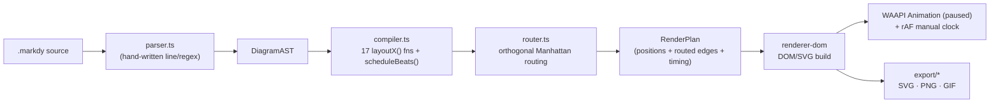
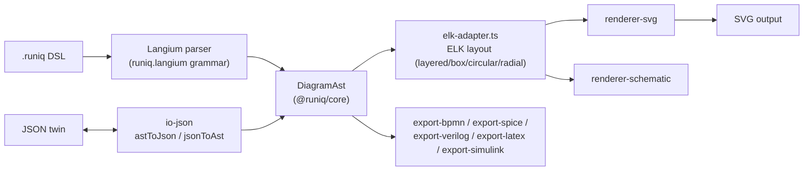
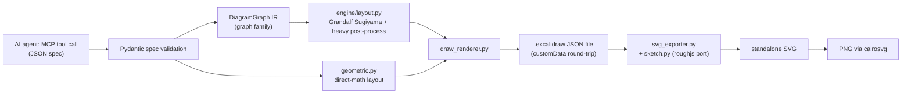
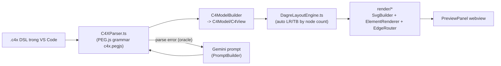

# Weekly scan: diagram-as-code & visual tooling — 2026-09-05

**Executive summary:**
- Tuần này chỉ có **1/4 repo** thật sự đạt ngưỡng "pushed trong 7 ngày" (Markdy, push hôm nay); domain diagram-as-code khá "thin" tuần này nên 3 repo còn lại được chọn theo relevance-based fallback (tier 2/3 trong data source) — recency thật của từng repo được ghi rõ ràng ở §1 mỗi mục, không che giấu.
- Phát hiện đáng chú ý nhất: **Markdy** — animated SVG diagram DSL rất gần với kymostudio về mission (17 layout engines, orthogonal routing, WAAPI animation, MCP server) — và **Runiq** — DSL đa domain (BPMN/SPICE/Verilog/LaTeX export) dùng Langium + ELK, do một cựu thành viên MermaidJS làm solo.
- Không có GitHub search API (`gh`) khả dụng trong session này (scope bị khoá về `kymostudio/kymostudio`); toàn bộ discovery + deep-dive dùng WebSearch/WebFetch (public GitHub pages) thay vì `gh api search/repositories` như đề bài gợi ý — một số dữ liệu (star count chính xác, ngày tạo repo) vì vậy có độ tin cậy thấp hơn so với gọi API trực tiếp và được đánh dấu "không xác định" khi cần.

**Mục lục:**
1. [Markdy (HoangYell/markdy-com)](#1-markdy-hoangyellmarkdy-com)
2. [Runiq (quipolabs/runiq)](#2-runiq-quipolabsrooniq)
3. [excalidraw-architect-mcp (BV-Venky/excalidraw-architect-mcp)](#3-excalidraw-architect-mcp-bv-venkyexcalidraw-architect-mcp)
4. [C4X VS Code Extension (jpantsjoha/c4x-vscode-extension)](#4-c4x-vs-code-extension-jpantsjohac4x-vscode-extension)

---

## 1. Markdy (HoangYell/markdy-com)

### §1 — Quick context

Markdy là diagram-as-code DSL **chuyên cho animation**: text compile ra choreographed 60fps motion graphics chạy thẳng trong browser bằng CSS/SVG + Web Animations API, không cần Canvas hay GSAP — đây là điểm khác biệt lớn nhất so với Mermaid/D2 (vốn render tĩnh).

- **Tech stack:** TypeScript, monorepo pnpm-workspace, 17+ package `@markdy/*`. Output: DOM/SVG live, export SVG/PNG/GIF.
- **Repo health:** 88 stars, 3 forks, MIT. Commit gần nhất **hôm nay (2026-09-05)**, release v1.3.2 cùng ngày; velocity rất cao (nhiều patch release trong cùng 1 ngày, ví dụ v1.1.2–v1.1.7 đều ngày 2026-08-30). CI đầy đủ: typecheck/lint/build, unit test, compat-regression gate, visual-regression (headless Chrome + baseline), perf gate.
- **Distribution:** npm (`@markdy/core`, `@markdy/cli`, `@markdy/mcp-server`, `@markdy/vscode`, `@markdy/astro`, `@markdy/mdx`...).

### §2 — Architecture deep-dive

**A. Component inventory**
- `packages/core/src/parser.ts` — parser hand-written, dòng-theo-dòng.
- `packages/core/src/ast.ts` — `DiagramAST` (plain mutable TS type).
- `packages/core/src/compiler.ts` — dispatch tới 17 hàm `layoutX()`, cộng `scheduleBeats()`/`buildSequencePlan()` để sinh timeline animation.
- `packages/core/src/router.ts` — `routeOrthogonalEdge()` + `allocatePortLanes()` (Manhattan routing, port multiplexing).
- `packages/core/src/registry.ts`, `themes.ts` — bảng diagram-type/node-kind/edge-operator; theme tĩnh.
- `packages/renderer-dom/src/*` — build DOM/SVG từ `RenderPlan`, driver animation (`presentation-controller.ts`), `export/`.
- `packages/cli`, `packages/mcp-server`, `packages/vscode`, `packages/compat` (ingest Mermaid/Docker/K8s/Terraform/Draw.io → MarkdyScript).
- Đáng chú ý: `@markdy/core` — được quảng cáo "zero-dependency parser ~14kB" — nhưng thực tế còn chứa `arch-lint.ts`, `verifier.ts`, `drift.ts`, `diff.ts`, `c4.ts`, `intellicode.ts`, `provenance.ts`, `recipes.ts` (governance/AI-assist), không thuần là parser.

**B. Pipeline** (user chạy `markdy render foo.markdy` → SVG animation xuất hiện):
1. `.markdy` text → `parse()` → `DiagramAST`.
2. `compile()` chọn 1 trong 17 `layoutX()` theo `diagramType` → tọa độ node.
3. `routeOrthogonalEdge()` + `allocatePortLanes()` → cạnh đã route, gộp vào `RenderPlan`.
4. `scheduleBeats()` sinh các `Cue`/`TimedCue` cho từng "beat" tường thuật.
5. `@markdy/renderer-dom` build DOM/SVG node+edge từ `RenderPlan`.
6. Một vòng `requestAnimationFrame` set thủ công `anim.currentTime` lên các WAAPI `Animation` object **luôn ở trạng thái paused** (né bug cascade `startTime`/`fill:"both"` giữa các browser) — playback xác định (deterministic), không dùng autoplay WAAPI mặc định.

**C. Data model/IR:** hai IR kế tiếp — `DiagramAST` (post-parse) → `RenderPlan` (post-compile, có node đã định vị + cạnh đã route + timing). Cả hai là plain TS `type`, field không `readonly` → mutable giữa các pass. Có bước "hạ xuống IR đơn giản hơn" đúng nghĩa (gần giống ý tưởng TALA của D2), nhưng không có ranh giới immutable rõ ràng như `alignment.py` của kymostudio.

**D. Input language:** parser hand-written dựa trên line/indentation + regex nhận token (`FLOW_OP_RE` bắt `->`, `<-`, `~>`, `--`, `..>`, `<->`). Không phải PEG/recursive-descent hình thức, không có EBNF/BNF — `docs/SYNTAX.md` chỉ là prose + ví dụ. Error reporting: `ParseError` có `line`/`column?`, mảng `diagnostics` với `severity/message/line` — chưa thấy caret/snippet chính xác cột.

**E. Layout algorithm:** 17 layout engine tên riêng trong `compiler.ts` (rank-based DAG `layoutRanked`, `layoutTree`, `layoutConstellation` orbital, `layoutLoop`/`layoutFlywheel` circular hub, `layoutSwimlane`, `layoutQuadrant`, `layoutPyramid`, `layoutTimeline`, `layoutGantt`, `layoutVenn`, `layoutLayers`, `layoutNested`, `layoutRadar`, `layoutMedallion`...). Edge routing **chỉ orthogonal/Manhattan**, không có spline/straight thay thế. Không có kỹ thuật crossing-minimization được đặt tên; `RouteOptions.obstacles?: Box[]` tồn tại trong type nhưng **không được dùng thực sự** trong `routeOrthogonalEdge()` — obstacle avoidance coi như chưa implement dù type gợi ý có.

**F. Rendering/output:** một backend renderer duy nhất (`@markdy/renderer-dom`, DOM+SVG). Animation qua WAAPI+rAF clock như mô tả ở B. Export SVG/PNG/GIF qua `exportDiagramAsVectorSvg/Png/Gif`. `@markdy/astro`/`@markdy/mdx` chỉ là wrapper tích hợp SSR/MDX, không phải backend render riêng.

**G. Extensibility:** không có plugin system chính thức. Theme = sửa trực tiếp object `THEMES` trong `themes.ts` (hoặc gọi `generateThemeFromBrand()` runtime). Thêm layout engine = thêm hàm vào `compiler.ts` + case dispatcher + string `diagramType` vào `registry.ts` — không có hook mở rộng tài liệu hoá.

**H. Dev experience:** CLI rất đầy đủ (`render`, `check`, `lint`, `fmt`, `verify`, `explain`, `guide`/`recipe`, `c4`, `drift`, `suggest`, `import`, `diff`, `share`, `ai`...). VS Code extension có TextMate grammar, live preview 60fps (`Cmd+K V`), language-server cho lint/IntelliCode/auto-repair. MCP server lộ 9 tool (`handleValidateMarkdy`, `handleFixMarkdy`, `handleTranspileToMarkdy`,...).

### §3 — Architecture diagram

### §4 — Verdict

Kỹ thuật đáng học nhất: **WAAPI-paused + rAF-clock thủ công** để né bug cascade animation cross-browser — nếu kymostudio từng muốn target live-DOM player thay vì chỉ static/export SVG cho `--animate`, đây là pattern cụ thể đáng đọc lại (`docs/ARCHITECTURE.md` của Markdy). Cũng đáng chú ý: `@markdy/compat` ingest Mermaid/Draw.io/Docker Compose/K8s/Terraform → MarkdyScript — phạm vi "nhiều input, một DSL" rộng hơn hẳn BPMN importer đơn lẻ của kymostudio, dù bản thân dùng regex nhận diện chứ không phải transpiler hình thức.

Red flag: parser không có grammar hình thức (ngược hẳn với `docs/DSL.md` dual-sourced EBNF của kymostudio) → khó đảm bảo parity giữa spec và implementation nếu có bản port thứ hai; `@markdy/core` bị scope creep (governance/AI-lint/C4 modeling nhét chung với "zero-dep parser"); `obstacles` option khai báo nhưng chưa dùng thật. Open question: velocity release rất cao (nhiều patch/ngày) có đi kèm review kỹ hay không, dù CI có visual-regression gate.

**Verdict: study deeper** — mission gần kymostudio nhất trong 4 repo tuần này (animated SVG diagram DSL), đáng theo dõi định kỳ.

---

## 2. Runiq (quipolabs/runiq)

> **Lưu ý recency:** repo này **không** đạt ngưỡng "pushed trong 7 ngày" — commit cuối cùng quan sát được là **2026-04-07**, và bài "Show HN: Runiq" cũng từ **2026-04-08** (~5 tháng trước, không phải tuần này). Được đưa vào scan vì mức độ liên quan kiến trúc rất cao (DSL đa domain, Langium+ELK, do một cựu MermaidJS engineer viết), tìm thấy qua relevance search chứ không phải qua tín hiệu "mới publish/update tuần này". Ghi rõ để không đánh lừa là "tin nóng".

### §1 — Quick context

Runiq là composable diagram DSL với **hai định dạng input tương đương 1:1** (DSL người-đọc-được ↔ JSON "AST twin"), khác Mermaid/D2 ở chỗ output không chỉ SVG mà còn SPICE netlist, Verilog HDL, LaTeX/TikZ, Simulink, BPMN XML — nhắm vào diagram kỹ thuật (electrical/control/PID) chứ không chỉ software architecture.

- **Tech stack:** TypeScript monorepo, Langium (grammar engine) cho parser, ELK (elkjs) cho layout. Output: SVG 1.1/2.0 chuẩn, + các export kỹ thuật kể trên.
- **Repo health:** 0 stars/forks quan sát được, ~673 commit, gần như solo (chỉ thấy 1 tác giả `jgreywolf` trong các commit đã xem) — không xác định tổng số contributor (trang contributors không tải được). CI 4 workflow (test matrix Node 20/22, coverage Codecov, visual-regression Playwright, `npm audit`). Không có GitHub Release nào dù `package.json` ghi version 1.1.0 — version quản lý qua changesets/npm publish.
- **Distribution:** npm, 17+ package `@runiq/*`; web editor tại editor.runiq.org (SvelteKit).

### §2 — Architecture deep-dive

**A. Component inventory**
- `packages/parser-dsl/src/runiq.langium` — grammar Langium; `langium-parser.ts`, `validator.ts`, `diagnostics/`.
- `packages/core/src/{registries.ts,constants.ts}` — AST types, shape registry; `shapes/` chia 19 category (aws, azure, bpmn, c4, charts, control-systems, erd, flowchart, kinematic, network, quantum, uml...).
- `packages/layout-base/src/elk-adapter.ts` — adapter sang elkjs; `circular-layout.ts` (thuật toán riêng ngoài ELK cho container tròn).
- `packages/renderer-svg/src/*` — renderer chính, chia theo loại diagram (gitgraph, kanban, pedigree, railroad, sequence, timeline, treemap, wardley, fault-tree renderer riêng) + `style-resolver.ts`.
- `packages/renderer-schematic` — renderer riêng cho sơ đồ kỹ thuật (nội dung không lấy được do lỗi tải).
- `packages/io-json/src/index.ts` — `astToJson()`/`jsonToAst()`/`roundTrip()` — cầu nối JSON twin.
- `packages/export-bpmn/src/index.ts` — `toBpmnXml()` đầy đủ (task/gateway/event/lane/flow); `fromBpmnXml()` **chỉ là stub**, trả về diagram rỗng kèm warning "not implemented yet".
- `packages/export-{spice,verilog,latex,simulink}` — tồn tại trong cây package nhưng nội dung chưa đọc được.

**B. Pipeline:**
1. `.runiq` → Langium parser (`runiq.langium`) → AST sinh tự động.
2. `validator.ts`/`diagnostics/` chạy semantic validation.
3. AST → kiểu `@runiq/core` (`DiagramAst`), resolve shape/container qua registry.
4. `elk-adapter.ts` dựng ELK graph, gọi elkjs, map ngược tọa độ vào AST.
5. `renderer-svg` (hoặc `renderer-schematic` cho sơ đồ kỹ thuật) duyệt AST đã có tọa độ → SVG.
6. Nhánh thay thế: thay vì bước 5, AST được đưa cho `export-bpmn`/`export-spice`/`export-verilog`/`export-latex`/`export-simulink` để serialize sang định dạng đích khác. `io-json` song song với bước 1: JSON có thể là input/output thay thế cho cùng một AST.

**C. Data model/IR:** một AST duy nhất (`DiagramAst`) — không có "lower IR" tách biệt kiểu TALA của D2. Layout (`elk-adapter.ts`) có vẻ annotate trực tiếp tọa độ vào AST thay vì sinh cấu trúc mới; `roundTrip()` của `io-json` (AST→JSON→AST) khẳng định JSON chỉ là serialization trung thực của AST này, khớp tagline "two inputs, one AST".

**D. Input language:** Langium xác nhận qua file `runiq.langium` — rule `Document` với 16 "Profile" (DiagramProfile, ElectricalProfile, ControlProfile, SequenceProfile, PneumaticProfile, PIDProfile, WardleyProfile, KanbanProfile, GitGraphProfile...). Không có EBNF xuất bản riêng — file `.langium` chính là spec. Không tìm thấy VS Code extension nào dù Langium cho LSP miễn phí — LSP "sẵn có về mặt kỹ thuật" nhưng chưa có IDE integration nào ship.

**E. Layout algorithm:** ELK xác nhận qua `elk-adapter.ts`. Website nói có 5 thuật toán (layered/force/stress/tree/radial); code xác nhận rõ layered (mặc định, `elk.layered.*`), `box` cho use-case diagram, `circularLayout()` tự viết (không qua ELK) cho container tròn, `RADIAL` cho container radial — force/stress/tree có khả năng truyền thẳng qua ELK algorithm ID nhưng chưa xác nhận riêng từng cái. Crossing-minimization: `elk.layered.crossingMinimization.strategy: LAYER_SWEEP` + `nodePlacement.strategy: NETWORK_SIMPLEX` — xác nhận layered layout kiểu Sugiyama. Edge routing: `ORTHOGONAL` (mặc định) vs `POLYLINE` (use-case diagram).

**F. Rendering/output:** một renderer dispatcher (`renderer-svg`) với hàm render riêng theo loại diagram, không phải generic shape-walker đơn nhất. **Không có animation** — không tìm thấy bằng chứng SMIL/CSS-transition/animate trong code lẫn trang chủ. Các `export-*` là emitter pluggable độc lập với `renderer-svg`.

**G. Extensibility:** shape chia theo category folder (`packages/core/src/shapes/*`, 19 thư mục) + registry — thêm shape = thêm vào category + đăng ký. Exporter mới = package `export-*` riêng dùng chung AST — convention rõ ràng nhưng chưa thấy interface/plugin API hình thức.

**H. Dev experience:** CLI package tồn tại (`packages/cli`) nhưng README không tìm thấy ở path dự đoán — không xác định flag/watch mode cụ thể. Editor web (editor.runiq.org, SvelteKit + Playwright e2e) có live preview, import JSON/CSV, export button, "5-Minute Quick Start" — trải nghiệm chủ yếu qua web app, không phải CLI/IDE.

### §3 — Architecture diagram

### §4 — Verdict

Ba kỹ thuật đáng học cho kymostudio: (1) **"1:1 AST twin"** — `io-json` cho JSON là format input/output thứ hai mà không cần viết parser thứ hai, một cách rẻ để mở thêm entry point; (2) **giao hẳn layout cho ELK qua adapter mỏng** (`elk-adapter.ts`) bao 5 thuật toán + một "lối thoát" tự viết cho circular layout, thay vì hand-roll toàn bộ; (3) Langium cho LSP/diagnostics miễn phí — nếu kymostudio từng cân nhắc grammar-engine thay vì parser hand-written (`dsl.py`/`dsl.ts` hiện tại) để có IDE tooling parity rẻ hơn.

Red flag: BPMN chỉ export, **import chưa implement** (`fromBpmnXml()` stub) — ngược với kymostudio vốn có BPMN import đầy đủ, một điểm mạnh nên tự hào giữ vững. Open question lớn nhất: 0 star, gần như solo, không có GitHub Release nào — nhưng code (grammar Langium thật, elk-adapter thật, exporter riêng cho từng target) là thật, không phải chỉ landing page đẹp; đọc như "một người rất năng suất" hơn là vaporware, nhưng chưa có validation từ cộng đồng.

**Verdict: study deeper** (đặc biệt phần ELK adapter + JSON/DSL twin pattern), nhưng theo dõi thêm 1-2 tháng xem có traction thật hay không trước khi đầu tư sâu.

---

## 3. excalidraw-architect-mcp (BV-Venky/excalidraw-architect-mcp)

### §1 — Quick context

Đây là MCP server biến **mô tả kiến trúc dạng JSON** (không phải text DSL) thành Excalidraw diagram auto-layout — AI agent gọi tool thay vì người dùng viết source file; khác biệt với kymostudio ở chỗ input là structured tool-call, không phải file `.excalidraw`-DSL.

- **Tech stack:** Python, Pydantic cho spec validation, Grandalf cho Sugiyama layout, roughjs port tự viết bằng Python cho "hand-drawn" SVG. Output: `.excalidraw` JSON, SVG standalone, PNG (qua cairosvg).
- **Repo health:** 148 stars, MIT, ~6 tháng tuổi (commit sớm nhất quan sát được 2026-03-06), commit gần nhất **2026-08-25** (~11 ngày trước — gần đạt ngưỡng 7 ngày nhưng không đạt). CI có `ci.yml` + `publish.yml`; tag gần nhất v2.0.0 (2026-08-25).
- **Distribution:** PyPI (`excalidraw-architect-mcp`, optional extra `[png]`), chạy qua `uvx`.

### §2 — Architecture deep-dive

**A. Component inventory**
- `core/models.py` — `DiagramGraph` (IR đồ thị dùng chung: Node/Edge/Subgraph), `LayoutResult`.
- `core/components.py` — registry style theo tech-stack (~60+ entry: postgres, redis, nginx, kafka... 9 category), thuần data.
- `engine/layout.py` (~1.700 dòng) — orchestrate Sugiyama layout + hậu xử lý nặng (xem E).
- `engine/renderer.py`, `engine/draw_renderer.py` — chuyển layout/drawable thành Excalidraw JSON element (dùng rough rendering **của chính Excalidraw client**, không phải port riêng).
- `export/svg_exporter.py` — export SVG/PNG standalone.
- `export/sketch.py` (401 dòng) — port thuật toán roughjs sang Python từ đầu (xem F) — **khác với `draw_renderer.py`**, chỉ chạy ở nhánh export SVG standalone.
- `parsers/mermaid.py` — convert Mermaid flowchart text sang graph nội bộ.
- `parsers/typed_state.py`/`state.py` — đọc/patch `customData` embedded trong file `.excalidraw` để sửa lại mà không dựng lại từ đầu.
- `diagrams/registry.py` — bảng `DIAGRAM_TYPES` map tên → (family, Pydantic spec class, layout fn, guidance text cho agent).
- `diagrams/{structural,flow,geometric,charts}.py` — spec + layout function theo từng family; `geometric.py` (timeline/quadrant/pyramid/venn/gantt) **bỏ qua graph IR hoàn toàn**, tính tọa độ trực tiếp bằng công thức.
- `knowledge/*` (13 file) — architecture knowledge graph backed bởi markdown file, lộ ra qua tool `kg_*`.

**B. Pipeline:**
1. Agent gọi `list_diagram_types`/`get_diagram_schema(type)` để lấy JSON schema + guidance ("use_when"/"avoid_when", density heuristic).
2. Agent gọi `create_diagram(output_path, diagram_type, spec, ...)` với spec JSON.
3. Spec validate vào Pydantic class tương ứng (`diagrams/registry.py`).
4. Với family "graph" (architecture/flowchart): spec → `DiagramGraph` IR → `engine/layout.py` (Sugiyama) → `LayoutResult`. Với family "geometric"/chart: hàm `layout_*()` tính tọa độ thẳng, không qua IR đồ thị.
5. `draw_renderer.py` chuyển thành Excalidraw JSON element, nhúng lại spec gốc + `diagram_type` vào `customData`.
6. Ghi file `.excalidraw`.
7. Tuỳ chọn: `modify_diagram` đọc lại `customData` qua `typed_state.py`, áp dụng patch add/remove/update, ghi lại — không cần dựng lại toàn bộ.
8. Tuỳ chọn: `export_diagram` đọc `.excalidraw`, gọi `svg_exporter.py` (dùng `sketch.py` cho nét vẽ tay) → SVG, rồi `cairosvg` → PNG.

**C. Data model/IR:** `DiagramGraph` (Node/Edge/Subgraph trong `core/models.py`) là IR dùng chung, tài liệu hoá rõ "the intermediate representation shared across all tools" — nhưng chỉ áp dụng cho family đồ thị; family "geometric"/chart cố tình **bỏ qua IR này** (comment trong code: "None of these run a graph algorithm... individually small"). Pipeline là một pass tuyến tính (spec→graph→layout→element), không thấy bằng chứng mutate nhiều pass ngoài các bước hậu-xử-lý nội bộ của layout engine.

**D. Input language:** không phải text DSL — input là JSON/dict structured qua MCP tool-call argument (Mermaid text chỉ được nhận qua tool riêng `mermaid_to_excalidraw`). Validation bằng Pydantic. Error reporting **thiết kế riêng cho agent**: `get_diagram_schema` là bước "pre-flight" để tránh sai ngay từ lần gọi đầu; `apply_spec_patch` raise `ValueError` kèm gợi ý sửa cụ thể (vd "not a typed diagram; use node/connection operations instead") — một dạng anti-hallucination design chủ động, không chỉ là error message cho người.

**E. Layout algorithm:** dùng thư viện **Grandalf** (`SugiyamaLayout`) chứ không tự viết từ đầu — nhưng output của Grandalf được hậu xử lý rất nặng (~1.700 dòng riêng trong `layout.py`): `_apply_adaptive_layer_gaps()` (giãn theo độ rộng label, clamp 80–300), `_stretch_hub_nodes()` (node fan-in/out ≥3 được giãn rộng, clamp 5×), `_resolve_all_overlaps()`/`_resolve_hub_overlaps()`, `_space_hub_fanout_targets()`, `_displace_auxiliary_nodes()`, `_spread_for_label_collisions()`, `_route_edges()` (obstacle-aware, `_bow_parallel()` uốn cong cạnh song song). Family "geometric" tính toạ độ trực tiếp bằng công thức cố định (grid 560×560, chia tier theo công thức, đặt vòng tròn đều...).

**F. Rendering/output:** hai đường vẽ "rough" khác nhau tồn tại song song — `draw_renderer.py` (đơn giản, dựa vào Excalidraw client tự render rough) và `export/sketch.py` (401 dòng, port thuật toán roughjs thật sự: PRNG Park-Miller/Lehmer + `_imul()` giả lập nhân 32-bit có dấu của JS để seed tái lập được, `_double_line()` cho nét đôi đặc trưng, Catmull-Rom→Bézier cho đường cong, `_ellipse_points()` có lead-in/overshoot) — chỉ chạy khi export SVG standalone, không dùng khi tạo `.excalidraw` JSON thường. PNG qua `cairosvg` (optional dependency).

**G. Extensibility:** thêm diagram type mới cần code thật (spec class + layout function + đăng ký `_t()` vào `DIAGRAM_TYPES`) — không thuần data-driven. Thêm tech-stack style mapping thì hoàn toàn data (`_register(name, aliases..., category=, badge=, ...)`, một dòng, không cần logic).

**H. Dev experience:** 7+ MCP tool chính (`create_diagram`, `modify_diagram`, `get_diagram_info`, `export_diagram`, `list_diagram_types`, `get_diagram_schema`, `mermaid_to_excalidraw`) + bộ `kg_*` cho knowledge graph. Transport stdio (Cursor/Claude Code/Windsurf, không cần API key). README thiết kế rõ ràng cho agent-ergonomics (density heuristic, use/avoid text) hơn là chỉ cho người đọc.

### §3 — Architecture diagram

### §4 — Verdict

Điểm đáng học trực tiếp cho `packages/python/src/kymo/to_excalidraw.py` của kymostudio: (1) tách hẳn family "đồ thị cần Sugiyama" khỏi family "geometric tính thẳng bằng công thức" — nếu kymostudio có loại diagram hình dạng cố định, không cần ép qua toàn bộ `alignment.py` resolver; (2) `get_diagram_schema` như một bước pre-flight cho agent — đáng cân nhắc nếu kymostudio từng build MCP wrapper cho `.kymo`; (3) `export/sketch.py` giải quyết đúng bài toán "cần SVG trông giống Excalidraw mà không có browser" — đáng đọc trực tiếp nếu `to_excalidraw.py` từng cần xuất SVG độc lập giữ được nét vẽ tay ngoài app Excalidraw.

Red flag: `engine/layout.py` dài 1.700 dòng chủ yếu để "sửa lưng" Grandalf — cho thấy Sugiyama layout từ thư viện có sẵn **không đủ tốt out-of-the-box** cho diagram nhiều label/nhiều hub; cách hand-roll của `alignment.py` kymostudio có thể thực ra ít patchwork hơn. Cũng có sự không nhất quán giữa hai code path "rough rendering" (`draw_renderer.py` vs `sketch.py`) chưa rõ là chủ đích hay trùng lặp kỹ thuật nợ (technical debt). Open question: cairosvg import-guard hoạt động thế nào khi thiếu optional dep — chưa xác nhận được.

**Verdict: study deeper** phần `engine/layout.py` (bài học "khi nào Sugiyama library sẵn có là không đủ") và `export/sketch.py` (roughjs-in-Python); phần còn lại **glance only**.

---

## 4. C4X VS Code Extension (jpantsjoha/c4x-vscode-extension)

> **Lưu ý recency:** commit gần nhất quan sát được là **2026-08-07** (~29 ngày trước ngày scan) — không đạt ngưỡng 7 ngày, cũng không phải "created trong 30 ngày" (project đã ~9 tháng tuổi, tag đầu tiên v1.0.3 tháng 12/2025). Đưa vào scan vì giá trị so sánh trực tiếp với `packages/vscode-extension` của kymostudio (cùng là VS Code extension cho `.diagram`-DSL với live preview), không phải vì tín hiệu "mới" tuần này.

### §1 — Quick context

C4X là VS Code extension cho C4 architecture diagram: DSL kiểu Mermaid, preview SVG offline tức thời, cộng tính năng AI-generate qua Gemini có vòng tự-sửa lỗi cú pháp — điểm khác biệt là "self-correcting AI loop" dùng chính parser làm oracle, không phải chỉ AI-generate một lần.

- **Tech stack:** TypeScript, PEG.js cho parser, dagre cho layout. Output: SVG, PNG (1x/2x/4x), PDF, HTML, clipboard.
- **Repo health:** 2 stars, 0 fork, MIT, gần như solo-author (1 tên tác giả xuất hiện trong toàn bộ commit đã xem), ~1.579 install trên Marketplace, 0 rating. CI có `ci.yml`, `codeql.yml`, `release.yml`. Release gần nhất v1.6.4 (2026-08-07).
- **Distribution:** VS Code Marketplace (`jpantsjoha.c4x`) + Open VSX.

### §2 — Architecture deep-dive

**A. Component inventory**
- `parser/C4XParser.ts` + `parser/c4x.pegjs` (grammar PEG.js thật, compile ra `c4x.generated.js`) — cộng `parser/plantuml/`, `parser/structurizr/` cho import định dạng khác.
- `layout/DagreLayoutEngine.ts` — module layout duy nhất, wrap thư viện `dagre`.
- `render/{SvgBuilder,ElementRenderer,EdgeRouter,BoundaryRenderer,LabelRenderer}.ts` — build SVG.
- `model/{C4Model,C4ModelBuilder,c4Legality}.ts` — interface phẳng (`C4Element`, `C4Rel`, `C4View`, `C4Model`), không phải class.
- `themes/*` — 6 theme file riêng (Classic/Modern/Muted/HighContrast/C4Standard/Auto) + `ThemeManager.ts` + `c4-palette.ts`.
- `ai/{GeminiService,PromptBuilder,SyntaxValidator,FallbackStrategy,CodeContextExtractor}.ts` — tích hợp Gemini + vòng tự sửa lỗi.
- `webview/{WebviewProvider,PreviewPanel,visualLayoutProtocol,editorBinding,draftState}.ts` — preview panel + visual drag-to-edit editor.
- `export/{SvgExporter,PngExporter,PdfExporter,HtmlExporter,ClipboardExporter}.ts`.
- `assets/{aws-icons,azure-icons,gcp-icons,icons}.ts` — data icon 1500+ inline trực tiếp trong `.ts`, không có manifest JSON riêng.

**B. Pipeline:**
1. User gõ `.c4x` trong VS Code (grammar TextMate `syntaxes/c4x.tmLanguage.json`).
2. `WebviewProvider.createOrShow()` → `PreviewPanel.createOrShow()`.
3. Text → `C4XParser.ts` (grammar `c4x.pegjs`) → AST.
4. `C4ModelBuilder` build `C4Model`/`C4View`; `c4Legality.ts` validate.
5. `DagreLayoutEngine.ts` tự chọn hướng rồi chạy `dagre.layout()`.
6. `render/*` (SvgBuilder + ElementRenderer/EdgeRouter/BoundaryRenderer/LabelRenderer) sinh SVG theo theme đang chọn.
7. `PreviewPanel` post message SVG/layout vào webview; `previewClientScript.ts` render và có thể gửi ngược edit (kéo-thả) để `writeback/` áp lại vào source text.

**Nhánh AI:** prompt (`PromptBuilder`, có `CodeContextExtractor` lấy ngữ cảnh code) → `GeminiService` gọi API → làm sạch response → `SyntaxValidator` chạy **lại chính parser PEG.js đó** để validate; nếu lỗi, `buildFixPrompt(rawText, error.message)` gửi lại cho Gemini, lặp tối đa `maxRetries` (hiện UI "Auto-Correcting Syntax Error (Attempt X/maxRetries)"); hết lượt thì rơi vào `FallbackStrategy.ts`.

**C. Data model/IR:** interface TypeScript phẳng, không phải class, field như `sourceRange`/`sourceId` gắn thêm để phục vụ writeback — cùng một object graph có vẻ bị mutate xuyên suốt parse→layout (dagre gán x/y)→render→writeback, không có ranh giới resolved-model rõ ràng kiểu `alignment.py` của kymostudio.

**D. Input language:** **có grammar hình thức thật** — `parser/c4x.pegjs` (PEG.js), ví dụ rule `Start = _ Directive? _ GraphKeyword _ Direction _ StatementList`. Có tài liệu spec riêng (`docs/c4x-syntax.md`, `docs/C4X-ELEMENT-TYPES.md`). Cơ chế tự-sửa lỗi (§B) chính là: dùng lại parser làm "oracle", đưa thẳng error message của nó làm feedback cho LLM — không có auto-repair ở tầng parser thuần (non-AI).

**E. Layout algorithm:** xác nhận dùng `dagre` (`dagre ^0.8.5`). Heuristic auto-direction: `autoDetectDirection()` trả về `topLevelCount <= 4 ? 'LR' : 'TB'` — ngưỡng đơn giản, rẻ. 3 preset spacing (compact/balanced/spacious) nhân thêm hệ số "tighten" (0.75 nếu ≤3 con, ngược lại 1.0). Routing cạnh qua `EdgeRouter.ts`, dựa trên graph toàn cục + hierarchical routing sẵn có của dagre — code routing chi tiết chưa lấy được đầy đủ.

**F. Rendering/output:** SVG build từ `SvgBuilder.ts` + các renderer con. 6 theme là **data-driven token object** (không phải thuần CSS class) qua `Theme.ts`/`ThemeManager.ts`/`c4-palette.ts`. Export: SVG/PNG (1x/2x/4x)/PDF/HTML/clipboard. Icon 1500+ nằm trực tiếp trong file `.ts` theo vendor (aws/azure/gcp), gọi qua cú pháp `$sprite="c4xicons.<vendor>.<icon-name>"`, autocomplete qua module `completion/`.

**G. Extensibility:** thêm element type = sửa `C4ElementType` trong `model/C4Model.ts` + rule trong `c4Legality.ts` + case renderer trong `ElementRenderer.ts`. Thêm icon = thêm entry vào file `assets/*-icons.ts` tương ứng (không có script generate manifest tự động). Thêm theme = implement interface `Theme.ts`, đăng ký vào `ThemeManager.ts`.

**H. Dev experience:** README công bố benchmark (activation ~0.15ms/target <200ms, parse ~10ms, render ~55ms, bundle 386KB) nhưng **không thấy code đo thời gian thực tế** trong `extension.ts` — đọc như số liệu công bố hơn là instrument sẵn trong code. Visual drag-to-edit editor thật (`webview/{PreviewPanel,editorBinding,draftState,visualLayoutProtocol}.ts`); có khái niệm draft/staged state trước khi writeback nhưng chưa thấy diff view rõ ràng. Keybinding duy nhất `Cmd+K V`. **Không xác định được** CSP của webview (không thấy CSP meta tag hay `asWebviewUri`/nonce trong đoạn code lấy được) — cần kymostudio tự kiểm tra kỹ CSP cho `packages/vscode-extension` của mình thay vì giả định C4X làm đúng.

### §3 — Architecture diagram

### §4 — Verdict

Kỹ thuật đáng học nhất: dùng **chính parser hình thức làm oracle cho vòng tự-sửa lỗi AI** (`SyntaxValidator` re-parse output Gemini, feed thẳng error message làm fix-prompt, giới hạn `maxRetries`) — pattern "parse-as-judge" rẻ và sạch, đáng cân nhắc nếu kymostudio từng làm AI-assist quanh `.kymo`/`docs/DSL.md`. Heuristic auto-direction LR/TB theo ngưỡng số node top-level (≤4) cũng là một default rẻ, thực dụng, đáng tham khảo cho auto-layout của kymostudio.

Red flag: sức khoẻ dự án khá mỏng so với độ phức tạp claim (2 star, 0 fork, gần như solo, nhưng có 6 theme + 3 dialect DSL (C4X/PlantUML/Structurizr) + MCP server + visual editor) — dấu hiệu tính năng đắp nhanh, nên cân nhắc kỹ trước khi tin tuyệt đối các con số "battle-tested". CSP của webview không xác nhận được là có hay không — nếu thực sự thiếu thì đây là gap bảo mật, kymostudio nên tự verify CSP + nonce cho preview panel của `packages/vscode-extension`, đừng giả định pattern nào của C4X là chuẩn an toàn.

**Verdict: glance only** cho tổng thể, nhưng **study deeper** riêng phần "parser làm oracle cho AI self-correction loop".
