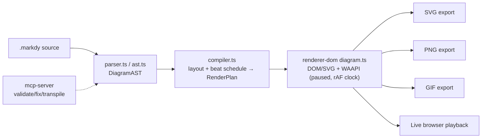
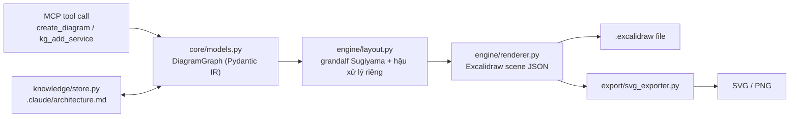
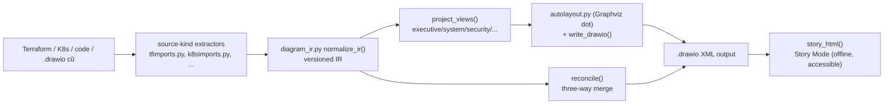
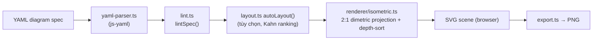

# Weekly Scan: Diagram-as-Code & Visual Tooling (2026-09-06)

**Tóm tắt (executive summary):**

- Tuần này nổi bật nhất là **Markdy** (`HoangYell/markdy-com`) — đối thủ trực tiếp gần nhất với kymostudio: cùng mô hình DSL → animated SVG, nhưng biến animation thành primitive hạng nhất qua Web Animations API thay vì hiệu ứng phụ; các claim "17 layout engines" và "Manhattan routing" đều có code thật đứng sau, không phải vaporware.
- Hai repo còn lại đáng chú ý nhất về mặt kỹ thuật lõi: `excalidraw-architect-mcp` có một **three-way-merge pattern** (`reconcile()`) và layout Sugiyama-based đáng học; `drawio-skill` có cùng ý tưởng incremental-sync (`data-model-id` + `data-source-*` snapshot) áp dụng cho `.drawio` XML — cả hai đều gợi ý kymostudio nên có cơ chế "re-generate không phá layout tay của user", thứ hiện chưa tồn tại.
- `isometric-diagrams` là một hobby project rất nhỏ (0 sao) nhưng công thức projection 2:1 dimetric (`isoToScreen`) và painter's-algorithm depth-sort theo `x+y` là hai đoạn code ngắn, có thể tái sử dụng ngay nếu kymostudio muốn thêm output isometric/2.5D.

**Mục lục:**

1. [Markdy (`HoangYell/markdy-com`)](#1-markdy-hoangyellmarkdy-com)
2. [Excalidraw Architect MCP (`BV-Venky/excalidraw-architect-mcp`)](#2-excalidraw-architect-mcp-bv-venkyexcalidraw-architect-mcp)
3. [drawio-skill (`Agents365-ai/drawio-skill`)](#3-drawio-skill-agents365-aidrawio-skill)
4. [isometric-diagrams (`DaanV2/isometric-diagrams`)](#4-isometric-diagrams-daanv2isometric-diagrams)

---

## 1. Markdy (`HoangYell/markdy-com`)

### §1 — Quick context

DSL biến animation thành primitive hạng nhất: text → MarkdyScript → motion graphics 60fps qua Web Animations API, khác Mermaid/D2/PlantUML/Excalidraw ở chỗ diagram *chuyển động theo beat timeline* chứ không tĩnh. Stack: TypeScript thuần, pnpm monorepo 10 package (`packages/core`, `renderer-dom`, `cli`, `compat`, `mcp-server`, `vscode`, `astro`, `mdx`, `markdy-language-server`, `stdlib-systems`), core zero runtime deps, build bằng `tsup`, test bằng `vitest`. 88 sao, 651 commit, commit gần nhất 2026-09-05 — đang phát triển tích cực, có CI (`ci.yml`, `release.yml`, `publish-vscode.yml`) gồm unit test + architecture gate + visual-regression qua Chrome DevTools. Phân phối: npm (`@markdy/*`), VS Code Marketplace (`hoangyell.markdy-vscode`), MCP server cho Claude/Cursor/Antigravity/Cline/Windsurf.

### §2 — Architecture deep-dive

**A. Component inventory** — `packages/core/src/parser.ts` (tokenize + indentation-tracking), `ast.ts` (kiểu `DiagramAST`), `compiler.ts` (layout + lập lịch `beat` → `RenderPlan`), `arch-lint.ts`/`provenance.ts`/`diff.ts`/`drift.ts` (governance, code-provenance anchor, phát hiện drift kiến trúc so với code); `packages/renderer-dom/src/diagram.ts` (vòng lặp render/animate chính), `edges.ts`/`geometry/path.ts` (routing), `export/{svg,png,gif}-exporter.ts`.

**B. Pipeline** — (1) `.markdy` text → `parser.ts` dựng `DiagramAST`, ném `ParseError` có `line`/`column` nếu sai; (2) validate reference + phát hiện chu trình bằng DFS ngay trong parser; (3) `compiler.ts:compilePlan()` tính kích thước node, dispatch sang 1 trong ~13 hàm layout theo loại diagram, route cạnh, lập lịch `beat` thành `RenderPlan`; (4) `renderer-dom` dựng DOM/SVG và tạo các `Animation` (WAAPI) ở trạng thái *paused*; (5) một vòng `requestAnimationFrame` tự set `anim.currentTime = sceneMs` thay vì để WAAPI tự chạy — né lỗi `startTime`/`fill` không đồng nhất giữa các trình duyệt; (6) `presentation-controller.ts` điều khiển seek/play/speed theo beat; exporter serialize bất kỳ frame nào ra SVG/PNG/GIF.

**C. Data model / IR** — Plain TypeScript interface (không phải class), 2 tầng IR: `DiagramAST` (parse-time) → `RenderPlan` (compile-time, gồm `PositionedNode`/`RoutedEdge`), mutable-by-convention (không có `readonly`), thiết kế để dễ trao đổi giữa các tool.

**D. Input language** — Parser tự viết, hybrid line/indentation-based + regex tokenize + recursive descent cho nested body (`readBody()`), không dùng PEG/parser-combinator. Không có grammar EBNF chính thức (chỉ có prose `docs/SYNTAX.md`), khác với `docs/DSL.md` chuẩn hóa của kymostudio. Lỗi báo qua `ParseError extends Error` có số dòng/cột.

**E. Layout** — Claim "17 layout engines" được xác nhận thật: `compiler.ts` dispatch tới các hàm riêng biệt (`layoutRanked`, `layoutTree`, `layoutRadar`, `layoutGantt`, `layoutSwimlane`,...). `layoutRanked()` làm rank-assignment forward-sweep + barycentric ordering trong rank + adaptive column spacing thật. Routing cạnh nằm ở renderer (`geometry/path.ts:routeOrthogonal()`, Manhattan, obstacle-aware), giảm crossing bằng lane-counter heuristic (`nextEdgeLane()`), không phải Sugiyama crossing-minimization thật sự.

**F. Rendering** — Một renderer DOM/SVG chính, không phải kiến trúc pluggable multi-backend như kymostudio; SVG/PNG/GIF là exporter phủ lên cùng renderer DOM, phụ thuộc môi trường WAAPI sống.

**G. Extensibility** — `@markdy/compat` lo "universal ingestion" (Mermaid/Docker Compose/K8s/Terraform → MarkdyScript); không có API `registerLayoutEngine()` rõ ràng, thêm archetype mới cần sửa dispatcher.

**H. Dev experience** — VS Code extension có live preview, `markdy-language-server` (LSP), MCP server 8 tool (`handleValidateMarkdy`, `handleFixMarkdy` tự sửa lỗi, `handleTranspileToMarkdy`,...), CLI cho CI.

### §3 — Architecture diagram

### §4 — Verdict

Kỹ thuật đáng học nhất: **manual-clock WAAPI playback** (tạo animation paused, một vòng rAF tự set `currentTime`) — áp dụng thẳng được cho `--animate` của kymostudio để có scrub/reverse/speed control miễn phí. **Lane-keyed edge routing** và **code-provenance anchor** (`@src="file.ts#L10"` + `diff.ts`/`drift.ts`) cũng là ý hay cho fan-in/trunk-lane của `alignment.py` và cho một tính năng "diagram bám theo code thật" mà kymostudio chưa có. Red flag: không có grammar hình thức, crossing-avoidance chỉ là heuristic, và cấu trúc thư mục AI-agent (`.claude/`, `.cursor-plugin/`, `agents/`) cho thấy repo được xây dựng nặng bằng AI-assist. Verdict: **study deeper** — đây là repo gần domain kymostudio nhất tuần này.

---

## 2. Excalidraw Architect MCP (`BV-Venky/excalidraw-architect-mcp`)

### §1 — Quick context

MCP server biến mô tả kiến trúc hệ thống thành một **knowledge graph bền vững, có thể truy vấn**, rồi render ra Excalidraw đã auto-layout — khác các tool "generate ảnh diagram" ở chỗ tách biệt structural description khỏi layout math và lưu trạng thái để chỉnh sửa lặp lại được. Stack: Python ≥3.10, MIT, phụ thuộc `fastmcp`, `pydantic`, `grandalf` (thư viện Sugiyama layout độc lập, tùy chọn `cairosvg`). 149 sao, 60 commit, có `tests/` thật (6 file) và CI (`ci.yml`, `publish.yml`) dù không có badge hiển thị. Phân phối: PyPI `excalidraw-architect-mcp`, MCP stdio cho Cursor/Claude Code/Windsurf.

### §2 — Architecture deep-dive

**A. Component inventory** — `core/models.py` (IR Pydantic: `Node`, `Edge`, `Subgraph`, `DiagramGraph`), `core/{palette,themes,components}.py` (styling theo công nghệ, 50+ mapping); `engine/layout.py` (Sugiyama qua `grandalf` + hậu xử lý riêng), `engine/renderer.py` (dựng Excalidraw JSON); `export/svg_exporter.py`, `export/sketch.py` (Excalidraw JSON → SVG/PNG); `knowledge/{store,parser,query,diff,drift,lint}.py` (tính năng knowledge-graph bền vững); `diagrams/registry.py` + 25 loại diagram.

**B. Pipeline** — (1) MCP tool (`create_diagram`/`kg_add_service`/`kg_link`) nhận tham số có cấu trúc, không parse free-text DSL; (2) tool dựng/sửa `DiagramGraph` (validate bằng Pydantic) — với nhánh knowledge-graph, load/sửa file `.claude/architecture.md`; (3) `engine/layout.py:compute_layout()` chạy layering/ranking của `grandalf` rồi hậu xử lý riêng (adaptive gap, hub stretching, obstacle routing) ra `LayoutResult`; (4) `engine/renderer.py:build_excalidraw_file()` dựng element Excalidraw thật (rectangle/diamond/arrow, có binding) và nhúng metadata vào `appState.customData`; (5) tùy chọn re-render sang SVG/PNG "sketch" qua `export/`; (6) file `.excalidraw` ghi ra đĩa, có thể sửa tay và sync lại nhờ metadata round-trip.

**C. Data model / IR** — `DiagramGraph{nodes, edges, subgraphs, direction}` là IR chung cho mọi tool, comment thẳng trong code là "the intermediate representation shared across all tools". Layout output riêng: `PositionedNode`/`PositionedEdge`/`LayoutResult`. Knowledge-graph không lưu JSON/DB mà lưu **plain Markdown** (`.claude/architecture.md`) qua `knowledge/parser.py` — git-diffable, người và AI đều sửa được trực tiếp; không thấy versioning/migration rõ ràng trong `store.py`.

**D. Input language** — Không có DSL tự do cho tạo diagram một lần (chỉ tham số MCP tool). Nhưng knowledge-graph có một grammar markdown nhỏ, dễ đọc: `- gateway: API Gateway [type: nginx] [domain: edge] — public entrypoint` dưới heading `## Services`/`## Dependencies`, có marker version `<!-- excalidraw-architect: knowledge-graph v1 -->`.

**E. Layout** — Xác nhận bằng code, không chỉ theo README: `grandalf>=0.8` (thư viện Sugiyama thật, ~600 dòng phần lõi) làm layering/ranking/ordering; phần **tự viết** và đáng kể nằm ở hậu xử lý: `_apply_adaptive_layer_gaps` (giãn cách theo kích thước nhãn cạnh, kẹp MIN/MAX), `_stretch_hub_nodes` (giãn node hub, giới hạn `MAX_HUB_STRETCH=5.0`), `_find_obstacles`/`_route_around_obstacles` (routing né vật cản qua giao cắt đường-hình chữ nhật tham số), `_bow_parallel` (bo cong cạnh song song).

**F. Rendering** — `renderer.py` dựng đúng schema Excalidraw (`id, x, y, roundness, seed, version, versionNonce,...`), đặc biệt tính `fixedPoints` của arrow từ **cùng** tọa độ dùng để vẽ đường — tránh lỗi kinh điển "arrow thẳng khi render nhưng lệch khi kéo tay" của Excalidraw.

**G. Extensibility** — `diagrams/registry.py` + module theo họ diagram gợi ý registry pattern; không thấy plugin system cho technology mapping ngoài sửa trực tiếp `core/palette.py`.

**H. Dev experience** — Bộ MCP tool lớn, tổ chức tốt: diagram tools (`create_diagram`, `mermaid_to_excalidraw`, `export_diagram`) và KG tools (`kg_add_service`, `kg_lint`, `kg_diff`, `kg_drift`, `kg_onboarding_doc`); `pyproject.toml` có `ruff` + `pytest` + script tiện ích.

### §3 — Architecture diagram

### §4 — Verdict

Đáng học nhất cho kymostudio (vốn cũng xuất Excalidraw): (1) cách tính `fixedPoints` từ đúng tọa độ đã vẽ arrow — nên kiểm tra `to_excalidraw.py`/`to-excalidraw.ts` có tự-nhất-quán tương tự không; (2) **adaptive layer gap theo kích thước nhãn cạnh, kẹp min/max** — heuristic rẻ, áp dụng thẳng vào `alignment.py`/`layout.ts`; (3) **markdown-as-persistent-graph** là ý tưởng tốt nếu kymostudio từng muốn chế độ "sửa tại chỗ" thay vì generate lại từ đầu. Red flag: test layout chỉ kiểm tra số lượng node/bounding-box không chồng nhau, không kiểm tra layering/crossing thật; thuật toán Sugiyama là dependency có sẵn (`grandalf`), phần "novel" thực ra là các pass hậu xử lý. Verdict: **study deeper** (riêng phần layout post-processing và Excalidraw binding).

---

## 3. drawio-skill (`Agents365-ai/drawio-skill`)

### §1 — Quick context

Agent Skill biến text và các nguồn thật (Terraform, K8s, code) thành mô hình `.drawio` **có thể maintain tiếp** — khác biệt ở chỗ đồng bộ tăng dần (incremental sync) mà không phá layout tay đã chỉnh, và chiếu một model ra nhiều view theo đối tượng xem. Stack: Python thuần stdlib (`diagram_ir.py` tự nhận "intentionally stdlib-only"), gọi ngoài draw.io CLI/Graphviz `dot` khi có. Số sao báo cáo không đồng nhất giữa các nguồn (~5k-9k, không xác định chính xác), nhưng có `tests/` thật (13 file) và CI thật (`.github/actions/drawio-architecture-test`, `drawio-diff`). Phân phối: Agent Skills package (`npx skills add`, Claude Code plugin marketplace), kèm MCP server stdio.

### §2 — Architecture deep-dive

**A. Component inventory** — `scripts/diagram_ir.py` (lõi: schema IR, convert `.drawio`↔IR, reconcile, view projection, rule engine, story generator); `scripts/autolayout.py` (Graphviz `dot`, import động qua `importlib`); 13 script `*imports.py`/`tfstate.py`/`k8simports.py`/... (source-kind extractor, đều đổ vào `normalize_ir()`); `scripts/diagramctl_mcp.py` (MCP server tự viết, JSON-RPC 2.0 qua stdio, không dùng package `mcp`); `scripts/diagramctl.py` (CLI wrapper mỏng gọi tất cả).

**B. Pipeline** — (1) một extractor đọc artifact thật (`.tf`, package Python, `.drawio` cũ) ra JSON `{nodes, edges}` thô; (2) `normalize_ir()` chuẩn hóa thành IR có version (`schema = "drawio-skill/diagram-ir/v1"`), gán id ổn định, suy luận `kind` bằng heuristic từ khóa; (3) `diagramctl.py build` chiếu view (`project_views()`), layout qua Graphviz `dot` (fallback grid nếu không có `dot`), serialize ra `.drawio` XML, gắn `data-model-id`/`data-provenance` vào mỗi cell; (4) khi nguồn đổi, `diagramctl.py sync` trích IR mới và gọi `reconcile()` — match cell theo `data-model-id`, vá label/property tại chỗ, **không đụng** `<mxGeometry>` của node đã khớp; (5) node mới được xếp thêm bên dưới (`max_y + 100`), node bị xóa thì prune hoặc làm mờ; (6) `diagramctl.py test`/`review`/`query`/`whatif` chạy rule-check hoặc mô phỏng lan truyền lỗi trực tiếp trên IR JSON.

**C. Data model / IR** — Plain JSON dict, không phải dataclass/protobuf, chỉ có 1 hằng số string đánh version. Node có `id, label, kind, properties, provenance`, tùy chọn `x/y/width/height` (khi round-trip từ `.drawio`) — tách geometry khỏi semantics **thực sự chỉ đúng ở tầng XML** (geometry trong `<mxGeometry>`, semantics/provenance trong `data-*` attribute), IR ở tầng Python không tách tuyệt đối.

**D. Input language** — Không có DSL; input là JSON graph thô hoặc bất cứ gì extractor parse ra. Không có EBNF chính thức; ví dụ `tfimports.py` tự nhận "Parses `.tf` files with a small regex + brace-matching pass (no HCL library needed)". `normalize_ir()` chỉ validate kiểu/uniqueness cơ bản, ném `ValueError`, không có validator schema hay lỗi có số dòng.

**E. Layout** — Thuật toán thật đáng kể nhất trong repo: `reconcile()` là **three-way merge** thật — so sánh giá trị hiện tại với giá trị nhận vào mới và giá trị đã lưu từ lần sync trước (`data-source-label`/`data-source-properties`); nếu 3 giá trị khác nhau thì gắn cờ `conflict` và **giữ bản sửa tay**, không ghi đè âm thầm. Hành vi này có unit test thật (`test_reconcile_preserves_manual_geometry_and_style`, `test_reconcile_reports_three_way_label_conflict`). Layout node mới dùng Graphviz `dot -Tplain` với `splines=ortho`, thay lại waypoint từ polyline của `dot`.

**F. Rendering** — `write_drawio()` dựng XML `mxfile`/`mxGraphModel` bằng `xml.etree.ElementTree` thuần, không dùng thư viện drawio riêng. `project_views()` chiếu view theo filter (không phải template): mỗi view (`executive`, `system`, `security`,...) là một nhánh Python chọn node theo `properties`/`kind`; mỗi hàm view **tự báo cáo** khi phải fallback về "tất cả node" kèm lý do — cơ chế degrade-gracefully trung thực.

**G. Extensibility** — Thêm source-kind mới = viết script xuất JSON tương thích `normalize_ir()`, không có interface/registry chính thức. Thêm view mới = thêm nhánh `elif` trong `project_views()`.

**H. Dev experience** — CI action thật (`drawio-architecture-test`, `drawio-diff`) chạy "architecture-as-test" không cần cài draw.io/Graphviz. MCP server 9 tool, mỗi tool chỉ gọi lại CLI (transport mỏng, không phải implementation riêng). "Story Mode" (`story_html()`) sinh HTML offline có `aria-label`, fallback `<ol>` văn bản — thực sự quan tâm accessibility.

### §3 — Architecture diagram

### §4 — Verdict

Kỹ thuật xuất sắc nhất và exportable nhất tuần này: pattern **`data-model-id` + `data-source-*` snapshot → three-way merge** trong `reconcile()`. Kymostudio hiện không có cách "chạy lại DSL sau khi user đã chỉnh tay SVG/Figma output mà không mất chỉnh sửa đó" — pattern này (lưu id ổn định + giá trị lần sync trước ngay trên artifact output, so 3 chiều, chỉ báo conflict thật) là mẫu cụ thể, có test, đáng cân nhắc. Ý tưởng "source-kind profile → 1 IR chung" cũng là template tốt cho một importer OpenAPI/Terraform mới của kymostudio, tương tự nhưng tổng quát hơn BPMN importer hiện tại. Red flag: parsing Terraform/IaC cố tình không robust (regex + đếm ngoặc), suy luận `kind` là heuristic từ khóa dễ sai, số liệu sao/commit không xác minh được chính xác. Verdict: **study deeper** (riêng phần `reconcile()` và source-kind abstraction).

---

## 4. isometric-diagrams (`DaanV2/isometric-diagrams`)

### §1 — Quick context

Viewer diagram isometric tương tác: viết YAML mô tả kiến trúc/data-flow, render ra scene SVG 3-D (thực chất 2:1 dimetric) ngay trên trình duyệt — khác các tool isometric khác ở việc là DSL YAML + auto-layout tùy chọn, không chỉ thư viện vẽ hình khối. Stack: Svelte 5 + SvelteKit 2, TypeScript, Vite, `js-yaml`, test bằng Playwright (e2e) + Vitest (unit). **0 sao GitHub**, MIT, `"private": true` trong `package.json` — hobby project rất sớm nhưng đang phát triển thật (commit gần nhất về "ribbon edge rendering" ngày 2026-06-26), có CI trên mỗi PR (lint → typecheck → build → Playwright). Phân phối: web app tĩnh (GitHub Pages qua `adapter-static`), kèm `cli/` riêng để import CloudFormation/Terraform-state/K8s → YAML của tool; chưa publish npm.

### §2 — Architecture deep-dive

**A. Component inventory** — `src/lib/types/diagram.ts` (toàn bộ data model); `src/lib/parser/yaml-parser.ts` (YAML → `DiagramSpec` qua `js-yaml`); `src/lib/parser/lint.ts` (`lintSpec()`, linter ngữ nghĩa tự viết); `src/lib/layout.ts` (`autoLayout()` tùy chọn); `src/lib/renderer/isometric.ts` (công thức projection + dựng path SVG); `src/lib/renderer/shapes.ts` (`sortEdgesByDepth()` + shape helper); `src/lib/components/*.svelte` (`IsometricDiagram.svelte`, `UiEditor.svelte`); `src/lib/export.ts` (`downloadSvg`/`downloadPng`).

**B. Pipeline** — (1) user viết/nạp YAML trong textarea trình duyệt (`+page.svelte`) hoặc file ví dụ; (2) `yaml-parser.ts` gọi `yaml.load()`, bọc lỗi thành `ParseError` kèm số dòng (từ `err.mark.line` của js-yaml); (3) `lintSpec()` kiểm tra id trùng, cạnh treo, group rỗng — cảnh báo không chặn render; (4) tùy chọn `autoLayout()` gán vị trí lưới cho node chưa có tọa độ (rank hóa kiểu Sugiyama qua thuật toán Kahn); (5) `IsometricDiagram.svelte` sắp xếp node/cạnh từ sau ra trước theo `x+y` rồi gọi `renderer/isometric.ts` dựng path SVG; (6) Svelte render `<svg>` reactive theo layer (lưới → zone → floor tile → cạnh → thân node → nhãn); `export.ts` xuất SVG hoặc raster PNG.

**C. Data model / IR** — TypeScript interface thuần trong `types/diagram.ts`, ánh xạ gần 1:1 với YAML: `DiagramSpec{nodes, edges?, groups?, ...}`, `Position{x, y, z?}` (z tùy chọn = độ cao/layer), `DiagramNode`, enum cố định `NodeType`/`EdgeType`. Không dùng Svelte store cho state này — truyền qua props/derived state.

**D. Input language** — Gần như YAML thô với schema tự gõ tay mỏng, không có JSON Schema/Zod; validate hoàn toàn qua `lintSpec()` + kiểu TypeScript lúc parse. Báo lỗi khá tốt so với quy mô repo: lỗi parse có số dòng, lint diagnostic phân mức `error`/`warning`, có `findTokenLine()` map lỗi về dòng nguồn.

**E. Layout** — Vị trí chủ yếu do **user tự khai** tọa độ lưới `x/y/z` trong YAML. `autoLayout()` là auto-layout thật dù đơn giản: rank hóa longest-path qua thuật toán Kahn, hàng = rank, cột canh giữa mỗi hàng, node rời rạc rơi về rank 0. Occlusion cho phép chiếu isometric được xử lý bằng **painter's algorithm** thật: cả node và cạnh (`sortEdgesByDepth()`) đều sort từ sau ra trước theo `x+y` — xác nhận qua commit "fix occlusion artefacts".

**F. Rendering** — Công thức projection (`isometric.ts`) là 2:1 dimetric chuẩn: `screenX=(x−y)·tileW/2`, `screenY=(x+y)·tileH/2 − z·tileH`, với `tileW=2·tileH`. `boxPaths()` dựng khối hộp từ 1 điểm neo trên đỉnh đã chiếu, offset nửa-width/height cho 3 mặt (top/left/right), có hệ số `padding` tạo khe hở giữa các khối. `ribbonPath`/`ribbonArrowHead` vẽ cạnh dạng ribbon trên mặt đất có bo góc/foreshortening. Output chỉ SVG (cộng PNG raster qua canvas). **Không có** pan/zoom dù README nói là "3-D scene viewer"; claim "dark/light theme toggle" cũng không khớp code (chỉ có theme cố định + field YAML, không có UI toggle).

**G. Extensibility** — Thêm node type mới phải sửa union `NodeType` (enum đóng), không phải hệ plugin/đăng ký. Theming qua `renderer/theme.ts` + override `style` trực tiếp trong YAML.

**H. Dev experience** — Có editor sống: textarea YAML compile-live (debounce) và `UiEditor.svelte` dạng form thay thế. SvelteKit dev server hot-reload chuẩn. `cli/` là tool import riêng biệt (infra format → YAML), không phải renderer dòng lệnh cho chính diagram.

### §3 — Architecture diagram

### §4 — Verdict

Đáng học nhất cho kymostudio (chưa có output isometric/2.5D): công thức projection `screenX=(x−y)·tileW/2, screenY=(x+y)·tileH/2−z·tileH` ngắn gọn, copy-paste được thẳng vào một chế độ renderer mới; và **painter's-algorithm depth-sort theo x+y** áp dụng trực tiếp lên `Component`/`Edge` hiện có của kymostudio mà không cần scene-graph 3D thật. Red flag: repo cực nhỏ (0 sao, `private: true`, chưa publish), enum node/edge đóng thay vì mở rộng được, thiếu pan/zoom, và vài claim README (theme toggle, "interactive inspection") không khớp code — nên coi là tín hiệu tham khảo kỹ thuật hơn là sản phẩm để dùng. Câu hỏi mở: liệu kỹ thuật ribbon-edge mitring có scale tốt khi số cạnh lớn không (chưa kiểm chứng). Verdict: **glance only** — đọc công thức projection và depth-sort, bỏ qua phần còn lại.
