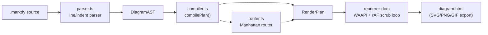
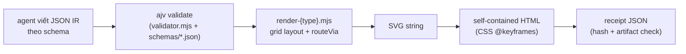
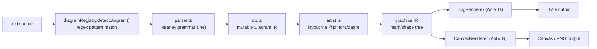
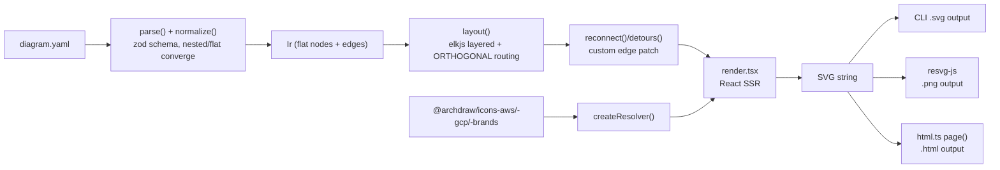

# Weekly scan: diagram-as-code & visual tooling — 2026-09-07

**Phạm vi**: repos trong domain diagram-as-code / DSL / SVG animation / layout algorithm được publish hoặc update đáng kể trong 7 ngày qua (2026-08-31 → 2026-09-07). Nguồn: GitHub topic search (`topic:diagram-as-code`) + keyword search, do không có quyền dùng `gh` CLI/API có auth trong session này nên số liệu lấy qua GitHub public web pages (WebFetch), không phải REST API có auth — vài con số (contributor count, CI chi tiết) vì vậy "không xác định" ở một số chỗ.

## Executive summary

- **`markdy-com`** (HoangYell) là repo gần nhất và giống kymostudio nhất về mục tiêu — DSL riêng compile ra **animated SVG/HTML qua Web Animations API**, 17 layout engine theo diagram type, MCP server cho AI agent — đáng nghiên cứu kỹ nhất tuần này, đặc biệt kỹ thuật "deterministic WAAPI scrubbing" (pause toàn bộ animation, tự lái `currentTime` qua `requestAnimationFrame`) cho khả năng seek/pause mà kymo's `--animate` hiện chưa có.
- **`archify`** (tt-a1i) minh chứng cho một pattern khác hẳn: **bỏ hẳn textual DSL**, để agent viết thẳng JSON IR theo JSON Schema, đổi lại có "receipt" (JSON diagnostic có thể agent parse) sau mỗi lần render/validate — đáng học cho hướng agent-first của kymo dù star count (50.9k) đáng ngờ so với chỉ 223 commit trong 5 tháng.
- **`pintora`** (hikerpig) là thư viện text-to-diagram trưởng thành hơn (1.3k sao), dùng grammar sinh bằng Nearley (không phải regex/line-based như kymo's `dsl.py`) và tách rõ **semantic IR** (per-diagram `db.ts`) khỏi **graphics IR** (mark/shape tree dùng chung cho SVG lẫn Canvas renderer) — mô hình "graphics IR trung gian" này là gợi ý kiến trúc rõ ràng nhất cho việc kymo có 3 emitter (`to_svg`/`to_figma`/`to_excalidraw`) đang đi thẳng vào `Diagram` model riêng lẻ.
- **`archdraw`** (No1Joon) là repo mới nhất (0 sao, tạo tuần này) nhưng đáng chú ý nhất về **icon system**: mỗi vendor icon pack (`@archdraw/icons-aws`, `-gcp`, `-brands`) là một npm package độc lập cùng implement contract `IconPack = {provider, icons, aliases}`, gộp lại runtime qua `createResolver()` — so với `icons.py` của kymo (hand-coded `ICONS` + file-backed scan), đây là hướng tách icon ra khỏi core lib rõ ràng hơn; kèm theo đó là patch ELK có mục tiêu (`reconnect()` tự sửa edge bị ELK route sai khi bật `wrapping`) thay vì tắt cả tính năng.

## Mục lục

1. [markdy-com](#1-markdy-com)
2. [archify](#2-archify)
3. [pintora](#3-pintora)
4. [archdraw](#4-archdraw)

---

## 1. markdy-com

**Repo**: [HoangYell/markdy-com](https://github.com/HoangYell/markdy-com)

### §1 — Quick context

Animated-architecture-diagram DSL compile ra HTML/SVG động qua Web Animations API — khác kymo ở chỗ animation là **trọng tâm sản phẩm** (không phải tùy chọn `--animate`) và có 17 layout engine chuyên biệt theo diagram type thay vì một engine tổng quát. Tech stack: TypeScript, zero-dep ~14kB parser core, output HTML/SVG/PNG/GIF/social-card. Repo health: 90 sao, 3 fork, MIT, ~10 release trong 8 ngày gần nhất (`v1.1.7` → `v1.4.3`), CI có `ci.yml`/`release.yml`/`publish-vscode.yml`. Distribution: npm (`@markdy/core`, `@markdy/cli`, `@markdy/renderer-dom`, `@markdy/mcp-server`, `@markdy/language-server`, v.v.) + VS Code extension `hoangyell.markdy-vscode` + browser playground tại markdy.com.

### §2 — Architecture deep-dive

**A. Component inventory** — `packages/core/src/parser.ts` (DSL→AST), `ast.ts` (type định nghĩa `DiagramAST`), `compiler.ts` (`compilePlan`, dispatch layout theo loại diagram), `router.ts` (edge routing — "Collision-aware Orthogonal Manhattan Router"), `themes.ts`/`theme-generator.ts`, `player.ts` (config playback), `system-vocabulary.ts` (registry loại node), `provenance.ts` (anchor `@src=`), `diff.ts` (so sánh evolution giữa git commit), `arch-lint.ts`/`verifier.ts` (governance check). `packages/cli` là custom arg-parser (không dùng commander/yargs). `packages/mcp-server` wrap `@modelcontextprotocol/sdk`. `packages/renderer-dom` là renderer DOM/WAAPI duy nhất tìm thấy bằng chứng.

**B. Pipeline** — (1) user chạy `markdy render system.markdy --out diagram.html`; (2) CLI's `parseArgv()` dispatch vào handler `render`; (3) đọc file `.markdy` bằng `readFile()`; (4) `parse(source, opts)` trong `core/src/parser.ts` trả về `DiagramAST`; (5) `compilePlan(ast, theme)` chọn layout function theo `switch` trên diagram type, route edge qua `router.ts`, lên lịch animation cue → `RenderPlan`; (6) `packages/renderer-dom` tiêu thụ `RenderPlan`, sinh markup WAAPI; (7) CLI ghi `diagram.html`.

**C. Data model/IR** — `DiagramAST` là plain TS interface (không phải class), không explicit freeze; `compilePlan` **mutate tại chỗ** một phần `ast.meta` (auto-size width/height) nhưng build `RenderPlan` mới cho nodes/edges/cues. Không có khái niệm "lower IR" được đặt tên chính thức — các mảng `RoutedEdge[]`/`TimedCue[]`/`PositionedNode[]` đóng vai trò intermediate stage nhưng không tài liệu hoá như một layer riêng.

**D. Input language design** — Parser hand-written, **line/indentation-based** (giống cách tiếp cận của `dsl.py` bên kymo, không phải PEG/ANTLR/combinator): match từ khoá theo dòng, gom thân block thụt lề cho `beat`/`group`/`pattern`. Có recovery riêng cho ngữ cảnh MDX/JSX bị strip indentation. Error: class `ParseError extends Error` có `line`/`column`, message dạng `line ${line}: ...`. Không tìm thấy EBNF hình thức trong `docs/SYNTAX.md` (chỉ prose + ví dụ) — khác kymo, nơi `docs/DSL.md` là spec EBNF chuẩn hoá.

**E. Layout algorithm** — 17 `DiagramType` dispatch qua `switch` trong `layoutNodes()`: `layoutRanked()` (Sugiyama-style layered + barycenter crossing heuristic, 4-pass reorder) cho flowchart/sequence/default; `layoutTree()`; các layout polar/góc (`layoutConstellation`/`layoutLoop`/`layoutRadar`/`layoutVenn`); layout dạng lưới/tier (`layoutQuadrant`/`layoutMedallion`/`layoutSwimlane`/`layoutPyramid`); `layoutNested()` (concentric inset); layout tuyến tính (`layoutTimeline`/`layoutGantt`/`layoutLayers`). Edge routing: Manhattan router có "dynamic port multiplexing" (`allocatePortLanes()`) để tự giãn cổng khi fan-in/out đông. Crossing minimization chỉ có ở `layoutRanked()` (barycenter), các engine khác không có.

**F. Rendering/output** — Một backend renderer duy nhất (`renderer-dom`, DOM + WAAPI). Cơ chế animation đáng chú ý: **tất cả WAAPI animation bị pause vĩnh viễn**, một vòng `requestAnimationFrame` tự set `anim.currentTime = sceneMs` mỗi frame — tức là animation được lái thủ công thay vì autoplay tự nhiên của WAAPI, cho phép scrub/pause/seek chính xác từng frame. Export PNG/SVG/GIF/social-card được README công bố nhưng cơ chế cụ thể chưa verify độc lập.

**G. Extensibility** — Không có plugin-loader hình thức; thêm node kind = thêm string vào `TECHNICAL_NODE_TYPES` + map role trong `system-vocabulary.ts`; thêm layout/diagram type mới = thêm case trong `switch` của `compiler.ts` + viết `layoutX()` mới; theme qua `themes.ts`/`theme-generator.ts`.

**H. Dev experience** — CLI ~18 subcommand (`render`, `lint`, `fmt`, `import`, `diff`, `c4`, `explain`, `suggest`, `verify`, `doctor`...). VS Code extension có live preview (`Cmd+K V`), CodeLens, QuickFix; `@markdy/language-server` là LSP headless riêng (claim hỗ trợ Neovim/Helix/Emacs). MCP server expose tool `validate_markdy_code`/`diagnose_markdy_syntax`/`fix_markdy_code`/`transpile_to_markdy` + resource `markdy://spec/agent-reference`. `markdy import` normalize Mermaid/Docker Compose/K8s/Terraform state/drawio về DSL qua một package `compat` duy nhất — một importer surface hợp nhất, khác kymo (chỉ có BPMN importer riêng).

### §3 — Architecture diagram

### §4 — Verdict

**Đáng học**: (1) kỹ thuật pause-all-WAAPI + rAF scrub theo `sceneMs` — cho seek/pause chính xác, đáng so sánh với cách kymo hiện đang xuất animation (`--animate` dùng CSS/SMIL); (2) `@src="path#L10-L50"` provenance anchor gắn thẳng node diagram vào dòng code — kymo's `Component` dataclass chưa có field tương đương; (3) một package `compat` multiplex nhiều format import (Mermaid/Compose/K8s/Terraform/drawio) qua một CLI verb — kymo chỉ có BPMN, đóng khoảng trống adoption này rẻ nếu làm best-effort.

**Red flag**: không có formal grammar (EBNF) cho DSL dù dự án khá phức tạp (17 layout engine); switch-based dispatch cho layout/diagram type sẽ khó mở rộng khi số lượng tăng thêm.

**Open question**: parser 14kB zero-dep có xử lý được edge-case lồng nhau phức tạp (nested beat trong group trong pattern) tốt như grammar sinh tự động không — chưa kiểm chứng bằng test case cụ thể.

**Verdict: study deeper** — miền chồng lấn trực tiếp với kymo (animated diagram DSL), kỹ thuật WAAPI-scrub và provenance-anchor đáng thử nghiệm cụ thể.

---

## 2. archify

**Repo**: [tt-a1i/archify](https://github.com/tt-a1i/archify)

### §1 — Quick context

Agent skill sinh diagram (architecture/workflow/sequence/data-flow/lifecycle) dạng self-contained HTML có motion, khác kymo ở chỗ **không có textual DSL** — agent viết thẳng JSON IR theo JSON Schema, còn kymo có `.kymo` làm ngôn ngữ trung gian cho người/agent viết. Tech stack: Node.js (`.mjs`), JSON Schema draft 2020-12 (ajv validate), output self-contained HTML (CSS keyframes, không JS animation loop). Repo health: 50.9k sao (đáng ngờ — chỉ 223 commit / ~5 tháng tuổi, tỉ lệ sao:commit bất thường so với công cụ dev tương đương, dù activity contributor/PR/issue có vẻ organic — ≥12 tác giả riêng biệt, 57 issue mở, 69 PR mở), MIT license, 20 tagged release. Distribution: `npx skills add tt-a1i/archify -g` (git-based, không thấy npm registry publish).

### §2 — Architecture deep-dive

**A. Component inventory** — `bin/archify.mjs` (CLI entry, dispatch `validate/render/deliver/preview/compare/migrate/doctor`); `schemas/{architecture,workflow,sequence,dataflow,lifecycle,common}.schema.json` (JSON Schema per diagram type); `renderers/{type}/render-{type}.mjs` (một renderer module mỗi loại, ví dụ `renderers/architecture/render-architecture.mjs` + `grid.mjs`); `renderers/shared/{geometry.mjs, validator.mjs, text-fit.mjs, layout-report.mjs, diagnostics.mjs, repository-evidence.mjs, i18n.mjs, brand-marks.mjs, cli.mjs}` (helper cross-cutting); `examples/*.architecture.json` kèm `.html` tương ứng; `SKILL.md` (định nghĩa skill cho agent, phân phối qua `npx skills add`); `.github/workflows/{ci,dsh,release,star-history}.yml`.

**B. Pipeline** — (1) agent (Claude Code/Cursor/Codex CLI) đọc `SKILL.md`, tự viết file JSON theo schema tương ứng; (2) `archify validate file.json` chạy `validator.mjs` + ajv theo schema; (3) `archify render file.json` — CLI resolve `renderers/{type}/render-{type}.mjs`, load IR, tính layout (grid hoặc `pos` tường minh), route edge, sinh SVG, bọc trong template HTML self-contained; (4) `archify deliver` = render → mechanical artifact check → hash → "receipt" JSON → ghi file; (5) tuỳ chọn `preview`/`compare`/`migrate` cho vòng lặp chỉnh sửa.

**C. Data model/IR** — Plain JSON, phân biệt bằng `schema_version` + `diagram_type`, bắt buộc `meta` + `components`. Input immutable (không có API mutate runtime tìm thấy); "lowering" xảy ra bên trong từng renderer (`measureComponent`, `boundaryRect`, `routeVia` trong `render-architecture.mjs`) — tính x/y/width/height/path trực tiếp từ IR khai báo, không qua layer trung gian riêng.

**D. Input language design** — **Không có textual DSL**: JSON IR chính là "ngôn ngữ", agent viết trực tiếp theo schema, có prose rule hướng dẫn trong `SKILL.md` (ví dụ ≤12 node chính, label thưa). Error reporting là "machine-readable error receipt" qua ajv + geometry check tuỳ biến (`cleanFlowProblems`, `cleanCrossingProblems`, `cleanBorderRunProblems`).

**E. Layout algorithm** — Không phải graph auto-layout (không thấy dagre/elk/force trong `renderers/shared`) mà là **grid-based placement** (`gridLayout()`, `resolveComponentPos()`) cộng edge routing tất định (`routeVia`, `automaticPortSpread`, `alignFacingPorts`, dogleg trực giao). Không có thuật toán crossing-minimization chính thức, chỉ có kiểm tra va chạm/hành lang.

**F. Rendering/output** — SVG nhúng trong một file HTML self-contained (verify qua `examples/rag-pipeline.html`: `<style>` inline, không `<script src>` ngoài). Animation là **CSS `@keyframes`** (`pulse`, `archify-radar-live`, `archify-lens-in`...), không phải JS rAF loop. Export PNG/JPEG/WebP/SVG/WebM theo README (cơ chế chưa verify độc lập). 5 renderer module về cơ bản one-per-type, không có registry plugin renderer tổng quát.

**G. Extensibility** — Thêm diagram type mới cần schema file mới + renderer module mới (không có plugin-loader). Theme dark/light qua URL param runtime + CSS.

**H. Dev experience** — Phân phối qua `npx skills add tt-a1i/archify -g` (đóng gói "agent skill"), CLI có `validate/render/deliver/preview/compare/migrate/doctor` nhưng **không có watch mode** — README nói rõ "all operations are one-shot".

### §3 — Architecture diagram

### §4 — Verdict

**Đáng học**: (1) pattern "receipt" — mỗi lần render/deliver/compare trả JSON diagnostic có thể agent parse thay vì đọc stdout tự do — kymo CLI có thể học để phục vụ agent loop tốt hơn; (2) mechanical geometry lint (`cleanFlowProblems`, `cleanCrossingProblems`, label-fit-in-box) tích hợp ngay trong đường render, không chỉ ở golden-SVG test — kymo's `alignment.py` hiện chưa expose diagnostic dạng này cho user/agent; (3) schema-per-diagram-type với `common.schema.json` dùng chung — đáng so với cách `.kymo` gộp mọi constraint vào một grammar duy nhất.

**Red flag**: không tìm thấy design doc kỹ thuật cho IR/pipeline (`DESIGN.md` chỉ là brand/visual spec); marketing gọi là "auto-layout" nhưng không có bằng chứng crossing-minimization hay force-layout thật sự; `integrations/` chỉ có 1 thư mục thật (`deepseek-harness`) dù README liệt kê 4 agent tool; `SKILL.md` tự nhận "based on Cocoon-AI/architecture-diagram-generator" — nên kiểm tra fork lineage trước khi coi đây là prior art gốc.

**Open question**: 50.9k sao / 223 commit trong 5 tháng — tỉ lệ này có giải thích được bằng viral agent-skill adoption thật, hay có phần bị inflate? Chưa verify qua star-history data.

**Verdict: study deeper** cho ý tưởng "receipt" + geometry lint, nhưng **glance only** cho phần layout/animation (đơn giản hơn kymo đáng kể).

---

## 3. pintora

**Repo**: [hikerpig/pintora](https://github.com/hikerpig/pintora)

### §1 — Quick context

Thư viện text-to-diagram trưởng thành (lấy cảm hứng từ Mermaid.js/PlantUML), chạy cả browser lẫn Node — khác kymo ở kiến trúc plugin registry cho từng diagram type và tách bạch semantic IR khỏi graphics IR. Tech stack: TypeScript, pnpm monorepo (Turborepo), parser sinh bằng Nearley grammar (`@hikerpig/nearley` + `@hikerpig/moo`, fork riêng), renderer dùng AntV G (`@antv/g-svg`/`@antv/g-canvas`), layout dùng fork riêng của dagre/graphlib (`@pintora/dagre`, `@pintora/graphlib`). Repo health: 1.3k sao, 37 fork, MIT, latest release v0.8.2 (2025-02-13) — nhịp release khá chậm so với 2 repo trên nhưng vẫn có push trong tuần này. Distribution: npm (`@pintora/standalone`, `@pintora/cli`...).

### §2 — Architecture deep-dive

**A. Component inventory** — `packages/pintora-core/src/` (`diagram-registry.ts` — plugin registry; `type.ts` — contract `IDiagram`/`IDiagramParser`/`IDiagramArtist`; `config-engine.ts`; `themes/`). `packages/pintora-diagrams/src/` chứa 8 diagram type dạng thư mục song song (sequence/class/er/component/activity/dot/gantt/mindmap), mỗi thư mục có cùng shape: `parser.ts`, `parser/*.ne` (grammar), `db.ts` (mutable IR store), `artist.ts` (IR→graphics), `config.ts`. `packages/pintora-renderer/src/renderers/{base.ts, SvgRenderer.ts, CanvasRenderer.ts}` dùng AntV G. `packages/pintora-standalone` là bundle cho browser. `packages/pintora-cli` là CLI Node.

**B. Pipeline** — (1) `standalone.renderTo(code, opts)` hoặc CLI `render` đọc text; (2) `diagramRegistry.detectDiagram(text)` chạy regex `.pattern` của từng `IDiagram` đã đăng ký để nhận diện loại diagram; (3) `parser.ts` tương ứng chạy Nearley grammar (ví dụ `sequence/parser/sequenceDiagram.ne`) parse text → parse tree, gọi `db.apply(results)`; (4) `db.ts` (subclass `BaseDb`) là reducer-style mutable store, apply action để build `*DiagramIR extends BaseDiagramIR`; (5) `artist.ts` (`IDiagramArtist`) duyệt IR, tính layout (inline hoặc qua `@pintora/dagre` cho diagram dạng graph), sinh graphics-IR (mark/shape tree); (6) `BaseRenderer` khởi tạo canvas AntV G (SVG hoặc Canvas), `traverseScene()` duyệt mark tree, convert group→`addGroup()`, shape→`addShape()`; (7) output SVG DOM/string (browser) hoặc PNG/JPG/SVG file (CLI).

**C. Data model/IR** — Hai lớp, đều mutable, class-based: **Diagram IR** riêng theo type (ví dụ `SequenceDiagramIR extends BaseDiagramIR = {messages, actors, actorOrder, notes, ...}`), build qua singleton `*DB` với reducer `apply(actions)`. **Graphics IR** — mark/shape scene tree tổng quát (group + shape có `attrs`), cả SVG renderer lẫn Canvas renderer tiêu thụ y hệt qua `traverseScene()`/`addShape()` — đây chính là seam pluggability giữa "vẽ gì" và "vẽ bằng gì".

**D. Input language design** — **Grammar hình thức, sinh tự động, không phải hand-rolled**: mỗi diagram type có file `.ne` (Nearley), compile bằng script `gen-parser`, wrap bởi `genParserWithRules()` (`util/parser-util.ts`, có option `dedupeAmbigousResults`, `postProcess`). Có một grammar `.ne` độc lập thứ hai cho block style inline `@pre {...}`. Error reporting: không có layer try/catch/recovery riêng — lỗi trồi lên qua hành vi mặc định của Nearley (empty result/exception), caller phải tự kiểm tra.

**E. Layout algorithm** — Diagram dạng graph (class/er/component/dot) dùng `@pintora/dagre` + `@pintora/graphlib` (fork riêng của hikerpig); `d3-shape`/`d3-scale`/`d3-interpolate` phục vụ curve path và trục thời gian Gantt. Sequence/mindmap nhiều khả năng có positioning hand-code riêng trong `artist.ts` (không dùng dagre vì là layout tuyến tính/cây) — chưa verify từng dòng.

**F. Rendering/output** — Backend pluggable thật sự qua AntV G: `BaseRenderer.getCanvasClass()` override theo subclass để chọn canvas class cụ thể (SVG hoặc Canvas). Node CLI xuất thêm PNG/JPG. **Không có animation** — không tìm thấy `requestAnimationFrame`, CSS transition, hay animation library nào trong renderer — render là một pass tĩnh duy nhất.

**G. Extensibility** — Plugin API tường minh: `diagramRegistry.registerDiagram(name, diagram: IDiagram)` với `IDiagram = {pattern: RegExp, parser, artist, eventRecognizer?, configKey?, clear()}` — chính cơ chế nội bộ dùng cho cả 8 diagram type built-in. Theme qua `themeRegistry` + hệ thống config có kiểu (`ConfigValueType`), cộng thêm style-engine `@pre` riêng cho override style theo instance.

**H. Dev experience** — CLI `pintora-cli render -i in.pintora -o out.png` (flag `-p/-t/-w`), không có watch mode. Có live editor/demo (`demo/live-editor`, Vite+Tailwind) và docs site Docusaurus-style với live-play code block. VS Code extension chỉ được README nhắc tới như ecosystem project ngoài, không nằm trong monorepo này.

### §3 — Architecture diagram

### §4 — Verdict

**Đáng học**: (1) contract plugin đồng nhất `IDiagram = {pattern, parser, artist, eventRecognizer, clear()}` đăng ký vào một `DiagramRegistry` — mỗi diagram type là một thư mục tự chứa cùng 5-file shape; kymo (Python + JS song song) có thể học pattern này để "thêm diagram family mới" trở thành việc cơ học thay vì ad hoc mỗi lần; (2) **graphics IR trung gian tách khỏi semantic IR** — `artist.ts` không bao giờ đụng trực tiếp API SVG/Canvas, chỉ sinh mark/shape tree tổng quát để `BaseRenderer` duyệt — kymo's `to_svg.py`/`to_figma.py`/`to_excalidraw.py` hiện đi thẳng vào `Diagram` model riêng lẻ, một layer "marks" trung gian sẽ giúp code đặc thù-theo-format co lại chỉ còn phần canvas adapter; (3) grammar riêng, nhỏ, tái sử dụng được cho style block inline (`@pre {...}`) tách khỏi grammar chính — cách thêm style override per-instance vào `.kymo` mà không phình to grammar chính.

**Red flag**: release cadence chậm (v0.8.2 từ 2025-02), không có animation dù kiến trúc render đủ tổng quát để thêm; contributor count không xác định được (trang GitHub load client-side, WebFetch không thấy).

**Open question**: `@pintora/dagre`/`@pintora/graphlib` là fork riêng — fork để làm gì khác upstream (bugfix, custom feature)? Chưa đọc diff.

**Verdict: study deeper** — riêng phần kiến trúc plugin registry + graphics-IR-trung-gian đáng đưa vào roadmap refactor emitter của kymo, kể cả khi bản thân pintora (thiếu animation) không phải đối thủ trực tiếp.

---

## 4. archdraw

**Repo**: [No1Joon/archdraw](https://github.com/No1Joon/archdraw)

### §1 — Quick context

CLI/library vẽ cloud architecture diagram (SVG/PNG) từ YAML, nhắm vào workflow "AI agent viết YAML, archdraw render" — khác kymo ở chỗ tách icon ra thành package riêng theo vendor thay vì bundle chung, và render SVG hoàn toàn qua React SSR (không DOM). Tech stack: TypeScript, zod (validate), elkjs (layout), react-dom/server (`renderToStaticMarkup` cho SVG), `@resvg/resvg-js` (PNG). Repo health: 0 sao (mới tạo tuần này), 2 tác giả (`No1Joon` + `github-actions[bot]` cho changesets), CI có lint→build→typecheck→vitest (kèm SVG snapshot test), MIT. Distribution: npm — `archdraw` (CLI) + `@archdraw/core` + `@archdraw/react` + 3 icon-pack package riêng (`icons-aws`/`icons-gcp`/`icons-brands`).

### §2 — Architecture deep-dive

**A. Component inventory** — `packages/cli/src/cli.ts` (Commander CLI: `render`/`types`/`schema`); `packages/core/src/{index,schema,normalize,layout,render.tsx,icons,html}.ts` (toàn bộ pipeline: zod validate → flat IR → ELK layout → React SVG string, không icon asset, không DOM); `packages/icons-aws/src/{generated,aliases,index,types}.ts` (icon pack AWS: map slug→SVG sinh tự động + alias map viết tay); `packages/icons-gcp`, `packages/icons-brands` cùng shape; `packages/react` (component wrapper `<Architecture />`).

**B. Pipeline** — (1) `cli.ts` đọc file/stdin → `parse(source)` (wrap `yaml`'s `parse`); (2) `normalize(doc)` validate qua `DiagramSchema.safeParse`, đệ quy cả 2 dạng input (nested `children` / flat `parent`) thành `FlatNode[]` + edges → `Ir`; (3) `layout(ir)` dựng cây `ElkNode` (compound node cho group), chạy `elk.layout(...)`, rồi `reconnect()` tự sửa các edge bị ELK route lạc khi có wrapping; (4) `Diagram({root, ir, icons, theme})` là cây React function-component, `renderToStaticMarkup` (react-dom/server) biến thành chuỗi SVG — không cần browser/jsdom; (5) CLI: `.svg` ghi thẳng chuỗi; `.png` qua `@resvg/resvg-js` (`Resvg(...).render().asPng()`) dùng font `NotoSansKR.ttf` bundle sẵn; `.html` bọc SVG bằng `page()` trong `html.ts` kèm CSS animate dash.

**C. Data model/IR** — `Ir = {provider, title?, direction, wrap, nodes: FlatNode[], edges: Edge[]}`; `FlatNode = {id, label, type?, kind?, parent, isGroup, shape, domain?, external}`. Build một lần bởi `normalize()`, sau đó **immutable/read-only** xuyên suốt `layout.ts`/`render.tsx` — không có method mutate nào được expose.

**D. Input language design** — Zod schema (`schema.ts`) chấp nhận cả 2 hình dạng: `groups` lồng nhau (`children` qua `z.lazy` đệ quy) và `nodes` phẳng (field `parent`). `normalize.ts`'s `walk()` quy cả 2 dạng về cùng một list phẳng; pass thứ 2 promote bất kỳ node nào được reference làm `parent` thành `isGroup=true` bất kể input là dạng nào — tức là 2 schema hội tụ về một IR duy nhất thay vì xử lý riêng biệt xuyên pipeline. Lỗi gom vào một class `DiagramError` duy nhất mang `message` + `hint` tuỳ chọn (cycle detection, duplicate id, unknown edge endpoint, icon-type không rõ kèm gợi ý kiểu Levenshtein "Did you mean" trong `icons.ts`).

**E. Layout algorithm** — `elkjs` 0.12.0, thuật toán `'layered'`, `elk.edgeRouting: 'ORTHOGONAL'`, `elk.hierarchyHandling: 'INCLUDE_CHILDREN'`, spacing tường minh (`nodeNode: 48`, `nodeNodeBetweenLayers: 72`...). Chế độ `wrap` bật thêm `wrapping.strategy: MULTI_EDGE`, `aspectRatio: 1.6`, nhưng **chủ động tắt** `wrapping.multiEdge.improveWrappedEdges` (comment code giải thích: tính năng này throw lỗi khi graph có edge băng qua group bị wrap) — không dùng crossing-minimization option riêng nào ngoài default của ELK layered. `reconnect()`/`detours()` trong `layout.ts` là patch tự viết (không phải tính năng ELK): sửa edge bị ELK "đánh rơi" khỏi node, và gắn cờ/report edge bị route dài gấp >2 lần khoảng cách trực tiếp (`DETOUR_RATIO = 2`).

**F. Rendering/output** — "DOM-free" nghĩa là **React SSR**, không phải string templating tay: `render.tsx` là JSX định nghĩa `<svg>/<g>/<path>`, convert qua `renderToStaticMarkup` — cùng một code path chạy được cả Node lẫn browser, không cần jsdom/canvas. PNG qua `@resvg/resvg-js`. Renderer **không pluggable** — `render.tsx` là một cây React cố định, chỉ `theme`/`icons` được inject qua `RenderOptions`.

**G. Extensibility (icon system)** — `IconPack = {provider, icons: Record<slug,IconAsset>, aliases: Record<alias,slug>}` (`icons.ts`). `createResolver(...packs)` gộp nhiều pack lại runtime; `resolve(type)` tra alias→slug→asset, throw `DiagramError` kèm gợi ý Levenshtein/word-boundary khi miss. Thêm pack mới = một npm package mới đúng shape này; file `generated.ts` được sinh tự động bằng script `pnpm icons:sync aws` từ SVG chính chủ của vendor, còn alias thì maintain tay.

**H. Dev experience** — CLI Commander với `render` (mặc định)/`types` (fuzzy search slug icon xuyên các pack đã load)/`schema` (dump JSON Schema); `--check` chỉ validate; stderr in diagnostic không-fatal (report detour, cảnh báo literal `\n`, cảnh báo provider-drift). Không có watch mode hay browser-preview flag; `--out foo.html` là thứ gần nhất (trang HTML animated tự chứa).

### §3 — Architecture diagram

### §4 — Verdict

**Đáng học**: (1) icon pack là plain-data contract (`IconPack = {provider, icons, aliases}`) không phụ thuộc gì — bất kỳ npm package thứ ba nào cũng implement được, gộp lại lúc CLI chạy qua `-p aws,gcp,brands` thay vì compile cứng vào core lib; so với `icons.py` của kymo (hand-coded `ICONS` dict + quét file trong `icons/`), đây là hướng tách rời icon khỏi core rõ ràng hơn, đáng cân nhắc nếu kymo muốn mở icon pack cho bên thứ ba đóng góp. (2) `suggest()` trong `icons.ts` tách 2 tầng: Levenshtein distance-1 bắt lỗi gõ trước, rồi word-boundary match (`startsWith`/`endsWith` theo segment tách bằng hyphen) bắt "did you mean" cho alias khác độ dài hẳn (vd `airflow`→`apacheairflow`) trước khi fallback ngưỡng khoảng cách lỏng hơn — rẻ, không cần dependency fuzzy-search. (3) Vá lỗi ELK có mục tiêu: tắt hẳn `wrapping.multiEdge.improveWrappedEdges` (biết nó buggy) rồi tự viết `reconnect()` chỉ sửa đúng những edge bị lạc (check endpoint có nằm trên box hay không) — thay vì override toàn bộ edge-routing.

**Red flag**: dự án chỉ 2 tác giả (1 người + bot), 0 sao, còn quá mới để đánh giá độ ổn định API; renderer không pluggable (chỉ 1 cây React cố định) nên nếu cần thêm backend khác (Canvas, Figma...) sẽ phải viết lại từ đầu chứ không cắm module mới được.

**Open question**: hiệu năng React SSR cho diagram rất lớn (hàng trăm node) so với string-templating trực tiếp — chưa có benchmark; `DETOUR_RATIO = 2` là hằng số cứng, chưa rõ có configurable không.

**Verdict: study deeper** cho icon-pack contract + ELK-patch pattern; **glance only** cho phần render (React SSR là lựa chọn hợp lý cho repo này nhưng không áp dụng trực tiếp được cho kymo vì kymo không có React trong core).
