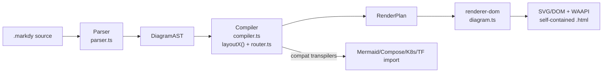
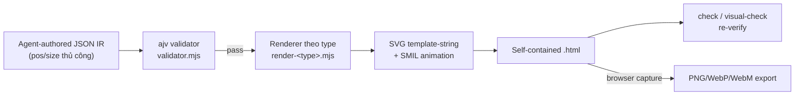
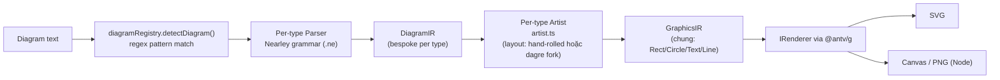
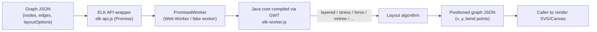

# Weekly Scan — Diagram Tooling (2026-09-08)

**Nguồn dữ liệu:** GitHub REST search (`topic:diagram-as-code`, `topic:dsl`, `topic:svg-animation`, `topic:graph-visualization`, `topic:layout-algorithm`, `pushed:>2026-09-01`) qua `api.github.com`, vì phiên này chỉ có quyền GitHub MCP scope vào `kymostudio/kymostudio` — không gọi được `search/repositories` qua MCP cho repo ngoài. Domain này hiện bị nhiễu nặng bởi: profile-README SVG (theo dõi commit/weather), AI-agent "skill" repos, và fork/spam có sao ảo — đã lọc theo tiêu chí loại trừ trong task.

## Executive summary

- **markdy-com** là đối thủ trực tiếp gần nhất của kymostudio (animated diagram DSL, TS, Web Animations API) nhưng kiến trúc core còn phẳng/lộn xộn so với separation `dsl.py`/`layout.py`/`alignment.py`/`to_svg.py` của kymostudio — kỹ thuật WAAPI-scrubbing đáng học.
- **archify** minh hoạ một hướng đi khác hẳn: bỏ auto-layout, để AI agent tự đặt toạ độ `pos`/`size` trong JSON IR, và dùng validate-gate làm cơ chế self-heal cho agent — nhưng con số 53k sao của nó không khớp với độ sâu contributor/issue thực tế, cần cảnh báo rõ.
- **elkjs** (Sugiyama layered layout, JS wrapper quanh lõi Java/GWT) và **pintora** (registry `IDiagram{pattern,parser,artist}` cho nhiều loại diagram trên một core) không có thay đổi "nổi bật" trong 7 ngày qua (routine maintenance / thậm chí pintora đã im ắng từ tháng 6) nhưng vẫn đáng đọc vì cho ý tưởng cụ thể cho layout/plugin architecture của kymostudio.

## Mục lục

1. [markdy-com](#1-hoangyellmarkdy-com)
2. [archify](#2-tt-a1iarchify)
3. [pintora](#3-hikerpigpintora)
4. [elkjs](#4-kielerelkjs)

---

## 1. HoangYell/markdy-com

### §1 — Quick context

Animated architecture-diagram-as-code với DSL riêng (MarkdyScript) — khác kymostudio ở chỗ animation là WAAPI scrubbing thủ công thay vì SMIL/CSS. Stack: TypeScript, pnpm monorepo, `tsup`/`vitest`. 90 sao, 3 fork, MIT, ~10 release trong 2 tuần (v1.1.7→v1.4.3) — cadence rất cao cho dự án nhỏ. Có CI thật (`ci.yml` chạy test + conformance-gate + visual-regression qua Puppeteer/pixelmatch). Phân phối: npm scoped packages (`@markdy/core`, `@markdy/renderer-dom`, `@markdy/cli`, `@markdy/mcp-server`, …) + VS Code extension.

### §2 — Architecture deep-dive

**A. Component inventory** — `Parser` (`packages/core/src/parser.ts`); `Compiler` (`packages/core/src/compiler.ts` — layout dispatch, dedupe, `router.ts`, `scheduleBeats()`); `Diagram`/playback core (`packages/renderer-dom/src/diagram.ts`); `CLI` (`packages/cli/src/index.ts`); `MCP server` (`packages/mcp-server/src/tools.ts`, 8 tool); `Compat transpilers` (`packages/compat/` — Mermaid/Docker Compose/K8s/Terraform/D2/PlantUML → MarkdyScript).

**B. Pipeline** — 1) `markdy render foo.markdy` gọi CLI; 2) `parse()` → `DiagramAST` (nodes/edges/groups/beats/diagnostics); 3) `compile()` tính kích thước node, dedupe edge, dispatch theo diagram type tới 1 trong ~14 hàm `layoutX()`, gọi `router.ts` định tuyến edge, `scheduleBeats()` gán timestamp → `RenderPlan`; 4) `createDiagram()` dựng DOM/SVG từ `RenderPlan`, tạo `Animation` object (paused) cho mỗi node/edge/cue; 5) CLI ghi file `.html` độc lập.

**C. Data model/IR** — Hai IR tường minh dạng plain object (không class): `DiagramAST` (parse output) và `RenderPlan` (compile output, gồm `PositionedNode[]`, `RoutedEdge[]`, `groupBoundaries`, `treeBuses`, `cues: TimedCue[]`). Giống kiến trúc parse→resolve→render của kymostudio, nhưng không có tầng thứ 3 tách biệt như `alignment.py`.

**D. Input language** — Parser line/indent-based, tự viết tay (không PEG/parser-combinator): `stripComment()` → `readBlocks()` (indent tracking) → pattern-match theo block (`scene`, `layout`, `pattern`, `group`, edge lines, `beat`…), tokenizer riêng cho flow chain (`->`, `<-`, `~>`). Không có EBNF chính thức (chỉ `docs/SYNTAX.md` dạng prose) — khác kymostudio's `docs/DSL.md`. Lỗi qua `ParseError` (line/col) + mảng `diagnostics`, cố gắng recover thay vì abort ngay.

**E. Layout** — "17 layout engine" thực chất là 14 hàm `layoutX()` dispatch theo `type` trong `compiler.ts` (`layoutRanked` = topological sort + barycenter + "4-sweep" crossing-min; `layoutTree`, `layoutRadar`, `layoutSwimlane`, `layoutGantt`…) — toàn bộ auto-layout, không có manual x/y. Routing tách riêng ở `router.ts`: orthogonal ("Manhattan") có chấm điểm collision, dynamic port-lane cho edge song song, bo góc bằng quadratic Bézier.

**F. Rendering** — Một backend DOM+SVG (`@markdy/renderer-dom`); `html2canvas` chỉ dùng cho export (mâu thuẫn nhẹ với tuyên bố "no Canvas"). Animation = Web Animations API nhưng **điều khiển thủ công**: mỗi `Animation` bị `.pause()` ngay sau khi tạo, một vòng `requestAnimationFrame` trung tâm set `currentTime`/`playbackRate`/`startTime` mỗi frame (`applyCurrentTime()`) — theo `docs/ARCHITECTURE.md`, đây là lựa chọn có chủ đích để né inconsistency của native timeline autoplay giữa các browser.

**G. Extensibility** — Không có plugin registry chính thức: thêm diagram type = thêm case trong `compilePlan` + hàm `layoutX()` mới; import format mới = thêm transpiler trong `@markdy/compat`. Theme là data object (10 theme có sẵn + generator), không phải CSS plugin API.

**H. Dev experience** — CLI rất rộng: `render`, `lint`, `fmt`, `verify`, `explain`, `drift` (so diagram với repo thực), `c4`, `suggest` (IntelliCode-style), `share` (playground link qua URL hash), chạy không tham số sẽ mở playground local port 4242. Có VS Code/Cursor extension + `markdy-language-server` (LSP — capability cụ thể chưa xác nhận từ code).

### §3 — Architecture diagram

### §4 — Verdict

Kỹ thuật đáng học nhất: **manual WAAPI scrubbing** (`pause()` toàn bộ animation + 1 RAF loop set `currentTime`) cho seek/scrub sample-accurate — áp dụng được nếu kymostudio làm runtime JS cho `--animate` thay vì chỉ xuất SMIL/CSS tĩnh. Route-collision scoring trong `router.ts` cũng là ý hay cho fan-in routing. Red flag: `packages/core/src/` phẳng, trộn compiler với các concern không liên quan (`ai-healing.ts`, `drift.ts`, `arch-lint.ts`) — thiếu separation rõ ràng như kymostudio. Cadence release (~10 release/2 tuần, 90 sao, contributor base nhỏ) gợi ý dự án đơn-maintainer đang iterate nhanh, chưa được kiểm chứng ở scale. Open question: LSP/watch-mode thực sự làm được gì chưa rõ. **Verdict: study deeper** (đặc biệt phần animation runtime + router).

---

## 2. tt-a1i/archify

### §1 — Quick context

"Agent skill" (không phải thư viện truyền thống) sinh diagram architecture/workflow/sequence/dataflow/lifecycle từ JSON IR do chính AI agent tự soạn — khác kymostudio ở chỗ **không có DSL text và không có auto-layout**, agent tự đặt `pos`/`size`. Stack: Node.js/ESM thuần, zero runtime dependency (chỉ `ajv` để validate). Repo hiện hiển thị **53.1k sao / 3.5k fork**, MIT, v2.17.0-dev.1, CI thật (`.github/workflows/`). Phân phối: cài như skill package (`npx skills add tt-a1i/archify -g`) vào thư mục skill của Cursor/Claude Code/Codex CLI, không phải npm install thông thường.

### §2 — Architecture deep-dive

**A. Component inventory** — CLI (`archify/bin/archify.mjs`, 14 subcommand); 6 schema JSON Schema draft 2020-12 (`archify/schemas/*.schema.json`); 6 renderer module theo type (`archify/renderers/<type>/render-<type>.mjs`) + `grid.mjs` (layout) + helper dùng chung (`validator.mjs`, `geometry.mjs`, `router` logic trong renderer); `delta/architecture-delta.mjs` (before/after diff); skill doc `archify/SKILL.md` — văn bản hướng dẫn agent, không phải code.

**B. Pipeline** — 1) Agent tự soạn JSON theo `diagram_type` + ví dụ trong `examples/*.json`; 2) `archify validate <type> file.json` chạy ajv + kiểm layout/label/route; 3) `render`/`preview` gọi renderer type tương ứng, ghép template-string SVG rồi bọc HTML tự chứa; 4) `check <output.html>` verify lại composition rule; 5) `deliver` chain validate→render→check, chỉ ghi đè file "last known good" khi cả 3 pass.

**C. Data model/IR** — Mỗi diagram type có JSON Schema riêng (`additionalProperties:false`, closed-world), fragment chung qua `$ref` vào `common.schema.json`. Không có immutability ở tầng IR — "an toàn" đến từ quy trình CLI (chỉ ghi đè sau khi validate pass), không phải cấu trúc dữ liệu immutable.

**D. Input language** — **Không có DSL text**: IR là JSON do agent viết trực tiếp, có toạ độ `pos:[x,y]`/`size:[w,h]` tường minh (xác nhận từ `web-app.architecture.json`). Lỗi trả về dạng JSON có cấu trúc `{code, subject, evidence, supportedFixes}` — thiết kế để agent tự sửa, không phải stack trace cho người.

**E. Layout** — Chủ động **từ chối auto-layout tổng quát** ("layout judgment over generic auto-layout" — README): agent tự đặt toạ độ; `grid.mjs` chỉ hỗ trợ grid đơn giản khi cần. Routing hỗ trợ enum `route: auto|straight|orthogonal-h|orthogonal-v` + waypoint `via` thủ công, có fallback tự động chọn hướng orthogonal kèm kiểm tra clearance va chạm component — là collision-avoidance, không phải crossing-minimization đúng nghĩa graph layout.

**F. Rendering** — SVG dựng bằng ghép template-string JS thuần (không dùng thư viện DOM/SVG). Animation qua **SMIL** (thuộc tính animate inline, bật theo `meta.animation`), khác hẳn CSS/WAAPI của markdy-com. Export PNG/WebP/WebM chạy phía browser từ chính file HTML đã render.

**G. Extensibility** — Thêm diagram type mới cần: schema mới + đăng ký generated-validator + renderer module mới + thêm type string vào CLI — friction tương đối cao (code-level), không phải plugin config-only.

**H. Dev experience** — Trục thiết kế trung tâm là tích hợp AI agent: `SKILL.md` viết như operating manual cho LLM (cấm "counterfeit validation passes bằng CSS trick"), cổng validate→deliver tồn tại để agent tự sửa mà không cần người debug.

### §3 — Architecture diagram

### §4 — Verdict

Điểm đáng học: cơ chế **validate-before-deliver làm CLI verb riêng** trả JSON `{code, subject, evidence, supportedFixes}` — mẫu tốt để agent tự sửa `.kymo` source mà không cần đọc traceback; và concept `views` (named focus subset trong `meta`) — kymostudio DSL hiện chưa có. Red flag lớn nhất không nằm ở code mà ở **con số sao**: tăng ~12x trong <2 tuần (4.2k → 53k) trong khi tổng số issue/PR chỉ chạm #345 và contributor thực tế quan sát được ~15 người — độ lệch giữa sao và độ sâu hoạt động là dấu hiệu rõ của sao ảo/gamed, cần loại trừ khi đánh giá "mức độ trưởng thành". Open question: cơ chế export WebM chưa xác nhận được từ source đã đọc. **Verdict: glance only** cho code, nhưng **study deeper** riêng phần validate-gate/error-schema pattern.

---

## 3. hikerpig/pintora

### §1 — Quick context

Text-to-diagram library đa loại (giống Mermaid) chạy cả browser lẫn Node — khác kymostudio ở chỗ **một core hỗ trợ nhiều diagram type qua plugin registry** thay vì một model diagram duy nhất. Lưu ý minh bạch: repo được tìm thấy qua `pushed:>2026-09-01`, nhưng khi đọc sâu, commit atom feed cho thấy commit gần nhất thực tế là **2026-06-12** — có khả năng chỉ số `pushed_at` của GitHub search bị lệch (branch phụ, cache) so với hoạt động thực trên `master`; ghi nhận đây KHÔNG phải update "trong 7 ngày qua" như tiêu chí ban đầu, giữ lại vì giá trị kiến trúc. Stack: TypeScript, pnpm+Turborepo, Jest, render qua `@antv/g`. ~1.3k sao, MIT, CI thật nhưng không có golden-corpus lớn như kymostudio. npm: `@pintora/standalone`, `@pintora/core`, `@pintora/diagrams`, `@pintora/renderer`.

### §2 — Architecture deep-dive

**A. Component inventory** — `pintora-core` (`diagram-registry.ts`, `symbol-registry.ts`, `themes/`); `pintora-diagrams` (mỗi type 1 thư mục: `sequence/`, `class/`, `er/`, `gantt/`, `mindmap/`… mỗi thư mục có `parser/` + `artist.ts` + `db.ts`); `pintora-renderer` (`renderers/` SVG/canvas qua `@antv/g`); `pintora-standalone` (bundle browser).

**B. Pipeline** — 1) `parseAndDraw(text, opts)` hoặc `renderTo()`; 2) `diagramRegistry.detectDiagram(text)` thử regex `pattern` của từng diagram đã đăng ký, fallback về `sequenceDiagram` nếu không khớp; 3) `parser` của type đó (grammar Nearley riêng) chuyển text → `DiagramIR` (bespoke theo type); 4) `artist` của type đó chuyển `DiagramIR` → `GraphicsIR` chung (Group/Rect/Circle/Text/Line…), tự làm layout math bên trong; 5) `IRenderer` vẽ `GraphicsIR` ra SVG/Canvas qua `@antv/g`.

**C. Data model/IR** — Hai tầng: `DiagramIR` riêng theo từng type (builder mutable, ví dụ `SequenceDB extends BaseDb` với `addActor()`/`addSignal()`, chỉ serialize qua `getDiagramIR()` ở cuối) hội tụ về **một `GraphicsIR` chung** ở tầng renderer — tách bạch "cái renderer cần hiểu" khỏi "cái grammar của từng type cần".

**D. Input language** — **Formal grammar riêng cho mỗi diagram type** dùng Nearley (Earley-parser generator, fork riêng `@hikerpig/nearley`) + lexer Moo, file `.ne` (vd `sequence/parser/sequenceDiagram.ne`) include fragment chung (`whitespace.ne`, `config.ne`). `pintora-core` không ràng buộc công cụ parser — docs nói rõ tác giả diagram type mới có thể dùng jison/PEG.js tuỳ ý, chỉ cần thoả interface `IDiagramParser<D>`.

**E. Layout** — Không có layout engine chung: sequence diagram layout thủ công (vertical stacking theo thứ tự khai báo, không crossing-minimization); các diagram dạng graph (class/component/ER/activity) dùng **fork riêng của dagre** (`@pintora/dagre`) — tái dùng thuật toán đã có thay vì tự viết lại layered-layout.

**F. Rendering** — Thống nhất qua `@antv/g` (một abstraction cho cả SVG và Canvas). **Không có animation** — đây là khoảng trống rõ so với kymostudio. Pluggability nằm ở tầng artist (IR→GraphicsIR), không phải ở renderer.

**G. Extensibility** — Bề mặt plugin rất gọn: interface `IDiagram<D,Config> = {pattern, parser, artist, eventRecognizer?}`, đăng ký qua `diagramRegistry.registerDiagram(name, diagram)`. Theme là registry riêng (`ThemeRegistry`) với `StyleEngine` + directive `@bindClass` trong chính DSL để override style tại parse-time.

**H. Dev experience** — Docs + playground tại pintorajs.vercel.app, VS Code extension (syntax highlight + preview), CLI, plus tích hợp Gatsby/Obsidian/Observable.

### §3 — Architecture diagram

### §4 — Verdict

Điểm đáng học nhất: interface `IDiagram{pattern, parser, artist}` là template rất gọn cho multi-diagram-type plugin surface mà kymostudio hiện chưa có (kymostudio chỉ có 1 model `Diagram` duy nhất) — tách `DiagramIR` (per-type, parser-facing) khỏi `GraphicsIR` chung (renderer-facing) là ý hay nếu kymostudio muốn hỗ trợ nhiều "front-end DSL" khác cùng compile về chung `Component`/`Edge`/`Region`. Fork sẵn dagre cho graph-layout thay vì tự viết cũng là pattern tái dùng thực dụng. Red flag: grammar fork riêng (`@hikerpig/nearley`/`moo`) là gánh nặng maintain; hoạt động gần đây chủ yếu là dependency-bump, không có tính năng mới đáng kể; và quan trọng — layout rigor không đồng nhất giữa các type (sequence layout ad-hoc, không có alignment-resolver chung như kymostudio). **Verdict: study deeper** (riêng phần plugin interface), phần còn lại **glance only**.

---

## 4. kieler/elkjs

### §1 — Quick context

JS/npm wrapper cho Eclipse Layout Kernel (ELK) — bộ thuật toán layout đồ thị dùng bởi chính mermaid.js cho hierarchical layout. Khác kymostudio ở chỗ đây **không phải công cụ diagram-as-code** mà là một layout-algorithm backend thuần tuý, chọn theo nhánh fallback "ecosystem activity" của task. Tech stack: thuật toán lõi viết **Java, compile qua GWT** thành `elk-worker.js`; phần JS tay viết chỉ là API/messaging wrapper (`elk-api.js`). ~2.8k sao, dual license EPL-2.0/GPL-3.0, CI có (mocha), version `package.json` trên master là 0.13.0 (chưa release chính thức, release công khai mới nhất là 0.12.0). npm: `elkjs`.

### §2 — Architecture deep-dive

**A. Component inventory** — API layer (`src/js/elk-api.js` — class `ELK`, `main-api.js`, `main-node.js`); lõi thuật toán (`src/java/org/eclipse/elk/**`, compile bằng Gradle/GWT ra `lib/elk-worker.js`); bridge `PromisedWorker` (3 tầng fallback: `workerFactory` tuỳ chỉnh → package `web-worker` + `workerUrl` → fake worker in-process).

**B. Pipeline** — 1) Caller dựng graph JSON `{id, layoutOptions, children, edges}`; 2) `new ELK({...})` khởi tạo wrapper + worker; 3) `elk.layout(graph, options)` gửi message `{cmd:'layout', graph, layoutOptions}` tới worker, trả về `Promise`; 4) lõi Java (compiled) chạy thuật toán được chọn (`elk.algorithm`, mặc định `layered`); 5) Promise resolve với graph mới có `x`/`y` gắn vào mọi node/port + bend point cho edge — đây là object mới trả qua message channel, không phải mutate object gốc.

**C. Data model** — Input node `{id, width, height, layoutOptions?, children?, ports?}` (nesting qua `children` cho compound graph); edge `{id, sources:[], targets:[]}` (hyperedge-style, nhiều source/target). `layoutOptions` là flat string-key map (`elk.algorithm`, …) gắn được ở bất kỳ cấp nào (root/node/edge).

**D. Input language** — Không có DSL text — input là object graph JSON thuần, không qua bước parse.

**E. Layout algorithm** — Danh sách thuật toán có sẵn (theo docs chính thức): **Layered** (Sugiyama-style, mặc định, dùng bởi mermaid.js), **Stress**, **Mr. Tree**, **Radial**, **Force**, **DisCo** (disconnected components), **Rectangle Packing**, **Box**, **Fixed** (giữ nguyên toạ độ), **Randomizer**. Routing qua key `elk.edgeRouting`: `UNDEFINED|POLYLINE|ORTHOGONAL|SPLINES`. **Crossing minimization** dùng chiến lược `layered.crossingMinimization.strategy` (`LAYER_SWEEP` mặc định — sweep qua các layer nhiều vòng) áp dụng **barycenter heuristic** (Sugiyama et al.) rồi hậu xử lý bằng **greedy-switch** (Eades et al.) — cả hai tên thuật toán xác nhận từ docs chính thức + luận văn thạc sĩ Schelten về ELK layer-sweep.

**F. Rendering** — elkjs không render gì cả — chỉ trả toạ độ, caller tự vẽ SVG/Canvas.

**G. Extensibility** — Có thể đăng ký thuật toán custom qua `{algorithms:[...]}` + message `{cmd:'register'}`, và introspect runtime qua `knownLayoutAlgorithms()`. Nhưng viết thuật toán mới vẫn phải qua Java + toolchain Gradle/GWT — **không có đường plugin thuần JS**.

**H. Dev experience** — API hoàn toàn async/Promise (`elk.layout().then().catch()`), không có API đồng bộ; browser nên dùng Web Worker thật, Node cần package `web-worker` hoặc fallback in-process kèm cảnh báo console. Có demo tương tác "elklive" (không nằm trong repo).

### §3 — Architecture diagram

### §4 — Verdict

Hoạt động gần nhất (qua commit log) chủ yếu là dependency bump + CI matrix update, **không có thay đổi thuật toán nổi bật trong tuần này** — đọc vì giá trị tham khảo lâu dài, không phải vì tin tức mới. Kỹ thuật cụ thể áp dụng được cho `alignment.py`/`alignment.ts`: thiết kế 2 bước crossing-minimization (barycenter/median sweep toàn cục rồi greedy-switch cục bộ) là pattern dễ port nếu kymostudio cần crossing-minimization thật cho fan-in/trunk-lane staggering thay vì heuristic vị trí thuần; và `edgeRouting` là option per-edge tường minh (orthogonal/polyline/spline) — model hoá tốt hơn việc chỉ có default toàn cục. Red flag khi cân nhắc làm backend thay thế: lõi là Java-via-GWT (blob JS lớn không kiểm soát được), API chỉ async/worker-oriented (không hợp layout pass đồng bộ của Python), và không có đường mở rộng thuần JS. **Verdict: study deeper** cho ý tưởng thuật toán (crossing-min, edge-routing option), **ignore** như một dependency thực tế.
