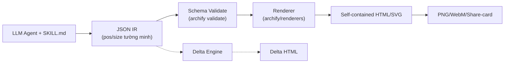
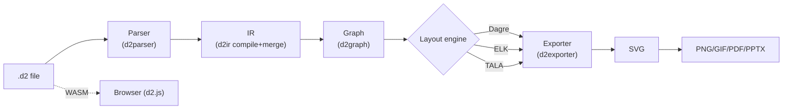
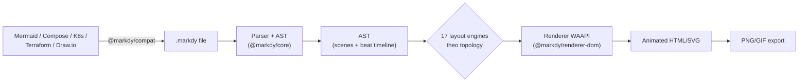
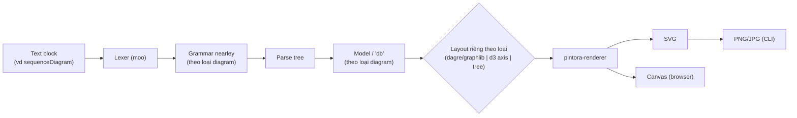

# Weekly Diagram Tooling Scan — 2026-09-09

Phạm vi: repo GitHub trong domain diagram-as-code / visual tooling được publish hoặc update đáng kể từ **2026-09-02 đến 2026-09-09**, phục vụ nghiên cứu cho kymostudio (`packages/python`, `packages/js`, core Rust `kymostudio-core`).

## Tóm tắt điều hành

- **Làn sóng "agent skill" cho diagram đang bùng nổ tuần này** — dẫn đầu là `tt-a1i/archify` (54.8k sao, push 8/9), cùng hàng loạt skill nhỏ hơn (`svg-diagram`, `OpenDiagram`, …) biến JSON IR do LLM tự soạn thành SVG/HTML tĩnh **có validate schema nhưng KHÔNG có auto-layout** — vị trí (`pos`/`size`) do agent tự khai báo. Đây là điểm khác biệt lớn nhất với triết lý "khai báo quan hệ, để máy tự tính vị trí" của `alignment.py`/`alignment.ts` trong kymostudio, đáng nghiên cứu ở góc validate-loop hơn là layout.
- **D2 ra bản v0.9.0 đúng ngày 7/9/2026, mở mã nguồn layout engine TALA** (trước đây độc quyền) — đây là tin lớn nhất về layout algorithm trong tuần, và `d2talalayout` giải đúng bài toán "layout cho diagram kiến trúc phần mềm" mà kymostudio đang tự giải bằng `alignment.py`.
- **`markdy-com` là đối thủ/tham chiếu gần nhất với kymostudio** — cùng pitch "animated diagram-as-code DSL" (Web Animations API, MCP server, VS Code + LSP) dù còn rất non (93 sao, 5 tháng tuổi, một tác giả). Mô hình "beat" (nhịp hoạt cảnh tuần tự) của nó đáng đọc kỹ để đối chiếu với `--animate` của kymostudio.

## Mục lục

1. [§Deep-dive 1 — archify (tt-a1i/archify)](#1-archify-tt-a1iarchify)
2. [§Deep-dive 2 — D2 (d2lang/d2)](#2-d2-d2langd2)
3. [§Deep-dive 3 — markdy-com (HoangYell/markdy-com)](#3-markdy-com-hoangyellmarkdy-com)
4. [§Deep-dive 4 — pintora (hikerpig/pintora)](#4-pintora-hikerpigpintora)
5. [Các repo khác trong tầm radar (không deep-dive)](#5-các-repo-khác-trong-tầm-radar-không-deep-dive)

---

## 1. archify (tt-a1i/archify)

### §1 Quick context

**Pitch:** Agent skill biến JSON IR có kiểm định schema thành file HTML/SVG tự chứa (self-contained) — khác biệt căn bản vì tọa độ (`pos`/`size`) do chính agent/LLM khai báo tuyệt đối, hoàn toàn không có bước auto-layout.

**Tech stack:** Node.js (ESM, `.mjs`), không có runtime framework lớn; output là 1 file HTML tự chứa nhúng SVG, export thêm PNG/SVG/WebM/share-card 1200×630.

**Repo health:** 54,801 sao, 3,587 fork, 64 issue mở, 76 PR mở, 236 commit, tạo 4/2026, push gần nhất 8/9/2026. Có thư mục `test/` riêng nhưng chưa xác nhận CI workflow cụ thể chạy gì.

**Distribution:** Cài qua bộ cài "skills" (`npx skills add tt-a1i/archify -g`), chạy như một agent skill bên trong Cursor/Claude Code/Codex CLI/OpenCode — không phải npm package hay binary độc lập theo nghĩa truyền thống.

### §2 Kiến trúc chi tiết

**A. Component inventory:**
- CLI (`archify/bin/archify.mjs`) — subcommand `validate | preview | deliver | guide | compare`
- Schema (`archify/schemas/`) — JSON Schema riêng cho từng trong 5 loại diagram (architecture/workflow/sequence/dataflow/lifecycle)
- Renderer (`archify/renderers/`) — module render theo từng loại diagram
- Delta engine (`archify/delta/`) — tính diff giữa 2 snapshot IR (before/after)
- Brand marks (`archify/brand-marks/`) — SVG canonical được nhúng thẳng để sống sót qua export raster
- Examples (`archify/examples/`) — 24 file JSON IR mẫu, đóng vai trò fixture hồi quy
- `SKILL.md` — bản "hợp đồng" mô tả giao thức cho agent tự soạn IR hợp lệ

**B. Pipeline (happy path):**
1. Agent (Claude Code/Cursor/...) đọc `SKILL.md`, tự soạn 1 file JSON IR đúng schema (vd `web-app.architecture.json`) với tọa độ `pos`/`size` tường minh cho từng component.
2. `archify validate <type> <file.json>` — kiểm schema + kiểm "layout/route clearance" (chồng lấn, va chạm cạnh).
3. `archify preview|deliver <type> <file.json> <output.html>` biên dịch quyết định luận (deterministic) IR đã validate thành 1 file HTML tự chứa nhúng SVG.
4. (Tùy chọn) `archify compare architecture base.json head.json delta.html` — diff 2 snapshot IR thành HTML thể hiện added/removed/changed/moved/rerouted.
5. Mở HTML trong trình duyệt hoặc export PNG/SVG/WebM/share-card.

**C. Data model / IR:** JSON có `schema_version`, `meta`, `components[]` (id/type/label/**pos**/**size**), `boundaries[]`, `connections[]` (from/to/label/variant/fromSide/toSide/**via** waypoints), `cards[]`. Đây là **snapshot JSON tĩnh, bất biến** — không có khái niệm "compile xuống IR thấp hơn" hay resolver nhiều pass; file đã có tọa độ tuyệt đối ngay từ đầu. Điểm này gần giống cách kymostudio xử lý `.bpmn` (`cli.py` bỏ qua `layout()`/`resolve_alignments()` vì DI coordinates đã tuyệt đối) hơn là cách xử lý `.kymo` (khai báo quan hệ rồi để `alignment.py` tính vị trí).

**D. Input language design:** Không có DSL văn bản/grammar nào cả — "ngôn ngữ" thực chất là JSON Schema + prompt trong `SKILL.md` hướng dẫn LLM. Việc "parse" được giao hoàn toàn cho agent. Validate bằng JSON Schema, kèm "machine-readable failure diagnostics with repair suggestions" — thiết kế lỗi để agent tự sửa và validate lại (vòng lặp lỗi ↔ agent), khác hẳn cách báo lỗi hướng-người-đọc của `dsl.py`.

**E. Layout:** Không có thuật toán auto-layout — chỉ có kiểm tra hậu-kiểm (overlap/route clearance) sau khi agent tự đặt `pos`/`size`/`via`.

**F. Rendering:** Một backend SVG/HTML canonical, fan-out sang PNG/SVG/WebM/share-card từ cùng 1 SVG gốc. "Finite motion" được nhắc tới nhưng cơ chế animation cụ thể (CSS transition hay JS timeline) — không xác định.

**G. Extensibility:** Thêm loại diagram mới cần 1 schema JSON mới + 1 renderer module mới; `DESIGN.md` áp "Semantic Color Rule"/"One Voice Rule" — quản trị bằng tài liệu thiết kế, không phải plugin API.

**H. Dev experience:** CLI hướng-agent (không phải hướng-người dùng cuối), subcommand `guide` nhận mô tả tự do bằng ngôn ngữ tự nhiên; không có bằng chứng về VS Code extension/LSP/watch mode — công cụ này được thiết kế để chạy trong chat với AI agent, không phải để người dùng gõ tay trong editor.

### §3 Sơ đồ pipeline

### §4 Verdict

Điểm đáng học nhất là **quy trình validate-trước-khi-render với lỗi có thể máy đọc và kèm gợi ý sửa** — kymostudio hiện `dsl.py` "parsing thuần khai báo, không validate gì cả" ở bước parse; một subcommand `kymo validate`/`kymo lint` với thông điệp lỗi thiết kế để cả người lẫn agent đọc được là ý tưởng có thể mượn trực tiếp. Tính năng **Architecture Delta** (so 2 snapshot IR → HTML diff added/removed/moved/rerouted) cũng không có tương đương trong kymostudio và gợi ý một `kymo diff a.kymo b.kymo` cho review PR diagram.

Red flag: hoàn toàn không có auto-layout — chỉ khả thi vì có LLM đặt tọa độ hộ; đây là công cụ LLM-in-the-loop, không phải một engine diagram-as-code tổng quát để so sánh ngang hàng. Lượng sao 54.8k trong 5 tháng nhiều khả năng đến từ làn sóng agent-skill marketplace hiện tại hơn là do sức bền kỹ thuật lâu dài — cần thận trọng khi coi số sao là tín hiệu chất lượng.

Câu hỏi mở: cơ chế "finite motion" cụ thể là gì; việc kiểm tra route clearance có thuật toán gì phía sau hay chỉ là hậu-kiểm hình học đơn giản.

**Kết luận: glance only** — đáng đọc lướt phần validate-loop và delta-diff, không đáng nghiên cứu sâu như một layout/render engine.

---

## 2. D2 (d2lang/d2)

### §1 Quick context

**Pitch:** D2 là ngôn ngữ scripting text-to-diagram với 3 layout engine cắm được (Dagre, ELK, và TALA vừa mở mã nguồn) — khác biệt vì cho phép chọn thuật toán layout theo nhu cầu ngay trong cùng một ngôn ngữ, thay vì cố định 1 thuật toán.

**Tech stack:** Go; output SVG (canonical) → PNG/GIF/PDF/PPTX; có bản WASM (`d2.js`) chạy trình duyệt.

**Repo health:** 25,331 sao, 745 fork, phát hành liên tục (v0.9.0 ngày 7/9/2026), có bộ e2e test corpus lớn, trưởng thành từ 2022.

**Distribution:** binary Go đơn (script cài qua brew/curl), Go module, npm wrapper qua WASM.

### §2 Kiến trúc chi tiết

**A. Component inventory:**
- Parser (`d2parser/parse.go`) — lexer + parser tự viết tay, không sinh từ ANTLR/PEG
- IR compiler (`d2ir/`) — biên dịch AST thành 1 cấu trúc "map of maps" có thể merge (xử lý import, pattern glob `&`/`**`, class/var), đúng khái niệm "compile xuống lower IR" mà CLAUDE.md của kymostudio nhắc tới
- Graph model (`d2graph/`) — graph cụ thể cuối cùng (shape + edge có style/geometry) mà layout engine tiêu thụ
- Layout engines (`d2layouts/`): `d2dagrelayout` (Dagre port thuần Go), `d2elklayout` (ELK port thuần Go), `d2talalayout` (TALA — engine layout kiến trúc từng độc quyền, giờ mở mã nguồn), cộng `d2grid`/`d2near`/`d2sequence` cho bố cục chuyên biệt
- Exporter (`d2exporter/`) — render graph đã layout ra SVG rồi rasterize tiếp PNG/GIF/PDF/PPTX

**B. Pipeline:** 1) chạy `d2 --layout=tala in.d2 out.svg`; 2) `d2parser` parse text `.d2` thành AST; 3) `d2ir` compile AST → IR (resolve import, glob, class/var, merge); 4) IR → `d2graph` (graph cụ thể); 5) engine layout được chọn (dagre/elk/tala) tính vị trí + route cạnh trực tiếp lên `d2graph`; 6) `d2exporter` duyệt graph đã layout, xuất SVG rồi rasterize nếu cần. `--watch` lặp lại bước 2-6 mỗi khi file đổi, live-reload trình duyệt.

**C. Data model / IR:** Hai tầng IR rõ rệt — `d2ir` là cấu trúc map tổng quát, **có thể merge/override** (nhiều mảnh cấu hình từ import/glob/var được gộp trước khi model "chốt"); rồi `d2graph` là graph cụ thể cho renderer. Layout engine **mutate trực tiếp** `d2graph` (điền field vị trí/route trong lúc chạy) — khác với triết lý của kymostudio nơi `Component`/`Edge`/`Diagram` trong `model.py` được `alignment.py` (5 pass) điền 1 lần rồi coi như bất biến khi đưa vào `to_svg.py`.

**D. Input language design:** Parser tự viết tay (không ANTLR/PEG), không có EBNF hình thức công bố (d2lang.com dạy cú pháp bằng ví dụ, không phải grammar) — cú pháp lai indentation/brace (`key: value`, `{ }`, `->`/`<-`/`<->`, `&` cho pattern-match). Báo lỗi có source range có cấu trúc, phục vụ cả language server — điều mà front-end `.kymo` hiện chưa có (không có LSP cho `.kymo`/`.bpmn` trong kymostudio, dù có VS Code extension cho preview).

**E. Layout — điểm nổi bật nhất:** 3 engine auto-layout đầy đủ, hoán đổi được: Dagre (Sugiyama-style, layered/hierarchical), ELK (constraint-based, nhiều thuật toán con), và TALA (engine riêng của D2, "thiết kế riêng cho diagram kiến trúc phần mềm", hỗ trợ seed xác định qua `--tala-seeds`). Không có luồng "người dùng tự đặt vị trí" được nhấn mạnh trong tài liệu — vị trí luôn được tính, `near`/container chỉ là gợi ý.

**F. Rendering:** SVG là canonical duy nhất; PNG/GIF/PDF/PPTX là target xuất phái sinh (v0.9.0 mới đưa các định dạng này thành built-in, trước đó cần công cụ ngoài) — kiến trúc emitter tương tự `to_svg.py` của kymostudio với các sibling `to_figma.py`/`to_excalidraw.py`/`to_webp.py`, khác ở chỗ các "sibling" của D2 đều là bản raster/print của cùng 1 SVG, không phải định dạng ngữ nghĩa khác (Figma file, Excalidraw scene). Không có animation.

**G. Extensibility:** Layout engine chọn qua flag/env/config trong file — một interface pluggable-layout thật sự (implement bởi `d2dagrelayout`/`d2elklayout`/`d2talalayout`) mà `alignment.py`/`alignment.ts` (1 resolver monolith) của kymostudio chưa có. Theming qua class/var và theme ID có sẵn; shape mới giới hạn trong 1 enum cố định, không có bằng chứng về plugin shape do bên thứ ba tự định nghĩa.

**H. Dev experience:** `d2 --watch` live-reload trình duyệt, `--help` đầy đủ, lỗi compiler có cấu trúc, có VS Code extension/language server, playground tương tác tại d2lang.com.

### §3 Sơ đồ pipeline

### §4 Verdict

Ý tưởng dễ chuyển giao nhất cho kymostudio: **interface pluggable-layout** — cùng 1 `d2graph` được đưa cho các implementation Dagre/ELK/TALA hoán đổi qua flag. Hiện `alignment.py`/`alignment.ts` là 1 resolver 5-pass monolith; tách phần "tính vị trí cho auto-layout frame" ra sau 1 interface nhỏ (dù chỉ 2 chiến lược: resolver hiện tại cho frame-based layout + 1 chiến lược kiểu Sugiyama/dagre cho diagram nhiều cạnh tự do không thuộc BPMN/`layout{}`) sẽ giúp các diagram đó có crossing-minimization thật thay vì bắt tác giả DSL tự canh tay.

Việc TALA mở mã nguồn đúng tuần này (v0.9.0, 7/9) nghĩa là code layout kiến trúc-diagram thật giờ đọc được — đáng đọc kỹ `d2layouts/d2talalayout` vì đây đúng bài toán của kymostudio (diagram kiến trúc/workflow, không phải graph tổng quát).

Red flag: không lớn — D2 trưởng thành, nhưng 2 tầng IR (`d2ir` map tổng quát → `d2graph` cụ thể) thêm độ phức tạp mà thiết kế 1-dataclass của kymostudio cố tình tránh; không đáng copy trừ khi kymostudio cần pattern glob/import kiểu D2.

Câu hỏi mở: `--tala-seeds` gợi ý TALA có yếu tố heuristic/random — cần kiểm tra độ xác định (determinism) trước khi so với triết lý golden-SVG byte-for-byte của kymostudio, vì 1 layout engine không xác định sẽ không tương thích ngay với cách test này.

**Kết luận: study deeper** — đặc biệt `d2talalayout` và ranh giới interface layout engine.

---

## 3. markdy-com (HoangYell/markdy-com)

### §1 Quick context

**Pitch:** Markdy biên dịch kịch bản `.markdy` thành animation 60fps trong trình duyệt bằng Web Animations API thuần (zero dependency, không Canvas/GSAP) — khác biệt vì dựng diagram theo chuỗi "beat" (nhịp hoạt cảnh) tuần tự thay vì một layout tĩnh đơn thuần.

**Tech stack:** TypeScript, monorepo pnpm workspaces; core zero-dependency (~14kB); output HTML animated (WAAPI) + export SVG/PNG/GIF; có VS Code extension, LSP, MCP server.

**Repo health:** 93 sao, 3 fork, tạo 4/2026, push 6/9/2026 (~5 tháng tuổi) — còn rất non, tác giả duy nhất công khai là "Hoang Yell"; README tự nhận "CI/CD verification gates for unit tests, visual regressions, performance benchmarking, and example canonical verification" (chưa xác minh độc lập).

**Distribution:** npm (scoped packages `@markdy/core`, `@markdy/cli`, …), VS Code Marketplace, MCP server qua `npx @markdy/mcp-server`.

### §2 Kiến trúc chi tiết

**A. Component inventory:**
- `@markdy/core` — parser + AST engine + validate, zero deps, ~14kB
- `@markdy/renderer-dom` — renderer animation WAAPI (DOM/SVG) + export SVG/PNG/GIF
- `@markdy/cli` — `render | lint | format | import`
- `@markdy/compat` — transpiler nhập từ Mermaid/Docker Compose/Kubernetes/Terraform/Draw.io sang `.markdy`
- `markdy-vscode` — live preview + syntax highlight + auto-fix
- `@markdy/language-server` — LSP headless cho editor khác
- `@markdy/mcp-server` — expose tool `validate_markdy_code`/`diagnose_markdy_syntax`/`fix_markdy_code`/`transpile_to_markdy` cho agent qua MCP
- `@markdy/stdlib-systems` — từ vựng ngữ nghĩa/icon (`browser`, `gateway`, `service`, `cache`, `database`, …)
- `@markdy/astro`, `@markdy/mdx` — nhúng vào doc site

**B. Pipeline:** 1) tác giả viết file `.markdy` với `scene`/`layout`/khai báo node/khối `beat`; 2) chạy `npx @markdy/cli render system.markdy --out diagram.html` (hoặc gọi `createDiagram({code})` trong browser); 3) `@markdy/core` parse text thành AST, chạy validate/lint; 4) 1 trong 17 layout engine chuyên biệt theo dạng diagram tính vị trí node; 5) `@markdy/renderer-dom` duyệt timeline các `beat`, phát chuỗi WAAPI keyframe animation (cue `show`/`frame`/`glow`/`stagger`) điều khiển phần tử SVG/DOM; 6) output là 1 file HTML animated tự chứa (hoặc nhúng qua component React/Astro/MDX), có thể export SVG/PNG/GIF tĩnh.

**C. Data model / IR:** AST từ `@markdy/core` biểu diễn scene, node, và **1 danh sách beat có thứ tự**, mỗi beat chứa các cue có mốc thời gian (`show`/`frame`/`glow`, thông điệp `->`/`<-`/`~>`) — về bản chất là 1 **IR có trục thời gian (choreography timeline)**, không chỉ là graph tĩnh. Đây là khác biệt cấu trúc lớn nhất so với `Diagram` của kymostudio (chỉ có components/regions/edges, không có trục thời gian) và so với D2/archify (IR của họ không có timeline animation). Việc AST được mutate tại chỗ hay dựng lại bất biến qua từng pass — không xác định (không đọc được source `renderer-dom`).

**D. Input language design:** DSL văn bản riêng ("MarkdyScript"), cấu trúc block (`scene`, `beat "label":` thân thụt lề), khai báo node có "kind" xây sẵn (`browser`, `gateway`, `service`, `cache`, `database`) map thẳng sang icon trong `@markdy/stdlib-systems` — cùng ý tưởng với việc resolve icon key trong `icons.py` của kymostudio, nhưng được đưa vào ngay grammar dưới dạng từ khóa loại-node thay vì thuộc tính `icon:` riêng. Cú pháp đáng chú ý: **3 toán tử mũi tên phân biệt ngữ nghĩa message** (`->` request đồng bộ, `<-` response, `~>` sự kiện bất đồng bộ) mã hóa ngay trong parse, khác cách kymostudio dùng thuộc tính `style`/kind trên edge để biểu đạt việc này. Cách viết parser và có grammar hình thức hay không: không xác định (README khẳng định "mọi ví dụ parse sạch trên grammar hiện tại" ngụ ý có grammar được enforce trong CI, nhưng không tìm thấy file grammar cụ thể).

**E. Layout:** **17 layout engine đặt tên theo từng dạng topology** (architecture, flowchart, tree, state, sequence, layers, nested, swimlane, quadrant, pyramid, medallion, timeline, gantt, flywheel, constellation, radar, venn) thay vì 1 thuật toán auto-layout tổng quát — mỗi *hình dạng* diagram có layout riêng được tinh chỉnh tay, khác hẳn chiến lược "1 resolver cho mọi thứ" của kymostudio hoặc "vài thuật toán graph tổng quát, chọn 1" của D2/Mermaid. Chi tiết crossing-minimization/edge-routing nội bộ: không xác định.

**F. Rendering/output:** Chỉ DOM+SVG, animate bằng Web Animations API gốc trình duyệt (biến đổi CSS/SVG), chủ đích tránh Canvas và GSAP để giữ core zero-dependency; export SVG/PNG/GIF tĩnh nhiều khả năng là ảnh chụp phái sinh từ cùng DOM renderer. Chỉ 1 backend render (`renderer-dom`), không có sibling PDF/Figma/Excalidraw.

**G. Extensibility:** Định dạng ngoài cắm vào qua transpiler `@markdy/compat` (Mermaid/Compose/K8s/Terraform/Draw.io → `.markdy`) — có thể so sánh trực tiếp với ý tưởng "thêm importer" cho kymostudio (hiện chỉ có 1 importer, BPMN, và đi theo hướng khác vì BPMN tự nó đã có hình dạng diagram). Theming qua 10 theme đặt tên cố định (midnight, paper, blueprint, editorial, …) — 1 enum cố định, không có bằng chứng về API override CSS đầy đủ.

**H. Dev experience:** CLI `render/lint/format/import`; VS Code extension có live preview + "auto-fix"; có gói LSP đầy đủ cho editor khác; playground trình duyệt; MCP server cho agent quyền validate/diagnose/fix/transpile trực tiếp — tích hợp MCP-first này phát triển hơn hẳn kymostudio hiện tại (kymostudio có worker `kymo-mcp` nhưng phục vụ catalogue icon/brand của `icons.kymo.studio`, không phải để agent soạn/sửa DSL).

### §3 Sơ đồ pipeline

### §4 Verdict

Đây là dự án gần với pitch của kymostudio nhất trong cả tuần (animated diagram-as-code) nên đáng so sánh trực diện: kymostudio đã có target `--animate`, nhưng **mô hình DSL choreography theo "beat"** (chuỗi nhịp tuần tự, mỗi nhịp có cue `show`/`frame`/`glow`/`stagger` và 3 toán tử mũi tên phân biệt sync/async/response) là 1 mô hình trục-thời-gian biểu đạt hơn những gì CLAUDE.md mô tả về animation của kymostudio — đáng đọc kỹ shape AST của `@markdy/core` để xem `Diagram`/`Edge` của kymostudio có cần khái niệm "timeline" hạng nhất thay vì animation chỉ là chuyện của tầng render.

`@markdy/compat` (import Mermaid/Docker Compose/K8s manifest/Terraform/Draw.io → DSL riêng) là ý tưởng cụ thể, khả thi để copy cho câu chuyện importer của kymostudio: 1 lệnh `kymo import docker-compose.yml` hay `kymo import terraform.tfstate` sẽ khớp mẫu importer sẵn có (`from_bpmn.py`) và mở rộng surface tiếp cận người dùng.

Red flag: repo còn rất non (5 tháng tuổi, 93 sao, 1 tác giả công khai, chưa thấy co-maintainer), bề mặt tham vọng lớn (10 package, MCP server, LSP, VS Code extension, plugin Astro/MDX, 17 layout engine) cho 1 dự án trẻ — rủi ro bị bỏ dở cao hoặc một số tính năng công bố còn mỏng; tuyên bố "zero dependencies ~14kB" dễ nói nhưng khó kiểm chứng nếu không đọc trực tiếp source `@markdy/core` (chưa thực hiện trong lần scan này).

Câu hỏi mở: có file grammar hình thức thật hay parser viết tay kiểu regex/line-based như `dsl.py`; 17 layout engine có share code lõi với config theo-hình-dạng hay là 17 thuật toán tách biệt hoàn toàn; vấn đề rounding kiểu `pyRound` có liên quan không (chưa thấy bằng chứng có impl thứ 2 cần giữ parity nên có lẽ không phải vấn đề của họ).

**Kết luận: study deeper** — tham chiếu trực tiếp gần nhất cho tham vọng animation của kymostudio.

---

## 4. pintora (hikerpig/pintora)

### §1 Quick context

**Pitch:** Pintora là thư viện text-to-diagram lấy cảm hứng từ Mermaid/PlantUML, khác biệt vì dùng `nearley` (Earley parser) sinh từ grammar hình thức thay vì regex/line-based, cùng renderer kép SVG + Canvas.

**Tech stack:** TypeScript; `nearley` + `moo` cho lexer/parser; `@pintora/dagre` (fork dagre riêng) + `@pintora/graphlib` cho layout đồ thị; `d3-scale`/`d3-time`/`d3-interpolate`/`d3-shape` cho gantt/timeline; output SVG (browser + Node), Canvas (browser), PNG/JPG (Node CLI).

**Repo health:** 1,283 sao, 37 fork, tạo 2021 (5 năm, trưởng thành), push 7/9/2026. Có monorepo pnpm + Turbo, test Jest, ESLint/Prettier, và cả 1 package `pintora-harness` riêng cho test — tín hiệu kỷ luật CI/test rõ ràng.

**Distribution:** npm (9 package workspace, vd `@pintora/cli`, `@pintora/standalone`), VS Code extension, Gatsby plugin, cell Observable notebook, web component (`pintora-stencil`).

### §2 Kiến trúc chi tiết

**A. Component inventory:**
- `pintora-core` — runtime dùng chung, config, API đăng ký plugin
- `pintora-diagrams` — mỗi loại diagram (sequence, ER, component, activity, mindmap, gantt, DOT, class) có grammar + parser + "artist" (renderer) riêng
- `pintora-renderer` — abstraction vẽ SVG/Canvas dùng chung cho mọi "artist"
- `pintora-cli` — CLI Node, xuất PNG/JPG/SVG
- `pintora-standalone` — bundle chạy trình duyệt
- `pintora-target-wintercg` — target render cho runtime edge (WinterCG, vd Cloudflare Workers)
- `development-kit` / `pintora-harness` / `test-shared` — công cụ dev/test nội bộ

**B. Pipeline:** 1) người dùng viết 1 block text (vd `sequenceDiagram ...`); 2) lexer `moo` tokenize; 3) grammar `nearley` riêng cho từng loại diagram parse token thành parse tree bằng thuật toán Earley; 4) mỗi loại diagram có bước dựng "model"/"db" riêng biến parse tree thành dữ liệu chuyên biệt (participant/message cho sequence, entity/relation cho ER, …); 5) "artist" của loại diagram đó layout model — dùng `@pintora/dagre` (qua `@pintora/graphlib`) cho diagram dạng đồ thị (component/class/activity), toán vị trí riêng cho loại khác (gantt qua `d3-scale`/`d3-time`, mindmap khả năng dùng tree layout); 6) `pintora-renderer` vẽ model đã layout ra SVG/Canvas, inline trong DOM hoặc ghi file PNG/JPG/SVG qua CLI Node.

**C. Data model/IR:** **Không có 1 IR chung** — mỗi loại diagram tự sở hữu model kiểu riêng (pattern "db" theo kiểu Mermaid), dựng mới hoàn toàn cho từng loại, không phải 1 họ dataclass `Component`/`Edge`/`Region` chung cho mọi loại như `model.py` của kymostudio. Về mutability: parse tree được tiêu thụ 1 lần để dựng model theo-loại; model đó đưa 1 lần cho artist để layout+vẽ — không thấy bằng chứng về resolver nhiều pass trên 1 cấu trúc chung (khác với 5-pass của `alignment.py`).

**D. Input language design:** **Grammar hình thức cho từng loại diagram**, viết bằng `nearley` (file `.ne`, thuật toán Earley — xử lý tốt grammar mơ hồ/đệ quy trái mà recursive descent viết tay gặp khó), tokenize bằng `moo` — cách tiếp cận hình thức hơn hẳn cả parser viết tay của D2 lẫn parser line-oriented khai báo của `dsl.py`/`dsl.ts`. Chiến lược báo lỗi: không xác định (chưa đọc trực tiếp).

**E. Layout:** Diagram dạng đồ thị (component, class, activity) dùng dagre fork riêng (`@pintora/dagre`, layered/hierarchical, họ Sugiyama) trên `@pintora/graphlib`; sequence diagram dùng logic vị trí lifeline riêng; gantt/timeline dùng trục d3; mindmap dùng (khả năng) tree/radial layout. Tức là: nhiều chiến lược layout chuyên biệt theo loại diagram, cùng tinh thần với ý tưởng "17 engine" của markdy nhưng quy mô nhỏ hơn (8 loại) và dựa trên thư viện graph-layout đã kiểm chứng thay vì code bespoke cho mọi hình dạng.

**F. Rendering:** **Dual-backend rõ ràng** — SVG (chạy cả browser lẫn Node) và Canvas (chỉ browser) — chọn tại thời điểm gọi, cả hai đều nhận cùng 1 model đã layout qua abstraction của `pintora-renderer`; CLI Node thêm rasterize PNG/JPG trên nền SVG. Không có animation. Việc có cả SVG/Canvas song song cộng thêm target WinterCG là 1 kiến trúc "pluggable emitter" thật sự, cùng hình dạng với các sibling `to_svg.py`/`to_figma.py`/`to_excalidraw.py` của kymostudio, chỉ khác là sibling của pintora là các **bề mặt render khác nhau** cho cùng 1 hình ảnh, không phải các **định dạng đích khác nhau** (file Figma, scene Excalidraw) như kymostudio.

**G. Extensibility:** Có **plugin system tường minh, có tài liệu** ("cung cấp hệ thống plugin để nhà phát triển diagram viết và phân phối loại diagram riêng") — bên thứ ba có thể đăng ký hẳn 1 loại diagram mới (grammar + model + artist) mà không đụng vào `pintora-core` — câu chuyện extensibility mạnh hơn kymostudio hiện tại (front-end DSL và BPMN của kymostudio đều là first-party, chưa có API plugin loại-diagram bên thứ ba).

**H. Dev experience:** VS Code extension, Gatsby plugin (nhúng SSR vào site tĩnh), tích hợp Observable notebook, web component (`pintora-stencil`) để nhúng `<pintora-diagram>` vào bất kỳ đâu — câu chuyện "nhúng vào công cụ có sẵn" rộng hơn là 1 workflow CLI-first; watch mode/hot reload: không xác định từ bằng chứng thu thập được.

### §3 Sơ đồ pipeline

### §4 Verdict

Đáng học nhất: việc dùng **`nearley` (Earley parsing, xử lý tốt grammar mơ hồ/đệ quy trái)** cho DSL diagram đáng xem xét nghiêm túc, chính vì CLAUDE.md của kymostudio tự nhận `.kymo` là grammar "line-oriented" parse tay trong `dsl.py`, với `docs/DSL.md` là đặc tả EBNF **duy trì tay trong lockstep** riêng biệt — dùng `nearley` sẽ cho phép chính EBNF *là* parser (1 nguồn sự thật duy nhất) thay vì 2 tài liệu có thể lệch nhau, đổi lại phải thêm 1 dependency grammar-compiler (hiện package JS của kymostudio đang "dependency-free") — đây là đánh đổi thật, không phải cái lợi miễn phí.

Kiến trúc **plugin theo-loại-diagram** (grammar+model+artist đóng gói, đăng ký độc lập) của pintora là tham chiếu tốt cho câu hỏi tương lai "kymostudio sẽ hỗ trợ 1 loại diagram hoàn toàn mới ngoài cặp DSL/BPMN hiện tại như thế nào".

Red flag: không có gì nghiêm trọng — đây là thư viện trưởng thành, test kỹ, nhưng vẫn dưới 1.3k sao sau 5 năm dù có chiều sâu kỹ thuật — nhắc nhở rằng độ tinh vi của grammar/DSL không tự nó tạo ra adoption trong domain này (câu chuyện phân phối/nhúng vào công cụ khác quan trọng hơn, xét theo tích hợp rộng Gatsby/Observable/web-component của nó).

Câu hỏi mở: cách tiếp cận `nearley` có gây vấn đề hiệu năng trên diagram lớn so với parser viết tay không (Earley có worst-case bậc 3); có bao nhiêu logic layout bị lặp lại giữa 8 "artist" theo-loại so với phần dùng chung trong `pintora-core`.

**Kết luận: study deeper** — cụ thể là cách tiếp cận grammar `nearley` và API đăng ký plugin.

---

## 5. Các repo khác trong tầm radar (không deep-dive)

- **`bybit-exchange/svg-diagram`** (381 sao, push 3/9/2026) — agent skill cùng ngách "IR có kiểu → SVG tự chứa" như archify, nhưng nhấn mạnh "hand-placed SVG" theo 1 house style được lint sẵn (không có bằng chứng về tính năng validate schema hay delta-diff như archify). Đáng chú ý vì được publish bởi tổ chức 1 sàn giao dịch crypto (Bybit), gợi ý công cụ này được "dogfood" nội bộ trước khi mở nguồn. Không deep-dive vì kiến trúc gần như là tập con của archify, không thêm ý tưởng kiến trúc mới.
- **`kieler/elkjs`** (2,762 sao, push 6/9/2026) — bản port thuần JavaScript (qua GWT, không phải WASM) của Eclipse Layout Kernel, cung cấp các thuật toán layered (họ Sugiyama)/stress/mrtree/radial/force/disco như 1 thư viện *chỉ tính vị trí*, không tự vẽ hay parse gì cả. Đáng theo dõi vì đây là engine tham chiếu đứng sau `d2elklayout` của D2 và gián tiếp cả Mermaid khi dùng layout ELK. Không deep-dive vì nó không có parser/renderer riêng — không khớp khung pipeline bắt buộc (input→parser→IR→renderer→output) của phần deep-dive.
- **`Itz-Agasta/OpenDiagram`** (23 sao, push 5/9/2026) — bản thay thế mã nguồn mở, self-hosted cho DiagramGPT của Eraser.io: nhận mô tả hệ thống bằng tiếng Anh thường, dùng LLM sinh diagram system-design/sequence/ERD/cloud có thể chỉnh sửa trên canvas Excalidraw. Đáng chú ý vì là cầu nối "ngôn ngữ tự nhiên → diagram có cấu trúc → Excalidraw JSON" liên quan trực tiếp tới `to_excalidraw.py` của kymostudio, nhưng còn quá mới/nhỏ (23 sao, dường như 1 người đóng góp) và tài liệu nội bộ còn mỏng để deep-dive có trách nhiệm trong tuần này.
- **`monfa-red/mdbook-lini`** (2 sao, tạo 13/8/2026, push 8/9/2026) — mdbook preprocessor viết bằng Rust, render "mọi hình từ text thuần" (diagram, chart, sequence, mindmap, sơ đồ kỹ thuật) thành SVG inline cho site tài liệu tĩnh. Đáng chú ý chủ yếu vì impl bằng Rust (liên quan tới crate `kymostudio-core` của kymostudio) và phạm vi "1 preprocessor, nhiều loại hình" — nhưng ở 2 sao và chưa đầy 1 tháng tuổi thì chưa có track record hay độ sâu để đánh giá.
