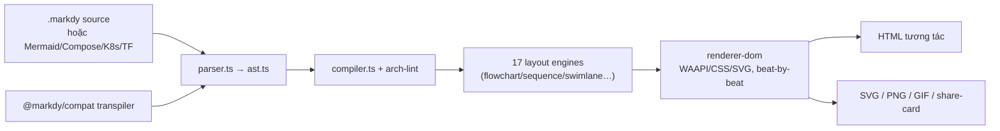
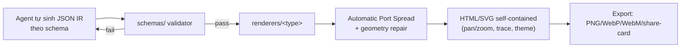
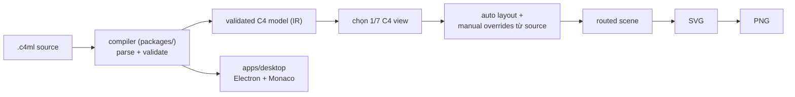
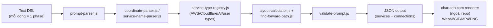

# Weekly Scan — Diagram-as-Code & Visual Tooling (2026-09-10)

**Executive summary:**
- Tuần này nổi bật nhất là `archify` (tt-a1i) — một "agent skill" biến JSON IR thành HTML/SVG động, đang viral (~55k+ sao chỉ sau ~2 tuần) nhờ đóng gói cho Claude Code/Cursor/Codex, không phải nhờ đột phá kỹ thuật.
- `markdy-com` là repo gần với kymostudio nhất về triết lý: DSL text-based → animated architecture diagram, có compiler riêng, 17 layout engine theo archetype, và cơ chế `@src=` neo diagram vào code — đáng đọc kỹ nhất tuần này.
- Còn lại là các dự án rất sớm (`c4ml` pre-1.0 beta, `animated-architecture-diagrams` 1 commit) — ý tưởng DSL/layout đáng ghi nhận nhưng chưa đủ chín để học kiến trúc.

**Mục lục**
1. [markdy-com](#1-markdy-com)
2. [archify](#2-archify)
3. [c4ml (C4thedral)](#3-c4ml-c4thedral)
4. [animated-architecture-diagrams](#4-animated-architecture-diagrams)

---

## 1. markdy-com

**Repo:** [`HoangYell/markdy-com`](https://github.com/HoangYell/markdy-com)

### §1 — Quick context
Markdy biến text DSL thành **animated architecture diagram** kể chuyện theo từng "beat" (bước tường thuật) — khác biệt với Mermaid/D2 ở chỗ animation là công dân hạng nhất, không phải add-on. Tech stack: TypeScript monorepo (pnpm workspaces), parser ~14kB zero-dependency, render bằng Web Animations API (WAAPI) + CSS/SVG transform (không dùng Canvas). Output: HTML tương tác, SVG, PNG, GIF, share-card. Repo health: 93 sao, 3 fork, CI đang pass (`ci.yml`), 0 issue mở, 660 commit trên main. Distribution: npm (`@markdy/core`, `@markdy/cli`, `@markdy/renderer-dom`, …), VS Code extension, MCP server.

### §2 — Kiến trúc chi tiết

**A. Component inventory**
- `Parser`/`AST` (`packages/core/src/parser.ts`, `ast.ts`) — dựng cây cú pháp từ MarkdyScript.
- `Compiler` (`packages/core/src/compiler.ts`) — biên dịch AST sang render graph.
- `ArchLint` (`packages/core/src/arch-lint.ts`) — kiểm tra cycle/cross-layer bypass ở mức kiến trúc.
- `Verifier`/`SyntaxDiagnostics` (`verifier.ts`, `syntax-diagnostics.ts`) — self-healing diagnostics.
- `Renderer DOM` (`packages/renderer-dom`) — sinh motion graphics 60fps qua WAAPI.
- `Compat` (`packages/compat`) — transpiler nhận Mermaid/Docker Compose/Kubernetes/Terraform/Draw.io.
- `CLI`/`MCP server`/`Language Server`/`VS Code ext` — các entry point còn lại.

**B. Pipeline (happy path)**
1. User viết file `.markdy` (hoặc transpile từ Mermaid/Compose qua `@markdy/compat`).
2. `parser.ts` → `ast.ts` dựng AST.
3. `compiler.ts` áp `arch-lint` + `classifier`/`registry` để gắn loại node (service/database/cache…).
4. Một trong 17 layout engine (theo archetype: flowchart, sequence, swimlane, timeline…) tính toán vị trí + port.
5. `renderer-dom` phát animation theo từng `beat` bằng WAAPI/CSS transform.
6. CLI/MCP xuất HTML tương tác, hoặc export tĩnh SVG/PNG/GIF/share-card.

**C. Data model / IR**
AST (`ast.ts`) là IR chính; không có bằng chứng về một "lower IR" tách biệt kiểu TALA của D2 — compiler dường như biên dịch thẳng AST → render instructions theo layout engine tương ứng archetype. Không xác định rõ AST là mutable hay immutable giữa các pass.

**D. Input language design**
Custom recursive/declarative parser (không dùng PEG/ANTLR theo tên file `parser.ts` đơn lẻ, nhẹ ~14kB). Cú pháp mẫu:
```markdy
scene "Cache-Aside Architecture" theme=auto
layout LR
browser Client "Web Client"
cache Redis "Redis Cluster"
database Postgres "PostgreSQL 16"
beat cache_hit "1. Cache Hit Path":
  Client -> Redis "GET key"
  Redis <- Postgres "200 Target URL"
```
Toán tử `->`/`<-`/`~>` phân biệt request/response/async event. Không thấy grammar EBNF chính thức publish. Error reporting: "self-healing syntax diagnostics" qua `syntax-diagnostics.ts` — không xác định chi tiết cơ chế.

**E. Layout algorithm**
17 layout engine chuyên biệt theo loại diagram (không phải một force-directed/hierarchical chung), cộng "dynamic port multiplexing" để tránh dồn line khi nhiều cạnh cùng vào một node. Không có bằng chứng về crossing-minimization kiểu Sugiyama/barycentric cụ thể.

**F. Rendering/output**
Single rendering backend chính (DOM + WAAPI/CSS/SVG transform), nhưng nhiều export target (HTML/SVG/PNG/GIF/share-card) qua cùng render graph — giống pluggable emitter ở tầng export hơn là tầng render.

**G. Extensibility**
10 theme có sẵn (`themes.ts`, `theme-generator.ts`); thêm hệ thống mới qua `system-vocabulary.ts`/`stdlib-systems`; thêm định dạng nguồn mới qua `@markdy/compat`.

**H. Dev experience**
VS Code/Cursor extension với live preview (`Cmd+K V`), Language Server riêng, MCP server cho Claude/Cursor/Antigravity/Cline — dev experience đầu tư khá đầy đủ cho một repo 93 sao.

### §3 — Architecture diagram


### §4 — Verdict
Đáng học nhất: "17 layout engine theo archetype" thay vì một auto-layout chung — kymo hiện chỉ có một `layout.py` generic; có thể tham khảo ý tưởng layout mode riêng cho sequence/swimlane. `@src="path#L10-L50"` (neo node vào dòng code) là ý hay cho các diagram kiến trúc sinh từ codebase, kymo chưa có. Dynamic port multiplexing đáng so với cơ chế "fan-in/trunk-lane edge staggering" đã có trong `alignment.py`. Red flag: 17 layout engine + nhiều compat transpiler là bề mặt lớn cho repo mới (660 commit nhưng 0 release version thấy được) — chưa rõ độ ổn định. Câu hỏi mở: arch-lint chạy ở parse-time hay là pass riêng? **Verdict: study deeper** — gần nhất về triết lý với kymostudio trong tuần này.

---

## 2. archify

**Repo:** [`tt-a1i/archify`](https://github.com/tt-a1i/archify)

### §1 — Quick context
Archify là **agent skill** (không phải DSL): agent (Claude Code/Cursor/Codex) tự sinh JSON IR mô tả kiến trúc, Archify validate rồi compile thành HTML/SVG self-contained có motion — khác biệt ở chỗ input không phải text DSL người viết tay mà là JSON do LLM tạo ra theo schema. Tech stack: Node.js/JavaScript thuần, JSON Schema validation. Output: HTML/SVG, export PNG/JPEG/WebP/WebM/share-card. Repo health: đang viral — số sao tăng từ ~4.2k (28/8) lên ~55k+ (10/9), #1 trending GitHub, MIT license, v2.17.0-dev.1, 67 issue mở. Distribution: `npx skills add tt-a1i/archify` (không phải npm package cổ điển, mà là "skill" cài vào thư mục agent).

### §2 — Kiến trúc chi tiết

**A. Component inventory**
- `bin/archify.mjs` — CLI entry point (`validate` / `preview` / `deliver`).
- `schemas/` (`archify/schemas/`) — JSON Schema cho 5 loại diagram (architecture/workflow/sequence/dataflow/lifecycle).
- `renderers/<type>/` — renderer riêng cho từng loại diagram (evidence: `renderers/workflow/README.md` được README chính dẫn tới).
- `delta/` — so sánh hai snapshot đã validate (Before/Delta/After).
- `SKILL.md` — hợp đồng sinh + xem cho agent, mô tả toàn bộ pipeline.

**B. Pipeline (happy path)**
1. Agent (Claude Code/Cursor/…) đọc `SKILL.md`, tự viết JSON IR theo schema tương ứng loại diagram.
2. `node bin/archify.mjs validate <type> <file.json>` chạy schema validator trong `schemas/`.
3. Nếu pass, `preview` render sang HTML/SVG tạm để xem trực tiếp (desktop session watch file).
4. `deliver` chạy lại toàn bộ check, nếu pass thì atomically ghi đè file HTML đích.
5. Người dùng mở file HTML self-contained (pan/zoom, trace route, tô sáng theo layer, export ảnh).

**C. Data model / IR**
IR là JSON thuần theo schema cố định — ví dụ file `web-app.architecture.json`: mỗi component có `id`, `type` (external/security/cloud/backend/database/messagebus…), `pos` (toạ độ tuyệt đối px), `size`. Đây là điểm khác biệt lớn với kymo/markdy: **layout không tự động tính** — tác giả (agent) tự cho toạ độ tuyệt đối trong IR, renderer chỉ làm "Automatic Port Spread" để nắn điểm nối cạnh.

**D. Input language design**
Không có parser theo nghĩa DSL text — input là JSON validate bằng schema, tương đương "grammar" chính là JSON Schema trong `schemas/`. Error reporting: trả JSON có cấu trúc kèm "repair guidance" máy đọc được — thiết kế rõ ràng cho vòng lặp tự-sửa của agent, không phải cho người.

**E. Layout algorithm**
Không có auto-layout thật sự (theo evidence IR chứa `pos`/`size` tuyệt đối do agent tự đặt). Chỉ có "Automatic Port Spread" cho edge routing, và geometry repair theo thứ tự: dịch label → nắn route → nén khoảng cách — không đụng vào nội dung. Không xác định có dùng thuật toán crossing-minimization nào.

**F. Rendering/output**
Renderer tách theo loại diagram (`renderers/<type>`) — pluggable theo type chứ không phải theo backend output. Animation opt-in qua `meta.animation: "trace"`, cơ chế cụ thể (CSS/JS) không xác định rõ trong tài liệu đọc được.

**G. Extensibility**
Thêm loại diagram mới cần: schema mới + example JSON + renderer module mới — pattern rõ ràng nhưng thủ công (không phải plugin registry động).

**H. Dev experience**
CLI 3 lệnh rõ ràng (`validate`/`preview`/`deliver`) với `--json`/`--layout-json` cho machine-readable diagnostics; không có VS Code extension hay LSP riêng — dev experience tối ưu cho agent, không phải cho người viết tay.

### §3 — Architecture diagram


### §4 — Verdict
Điểm đáng học không nằm ở kỹ thuật layout (vì gần như không có auto-layout — đây là điểm yếu, không phải điểm mạnh) mà ở **mô hình phân phối**: đóng gói thành "agent skill" cài thẳng vào `.claude/skills/` là kênh phân phối mới khiến một repo non trẻ đạt ~55k sao trong 2 tuần — kymostudio có thể cân nhắc gói một `SKILL.md` tương tự cho `kymo` CLI để tận dụng kênh này, tách biệt với vai trò DSL-first hiện tại. Red flag: `DESIGN.md` chỉ là spec thị giác (không mô tả engineering); code nguồn commit dạng plain file **và** một `archify.zip` dư thừa để cài thủ công — mùi packaging không gọn; IR dùng toạ độ tuyệt đối do agent tự đặt nên dễ vỡ khi đổi label/kích thước. Câu hỏi mở: pipeline có thực sự deterministic khi phụ thuộc toạ độ do LLM tự sinh mỗi lần? **Verdict: glance only** cho kỹ thuật layout/renderer, nhưng **study deeper** mô hình phân phối "skill".

---

## 3. c4ml (C4thedral)

**Repo:** [`indianerbande/c4ml`](https://github.com/indianerbande/c4ml)

### §1 — Quick context
C4thedral là desktop workbench (Electron) biên dịch một nguồn C4ML duy nhất thành 7 view kiến trúc C4 khác nhau (System Landscape/Context/Container/Component/Code/Dynamic/Deployment) — khác Structurizr ở chỗ chạy hoàn toàn local, không cần server, và giữ layout override trong source control thay vì UI state ẩn. Tech stack: TypeScript, Node.js ≥24.15, pnpm monorepo, Electron + Angular + Monaco editor. Output: SVG, PNG deterministic. Repo health: 1 sao, 0 fork, 108 commit, chưa có CI badge quan sát được, license Apache-2.0, bản v0.1.0-beta.7 (public source beta). Distribution: chưa publish package chuẩn, CLI provisional qua `pnpm run c4ml`.

### §2 — Kiến trúc chi tiết

**A. Component inventory**
- `apps/` — ứng dụng desktop (Electron+Angular+Monaco) và CLI, dùng chung compiler.
- `packages/` — compiler + language package dùng chung giữa desktop/CLI ("portable compiler").
- `examples/` — file `.c4ml` runnable (không lấy được nội dung cụ thể do lỗi fetch, không xác định chi tiết syntax).
- `docs/`, `reviews/` — tài liệu người dùng/kỹ sư và "architecture comparison workflows".

**B. Pipeline (happy path)**
1. User chạy `pnpm run c4ml -- check <file>` trên file `.c4ml` (vd. `hello-container.c4ml`).
2. Compiler (trong `packages/`) parse nguồn thành **validated C4 model** (People/Systems/Containers/Components/Code Elements/deployment/instances/relationships).
3. Chọn 1 trong 7 view type cần render.
4. Auto layout tính vị trí, cộng override thủ công (relative placement, alignment, nudge, pin, waypoint…) do người dùng khai trong source.
5. Compiler định tuyến scene ("routed scene") rồi sinh SVG.
6. `pnpm run c4ml -- render <file> --view <name> --format svg,png` xuất SVG + PNG với font cục bộ để đảm bảo geometry reproducible.

**C. Data model / IR**
"Validated C4 model" đóng vai trò IR trung gian giữa parse và layout — có bước validate rõ ràng trước khi vào layout, tương tự alignment.py của kymo nhưng gộp chung compile+validate. Không có bằng chứng về một lower IR kiểu TALA; không xác định model là mutable/immutable.

**D. Input language design**
DSL riêng tên C4ML; README không show cú pháp cụ thể (không fetch được `hello-container.c4ml` — không xác định grammar chi tiết, parser approach cũng không xác định). Nguyên tắc thiết kế nêu rõ: chỉnh sửa layout bằng tay trên UI phải ghi ngược lại vào text nguồn, để "reviewable in source control" — đây là chủ đích thiết kế ngôn ngữ đáng chú ý dù chưa thấy code cụ thể.

**E. Layout algorithm**
Hybrid: auto layout mặc định + override thủ công qua khai báo trong source (relative placement, equal spacing, waypoints, avoidance areas, route corridors, fixed routes). Không xác định thuật toán auto-layout cụ thể (force-directed/hierarchical/orthogonal), không xác định có crossing-minimization.

**F. Rendering/output**
Một compiler dùng chung cho cả desktop và CLI ("same portable compiler"), output SVG rồi PNG — không thấy bằng chứng animation. Single backend, không pluggable emitter theo evidence hiện có.

**G. Extensibility**
Không xác định rõ cơ chế thêm C4 view type mới hay theme — README tập trung vào 7 view cố định theo chuẩn C4, không đề cập plugin system.

**H. Dev experience**
CLI còn "provisional trong giai đoạn beta"; desktop app dùng Monaco editor (syntax highlight/IDE-like editing) nhưng không có VS Code extension hay LSP riêng theo evidence đọc được. Không xác định watch mode.

### §3 — Architecture diagram


### §4 — Verdict
Ý đáng học nhất cho kymo: nguyên tắc "graphical edit phải ghi ngược lại vào source text, không sống trong UI state ẩn" — kymo đã có `layout {}` block trong DSL cho việc này, nhưng nếu tương lai kymo có GUI editor thì nguyên tắc round-trip này của C4thedral là tham chiếu tốt. "Một model → 7 view chiếu khác nhau" là pattern kymo chưa có (kymo hiện là 1 diagram = 1 output view) — có thể cân nhắc khái niệm "focus/projection" cho diagram lớn. Red flag: pre-1.0 beta, tác giả cảnh báo chính syntax "may change before 1.0", chỉ 1 sao/108 commit — dự án solo, độ trưởng thành thấp. Câu hỏi mở: "deterministic SVG với controlled local fonts" giải quyết font-fallback cross-OS thế nào cụ thể? **Verdict: glance only** — ý tưởng có giá trị tham khảo nhưng quá sớm để đọc sâu code.

---

## 4. animated-architecture-diagrams

**Repo:** [`chartado/animated-architecture-diagrams`](https://github.com/chartado/animated-architecture-diagrams)

### §1 — Quick context
Package JS thuần chuyển text ngắn gọn kiểu `API Gateway -> Lambda -> DynamoDB` thành dữ liệu diagram có toạ độ, dùng làm nguồn cho animation trên chartado.com — khác Mermaid ở cú pháp cực tối giản cho riêng domain cloud/AI-agent architecture (60+ loại service AWS/Cloudflare/AI được định nghĩa sẵn). Tech stack: JavaScript/Node ≥22, zero dependency, test bằng Jest. Output: JSON có cấu trúc (không tự render ảnh — rendering/animation thật xảy ra ở chartado.com, export WebM/WebP/GIF/MP4/PNG/PDF). Repo health: 0 sao, 1 commit, không có release/package công khai — dự án ngày đầu. Distribution: chưa thấy trên npm.

### §2 — Kiến trúc chi tiết

**A. Component inventory**
- `prompt-parser.js` — parse từng dòng text DSL thành cấu trúc trung gian.
- `coordinate-parser.js` — bóc tách toạ độ inline `[x, y]` khi người dùng ghi kèm.
- `service-name-parser.js` + `service-type-registry.js` — nhận diện tên service, tra registry loại (`aws-service-types.js`, `cloudflare-service-types.js`, `ai-service-types.js`, `user-service-types.js` cho custom).
- `layout-calculator.js` — tính vị trí cuối cùng cho node chưa có toạ độ tường minh.
- `find-forward-path.js`, `recalculate-choice-rows.js` — xử lý fan-out/branch (`{A, B, C}`, `|Tool, Response|`).
- `validate-prompt.js` — kiểm tra tính hợp lệ, trả `{ valid: false, error }` thay vì throw.

**B. Pipeline (happy path)**
1. User viết chuỗi dòng text, mỗi dòng là một "animation phase" (vd. `Lambda -> SQS -> DynamoDB`).
2. `prompt-parser.js` tách dòng, gọi `service-name-parser.js`/`coordinate-parser.js` cho từng token.
3. `service-type-registry.js` gắn icon/type cho mỗi service (dedupe theo tên; service lạ render generic).
4. `validate-prompt.js` chạy kiểm tra cấu trúc; nếu fail trả lỗi có cấu trúc, không throw exception.
5. `layout-calculator.js` (+ `find-forward-path.js`/`recalculate-choice-rows.js` cho fan-out/alternative) tính toạ độ x/y cuối.
6. Trả JSON `{ services: [...], connections: [...] }`; chartado.com nhận JSON này để render + phát animation theo phase, export WebM/GIF/MP4/PNG.

**C. Data model / IR**
IR là plain JSON object (mảng service kèm metadata name/type/icon/x/y, mảng connection) — không có class/dataclass riêng theo evidence tên file (toàn bộ là hàm `.js` xử lý trên object thường). Không xác định mutable/immutable giữa các bước.

**D. Input language design**
Line-based parser tự viết (không dùng PEG/ANTLR) — mỗi dòng độc lập là 1 phase. Cú pháp:
```
Lambda -> SQS -> DynamoDB
SNS -> {Lambda Emailer, Lambda Analytics, SQS Archive}
Agent -> LLM -> |Tool, Response|
Lambda [0.2, 0.3] -> SQS [0.5, 0.3]
User:Browser -> AWS:API Gateway
```
Không có grammar EBNF công bố. Error reporting: trả object `{ valid: false, error }` có cấu trúc, không exception — thiết kế hướng tới dùng làm thư viện nhúng.

**E. Layout algorithm**
Không rõ có phải auto-layout đồ thị thật (force-directed/hierarchical) hay chỉ là quy tắc sắp hàng theo thứ tự xuất hiện + toạ độ tỉ lệ `[0,1]` do user ghi đè — tên file `layout-calculator.js` gợi ý có tính toán, nhưng không đọc được implementation nên **không xác định** thuật toán cụ thể. Có xử lý riêng cho fan-out/alternative (`recalculate-choice-rows.js`) nên có ít nhất một dạng row-based layout theo nhánh.

**F. Rendering/output**
Repo này **không tự render ảnh** — chỉ sinh JSON; phần render/animation (WebM/GIF/MP4/PNG/PDF) nằm ở service web chartado.com, ngoài phạm vi repo. Đây là kiến trúc tách bạch parser/layout (open-source) khỏi renderer (closed, SaaS).

**G. Extensibility**
Thêm provider mới qua thêm file `*-service-types.js` + đăng ký vào `service-type-registry.js`; có sẵn `user-service-types.js` cho custom service không cần sửa core.

**H. Dev experience**
Chỉ là library/CLI tối giản, README không đề cập VS Code extension, LSP, watch mode hay browser preview cục bộ (preview thật nằm trên chartado.com) — không xác định thêm.

### §3 — Architecture diagram


### §4 — Verdict
Đáng học nhất là cú pháp DSL cực ngắn cho fan-out (`{A, B, C}`) và alternative-branch (`|Tool, Response|`) trên cùng một dòng — so với kymo hiện phải khai riêng từng edge, đây là ý tưởng nén cú pháp đáng cân nhắc cho các trường hợp fan-out đơn giản. Namespace prefix `Provider:Component` (vd. `AWS:API Gateway`) cũng là cách gọn để phân biệt icon-provider mà không cần khai icon riêng — có thể so sánh với cách `icons.py` của kymo resolve icon key. Red flag: 0 sao, 1 commit duy nhất, chưa có release — về bản chất là proof-of-concept, phần render thật (nơi có giá trị học nhiều nhất) lại nằm ngoài repo (SaaS đóng). Câu hỏi mở: `layout-calculator.js` có thực sự tự động tính layout hay chỉ áp dụng toạ độ `[0,1]` người dùng tự ghi? **Verdict: glance only** — chỉ đáng đọc nhanh phần cú pháp DSL, không đủ chín để học kiến trúc renderer.
