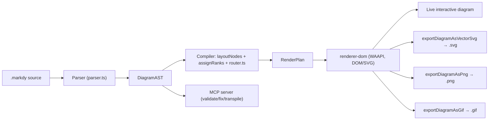
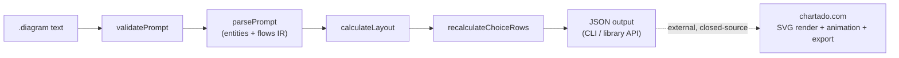
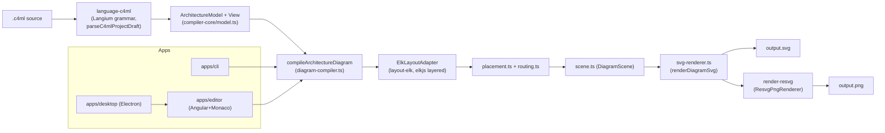
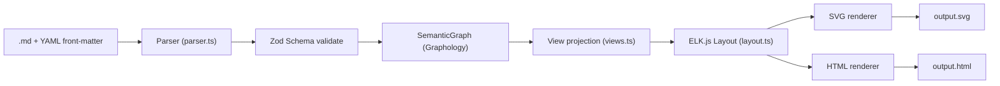

# Weekly Scan — Diagram-as-Code & Visual Tooling (2026-09-11)

**Executive summary:**
- Tuần này nổi bật nhất là **Markdy** (`HoangYell/markdy-com`) — DSL animation theo "beat" tường thuật với router Manhattan orthogonal khá tinh vi (port lane multiplexing) và cách điều khiển Web Animations API ở trạng thái paused để playback nhất quán mọi trình duyệt; đáng `study deeper` cho phần router/animation timing, dù các tuyên bố về độ trưởng thành ("Architecture Intelligence Platform") nên được dè dặt.
- Ba repo còn lại (`chartado/animated-architecture-diagrams`, `indianerbande/c4ml`, `dkharlanau/visual-workbench`) đều còn rất non (0-1 sao, thường 1 tác giả, 1 số chưa publish package) nhưng mỗi repo có một ý tưởng kiến trúc cụ thể đáng ghi chú: Kahn's-algorithm layout khi có back-reference, tách IR "model tĩnh + view" cho C4, và "project view trước khi render" để tái dùng một pipeline cho nhiều named view.
- Không repo nào trong tuần này cạnh tranh trực tiếp với kymostudio ở cả 3 trục (DSL + animated SVG + BPMN import) cùng lúc — phần lớn chỉ mạnh một trục (animation, hoặc layout, hoặc cross-format), nên rủi ro cạnh tranh trực tiếp thấp nhưng có vài kỹ thuật layout/routing cụ thể đáng đối chiếu với `alignment.py`.

**Mục lục:**
1. [Markdy — HoangYell/markdy-com](#markdy--hoangyellmarkdy-com)
2. [Animated Architecture Diagrams — chartado/animated-architecture-diagrams](#animated-architecture-diagrams--chartadoanimated-architecture-diagrams)
3. [C4thedral — indianerbande/c4ml](#c4thedral--indianerbandec4ml)
4. [Visual Workbench — dkharlanau/visual-workbench](#visual-workbench--dkharlanauvisual-workbench)

---

## Markdy — HoangYell/markdy-com

**§1 — Quick Context**
Pitch: DSL biến kiến trúc hệ thống thành animation timeline theo từng "beat" (bước tường thuật), khác Mermaid/PlantUML vốn chỉ vẽ tĩnh. Tech stack: TypeScript monorepo (pnpm workspaces), core zero-dep (~14kB), output DOM+SVG qua Web Animations API, export thêm SVG/PNG/GIF/HTML. Repo health: ~93 sao, 3 fork, MIT, có CI (`ci.yml` badge, `pnpm ci` chạy test/gate/visual), số contributor không xác định (trang contributors lỗi tải). Distribution: npm (`@markdy/core`, `@markdy/cli`, `@markdy/renderer-dom`...), VS Code Marketplace + Open VSX, MCP server qua `npx`.

**§2 — Architecture Deep-Dive**

A. Component inventory:
- `Parser` (`packages/core/src/parser.ts`) — đọc source → `DiagramAST`.
- `AST/IR types` (`packages/core/src/ast.ts`) — định nghĩa `DiagramAST`, `NodeDecl`, `EdgeDecl`, `RenderPlan`...
- `Compiler` (`packages/core/src/compiler.ts`) — `compilePlan()` điều phối layout, ranking, routing, scheduling.
- `Router` (`packages/core/src/router.ts`) — Manhattan orthogonal edge routing + port multiplexing.
- `Renderer` (`packages/renderer-dom`) — `createDiagram()`, vòng lặp WAAPI, các hàm export.
- `CLI` (`packages/cli/src/index.ts`, bin `markdy`) — lệnh render/lint/format/import/diff.
- `Compat importers` (`packages/compat`) — transpile Mermaid/Compose/K8s/Terraform/Draw.io → AST.
- `MCP server` (`packages/mcp-server`) — tool validate/diagnose/fix/transpile cho AI agent.

B. Pipeline (happy path): (1) user chạy `markdy render system.markdy --out diagram.html`; (2) CLI gọi `parse()` → `DiagramAST` (tách block theo indentation, regex phân loại dòng, validate reference/cycle); (3) `compilePlan(ast, theme)` trong `compiler.ts`: gộp/khử trùng edge, tính adaptive dimensions, dispatch `layoutNodes()` theo diagram-type (15+ engine), `assignRanks()` (topological sort + barycenter), route qua `router.ts`, tính group boundary; (4) `scheduleBeats()` sinh cue theo thời gian → `RenderPlan`; (5) `renderer-dom` dựng DOM/SVG, gắn WAAPI animation (paused), rAF chỉnh `currentTime` thủ công để playback nhất quán mọi trình duyệt; (6) exporter (`exportDiagramAsVectorSvg/Png/Gif`) chụp state tại thời điểm bất kỳ → file output.

C. Data model: interface/type TypeScript thuần (không class), mỗi stage tạo object mới (`AST` → `RenderPlan`), tương đương một bước "compile xuống IR thấp hơn" — gần giống kymostudio (Diagram → resolved model) nhưng tách rõ 2 kiểu IR có tên riêng thay vì một dataclass được mutate qua alignment passes.

D. Input language: parser line/block tự viết, phân loại dòng bằng regex rồi đọc block kiểu recursive-descent (`readBody`/`readIndentedBody`/`readColonBody`) — không phải PEG/ANTLR/parser-combinator. **Không có grammar hình thức (BNF/EBNF)** được commit — `docs/SYNTAX.md` chỉ là prose + bảng + ví dụ, mâu thuẫn với tuyên bố README "Strict grammar AST". Lỗi báo qua `ParseError` (line/col) + mảng `Diagnostic[]`, có `validateReferences()`/`detectFlowCycles()`.

E. Layout: nhiều engine theo diagram-type (flowchart/tree/sequence/constellation/quadrant/swimlane/pyramid/timeline/gantt/venn/layers/nested/radar...), dùng topological rank + barycenter heuristic (kiểu Sugiyama) để giảm crossing, content-adaptive sizing/grid-snap. Routing: Manhattan orthogonal, chọn port cardinal tối ưu, "port lane multiplexing" cho cạnh song song, tránh vật cản bằng đếm giao cắt giữa các đường ứng viên, bo góc bằng quadratic Bézier.

F. Rendering: một backend sống chính (DOM/SVG qua WAAPI, điều khiển thủ công qua rAF+currentTime để tránh lệch trình duyệt) cộng các exporter snapshot dùng lại cùng `RenderPlan` (SVG/PNG/GIF/HTML) — không phải kiến trúc nhiều emitter độc lập như `to_svg.py`/`to_figma.py`/`to_excalidraw.py` của kymostudio, mà là một renderer + nhiều "lát cắt" từ cùng timeline.

G. Extensibility: registry icon/vocabulary (`symbols.ts`, `stdlib-systems`), theme qua `themes.ts`/`theme-generator.ts` (10 theme), luật governance trong `arch-lint.ts` (phát hiện deadlock/cross-layer), importer transpiler-plugin (`compat`) cho Mermaid/K8s/Terraform/Draw.io.

H. Dev experience: CLI đầy đủ (render/lint/format/import/diff), VS Code/Cursor extension với live preview song song, QuickFix, formatter, headless language-server (Neovim/Helix/Emacs), playground trên trình duyệt không cần cài đặt, MCP server cho agent tự "self-heal" syntax.

**§3 — Architecture Diagram**

**§4 — Verdict**
Đáng học: (1) mô hình "beat" tường thuật theo bước (show/frame/zoom/glow) — ý tưởng cú pháp đáng cân nhắc cho target `--animate` của kymostudio thay vì chỉ auto-animate; (2) router Manhattan có "port lane multiplexing" + tránh vật cản bằng đếm giao cắt là kỹ thuật cụ thể có thể đối chiếu với fan-in/trunk-lane staggering trong `alignment.py`; (3) chơi WAAPI ở trạng thái paused rồi tự điều khiển `currentTime` qua rAF là kỹ thuật hay để animation SVG nhất quán giữa trình duyệt. Red flag: tuyên bố "strict grammar AST" nhưng không có EBNF thật (khác kymostudio luôn đồng bộ `dsl.py` với `docs/DSL.md`); `core/src` phẳng 25 file với tên mang tính marketing (`ai-healing.ts`, `intellicode.ts`, `drift.ts`) cùng loạt thư mục AI-agent ở root (`skills/`, `prompts/`, `rules/`, `agents/`) gợi ý dự án có thể được viết phần lớn bởi AI, quy mô cộng đồng thực tế (93 sao, contributor không xác định) nhỏ hơn nhiều so với danh sách tính năng "Architecture Intelligence Platform" được quảng bá. Câu hỏi mở: 15+ layout engine có thực sự độc lập hay chỉ là wrapper mỏng quanh vài primitive chung? Độ chính xác của "Universal Ingestion" (Terraform/K8s/Draw.io) chưa kiểm chứng được. Verdict: **study deeper** cho phần router/port-multiplexing và mô hình beat, nhưng cần dè dặt với các tuyên bố về độ trưởng thành/quy mô.

---

## Animated Architecture Diagrams — chartado/animated-architecture-diagrams

**§1 — Quick Context**
- Pitch: parser + layout engine thuần JS biến `A -> B -> C` thành JSON có tọa độ; khác biệt chính là chỉ xuất **data**, không tự render — animation/SVG nằm ở web app closed-source chartado.com.
- Tech stack: JavaScript ESM thuần (Node ≥22), **zero runtime deps** (chỉ jest cho test); output của library là JSON (services + positions + connections), không phải SVG/animation.
- Repo health: 0 stars, 0 forks, chỉ **1 commit**, không thấy `.github/workflows` (không có CI), không có release nào. Có test suite (Jest, ~14 file test khớp 1:1 với src/).
- Distribution: README ghi `npm install @chartado/animated-architecture-diagrams` nhưng package **không tồn tại** trên npm registry (404 khi tra cứu) — có thể chưa publish hoặc đã gỡ.

**§2 — Architecture Deep-Dive**

A. Component inventory:
- `readDiagram` (`src/read-diagram.js`) — API công khai duy nhất, nối validate→parse→layout→recalc→format.
- `parsePrompt` (`src/prompt-parser.js`) — parser chính, ~800 dòng, xây dựng entities + flows.
- `validatePrompt` (`src/validate-prompt.js`) — kiểm tra cân bằng `{} () ||` và cấu trúc arrow.
- `calculateLayout` (`src/layout-calculator.js`) — gán x/y theo lưới cột/hàng.
- `recalculateChoiceRows` (`src/recalculate-choice-rows.js`) — căn giữa hàng nhánh bằng đếm leaf đệ quy.
- `findForwardPath` (`src/find-forward-path.js`) — BFS phát hiện tham chiếu ngược để dựng lại đường đi xuôi.
- `ServiceTypeRegistry` (`src/service-type-registry.js`) + `aws/ai/cloudflare/user-service-types.js` — bảng icon/màu/type theo namespace, có keyword-alias map.
- `coordinate-parser.js`, `coordinate-label-registry.js`, `service-name-parser.js` — phụ trợ parse `[x,y]` và `Namespace:Name`.
- CLI: `bin/diagram.js` (`check`/`parse`).

B. Pipeline (happy path): (1) `npx diagram parse file.diagram` → (2) CLI đọc file, strip dòng `#` comment → (3) `validatePrompt` kiểm tra cú pháp → (4) `parsePrompt` dựng mảng `entities` + `entities.flows` (đây chính là IR) → (5) `calculateLayout` gán positions, `recalculateChoiceRows` chỉnh lại hàng nhánh → (6) in JSON ra stdout. **Không có bước render** trong repo này.

C. Data model/IR: mảng JS phẳng `entities`, mutable, mỗi phần tử là plain object bị gắn thêm cờ dần dần qua nhiều pass (`isFanOutTarget`, `isChoiceSource`, `column`, `row`, `totalRows`...). Đáng chú ý: `entities.flows` gắn thẳng property lên **instance mảng** — pattern khá "hacky", không có schema/type hình thức (không TS, không JSDoc typedef). Không có khái niệm "lower IR" tách biệt.

D. Input language: parser tự viết tay, quét ký tự thủ công (`splitByArrowRespectingBraces`, `splitByCommaRespectingParens`), không phải PEG/ANTLR/combinator. Không có grammar BNF/EBNF chính thức — spec chỉ nằm ở README. Error reporting rất sơ sài: mọi lỗi cú pháp đều trả về cùng một message `'Invalid syntax'`, không có vị trí dòng/cột.

E. Layout: grid theo cột (dựa độ sâu khi duyệt arrow) + hàng cho fan-out/choice, căn giữa đệ quy kiểu tidy-tree đơn giản (không phải Sugiyama đầy đủ, không barycentric crossing-minimization). Khi phát hiện tham chiếu ngược, `reassignConvergentLayout` dùng Kahn's algorithm (topo sort, longest-path) gán lại cột. Cạnh vẽ thẳng, không có edge routing/bezier.

F. Rendering: **không có trong repo**. `readDiagram()` chỉ trả JSON thuần; toàn bộ SVG/Canvas, animation CSS/JS, và export WebM/WebP/GIF/MP4/PNG/PDF thuộc về chartado.com — closed-source, không thể kiểm chứng.

G. Extensibility: thêm provider mới = viết file `*-service-types.js` theo interface ngầm định (`hasService`/`getServiceType`), đăng ký vào mảng `PROVIDERS`. Không có plugin system, không có theming/styling nào (màu hard-code từng type), icon chỉ là 1 ký tự Unicode.

H. Dev experience: CLI tối giản (`check`/`parse`, không `--watch`, không preview trình duyệt, không LSP/VS Code). Có test suite tốt nhưng không thấy CI gate.

**§3 — Architecture Diagram**

**§4 — Verdict**
Đáng học: cú pháp `<-` đảo chiều và multi-line "flow phases" (dedupe theo tên để tái dùng node cho request/response) là ý hay cho việc biểu diễn animate phases gọn trong text — kymostudio's DSL có thể tham khảo. Thuật toán `reassignConvergentLayout` (Kahn's longest-path khi có back-reference) đáng so sánh với cơ chế fan-in/trunk-lane của `alignment.py`. Red flags: trùng lặp code nặng giữa `parseSingleLine`/`parseBranchLine` (~250 dòng gần giống nhau), IR là mảng mutable gắn property tùy tiện (`entities.flows`) — kém hơn hẳn cách tách `model.py` dataclass / `alignment.py` 5-pass của kymostudio. Error reporting chỉ có 1 message chung, không dòng/cột. Repo mới 1 commit, không CI, package chưa thấy trên npm dù README quảng cáo — độ trưởng thành rất thấp. Câu hỏi mở: renderer thật (SVG/animation) chỉ tồn tại ở chartado.com nên không đánh giá được chất lượng output cuối. **Verdict: glance only** — đọc DSL syntax để lấy ý tưởng cú pháp, không cần nghiên cứu sâu kiến trúc vì phần quan trọng nhất (rendering) không nằm trong repo và phần còn lại chưa đủ chín.

---

## C4thedral — indianerbande/c4ml

**§1 — Quick Context**
- Desktop workbench C4-model kết hợp compiler DSL (C4ML) với layout ELK và render resvg, khác kymostudio ở chỗ tách IR thành "model tĩnh + view" tái dùng cho 7 loại view C4, thay vì DSL phẳng một-diagram.
- Stack: TypeScript monorepo (pnpm), Electron + Angular 22 + Monaco 0.56 (desktop/editor), Node CLI; deps chính: Langium (grammar), elkjs (layout), @resvg/resvg-js (PNG); output SVG/PNG deterministic.
- Sức khỏe repo: 1 star, license Apache-2.0, v0.1.0-beta.7 (9/9/2026), do một tác giả "vibe-coded" theo AGENTS.md; không xác định số contributor/CI status (không đọc được workflow files).
- Phân phối: mã nguồn mở, cài qua `pnpm install` + `pnpm run desktop:start`; chưa có installer ký số, chưa thấy npm/PyPI package công khai.

**§2 — Architecture Deep-Dive**

A. Component inventory:
- `ArchitectureModel`/pipeline (`packages/compiler-core/src/model.ts`, `diagram-compiler.ts`) — IR + orchestrator `compileArchitectureDiagram`.
- Language front-end (`packages/language-c4ml/src/c4ml-draft.langium` + `language.ts`, `completion.ts`, `scope-provider.ts`) — grammar Langium, còn gắn nhãn "draft"/experimental.
- Layout adapter (`packages/layout-elk/src/index.ts`) — bọc elkjs (`ElkLayoutEngine` → `ElkLayoutAdapter`).
- Routing/Placement (`packages/compiler-core/src/routing.ts`, `placement.ts`, `route-labels.ts`).
- Scene builder (`packages/compiler-core/src/scene.ts`, `comparison-scene.ts`).
- SVG renderer (`packages/compiler-core/src/svg-renderer.ts`, `shapes.ts`, `theme.ts`) — pure function `renderDiagramSvg`.
- PNG backend (`packages/render-resvg`) — adapter `@resvg/resvg-js`, tách biệt để browser/compiler-core không phụ thuộc Node-only lib.
- CLI (`apps/cli/src/cli.ts`) — lệnh `analyze/check/query/render/diff/version`.
- Desktop/Editor (`apps/desktop`, `apps/editor`) — Electron + Angular + Monaco.

B. Pipeline (theo lệnh `c4ml render foo.c4ml`):
1. `loadArchitectureProject` đọc project/file từ đĩa.
2. `parseC4mlProjectDraft(project)` — parse text → `ArchitectureModel` (elements, relationships, deployment) + views. (Tên hàm còn "Draft" — cho thấy front-end ngôn ngữ vẫn thử nghiệm.)
3. `compileArchitectureDiagram({model, view, layoutAdapter, ...})`: resolve view → `diagram-preparation` dựng graph layout-ready → `ElkLayoutAdapter` tính toạ độ (layered/orthogonal) → `placement.ts` áp constraint thủ công → `routing.ts` tính route cạnh → `scene.ts` dựng scene.
4. `renderDiagramSvg(scene)` sinh chuỗi SVG (defs/style + shape primitives).
5. Nếu format gồm PNG: `ResvgPngRenderer.render(svg)` (package `render-resvg`) chuyển sang PNG.
6. CLI ghi artifact ra `build/diagrams/<view>.svg|.png`.

C. Data model/IR: plain TypeScript interfaces, `readonly` field — immutable value objects, không dùng class. `ArchitectureModel` (elements: Person/SoftwareSystem/Container/Component/CodeElement union theo `kind`, relationships, deployment) là IR tĩnh; sau đó pipeline biến đổi qua nhiều IR trung gian có tên riêng (prepared layout graph → positioned graph → routed graph → `DiagramScene`) — mỗi giai đoạn output type riêng, giữ pattern "compile xuống IR thấp hơn" khá rõ, gần giống nhiều-pass của alignment.py nhưng tách hẳn thành module/file riêng cho từng pass thay vì 5-pass trong một resolver.

D. Input language design: Langium (dựa trên Chevrotain, LSP-ready) — grammar viết dạng `.langium` (`c4ml-draft.langium`), tức có "formal grammar" thật sự (không phải regex/line-based như dsl.py của kymostudio). Có module `completion.ts`, `highlighting.ts`, `scope-provider.ts`, `semantic-authoring-edits.ts` cho thấy đầu tư vào IDE support/error reporting qua LSP diagnostics, nhưng README và tên hàm `parseC4mlProjectDraft` xác nhận ngôn ngữ còn ở giai đoạn "preview", chưa phải cú pháp production ổn định.

E. Layout algorithm: dùng ELK (Eclipse Layout Kernel qua elkjs) thuật toán `layered` (phân lớp/hierarchical) ở cả root lẫn compound node, `edgeRouting: ORTHOGONAL`, bật `crossingMinimization.forceNodeModelOrder`. Spacing được điều chỉnh động tùy có nhãn cạnh hay không. Ngoài ra README nói rõ layout là "kết hợp auto layout + kiểm soát thủ công" — `placement.ts` cho phép constraint/override vị trí sau layout tự động, không phải thuần force-directed hay thuần manual.

F. Rendering: single backend SVG (`svg-renderer.ts`) là nguồn sự thật (deterministic), PNG chỉ là bước raster hoá qua resvg (`render-resvg`), không có animation. Renderer là pluggable theo shape: shape có `primitives` (rect/ellipse/polygon/line), style theo CSS class `.element-role-${role}.element-state-${state}` lấy màu từ theme object — cơ chế theme tách khỏi renderer.

G. Extensibility: thêm shape mới = thêm entry vào shape registry với `primitives` (không cần sửa renderer core) — có `architecture-shape-resource.ts`, `architecture-theme-resource.ts` cho thấy shape/theme được nạp như "resource" pluggable. Không xác định có plugin API công khai cho bên thứ ba hay không.

H. Dev experience: Monaco 0.56 nhúng trong Angular editor (`apps/editor`), CLI có `--diagnostics human|json`; không xác định watch-mode/hot-reload cụ thể (chưa đọc code `apps/editor/src/app`); Electron desktop app đóng gói CLI + editor cùng "portable compiler core" theo README apps/.

**§3 — Architecture Diagram**

**§4 — Verdict**
Điểm đáng học: (1) dùng ELK/elkjs làm layout engine ngoài (layered + orthogonal routing + crossing-minimization flag có sẵn) thay vì tự viết thuật toán layout — kymostudio's layout.py/alignment.py tự làm mọi thứ (auto-layout frame, fan-in/trunk-lane staggering); có thể tham khảo cách C4thedral tách "auto layout" và "manual placement override" thành 2 pass riêng biệt (`layout` rồi `placement` constraint) rõ ràng hơn là gộp trong 5-pass resolver. (2) Model tách rời hoàn toàn "static model" khỏi "view" (nhiều view cùng chiếu từ 1 model) — kymostudio's Diagram hiện gắn liền 1 file = 1 diagram; ý tưởng multi-view-from-one-model đáng cân nhắc cho DSL tương lai nếu muốn hỗ trợ C4-style zoom levels. (3) Renderer tách shape thành `primitives` list + registry, gần giống icons.py's file-backed ICONS nhưng generic hơn cho shape tùy chỉnh, không chỉ icon.

Red flags: ngôn ngữ nhập liệu chính (Langium grammar) vẫn tên "draft" (`parseC4mlProjectDraft`, `C4mlDraft` project) — chưa production-stable dù CLI đã dùng nó; README tự nhận "vibe-coded"; chỉ 1 star, dường như 1 tác giả, chưa có installer ký số; không thấy CI badge hay test-status xác nhận qua research này. Không có animation output — không cạnh tranh trực tiếp với animated-SVG của kymostudio.

Câu hỏi mở: `parseC4mlProjectDraft` parse Langium AST → `ArchitectureModel` ở đâu cụ thể (chưa đọc file đó); có CI pipeline thật không; ELK layout có được expose để user override per-node không hay chỉ qua `placement.ts`.

Verdict: **glance only** — kiến trúc pipeline (IR đa pass, ELK layout, shape-primitive renderer) đáng ghi chú làm tham khảo thiết kế, nhưng dự án còn quá non (beta, 1 star, ngôn ngữ input chưa ổn định) để nghiên cứu sâu ngay.

---

## Visual Workbench — dkharlanau/visual-workbench

**§1 — Quick Context**
Biến Markdown (front-matter YAML) mô tả node/edge ngữ nghĩa thành SVG/HTML tất định qua Graphology + ELK.js, không có animation. Stack: TypeScript, Node 20+; deps chính `graphology`, `elkjs`, `zod`, `yaml`, `commander`. Repo health: 0 stars, 0 forks, số contributor không xác định (có vẻ tác giả đơn lẻ), phiên bản mới nhất v0.1.2 (CHANGELOG 2026-09-01), có CI (`ci.yml`, `enterprise-architecture-compatibility.yml`, `product-pages.yml`). Phân phối: **chỉ source** — README nói rõ v0.1 chưa publish lên npm, người dùng clone repo và chạy `dist/cli.js` cục bộ.

**§2 — Architecture Deep-Dive**

A. Component inventory: `Parser` (`src/parser.ts`) — tách front-matter YAML, parse thành `VisualDocument`. `Schema` (`src/schema.ts`) — Zod schema cho toàn bộ mô hình (node/edge/group/view). `Model/SemanticGraph` (`src/model.ts`) — bọc `graphology.MultiDirectedGraph`. `Views` (`src/views.ts`) — logic preset + projection view. `Methods` (`src/methods.ts`) — chọn policy layout theo `kind`. `Layout` (`src/layout.ts`) — gọi ELK.js. `Lanes` (`src/lanes.ts`) — dựng swimlane. `Routing` (`src/routing.ts`) — routing cạnh. `Themes` (`src/themes.ts`) — theme "paper"/"slate". `Renderers` (`src/renderers/svg.ts`, `html.ts`) — emitter tĩnh. `Adapters` (`src/adapters/project-evidence.ts`) — nạp input dạng JSON khác. `CLI` (`src/cli.ts`) — commander, 6 lệnh.

B. Pipeline (theo README + cli.ts, `vwb render foo.md -o out.svg`): (1) đọc `.md`, tách front-matter YAML; (2) Zod validate + `validateModel()` (trùng id, tham chiếu treo); (3) build `SemanticGraph` (Graphology) từ `VisualDocument`; (4) nếu có `-v view`, `projectVisualView()` chiếu đồ thị theo preset; (5) `methods.ts` chọn ELK algorithm/direction, `layout.ts` dựng graph ELK từ `mapNodes/mapEdges`, gọi `elk.layout()`, rồi `lanes.ts` compose swimlane; (6) `renderSvg()`/`renderHtml()` dùng `Theme` + toạ độ ELK để xuất file.

C. Data model / IR: hai lớp — `VisualDocument` (object Zod-validated, IR "nguồn") và `SemanticGraph` = `MultiDirectedGraph` (mutable, build bằng `addNode`/`addEdgeWithKey`) — đây chính là IR ngữ nghĩa. Có bước "compile xuống lower IR" thật sự trước ELK: `layout.ts` map node/edge Graphology sang cấu trúc graph riêng của ELK (kích thước tính từ label + density). View projection tạo `VisualDocument` mới (không mutate tại chỗ).

D. Input language: Markdown chỉ là vỏ bọc — nội dung thực chất là **YAML front-matter** trong khối `visual: …`, không có AST walker cho phần thân Markdown, không regex trích nội dung tự do. Không thấy EBNF hình thức; `docs/language.md` tồn tại nhưng là đặc tả prose, dựa trên Zod schema làm nguồn sự thật cấu trúc. Lỗi báo qua Zod parse error + `validateModel()` custom checks.

E. Layout: ELK.js `elk.algorithm: 'layered'` (Sugiyama-based) khi kind phù hợp, với `crossingMinimization.strategy: LAYER_SWEEP`, `nodePlacement.strategy: NETWORK_SIMPLEX`, `cycleBreaking.strategy: GREEDY`; `edgeRouting`/`direction`/spacing cấu hình động theo "visual method policy" từng `kind`.

F. Rendering: hai emitter tĩnh (svg.ts, html.ts), **không animation** (không CSS transition/SMIL/JS). Không pluggable qua config — hardcode theo type. Các named view (executive/flow/data/controls/exceptions) dùng chung một pipeline: `projectVisualView()` tạo `VisualDocument` con rồi đưa qua đúng layout+render đó — không có code path riêng cho từng view.

G. Extensibility: thêm node/edge type = sửa Zod enum trong `schema.ts` + map màu trong `themes.ts` (code change, không phải plugin). Named view mới = thêm case trong hàm switch `presetIds()`. Không có hệ plugin. Theme: 2 theme cứng, không đăng ký runtime.

H. Dev experience: CLI 6 lệnh (`render`, `render-project-evidence`, `render-views`, `validate`, `inspect`, `views`). **Không có** watch mode, browser preview, hot-reload. "GOLDEN_QUICKSTART" tập trung vào reproducibility (clone tag ghim, `npm ci`, checksum verify) hơn là trải nghiệm dev tương tác — kèm `docs/ai/`, `agent-manifest.json`, `skills/` ở root cho thấy dự án hướng tới AI-agent tiêu thụ hơn con người thao tác trực tiếp.

**§3 — Architecture Diagram**

**§4 — Verdict**
Đáng học nhất: cách tách view khỏi renderer bằng "project trước, render sau" (`projectVisualView()` sinh `VisualDocument` con, tái dùng nguyên pipeline layout+render) — kymostudio's `alignment.py` hiện gắn liền một `Diagram` duy nhất; mô hình multi-view chiếu từ một semantic graph gốc là ý tưởng đáng cân nhắc cho tương lai (ví dụ view rút gọn BPMN). ELK's layered policy theo `kind` (chọn crossing-min/edge-routing tuỳ loại diagram) cũng là gợi ý hay so với `layout.py` hiện tại của kymostudio vốn cố định logic auto-layout. Về DSL: dùng Markdown chỉ làm vỏ YAML front-matter, **không** thật sự tận dụng cú pháp Markdown (không AST walker) — nên đây *không* phải bằng chứng ủng hộ việc kymostudio chuyển `.kymo` sang Markdown-hosted; ngược lại nó cho thấy ưu điểm của lưới cú pháp riêng biệt (`.kymo`) rõ ràng và có test byte-for-byte như kymostudio đang làm.

Red flags: 0 sao/0 fork, một tác giả, chưa publish npm, renderer hoàn toàn tĩnh (mâu thuẫn với tên gọi "visual modeling" nhưng thiếu animation — điểm khác biệt lớn nhất của kymostudio); theme/node-type không mở rộng được ngoài sửa code. Câu hỏi mở: hiệu năng ELK trên đồ thị lớn, độ ổn định layout (deterministic thật sự?), và mục tiêu thật của dự án (nội bộ enterprise-architecture hay OSS công khai) chưa rõ. Verdict: **glance only** — ý tưởng view-projection đáng ghi chú, nhưng dự án còn quá non (v0.1, không cộng đồng) để nghiên cứu sâu hơn lúc này.
