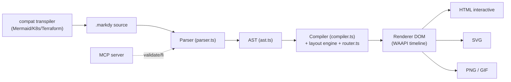
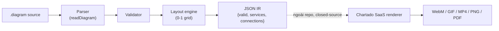
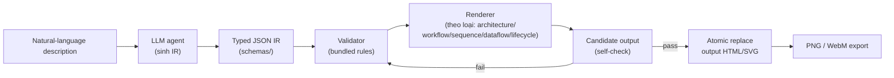
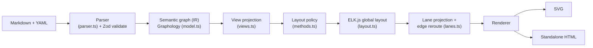

# Weekly Scan — Diagram-as-Code & Visual Tooling (2026-09-12)

## Tóm tắt điều hành

- Tuần này nổi bật nhất là **archify** (58.6k stars, gói dưới dạng "agent skill" cho Claude Code/Cursor/Codex) — cho thấy hướng đi mới: thay vì một CLI/thư viện độc lập, diagram engine được đóng gói như một skill để LLM agent tự sinh JSON IR rồi validate/deliver, gần với mô hình "agent-native tooling" hơn là "developer tool" truyền thống.
- Có ít nhất hai dự án cùng mục tiêu **"diagram-as-code → animated output"** giống hệt định vị của kymostudio xuất hiện gần như đồng thời: **markdy** (TypeScript, 17 layout engine, WAAPI, MCP server) và **chartado's animated-architecture-diagrams** (JS thuần, zero-dep, DSL kiểu `A -> B -> C`) — đáng chú ý vì đây là "đối thủ" trực tiếp gần nhất về ý tưởng với kymo.
- Xu hướng thiết kế DSL đáng ghi nhận: **visual-workbench** đi theo triết lý "không tọa độ x/y, chỉ mô tả ngữ nghĩa" dùng ELK.js + Graphology tách biệt hoàn toàn model ngữ nghĩa khỏi layout — một cách tiếp cận khác với kymo (kymo vẫn cho phép frame/anchor thủ công) đáng để tham khảo cho `alignment.py`/`alignment.ts`.

## Mục lục

1. [Danh sách rút gọn (shortlist) 10 repo](#shortlist)
2. [Deep-dive #1 — markdy (HoangYell/markdy-com)](#deepdive-markdy)
3. [Deep-dive #2 — chartado/animated-architecture-diagrams](#deepdive-chartado)
4. [Deep-dive #3 — archify (tt-a1i/archify)](#deepdive-archify)
5. [Deep-dive #4 — visual-workbench (dkharlanau/visual-workbench)](#deepdive-vw)
6. [Ghi chú phương pháp & giới hạn](#methodology)

## Shortlist — 10 repo ứng viên

| Repo | Pitch (VN) | Vì sao xuất hiện | Stars | Hoạt động gần nhất |
|---|---|---|---|---|
| [HoangYell/markdy-com](https://github.com/HoangYell/markdy-com) | DSL tạo diagram kiến trúc **có animation** (WAAPI 60fps), 17 layout engine, kèm MCP server cho AI agent | topic `diagram-as-code`, pushed 2026-09-10 | 95 | 2026-09-10 |
| [chartado/animated-architecture-diagrams](https://github.com/chartado/animated-architecture-diagrams) | Ngôn ngữ mô tả kiến trúc dạng text (`Lambda -> SQS -> DynamoDB`) render thành diagram animate, zero-dep | topic `diagram-as-code`, repo/package rất mới (tạo 2026-09-08) | 0 | 2026-09-08 |
| [tt-a1i/archify](https://github.com/tt-a1i/archify) | "Agent skill" sinh 5 loại diagram (architecture/workflow/sequence/dataflow/lifecycle) từ typed JSON IR, deterministic validate-before-deliver | topic `diagram-as-code`, viral trong giới agentic coding | 58,613 | 2026-09-12 |
| [dkharlanau/visual-workbench](https://github.com/dkharlanau/visual-workbench) | Engine mô hình hoá "ngữ nghĩa" (Markdown+YAML) → ELK.js layout → SVG/HTML, chủ trương "không toạ độ x/y" | topic `diagram-as-code`, mới tạo 2026-08-26 | 0 | 2026-09-10 |
| [indianerbande/c4ml](https://github.com/indianerbande/c4ml) (c4thedral) | Desktop workbench viết C4 model bằng DSL riêng (C4ML), xuất SVG/PNG "deterministic" (không chụp ảnh màn hình) | topic `diagram-as-code`, mới tạo 2026-09-02 | 1 | 2026-09-09 |
| [huy01197/diagram-maker](https://github.com/huy01197/diagram-maker) | Engine Python thuần (0 dependency) vẽ kiến trúc data pipeline tài chính, dùng Bézier routing + "virtual port coupling" để triệt tiêu wire-crossing | topic `diagram-as-code`, rất mới (tạo 2026-09-08) | 1 | 2026-09-11 |
| [c4hero/c4hero](https://github.com/c4hero/c4hero) | Vẽ C4 diagram local-first ngay trên browser, chỉnh sửa trực quan rồi lưu lại thành file `.dsl` thuần văn bản | topic `dsl`, pushed 2026-09-12 | 49 | 2026-09-12 |
| [keroway/obsidian-tdsl](https://github.com/keroway/obsidian-tdsl) | Plugin Obsidian: viết DSL timeline trong code block, render ra SVG timeline có dark mode | topic `dsl`, pushed 2026-09-12 | 0 | 2026-09-12 |
| [No1Joon/archdraw](https://github.com/No1Joon/archdraw) | Vẽ cloud architecture diagram (SVG/PNG) từ YAML, thiết kế riêng cho AI CLI dùng | topic `diagram-as-code`, rất mới (tạo 2026-08-13) | 0 | 2026-09-11 |
| [kieler/elkjs](https://github.com/kieler/elkjs) | Bản JS của bộ layout algorithm ELK (Eclipse Layout Kernel) — hierarchical/layered layout kinh điển | topic `layout-algorithm`, hoạt động ổn định của một thư viện nền tảng được nhiều tool trên dùng lại (kể cả visual-workbench ở trên) | 2,762 | 2026-09-09 |

Ghi chú: search theo topic `svg-animation` và `graph-visualization` chủ yếu trả về noise (GitHub-profile-README-art, chart/dashboard, network-analysis) không đạt tiêu chí loại trừ, nên không đưa vào shortlist.

---

## Deep-dive #1 — markdy (`HoangYell/markdy-com`)

### §1 — Quick context

Markdy là DSL viết kiến trúc hệ thống rồi render thành **animation 60fps chạy trong browser** bằng Web Animations API (WAAPI), khác các tool diagram-as-code khác ở chỗ diagram không chỉ tĩnh mà kể chuyện theo "beat" (giống storyboard) — điểm này định vị gần sát nhất với kymostudio trong toàn bộ đợt quét này. Stack: TypeScript monorepo (pnpm workspaces), core zero-dependency (~14kB). Output: HTML tương tác, SVG, PNG, GIF. Repo health: 95 stars, 3 forks, 662 commit, 12 PR, 0 issue mở, có CI (unit/integration test, visual-regression bằng headless Chrome + Pixelmatch, performance gate <40ms/<25MB). Phân phối: npm (`@markdy/cli`, `@markdy/core`…), VS Code extension, web playground tại markdy.com.

### §2 — Architecture deep-dive

**A. Component inventory** (dựa trên cấu trúc monorepo `packages/` và listing `packages/core/src/`):
- `Parser` (`packages/core/src/parser.ts`) — chuyển MarkdyScript source thành AST, README mô tả là "single-pass parser, line-by-line state machine".
- `AST` (`packages/core/src/ast.ts`) — định nghĩa kiểu dữ liệu AST.
- `Compiler` (`packages/core/src/compiler.ts`) — biến AST thành "rendering plan".
- `Router` (`packages/core/src/router.ts`) — router/orthogonal routing engine cho edge (README nhắc "dynamic port multiplexer and orthogonal routing engine").
- `Symbols` (`packages/core/src/symbols.ts`) — quản lý icon/symbol (AWS, GCP, Kubernetes, Redis…).
- `Diff` (`packages/core/src/diff.ts`) — so sánh hai bản AST (`diffDiagramASTs()`), phục vụ "compare architecture revisions".
- `Renderer DOM` (`packages/renderer-dom`) — engine render WAAPI (60fps timeline) + export SVG/PNG/GIF.
- `CLI` (`packages/cli`) — lint/render/format/import/diff.
- `MCP server` (`packages/mcp-server`) — expose tool `validate_markdy_code`, `diagnose_markdy_syntax`, `fix_markdy_code`, `transpile_to_markdy` cho AI agent.
- `Compat` (`packages/compat`) — transpiler từ Mermaid/Docker Compose/K8s/Terraform/Draw.io sang MarkdyScript.
- Không xác định: file layout-engine cụ thể cho từng trong số "17 layout engine" (README liệt kê tên nhưng không thấy filename riêng lẻ trong lần fetch này).

**B. Pipeline (happy path, chạy `markdy render system.markdy`):**
1. CLI đọc file `.markdy`.
2. `parser.ts` parse source → AST (báo lỗi kèm số dòng nếu sai cú pháp).
3. `compiler.ts` compile AST → "rendering plan" (đã chọn layout engine tương ứng theo khai báo `layout`, gán vị trí node/route cạnh qua `router.ts`).
4. `renderer-dom` build timeline WAAPI theo các `beat` (cảnh) đã khai báo, gắn theme.
5. Render ra HTML tương tác (mặc định) hoặc xuất tĩnh SVG/PNG/GIF.
6. (Tuỳ chọn) VS Code extension hiển thị live preview song song.

**C. Data model/IR:** AST là cấu trúc trung gian (TypeScript types trong `ast.ts`), sau đó compile tiếp thành "rendering plan" — tức có khái niệm hai tầng IR (AST ngôn ngữ → plan render), gần giống ý tưởng "lower IR" nhưng không có tên riêng như TALA của D2. Không xác định rõ AST có immutable hay không (không đọc được source code, chỉ suy từ README).

**D. Input language design:** Parser tự viết ("custom", single-pass, line-based state machine) — không dùng ANTLR/PEG. Có báo lỗi kèm số dòng (`ParseError` với line number). Không thấy EBNF chính thức trong README nhưng có file `SYNTAX.md` riêng (chưa fetch được nội dung đầy đủ).

**E. Layout:** 17 "layout engine" tên riêng (architecture, flowchart, tree, state, sequence, layers, nested, swimlane, quadrant, pyramid, medallion, timeline, gantt, flywheel, constellation, radar, venn) — nghĩa là mỗi loại diagram có thuật toán layout chuyên biệt thay vì một engine tổng quát; loại thuật toán cụ thể (Sugiyama? force-directed?) không xác định vì không đọc được source từng engine. Edge routing: "orthogonal routing engine" + "dynamic port multiplexing" cho multiple connection song song.

**F. Rendering/output:** Backend chính là DOM + WAAPI (CSS/SVG transform, không dùng Canvas/GSAP), rồi export snapshot sang SVG/PNG/GIF — một backend animate, nhiều format xuất tĩnh derive từ đó (không hẳn multi-emitter độc lập như to_svg.py/to_figma.py của kymo).

**G. Extensibility:** Thêm icon qua `symbols.ts`/thư viện SVG glyph; theme qua 10 theme có sẵn (không rõ cơ chế custom theme); format mới qua package `compat` (transpiler).

**H. Dev experience:** Có VS Code extension (live preview `Cmd+K V`), CLI có `lint`/`format`/`diff`, MCP server hỗ trợ agent tự sửa lỗi cú pháp (`fix_markdy_code`) — đây là điểm DX khá mạnh, browser playground riêng.

### §3 — Architecture diagram

### §4 — Verdict

Bài học cụ thể cho kymostudio: (1) khái niệm **"beat"** (narrative timeline scene) là cách hay để mô tả animation tường minh trong DSL thay vì animate toàn bộ diagram cùng lúc — kymo hiện chủ yếu animate theo edge/`--animate` flag, có thể tham khảo cú pháp `beat name "title": show $nodes stagger=60ms` cho animation có kịch bản. (2) Ý tưởng `diffDiagramASTs()` (diff hai revision kiến trúc) là tính năng chưa có ở kymo, dễ làm vì kymo đã có model dataclass ổn định. (3) MCP server với tool `fix_*`/`diagnose_*` là hướng packaging đáng cân nhắc khi kymo nhắm tới agentic coding users. Red flag: không đọc được source thật (WebFetch bị 403 khi gọi trực tiếp api.github.com/contents, phải suy từ README + trang tree), nên nhiều chi tiết thuật toán layout cụ thể chưa kiểm chứng được. Verdict: **study deeper** — đáng đọc `ARCHITECTURE.md` và `SYNTAX.md` đầy đủ trong lần sau.

---

## Deep-dive #2 — chartado/animated-architecture-diagrams

### §1 — Quick context

Đây là phần lõi ngôn ngữ (open-source, tách riêng khỏi SaaS chartado.com) của một dịch vụ render animated diagram — pitch khác biệt: **DSL cực tối giản kiểu arrow-chain** (`Lambda -> SQS -> DynamoDB`) không có block/indent, chỉ có 1 file text mỗi diagram, ưu tiên tốc độ viết hơn biểu đạt phức tạp. Stack: JavaScript/Node ≥22, **zero dependency**, test bằng Jest. Output của thư viện core chỉ là JSON (`{valid, services, connections}`); phần animate (WebM/WebP/GIF/MP4/PNG/PDF) nằm ở service SaaS chartado.com, không có trong repo này. Repo health: 0 star, 0 fork, gần như 1 commit — cực kỳ mới (tạo 2026-09-08), chưa có release chính thức. Phân phối: npm (`@chartado/animated-architecture-diagrams`).

### §2 — Architecture deep-dive

**A. Component inventory** (theo mô tả README, không đọc được listing `src/` chi tiết do 403):
- `Parser` (thư mục `src/`, hàm `readDiagram()`) — parse text DSL thành cấu trúc `{services, connections}`.
- `Validator` — kiểm tra tính hợp lệ diagram, trả `{valid: false, error}` thay vì throw exception.
- `Layout engine` — tính toạ độ 0-1 grid cho từng service khi không có toạ độ thủ công.
- `Service library` — bảng tra 60+ loại service (AWS, Cloudflare, AI agent…) kèm icon.
- `CLI` (`bin/`) — lệnh `diagram check` (dùng trong CI) và `diagram parse`.
- Không xác định: file/module cụ thể bên trong `src/` (bị chặn 403 khi gọi API contents).

**B. Pipeline (chạy `npx diagram parse examples/rag-pipeline.diagram`):**
1. CLI đọc file `.diagram`.
2. Parser tách từng dòng thành chuỗi service + operator (`->`, `<-`, `{}`, `()`, `|...|`, `[x,y]`).
3. Validator kiểm tra cú pháp/tham chiếu service, trả lỗi có cấu trúc nếu sai.
4. Layout engine gán toạ độ 0-1 cho service chưa có toạ độ tường minh.
5. Kết quả trả về JSON `{valid, services[], connections[]}` — dừng ở đây, **không tự render ảnh**.
6. (Ngoài repo) chartado.com nhận JSON này và render thành video/ảnh động.

**C. Data model/IR:** Đơn giản — plain object JSON (`services[]` có type/icon/position, `connections[]`), không có class/dataclass tách biệt theo README; không có khái niệm "lower IR" kiểu TALA. Vì tách lớp render ra khỏi repo, đây gần như chỉ là "parser + validator + layout", không có renderer trong scope.

**D. Input language design:** Không phải parser tổng quát (không PEG/ANTLR) — cú pháp dựa trên ký hiệu đặc biệt cố định: `->`/`<-` (hướng), `{}` (fan-out song song), `()` (nhóm chuỗi lồng nhau trong branch), `|a, b|` (lựa chọn loại trừ lẫn nhau — khác `{}` về ngữ nghĩa "exclusive" vs "parallel", một phân biệt cú pháp khá tinh tế), `[x,y]` (toạ độ thủ công theo lưới 0-1), `Namespace:Service` (chọn provider tường minh khi tên trùng). Lỗi trả về structured object, không exception — tốt cho tích hợp CI. Không có EBNF chính thức được công bố.

**E. Layout:** Không tài liệu hoá thuật toán cụ thể (không rõ hierarchical hay đơn giản là "next slot trên trục ngang theo thứ tự dòng"); có cơ chế **override thủ công qua toạ độ 0-1** kết hợp auto-layout — mô hình hybrid giống triết lý `frame`/anchor của kymo. Không thấy đề cập đến crossing minimization.

**F. Rendering/output:** Bản thân npm package **không render ảnh** — chỉ sinh JSON positions; animation/video là closed-source ở SaaS. Đây là điểm khác biệt lớn nhất so với kymo (kymo render trực tiếp ra SVG/Figma/Excalidraw/WebP ngay trong OSS core).

**G. Extensibility:** Thêm service mới vào "service library" (bảng tra icon theo tên), namespace prefix để disambiguate.

**H. Dev experience:** CLI có 2 lệnh rõ ràng (`check` cho CI, `parse` cho debug/JSON output), thiết kế fail-soft (không throw) khá thân thiện với pipeline CI.

### §3 — Architecture diagram

### §4 — Verdict

Điểm đáng học: cú pháp arrow-chain một dòng cực ngắn (`A -> B -> C`) hạ rào cản viết diagram đơn giản xuống mức tối thiểu — kymo DSL hiện đã expressive hơn (region/frame/layout block) nhưng có thể cân nhắc thêm một "cú pháp tốc ký" cho case đơn giản nhất (chain tuyến tính) như syntactic sugar. Phân biệt `{a,b}` (fan-out song song) và `|a,b|` (exclusive alternative) trong cùng một ký hiệu ngoặc là một ý hay để biểu đạt semantics khác nhau bằng cú pháp khác nhau — kymo có thể xem lại xem alignment.py có phân biệt rõ "parallel branch" và "either/or branch" cho BPMN gateway hay không. Red flag: thư viện tách biệt hoàn toàn parser khỏi renderer (renderer là SaaS đóng), nên hầu như không giúp ích cho phần render/animate của kymo — chỉ có giá trị tham khảo phần DSL syntax. Verdict: **glance only** (đọc thêm cú pháp DSL, bỏ qua phần kiến trúc render vì không mở).

---

## Deep-dive #3 — archify (`tt-a1i/archify`)

### §1 — Quick context

Archify không phải một CLI/thư viện độc lập theo nghĩa thông thường mà là một **"agent skill"** (cài qua `npx skills add tt-a1i/archify -g`) để LLM agent (Claude Code, Cursor, Codex, OpenCode) tự sinh "typed JSON IR" mô tả 5 loại diagram (architecture/workflow/sequence/dataflow/lifecycle) rồi Archify validate + render deterministic ra HTML/SVG — khác biệt lớn nhất là **không có cú pháp DSL cho người viết tay**, người dùng mô tả bằng ngôn ngữ tự nhiên, agent chịu trách nhiệm sinh IR đúng schema. Stack: Node.js/JavaScript, output HTML tự chứa + SVG, xuất thêm PNG/WebM. Repo health: 58,613 stars, 3.8k forks, version `v2.17.0-dev.1`, MIT license — mức độ viral rất cao trong 5 tháng (tạo 2026-04-15). Phân phối: qua `npx skills add` (không phải npm package truyền thống).

### §2 — Architecture deep-dive

**A. Component inventory** (từ listing thư mục `archify/`):
- `bin/` — CLI thực thi (`bin/archify.mjs`) với các subcommand `validate`, `deliver`, `preview`, `guide`.
- `schemas/` — định nghĩa "typed JSON IR" cho từng loại diagram (chưa đọc được nội dung chi tiết, chỉ thấy có `archify/schemas/README.md` được README chính trỏ tới).
- `renderers/architecture/`, `renderers/dataflow/`, `renderers/lifecycle/`, `renderers/sequence/`, `renderers/workflow/`, `renderers/shared/` — renderer **tổ chức theo loại diagram**, không phải theo output format — nghĩa là mỗi loại diagram có logic vẽ riêng dùng chung code ở `shared/`.
- `migrations/` — migrate IR giữa các version schema (gợi ý IR có version hoá, breaking change được xử lý có kiểm soát).
- `recipes/` — mẫu "cookbook" hướng dẫn agent sinh IR cho tình huống cụ thể.
- `delta/` — không xác định rõ chức năng (tên gợi ý "so sánh khác biệt" nhưng không đọc được code).
- `references/`, `brand-marks/` — tài liệu tham chiếu + tài sản icon thương hiệu (AWS/GCP…).
- Không xác định: file cụ thể trong mỗi renderer subfolder (GitHub tree view không show sâu hơn 1 cấp trong lần fetch này).

**B. Pipeline (theo mô tả "Generate → Validate → Preview → Deliver → Iterate" trong README, ánh xạ sang chạy `archify.mjs deliver`):**
1. Người dùng mô tả bằng ngôn ngữ tự nhiên (vd: "Browser -> API -> Redis cache -> PostgreSQL fallback").
2. LLM agent (không phải Archify) sinh ra **typed JSON IR** tuân theo schema trong `archify/schemas/`.
3. `archify.mjs validate <type> <file>` chạy bundled validator + layout rules kiểm tra IR, báo lỗi kèm vị trí sửa cụ thể nếu sai.
4. `archify.mjs deliver <type> <file> <output>` render ra một candidate trong cùng thư mục, tự kiểm tra lại candidate đó.
5. Chỉ khi candidate "pass" mới **atomically replace** file output đích (tránh output hỏng giữa chừng).
6. Agent tiếp tục sửa IR nguồn lặp lại (bước 2-5) mà không phá vỡ phần cấu trúc không liên quan — có tracking "drift"/"diff" giữa các lần.

**C. Data model/IR:** "Typed JSON IR" — theo tên gọi và có thư mục `schemas/` riêng, gợi ý dùng JSON Schema để type-check chứ không phải class/dataclass runtime. Có khái niệm rõ ràng về **compile tường minh xuống IR trung gian rồi mới render** (agent → IR → renderer), và có `migrations/` cho thấy IR có version hoá — đây là điểm gần nhất với khái niệm "TALA-like lower IR" trong toàn bộ đợt quét, dù không đọc được schema thật để xác nhận cấu trúc.

**D. Input language design:** Không có ngôn ngữ nguồn dạng text cho con người viết — "ngôn ngữ" thực chất là JSON Schema mà agent phải tuân theo, cộng thêm "recipes"/cookbook dạng prompt engineering để hướng dẫn agent sinh đúng IR. Do đó không áp dụng khái niệm parser truyền thống (regex/PEG/ANTLR) — bản thân LLM đóng vai trò "parser" từ ngôn ngữ tự nhiên sang IR, còn Archify chỉ validate IR đã sinh.

**E. Layout:** README nhắc "bundled validators and layout rules" nhưng không có chi tiết thuật toán (force-directed/hierarchical...) trong nội dung đã fetch — không xác định.

**F. Rendering/output:** Renderer tổ chức theo loại diagram (kiến trúc/sequence/workflow/dataflow/lifecycle), output HTML tự chứa nhúng SVG, có export thêm PNG/WebM cho "guided story playback". Có "interactive exploration", "route probing" — tức renderer không chỉ là ảnh tĩnh mà có tương tác runtime trong HTML (giống hướng đi của `--animate` ở kymo nhưng thiên về khám phá tương tác hơn animation kể chuyện tuyến tính).

**G. Extensibility:** Thêm loại diagram mới đòi hỏi thêm cả schema (`schemas/`) lẫn renderer riêng (`renderers/<type>/`) — cấu trúc song song schema↔renderer theo type khá rõ ràng, dễ mở rộng có kỷ luật.

**H. Dev experience:** CLI có `--json` flag cho output máy đọc được, `guide "<mô tả>"` sinh gợi ý trực tiếp từ ngôn ngữ tự nhiên, cơ chế deliver an toàn (atomic replace chỉ khi pass) là điểm DX rất mạnh cho use-case agent tự động chạy lặp lại nhiều lần mà không sợ phá hỏng output đang dùng.

### §3 — Architecture diagram

### §4 — Verdict

Bài học cụ thể: cơ chế **"render candidate vào cùng thư mục, tự validate lại, chỉ atomically replace khi pass"** là một pattern an toàn đáng cân nhắc cho `kymo` CLI khi chạy trong vòng lặp agent (tránh để lại file `.svg` hỏng giữa chừng nếu render bị crash) — hiện `cli.py`/`bin/kymo.mjs` không thấy cơ chế tương tự. Việc tổ chức `schemas/` + `renderers/<type>/` song song theo từng loại diagram cũng là mô hình gọn để so sánh với cách kymo tổ chức icon/BPMN-shape (`bpmn_shapes.py` tách riêng nhưng dùng chung `to_svg.py`). Điểm cần cảnh giác: đây là "agent skill", không phải công cụ deterministic độc lập theo nghĩa cổ điển — độ tin cậy của IR phụ thuộc hoàn toàn vào chất lượng LLM sinh ra, và 58.6k star trong bối cảnh trend "agent skill" viral có thể phản ánh hype hơn là chất lượng kỹ thuật lâu dài (không kiểm chứng được bằng test suite thực tế qua lần fetch này). Verdict: **study deeper** phần pattern "validate-before-atomic-deliver", **ignore** phần mô hình agent-sinh-IR (không áp dụng được cho kymo vì kymo DSL viết tay, không qua LLM).

---

## Deep-dive #4 — visual-workbench (`dkharlanau/visual-workbench`)

### §1 — Quick context

Visual-workbench khác biệt bằng triết lý **"model meaning, never coordinates"**: người viết chỉ mô tả node/edge/group bằng YAML front-matter nhúng trong Markdown, tuyệt đối không có toạ độ x/y trong source — toàn bộ layout do ELK.js quyết định, sau đó được project lại thành swimlane. Stack: TypeScript/Node ≥20, dependency chính là **Graphology** (semantic graph) + **ELK.js** (layout) + **Zod** (validate schema). Output: SVG và HTML standalone. Repo health: 0 sao, 0 fork, 33 commit, 1 issue mở, phiên bản "v0.1 source distribution", **chưa publish lên npm** (phải clone + `npm ci` + build tay) — dự án còn rất sớm. Không thấy CI badge trong nội dung đã fetch (không xác định có GitHub Actions hay không).

### §2 — Architecture deep-dive

**A. Component inventory** (từ liệt kê `src/` trong README):
- `Parser` (`src/parser.ts`) — đọc Markdown + YAML metadata, chạy diagnostic validation.
- `Model` (`src/model.ts`) — dựng **Graphology semantic graph**, độc lập hoàn toàn khỏi layout.
- `Views` (`src/views.ts`) — chiếu (project) named views từ model ngữ nghĩa; có "path contraction" giữ liên kết khi ẩn node trung gian.
- `Methods` (`src/methods.ts`) — chính sách layout theo loại visual method (process/handoff/data-flow/roadmap/timeline/dependency-map…) — chọn layered layout cho flow có hướng, stress layout phi-hierarchical cho relationship map.
- `Layout` (`src/layout.ts`) — adapter gọi **ELK.js** để tính cấu trúc đồ thị toàn cục + vị trí node ban đầu.
- `Lanes` (`src/lanes.ts`) — chiếu ranh giới sở hữu/hệ thống thành swimlane, viết lại route cạnh orthogonal, vẫn tôn trọng thứ tự (sequencing) mà ELK đã tính.
- `Stages` (`src/stages.ts`) — xử lý roadmap theo giai đoạn (Now/Next/Pilot/Scale) với spacing tự động.
- `Renderers` — xuất SVG/HTML theo "visual grammar" riêng của dự án.
- `CLI` (`src/cli.ts`) — `validate`, `render`, `render-views`, `inspect`.

**B. Pipeline (chạy `node dist/cli.js render examples/order-fulfillment-lanes.md -o output.svg`):**
1. CLI đọc file Markdown, `parser.ts` tách YAML front-matter (`nodes`, `edges`, `groups`, `views`).
2. Zod validate schema — báo lỗi nếu thiếu field/kiểu sai.
3. `model.ts` dựng Graphology graph thuần ngữ nghĩa (chưa có toạ độ).
4. `views.ts` chiếu ra named view được yêu cầu (vd `executive`), áp dụng path contraction nếu ẩn node.
5. `methods.ts` chọn chính sách layout theo `kind` (vd `handoff` → layered) rồi `layout.ts` gọi ELK.js tính vị trí node toàn cục.
6. `lanes.ts` chiếu lại node vào swimlane theo group, tính lại route cạnh orthogonal; renderer xuất SVG/HTML cuối cùng.

**C. Data model/IR:** Đồ thị Graphology là IR trung tâm — mô tả rõ ràng là **"coordinate-free"** (không nhúng layout info) và được dùng lại cho nhiều view/method khác nhau từ cùng một model — đây là một khái niệm "IR tách biệt khỏi trình bày" khá gần với triết lý `model.py` của kymo (dataclass thuần, renderer dumb), điểm khác là kymo's `Diagram` dataclass đã có toạ độ sau `resolve_alignments()`, còn ở đây toạ độ chỉ xuất hiện ở tầng `layout.ts` sau này — tách bạch rõ hơn giữa "semantic IR" và "geometric IR" (2 tầng IR tường minh).

**D. Input language design:** Không phải DSL text tự do mà là **YAML schema có cấu trúc cố định** (nodes/edges/groups/views) nhúng trong Markdown front-matter, validate bằng Zod — cách tiếp cận "schema-as-grammar" thay vì viết parser dòng-lệnh như DSL của kymo. Lỗi báo qua Zod (thường kèm path field bị sai) — không rõ có line-number chính xác trong file Markdown gốc hay không (không xác định).

**E. Layout:** Auto-layout **hoàn toàn** (không cho phép toạ độ thủ công) — hierarchical/layered qua ELK.js cho flow có hướng, stress-based (non-hierarchical) cho relationship map; sau đó có bước riêng **lane projection + orthogonal edge reroute** đặt lên trên kết quả ELK. Đây thực chất là kiến trúc 2 giai đoạn layout (global layout trước, rồi post-process theo constraint ngữ nghĩa/lane) — một mô hình dễ tham khảo cho `alignment.py` của kymo khi cần thêm auto-layout tổng quát hơn (hiện kymo chủ yếu dựa vào `layout { }` tree do người dùng khai báo, chưa có global auto-layout kiểu ELK).

**F. Rendering/output:** Một backend renderer, hai output (SVG thuần, HTML standalone) — không có kiến trúc multi-emitter như kymo (Figma/Excalidraw/WebP).

**G. Extensibility:** Thêm "visual method" mới = thêm 1 entry trong `methods.ts` (chính sách layout) — khá rõ ràng nhưng gắn chặt với code, không có plugin API tách rời theo README đã đọc.

**H. Dev experience:** CLI có `inspect` để xem cấu trúc ngữ nghĩa đã parse (hữu ích debug), nhưng chưa publish npm, chưa thấy VS Code extension/LSP, chưa xác định có watch mode hay không.

### §3 — Architecture diagram

### §4 — Verdict

Bài học cụ thể cho kymostudio: (1) tách rõ **"semantic IR" (coordinate-free) khỏi "geometric IR" (đã có toạ độ)** làm hai bước riêng biệt (`model.ts` vs `layout.ts`) là một cách tổ chức code sạch hơn so với việc alignment.py vừa giữ semantics vừa tính toạ độ trong cùng 5 pass — không nhất thiết phải đổi kiến trúc kymo, nhưng đáng để đánh giá xem có nên tách riêng "resolve semantics" khỏi "compute geometry" thành 2 module rõ ràng hơn. (2) Việc dùng **ELK.js làm layout backend** thay vì tự viết thuật toán Sugiyama là lựa chọn thực dụng đáng cân nhắc nếu kymo JS muốn thêm auto-layout tổng quát (ELK.js đã là dependency được nhiều tool khác dùng lại, ổn định, có sẵn hierarchical + force layout). (3) "Path contraction" khi ẩn node ở một view (giữ liên kết logic dù ẩn node trung gian) là tính năng hay cho kymo nếu tương lai có khái niệm "view/filter" trên cùng một diagram nguồn. Red flag: dự án rất sớm (0 sao, 33 commit, chưa release npm), tự nhận "not to be another drawing tool" — phạm vi hẹp (business process, không phải kiến trúc phần mềm tổng quát), nên nhiều ý tưởng cần đánh giá lại khi áp dụng ngoài domain business-process. Verdict: **study deeper** riêng phần kiến trúc semantic-IR/ELK.js, phần còn lại **glance only**.

---

## Ghi chú phương pháp & giới hạn

- Discovery dùng GitHub Search API không xác thực (`api.github.com/search/repositories`) qua WebFetch với các topic `diagram-as-code`, `dsl`, `svg-animation`, `graph-visualization`, `layout-algorithm`, lọc `pushed:>2026-09-05`. Hai topic `svg-animation` và `graph-visualization` trả gần như toàn bộ noise (GitHub-profile-README art, chart/network-analysis tool) nên bị loại theo tiêu chí loại trừ của brief; không cần rơi xuống fallback bước 2/3 vì bước 1 đã đủ ≥4 ứng viên tốt.
- Một số lệnh gọi `api.github.com/repos/{owner}/{repo}/contents/...` bị trả về **403 Forbidden** (rate-limit/robots trên proxy môi trường) — những chỗ này được thay bằng fetch trang tree người-dùng (`github.com/.../tree/...`) hoặc suy luận từ nội dung README; các trường hợp không lấy được bằng chứng thực tế đã được ghi rõ là "không xác định" trong §2 thay vì suy đoán.
- Không repo nào trong 4 bài deep-dive được `git clone` hay đọc source code đầy đủ dòng-theo-dòng — toàn bộ dựa trên README, trang tree GitHub, và một phần nội dung file mẫu fetch được qua `raw.githubusercontent.com`/trang blob. Đây là giới hạn cần lưu ý khi trích dẫn các chi tiết thuật toán (đặc biệt mục §2.E "Layout" của cả 4 repo đều có phần "không xác định").
- Không có ứng viên nào từ ba topic `dsl`/`layout-algorithm` liên quan trực tiếp illustration/diagram ngoài `kieler/elkjs` (đã đưa vào shortlist như "ecosystem activity" của một thư viện nền tảng, không deep-dive vì không phải repo "mới" theo nghĩa dự án non trẻ).
