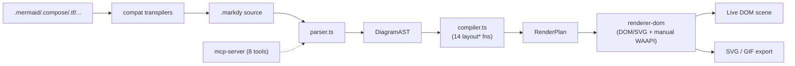
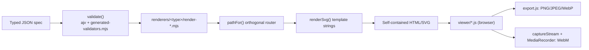
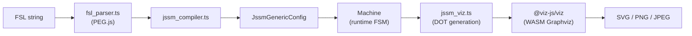
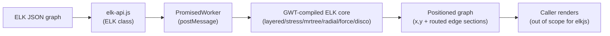

# Weekly scan — diagram-as-code & visual tooling (2026-09-13)

**Phạm vi**: repos GitHub trong domain diagram-as-code / animation / layout được publish hoặc update đáng kể trong ~7 ngày qua (`pushed:>2026-09-06`), lọc qua `topic:diagram-as-code`, `topic:dsl`, `topic:svg-animation`, `topic:graph-visualization`, `topic:layout-algorithm`. Tier PRIMARY của filter đã đủ candidate nên không cần rơi xuống fallback keyword-based hay ecosystem-release-scan.

## Executive summary

- Hai thái cực triết lý layout xuất hiện cùng tuần: **archify** (~59.7k sao, agent-skill JS) đặt cược vào *"layout judgment, không auto-layout"* — agent tự quyết định `pos`/`size`, còn tool chỉ validate hình học và route cạnh; **markdy-com** (95 sao, TypeScript) đi hướng ngược lại với 14 hàm `layout*` dispatch theo loại diagram cộng animation Web Animations API. Cả hai đáng đối chiếu với cách `alignment.py`/`alignment.ts` của kymostudio đang tự tính toán vị trí.
- **jssm** là case study tốt về DSL "arrow-based" (FSL) nhưng cũng là bài học cảnh giác: claim nổi bật nhất của nó (state type an toàn ở compile-time, suy ra từ chuỗi FSL) **không được xác nhận trong code** — `StateType` chỉ là `string`. Không nên tin tài liệu marketing của bất kỳ repo nào mà không đọc source.
- **elkjs** là tài liệu tham chiếu layout-algorithm giá trị nhất trong đợt scan này (Sugiyama-family `layered`, options cascade, edge routing với bend-point sections) — nhưng cách nó build (Java → GWT → JS, cần checkout repo `eclipse/elk` liền kề) là phản ví dụ so với chiến lược "hai implementation độc lập, đối chiếu bằng golden conformance tests" mà kymostudio đang theo.

## Mục lục

1. [markdy-com](#1-hoangyellmarkdy-com)
2. [archify](#2-tt-a1iarchify)
3. [jssm](#3-stonecypherjssm)
4. [elkjs](#4-kielerelkjs)

---

## 1. HoangYell/markdy-com

**Repo**: https://github.com/HoangYell/markdy-com

### §1 — Quick context

Diagram-as-code cho animated architecture diagrams: thay vì vẽ topology tĩnh, DSL `.markdy` mô tả *choreographed motion* — hệ thống hoạt động ra sao theo thời gian, không chỉ trông như thế nào. Tech stack: TypeScript monorepo (`packages/core`, `packages/renderer-dom`, `packages/compat`, `packages/mcp-server`, `packages/cli`, `packages/vscode`, `packages/markdy-language-server`); output DOM/inline-SVG + export SVG/GIF. Repo health: 95 sao, dường như một tác giả chính (`HoangYell`/`yellcamap`) với nhịp release rất nhanh (v1.4.0 → v1.4.6 trong một tuần) — rủi ro bus-factor cho một dự án claim ingest 7 format ngoài (Mermaid, Docker Compose, K8s, Terraform, Draw.io, D2, PlantUML). Distribution: npm (nhiều package con), MCP server riêng version độc lập (1.0.30 so với root 1.4.6), VS Code extension.

### §2 — Architecture deep-dive

**A. Component inventory** — `packages/core/src/parser.ts` (`.markdy` → `DiagramAST`); `compiler.ts` (`DiagramAST` → `RenderPlan`, dispatch layout + schedule animation cues); `ast.ts` (toàn bộ type definitions, không dùng class); `registry.ts` (bảng từ vựng: 18 `DIAGRAM_TYPES`, edge operators `->`/`<-`/`~>`/`--`/`..>`); `packages/compat/src/*-transpiler.ts` (6 transpiler ingest format ngoài xác nhận qua file listing); `packages/renderer-dom/src/*` (module riêng cho mỗi diagram type: `sequence.ts`, `tree.ts`, `quadrant.ts`, `swimlane.ts`, `gantt.ts`... cộng `geometry/` cho routing); `packages/mcp-server/src/{index.ts,tools.ts}`.

**B. Pipeline** — (1) tác giả viết `.markdy` hoặc file format ngoài; (2) nếu là format ngoài, transpiler trong `compat` sinh MarkdyScript; (3) `parser.ts:parse()` — tokenize theo dòng bằng regex, kết hợp recursive-descent (`readBody`) cho block thụt lề — ra `DiagramAST`, lỗi fatal ném `ParseError`, lỗi nhẹ gom vào mảng `diagnostics` không chặn build; (4) `compiler.ts:compilePlan()` tính kích thước node, dispatch một trong 14 hàm `layout*` qua switch theo `DiagramType`, route + dedupe cạnh, dựng group boundary, lên lịch beat cue → `RenderPlan`; (5) `renderer-dom/src/diagram.ts:createDiagram()` dựng DOM/SVG từ `RenderPlan`, pre-build sẵn mọi `Animation` object ở trạng thái paused; (6) một vòng `requestAnimationFrame` set `anim.currentTime` thủ công mỗi frame (không dùng WAAPI playback gốc, để né bug cross-browser của `startTime`/`fill:"both"`); (7) xuất ra live DOM scene hoặc SVG/GIF tĩnh qua `export/`.

**C. Data model/IR** — Plain TS interface (không class), hai tầng: `DiagramAST` (parse output) → `RenderPlan` (compile output, gồm `PositionedNode[]`, `RoutedEdge[]`, `GroupBoundary[]`, `TimedCue[]`). Mỗi tầng là object mới (style hàm thuần), không có tầng IR thấp hơn nữa kiểu "TALA" của D2.

**D. Input language design** — Hybrid: regex line-based tokenizer + recursive-descent cho block lồng nhau. Không có formal grammar (BNF/EBNF) — `docs/SYNTAX.md` chỉ mô tả bằng văn xuôi/ví dụ. Error reporting: class `ParseError` (line+column) cho lỗi fatal, mảng `diagnostics` non-fatal cho warning; có cơ chế "self-healing" phục hồi thụt lề khi host (MDX) làm mất whitespace.

**E. Layout algorithm** — 14 hàm `layout*` (`layoutRanked`, `layoutTree`, `layoutConstellation`, `layoutSwimlane`, `layoutGantt`, `layoutRadar`, v.v.) chọn qua một switch `layoutNodes()` trên 18 `DiagramType` — nhiều type alias cùng một hàm (`flowchart`/`sequence`/`state` đều rơi vào `layoutRanked`). **Lưu ý: con số "17 layout engines" quảng cáo không khớp 14 hàm thực tế tìm thấy** — nhiều khả năng đếm theo "diagram type" chứ không phải thuật toán riêng biệt, một discrepancy chưa giải quyết được. `layoutRanked` dùng ranking + barycenter crossing-minimization kiểu Sugiyama (chưa verify từng dòng). Auto-layout mặc định; edge routing qua `router.ts` + `renderer-dom/src/geometry/` (orthogonal, obstacle-aware).

**F. Rendering/output** — Một backend duy nhất: DOM + inline SVG (không Canvas). Animation cơ chế "manual WAAPI scrubbing" như mô tả ở B. `beat` được kích hoạt bằng cách rơi vào khoảng `[start,end]` trong lịch `TimedCue` đã compile — thuần deterministic theo timeline offset, không phải event.

**G. Extensibility** — `docs/ARCHITECTURE.md` mô tả cụ thể: thêm node kind → sửa `system-vocabulary.ts`; thêm cue → sửa `registry.ts` + `ast.ts` + `compiler.ts` + `edges.ts`; thêm edge operator → 4 file tương tự. Đây là điểm mở rộng rải rác theo file, không có plugin loader.

**H. Dev experience** — CLI `markdy lint/fmt/render`; `markdy-language-server` + VS Code extension (chưa xác nhận có full LSP diagnostics/hover hay chỉ syntax highlight). MCP server expose 8 tool (`validate_markdy_code`, `diagnose_markdy_syntax`, `fix_markdy_code`, `transpile_to_markdy`, `explain_architecture`, `generate_markdy_prompt`, `get_architecture_catalog`, `get_markdy_intellicode`) + 4 resource + 4 prompt — thiết kế MCP khá đầy đủ cho agent workflow.

### §3 — Architecture diagram

### §4 — Verdict

Đáng học: (1) cơ chế "manual WAAPI scrubbing" (pre-build animation paused, set `currentTime` mỗi rAF) là một giải pháp animation đáng cân nhắc nếu kymostudio muốn animation timeline chính xác hơn thay vì thuần CSS keyframes; (2) code-anchor `@src="path#L10"` (link diagram node về dòng code cụ thể, có "Git-verified provenance") là ý tưởng hay có thể áp dụng cho kymo khi diagram mô tả kiến trúc code thật; (3) MCP server 8-tool là hình mẫu tốt nếu kymostudio muốn expose DSL validation/fix cho agent. Red flag: số liệu marketing (17 layout engine) không khớp code — nhắc nhở luôn đọc source thay vì README khi đánh giá repo khác. Open question: crossing-minimization của `layoutRanked` có thực sự Sugiyama/barycentric hay chỉ heuristic đơn giản — chưa verify. **Verdict: study deeper** (gần nhất về mặt kiến trúc với kymostudio, đáng theo dõi tiếp).

---

## 2. tt-a1i/archify

**Repo**: https://github.com/tt-a1i/archify

### §1 — Quick context

Không phải một DSL độc lập mà một "agent skill": agent (Claude Code/Cursor/Codex) sinh JSON spec theo schema, archify validate + render thành HTML/SVG tự chứa có animation, xuất PNG/JPEG/WebP/SVG/WebM. Điểm khác biệt chính: **từ chối auto-layout tổng quát**, để agent tự quyết định vị trí/kích thước — công cụ chỉ gate chất lượng hình học. Tech stack: Node.js/JavaScript (ESM `.mjs`), core dep chỉ `ajv`/`parse5`/`saxes`/`simple-icons` (không Puppeteer/Playwright). Repo health: ~59.7k sao (viral thực sự, verify độc lập qua page fetch), 90+ file test, version dev `v2.17.0-dev.1`. Distribution: npm package `archify/` nằm trong monorepo, đóng gói kèm `SKILL.md` làm skill manifest cho agent.

### §2 — Architecture deep-dive

**A. Component inventory** — `archify/bin/archify.mjs` (CLI dispatcher, 13 subcommand: `render/check/examples/demo/compare/deliver/preview/validate/migrate/guide/brands/doctor/visual-check`); `archify/schemas/*.schema.json` (JSON Schema draft 2020-12, một schema/diagram-type); `archify/renderers/<type>/render-<type>.mjs` + `renderers/shared/*` (17 file tiện ích dùng chung: `geometry.mjs`, `layout-report.mjs`, `validator.mjs`, `diagnostics.mjs`, `text-fit.mjs`...); `viewer/*.js` (client-side, build vào `assets/template.html`); `archify/delta/` (so sánh kiến trúc before/after); `archify/migrations/` (schema v1→v2); `archify/scripts/generate-validators.mjs` (pre-compile schema thành code, bỏ runtime dep vào ajv).

**B. Pipeline** — (1) agent ghi typed JSON spec ra file theo schema; (2) `archify validate <type> <file>` — ajv strict-mode + check ngữ nghĩa (ID trùng, ref treo); (3) `archify deliver` đọc spec, ghi ra candidate snapshot cùng thư mục; (4) renderer tương ứng: load → đo kích thước component (`gridLayout`/measure) → tính boundary → `validateArchitecture()` (30+ kiểm tra hình học) → route cạnh bằng `pathFor()` → `renderSvg()` (template string) → nhúng SVG vào template HTML; (5) chạy "artifact checker" hoàn chỉnh trên HTML/SVG vừa render; (6) chỉ khi mọi check pass mới atomic-rename ghi đè file đích (staging + rename, tránh partial write); (7) ghi `.receipt.json` (SHA-256, số lỗi/cảnh báo); (8) export PNG/JPEG/WebP/WebM xảy ra **hoàn toàn phía client trong trình duyệt** qua `viewer/export.js`, không phải trong Node process.

**C. Data model/IR** — JSON thuần: `schema_version` + `diagram_type` + `meta` + mảng theo type (`components`, `connections`, `boundaries`...). Component có `pos: [x,y]` và `size: [w,h]` tường minh — vị trí do agent quyết định, không phải tool tính. IR là input bất biến; renderer lower xuống một tầng "measured geometry" (`layout-report.mjs`: `componentBox`, `connectionPath`) — gần giống IR thấp hơn nhưng chỉ tồn tại trong quá trình render, không phải một pass riêng biệt lưu lại.

**D. Input language design** — Chỉ JSON Schema để author, không có textual DSL riêng cho việc viết tay. `SKILL.md` claim còn nhận input Mermaid dán trực tiếp (flowchart/sequenceDiagram/stateDiagram) nhưng **không tìm thấy module import Mermaid** trong lần đọc này (open question). Validation dùng ajv draft 2020-12, `additionalProperties: false` ở mọi cấp — từ chối field lạ thay vì bỏ qua. Điểm hay: schema được **pre-compile thành `generated-validators.mjs`** để runtime không cần ajv/network. Error: object "diagnostics" có code/subject/evidence/fixes, serialize được JSON.

**E. Layout algorithm** — Không có auto-layout tổng quát; vị trí do agent chỉ định (`pos`/`size`) hoặc qua helper `gridLayout()` tùy chọn. Edge routing (`pathFor()`) là router orthogonal tự viết: xác định side của endpoint, snap các port đối diện nhau, thử nhiều chiến lược route (straight/orthogonal-h/orthogonal-v/auto side-aware), validate bằng obstacle-clearance check, fallback về midpoint routing nếu không route nào hợp lệ. Không minimize crossing bằng thuật toán, nhưng **detect và gate crossing** qua `cleanCrossingProblems` trong bước validate.

**F. Rendering/output** — Sinh SVG bằng template string thuần (không DOM builder). Animation tối giản, CSS-driven (`animateAttr()` gắn class/attr theo `meta.animation`), tôn trọng `prefers-reduced-motion`. Export multi-format hoàn toàn client-side: PNG/JPEG/WebP qua `XMLSerializer` → rasterize 4x bằng canvas; **WebM đáng chú ý nhất** — vẽ nền tĩnh một lần, overlay scene redraw theo `requestAnimationFrame` (workaround vì `Image` bitmap cache không advance CSS animation), capture bằng `canvas.captureStream(fps)` + `MediaRecorder` (VP9/VP8). Không headless browser, không Puppeteer — user tự mở tab thật.

**G. Extensibility** — Thêm diagram type mới = schema mới + `render-<type>.mjs` mới dùng chung `renderers/shared/*`; 5 type hiện tại độc lập version (workflow có migration v1→v2 với cam kết backward-compat). Theme: dark/light + 4 preset qua CSS variable. Icon/brand mark từ Simple Icons, có script `generate:brand-marks` riêng. Không có plugin API runtime — mở rộng bằng cách sửa/thêm file trong monorepo.

**H. Dev experience** — CLI có `doctor` (health check Node version/fixture), `preview` (claim live-reload nhưng chưa xác định được module implement), `demo`/`guide` scaffold ví dụ. Mọi output HTML nhúng sẵn control tương tác: `?` guide, `/` find/focus, `R` route probing, `L` lens compare, `M` overview radar, `P` guided playback, `F` presentation mode — implement trong `viewer/*.js`.

### §3 — Architecture diagram

### §4 — Verdict

Đáng học nhất cho kymostudio: (1) **schema pre-compile thành static validator code** (`generate-validators.mjs`) — kymo có thể áp dụng để validate `.kymo`/DIAGRAM JSON mà không cần runtime dep; (2) kỹ thuật **export WebM không headless browser** (canvas rasterize nền tĩnh + overlay animation redraw theo rAF + `captureStream`/`MediaRecorder`) là hướng đáng thử nếu kymostudio muốn thêm output video từ `--animate` mà không phụ thuộc Puppeteer; (3) triết lý "layout judgment over auto-layout" là một đối trọng thú vị để tranh luận nội bộ — kymo hiện đặt cược vào auto-layout + alignment resolver, biết rõ trade-off của phía đối lập giúp bảo vệ quyết định đó tốt hơn. Red flag: scope phình to bất thường so với một "agent skill" (90+ test, delta engine, brand-mark licensing pipeline, "semantic passport") — nên kiểm chứng adoption thực tế thay vì chỉ tin số sao; cơ chế `visual-check` "browser-based automated visual validation" chưa xác định được implement (không thấy Puppeteer/Playwright trong dep). **Verdict: study deeper** riêng phần export pipeline và schema-validation pattern; phần còn lại glance only.

---

## 3. StoneCypher/jssm

**Repo**: https://github.com/StoneCypher/jssm

### §1 — Quick context

Thư viện finite-state-machine JS/TS mà chuỗi DSL định nghĩa máy trạng thái (FSL, cú pháp arrow `->`/`=>`/`~>`) cũng chính là nguồn để render diagram — ý tưởng "runtime và diagram không thể lệch nhau vì cùng một string". Tech stack: TypeScript, PEG.js cho parser, `@viz-js/viz` (WASM Graphviz) cho render. Repo health: 369 sao, pushed trong tuần lọc (`>2026-09-06`, timestamp chính xác không lấy được), có CLI, docs site, CodeMirror 6 mode, tài liệu "vẫn đang hoàn thiện" theo chính README. Distribution: npm, có 4 binary CLI (`fsl`, `jssm`, `fsl-render`, `fsl-export-system-prompt`).

### §2 — Architecture deep-dive

**A. Component inventory** — `src/ts/fsl_parser.peg` (grammar PEG.js nguồn, build ra `fsl_parser.ts`); `jssm_compiler.ts` (`compile()`/`make()`, resolve group/conflict/hook từ parse tree thô ra `JssmGenericConfig`); `jssm.ts` (class `Machine<mDT>` — instance runtime, API transition/action/hook); `jssm_arrow.ts` (phân loại kiểu mũi tên); `jssm_intern.ts` (interning số cho dispatch nhanh); `jssm_viz.ts`/`jssm_viz_colors.ts` (sinh DOT string + render); `src/ts/cli/*` (4 binary); `src/ts/language_service/` (diagnostics/completions/semantic-spans cho editor); `src/machines/` (100+ file `.fsl` ví dụ).

**B. Pipeline** — (1) dev viết chuỗi FSL, truyền vào factory (`sm` tagged template — vị trí định nghĩa chính xác không tìm thấy trong lần đọc này); (2) chuỗi → `fsl_parser.ts` (PEG.js generated) → parse tree thô; (3) `jssm_compiler.ts:compile()` resolve thành `JssmGenericConfig`; (4) `new Machine(config)` dựng edge map + interned id → FSM sống, dùng ngay được (`.transition()`, `.action()`); (5) để vẽ diagram: cùng string/machine đưa qua `jssm_viz.ts`, sinh DOT string (slug hoá state, phân loại state để style, gộp cạnh hai chiều); (6) DOT → `@viz-js/viz` (Graphviz biên dịch WASM, **không** shell ra binary hệ thống, không gọi API ngoài) → SVG; đường chuyển sang PNG/JPEG chưa xác định được từ file đã đọc.

**C. Data model/IR** — Phân tách rõ: parse tree PEG thô → object trung gian compiler → `JssmGenericConfig` (khai báo, đã resolve) → instance `Machine` (có state, mutable). Transition lưu trong mảng `_edges` + index dạng `Map` (`_edge_map`) cộng interning số cho hiệu năng. Data payload generic (`mDT`) là immutable-by-copy: `.data()` trả bản deep-clone, có escape hatch `._data_ref()` truy cập trực tiếp.

**D. Input language design** — PEG.js hand-written, xác nhận file `fsl_parser.peg` tồn tại. **Không có tài liệu grammar hình thức (BNF/EBNF)** — `LanguageReference.md` chỉ là văn xuôi + ví dụ, tự ghi "still underway". Error: class `JssmError` mang `message`, `requested_state`, `source_location` (offset/line/column khi bật `{locations:true}`).

**E/F. Layout & rendering** — Layout giao hoàn toàn cho Graphviz; field `graph_layout` trong config hỗ trợ `dot`/`circo`/`fdp`/`neato`/`twopi`. Engine render là **`@viz-js/viz`** (WASM Graphviz, có thể thay engine asm.js cho môi trường CSP nghiêm ngặt) — không phải shell-out hay remote API. Tiền xử lý trước khi sinh DOT: slug hoá state, phân loại state (final/complete/terminal), gộp cạnh hai chiều thành chip. Không tìm thấy khả năng animation — output tĩnh SVG/PNG/JPEG; có file `fsl_gif.ts` chưa đọc nội dung (khả năng liên quan animation, chưa xác nhận).

**G. Extensibility** — Thêm kiểu mũi tên mới đòi sửa **3 switch statement riêng biệt** (`arrow_direction`, `arrow_left_kind`, `arrow_right_kind`) cộng grammar PEG — không có bảng tra cứu trung tâm, đây là code smell rõ ràng. Style hook theo state/transition qua theme cascade (`resolve_state_config()`).

**H. Dev experience** — CLI 4 binary với subcommand. **Claim nổi bật "type-safe state từ chuỗi FSL" không được xác nhận**: `jssm.ts` định nghĩa `type StateType = string;` — state chỉ là string thường, không phải literal union suy ra tại compile-time từ FSL text. Checkmark "TypeScript data" trong `FeatureComparison.md` chỉ nói về generic `mDT` (data payload), không phải state name. Có CodeMirror 6 mode, web component, playground (`jssm-viz-demo`, có vẻ là repo/site riêng).

### §3 — Architecture diagram

### §4 — Verdict

Đáng học: ý tưởng "một chuỗi vừa là runtime vừa là diagram source, không thể lệch nhau" là một câu chuyện thiết kế đáng để kymostudio tham khảo khi trình bày lý do dùng `.kymo` — nhưng bản thân kymo (parse → resolve → render tách bạch, có golden test đối chiếu) đã giải quyết vấn đề "đồng bộ" theo cách khác (test-based thay vì same-string-based), nên không cần đổi hướng, chỉ là một luận điểm marketing tham khảo. Việc **giao layout hẳn cho Graphviz** (chọn engine qua field cấu hình) là mô hình nhẹ để có nhiều thuật toán mà không tự triển khai — đối lập với kymo tự viết `layout.py`/`alignment.py`; đáng cân nhắc cho các trường hợp edge (radial, circular) nếu không muốn tự code. Red flag rõ nhất: **claim marketing (typed state) sai so với code thực tế**, và anti-pattern 3-switch-statement khi thêm cú pháp mới — kymostudio nên tự kiểm tra `dsl.py`/`dsl.ts` không rơi vào bẫy tương tự khi thêm operator mới. Open question: cơ chế PNG/JPEG từ SVG chưa xác định. **Verdict: glance only** — bài học về DSL-design-narrative và về việc không tin README hơn là kiến trúc kỹ thuật để áp dụng trực tiếp.

---

## 4. kieler/elkjs

**Repo**: https://github.com/kieler/elkjs

### §1 — Quick context

Bản JS của Eclipse Layout Kernel (ELK), compile từ Java bằng GWT, expose 6+ họ thuật toán layout (`layered`/Sugiyama, `stress`, `mrtree`, `radial`, `force`, `disco`, cộng `sporeOverlap`/`sporeCompaction`/`rectpacking`) qua một JSON graph API thuần túy — không phải diagram tool, chỉ tính toán vị trí. Tech stack: JS wrapper (`elk-api.js`) bọc quanh core Java biên dịch GWT, chạy trong Web Worker. Repo health: ~2.8k sao, pushed 2026-09-09, có test (`test/mocha`), README liệt kê nhiều bug GWT-transpilation đã biết theo số issue cụ thể — minh bạch nhưng cũng cho thấy nợ kỹ thuật. Distribution: npm (`elkjs`), yêu cầu Java 8-21 để build (không cần để dùng thư viện đã build sẵn).

### §2 — Architecture deep-dive

**A. Component inventory** — `src/js/elk-api.js` (class `ELK`: constructor, `.layout()`, `.knownLayoutAlgorithms/Options/Categories()`, class `PromisedWorker` bọc postMessage bằng Promise); `src/java/org/eclipse/elk/...` (source Java ELK copy/patch từ repo `eclipse/elk`, các phần GWT-incompatible bị strip bằng regex khi build); `build.gradle` (pipeline build Java→GWT→JS, task `gwtc`/`gwtcMinified`); `lib/` (output build, không commit: `elk-api.js`, `elk-worker.js`, `elk.bundled.js`); `typings/*.d.ts` (type định nghĩa `ElkNode`/`ElkEdge`/`ElkPort`/`ElkLabel`/`LayoutOptions` — first-party, không cần `@types/`); `test/examples/SimpleElkGraphDrawer.js` (demo vẽ SVG, chỉ để test, không phải một phần thư viện).

**B. Pipeline** — (1) dev dựng object `graph` theo ELK JSON format, tạo `new ELK({...})`; (2) gọi `elk.layout(graph, {layoutOptions,...})`; (3) `ELK` post message `{command:'layout',...}` (kèm id) tới `PromisedWorker` (Web Worker thật hoặc inline); (4) worker chạy core ELK Java-compiled-GWT (entry point `org.eclipse.elk.js.ElkJs`) trên graph JSON; (5) engine chạy pipeline theo thuật toán chọn (với `layered`: cycle breaking → layering → crossing minimization → node placement → edge routing); (6) kết quả (cùng shape graph, giờ có `x`/`y`/`width`/`height` mỗi node và `sections` với bend point mỗi cạnh) post lại main thread; (7) `PromisedWorker` khớp id, resolve Promise; (8) `elk.layout()` trả về graph đã layout — **elkjs dừng ở đây, không tự render**.

**C. Data model/IR** — `ElkNode` phân cấp (children lồng nhau, mỗi node có thể có `ports`/`edges`/`labels`/`layoutOptions` riêng). `ElkExtendedEdge` (dạng hiện đại): `{id, sources[], targets[]}` hỗ trợ hyperedge, cùng `ElkEdgeSection` chứa `startPoint`/`endPoint`/`bendPoints[]` (khi routing là SPLINES, bend point là control point Bézier bậc ba). Dạng cũ `ElkEdge`/`ElkPrimitiveEdge` (single source/target) vẫn giữ để tương thích ngược — carry legacy shape trong typings công khai. Object trả về không mutate cùng reference với input do kiến trúc postMessage (structured clone).

**D. Input language design** — Không có DSL văn bản, thuần JSON graph API. Không có spec JSON hình thức trong chính repo này (dẫn ra tài liệu ngoài trên eclipse.dev/elk). Cấu hình thuật toán qua `layoutOptions` (key dạng chuỗi, có thể đặt ở graph-root, per-element, call-level, hoặc default ở instance) — dùng ID đầy đủ dạng `org.eclipse.elk.layered.crossingMinimization.strategy` hoặc dạng rút gọn bỏ tiền tố.

**E. Layout algorithm** — Đây là phần lõi của repo. `layered`: Sugiyama-style (layer hóa, sắp lại để giảm crossing), theo mô tả package.json "chuyên cho data flow diagram và port". Trang tham chiếu ELK liệt kê option "Crossing Minimization Strategy" như giá trị chọn được nhưng **không narrate chi tiết thuật toán bên trong từng strategy** trong phạm vi đã fetch. Edge routing có 3 mode: `POLYLINE`/`ORTHOGONAL`/`SPLINES` (spline là control point Bézier bậc ba). Các thuật toán `stress`/`mrtree`/`radial`/`force`/`disco` chỉ xuất hiện như tên chọn được trong `elk-api.js`, **không có tài liệu nội bộ mô tả cơ chế** trong repo elkjs (semantics nằm ở tài liệu ELK gốc, chưa fetch sâu do giới hạn phạm vi).

**F. Rendering/output** — Xác nhận rõ trong README: "elkjs is not a diagramming framework itself — it computes positions". Trả về không chỉ tọa độ mà cả hình học cạnh đã route đầy đủ (bend points, control points khi spline) ở mọi cấp phân cấp.

**G. Extensibility** — Thuật toán chọn qua string `layoutOptions['elk.algorithm']`, cascade theo cấp (instance default → call-level → per-element), có thể set thuật toán khác nhau cho từng sub-hierarchy. Constructor nhận `algorithms: [...]` để chọn module nào được đăng ký vào worker. Không có bằng chứng cho phép đăng ký thuật toán JS tùy chỉnh — mở rộng chỉ qua plugin Java biên dịch sẵn.

**H. Dev experience** — API Promise-based, hỗ trợ offload Web Worker (`workerUrl`/`workerFactory`), Node cần thêm package `web-worker`. Type định nghĩa first-party đầy đủ. README tự liệt kê nhiều bug GWT-transpilation đã biết theo số issue, và ghi rõ có build riêng non-minified để debug stack trace từ code GWT-generated — ngụ ý bundle minified rất khó debug.

### §3 — Architecture diagram

### §4 — Verdict

Đáng học nhất: (1) **options cascade** (instance default → call-level → per-element/per-sub-hierarchy) là pattern sạch mà `alignment.py`/`alignment.ts` của kymo có thể tham khảo khi cần cấu hình layout khác nhau cho từng region lồng nhau; (2) mô hình `ElkEdgeSection` với `bendPoints[]` (và spline control points) là format tham chiếu tốt cho việc mở rộng `Edge` model của kymo nếu muốn hỗ trợ orthogonal/spline routing tổng quát hơn; (3) việc elkjs dứt khoát tách "chỉ tính layout, không render" là một ranh giới kiến trúc rõ ràng — khớp với triết lý "renderer dumb" của kymostudio (`model.py` + emitter), đáng yên tâm rằng hướng đi hiện tại đúng theo chuẩn ngành. Red flag/bài học phản diện: build xuyên ngôn ngữ (Java → GWT → JS, cần checkout `../elk` liền kề, giới hạn Java 8-21, version "partially synchronized" với upstream) là loại rủi ro mà chiến lược "hai implementation Python/JS độc lập + golden conformance suite" của kymostudio chủ động né tránh — đáng trích dẫn làm lý do củng cố quyết định kiến trúc đó khi có ai đề xuất "sao không dùng transpiler cho đỡ trùng code". Open question: cơ chế crossing-minimization chi tiết của `layered` chưa fetch được (nằm ở tài liệu ELK gốc ngoài repo). **Verdict: study deeper** cho phần data model/options cascade của layout engine, không cần tham khảo phần build toolchain.
