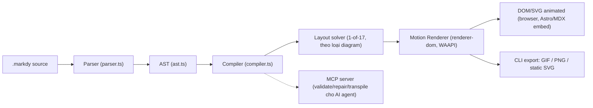
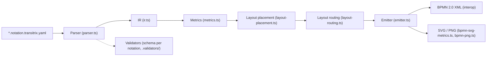
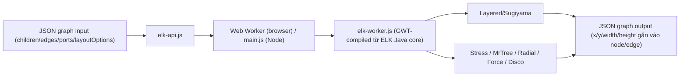
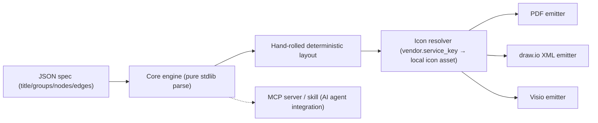

# Weekly scan — diagram-as-code & visual tooling (2026-09-14)

**Executive summary**
- Đối thủ trực tiếp gần nhất tuần này là **markdy-com** (HoangYell): DSL riêng ("MarkdyScript") + 17 layout solver + Web Animations API — cùng định vị "diagram-as-code" như kymostudio nhưng thiên về *narrative/animation* hơn là static architecture, và đã có MCP server + VS Code extension sẵn.
- **transitrix-studio** đáng chú ý vì kiến trúc pipeline gần như song song với `packages/python` của kymostudio (parser → IR → layout → BPMN emitter), nhưng input là YAML thay vì DSL dòng-lệnh, và mục tiêu là ArchiMate/BPMN/Capability-map cho enterprise architecture chứ không phải diagram tổng quát.
- **elkjs** không phải repo mới nhưng vừa có release đáng chú ý (0.12.0, 4/9/2026 — thêm GPL-3.0 dual-license + đổi sang release qua GitHub Actions); đáng nghiên cứu lại vì đây là "chuẩn công nghiệp" cho layered/Sugiyama layout mà `alignment.py`/`layout.ts` của kymostudio có thể đối chiếu.

## Mục lục
1. [markdy-com](#1-hoangyellmarkdy-com)
2. [transitrix-studio](#2-transitrixtransitrix-studio)
3. [elkjs](#3-kielerelkjs)
4. [archdiagram](#4-bharathgnanaarchdiagram)
5. [Danh sách rút gọn (8-10 repo, chỉ glance)](#5-danh-sách-rút-gọn)

---

## 1. HoangYell/markdy-com

### §1 — Quick context
Diagram-as-code cho **animated storytelling kiến trúc hệ thống** — khác các tool tĩnh (Mermaid/D2) ở chỗ diagram được chia thành "beats" chạy tuần tự 60fps qua Web Animations API thay vì render một hình tĩnh. Stack: TypeScript monorepo, core parser/compiler ~14kB zero-dependency, output DOM/SVG animated + GIF/PNG export. Repo health: 95 stars, license MIT, có `CHANGELOG.md`/`CONTRIBUTING.md`/`SECURITY.md` đầy đủ, đang ở release v1.4.x (nhiều release trong tháng 9/2026 — hoạt động rất tích cực). Phân phối: npm (`@markdy/*` packages) + VS Code marketplace + MCP server cho AI agent.

### §2 — Architecture deep-dive
**A. Component inventory**
- `Parser`/`AST` (`packages/core/src/parser.ts`, `ast.ts`) — tokenize MarkdyScript.
- `Compiler` (`packages/core/src/compiler.ts`) — AST → resolved scene graph.
- Layout solvers (không thấy path file riêng lẻ qua tree listing, nằm trong `core`) — 17 "topological algorithms" theo loại diagram.
- `Motion Renderer` (`packages/renderer-dom`) — WAAPI timeline choreography, "dynamic port multiplexing", "cycle-safe path routing".
- Diagnostic/self-heal: `arch-lint.ts`, `ai-healing.ts`, `drift.ts`, `verifier.ts`, `syntax-diagnostics.ts` — lớp lint/validate riêng, khá hiếm gặp ở tool cùng loại.
- `mcp-server` package — expose validate/diagnose/repair/transpile cho AI agent qua MCP protocol.
- `markdy-language-server` + `vscode` package — LSP-based editor support.
- `c4.ts`, `system-vocabulary.ts`, `stdlib-systems` package — vocabulary sẵn cho kiến trúc hệ thống (kiểu icon/keyword built-in, tương tự `icons.py` của kymostudio).

**B. Pipeline (happy path)**
1. User viết file `.markdy` (scene → node declarations → `beat` blocks mô tả flow theo thời gian → khối `player` cấu hình playback/UI).
2. `parser.ts` tokenize → `ast.ts` dựng AST.
3. `compiler.ts` resolve AST thành scene graph, áp layout solver tương ứng loại diagram (Architecture/Flowchart/Tree/...).
4. `renderer-dom` sinh DOM/SVG + Web Animations API timeline theo từng `beat`.
5. CLI/VS Code export ra SVG tĩnh, GIF, hoặc nhúng trực tiếp vào Astro/Next.js/MDX qua component.
6. (Tuỳ chọn) MCP server cho phép agent gọi validate/repair/transpile ngay trong vòng lặp code review.

**C. Data model / IR**
Có AST tường minh (`ast.ts`) và có vẻ một scene-graph trung gian sau compile (không thấy file `ir.ts` riêng như transitrix — có thể gộp trong `compiler.ts`/`index.ts`). Không xác định rõ mutable hay immutable giữa các pass do không đọc được source thực tế (chỉ có tree listing + README), và không thấy khái niệm "compile xuống IR thấp hơn" kiểu TALA của D2.

**D. Input language design**
Custom line/block-oriented DSL (không phải YAML) — cú pháp quan sát được từ ví dụ: khai báo `scene theme=...`, khai báo node bằng `<kind> <Id> ["Label"]`, block `beat <name>:` chứa các dòng flow `A -> B "label" -> C "label"`, và block `player:` cấu hình lồng nhau (playback/controls/interaction/chrome). Không có EBNF chính thức công khai trong các file đã đọc. Error reporting: có module `syntax-diagnostics.ts` riêng — gợi ý diagnostic tường minh hơn parser lỗi ném exception thô, nhưng không xác định được format lỗi cụ thể.

**E. Layout algorithm**
Tự nhận "17 layout solvers" (Architecture, Flowchart, Tree, State, Sequence, Layers, Nested, Swimlane, Quadrant, Pyramid, Medallion, Timeline, Gantt, Flywheel, Constellation, Radar, Venn) nhưng đây là 17 *loại diagram* có solver riêng, không phải 17 thuật toán layout tổng quát (khác cách nói của elkjs). Thuật toán cụ thể đằng sau mỗi solver: không xác định (không đọc được source). Edge routing: README nhắc "cycle-safe path routing" và "port multiplexing" để tránh dây chồng nhau — gợi ý có logic tránh chồng cạnh riêng, tương tự trunk-lane staggering trong `alignment.py` của kymostudio.

**F. Rendering / output**
Backend chính là DOM + Web Animations API (không phải raw SVG string như kymostudio) — nghĩa là output là markup động, animation chạy runtime trong trình duyệt, không phải file SVG có `<animate>` tag tĩnh. Có export path xuất GIF/PNG/SVG tĩnh (frame chụp lại). Renderer tách riêng thành package (`renderer-dom`) — kiến trúc pluggable-emitter tương tự `to_svg.py`/`to_figma.py` của kymostudio, nhưng hiện chỉ có 1 backend DOM.

**G. Extensibility**
`stdlib-systems`, `recipes.ts`, `registry.ts`, `system-vocabulary.ts` gợi ý một registry cho phép định nghĩa "system vocabulary" mới (icon/keyword) mà không sửa core — tương tự cách `icons.py` scan `icons/` của kymostudio nhưng có vẻ đây là code-level registry chứ không phải file-scan. Theme: có `theme-generator.ts`/`themes.ts` riêng.

**H. Dev experience**
Rất mạnh: VS Code extension với live side-by-side preview, Language Server riêng, CLI cho CI/CD lint, playground web (markdy.com/playground) có timeline scrubbing + share link, và tích hợp MCP cho 7 agent host (Claude, Cursor, Copilot, Antigravity, Cline, Windsurf, Zed).

### §3 — Architecture diagram

### §4 — Verdict
Đáng học nhất: (1) mô hình "beat" chia diagram thành các bước animation tuần tự có thể là hướng mở rộng thú vị cho `--animate` của kymostudio (hiện đã có animate nhưng markdy tách hẳn thành ngôn ngữ kịch bản theo thời gian, không chỉ animate transition); (2) registry-based "system vocabulary" đáng so sánh với cách `icons.py` resolve icon — nếu markdy cho định nghĩa vocabulary bằng code/registry linh hoạt hơn file-scan thì có thể học cách tổ chức; (3) lớp diagnostic/self-healing (`arch-lint`, `drift`, `ai-healing`) là điểm khác biệt lớn — gợi ý hướng "AI-native tooling" mà kymostudio chưa có tương đương. Red flag: không có golden/snapshot test lộ ra qua tree listing ngoài `tests/visual-baselines` (tên gợi ý có, nhưng không xác nhận được cơ chế byte-for-byte như kymostudio). Open question: 17 layout solver có share thuật toán chung (một core layered engine tham số hoá) hay là 17 cài đặt độc lập — không xác định được từ tài liệu công khai. **Verdict: study deeper** (đặc biệt phần beat/timeline DSL và MCP server design).

---

## 2. transitrix/transitrix-studio

### §1 — Quick context
Không phải diagram tool tổng quát mà là **Architecture-as-Code cho enterprise** (ArchiMate 3.2 + BPMN 2.0 + CMM) — khác kymostudio ở scope: input là YAML mô tả *toàn bộ enterprise* (goals, capability map, process, requirements), diagram BPMN chỉ là một trong 13 notation output. Stack: TypeScript, output BPMN 2.0 XML + SVG/PNG. Repo health: 11 stars (measured trên `transitrix-studio`; repo chị em `transitrix/methodology` chứa spec), MIT, dependabot rất tích cực (bump `bpmn-js`, `@plantuml/core` hàng tuần) → CI đang chạy đều. Phân phối: npm (`@transitrix/cli`, `@transitrix/diagrams`) + VS Code/IntelliJ extension.

### §2 — Architecture deep-dive
**A. Component inventory**
- `Parser`/`Compiler` (`src/parser.ts`, `compiler.ts`) — đọc YAML notation.
- `IR` (`src/ir.ts`) — intermediate representation tường minh, tách biệt khỏi cả input YAML lẫn output BPMN — điểm khác biệt lớn với markdy (không thấy IR file riêng ở đó).
- `Layout` (`src/layout.ts`, `layout-options.ts`, `layout-placement.ts`, `layout-routing.ts`) — tách stage đặt vị trí (placement) và stage nối cạnh (routing) làm hai module riêng.
- `Metrics` (`src/metrics.ts`, `metrics-geometry.ts`) — tính kích thước hình học node trước layout.
- `Emitter`/export (`emitter.ts`, `bpmn-export-profile.ts`, `bpmn-visual-export.ts`, `bpmn-svg-metrics.ts`, `bpmn-png.ts`) — nhiều lớp export cho từng target (BPMN XML chuẩn interop, SVG, PNG).
- `CLI` (`cli.ts`, `cli-parse.ts`) + `Validator` (`validator.ts` + thư mục `validators/`) — validate tách theo trách nhiệm (notation / element primitive / relation / repo structure) đúng như README mô tả.
- `packages/diagrams/` — renderer dùng chung giữa Studio, DSM và host khác (giống cách kymostudio share `to_svg.py` giữa CLI và test).

**B. Pipeline (happy path)**
1. User tạo file `*.<notation>.transitrix.yaml` trong zone `canon/` hoặc `field/` của một "organization" repo (vd. `acme_corp/`), có header `notation:`.
2. `parser.ts` đọc YAML → `ir.ts` dựng IR trung gian, độc lập notation.
3. `metrics.ts` tính kích thước node/label.
4. `layout-placement.ts` đặt vị trí, `layout-routing.ts` route cạnh (tách 2 stage — tương tự `layout.py` rồi `alignment.py` của kymostudio nhưng chia nhỏ hơn).
5. `emitter.ts`/`bpmn-visual-export.ts` xuất BPMN 2.0 XML chuẩn (interop được với Camunda, bpmn.io) + SVG/PNG.
6. VS Code/IntelliJ extension render live preview song song khi gõ; CLI validate toàn repo qua `.validators/lint.py` trong CI.

**C. Data model / IR**
Có IR tường minh (`ir.ts`) tách khỏi cả input lẫn output — đây là thiết kế "compile xuống lower IR" rõ ràng nhất trong 4 repo tuần này, gần giống ý tưởng TALA của D2. Mutable/immutable giữa các pass: không xác định (không đọc được source thật, chỉ có tên file).

**D. Input language design**
YAML (không phải custom text DSL) với "notation" header phân loại — cách tiếp cận structured-data-as-DSL, khác hẳn parser dòng-lệnh của `.kymo`. Có JSON Schema riêng (`schemas/`) cho từng notation → validate bằng schema thay vì recursive-descent parser viết tay. Error reporting: 4 lớp validator tách theo trách nhiệm (view notation / element primitive / relation / repo structure) — thiết kế validate theo lớp khá tinh vi, đáng chú ý hơn cách "parsing không validate gì" của `dsl.py` (kymostudio cố tình để `dsl.py` thuần khai báo, validate ở `alignment.py`).

**E. Layout algorithm**
Tách placement và routing thành 2 module riêng biệt nhưng thuật toán cụ thể (Sugiyama? force-directed?) không xác định được từ tree listing/README đã đọc — cần đọc source `layout.ts` thật để kết luận. Edge routing: có module riêng (`layout-routing.ts`) nhưng orthogonal/spline/curve — không xác định.

**F. Rendering / output**
Multi-target: BPMN 2.0 XML (interop chuẩn, không phải chỉ ảnh) là output "hạng nhất" — khác kymostudio/markdy vốn coi SVG là target chính và BPMN chỉ là *input* (import). Transitrix đi chiều ngược: text DSL → BPMN XML (export), tức là một hướng bổ sung thú vị nếu kymostudio muốn "round-trip" DSL ↔ BPMN thay vì chỉ import.

**G. Extensibility**
13 notation đăng ký kiểu plugin (mỗi notation có schema + validator riêng trong `.validators/`), thêm notation mới = thêm schema + validator, không đụng core — mô hình rõ ràng hơn.

**H. Dev experience**
VS Code + IntelliJ (hiếm gặp — đa số tool chỉ có VS Code) với live preview, CLI validate cho CI/CD, và một layer "Studio ↔ DSM ↔ host khác" dùng chung renderer qua `packages/diagrams` — kiến trúc multi-host giống LSP.

### §3 — Architecture diagram

### §4 — Verdict
Đáng học nhất: (1) IR tách riêng (`ir.ts`) độc lập khỏi input YAML và output BPMN — kymostudio hiện dùng `Diagram` dataclass làm IR chung, nhưng transitrix tách rõ hơn "notation-specific parse" → "IR chung" → "target-specific emit", đáng cân nhắc nếu BPMN export (ngược với import hiện có) được thêm vào kymostudio; (2) validate theo 4 lớp trách nhiệm (notation/primitive/relation/repo) là mẫu hình validate tốt hơn so với validate dồn một chỗ; (3) multi-IDE (VS Code + IntelliJ) dùng chung renderer package gợi ý cách tách `packages/js` thành LSP dùng được nhiều host hơn. Red flag: chỉ 11 stars, có thể còn early/thiếu người dùng thực chứng minh độ ổn định của BPMN export interop. Open question: layout placement/routing dùng thuật toán gì — cần đọc source thật để so sánh với `alignment.py`. **Verdict: study deeper** (đặc biệt phần IR tách lớp và BPMN export/round-trip).

---

## 3. kieler/elkjs

### §1 — Quick context
Không phải "diagram tool" mà là **layout engine thuần túy** (tính toạ độ, không vẽ) — khác kymostudio ở chỗ nó chỉ làm phần `layout.py`/`alignment.py`, không có renderer. Stack: JavaScript, sinh ra từ Java (Eclipse Layout Kernel) qua GWT transpile, input/output là JSON graph thuần. Repo health: ~2.8k stars, lâu đời (kế thừa từ klayjs), có `test/` riêng, license kép (EPL + mới thêm GPL-3.0 từ bản 0.12.0, 04/09/2026). Phân phối: npm (`elkjs`), dùng bởi Mermaid, Sprotty, nhiều IDE graph view.

### §2 — Architecture deep-dive
**A. Component inventory**
- `elk-api.js` (`src/`, theo README) — public API JS thuần, tương đương "front door" gọi `elk.layout(graph)`.
- `elk-worker.js` — logic layout thật, **generated từ Java qua GWT** (không phải code JS viết tay) — đây là điểm kiến trúc đặc biệt nhất repo này.
- `elk.bundled.js` — bundle cho `<script>` tag trực tiếp trên browser.
- `main.js` — entry point cho Node.js.
- `typings/` — type definition TypeScript cho graph JSON schema.

**B. Pipeline (happy path)**
1. User (hoặc tool khác như Mermaid/Sprotty) dựng một JSON graph (`{children, edges, ports, layoutOptions}`).
2. Gọi `new ELK().layout(graph)`.
3. `elk-api.js` forward request tới `elk-worker.js` (chạy trong Web Worker nếu ở browser, để không block UI).
4. `elk-worker.js` (Java-compiled) chọn algorithm theo `layoutOptions['elk.algorithm']` (mặc định `layered`) và chạy các phase Sugiyama: cycle removal → layer assignment → crossing minimization → node placement → edge routing.
5. Trả về Promise resolve JSON graph đã có toạ độ `x/y/width/height` gắn vào từng node/edge.
6. Caller (không phải elkjs) tự vẽ SVG/Canvas từ toạ độ đó.

**C. Data model / IR**
Plain JSON graph (không phải class/dataclass) — immutable input, output là graph mới có thêm field toạ độ (hoặc mutate tại chỗ tuỳ implementation, README không nói rõ). Không có khái niệm "lower IR" — JSON graph chính là IR duy nhất, xuyên suốt từ input tới output.

**D. Input language design**
Không có ngôn ngữ text — input là JSON object trực tiếp (giống gọi API hơn là parse DSL). Vì vậy không có "grammar" hay "parser" theo nghĩa truyền thống; validation nằm ở tầng JSON schema/typings.

**E. Layout algorithm** — đây là phần mạnh nhất repo này, có evidence rõ nhất trong 4 repo tuần này:
- Hỗ trợ 6 họ thuật toán chọn được qua `layoutOptions`: `layered` (Sugiyama, flagship, cho graph có hướng + port), `stress`, `mrtree`, `radial`, `force`, `disco`.
- Layered algorithm theo đúng 4 pha kinh điển của Sugiyama (cycle removal, layering, **crossing minimization**, node placement) — tài liệu ELK Eclipse xác nhận có dùng barycentric/median heuristic cho crossing minimization (không tự đọc được source JS vì nó là GWT-generated, nhưng đây là kiến thức công khai về thuật toán ELK layered).
- Edge routing: orthogonal (mặc định cho layered) hoặc polyline/spline tuỳ config.

**F. Rendering / output**
Không render gì cả — chỉ trả toạ độ. Đây là điểm khác biệt triết học lớn nhất so với kymostudio (vốn cố tình tách `layout.py`/`alignment.py` khỏi `to_svg.py` nhưng vẫn nằm trong cùng thư viện) — elkjs đẩy sự tách biệt này ra thành ranh giới package hoàn toàn.

**G. Extensibility**
Thêm algorithm mới = thêm vào phía Java core rồi build lại qua GWT — **không** extensible từ phía JS runtime (không có plugin API JS-side), đây là chi phí của việc "compile từ Java" thay vì viết thuật toán native JS.

**H. Dev experience**
Không có CLI/IDE riêng (đây là thư viện nhúng, không phải end-user tool). API đơn giản (`elk.layout(graph).then(...)`), có Web Worker built-in để không block main thread — chi tiết dev-experience đáng chú ý cho bất kỳ layout engine nào chạy trong browser.

### §3 — Architecture diagram

### §4 — Verdict
Đáng học nhất: (1) ranh giới cứng giữa "tính layout" và "vẽ" — kymostudio đã tách `layout.py`/`alignment.py` khỏi `to_svg.py` nhưng vẫn có thể học cách elkjs expose layout thuần qua JSON schema chuẩn hoá, giúp `alignment.ts`/`alignment.py` dễ test độc lập hơn (input/output đều là JSON so sánh được, không cần render SVG mới verify được layout đúng); (2) 6 lựa chọn algorithm qua 1 config field (`elk.algorithm`) là mẫu hình pluggable-algorithm gọn, đáng so sánh với cách kymostudio chỉ có 1 layout strategy cứng trong `layout.py`; (3) việc GWT-transpile từ Java core cho thấy chi phí thật của "port sang ngôn ngữ khác" — liên quan trực tiếp đến nguyên tắc "hai impl độc lập, không port" của kymostudio (Python↔JS) — elkjs chọn hướng ngược lại (transpile) và trả giá bằng việc JS-side không tự extend được thuật toán. Red flag: none đáng kể — đây là dự án Eclipse Foundation trưởng thành. Open question: license kép EPL+GPL-3.0 mới thêm có ảnh hưởng gì nếu kymostudio từng cân nhắc dùng elkjs làm layout backend cho `packages/js`. **Verdict: study deeper** (đặc biệt phần tách layout thuần khỏi render, và JSON graph schema làm hợp đồng test).

---

## 4. bharathgnana/archdiagram

### §1 — Quick context
Diagram-as-code cho **cloud architecture dùng icon vendor thật** (Azure/AWS/GCP/K8s) thay vì box chữ nhật generic — khác `mingrammer/diagrams` ở chỗ core hoàn toàn pure Python stdlib, không phụ thuộc Graphviz. Stack: Python 3.11+, input JSON spec (không phải DSL text), output PDF/draw.io/Visio (không có SVG trực tiếp theo README đã đọc). Repo health: rất nhỏ (3 stars, 5 commit) — early-stage, nhưng thiết kế đáng chú ý. Phân phối: pip/git clone + MCP server tuỳ chọn.

### §2 — Architecture deep-dive
**A. Component inventory**
- `archdiagram/` — core engine (pure stdlib).
- `mcp_server/` — optional MCP wrapper cho AI agent.
- `node/` — "optional rasterization bridge" (không xác định rõ dùng để làm gì thêm — có thể để render PNG preview qua Node, do Python core không có browser).
- `tools/download_icons.py` (suy ra từ lệnh `python -m tools.download_icons`) — tải icon vendor về local.
- `skill/` — tài liệu hướng dẫn cho AI agent (dạng giống Claude "skill" file).
- `examples/`, `tests/` — sample spec + unit test.

**B. Pipeline (happy path)**
1. Coding agent (Cursor/Claude Code/Codex) hoặc user viết JSON spec tay: `{title, direction, groups[], nodes[], edges[]}` với `service` theo format `"<vendor>.<service_key>"`.
2. `python -m archdiagram.cli render examples/sample_spec.json --format pdf|drawio|vsdx`.
3. Core engine parse JSON (stdlib `json`, không cần schema library ngoài) → dựng model nội bộ nodes/groups/edges.
4. Layout: "hand-rolled deterministic algorithm" tự viết, không qua Graphviz/networkx.
5. Icon: service key tra vào icon đã tải sẵn (`tools/download_icons`) theo vendor.
6. Emit theo format: PDF (vẽ trực tiếp, icon "baked-in"), draw.io XML (icon embed, editable), Visio (icon nhúng PNG glyph).

**C. Data model / IR**
JSON spec chính là input **và** gần như là IR luôn (không thấy lớp resolve trung gian riêng qua README) — nodes/groups/edges phẳng, group gán qua `"group": "app"` string reference chứ không nesting — thiết kế đơn giản hoá tối đa, đổi lại có thể giới hạn biểu đạt so với `Region`/`Component` lồng nhau của kymostudio.

**D. Input language design**
Không có custom DSL — dùng JSON thuần làm ngôn ngữ khai báo (giống elkjs, khác markdy/transitrix). Ưu điểm: agent AI (LLM) sinh JSON chuẩn dễ hơn sinh text DSL tuỳ biến; nhược điểm: JSON dài dòng hơn cho người viết tay, không có gì tương đương cú pháp ngắn gọn của `.kymo`.

**E. Layout algorithm**
Tự nhận "hand-rolled deterministic algorithm", cố tình từ chối dùng Graphviz/networkx để giữ "pure stdlib, no third-party deps" — cùng triết lý với việc kymostudio tự viết `alignment.py` thay vì gọi thư viện graph ngoài. Không xác định chi tiết thuật toán (orthogonal? layer-based đơn giản theo `direction: LR`?) vì không đọc được source thật.

**F. Rendering / output**
Ba backend PDF/draw.io/Visio, không có SVG trực tiếp theo tài liệu đã đọc (khác hẳn kymostudio coi SVG là target chính) — hướng tới output "mở lại chỉnh sửa được" (draw.io, Visio) hơn là output cuối để nhúng web. Icon luôn "baked-in"/embedded — không có khái niệm external asset reference, đảm bảo file xuất ra tự chứa (self-contained), giống nguyên tắc `to_excalidraw.py`/`to_webp.py` của kymostudio nhúng icon trực tiếp.

**G. Extensibility**
Thêm vendor/icon mới qua `tools/download_icons --vendors <list>` — tách biệt rõ "icon asset" khỏi "core engine", core engine không đổi khi thêm vendor.

**H. Dev experience**
CLI đơn giản, tích hợp AI agent qua 2 đường: skill file (đọc trực tiếp) hoặc MCP server (structured tool call) — không có VS Code extension/LSP/watch mode theo tài liệu đã đọc.

### §3 — Architecture diagram

### §4 — Verdict
Đáng học nhất: (1) triết lý "pure stdlib, không Graphviz/browser/3rd-party" giống hệt lý do kymostudio tự viết `alignment.py` và mới đây bỏ cairosvg để dùng `kymostudio-core` — xác nhận xu hướng chung trong domain này là tránh phụ thuộc nặng cho layout/render; (2) service key namespace `"<vendor>.<service_key>"` là cách đặt tên icon gọn, đáng so sánh với cách `icons.py` resolve `ICONS` dict + file-scan — nếu kymostudio mở rộng icon vendor-specific (AWS/Azure/GCP) thì namespace pattern này đáng tham khảo; (3) 3 output "editable" (draw.io/Visio) thay vì chỉ SVG là một ngách khác biệt — kymostudio có Figma export tương tự về mục tiêu "mở lại chỉnh sửa". Red flag: repo cực mới (3 sao, 5 commit) — chưa có bằng chứng thuật toán layout deterministic hoạt động tốt ở graph phức tạp/nhiều group lồng nhau; JSON spec phẳng có thể không scale cho kiến trúc lớn. Open question: "node/ rasterization bridge" dùng để làm gì chính xác — không xác định. **Verdict: glance only** (ý tưởng namespace icon + triết lý zero-dep đáng ghi nhận, nhưng repo quá non để học kiến trúc sâu hơn).

---

## 5. Danh sách rút gọn

Các repo khác quan sát được trong tuần nhưng không đủ tín hiệu/độ liên quan để deep-dive (glance only):

| Repo | Ghi chú |
|---|---|
| `Qiuner/birdview` | Không phải diagram-as-code cho tài liệu — là tool map kiến trúc codebase cho AI agent trước khi sửa code, output HTML tĩnh. Đáng theo dõi nếu kymostudio từng muốn một "self-map" tương tự cho chính nó, nhưng lệch domain so với brief tuần này. |
| `dkharlanau/visual-workbench` | Một projection trong hệ sinh thái "mapping-as-code" cá nhân (SAP/enterprise mapping), sinh SVG/HTML business-readable từ semantic model — gần biên "personal portfolio", độ trưởng thành chưa rõ. |
| Orbweaver (chưa xác định chính xác owner/repo qua search — mô tả "semantic visual structures for declarative systems", TypeScript, dùng elkjs) | Cần tìm lại link chính xác tuần sau; nếu đúng như mô tả thì đáng so sánh cách nó dùng elkjs làm layout backend thay vì tự viết. |
| `vadbosh/d2-diagram` | Có vẻ là wrapper cá nhân: build D2 source → PNG, lưu cùng code cho agent CLI — không phải renderer/layout mới, chỉ là quy ước workflow quanh D2 có sẵn. |
| `isatimur/excalidraw-skill-pack` | Skill pack cho AI agent vẽ Excalidraw — lớp tích hợp, không phải core diagram engine mới. |
| `tonywjs/html-diagram` | Claude Code skill tạo diagram HTML "editable" tự chứa — thú vị về UX (document = editor) nhưng chưa rõ có layout engine thật hay chỉ prompt template. |
