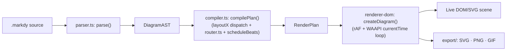
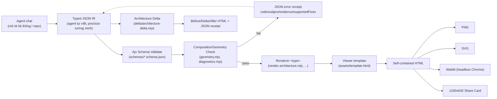
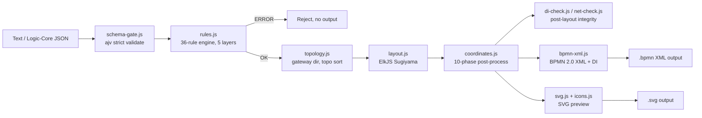
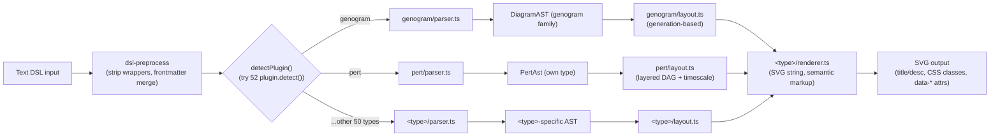

# Weekly Scan — Diagram Tooling (2026-09-15)

**Executive summary:**
- Xu hướng rõ nhất tuần này: diagram tool đang chuyển từ "text DSL → static SVG" sang hai hướng song song — (1) **animated/narrative diagrams** cho storytelling hệ thống (Markdy) và (2) **agent-authored JSON IR + validation gate** thay cho DSL truyền thống, vì AI coding agent giờ là user chính của các tool này (Archify, BPMN Generator).
- Kỹ thuật cụ thể đáng port sang kymostudio: Markdy's `allocatePortLanes`/`routeAroundObstacles` (port multiplexing + candidate-scoring obstacle routing) cho `alignment.py`/`to_svg.py`; Archify's JSON error-receipt pattern (`code/subject/evidence/supportedFixes`) và Architecture Delta diffing; SchemaTex's per-line `ParseError` với alias-table cho lỗi LLM hay gõ; BPMN Generator's 36-rule/5-layer validation engine cho BPMN import.
- Không có "chart library" hay "profile README generator" nào lọt vào list — đã loại theo tiêu chí; điểm chung 4 repo được chọn là đều có kiến trúc parser/layout/renderer thật, đọc được code, không phải vaporware.

**Mục lục:**
1. [Markdy (HoangYell/markdy-com)](#markdy-hoangyellmarkdy-com)
2. [Archify (tt-a1i/archify)](#archify-tt-a1iarchify)
3. [BPMN Generator (Stieges/bpmn-generator)](#bpmn-generator-stiegesbpmn-generator)
4. [SchemaTex (SchemaTex/SchemaTex)](#schematex-schematexschematex)

---

## Markdy (HoangYell/markdy-com)

### §1 — Quick Context
- Pitch: DSL "MarkdyScript" biên dịch text thành **animated** system-design diagrams (step-by-step "beats"), khác Mermaid/PlantUML/Excalidraw ở chỗ tập trung vào *kể chuyện hành vi hệ thống theo thời gian* (60fps WAAPI) thay vì vẽ topology tĩnh.
- Stack: TypeScript monorepo (pnpm workspaces), zero-dep compiler core (~14KB), DOM/SVG renderer dùng Web Animations API thuần (không Canvas/GSAP), Node 18+, tsup build, vitest test.
- Repo health: 95 stars / 3 forks, 724 commits trên `main`, MIT license, CI xanh (`ci.yml`: quality job build+typecheck+lint, test job matrix Node 20/22) — CI thật, không phải badge giả.
- Distribution: npm (`@markdy/core`, `@markdy/renderer-dom`, `@markdy/cli`, `@markdy/mcp-server`, `@markdy/astro`, `@markdy/mdx`, `@markdy/compat`, `@markdy/language-server`, `@markdy/stdlib-systems`), VS Code Marketplace + Open VSX extension, web playground tại markdy.com/playground.

### §2 — Architecture Deep-Dive

**A. Component inventory**
- Parser (`packages/core/src/parser.ts`, 1347 dòng) — đọc từng dòng, khớp statement patterns, ném `ParseError(line, column)` khi gặp input không hợp lệ. Có `stripComment` xử lý string-aware (không ăn nhầm `#` trong hex color), `parseProps`/`parsePropValue` parse key=value props kể cả `"..."`, số, bool, đơn vị thời gian `ms`/`s`.
- AST types (`packages/core/src/ast.ts`) — định nghĩa `DiagramAST { meta, styles, nodes, edges, groups, patterns, annotations, beats, diagnostics }` và `RenderPlan`.
- Registry (`packages/core/src/registry.ts`, 133 dòng) — bảng tra cứu tập trung: `NODE_KINDS`, `DIAGRAM_TYPES` (17 loại), `EDGE_OPERATORS` (`->`/`<-`/`~>`/`--`/`..>` → request/response/event/dependency), `NODE_ALIASES`, `CUE_ALIASES`. Đây là điểm mở rộng chính thức (doc `ARCHITECTURE.md` chỉ đích danh registry.ts khi hướng dẫn "add a new node kind/cue/flow operator").
- Compiler (`packages/core/src/compiler.ts`, 2371 dòng) — `compilePlan(ast, theme) -> RenderPlan`: gọi `computeAdaptiveDimensions`, `layoutNodes` (dispatch theo 17 `layoutX` function — `layoutRanked`, `layoutTree`, `layoutConstellation`, `layoutLoop`, `layoutMedallion`, `layoutQuadrant`, `layoutSwimlane`, `layoutPyramid`, `layoutTimeline`, `layoutGantt`, `layoutVenn`, `layoutLayers`, `layoutNested`, `layoutRadar`...), `computeGroupBoundaries`, `computeTreeBuses`, `scheduleBeats` (dựng timeline cue).
- Router (`packages/core/src/router.ts`, 490 dòng) — `routeOrthogonalEdge`, `allocatePortLanes`, `selectOptimalPorts`, `buildSmoothSvgPath`, `routeAroundObstacles`.
- Renderer DOM (`packages/renderer-dom/src/`: `diagram.ts`, `nodes.ts`, `edges.ts`, `sequence.ts`, `tree.ts`, `groups.ts`, `constellation.ts`, `theme.ts`, `geometry/`, `export/`) — `createDiagram()` là public API, chạy rAF loop set `anim.currentTime`.
- Package phụ trợ (evidence từ README/ARCHITECTURE): `@markdy/compat` (transpiler Mermaid/Docker Compose/K8s/Terraform/Draw.io), `@markdy/cli`, `@markdy/mcp-server`, `@markdy/astro`, `@markdy/mdx`, `@markdy/language-server`, `@markdy/stdlib-systems`.

**B. Pipeline (happy path)**
1. User viết `.markdy` (hoặc AI agent generate qua MCP `transpile_to_markdy`/`fix_markdy_code`).
2. `parse(source)` (parser.ts) → `DiagramAST` — chỉ parse, không layout (đúng nguyên tắc "compile-time layout" tách biệt trong ARCHITECTURE.md).
3. `compilePlan(ast, theme)` (compiler.ts) → `RenderPlan`: gán rank (Sugiyama-style), route edges qua `router.ts`, schedule cues theo timeline `beats`.
4. `createDiagram({ container, code })` (renderer-dom/diagram.ts) dựng DOM/SVG node + edge elements (nodes.ts/edges.ts), build WAAPI animations paused, chạy rAF loop set `currentTime` thủ công mỗi frame.
5. Output: DOM tương tác trong browser (playground/VS Code webview), hoặc export tĩnh qua `exportDiagramAsVectorSvg()`/`exportDiagramAsPng()`/`encodeGifSequence()`, hoặc CLI `markdy render system.markdy --out diagram.html`.

**C. Data model / IR**
Hai lớp IR tường minh: `DiagramAST` (plain object, gần với source) → `RenderPlan` (đã positioned nodes, routed edges, group boundaries, timed cues — "shape mà renderer consume"). Giống triết lý "renderer dumb" của kymostudio nhưng có 2 tầng IR rõ ràng thay vì 1 (kymostudio's `Diagram` model tương đương `RenderPlan`; output của `dsl.py:parse()` tương đương `DiagramAST`). Mutable trong compile pass (ví dụ `compilePlan` gán ngược `ast.meta.width` khi absent) — không immutable.

**D. Input language design**
Custom hand-written **line-oriented statement dispatcher** (không phải PEG/ANTLR/parser-combinator) — pattern-match từng dòng theo statement type (`scene`, `layout`, `style`, node kind, `group`, `edge`, `pattern`, `beat`), thu thập block con theo indent cho `beat`/`pattern`/`group` colon-body. Có cơ chế "indent recovery": nếu MDX/JSX strip whitespace làm mất indent, parser tự phục hồi bằng cách đọc các dòng cùng-indent tới statement top-level tiếp theo — chi tiết engineering tinh tế, giải quyết vấn đề thực tế (embed code trong template literal). Không có grammar EBNF chính thức publish (SYNTAX.md là docs dạng prose+ví dụ). Error reporting: `ParseError` có `line` (và optional `column`), strict — bất kỳ statement lạ nào đều throw.

**E. Layout algorithm**
Auto-layout, không phải user-specified toạ độ. Default (`architecture`/`flowchart`) dùng **ranked/hierarchical layout kiểu Sugiyama**: `assignRanks()` — topological sort (loại `response` edges và self-loop khỏi ranking để tránh cycle), trong mỗi rank sort theo **barycenter heuristic** để giảm crossing, tie-break theo group membership. 16 topology còn lại mỗi loại có hàm `layoutX()` riêng — library các layout chuyên biệt chứ không phải 1 engine tổng quát tham số hoá.
Edge routing: **orthogonal Manhattan routing** (`routeOrthogonalEdge`) chọn cardinal port tối ưu (`selectOptimalPorts`), sinh waypoint cố định, rồi `routeAroundObstacles` — **không phải A\* thật** mà là **candidate-generation + scoring**: sinh vài route ứng viên (waypoint gốc + 2 phương án rẽ + 1 ứng viên mỗi "corridor" quanh obstacle) rồi chọn ứng viên (fewest intersection, rồi shortest Manhattan length). Bo góc (`buildSmoothSvgPath`) dùng quadratic bezier `Q` tại mỗi waypoint. Crossing minimization chỉ ở mức barycenter heuristic, không phải Sugiyama đầy đủ 4-pha kiểu Graphviz dot.
Port multiplexing: `allocatePortLanes()` gom các edge cùng attach vào 1 cạnh node, sort theo vị trí trung tâm của node đối diện, gán lane index balance đều — giải quyết fan-in/fan-out congestion.

**F. Rendering/output**
Single primary backend: DOM/SVG overlay, không pluggable-emitter architecture kiểu kymostudio (to_svg/to_figma/to_excalidraw/to_webp side-by-side). Animation: WAAPI nhưng không dùng playback engine gốc — mọi animation tạo `paused`, rAF loop set `anim.currentTime` thủ công mỗi frame để né 2 bug cross-browser đã ghi rõ trong ARCHITECTURE.md. Export phụ: `exportDiagramAsVectorSvg()` (SVG tĩnh cho Figma), `exportDiagramAsPng()`, `encodeGifSequence()` (tự viết GIF89a encoder).

**G. Extensibility**
3 extension point tài liệu hoá rõ, đều trỏ file cụ thể: (1) node kind mới → `system-vocabulary.ts`; (2) cue mới → `registry.ts` + `parseCueLine` + `ast.ts` + `scheduleBeats` + `buildCueAnimations`; (3) flow operator mới → `registry.ts` + `ast.ts` + `themes.ts` + `renderer-dom/edges.ts`. Theme mechanism: 10 named theme tokens + `generateThemeFromBrand(hexColor)` sinh WCAG-compliant light/dark palette từ 1 màu brand.

**H. Dev experience**
CLI (`@markdy/cli`): `render`, `lint`, `format`, `import` (universal ingestion từ Mermaid/Compose/K8s/Terraform/Draw.io), `diff`, `verify --quality showcase`, `guide "<query>"`. IDE: VS Code/Cursor extension chính thức, live side-by-side preview, formatter, QuickFix, CodeLens; headless Language Server package riêng (`@markdy/language-server`) cho Neovim/Helix/Emacs — điểm kymostudio hiện chưa có. Browser preview client-side tại markdy.com/playground.

### §3 — Architecture Diagram

### §4 — Verdict
Đáng học: (1) `allocatePortLanes` — dynamic port multiplexing cân bằng nhiều edge trên cùng 1 cạnh node theo vị trí node đối diện, giải quyết fan-in/fan-out mà kymostudio's `alignment.py` mới làm 1 phần. (2) `routeAroundObstacles` dùng candidate-generation-and-score — heuristic rẻ, dễ port thay vì cài A* đầy đủ. (3) "response edges excluded from ranking" để tránh cycle — chi tiết nhỏ đáng kiểm tra `alignment.py` có xử lý tương tự không. (4) `generateThemeFromBrand(hex)` sinh theme WCAG từ 1 màu — kymostudio chưa có tương đương.
Red flags: parser không có grammar EBNF chính thức (chỉ prose docs) — rủi ro drift, khác kymostudio (DSL.md dual-sourced bắt buộc). "Universal Ingestion" và các "Advanced Engineering Superpowers" (blast radius, evolution matrix, governance) quảng bá mạnh trong README nhưng chưa verify sâu code (`diff.ts`, `arch-lint.ts`, `drift.ts`, `provenance.ts` chưa đọc) — có thể aspirational hơn thực tế.
Open questions: chất lượng thực tế của 16 layout riêng biệt; độ chín của `@markdy/compat` transpilers.
Verdict: **study deeper** phần router.ts (port multiplexing + obstacle routing) và compiler.ts rank/barycenter layout.

---

## Archify (tt-a1i/archify)

### §1 — Quick Context
- Pitch: agent viết JSON IR mô tả kiến trúc/workflow/sequence/dataflow/lifecycle, Archify compile deterministic thành 1 file HTML tự-chứa (SVG + motion + export), khác Mermaid ở chỗ có validation gate và Architecture Delta diff thay vì render-and-hope.
- Tech stack: Node.js (ESM `.mjs`), zero runtime deps ngoài `ajv` (schema validation), `parse5`/`saxes` (HTML/XML check), `simple-icons` (brand marks); không React/build framework, mọi renderer là plain ESM script.
- Repo health: ~62.3k sao (viral growth cuối Aug 2026, #1 GitHub trending), 4.1k forks, 71 issues mở, 96 PR mở, CI matrix Node 18/20/22/24 chạy `npm test`, dev version v2.17.0-dev.1, hoạt động rất tích cực (CHANGELOG unreleased có issue #330/#311/#124 mới).
- Distribution: không publish npm package — phân phối qua `npx skills add tt-a1i/archify` (Agent Skill installer) cài vào `~/.claude/skills/`, `~/.agents/skills/`… và `archify.zip` thủ công cho Claude.ai/Raven.

### §2 — Architecture Deep-Dive

**A. Component inventory**
- `archify/bin/archify.mjs` — CLI entry, sub-lệnh `render/compare/deliver/preview/validate/migrate/inspect/check/visual-check/guide/brands/doctor/demo`; định tuyến `rendererPath(type)` → `renderers/<type>/render-<type>.mjs`.
- `archify/schemas/*.schema.json` + `common.schema.json` — JSON Schema (Ajv, `additionalProperties:false`) cho 5 loại diagram, biên dịch sẵn thành `renderers/shared/generated-validators.mjs`.
- `renderers/shared/validator.mjs` — bọc Ajv, gắn `instancePath` với id/label gần nhất để lỗi đọc được (`/nodes/3 (id: "router") /label`).
- `renderers/shared/geometry.mjs` (1423 dòng, pure functions) — rect-overlap, segment-rect clearance/intersection, `automaticPortSpread`, `chosenSide`, `roundedPath`.
- `renderers/<type>/render-<type>.mjs` (+ `grid.mjs` riêng cho architecture) — 1 renderer độc lập mỗi loại diagram, build SVG string trực tiếp.
- `renderers/shared/diagnostics.mjs` — chuẩn hoá mọi lỗi thành `{code, severity, subject, evidence, supportedFixes}`.
- `delta/architecture-delta.mjs` — canonicalize + diff hai IR architecture (added/removed/changed/moved/rerouted).
- `viewer/*.js` + `template.source.html` — nguồn Viewer (search/focus/route-probe/export), build 1 lần thành `archify/assets/template.html` dùng chung cho cả 5 renderer.

**B. Pipeline (happy path)**
1. Agent viết JSON IR theo schema (`schema_version`, `diagram_type`, mảng cấu trúc, `pos`/`size` **do agent tự chọn toạ độ**, xem `examples/web-app.architecture.json`).
2. `archify validate <type> <file> --json` → Ajv schema check + renderer chạy diagnostic mode để chạy composition checks.
3. `archify deliver <type> <file> <out.html> --json` — render vào file tạm, chạy đủ bộ kiểm tra (schema + geometry + composition), chỉ pass mới atomic-replace file đích; ghi SHA-256 + byte count.
4. (Optional) `archify preview` — desktop loopback server watch file JSON, chỉ reload khi bản mới pass hết gate, giữ "last-good" khi fail.
5. `archify visual-check <out.html> --json` — headless Chrome lấy bằng chứng browser thật, tách biệt khỏi `deliver`.
6. Người dùng mở HTML tự-chứa; Viewer JS (đã gộp trong `assets/template.html`) cung cấp pan/zoom, focus, route probe, export PNG/SVG/WebM.

**C. Data model/IR**
JSON thuần, mutable trong quá trình renderer xử lý (renderer tự build layout table từ IR + geometry helpers thuần hàm), không có "lower IR" tách biệt — renderer đọc IR đã validate rồi build trực tiếp SVG string.

**D. Input language design**
Không phải text DSL, mà **typed JSON agent tự sinh**, có schema Ajv strict (`additionalProperties:false` mọi cấp) + `SKILL.md` hướng dẫn agent cách điền field. Lỗi trả structured (code/subject/evidence/supportedFixes), không phải JSON-schema message thô.

**E. Layout algorithm**
**Không auto-layout kiểu force-directed/hierarchical**: agent tự chọn `pos`/`size` tuyệt đối cho từng node. Renderer chỉ tính route (orthogonal, `via`/`channelX/Y`/`labelAt`), tự động "port spread" khi nhiều cạnh chung 1 phía, và validate hình học (không cắt qua node lạ, không route trùng hành lang) bằng `geometry.mjs`. Đây là "layout judgment" của agent + kiểm tra hình học xác định, không phải thuật toán auto-layout.

**F. Rendering/output**
Mỗi diagram type có renderer SVG riêng, cùng dùng `assets/template.html` làm khung HTML output; export PNG/SVG/WebM/JPEG ở tầng Viewer (client-side) — WebM cần Chrome headless. Architecture Delta canonicalize hai snapshot IR rồi diff theo id ổn định, xuất `compare architecture base.json head.json out.html --json`.

**G. Extensibility**
Thêm diagram type mới đòi hỏi: 1 schema JSON mới, 1 renderer `.mjs` mới đăng ký trong `TYPES` set của `bin/archify.mjs`, cập nhật `generated-validators.mjs`. Theme/preset (`classic/signal-flow/blueprint/editorial`) là field `meta.visual_preset`, xử lý trong Viewer CSS.

**H. Dev experience**
CLI JSON-first (`--json` mọi lệnh chính), mã lỗi ổn định + `supportedFixes` rõ ràng cho agent tự sửa (không đưa Node stack trace ra ngoài). Tích hợp trực tiếp làm Agent Skill cho Cursor/Claude Code/Codex CLI/opencode. `preview` là watch-mode loopback-only.

### §3 — Architecture Diagram

### §4 — Verdict
Điểm đáng học: (1) **JSON error receipt pattern** (`code/subject/evidence/supportedFixes`, exit code chuẩn) — kymostudio chưa có API lỗi máy-đọc-được tương tự cho `alignment.py`/`to_svg.py`. (2) **Architecture Delta** (canonicalize + diff theo stable id, add/remove/change/move/reroute) — concept kymostudio hoàn toàn chưa có, có thể áp dụng cho so sánh 2 `.kymo`/`Diagram` snapshot trong CI/PR review. (3) Triết lý "agent chọn toạ độ tường minh + validator hình học xác định" gần với hướng `alignment.py` của kymostudio hơn là force-directed — xác nhận hướng đi đúng.
Red flag: viral growth (62k sao) gắn nhiều với hype "Agent Skill" + docs rất dài dòng/luật lệ, nhưng code thực chất (geometry.mjs, delta, Ajv schema) khá vững, không phải vaporware.
Open question: chưa đọc kỹ toàn bộ composition rule set và cơ chế brand-marks/repository-evidence.
Verdict: **study deeper** phần Architecture Delta + JSON error receipt.

---

## BPMN Generator (Stieges/bpmn-generator)

### §1 — Quick Context
- One-line pitch: generator BPMN 2.0 enterprise chuyển text/JSON → XML+SVG qua rule engine + ElkJS, khác kymostudio's `from_bpmn.py` ở chỗ nó **tạo mới** diagram (forward-generation) chứ không phải import/parse BPMN có sẵn.
- Stack core: Node.js ESM, ElkJS (Sugiyama), bpmn-moddle/dmn-moddle, ajv, MCP SDK.
- Repo health: 43 stars, version 3.6.0, CI GitHub Actions, Jest test suite, CHANGELOG rất chi tiết (phát triển tích cực).
- Distribution: npm package `bpmn-generator` (exports `pipeline.js`, `import.js`, `validate.js`, `orchestrator.js`) + portable `.skill` ZIP cho Claude Code.

### §2 — Architecture Deep-Dive

**A. Component inventory** (đọc trực tiếp `scripts/bpmn/`):
- `pipeline.js` — orchestrator, expose `runPipeline()` + CLI.
- `schema-gate.js` — ajv draft-2020-12 strict gate (`validateLogicCoreSchema`).
- `rules.js` — rule engine (36 rules qua mảng `RULES`, mỗi rule `{id, layer, defaultSeverity, description, ref, check(proc,lc)}`).
- `topology.js` — `inferGatewayDirections`, `sortNodesTopologically`, `orderLanesByFlow`, `identifyHappyPathNodes`.
- `layout.js` — build ELK graph (`logicCoreToElk`) + `runElkLayout`.
- `coordinates.js` — 10-phase post-processing (lane bounds, pool width equalize, happy-path Y-leveling, orthogonal clipping).
- `di-check.js`, `net-check.js`/`workflow-net.js` — hậu-layout diagram integrity + Petri-net soundness (tách biệt khỏi rule engine).
- `bpmn-xml.js`, `svg.js`, `icons.js` — dual output emitters.
- `visual-refinement.js` — opt-in post-layout polish.
- `dmn/` — sibling subsystem hoàn toàn độc lập, pipeline riêng cho DMN 1.3.
- `mcp-bpmn-server.js` (4 MCP tools) + `http-server.js` (8 REST endpoints) + `orchestrator.js` (multi-agent state machine).

**B. Pipeline happy path**
1. Input: text (qua LLM, `agents/modeler.js`) hoặc JSON Logic-Core trực tiếp.
2. `validateLogicCoreSchema` (ajv) → `validateLogicCore` (36-rule engine, 5 layer) — dừng nếu có ERROR.
3. `inferGatewayDirections` + `preprocessLogicCore` (topological sort, lane/pool ordering) → `logicCoreToElk` → `runElkLayout` (ElkJS Sugiyama).
4. `buildCoordinateMap` → `simplifyAllEdges` → (opt-in) visual refinement → `routeMessageFlows` (đặt cuối vì cần vị trí pool đã chốt).
5. `generateBpmnXml` (qua bpmn-moddle) + `generateSvg` song song từ cùng `coordMap`.
6. Round-trip qua `validateBpmnXml` + `checkDiagramIntegrity`/`checkNetTranslation` làm hậu-kiểm độc lập với rule engine.

**C. Data model/IR "Logic-Core"**
JSON schema (draft 2020-12) với `oneOf` SingleProcess/Collaboration. `Node{id,type,lane,marker,attachedTo,timerExpression,loopType,multiInstance,color,...}`, `Edge{source,target,label,isHappyPath,isDefault}`, `Pool/Lane/MessageFlow`. So với kymostudio's `Diagram` dataclass: Logic-Core là **input** thô đi qua 4 phase biến đổi mutate in-place (`sortNodesTopologically` viết lại `proc.nodes` tại chỗ, ràng buộc thứ tự gọi tinh vi theo comment trong code) — kymostudio giữ model tương đối immutable hơn qua từng pass của `alignment.py`.

**D. Input language / validation**
Không có text DSL — chỉ JSON Schema + prose doc. 36 rules thật, 5 layer: Soundness S01-S15 (ERROR), Style M01-M11 (WARNING), Pragmatics P01-P03 (INFO), Workflow-Net WF01-WF03 (opt-in), Optimization O01-O04 (advisory opt-in). Mỗi rule trả `{pass, message}`. Tài liệu `fachliches-regelwerk.md` cực chi tiết, có lịch sử sửa lỗi rule kèm citation OMG spec section chính xác — mức rigor hiếm gặp.

**E. Layout**
ElkJS Sugiyama layered thật (`elk.layered`), direction RIGHT, `NETWORK_SIMPLEX`, layer constraint FIRST/LAST cho start/end event, `elk.priority`+`straightness` ưu tiên đường thẳng cho happy-path edges. Lane KHÔNG dùng ELK partitioning (rationale rõ trong comment: partition ép lane thành layer-group gây flow ngược) — lane band tính thủ công hậu-layout. Multi-pool dùng `rectpacking` rồi force-stack vertical thủ công vì ELK rectpacking tự mở cột 2 khi ≥4 participant, không khớp BPMN convention.

**F. Rendering**
XML (OMG BPMN 2.0.2 + BPMNDI, qua bpmn-moddle) và SVG (standalone, không dependency) sinh song song từ cùng `coordMap`. DMN dùng `dmn-moddle` riêng, DRD layout ElkJS riêng.

**G. Extensibility**
Rule profile JSON (`default-profile.json`, `strict-profile.json`) override severity/enable layer — config, không phải plugin code. Thêm rule mới = thêm object vào mảng `RULES`.

**H. Dev experience**
MCP server 4 tools (`generate_bpmn/validate_bpmn/import_bpmn/orchestrate_bpmn`), HTTP API 8 endpoint, orchestrator multi-agent (Modeler LLM → Reviewer → Layout → Compliance, loop tối đa 3+2 lần).

### §3 — Architecture Diagram

### §4 — Verdict
Đáng học nhất: **rule engine 36-rule/5-layer với JSON profile override** — kymostudio's `alignment.py`/`from_bpmn.py` hiện không có validation layer tách biệt kiểu này; approach "rule trả `{pass, message}` + severity theo profile" có thể áp dụng cho BPMN import validation (báo lỗi cấu trúc trước khi resolve). **ElkJS Sugiyama** đáng cân nhắc so với `alignment.py`'s auto-layout thủ công cho graph phức tạp nhiều nhánh, nhưng kymostudio's DSL-first (layout khai báo tường minh) là triết lý khác hẳn — không nên port trực tiếp. **MCP server pattern** ("LLM never touches coordinates") đáng tham khảo nếu kymostudio làm AI-authoring cho `.kymo`.
Red flag: không có DSL text thực sự (chỉ JSON), README khá "marketing" (bảng so sánh tự chấm điểm) — cần verify độc lập. Open question: chưa rõ mức test coverage thật ngoài 1 fixture 1398-case cho field-fidelity.
Verdict: **study deeper** (rule-engine design + ElkJS lane-handling), phần MCP/orchestrator chỉ glance.

---

## SchemaTex (SchemaTex/SchemaTex)

### §1 — Quick Context
- Pitch: engine "standards-as-code" cho 52 loại diagram chuyên ngành (y khoa, điện, luật, dự án…) — khác Mermaid/kymostudio ở chỗ mỗi loại implement đúng spec ngành (McGoldrick genogram, IEC 61131-3 ladder, NUREG-0492 fault tree...) thay vì generic shapes.
- Stack: TypeScript strict, hand-written parser/layout/renderer per diagram-type, 0 runtime deps.
- Health: 76 stars, 4 forks, 372 commits, 20 open issues, CI GitHub Actions + TS strict.
- Distribution: npm (`schematex`), subpath exports cho tree-shaking, React component (`schematex/react`), MCP server riêng (`@schematex/mcp`). License AGPL-3.0 (dual: commercial license bán riêng qua MyMap.ai).

### §2 — Architecture Deep-Dive

**A. Component inventory**
- `src/core/api.ts` — dispatcher trung tâm: mảng `plugins: DiagramPlugin[]` (52 entries import tường minh), `detectPlugin()` thử `plugin.detect(text)` tuần tự để suy luận diagram type từ dòng đầu.
- `src/core/types.ts` — contract `DiagramPlugin` (`type`, `detect`, `render`, `parse?`, `lint?`, `capabilities`); `DiagramAST` (individuals/relationships, dùng chung cho genogram/pedigree/ecomap/sociogram) nhưng KHÔNG phải IR toàn cục — code có comment tường minh "phylo AST tách khỏi DiagramAST vì cấu trúc khác hẳn", và `EEDiagramAST` riêng cho nhóm điện/công nghiệp.
- `src/diagrams/<type>/` — 52 thư mục độc lập, mỗi thư mục theo "5-file pattern" (`parser.ts`, `symbols.ts`, `layout.ts`, `renderer.ts`, `index.ts`). Đã đọc trực tiếp `genogram/{index,parser,layout}.ts`.
- `src/core/*` khác (tiện ích dùng chung, không phải IR): `dsl-preprocess.ts` (strip markdown code-fence, Mermaid frontmatter), `legend-parser.ts`, `source-range.ts`, `diagnostics.ts`, `editing.ts`, `theme.ts`, `svg.ts`.
- `packages/mcp/` — package `@schematex/mcp` riêng (dep `schematex` + MCP SDK + zod), 8 MCP tools, stdio transport + bản hosted schematex.js.org/mcp.

**B. Pipeline (happy path)**
1. `render(text, config?)` nhận text DSL thô.
2. Tiền xử lý: strip markdown/artifact wrapper, merge Mermaid-style frontmatter, giữ bảng `boundaries` để map offset về source gốc.
3. `detectPlugin()` — nếu `config.type` không có, duyệt tuần tự 52 plugin gọi `plugin.detect(text)` (thường regex/keyword match dòng đầu).
4. Plugin trúng gọi `parse<Type>(text)` — hand-written line-oriented parser riêng trả AST riêng của họ diagram đó.
5. `layout<Type>(ast, config)` — thuật toán layout riêng cho type đó, trả `LayoutResult`.
6. `render<Type>(layout, config, ast)` — sinh chuỗi SVG string thuần (không DOM).

**C. Data model/IR**
Không có một IR chung tuyệt đối cho cả 52 loại. Có 2-3 "họ" AST dùng chung theo domain (`DiagramAST` cho relationship-graph family; `EEDiagramAST` cho điện/công nghiệp; PERT có `PertAst` hoàn toàn riêng, không import từ core/types). Điểm chung thực sự chỉ là contract `DiagramPlugin` — mỗi plugin tự do chọn AST shape phù hợp domain.

**D. Input language design**
Parser genogram: state machine thủ công đi từng dòng, regex/string match theo token có thứ tự ưu tiên rõ ràng (comment "Longer tokens MUST come first" cho toán tử couple `~/~`, `~x~`, `-x-`), có bảng alias LLM hay dùng (`STATUS_ALIASES`: "dead"→"deceased", "stillbirth"→"stillborn"). Lỗi là class `ParseError(message, line, column, source)` với message dạng `Line X, col Y: <msg>\n → <source line>` — thật, không suy đoán. Không thấy formal EBNF trong code (grammar mô tả qua `docs/reference/*-STANDARD.md`).

**E. Layout algorithm**
Mỗi type có layout riêng biệt, không chia sẻ engine: genogram dùng generation-based family layout (`assignGenerations` → `orderNodesInGenerations` → `assignPositions`). PERT dùng layered DAG (longest-path rank làm layer, barycenter ordering, ưu tiên critical-path) + chế độ time-scaled (x ∝ Early Start, width ∝ duration, greedy lane packing), trích rõ tham chiếu `docs/reference/32-PERT-STANDARD.md §9`. Layout thuật toán gắn với chuẩn ngành cụ thể, không phải generic force-directed/dagre dùng chung.

**F. Rendering/output**
Renderer trả string SVG thuần (SSR-ready), có `role="img"`, `aria-label`, `<title>`/`<desc>` accessibility, `data-diagram-type` attribute, CSS class theo namespace (`.sx-ft-event`...) cho theming — xác nhận từ `examples/faulttree/pump-redundancy.svg` thật. SVG "background-agnostic by default", theme dark cần wrapper riêng.

**G. Extensibility**
`package.json` `exports` map có ~20 subpath export tường minh (`./genogram`, `./ecomap`, `./pert`...) nhưng KHÔNG phủ đủ cả 52 type — có thể là thiếu sót chưa update exports map theo tốc độ thêm diagram type. CONTRIBUTING.md nêu quy trình "5-file pattern" + standards doc riêng cho mỗi type mới.

**H. Dev experience**
Nguyên tắc thiết kế DSL "shaped by what LLMs get wrong" — tránh CJK quoting, ambiguous nesting, positional vs named args; mỗi type có grammar tối thiểu học được từ 1 ví dụ; error message có line number + fix suggestion (xác nhận qua `ParseError` thật). Có `llms.txt`/`llms-full.txt` cho agent. MCP server thật (8 tools, xác nhận qua package.json).

### §3 — Architecture Diagram

### §4 — Verdict
Đáng học: (1) exports map subpath per diagram-type để tree-shake (`schematex/genogram` ≈30KB) — `packages/js` của kymostudio có thể áp dụng pattern tương tự thay vì 1 bundle lớn. (2) Hand-written line-oriented parser + typed `ParseError(line, col, source)` với alias-table cho lỗi LLM hay gõ — áp dụng thẳng vào `dsl.py`/`dsl.ts` để cải thiện error UX cho AI-gen input. (3) Domain-specific layout (genogram generation-based, PERT layered-DAG+timescale) mỗi cái tham chiếu thẳng standards doc — khớp triết lý "diagram-as-code theo spec" của kymostudio.
Red flag: exports map KHÔNG cover đủ 52 diagram type (chỉ ~20) — quảng cáo "tree-shakable" nhưng chưa hoàn thiện. License AGPL-3.0 + dual commercial — khác posture của kymostudio, cần lưu ý nếu so sánh licensing.
Open questions: shared IR có được refactor dần theo family hay sẽ mãi phân mảnh khi lên >52 type? MCP server logic edit/reposition trên AST thật có audit an toàn không?
Verdict: **study deeper** — đặc biệt phần parser error-message design và exports/tree-shaking pattern, hữu ích trực tiếp cho `packages/js`.
