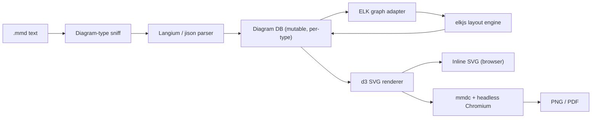
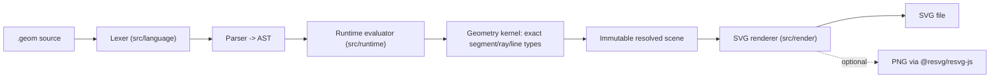
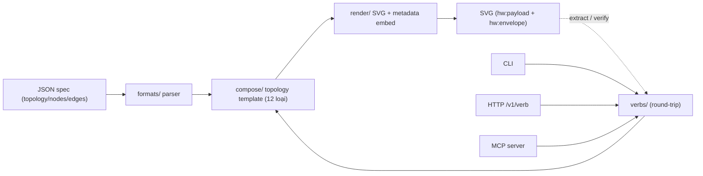
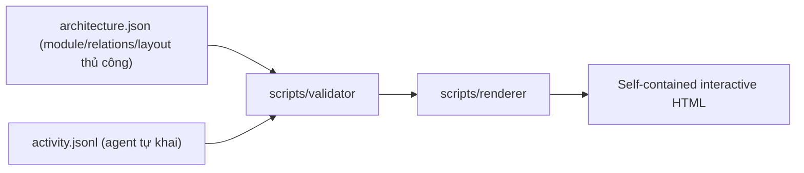

# Weekly scan — Diagram tooling & visual DSL (2026-09-16)

**Executive summary**

- Tuần này không có "diagram tool mới" nổi bật theo kiểu cổ điển (DSL + layout engine tổng quát); thay vào đó nổi lên một làn sóng "diagram-as-Claude-Code-skill" — SVG/HTML do AI agent sinh ra, tự mang theo spec/metadata để agent (hoặc chính nó) đọc lại được (`hyperweave`, `geometry-dsl`, `birdview`, `archify`).
- Sự kiện kiến trúc đáng chú ý nhất tuần là **Mermaid 12.0.0** (10/9/2026): chuyển default layout engine từ `dagre` sang **ELK**, biến Mermaid từ "1 thuật toán Sugiyama cố định" thành "adapter mỏng trên nhiều thuật toán ELK" (`layered`, `stress`, `force`, `mrtree`, `sporeOverlap`, `box`, `rectpacking`) — đây là bài học kiến trúc rõ nhất tuần này cho kymostudio.
- Ý tưởng đáng lấy nhất không nằm ở layout mà ở **round-trip**: `hyperweave` nhúng spec JSON gốc + digest hash-verified ngay trong file SVG xuất ra, để agent đọc lại chính output của mình — một pattern kymostudio chưa có, và có thể thêm mà không phá golden SVG tests nếu làm có điều kiện (đúng tinh thần gotcha "inject conditionally" đã có trong `to_svg.py`).

**Mục lục**

1. [Longlist (8-10 ứng viên)](#longlist)
2. [Deep-dive #1 — Mermaid 12.0.0 / ELK layout adoption](#deep-dive-1--mermaid-1200--elk-layout-adoption)
3. [Deep-dive #2 — shand001/geometry-dsl](#deep-dive-2--shand001geometry-dsl)
4. [Deep-dive #3 — InnerAura/hyperweave](#deep-dive-3--inneraurahyperweave)
5. [Deep-dive #4 — Qiuner/birdview](#deep-dive-4--qiunerbirdview)
6. [Ghi chú phương pháp](#ghi-chú-phương-pháp)

## Longlist

| Repo | 1 dòng | Sao | Ngôn ngữ | Trong bài |
|---|---|---|---|---|
| `mermaid-js/mermaid` (release 12.0.0) | ELK thay dagre làm default layout engine — thay đổi kiến trúc layout lớn nhất từ trước đến nay | ~80k (dự án lâu năm) | TypeScript | **Deep-dive #1** |
| `shand001/geometry-dsl` | DSL hình học Euclid chính xác (không xấp xỉ) cho agent, xuất SVG/PNG byte-identical | 2 | TypeScript | **Deep-dive #2** |
| `InnerAura/hyperweave` | CLI/HTTP/MCP sinh SVG diagram/table cho agent, tự nhúng spec + hash digest để round-trip | 43 | Python | **Deep-dive #3** |
| `Qiuner/birdview` | "Vẽ bản đồ kiến trúc trước khi code" — validate scope thay đổi của agent so với `architecture.json`, xuất HTML tương tác | 286 | JavaScript | **Deep-dive #4** |
| `tt-a1i/archify` | Agent skill sinh 5 loại diagram (architecture/workflow/sequence/data-flow/lifecycle) thành HTML tự chứa có "Delta mode" so sánh trước/sau | 63.7k (tăng bất thường, xem ghi chú) | JavaScript | Chỉ liệt kê — xem red flag ở dưới |
| `danchurko/topoform` | Skill offline-first chuyển JSON model đã validate thành diagram HTML tương tác | 0 | Python | Chỉ liệt kê — quá mới, chưa đủ evidence kiến trúc |
| `isatimur/excalidraw-skill-pack` | Skill pack gọi Excalidraw từ nhiều agent client (Claude Code, Cursor, Codex, Gemini CLI) | 4 | TypeScript | Loại — wrapper mỏng quanh Excalidraw có sẵn, gần với exclusion "generic SVG editor" |
| `nordstad/PinViz` | Sinh sơ đồ đấu nối GPIO dạng SVG từ khai báo | 5 | Python | Loại — quá hẹp (domain-specific GPIO), ít giá trị kiến trúc chung |
| `No1Joon/archdraw` | Sinh cloud architecture diagram từ YAML, 4,462+ icon | 0 | — | Loại — 0 sao, chưa đủ tín hiệu trưởng thành để đọc sâu tuần này |
| `vadbosh/d2-diagram` | Skill wrapper: mô tả bằng D2, render ra PNG cho Claude Code | 0 | Shell | Loại — chỉ là script gọi D2 CLI có sẵn, không có kiến trúc riêng |

Không đưa `plantuml/plantuml` vào deep-dive dù có push trong tuần: đây là commit bảo trì định kỳ trên dự án đã ổn định nhiều năm, không phải "significantly updated" theo tiêu chí kiến trúc.

## Deep-dive #1 — Mermaid 12.0.0 / ELK layout adoption

### §1 Quick context

Mermaid không phải tool mới, nhưng bản 12.0.0 (10/9/2026) là thay đổi kiến trúc layout lớn nhất kể từ khi dự án tồn tại: **ELK (Eclipse Layout Kernel) thay `dagre` làm layout engine mặc định** cho flowchart/state/class/ER/requirement/use-case. Stack: TypeScript monorepo (nhiều package: `mermaid`, `parser`, `mermaid-layout-elk`, `mermaid-layout-tidy-tree`, `tiny`, `mermaid-zenuml`), render bằng d3 lên SVG DOM. Dự án lâu năm, nhiều contributor, release đều đặn; distribution qua npm (nhiều gói tách nhỏ), CLI `mmdc` dùng headless Chromium để xuất PNG/PDF.

### §2 Architecture deep-dive

**A. Component inventory**
- Parser đa dạng theo diagram type (`packages/parser`) — đang chuyển dần từ jison (LALR) sang **Langium** (parser generator TS-native có LSP).
- Diagram "DB" — mỗi diagram type (`packages/mermaid/src/diagrams/*`) giữ 1 model mutable riêng, populate lúc parse.
- Layout engine tách gói riêng: `packages/mermaid-layout-elk` (wrap `elkjs`), `packages/mermaid-layout-tidy-tree`, cộng `dagre`-wrapper built-in.
- Renderer d3 (`packages/mermaid/src/dagre-wrapper` và tương đương) — vẽ SVG từ tọa độ layout trả về.

**B. Pipeline** (từ `.mmd` text đến output):
1. `mermaid.render(id, text)` (hoặc CLI `mmdc`) nhận text.
2. Sniff diagram type (frontmatter/từ khóa mở đầu) → chọn parser tương ứng (Langium hoặc jison) → dựng "diagram DB" (model nội bộ, mutable, per-diagram-type).
3. DB được adapter chuyển thành 1 ELK graph JSON (nodes/ports/edges/layoutOptions) — layout engine chọn qua config `layout:` (mặc định `elk` từ 12.0.0).
4. `elkjs` chạy thuật toán layout, trả tọa độ; adapter map ngược tọa độ vào DB.
5. Renderer d3 vẽ SVG dựa trên DB đã có tọa độ.
6. Output: SVG DOM inline (trình duyệt) hoặc `mmdc` chụp qua headless Chromium ra PNG/PDF/SVG file.

**C. Data model / IR**: mỗi diagram type có 1 "DB" singleton riêng (không có model hợp nhất toàn hệ thống) — đây là smell kiến trúc tồn tại lâu năm, sống sót qua cả lần refactor layout này. Không có khái niệm hạ tầng "compile xuống IR thấp hơn" kiểu TALA của D2; adapter ELK chỉ là 1 tầng dịch DB ↔ ELK-graph, không phải IR trung gian bền vững.

**D. Input language design**: không có 1 grammar EBNF cho toàn ngôn ngữ — mỗi diagram type có grammar riêng. Đang chuyển dần từ jison sang Langium; Langium mang lại error reporting tốt hơn hẳn (line/column thật, LSP-ready) so với thông báo lỗi cộc lốc của jison.

**E. Layout algorithm**: đây là điểm chính của release. Trước 12.0.0, `dagre` (Sugiyama layered + network-simplex ranking) là lựa chọn gần như duy nhất. Từ 12.0.0, ELK trở thành mặc định và lộ ra hẳn menu thuật toán qua config: `elk.layered` (Sugiyama họ hàng, nhưng nhiều pha crossing-minimization/node-placement có thể tinh chỉnh hơn dagre), `elk.stress`, `elk.force` (force-directed), `elk.mrtree`, `elk.sporeOverlap`, `elk.box`, `elk.rectpacking`. Edge routing orthogonal qua router riêng của ELK. Crossing minimization vẫn thuộc họ Sugiyama nhưng nay là của ELK, không phải cài cắm tay trong Mermaid.

**F. Rendering / output**: chỉ 1 backend thật sự — SVG qua d3 trong DOM; PNG/PDF là ảnh chụp màn hình qua headless browser (`mmdc`), không có rasterizer native. Không animation built-in. Điểm hay: **layout engine là pluggable** (đăng ký qua interface, tự "self-register" khi import gói `mermaid-layout-elk`), trong khi renderer thì không pluggable — tách biệt 2 mối quan tâm rất rõ.

**G. Extensibility**: 2 cơ chế plugin riêng biệt — (1) `registerDiagram` cho diagram type mới (minh chứng: `mermaid-zenuml`, `mermaid-example-diagram` là các gói ngoài tự đăng ký); (2) đăng ký layout engine mới cùng cơ chế self-register (minh chứng: `mermaid-layout-elk`, `mermaid-layout-tidy-tree` là gói npm riêng). Theme qua config biến, release này đổi theme mặc định sang "neo/redux-color".

**H. Dev experience**: CLI `mmdc` + live editor (mermaid.live); nhiều VS Code extension cộng đồng. Không có watch mode chính thức trong core lib (để bundler/dev-server lo). Ghi chú tốt: release notes cung cấp escape hatch rõ ràng (`layout: dagre, theme: default, look: classic`) để giữ hành vi cũ — communication về breaking change làm khá chuẩn mực.

### §3 Architecture diagram

### §4 Verdict

Đáng học nhất: **mô hình layout-engine pluggable** — Mermaid tách hẳn "diagram DB → generic graph → chạy engine → map tọa độ ngược" thành 1 tầng adapter mỏng, cho phép cắm nhiều thuật toán (Sugiyama/stress/force/tree/box) sau CÙNG MỘT config key. `kymostudio` hiện `layout.py`/`layout.ts` chỉ có auto-layout frame tự viết; nếu muốn thêm thuật toán layout thứ hai trong tương lai, pattern "adapter sang graph chuẩn rồi map ngược" của Mermaid là tham khảo tốt hơn là viết thuật toán mới trực tiếp vào `alignment.py`.

Red flag: breaking change (đổi layout + theme mặc định cùng lúc) có thể khiến diagram nhúng trong docs của bên thứ 3 (kể cả `docs.kymo.studio` nếu có nhúng Mermaid qua CDN không pin version) tự đổi hình dạng/màu sắc mà không ai chủ động thay đổi gì — nên kiểm tra nếu kymostudio có nhúng Mermaid live-render ở đâu đó. Global mutable "DB" per diagram type là smell cũ, sống sót qua refactor này.

Open question: chưa đọc code adapter DB↔ELK thật (chỉ xác nhận sự tồn tại qua tên gói + release notes), nên chưa rõ mức độ dễ mở rộng thực tế của adapter này.

**Verdict: study deeper** (riêng phần adapter layout-engine, không cần đọc toàn bộ Mermaid).

## Deep-dive #2 — shand001/geometry-dsl

### §1 Quick context

DSL hình học Euclid thuần túy cho AI agent: khai báo điểm/đường/đường tròn bằng tọa độ và ràng buộc hình học (circumcircle, intersect, project...), tính toán **chính xác** (không xấp xỉ số tích lũy) rồi xuất SVG/PNG **byte-identical** mỗi lần chạy. Stack: TypeScript, zero runtime dependency, PNG qua `@resvg/resvg-js` (optional). Repo cực mới (2 sao, 1 commit ghi nhận được) — chưa có bằng chứng CI/test, "không xác định". Chưa thấy dấu hiệu publish npm; đi kèm `SKILL.md` cho thấy đây là gói dưới dạng Claude-Code/OpenAI-agent skill hơn là sản phẩm CLI độc lập.

### §2 Architecture deep-dive

**A. Component inventory**
- `src/language` — lexer + parser thuần cú pháp.
- `src/runtime` — resolve tên, type-check, xử lý overload (vd. `line()` nhận 2 điểm hoặc điểm+góc).
- `src/geometry` — kernel số học hình học độc lập platform, phân biệt rõ đoạn thẳng/tia/đường thẳng vô hạn làm 3 kiểu riêng.
- `src/render` — bố trí nhãn tránh chồng lấn (deterministic text layout), boolean region bằng exact arc-mask, xuất SVG.
- `src/cli.ts` — entry point Node.
- `docs/spec.md` — tài liệu ngôn ngữ (chưa đọc được nội dung, không xác nhận có phải EBNF hình thức).

**B. Pipeline** (đường đi hạnh phúc):
1. Agent chạy CLI, vd. `geometry-dsl render triangle.geom -o triangle.svg`.
2. `src/cli.ts` đọc file `.geom`, gọi `parse(source)` → AST.
3. `evaluate(ast)` trong `src/runtime`: resolve định danh (`A`, `AB`, `circumcircle`...), type-check, gọi `src/geometry` để tính giao điểm/chiếu/biến đổi chính xác.
4. Kết quả là 1 "scene" bất biến — tập entity đã resolve tọa độ + style.
5. `renderSvg(scene)` bố trí nhãn, dựng boolean region bằng arc-mask chính xác, sinh SVG.
6. (Tùy chọn) convert SVG → PNG qua `@resvg/resvg-js`.

**C. Data model / IR**: AST (output parser) → "scene" bất biến (immutable) sau evaluate — mỗi phép toán (`project`, `intersect`, `transform`) tạo entity mới thay vì mutate, xác nhận qua mô tả README. Không có khái niệm hạ IR xuống 1 tầng thấp hơn kiểu D2's TALA — pipeline chỉ 2 tầng: AST → scene → SVG.

**D. Input language design**: lexer/parser tự viết (thư mục `src/language` riêng, không thấy dùng ANTLR/PEG.js/parser-combinator có sẵn) — cách tiếp cận custom recursive-descent nhiều khả năng. Không có EBNF hiển thị trong README (có `docs/spec.md` riêng, chưa đọc được). Error reporting là điểm mạnh rõ nhất: `GeometryDslError` typed, mang line/column + mã lỗi ổn định — thiết kế rõ ràng để agent tự sửa lỗi trong vòng lặp kín (parse → lỗi → agent sửa → parse lại), khác hẳn triết lý "lỗi cho người đọc" thông thường.

**E. Layout algorithm**: không áp dụng theo nghĩa graph-layout — đây là DSL hình học Euclid, vị trí do người dùng khai báo tường minh qua tọa độ và ràng buộc (circumcircle của 3 điểm, giao điểm 2 đường...). Không có auto-layout/edge-routing/crossing-minimization vì bản chất không phải node-edge diagram.

**F. Rendering / output**: SVG là target chính, PNG optional qua resvg. Không animation. 1 renderer duy nhất, không có pluggable emitter.

**G. Extensibility**: ~15 "core function" trực giao (point/line/circle/arc/path/project/intersect/transform/mark/text/inside/union/intersection/difference) — thêm hàm mới đòi hỏi sửa trực tiếp `runtime` + `geometry`, không có plugin system. Style qua tham số inline (`color=`, `width=`) trên từng entity, không có theme file tách riêng.

**H. Dev experience**: CLI tối giản, điểm mạnh là lỗi có mã ổn định phục vụ agent tự sửa — nhưng đây là DX hướng agent, không hướng người. Không có VS Code extension/LSP, watch mode, hay browser preview — hợp lý vì repo còn quá mới.

### §3 Architecture diagram

### §4 Verdict

Đáng học nhất: tách hẳn **3 kiểu hình học riêng** — đoạn thẳng / tia / đường thẳng vô hạn — thay vì xấp xỉ tất cả bằng cặp điểm, tránh lỗi cộng dồn sai số. `alignment.py`/`alignment.ts` của kymostudio cũng làm nhiều phép "resolve" hình học (anchor point, auto-bounds, edge staggering) bằng số thực; tách rõ "exact representation" (trước rasterize) khỏi "rendered coordinates" (sau rasterize) như repo này làm là hướng đáng cân nhắc nếu kymostudio từng gặp lỗi làm tròn tích lũy trong pipeline layout → SVG.

Điểm hay thứ hai: error type ổn định (mã lỗi + line/col) thiết kế riêng cho vòng lặp tự-sửa của agent — ý tưởng UX lỗi này áp dụng được cho `kymo` CLI nói chung (không chỉ khi dùng qua agent), vì hiện tại `dsl.py`/`dsl.ts` parse lỗi cũng cần phân biệt được rõ để người dùng (hoặc agent) tự sửa `.kymo` file.

Red flag: repo quá non (2 sao, có thể chỉ 1 commit) — không có bằng chứng test suite hay CI thực chất, độ ổn định chưa kiểm chứng được.

Open question: `docs/spec.md` có phải grammar hình thức thật không — chưa fetch được nội dung file này.

**Verdict: glance only** cho toàn repo (quá sớm để đầu tư đọc sâu), nhưng ý tưởng "kiểu hình học exact tách 3 loại" đáng ghi riêng vào backlog tham khảo cho `alignment.py`/`alignment.ts`.

## Deep-dive #3 — InnerAura/hyperweave

### §1 Quick context

CLI/HTTP/MCP sinh SVG diagram, table, và "receipt" (visualize token usage của agent session) — điểm khác biệt chính so với các tool khác trong domain: **mỗi SVG output tự mang theo spec JSON gốc + digest hash-verified nhúng bên trong**, để agent (hoặc chính hyperweave) đọc lại/verify được chính output của mình. Stack: Python, tự nhận "zero JavaScript, no runtime, no dependencies" ở phía consume (SVG thuần render bằng `` tag); Apache-2.0, 43 sao / 7 forks / 197 commit trên main — hoạt động đều nhưng cộng đồng nhỏ. Chưa xác nhận publish PyPI (không xác định).

### §2 Architecture deep-dive

**A. Component inventory** (từ cây thư mục `src/hyperweave/`):
- `formats/` — parse JSON spec đầu vào (topology, orientation, nodes, edges).
- `compose/` — hiện thực 12 "topology" layout template cố định: pipeline, fanout, fanin, hub, cycle, loop, dag, lanes, state-machine, sequence, tree, comparison.
- `render/` — xuất SVG, nhúng metadata 2 lớp (`hw:payload` = JSON đầy đủ, `hw:envelope` = digest ~200 token kèm sha256).
- `verbs/` — dispatch lệnh dùng chung: `compose` (spec→artifact), `transform` (patch JSON), `extract` (đọc payload/envelope ngược từ SVG), `verify` (kiểm hash), `diff`, `query`.
- `serve/` + `mcp/` — expose cùng bộ `verbs` qua HTTP `/v1/{verb}` và MCP server.
- `templates/` — 4 "genomic system" theme (Primer/Brutalist/Automata/Chrome), 45+ biến thể.
- `cli.py` / `__main__.py` — entry point CLI.

**B. Pipeline**:
1. Agent chạy `hyperweave compose diagram --spec-file dag-mesh.json -g primer -o output.svg`.
2. `verbs/compose` đọc spec qua `formats/`.
3. `compose/` chọn 1 trong 12 topology template, tính vị trí node/edge theo template đó (không phải auto-layout tổng quát mà là công thức bố trí cố định theo tên topology).
4. `render/` vẽ SVG theo theme, nhúng `hw:payload` + `hw:envelope`.
5. File SVG xuất ra; agent khác chạy `hyperweave extract`/`verify` để đọc lại spec/hash ngay từ file SVG đó — vòng lặp round-trip khép kín.

**C. Data model / IR**: input là JSON spec thuần (dict); "không xác định" có dataclass/class nội bộ riêng trong `core/` hay không (chưa đọc trực tiếp source Python). Điểm đặc biệt nhất: **SVG output được coi như 1 tầng lưu trữ IR có thể đọc lại** (round-trip qua metadata nhúng) — khác hẳn cách các tool khác (kể cả kymostudio) coi SVG chỉ là sản phẩm cuối, không phải nguồn dữ liệu để đọc lại.

**D. Input language design**: không phải text DSL mà là JSON schema theo từng "artifact class" (diagram/matrix/receipt), field cố định (`topology`, `orientation`, `nodes`, `edges`). Không có grammar EBNF (đúng bản chất, vì input là structured data chứ không phải cú pháp tự do). Error reporting: không xác định (chưa có evidence rõ trong các trang đã đọc).

**E. Layout algorithm**: 12 template topology cố định thay vì 1 engine layout tổng quát — mỗi topology có công thức bố trí riêng theo tên gọi (pipeline = tuyến tính, hub = xoay quanh 1 node trung tâm, tree = phân cấp, dag = layered). Không có bằng chứng về thuật toán crossing-minimization học thuật (barycentric/ILP) — nhiều khả năng đây là geometry template đơn giản, không phải graph-layout solver; chi tiết thuật toán bên trong từng topology: không xác định (chưa đọc source `compose/`).

**F. Rendering / output**: SVG duy nhất, chủ đích "zero JavaScript, no runtime" để tương thích `` tag ở mọi nơi (README, Slack, email). Không animation. 1 renderer chung phục vụ 3 artifact class (diagram/matrix/receipt).

**G. Extensibility**: theme qua 4 "genomic system" (tên gọi khác lạ nhưng bản chất là style preset, 45+ biến thể) — dễ chọn qua flag `-g`. Thêm topology/artifact class mới cần sửa code lõi (`compose/`), không thấy plugin system công khai.

**H. Dev experience**: điểm mạnh nhất trong nhóm scan tuần này — 3 entry point (CLI, HTTP `/v1/{verb}`, MCP server) dùng chung 1 bộ `verbs`, thiết kế "verb-oriented" khá sạch cho tool hướng agent, dễ thêm giao diện thứ 4 (vd. gRPC) mà không đụng logic lõi. Không thấy watch mode/browser preview; không LSP/VS Code extension.

### §3 Architecture diagram

### §4 Verdict

Đáng học nhất (của cả 4 repo tuần này): **nhúng spec gốc + digest hash-verified ngay trong SVG xuất ra**. Kymostudio hiện xuất SVG "câm" — chỉ để xem, không mang thông tin nguồn. Có thể thêm 1 khối `<metadata>` (hoặc comment XML) chứa digest của `.kymo` source / model đã resolve vào `to_svg.py`/`renderSVG`, miễn làm **có điều kiện** (chỉ khi bật 1 flag, vd. `--embed-source`) để không phá golden SVG byte-for-byte hiện có — đúng tinh thần gotcha đã ghi trong CLAUDE.md ("inject feature-specific CSS/defs conditionally"). Lợi ích: debug dễ hơn (biết SVG này sinh từ commit/model nào), và mở đường cho tool bên ngoài "đọc ngược" 1 SVG kymo đã render.

Điểm hay thứ hai: layout bằng template cố định theo tên topology (thay vì luôn giải bài toán layout tổng quát) — nhắc lại rằng với các trường hợp phổ biến (pipeline, hub-and-spoke, layered dag), một bộ preset đơn giản có khi thực dụng hơn 1 engine tổng quát.

Red flag: cộng đồng rất nhỏ, chưa xác nhận test coverage/CI thực chất; đặt cược hoàn toàn vào "AI agent" là người dùng chính — thị trường ngách, rủi ro duy trì lâu dài chưa rõ.

Open question: thuật toán bố trí cụ thể bên trong từng topology (đặc biệt `dag` và `lanes`, gần nhất với nhu cầu của kymostudio) — chưa đọc source `compose/` để xác nhận.

**Verdict: study deeper** phần round-trip metadata embedding; phần layout template — glance only.

## Deep-dive #4 — Qiuner/birdview

### §1 Quick context

"Vẽ bản đồ kiến trúc trước khi code": agent phải khai báo `architecture.json` (module, trách nhiệm, ownership, quan hệ) và tự log `activity.jsonl` (phạm vi đã sửa) — birdview validate 2 nguồn này khớp nhau rồi xuất 1 file HTML tương tác duy nhất. Đây không phải diagram tool thuần mà là "architecture-as-contract" cho quy trình code bằng AI. Stack: Node.js 18+/JavaScript, JSON Schema làm input, MIT, 286 sao / 20 forks — traction rõ hơn hẳn `hyperweave`/`geometry-dsl` trong nhóm scan tuần này. Latest release v0.2.0; README ghi rõ "package remains private" (chưa publish npm).

### §2 Architecture deep-dive

**A. Component inventory**
- `schemas/` — JSON Schema cho `architecture.json` và `activity.jsonl`.
- `scripts/` (validator + renderer) — validator kiểm cross-record rule (module ID ổn định, file ownership, tính nhất quán); renderer gộp dữ liệu thành HTML.
- `assets/` — viewer template (đóng gói JS/CSS vào HTML tĩnh), routing nội bộ dạng SPA, localization song ngữ Anh/Trung.
- `examples/` — bộ mẫu `architecture.json`, `activity.jsonl`, và biến thể theo "harness" khác nhau (deepseek-harness, bilingual...).

**B. Pipeline**:
1. Người dùng/agent viết `architecture.json` (module, trách nhiệm, ownership, evidence, quan hệ, `layout` thủ công theo row/column).
2. Trong lúc agent làm việc, nó tự append `activity.jsonl` (target files đã sửa, verification record).
3. Chạy validator: đối chiếu `activity.jsonl` với `architecture.json` theo module ID ổn định (ownership, tính nhất quán).
4. Renderer gộp 2 nguồn thành 1 file HTML tĩnh, tự chứa toàn bộ viewer.
5. Mở HTML: xem kiến trúc, xem thay đổi hiện tại overlay lên bản đồ, so sánh trước/sau, lọc quan hệ giữa module.

**C. Data model / IR**: 2 tài liệu JSON độc lập, liên kết bằng "stable module ID" — không có 1 IR hợp nhất; validator "resolve" bằng cách join 2 file theo ID tại thời điểm render. `activity.jsonl` là log append-only bất biến theo thời gian (JSON Lines), không mutate.

**D. Input language design**: JSON Schema thuần (file trong `schemas/`) đóng vai trò "formal grammar" — không phải text DSL. Error reporting: validator trả "cross-record rule" nhưng nội dung message cụ thể — không xác định (chưa đọc source validator trực tiếp).

**E. Layout algorithm**: đây là điểm khác biệt lớn nhất so với 3 repo còn lại — `architecture.json` có field `layout` với `row`/`column` khai báo **thủ công** (xác nhận qua ví dụ module `workbench` đọc được), **không có auto-layout engine nào cả**. Không edge routing/crossing-minimization vì vị trí đã cố định bởi người khai báo.

**F. Rendering / output**: chỉ xuất 1 file HTML tự chứa; định dạng vẽ vector cụ thể bên trong (SVG hay Canvas) — không xác định (README không nói rõ, chưa đọc source renderer). Không animation dạng SMIL/CSS, nhưng có tương tác qua JS (route tracing, upstream/downstream reach analysis, step qua activity timeline).

**G. Extensibility**: thêm module/quan hệ mới chỉ cần sửa JSON theo schema có sẵn — không cần code. Thêm loại view/tương tác mới cần sửa `assets/` (viewer template) trực tiếp; không có plugin system.

**H. Dev experience**: không thấy CLI polish rõ ràng ngoài `scripts/` gọi trực tiếp — không xác định mức độ thân thiện. Không watch mode (README ghi rõ "updates require HTML regeneration" — phải chạy lại renderer thủ công mỗi lần). Không cần server để xem: mở file HTML trực tiếp chính là "browser preview".

### §3 Architecture diagram

### §4 Verdict

Đáng học nhất: coi "kiến trúc khai báo" và "hoạt động/thay đổi thực tế" là 2 nguồn dữ liệu tách biệt, join bằng ID ổn định, rồi **validate tính nhất quán trước khi render** — hướng "architecture-as-contract, validated before merge" có thể là ý tưởng ứng dụng cho chính kymostudio (vd. một `.kymo` diagram mô tả kiến trúc `packages/python` ↔ `packages/js` có thể validate tự động xem có khớp cấu trúc thư mục thật không), dù đây là ý tưởng ứng dụng chứ không phải kỹ thuật render/layout mới.

Điểm đáng chú ý thứ hai: layout hoàn toàn thủ công (row/column) — nhắc lại rằng nhiều tool hữu ích trong domain này KHÔNG cần auto-layout; giá trị nằm ở data model + validation, không phải thuật toán vẽ.

Red flag: chưa publish npm ("package remains private") — độ trưởng thành sản phẩm còn thấp; dữ liệu "activity" hoàn toàn do agent tự khai báo (declared, không tự động quan sát), dễ sai lệch nếu agent khai báo sai hoặc gian dối.

Open question: định dạng vẽ vector bên trong HTML (SVG hay Canvas) — chưa xác nhận được từ các trang đã đọc.

**Verdict: glance only** cho phần render; đáng đọc kỹ hơn phần JSON Schema + validator cross-record nếu kymostudio từng cân nhắc tính năng "diagram phải khớp code thật" (living architecture diagram).

## Ghi chú phương pháp

- Không có quyền truy cập `gh` CLI hay GitHub REST API trực tiếp trong phiên này (session bị giới hạn phạm vi vào repo `kymostudio/kymostudio`); dữ liệu tuần này thu thập qua tìm kiếm web + đọc trực tiếp trang GitHub (README, cây thư mục, file mẫu) bằng công cụ fetch trang, cross-check giữa 2 truy vấn độc lập cho phần longlist (số liệu sao/mô tả khớp nhau giữa 2 lần fetch).
- `tt-a1i/archify` bị loại khỏi deep-dive dù nội dung README hấp dẫn (đúng domain kymostudio: HTML tự chứa + "motion"): tốc độ tăng sao (63.7k sao nhưng chỉ 193 watcher, không tương xứng) là bất thường và **chưa được xác minh độc lập** — cần kiểm tra lại vào lần scan sau trước khi đầu tư đọc sâu.
- Vài chi tiết ("không xác định") là do trang đã fetch không hiển thị đủ nội dung file nguồn (vd. `docs/spec.md` của `geometry-dsl`, nội dung `scripts/validator` của `birdview`) — không suy diễn để tránh bịa evidence, theo đúng yêu cầu của task.
