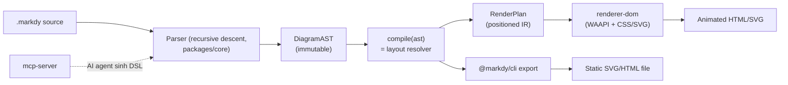
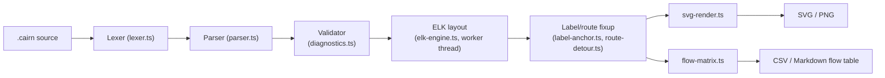
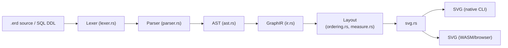
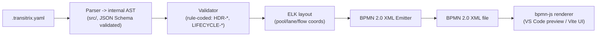

# Weekly Diagram Tooling Scan — 2026-09-18

> Ghi chú phương pháp: GitHub MCP trong phiên này chỉ được scope vào `kymostudio/kymostudio`, nên toàn bộ nghiên cứu repo bên ngoài dưới đây dùng `WebSearch`/`WebFetch` (đọc trang GitHub public, README, commit log) thay vì `gh api search/repositories`. GitHub không cho search theo "pushed trong 7 ngày" qua web UI thông thường, nên độ chính xác "trong 7 ngày qua" là best-effort dựa trên ngày commit/release gần nhất quan sát được, có ghi chú độ không chắc chắn ở từng repo.

## Tóm tắt điều hành

- **Markdy** (animated architecture diagrams as code, Web Animations API + 17 layout engine) là repo gần kymostudio nhất về mục tiêu ("DSL → animated SVG"), và có hoạt động sát nhất (release v1.5.0 ngày 13/9, commit mới nhất 17/9/2026) — đáng nghiên cứu sâu nhất trong tuần này.
- Ba repo còn lại đại diện ba khía cạnh khác kymostudio cần tham khảo: **Cairn** (ELK-based layout với overlap-prevention nghiêm ngặt cho enterprise-scale diagram), **rusterd** (Rust → WASM compiler với IR/layout/renderer tách bạch, phân phối đa nền tảng giống mô hình Python+JS+Rust của kymostudio), và **Transitrix Studio** (YAML DSL biên dịch ra BPMN 2.0 XML qua ELK layout — cùng bài toán cross-format với `from_bpmn.py`/`from-bpmn.ts` của kymostudio).
- Điểm chung đáng chú ý: cả 4 repo đều tách rõ **parse → IR/AST → layout → render**, và 3/4 dùng ELK hoặc engine layout ngoài thay vì tự viết constraint solver — gợi ý kymostudio nên tiếp tục tự giữ layout engine tối giản riêng (alignment.py 5-pass) nhưng có thể học cách họ expose layout hint/overlap-diagnostics cho người dùng.

## Mục lục

1. [Markdy — animated architecture diagrams as code](#1-markdy--animated-architecture-diagrams-as-code)
2. [Cairn — diagram-as-code CLI với ELK layout & overlap prevention](#2-cairn--diagram-as-code-cli-với-elk-layout--overlap-prevention)
3. [rusterd — ER diagram DSL compiler (Rust → WASM)](#3-rusterd--er-diagram-dsl-compiler-rust--wasm)
4. [Transitrix Studio — YAML-to-BPMN 2.0 authoring tool](#4-transitrix-studio--yaml-to-bpmn-20-authoring-tool)
5. [Các repo khác đã khảo sát (không deep-dive)](#5-các-repo-khác-đã-khảo-sát-không-deep-dive)

---

## 1. Markdy — animated architecture diagrams as code

**Nguồn:** https://github.com/HoangYell/markdy-com · https://markdy.com

### §1 Quick context

Markdy biên dịch một DSL `.markdy` thành motion graphics 60fps chạy bằng Web Animations API thay vì video/GIF, khác Mermaid/D2 ở chỗ diagram là **choreography theo "beat" theo thời gian** chứ không chỉ là snapshot tĩnh. Tech stack: TypeScript monorepo (pnpm workspaces), renderer thuần CSS/SVG transform + WAAPI (không Canvas, không GSAP), core parser ~14 kB zero-dep. Repo health: 96 sao, 3 fork, MIT, release gần nhất v1.5.0 (13/9/2026), commit mới nhất 17/9/2026, có CI + visual-regression test (Pixelmatch) + performance gate. Phân phối qua npm scope `@markdy/*` (cli, mcp-server, core, renderer-dom, language-server) và VS Code Marketplace/Open VSX.

### §2 Architecture deep-dive

**A. Component inventory** (theo cấu trúc `packages/` quan sát từ README): `core` (`packages/core`) — parser + compiler + AST engine; `renderer-dom` (`packages/renderer-dom`) — motion-graphics renderer dùng WAAPI; `cli` (`packages/cli`) — terminal render/lint/import; `mcp-server` (`packages/mcp-server`) — MCP tool cho Claude/Cursor; `language-server` (`packages/language-server`) — LSP headless cho editor khác; `compat` (`packages/compat`) — transpiler từ Mermaid/Docker Compose/K8s/Terraform/Draw.io; `vscode` (`packages/vscode`) — extension.

**B. Pipeline** — 5 bước "happy path" từ `npx @markdy/cli render diagram.markdy --out diagram.html`: (1) CLI đọc file `.markdy`; (2) `core` parse recursive-descent theo indentation thành `DiagramAST` bất biến (immutable); (3) `compile(ast)` resolve layout, trả về `RenderPlan` — IR đã có toạ độ, edge đã route, group boundary, cue theo beat; (4) `renderer-dom` khởi tạo DOM/SVG node + đăng ký WAAPI animation cho từng cue; (5) xuất file HTML/SVG tĩnh (CLI) hoặc mount trực tiếp DOM (Astro/MDX/browser).

**C. Data model/IR** — Có khái niệm "compile xuống IR thấp hơn" rõ ràng, giống ý tưởng TALA của D2: `DiagramAST` (bất biến, sát cú pháp nguồn) → `RenderPlan` (đã layout-resolved, mang toạ độ tuyệt đối, route edge, group bounds, beat/cue timeline). Tách hai pha này cho phép compiler thay layout engine mà không đụng renderer.

**D. Input language design** — Parser là **recursive descent có nhận biết indentation** (không regex/PEG/ANTLR): match theo statement pattern (`scene`, `layout`, `node`, `edge`, `beat`...) rồi thu các dòng con thụt lề làm cue/member. Lỗi cú pháp ném `ParseError(lineNumber)` — line-numbered, strict; có cơ chế fallback phục hồi khi thân khối colon bị de-indent (hay gặp trong MDX). Không thấy EBNF chính thức, nhưng có `docs/SYNTAX.md` làm reference.

**E. Layout** — Layout **compile-time, deterministic**, không phải force-directed hay ILP crossing-minimization tường minh; 17 "layout engine" chuyên biệt theo domain (distributed system, security layer, data pipeline...) gán rank vị trí node, kích thước canvas auto snap theo lưới 16px dựa trên topology/số node. Edge routing là **orthogonal có tránh vật cản** qua hàm `routeOrthogonalEdge()`; sequence diagram dùng lifeline geometry riêng. Không có bước crossing-minimization kiểu Sugiyama được tài liệu hoá.

**F. Rendering/output** — Renderer chính là DOM + CSS/SVG transform, animate bằng frame-loop tự set `animation.currentTime` (né lỗi `startTime`/`fill:"both"` không ổn định trên trình duyệt) — đây là animation mechanism thú vị nhất của repo này. Output: HTML tương tác (chính), SVG tĩnh, và transpile ngược sang Mermaid.

**G. Extensibility** — Ba điểm mở rộng registry-driven: thêm node kind (đăng ký `TECHNICAL_NODE_TYPES`), thêm cue/animation (đăng ký `BEAT_CUE_KEYWORDS` + `parseCueLine`), thêm flow operator (đăng ký `EDGE_OPERATORS`). Theme qua 10 "editorial style" có sẵn (midnight, blueprint, sketchy...).

**H. Dev experience** — CLI (`render`/`lint`/`import`), VS Code/Cursor extension với live preview, LSP cho Neovim/Helix/Emacs, browser playground (markdy.com/playground), và MCP server cho AI agent sinh `.markdy` từ ngôn ngữ tự nhiên.

### §3 Architecture diagram

### §4 Verdict

Đáng học nhất: (1) tách `AST` (immutable, sát cú pháp) khỏi `RenderPlan` (layout-resolved IR) — kymostudio hiện gộp việc này vào `alignment.py`/`alignment.ts` 5-pass, có thể tham khảo cách đặt tên/tách biên giới rõ hơn giữa "resolved model" và "render plan" để cả hai renderer (SVG tĩnh + tương lai animate) dùng chung. (2) Frame-loop tự set `animation.currentTime` là kỹ thuật cụ thể, hữu ích nếu kymostudio mở rộng `--animate` sang tương tác thay vì chỉ SMIL/CSS keyframes cố định. (3) Registry-driven extensibility (node kind/cue/operator) là mẫu tốt hơn if/else lớn dần trong `icons.py`.

Red flag: 17 "layout engine" nhưng README không mô tả crossing-minimization hay giải thuật cụ thể — nghi ngờ đây là 17 preset heuristic hơn là 17 thuật toán riêng biệt; cần đọc code `core` để xác nhận trước khi tin tưởng tuyên bố marketing. Star count khiêm tốn (96) và dự án còn rất trẻ (đổi tên/rebrand gần đây theo lịch sử PR) là rủi ro về độ ổn định API.

**Verdict: study deeper** (đặc biệt phần AST/RenderPlan split và animation frame-loop).

---

## 2. Cairn — diagram-as-code CLI với ELK layout & overlap prevention

**Nguồn:** https://github.com/R0kshan/cairn

### §1 Quick context

Cairn là DSL/CLI chuyên cho 3 view kiến trúc doanh nghiệp (logical/application/infrastructure) với cam kết "zero-overlap layout" được CI gate kiểm tra mỗi build, khác các tool chung chung ở chỗ nó chuyên biệt hoá cho enterprise architecture review thay vì diagram tổng quát. Tech stack: TypeScript/Node ≥22.6, layout engine ELKjs (Eclipse Layout Kernel), build bằng Biome, binary release qua Bun runtime. Repo health: 48 sao, 4 fork, Apache-2.0, đang ở giai đoạn "pre-release", commit mới nhất quan sát được là 17/9/2026 (nằm trong 7 ngày tính đến hôm nay), có CI với Dependabot + CodeQL hoạt động thường xuyên. Phân phối: npm (`@r0kshan/cairn`), Homebrew, Scoop, curl installer, browser playground.

### §2 Architecture deep-dive

**A. Component inventory** (từ liệt kê `src/`): `Lexer` (`src/lexer.ts`) — tokenize; `Parser` (`src/parser.ts`) — syntax analysis; `Validator` (`src/validator.ts`) — kiểm schema + diagnostics có mã lỗi; `Compiler` (`src/compile.ts`) — điều phối pipeline; `SceneLayout` (`src/scene-layout.ts`) — chuẩn bị scene cho layout; `ElkEngine`/`ElkWorker` (`src/elk-engine.ts`, `src/elk-worker.ts`) — tích hợp ELKjs, chạy trong worker thread; `SvgRender` (`src/svg-render.ts`) — xuất SVG; `RouteDetour` (`src/route-detour.ts`) — border-case routing; `LabelAnchor` (`src/label-anchor.ts`) — chống chồng nhãn; `FlowMatrix` (`src/flow-matrix.ts`) — xuất ma trận luồng CSV/Markdown; `Diagnostics` (`src/diagnostics.ts`) — lỗi có vị trí nguồn.

**B. Pipeline** — happy path từ `cairn build diagram.cairn -o out.svg`: (1) đọc file `.cairn`; (2) `lexer.ts` → `parser.ts` dựng AST; (3) `validator.ts` kiểm schema, sinh diagnostics có mã lỗi và vị trí nguồn (dừng nếu lỗi nghiêm trọng); (4) `elk-engine.ts` gọi ELKjs (chạy ở worker thread riêng) tính toạ độ, đồng thời `label-anchor.ts`/`route-detour.ts` xử lý nhãn/route tránh chồng; (5) `svg-render.ts` render SVG (tuỳ chọn xuất PNG); (6) `flow-matrix.ts` xuất thêm bảng luồng CSV/Markdown nếu được yêu cầu.

**C. Data model/IR** — Không xác định chi tiết cấu trúc lớp (class/dataclass) từ tài liệu công khai; có thư mục `models/` riêng cho data structure nhưng nội dung cụ thể "không xác định" qua nghiên cứu bề mặt README/tree listing.

**D. Input language design** — Parser tách lexer/parser cổ điển (không phải regex line-based đơn thuần như Mermaid, cũng không phải PEG/ANTLR theo tên file) — kiểu recursive-descent thủ công là suy luận hợp lý từ cấu trúc `lexer.ts`+`parser.ts` nhưng "grammar hình thức (BNF/EBNF)" — không xác định có được viết ra công khai hay không (không thấy trong tài liệu đã fetch). Error reporting: có mã lỗi định danh (giống style TypeScript compiler diagnostics) gắn vị trí nguồn, qua `diagnostics.ts`.

**E. Layout** — **Constraint-based/hierarchical qua ELKjs** (Eclipse Layout Kernel — cùng họ thuật toán với ELK dùng trong nhiều tool Java/Eclipse), không phải tự viết force-directed. Cam kết riêng biệt của Cairn là **overlap prevention**: dành trước không gian cho nhãn khi layout và đo lại overlap ở mỗi lần build (CI gate), cộng thêm `route-detour.ts` cho edge né vật cản. Không có bằng chứng cụ thể về thuật toán crossing-minimization ngoài việc ELK tự đảm nhiệm nội bộ.

**F. Rendering/output** — Backend SVG (chính), PNG (tuỳ chọn); còn có "flow matrix" xuất CSV/Markdown như một backend dữ liệu song song với backend hình ảnh — mẫu multi-backend đáng chú ý. Có browser playground cho phép kéo-thả chỉnh vị trí rồi ghi ngược vào DSL (giống ý tưởng "round-trip" editor-DSL).

**G. Extensibility** — Có 9 theme màu tuỳ biến (`themes.ts`, `theme-spec.ts`), 37 logo công nghệ tích hợp sẵn (Simple Icons), hỗ trợ song ngữ Anh/Pháp cho nhãn hệ thống — cơ chế plugin hình thức (thêm shape/format mới) không xác định rõ từ tài liệu đã đọc.

**H. Dev experience** — CLI đầy đủ (`new`, `validate`, `build`, `matrix`, `watch`, `themes`); có chế độ `watch` (live rebuild) và playground trên trình duyệt; không thấy VS Code extension/LSP trong tài liệu đã fetch.

### §3 Architecture diagram

### §4 Verdict

Ý tưởng đáng học nhất cho kymostudio: **CI-gated overlap check** — build fail nếu label/node chồng nhau — là kỷ luật kymostudio chưa có (golden SVG test bắt byte-for-byte, nhưng không có "overlap score" tường minh); có thể thêm một assertion nhẹ trong `resolve_alignments()`/`alignment.ts` để phát hiện label chồng trước khi golden test so byte. Việc chạy ELK layout trong worker thread riêng (`elk-worker.ts`) cũng là mẫu hay nếu kymostudio JS impl từng cần layout nặng không block main thread (ví dụ trong VS Code extension preview). Chạy ELKjs thay vì tự viết layout — ngược hướng triết lý "layout tối giản tự viết" của kymostudio, nhưng chứng minh ELK đủ nhanh cho enterprise-scale diagram nên có thể tham khảo khi cần orthogonal routing phức tạp hơn 5-pass hiện tại.

Red flag: dự án tự nhận "pre-release", CHANGELOG/version cụ thể không xác định, và nhiều thông tin kiến trúc (data model, plugin system) không truy được từ tài liệu công khai — cần đọc source thật nếu muốn học sâu hơn là chỉ README.

**Verdict: glance only** (đáng theo dõi thêm khi ra bản ổn định, chưa cần đọc sâu code ngay).

---

## 3. rusterd — ER diagram DSL compiler (Rust → WASM)

**Nguồn:** https://github.com/misebox/rusterd · https://misebox.github.io/rusterd/

### §1 Quick context

Rusterd là compiler DSL chuyên cho entity-relationship diagram, biên dịch Rust gốc và biên dịch chéo sang WASM để chạy trong trình duyệt — điểm khác biệt là tách rõ IR đồ thị (GraphIR) riêng khỏi cú pháp nguồn, cho phép cùng một backend layout/SVG phục vụ cả CLI lẫn web. Tech stack: Rust thuần, target kép (binary CLI + wasm-pack), output SVG. Repo health: rất nhỏ (2 sao, 1 fork) nhưng có CI (`check.yml` badge xanh), 153 commit, release gần nhất v0.4.2 (2/9/2026) — trong khoảng 2 tuần tính đến hôm nay. Phân phối: Cargo (Rust lib + CLI), npm (gói wasm).

### §2 Architecture deep-dive

**A. Component inventory** (từ `src/`): `Lexer` (`src/lexer.rs`) — tokenize; `Parser` (`src/parser.rs`) — dựng `Ast` (`src/ast.rs`); `IR`/`GraphIR` (`src/ir.rs`) — intermediate representation của schema (entity/relationship đã resolve); `layout/` (thư mục con, gồm ít nhất `ordering.rs` — sắp thứ tự entity, `measure.rs` — đo kích thước node/label) — layout engine; `svg.rs` — renderer SVG; `serializer.rs` — xuất định dạng khác (có thể JSON/debug); `sql/` (thư mục con) — parser DDL SQL để import schema có sẵn thành ERD.

**B. Pipeline** — happy path từ lệnh CLI render `.erd`: (1) đọc file nguồn (`.erd` hoặc DDL SQL qua `sql/`); (2) `lexer.rs` tokenize → `parser.rs` dựng `ast.rs`; (3) chuyển AST sang `ir.rs` (GraphIR) — đây là bước "compile xuống IR thấp hơn" tách biệt cú pháp khỏi ngữ nghĩa đồ thị; (4) `layout/` (ordering + measure) tính vị trí entity theo level tự động; (5) `svg.rs` render SVG cuối; với target WASM, cùng pipeline này chạy qua wasm-pack cho web/demo trực tuyến.

**C. Data model/IR** — Có tách bạch rõ ràng `ast.rs` (cú pháp) và `ir.rs` (GraphIR, ngữ nghĩa đồ thị) — đúng mô hình "compile xuống IR thấp hơn" mà spec yêu cầu tìm (tương tự tinh thần TALA của D2), dù không có tên gọi chính thức cho khái niệm này trong tài liệu công khai. Mutable/immutable qua các pass: không xác định (cần đọc source Rust để biết `ir.rs` có bị mutate tại chỗ hay build lại mỗi pass).

**D. Input language design** — Cú pháp block-based tương tự nhiều DSL hiện đại: `entity User { id int pk; email string unique not null }`, khối `rel { A 1 -- * B : "label" }`, và các "hint" điều khiển layout (`@hint.near`, `@hint.omit`) tách biệt khỏi định nghĩa schema — một ý hay để không phải "ô nhiễm" model chỉ vì cần gợi ý trình bày. `docs/` có chứa GBNF grammar file theo mô tả kho — cho thấy có **grammar hình thức được viết ra** (định dạng GBNF, thường dùng cho LLM-constrained generation), khác EBNF truyền thống nhưng cùng mục đích. Error reporting: không xác định chi tiết từ tài liệu đã fetch.

**E. Layout** — **Hierarchical/level-based tự động** (đồ thị ER được xếp theo "level, order, position" tự động suy ra từ quan hệ khoá ngoại) — gần với triết lý Sugiyama-style (rank rồi order trong rank) nhưng không có bằng chứng cụ thể về thuật toán crossing-minimization (barycentric/median) được đặt tên. Có `focus` block để giới hạn subgraph hiển thị (giảm độ phức tạp layout khi schema lớn) — tính năng thực dụng đáng chú ý.

**F. Rendering/output** — SVG là backend duy nhất được xác nhận; không có bằng chứng về animation. Điểm đặc biệt là **một core Rust phục vụ song song hai runtime**: CLI binary gốc và WASM cho trình duyệt — mô hình phân phối giống hệt kymostudio's `kymostudio-core` (Rust → nhiều consumer).

**G. Extensibility** — Không xác định cơ chế plugin/theme rõ ràng từ tài liệu công khai; có "adjustable detail levels" (focus block) nhưng không phải plugin system theo nghĩa thêm shape/icon mới.

**H. Dev experience** — CLI + trang demo tương tác trên GitHub Pages; không thấy VS Code extension/LSP; watch mode không xác định.

### §3 Architecture diagram

### §4 Verdict

Điểm áp dụng trực tiếp cho kymostudio: (1) tách `@hint.near`/`@hint.omit` khỏi định nghĩa entity là mẫu sạch cho "layout hint không làm bẩn model" — kymostudio's `.kymo` layout block đã làm tương tự (`layout { }` riêng), nên đây là xác nhận hướng đi đúng chứ không phải phát hiện mới. (2) Mô hình một lõi Rust phục vụ cả CLI native lẫn WASM chính là những gì `kymostudio-core` đang làm — rusterd là bằng chứng thêm rằng pattern này khả thi ở quy mô nhỏ, không có gì để "steal" thêm nhưng đáng để đối chiếu quyết định kiến trúc. (3) GBNF grammar file trong `docs/` (nếu xác nhận đúng) là ý hay nếu kymostudio muốn LLM-constrained-generation cho `.kymo` trong tương lai (agent sinh code hợp lệ theo grammar).

Red flag: repo cực nhỏ (2 sao), có thể là side-project cá nhân chưa được cộng đồng kiểm chứng nhiều; nhiều chi tiết (mutable/immutable IR, error reporting, plugin) "không xác định" vì tài liệu công khai mỏng — cần đọc trực tiếp source Rust nếu muốn dùng làm tham chiếu nghiêm túc.

**Verdict: glance only** (mô hình phân phối Rust/WASM đáng đối chiếu nhanh, không cần nghiên cứu sâu thêm).

---

## 4. Transitrix Studio — YAML-to-BPMN 2.0 authoring tool

**Nguồn:** https://github.com/transitrix/transitrix-studio · https://github.com/transitrix/methodology

### §1 Quick context

Transitrix biên dịch YAML "architecture-as-code" (13 notation: BPMN, Goals, DGCA, capability map...) thành BPMN 2.0 XML hợp lệ với layout tự động — khác các editor BPMN kéo-thả ở chỗ toàn bộ model sống dưới dạng YAML diff được trong Git, và code review chính là architecture review. Tech stack: TypeScript, VS Code Extension API + IntelliJ Plugin API, layout qua ELK, UI preview bằng Vite, test bằng Vitest. Repo health: `transitrix-studio` 11 sao (repo `methodology` đi kèm 14 sao), MIT, release gần nhất v3.7.3 (8/9/2026), commit mới nhất 11/9/2026 (trong 7 ngày, sát ngưỡng), CI có build provenance attestation + SBOM per release — mức kỷ luật release cao bất thường so với sao/fork thấp. Phân phối: Open VSX Registry, GitHub Releases (VSIX), JetBrains Marketplace; core logic đóng gói npm (`@transitrix/diagrams`, `@transitrix/cli`).

### §2 Architecture deep-dive

**A. Component inventory** (từ cấu trúc thư mục `transitrix-studio`): thư mục `src/` mô tả là "BPMN pipeline (parser, layout, emitter, CLI)"; `extension/` — VS Code extension host; `packages/diagrams/` — renderer/validator dùng chung giữa Studio và các tool khác (`@transitrix/diagrams`); `ui/` — Vite web UI cho preview trình duyệt; `schemas/` — JSON Schema nguồn cho validate YAML; ở repo `methodology`: `notations/CONTRACT.md` định nghĩa **format contract** chung cho mọi notation, và `.validators/lint.py` (Python) làm validator cấp repository.

**B. Pipeline** — happy path từ việc mở file `.transitrix.yaml` trong VS Code: (1) người dùng gõ YAML theo notation (vd. `*.process.transitrix.yaml`), header bắt buộc khai báo `notation:` khớp với phần mở rộng file; (2) parser trong `src/` đọc YAML thành AST nội bộ; (3) validator (theo `notations/CONTRACT.md`, các rule mã hoá như `HDR-001`, `LIFECYCLE-001`) kiểm cú pháp + ngữ nghĩa, phân tầng severity Error/Warning/Info; (4) layout qua ELK tính toạ độ node/lane; (5) emitter xuất BPMN 2.0 XML kèm toạ độ Diagram-Interchange đã layout; (6) extension VS Code hoặc `transitrix serve` (Vite UI) render live preview ngay khi gõ.

**C. Data model/IR** — Không xác định cấu trúc lớp cụ thể (class/struct) của AST nội bộ từ tài liệu công khai đã đọc. Có khái niệm rõ ràng về "notation" như một schema-per-file-type (giống nhiều DSL con dùng chung một khung cú pháp header), nhưng chi tiết IR nội bộ "không xác định".

**D. Input language design** — Input là **YAML có schema JSON Schema đi kèm** (không phải custom grammar tự viết như `.kymo`/D2) — cách tiếp cận này đánh đổi biểu cảm cú pháp lấy công cụ hoá miễn phí (autocomplete, validate) từ hệ sinh thái YAML/JSON Schema có sẵn. Grammar hình thức là JSON Schema (`schemas/`) chứ không phải BNF/EBNF cổ điển. Error reporting là **rule-coded, severity-tiered** (Error/Warning/Info/Accepted) với mã định danh rule (`HDR-001`...) — rất giống phong cách linter (ESLint/Clippy) hơn là compiler diagnostics thông thường, và tách rule "validate 1 file" khỏi rule "cross-cutting" cần load toàn bộ canon catalogue (vd. kiểm mọi `requirement` đều có `assertion` tương ứng) — mẫu kiến trúc validation 2 tầng đáng chú ý.

**E. Layout** — **Hierarchical qua ELK** (Eclipse Layout Kernel) — cùng họ engine với Cairn ở trên, dùng cho BPMN pool/lane/flow (bài toán layout tương tự `alignment.py`/BPMN import của kymostudio). Không xác định chi tiết edge routing (orthogonal hay spline) hay crossing-minimization cụ thể từ tài liệu công khai.

**F. Rendering/output** — Output chính thức là **BPMN 2.0 XML** (không phải SVG trực tiếp) — Transitrix render diagram bằng cách giao BPMN XML đã có toạ độ cho renderer BPMN chuẩn (bpmn-js, thấy trong dependency `bpmn-js` ở PR dependabot của repo) để hiển thị preview. Đây là điểm khác biệt lớn nhất so với 3 repo kia: **compile target là một chuẩn interop (BPMN XML) chứ không phải hình ảnh cuối**, giống hệt bài toán `to_bpmn.ts`/`to-bpmn.ts` của kymostudio.

**G. Extensibility** — Thêm notation mới = thêm JSON Schema + validator rule theo `notations/CONTRACT.md`; không phải plugin runtime mà là "thêm một schema tuân theo contract chung" — mẫu governance-first hơn là code-first.

**H. Dev experience** — Live preview ngay trong VS Code/IntelliJ khi gõ; `transitrix serve` cho preview trên trình duyệt; CLI validate (`npx @transitrix/cli validate`); watch mode ngụ ý qua "live preview as you type" nhưng cơ chế watcher cụ thể không xác định.

### §3 Architecture diagram

### §4 Verdict

Đây là repo liên quan trực tiếp nhất tới mảng BPMN của kymostudio (`from_bpmn.py`/`to_bpmn.ts`). Điểm đáng học: (1) **validation rule-coded, severity-tiered** (Error/Warning/Info, mã kiểu `HDR-001`) với tách bạch "rule cục bộ 1 file" và "rule cross-cutting cần cả catalogue" — kymostudio's DSL hiện "parsing thuần declarative, không validate gì" (theo CLAUDE.md); nếu tương lai muốn thêm validate cho `.kymo`, mô hình rule-coded + severity của Transitrix là tham chiếu tốt hơn tự nghĩ từ đầu. (2) Dùng ELK cho BPMN pool/lane layout củng cố thêm bằng chứng (cùng Cairn) rằng ELK là lựa chọn phổ biến cho bài toán "layout theo lane/level" — đáng cân nhắc nếu `alignment.py`'s BPMN-adjacent code từng cần orthogonal routing phức tạp hơn.

Câu hỏi mở: không rõ Transitrix có tự viết BPMN emitter hay tận dụng thư viện có sẵn — cần đọc `src/` thật để biết mức độ "tự chế" tương đương `to_bpmn.py` của kymostudio. Red flag: sao/fork rất thấp (11/0) dù kỷ luật release cao — có thể là dự án cá nhân/nhóm nhỏ mới public, chưa được cộng đồng kiểm chứng ở scale.

**Verdict: study deeper** (riêng phần rule-coded validation + BPMN/ELK layout, vì trùng trực tiếp với mảng BPMN mà kymostudio đang duy trì song song Python/JS).

---

## 5. Các repo khác đã khảo sát (không deep-dive)

Các repo dưới đây đạt bộ lọc liên quan (novel DSL / layout / rendering / cross-format) nhưng không nằm trong 4 lựa chọn deep-dive tuần này — liệt kê để tham khảo hoặc theo dõi các tuần sau.

- **iso-topology** (`MarkovWangRR/iso-topology`, Go, Apache-2.0, 66 sao) — DSL YAML/D2-syntax sinh diagram isometric 2.5D "design-grade", agent-first với vòng lặp `validate → repair → render → snapshot` byte-deterministic, single static binary không phụ thuộc runtime. Đáng chú ý về triết lý "DSL là machine-checkable contract cho AI agent tự sửa lỗi". **Lưu ý độ mới:** commit gần nhất quan sát được là 4/7/2026 — đã hơn 2 tháng, không đạt tiêu chí "trong 7 ngày", đưa vào danh sách vì giá trị tham khảo DSL/agent-loop, không phải vì recency.
- **rusterd** — xem mục 3 (deep-dive).
- **vizdom** (`vizdom-dev/vizdom`, TypeScript API trên lõi Rust/WASM, Apache-2.0, 192 sao) — thư viện dựng graph bằng API (không phải text DSL) với DOT-parser một phần, xuất SVG/JSON, có "visual diff viewer". Core WASM đóng nguồn dù wrapper TypeScript mở — hạn chế khi muốn học kiến trúc layout thật sự.
- **Lini** (`monfa-red/lini`, Rust, crates.io + npm qua remark/mdbook plugin) — một DSL nhỏ dùng chung cho flowchart, chart, sequence, mindmap, ER schema, sơ đồ kỹ thuật — cùng bộ node/link, chỉ khác "layout mode" theo loại figure; theme bằng CSS variable + `light-dark()` để tự đổi theme không cần script/re-render. Ý tưởng "một ngôn ngữ, nhiều layout mode" đáng đối chiếu với việc kymostudio giữ số loại diagram/region hạn chế.
- **C4Hero** (`c4hero/c4hero`, TypeScript, Apache-2.0) — canvas C4 model local-first, đọc/ghi thẳng Structurizr DSL gốc (verify chéo với parser Structurizr thật trong CI), layout lưu sidecar JSON cạnh file text để vị trí sống sót qua chỉnh sửa text — mẫu "hai view (canvas + text) đồng bộ hai chiều" tương tự tham vọng playground+DSL của kymostudio's editor/website.
- **Hyperweave** (`InnerAura/hyperweave`, Python, phân phối qua `uv`/pip) — CLI sinh SVG "deterministic" kèm metadata máy đọc nhúng ngay trong file, nhắm tới agent chain (agent sau đọc lại được spec từ SVG agent trước tạo ra) — ý tưởng "SVG mang theo spec của chính nó" là góc nhìn khác về interop, đáng để ý nếu kymostudio muốn SVG animate của mình cũng "self-describing" cho tool khác đọc lại.

**Ghi chú độ tin cậy chung:** tất cả số liệu sao/fork/ngày commit trong báo cáo này lấy từ WebFetch các trang GitHub công khai tại thời điểm 18/9/2026 qua tool tóm tắt trung gian (không phải `git log` trực tiếp), nên có thể lệch nhẹ hoặc bỏ sót chi tiết so với khi tự `git clone` và đọc source đầy đủ — đặc biệt các mục ghi "không xác định" nên được xác minh lại bằng cách đọc trực tiếp source nếu quyết định "study deeper".
