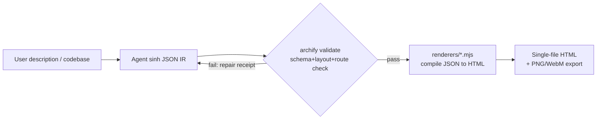
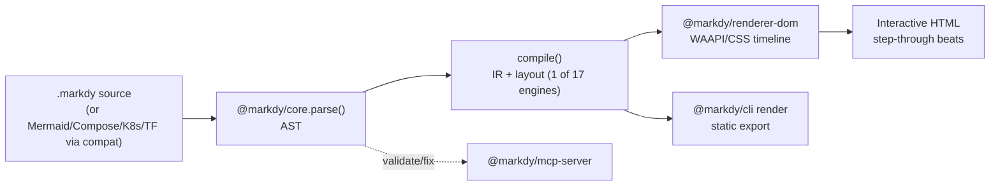
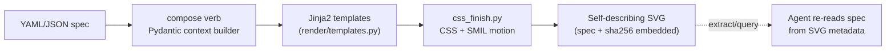
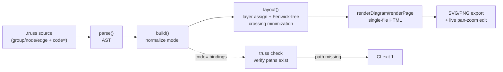

# Weekly scan — diagram-as-code & visual tooling (2026-09-20)

**Nguồn dữ liệu**: GitHub API (`gh api search/repositories`) không khả dụng trong session này
(GitHub access bị scope vào `kymostudio/kymostudio`) → fallback sang web search +
đọc trực tiếp README/source qua `raw.githubusercontent.com`. Kết quả filter từ
GitHub topic `diagram-as-code` sort theo `updated`, cross-check với search trên web.

## Executive summary

- **Xu hướng rõ rệt tuần này: "diagram-as-code cho AI agent", không phải cho human author.**
  Cả 4 repo được chọn đều nhắm agent (Claude/Cursor/Codex) làm consumer chính — input là JSON/YAML
  do LLM sinh ra, không phải người gõ tay; output ưu tiên self-contained single-file
  (HTML hoặc SVG) để agent trả trực tiếp trong chat, không cần build step.
- **`archify`** (67.5k stars, agent skill) và **`markdy-com`** (MCP server + 17 layout engine)
  là hai cái đáng học nhất về animation/motion — cả hai dùng Web Animations API / CSS thay vì
  SMIL hay JS canvas, đối lập với hướng CSS-class + SMIL hiện tại của kymostudio.
- **`tlk-truss`** đáng chú ý nhất về mặt kỹ thuật layout (Fenwick-tree crossing minimization,
  zero-dependency) và có ý tưởng lạ: bind node vào path/glob trong repo, `truss check` fail CI
  khi code bị xoá — pattern "diagram-code drift detection" kymostudio chưa có tương đương.

## Mục lục

1. [archify (tt-a1i/archify)](#1-archify-tt-a1iarchify)
2. [markdy-com (HoangYell/markdy-com)](#2-markdy-com-hoangyellmarkdy-com)
3. [hyperweave (InnerAura/hyperweave)](#3-hyperweave-inneraurahyperweave)
4. [tlk-truss (Talkdedsec/tlk-truss)](#4-tlk-truss-talkdedsectlk-truss)

---

## 1. archify (`tt-a1i/archify`)

### §1 — Quick context

Agent skill biến system description / codebase thành diagram HTML tương tác ngay trong
chat — khác biệt với kymostudio ở chỗ **không có concept file nguồn** kiểu `.kymo`, input là
JSON IR do agent tự sinh và tự validate trước khi render. Tech stack: Node.js, output
HTML/SVG + PNG/WebM + social card. Repo health: 67.5k stars, cập nhật 19/9/2026 (rất mới,
tăng trưởng nhanh bất thường — nghi là được quảng bá mạnh trong cộng đồng Claude Skills).
Không xác định số contributor/CI cụ thể từ README. Distribution: npm-style package +
`archify.zip` để cài như Claude Skill, không có bản CLI độc lập rõ ràng ngoài agent context.

### §2 — Architecture deep-dive

**A. Component inventory**
- `archify/bin/archify.mjs` — CLI entry, subcommands `validate | deliver | preview | guide | compare`.
- `archify/schemas/` — JSON Schema cho 5 diagram type (architecture/workflow/sequence/dataflow/lifecycle).
- `archify/renderers/` — compile JSON IR → HTML/SVG.
- `archify/delta/` — logic so sánh hai bản diagram (dùng bởi subcommand `compare`, thấy cả
  `checkout-platform.base.architecture.json` / `.head.architecture.json` trong examples).
- `viewer/` — web component để xem diagram tương tác.

**B. Pipeline / control flow** (happy path):
1. Agent (Claude/Cursor/Codex) đọc mô tả hệ thống từ user hoặc quét codebase.
2. Agent tự sinh JSON theo schema (`*.architecture.json` / `*.workflow.json` / …) — đây là
   bước "parse" nhưng do LLM làm, không phải parser cứng trong repo.
3. `archify validate` chạy schema + layout + route + label-clearance check, trả về
   "machine-readable repair receipt" nếu fail (agent tự sửa JSON dựa trên receipt này).
4. `archify deliver` compile JSON đã pass validate → single-file HTML (renderer trong `renderers/`).
5. (optional) `archify preview` — desktop loopback watch file, reload khi agent ghi JSON mới.
6. File HTML tự chứa, mở trực tiếp trong browser hoặc share card PNG/WebM.

**C. Data model**: JSON IR theo 5 schema riêng biệt (không có 1 model chung như
kymostudio's `Diagram` dataclass) — mỗi diagram type có shape khác nhau. Không xác định
rõ mutable/immutable giữa các pass từ evidence có được; kiến trúc "validate rồi mới
deliver" gợi ý pipeline không mutate JSON gốc (validate-only, deliver đọc lại).

**D. Input language design**: không có parser text — input luôn là JSON structured,
validate bằng JSON Schema. Đây là điểm khác biệt lớn nhất với DSL text-based như `.kymo`:
archify đặt cược rằng LLM sinh JSON đúng schema tốt hơn LLM sinh text DSL đúng grammar.
Error reporting: "repair receipt" — structured diff giữa JSON và schema, thiết kế để agent
đọc và tự fix, không phải để human đọc.

**E. Layout algorithm**: không xác định thuật toán cụ thể (không có evidence source code
layout engine trong tài liệu đọc được) — chỉ biết validator có check "layout" và
"label clearance" (tránh label đè lên nhau), gợi ý có auto-layout nhưng thuật toán không rõ.

**F. Rendering/output**: single-file HTML với CSS motion ("finite animations"), export
thêm PNG/WebM/social-card 1200×630. Không dùng canvas theo mô tả. Pluggable per diagram-type
renderer (5 renderer riêng trong `renderers/`).

**G. Extensibility**: thêm diagram type mới = thêm JSON Schema + renderer tương ứng
(pattern rõ từ 5 schema/5 renderer song song). Không thấy plugin system cho icon/shape
ngoài schema.

**H. Dev experience**: không có traditional CLI help/watch cho human — toàn bộ UX thiết kế
cho agent loop (validate → repair → deliver). Có VS Code/agent skill install qua zip,
không có LSP.

### §3 — Architecture diagram

### §4 — Verdict

**Đáng học**: cơ chế "repair receipt" — validate trả structured diff thay vì lỗi text tự do —
là pattern hay cho kymo-mcp (worker hiện có) nếu muốn agent tự sửa `.kymo` lỗi cú pháp;
kymostudio hiện dùng parser lỗi tự do trong `dsl.py`. Ý tưởng `compare`/delta giữa
`.base.json` và `.head.json` cũng đáng tham khảo cho việc diff hai revision diagram (dùng
trong git review) — kymostudio chưa có tính năng tương đương.
**Red flag**: 67.5k stars trong thời gian ngắn không tương xứng với độ trưởng thành hạ tầng
đọc được (không thấy test suite rõ ràng, không có golden-render regression test như
kymostudio) — khả năng cao stars đến từ viral trong cộng đồng Claude Skills chứ không phản
ánh độ chín kỹ thuật.
**Open question**: layout algorithm thực sự dùng gì — không có evidence.
**Verdict**: glance only cho core engine, nhưng **study deeper** riêng cơ chế
validate/repair-receipt.

---

## 2. markdy-com (`HoangYell/markdy-com`)

### §1 — Quick context

Biến text DSL (`.markdy`) thành **animated step-by-step explanation** của kiến trúc hệ
thống — khác kymostudio ở chỗ trọng tâm là "narrative beats" (kịch bản diễn giải theo thời
gian) thay vì static/single-animation diagram. Stack: TypeScript monorepo (pnpm workspaces),
~14kB zero-dependency core parser, renderer dùng Web Animations API. 96 stars, cập nhật
17/9/2026, README đa ngôn ngữ (EN/ZH) gợi ý team quốc tế; CI/test không xác định rõ từ
evidence đọc được. Distribution: npm packages theo namespace `@markdy/*` + VS Code extension
+ MCP server (`npx -y @markdy/mcp-server`).

### §2 — Architecture deep-dive

**A. Component inventory**
- `@markdy/core` — parser + compiler (`parse()`, `compile()`), AST engine ~14kB zero-dep.
- `@markdy/renderer-dom` — renderer WAAPI/CSS/SVG transform, không dùng Canvas.
- `@markdy/compat` — transpiler từ Mermaid / Docker Compose / K8s YAML / Terraform state /
  Draw.io sang MarkdyScript (cross-format conversion).
- `@markdy/mcp-server` — MCP tools: `validate_markdy_code`, `diagnose_markdy_syntax`,
  `fix_markdy_code`, `transpile_to_markdy`.
- `@markdy/cli`, `markdy-vscode`, `@markdy/language-server` — dev tooling.
- `@markdy/stdlib-systems` — semantic vocabulary (icon set sẵn cho Redis, PostgreSQL, …).

**B. Pipeline / control flow**:
1. User (hoặc `@markdy/compat`) viết/convert ra file `.markdy`.
2. `@markdy/core.parse()` → AST.
3. `compile()` → renderable IR có layout gán theo 1 trong 17 layout engine (chọn theo
   diagram type khai báo, ví dụ `architecture`, `sequence`, `swimlane`).
4. `@markdy/renderer-dom` dựng DOM + WAAPI timeline theo từng `beat` (khối narrative tuần
   tự) trong file.
5. Trình duyệt/VS Code preview chạy animation 60fps; CLI `render` xuất file tĩnh.
6. Output cuối: trang tương tác có thể step qua từng "beat" (giống slide deck kỹ thuật).

**C. Data model**: AST text → IR trung gian có layout đã gán tọa độ (tên gọi "compile" gợi ý
có khái niệm hạ cấp AST xuống IR thấp hơn, tương tự nhưng không xác nhận được có tách bạch
như D2 TALA hay không — không đủ evidence).

**D. Input language design**: custom recursive text DSL, dùng operator ký hiệu cho quan hệ
(`->` request, `<-` response, `~>` async event) và khối `beat name: ...` cho animation
tuần tự — cách tiếp cận gần giống Mermaid sequence nhưng thêm chiều thời gian tường minh.
Không có EBNF chính thức được tìm thấy. Error reporting qua MCP tool
`diagnose_markdy_syntax` — thiết kế cho agent tự sửa lỗi, tương tự archify.

**E. Layout algorithm**: 17 layout engine chuyên biệt theo domain (`architecture`,
`flowchart`, `tree`, `state`, `sequence`, `layers`, `swimlane`, `quadrant`, `timeline`,
`gantt`, `flywheel`, `constellation`, `radar`, `venn`, …) — hướng tiếp cận "nhiều thuật toán
chuyên dụng" thay vì 1 thuật toán tổng quát (khác kymostudio dùng 1 alignment resolver
5-pass cho mọi diagram). Có "dynamic port multiplexing" để tránh line congestion khi nhiều
cạnh chụm vào 1 node — tương tự vấn đề fan-in/trunk-lane staggering mà `alignment.py` của
kymostudio đã giải.

**F. Rendering/output**: DOM-based, CSS/SVG transform + WAAPI cho animation — **không dùng
SMIL**. Đối lập trực tiếp với hướng `--animate` hiện tại của kymostudio (CSS class + có khả
năng SMIL trong to_svg.py). Beat = animation step tường minh do user khai báo, không phải
animation ngầm định.

**G. Extensibility**: thêm layout engine mới = thêm solver trong core; icon vocabulary tách
riêng thành package `@markdy/stdlib-systems` (semantic, không phải raw SVG icon pack).

**H. Dev experience**: VS Code/Cursor live preview (`Cmd+K V`), LSP riêng
(`@markdy/language-server`), CLI có `lint`/`format`/`diff`. Đầu tư dev experience mạnh hơn
đa số repo cùng domain quan sát tuần này.

### §3 — Architecture diagram

### §4 — Verdict

**Đáng học**: (1) khái niệm "beat" — animation tuần tự có tên, user khai báo trực tiếp trong
DSL thay vì suy luận ngầm — kymostudio's `--animate` hiện có thể học cách cho phép đặt tên
animation step tường minh trong `.kymo` thay vì animation toàn cục; (2) "dynamic port
multiplexing" giải fan-in edge — nên so sánh trực tiếp với thuật toán
fan-in/trunk-lane-staggering hiện có trong `alignment.py` xem có khác biệt đáng lấy không;
(3) `@markdy/compat` (transpile Mermaid/Compose/K8s/Terraform/Draw.io → DSL) là mô hình
cross-format converter đáng tham khảo cho việc kymostudio mở rộng import ngoài BPMN.
**Red flag**: 17 layout engine riêng biệt là rủi ro maintenance lớn (so với 1 resolver
tổng quát của kymostudio) — nếu stars/traction thấp (96) thì effort đầu tư có vẻ vượt xa nhu
cầu thị trường thực tế hiện tại.
**Open question**: WAAPI có degrade gracefully khi export ra static SVG (kymostudio's core
use case) không, hay animation chỉ chạy được trong browser DOM?
**Verdict**: study deeper — riêng phần beat/narrative animation và port-multiplexing.

---

## 3. hyperweave (`InnerAura/hyperweave`)

### §1 — Quick context

"Visual CLI for agents" — sinh SVG *tự mô tả* (self-describing), nhúng cả spec gốc + hash
digest vào file, để agent khác đọc lại spec mà không cần parse pixel — khác biệt lớn nhất so
với kymostudio là **artifact = data + hình ảnh trong cùng 1 file**, không tách nguồn/renderer.
Stack: Python (Pydantic, FastAPI, FastMCP v3, Jinja2, Typer), CSS/SMIL cho animation
(**không JS**). Repo health: không xác định sao/contributor rõ ràng từ evidence; có
Dockerfile + `fly.toml` (deploy service), `.pre-commit-config.yaml` (có lint gate). License
Apache-2.0. Distribution: CLI + HTTP API (`/v1/{verb}`) + MCP server — không thấy PyPI publish
xác nhận.

### §2 — Architecture deep-dive

**A. Component inventory**
- `src/hyperweave/core/` — model/logic trung tâm (nội dung chi tiết không đọc được, chỉ tên
  thư mục).
- `src/hyperweave/render/templates.py`, `chart_engine.py`, `motion.py`, `css_finish.py`,
  `fonts.py`, `glyphs.py`, `glyph_metrics.py` — pipeline render tách theo concern
  (typography riêng khỏi layout/motion — điểm thiết kế đáng chú ý).
- `src/hyperweave/compose/` — bước ghép spec (JSON/YAML) thành artifact.
- `src/hyperweave/verbs/` — action layer: `compose | transform | extract | verify |
  validate | diff | query`.
- `src/hyperweave/mcp/`, `src/hyperweave/serve/` — MCP + HTTP API surface.
- `src/hyperweave/cli.py`, `__main__.py` — entry point Typer CLI.

**B. Pipeline / control flow**:
1. Agent/user viết YAML spec mô tả node/edge theo 1 trong 12 layout type (pipeline, fanout,
   DAG, tree, …).
2. `compose` verb đọc spec → Python context builder (`core/` + `compose/`).
3. Context truyền vào Jinja2 template (`render/templates.py`) sinh SVG string.
4. `css_finish.py` áp CSS/SMIL animation + style hoàn thiện.
5. Artifact cuối = SVG chứa (a) hình vẽ, (b) spec gốc nhúng dạng metadata, (c) sha256 digest.
6. Agent khác dùng verb `extract`/`query` đọc lại spec từ SVG đã sinh, không cần re-parse
   hình ảnh — "artifact self-describing" là điểm cốt lõi.

**C. Data model**: công thức kiến trúc công bố trong README:
`Artifact = Frame × Profile × Genome × Slots × Motion × Environment` — tên gọi trừu tượng,
không xác định được cấu trúc class/dataclass cụ thể từ evidence đọc được ("Genome"/"Slots"
gợi ý composable config theo layer, nhưng không đủ bằng chứng để khẳng định pattern chi
tiết — ghi "không xác định" cho phần implementation cụ thể).

**D. Input language design**: không phải text DSL — input là YAML/JSON structured (giống
archify), validate bằng Pydantic model. Không có custom parser text.

**E. Layout algorithm**: 12 layout type được liệt kê theo tên (pipeline, fanout, DAG,
tree, …) nhưng thuật toán cụ thể (crossing minimization, orthogonal routing…) — không xác
định từ evidence đọc được.

**F. Rendering/output**: SVG thuần qua Jinja2 template string (không phải qua canvas library
hay DOM) — animation bằng **CSS + SMIL**, cùng họ kỹ thuật với kymostudio's `to_svg.py`
(khác với archify/markdy dùng WAAPI). Single backend (SVG), không có emitter pluggable khác
được xác nhận (không thấy `to_figma`/`to_png` tương đương, dù README nói "chart" cũng được
hỗ trợ qua `chart_engine.py`).

**G. Extensibility**: thêm layout type = thêm handler trong `core`/`compose`; typography
tách riêng (`fonts.py`, `glyphs.py`, `glyph_metrics.py`) gợi ý hệ thống đo chữ tự viết thay
vì dựa vào renderer ngoài để đo text width — đáng chú ý vì đây là vấn đề khó (text sizing
chính xác trong SVG) mà nhiều tool né tránh.

**H. Dev experience**: CLI qua Typer, HTTP API REST, MCP server — 3 giao diện song song.
`justfile` + `.pre-commit-config.yaml` gợi ý dev workflow có kỷ luật (lint gate trước
commit). Không thấy LSP/VS Code extension.

### §3 — Architecture diagram

### §4 — Verdict

**Đáng học**: (1) "self-describing artifact" — nhúng spec gốc + hash vào chính file SVG
output — là ý tưởng đáng cân nhắc cho kymostudio: hiện tại `.kymo` nguồn và `.svg` output
tách biệt hoàn toàn, không có cách nào từ 1 file SVG kymostudio đã render lấy lại được model
JSON gốc; embedding metadata (kiểu `<metadata>` SVG tag) có thể hữu ích cho round-trip
editing hoặc cho MCP server hiện có của kymostudio đọc lại diagram đã sinh. (2) tách riêng
`glyph_metrics.py`/`fonts.py` khỏi layout — nên xem cách họ đo text width có chính xác hơn
cách kymostudio ước lượng hiện tại không (nếu có).
**Red flag**: không có test/golden-render suite rõ ràng được xác nhận từ evidence — risk
correctness cao hơn kymostudio's byte-for-byte golden test.
**Open question**: 12 layout type thực thi thuật toán gì — cần đọc source `core/` trực
tiếp để trả lời, chưa đủ evidence.
**Verdict**: glance only, nhưng đáng thử ý tưởng "embed spec + hash vào SVG metadata".

---

## 4. tlk-truss (`Talkdedsec/tlk-truss`)

### §1 — Quick context

DSL diagram-as-code buộc mỗi node phải bind vào path/glob thật trong repo qua `code=`, và
`truss check` fail CI (`exit 1`) nếu path đó biến mất — khác biệt rõ nhất: đây là công cụ
**giữ diagram đồng bộ với code theo thời gian**, không chỉ vẽ 1 lần. Stack: Node.js 20+,
zero runtime dependency, ships `.mjs`. Repo health: 0 stars nhưng có 83 unit test + 8
browser test chạy trên Node 20/22/24 × Windows/Linux — hạ tầng test nghiêm túc hơn hẳn stars
gợi ý (repo rất mới, chưa kịp lan truyền). Distribution: npm (`@talkdedsec/tlk-truss`) +
GitHub Action (`action.yml`) sẵn cho CI.

### §2 — Architecture deep-dive

**A. Component inventory**
- `bin/truss.mjs` — CLI entry (subcommand chính là `check`, cộng render).
- `src/` — chứa parser, layout engine, renderer (tên file cụ thể không đọc được toàn bộ, chỉ
  xác nhận qua exports: `parse, build, layout, renderDiagram, renderPage, toSource`).
- `examples/payments.truss` — ví dụ DSL đầy đủ đọc được (xem §2.D).
- `action.yml` — GitHub Action wrapper cho `truss check` dùng trong CI pipeline người khác.

**B. Pipeline / control flow**:
1. User viết file `.truss` khai báo `group`/`node`/edge, mỗi `node` có thể gắn
   `code=<path-or-glob>`.
2. `parse()` → AST từ text DSL.
3. `build()` → chuẩn hoá thành model (group nesting, node/edge resolve).
4. `layout()` → gán toạ độ theo view type (architecture/sequence/dataflow/lifecycle), dùng
   layer assignment + crossing minimization qua **Fenwick tree** + coordinate relaxation.
5. `renderDiagram()`/`renderPage()` → single-file HTML có SVG/PNG export, pan-zoom, live edit.
6. Song song: `truss check` đọc lại các `code=` binding, verify path/glob còn tồn tại trong
   repo — nếu không, exit code 1 → fail CI build, buộc người xoá code phải cập nhật diagram.

**C. Data model**: model trung gian có khái niệm `group` lồng nhau (nesting) + `node`/`edge`
phẳng tham chiếu group qua `in=` — không xác định mutable/immutable giữa pass từ evidence,
nhưng việc export riêng `build` và `layout` như 2 hàm tách biệt gợi ý pipeline dùng model
bất biến truyền qua transform thuần (functional style), tương tự kiến trúc
parse→layout→resolve_alignments→render của kymostudio (4 hàm export riêng biệt khớp khá sát
4 stage của kymostudio).

**D. Input language design**: custom line-oriented text DSL — **rất giống văn phong `.kymo`**:
khai báo header (`title`, `view`, `theme`, `flow`, `root`), rồi `group id "Label"`, rồi
`node id "Label" in=group kind=... code=...`, rồi cạnh bằng operator (`->` sync, `~>` async,
`:` label). Không có EBNF chính thức tìm thấy. Điểm khác biệt: attribute `code=` là first-
class citizen trong grammar, dùng cho drift-check chứ không chỉ styling.

**E. Layout algorithm**: layer assignment (giống Sugiyama-style hierarchical) + **crossing
minimization dùng Fenwick tree** (binary indexed tree — thường dùng để đếm inversion hiệu
quả O(n log n), đây là lựa chọn thuật toán khá tinh vi so với barycentric heuristic phổ biến)
+ "coordinate relaxation" cho bước làm đẹp toạ độ cuối. Xử lý được cycle trong graph.

**F. Rendering/output**: single-file HTML (đọc/edit trực tiếp trong browser), export
SVG/PNG, dark/light theme, pan-zoom — không có animation (view tĩnh, tương phản với 3 repo
kia). Single backend nhưng expose các hàm render tách rời (`renderDiagram`, `renderPage`) cho
phép nhúng vào pipeline khác.

**G. Extensibility**: 4 view type cố định (architecture/sequence/dataflow/lifecycle) — không
thấy plugin system rõ ràng cho thêm view mới hay icon.

**H. Dev experience**: GitHub Action sẵn dùng (`action.yml`) — traction chính là CI
integration, không phải interactive dev loop. Live-edit trong HTML export là điểm hay (không
cần quay lại source để sửa nhỏ). Không có LSP/VS Code extension xác nhận.

### §3 — Architecture diagram

### §4 — Verdict

**Đáng học**: (1) **drift detection qua `code=` binding + CI gate** là ý tưởng chưa có trong
kymostudio và đáng cân nhắc nghiêm túc — attribute tương tự có thể thêm vào `.kymo` grammar
(`code=` hoặc annotation riêng) rồi viết 1 `kymo check` subcommand verify path còn tồn tại,
hữu ích cho diagram kiến trúc dùng trong docs lớn (ví dụ chính README/docs của kymostudio mô
tả pipeline `dsl.py → layout.py → alignment.py → to_svg.py`). (2) Fenwick-tree crossing
minimization đáng so sánh trực tiếp với cách `alignment.py` hiện xử lý edge crossing (nếu
có) — có thể là thuật toán nhanh hơn cho canvas lớn. (3) input grammar (`group`/`node
in=group`/`code=`) gần với `.kymo` đến mức có thể đọc `src/` của họ như 1 case study
"grammar sibling" hữu ích khi cân nhắc mở rộng cú pháp DSL.
**Red flag**: 0 stars, license PolyForm Noncommercial (không phải OSI-approved permissive) —
hạn chế dùng lại code trực tiếp, chỉ nên học ý tưởng/thuật toán chứ không copy implementation.
**Open question**: license PolyForm Noncommercial có chặn cả việc tham khảo thuật toán hay
chỉ chặn dùng thương mại trực tiếp code — cần đọc kỹ LICENSE trước khi implement ý tưởng
tương tự.
**Verdict**: **study deeper** — riêng 2 phần drift-detection pattern và crossing-minimization
algorithm, tôn trọng license khi triển khai.
