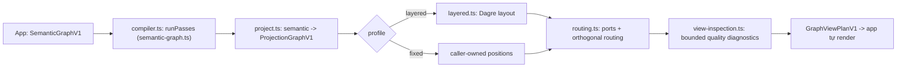
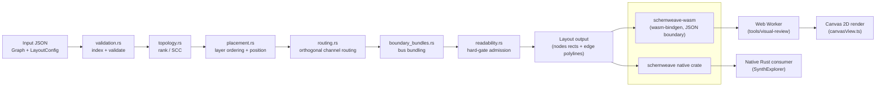
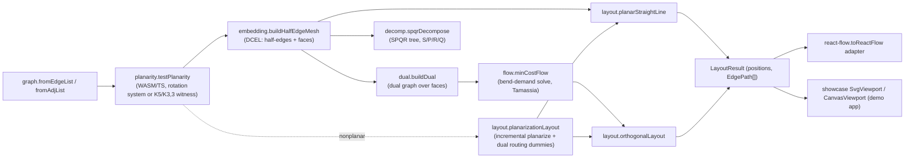

# Weekly scan — Diagram tooling & visual DSL (2026-09-21)

**Nguồn dữ liệu**: do phiên GitHub App của session này bị scope vào riêng
`kymostudio/kymostudio`, không gọi được `gh api search/repositories` xuyên
GitHub như kịch bản gốc yêu cầu. Thay vào đó, việc phát hiện repo dùng
web search + duyệt trực tiếp các trang GitHub Topics (`layout-algorithm`,
`graph-layout`, `diagram-as-code`) sort theo `updated`, sau đó `git clone`
từng repo ứng viên về để đọc code tận nơi. Vì domain này hiếm khi có repo
mới nổi >50 sao trong đúng 7 ngày, cửa sổ thời gian đã được nới theo đúng
logic fallback của brief (keyword-based ~30 ngày) — 4 repo chọn ra có last
commit từ 2026-08-12 đến 2026-09-14, đều 0-2 sao, được ưu tiên vì **giá trị
kiến trúc** (không phải traction) theo đúng relevance filter đã cho.

## Executive summary

- **`graph-view-compiler`** và **`diagram-layout-core`** cùng chạm một điểm
  đau của kymostudio: ranh giới giữa "layout adapter" và "renderer" hiện
  chưa tường minh trong `layout.py`/`alignment.py` — cả hai repo đều tách
  layout thành một IR có version + adapter thay thế được, và có test
  **determinism** như một first-class citizen (đáng làm ngay: thêm test
  gọi `resolve_alignments()` hai lần, assert output y hệt).
- **`schemweave`** (Rust, circuit-schematic layout) minh hoạ kỹ thuật
  **hard-gate admission** (reject cứng layout vi phạm clearance/spacing
  thay vì heuristic mềm) và dual-runtime native+WASM qua cùng JSON
  boundary — mô hình gần với `kymostudio-core`.
- **`topoloom`** là repo đáng đọc kỹ nhất về thuật toán: orthogonal routing
  bằng **min-cost-flow trên dual graph** (Tamassia topology-shape-metrics)
  để tối thiểu bend, khác hẳn cách `alignment.py` hiện đang stagger cạnh
  theo heuristic fan-in/trunk-lane — đáng nghiên cứu nếu kymostudio muốn
  giảm chồng lấn cạnh trong diagram dày đặc.
- Cả 4 repo đều là dự án 1 tác giả, 0-2 sao, pre-1.0/chưa publish — **không
  repo nào đủ chín để làm dependency**, tất cả chỉ đáng "glance only" để
  lấy ý tưởng pattern/thuật toán, không phải để tích hợp trực tiếp.

## Mục lục

1. [graph-view-compiler](#graph-view-compiler)
2. [schemweave](#schemweave)
3. [topoloom](#topoloom)
4. [diagram-layout-core](#diagram-layout-core)

---

## graph-view-compiler
https://github.com/tetracoralla/graph-view-compiler — npm: `@openadam/graph-view-compiler`

### §1 Quick context
Không phải một công cụ vẽ diagram mà là một **compiler thư viện renderer-neutral**: nhận một typed semantic graph, chạy các pass xác định (filter/slice/group/collapse), rồi xuất ra một "view plan" hình học (tọa độ + SVG path string) để app tự vẽ — khác kymostudio ở chỗ nó không sở hữu bước render cuối. Stack: TypeScript thuần, phụ thuộc runtime duy nhất là `@dagrejs/dagre` (3.1.1); output là JSON (node boxes, orthogonal SVG `path` strings), không xuất file SVG/ảnh. Repo health: 0 sao, tác giả duy nhất "openAdam", CI GitHub Actions chạy typecheck+vitest+build+`npm audit`, release mới nhất 0.5.0 (2026-09-04), commit cuối 2026-09-14, chỉ 1 commit hiển thị trong clone (có thể đã squash). Phân phối: chỉ qua npm.

### §2 Architecture deep-dive
**A. Component inventory** — `types.ts` (`src/types.ts`): định nghĩa type + hằng số giới hạn (MAX_*) toàn cục. `semantic-graph.ts`: validate/normalize `SemanticGraphV1` và các phép filter/slice/path/group/collapse thuần (pure). `semantics.ts`: lỗi `GraphProjectionError`, suy ra endpoint style từ direction, validate `ProjectionGraphV1`. `layered.ts`: wrapper Dagre — dựng `dagre.Graph`, set options, chạy layout, đọc lại rectangle. `routing.ts`: cấp port theo cạnh hình chữ nhật, router orthogonal có tránh vật cản, sinh SVG path bo góc, tính "jump" khi hai cạnh cắt nhau. `project.ts`: ghép layered.ts + routing.ts thành `ProjectedGraph` cho cả 2 profile (layered/fixed). `quality.ts`/`view-inspection.ts`: kiểm tra hình học (crossing, overlap) có ngân sách công việc giới hạn. `compiler-contract.ts`: contract công khai (`GraphViewPlanV1`). `compiler.ts`: orchestrator `compileGraphView()`.

**B. Pipeline**: (1) app gọi `compileGraphView({graph, passes, nodeSizes, profile})`; (2) normalize graph + chạy các pass theo thứ tự caller khai báo, ghi trace + membership; (3) map sang `ProjectionGraphV1` bằng size do caller đo; (4) áp profile `layered` (Dagre) hoặc `fixed` (vị trí caller); (5) cấp port, route orthogonal (hoặc theo corridor constraint), sinh path string + jump; (6) đối chiếu với `previousPlan` (align/change set) + kiểm tra chất lượng bounded → trả `GraphViewPlanV1` cho app tự vẽ.

**C. Data model/IR**: 3 tầng IR đều là plain versioned object, **immutable** qua từng pass (mọi operation trả object mới): `SemanticGraphV1` → `ProjectionGraphV1` (lower IR, gắn size đo được) → `GraphViewPlanV1` (output, có thể quay lại làm `previousPlan` cho lần compile sau).

**D. Input language**: không có text DSL, không có ngữ pháp hình thức — chỉ typed JS/JSON object (`examples/*.json`), validate bằng `validateSemanticGraph`. Lỗi báo cáo qua issue object `{code, id, message}` với enum code đóng; `compileGraphView` gộp mọi lỗi tầng dưới vào một `GraphViewCompileError` có `causeCode` trỏ về code gốc.

**E. Layout**: xác nhận bọc Dagre — `layered.ts` set `ranker: network-simplex`, `acyclicer: greedy`, đọc lại node center rồi tự tính lại route (không dùng edge points thô của Dagre). Không có bộ crossing-minimization riêng (kế thừa heuristic nội bộ của Dagre). Routing là **orthogonal router tự viết** (không phải Dagre): port theo cạnh, ngân sách vật cản/edge (≤96, mặc định 40), side-flip retry xác định, corridor constraint thủ công cho fixed view, jump arc khi 2 route cắt nhau.

**F. Rendering**: không xuất SVG document/animation — chỉ tọa độ + `path` (SVG path `d`) trong JSON; "renderer-neutral" là chủ đích, không màu/font/viewport.

**G. Extensibility**: `relation.kind` là string tự do (data-driven, không cần đăng ký). Thêm pass type mới phải sửa union đóng `GraphViewPass` + switch trong `compiler.ts` — không có plugin system. Không cơ chế style (chủ đích để lại cho consumer).

**H. DX**: không CLI, không IDE support, không watch mode (scripts chỉ build/typecheck/test/check:*). Docs rất kỷ luật (9 file .md, mỗi file 1 phạm vi rõ) nhưng thiếu demo chạy được — chỉ 3 file JSON mẫu.

### §3 Architecture diagram


### §4 Verdict
Đáng học: (1) 3-tầng IR versioned + immutable (mỗi tầng có `version` field riêng, tách bạch semantic ↔ projection ↔ output) rõ ràng hơn ranh giới model.py/layout.py/alignment.py/to_svg.py của kymostudio — có thể gợi ý gắn version field vào `Diagram` dataclass để an toàn khi golden-SVG thay đổi. (2) Diagnostics có ngân sách công việc rõ ràng (`inspection_limit`, `routing_fallback`, `layout_depth_exceeded`, `diagnostic_limit`) — alignment.py của kymostudio có thể áp dụng thay vì fail âm thầm trên diagram lớn. (3) `previousPlan`/`preserve-anchor` change-reconciliation là ý tưởng hay cho target `--animate` (biết node nào di chuyển/giữ nguyên giữa 2 lần render). Red flag: tác giả đơn, 0 sao, văn phong "product/AGENTS.md" nghe như tự mô tả tham vọng hơn là đã kiểm chứng thực tế (Calligram/Laniakea là consumer nội bộ không public); hoàn toàn không render gì nên không so sánh trực tiếp về chất lượng SVG được. Câu hỏi mở: các consumer thực (Calligram, Laniakea, Dependency Engine) có tồn tại/public hay chỉ là narrative nội bộ.

**Kết luận: xem lướt (glance only)** — không phải đối thủ trực tiếp vì không render, nhưng đáng ghi chú lại pattern IR phân lớp có version + diagnostics có ngân sách cho alignment.py/to_svg.py của kymostudio.

---

## schemweave
https://github.com/cachanova/schemweave

### §1 QUICK CONTEXT

Không phải diagram-as-code tổng quát mà là một **layout engine chuyên biệt cho circuit/RTL schematic**: nhận đồ thị JSON (node có kích thước cố định, port cố định trên biên, net điện định hướng) và trả về hình học left-to-right + orthogonal routing — khác kymostudio (DSL văn bản → mọi loại diagram). Tech stack: Rust 2024 (edition), workspace 4 crate + tool visual-review (TypeScript/Vite/Playwright). Repo health: 1 star, **1 commit duy nhất, 1 contributor** (Leela Pakanati/cachanova) — mới publish 2026-08-12, chưa có lịch sử phát triển; CI đầy đủ (`ci.yml`: fmt, test, clippy -D warnings, wasm build, JS test + browser test qua Playwright). Distribution: **chưa publish** lên crates.io/npm — chỉ dùng qua Git rev (README nói rõ "pre-release, API chưa ổn định").

### §2 ARCHITECTURE DEEP-DIVE

**A. Component inventory** — `crates/schemweave/src/`: `validation.rs` (index hoá + kiểm tra input), `topology.rs` (rank hoá, SCC), `placement.rs` (đặt vị trí node theo layer), `routing.rs` (module lớn nhất, orthogonal routing + mọi biến thể candidate), `boundary_bundles.rs` (gom bus tại biên), `groups.rs` (full-layout với group đã expand), `incremental.rs` (expand/collapse group cục bộ), `readability.rs` (đo clearance/congestion). `crates/schemweave-wasm` — boundary JSON qua `wasm-bindgen`. `crates/schemweave-eval` — scorer dev-only. `tools/visual-review` — harness browser so sánh với ELK.

**B. Pipeline** (theo `docs/ARCHITECTURE.md`): (1) validate + index ID ổn định → (2) rank left-to-right (co cụm SCC, loại cạnh feedback/non-flow) → (3) order layer (barycentric forward/reverse + isotonic projection, sinh nhiều candidate) → (4) route (kênh giữa layer, gộp trunk cùng net, lane ngoài cho feedback) → (5) admit (lọc theo clearance/contact/spacing, so sánh crossings/bends/length/area, tie-break tất định) → (6) refine theo budget (Fast/Quality/Max).

**C. Data model/IR** — `Graph{nodes,edges}` là **immutable input**; pipeline sinh nhiều `Layout` candidate (nodes/edges đã đặt tọa độ) rồi chọn "AdmittedCandidate" tốt nhất — không có khái niệm "lower IR" tách biệt, chỉ có struct `Layout` output. `incremental.rs` **không phải incremental layout tổng quát** mà là cơ chế hẹp: expand/collapse một "group" đã biết trước (đổi node compact thành cụm node con hoặc ngược lại), giữ nguyên hình học phần không liên quan, có work-limit và fallback trả về `needs_full_relayout`.

**D. Input language** — JSON schema thuần (Rust struct serde), không phải DSL văn bản: `Node{id,width,height,ports}`, `Port{id,side,offset}` (offset tính từ top/left tuỳ side), `Edge{id,source,target,net,participates_in_ranking}`. Constraint tuỳ chọn: `LayoutConstraints{inputs,outputs,boundary_bundles}`. Validation (`validation.rs`) trả lỗi kiểu (duplicate ID, port lệch, endpoint không tồn tại, quá nhiều ordering_sweeps...) qua enum `LayoutError`/`LayoutConstraintError` chi tiết theo `thiserror`.

**E. Layout/routing algorithm** — Layered/rank-based (giống Sugiyama) + barycentric ordering, **không phải force-directed**; routing orthogonal dựa kênh (channel) giữa các layer, có "sparse global"/"regional fanout" cho net lớn, né vật cản qua kiểm tra hard-gate (`edge_node_clearance`, `unrelated_route_contact`, `parallel_wire_spacing`) — không dùng heuristic mềm mà **reject cứng** nếu không thoả. `readability.rs`/`schemweave-eval` đo điểm (crossings, bends, route length, area, congestion...) nhưng đây là **scorer đánh giá ngoài engine** (dev-only), engine tự chọn candidate nội bộ qua so sánh `RouteQuality` (crossings→bends→length→area) chứ không dùng một hàm mục tiêu tổng hợp kiểu SA/GA.

**F. Rendering** — Engine **không render SVG**; chỉ trả hình học thuần (rect + polyline điểm). `tools/visual-review` tự vẽ bằng **HTML5 Canvas 2D** (`canvasView.ts`, `getContext('2d')`), không dùng SVG. WASM boundary trả JSON string giống hệt native (`layout_json`/`layout_serialized` cùng output).

**G. Extensibility** — Không có plugin point rõ ràng. `groups.rs` cho phép layout đầy đủ với các group đã expand làm keep-out region; `incremental.rs` cho expand/collapse cục bộ một group với "protected_groups" (nhóm khác giữ nguyên, có `frame_padding` keep-out). `boundary_bundles.rs` gom nhiều edge cùng slot thành 1 "graphical bus" ở biên input/output.

**H. Dev experience** — `benches/layout.rs` dùng Criterion đo `layout_with_config`/expand/collapse trên nhiều shape (pipeline, fanout, DAG, bus...) × 3 quality effort; `schemweave-eval` chấm điểm hard-gate + nhiều metric readability; `tools/visual-review` là app Vite chạy WASM trong Web Worker, so trực tiếp với ELK (elkjs) và render song song để review bằng mắt — quy trình dev khá bài bản cho một repo 1-commit.

### §3 ARCHITECTURE DIAGRAM



### §4 VERDICT

**Bài học cho kymostudio**: (1) Cách schemweave tách bạch "engine chỉ trả geometry, consumer tự render" (không SVG built-in) khác triết lý kymostudio (renderer riêng `to_svg.py` là công dân hạng nhất) — không nên bắt chước vì kymostudio cần output SVG trực tiếp, nhưng đáng học cách **hard-gate cứng** (reject layout không thoả clearance thay vì cố "vá" — có thể áp dụng cho `alignment.py` khi validate constraint). (2) Native+WASM dual-runtime qua cùng JSON boundary (`layout_json`) là mô hình gọn — kymostudio-core (Rust/resvg) đã đi hướng tương tự, có thể tham khảo cách schemweave test cả hai runtime bằng cùng bộ test JSON. (3) `incremental.rs` chỉ là expand/collapse group hẹp, KHÔNG phải incremental re-layout tổng quát — không có gì để "học" trực tiếp cho kymostudio's alignment resolver. **Red flag**: repo 1 commit/1 contributor/1 sao, API "pre-release không ổn định", chưa publish package — rủi ro cao nếu phụ thuộc. Câu hỏi mở: liệu thuật toán chọn-candidate-rồi-so-sánh (rất nhiều heuristic if/else trong `lib.rs`) có scale tốt không, hay chỉ tối ưu cho corpus SynthExplorer cụ thể. **Verdict một dòng: glance only** — kỹ thuật routing/hard-gate đáng đọc lướt để lấy ý tưởng, nhưng domain (circuit schematic, JSON-only input, không SVG) quá khác kymostudio để đầu tư nghiên cứu sâu.

---

## topoloom
https://github.com/khalidsaidi/topoloom

### §1 QUICK CONTEXT
Khác dagre/elk ở chỗ topoloom xuất ra **topology artifacts tường minh** (rotation system, half-edge mesh/DCEL, dual graph, SPQR-tree) như IR độc lập, chứ không chỉ toạ độ node — layout pipeline tiêu thụ lại các artifact này thay vì tự tính lại planarity/embedding. Stack: TypeScript (ESM-only), pnpm monorepo, planarity test dùng WASM core (Edge Addition Planarity Suite, C) + fallback TS. Sức khoẻ repo: 2 sao, **1 contributor duy nhất**, không có CI test workflow riêng (chỉ Firebase Hosting deploy + release.yml chạy test trước khi publish tag), phiên bản mới nhất v0.3.0 (2026-08-27). Phân phối: npm (`@khalidsaidi/topoloom`, scoped) + demo web-only (topoloom.web.app).

### §2 ARCHITECTURE DEEP-DIVE
**A. Component inventory** — `packages/topoloom/src/`: `graph/` (Graph class mutable-builder + immutable snapshot, JSON I/O, adjacency); `dfs/` (SCC/Tarjan, bridges, biconnected components, BC-tree); `planarity/` (`testPlanarity`, WASM binding `wasm.ts`/`wasm-data.ts` + pure-TS backend `ts.ts`); `embedding/` (`buildHalfEdgeMesh`, `faces`, `selectOuterFace`, `walkFace`); `dual/` (`buildDual`, `dualShortestPath`, `routeEdgeFixedEmbedding/OnGraph` — bao gồm fallback "maximal planar backbone"); `order/` (`stNumbering`, `bipolarOrientation`); `flow/` (min-cost flow: successive-shortest-path + Bellman-Ford potentials, residual graph); `decomp/` (SPQR: `spqrDecompose(Safe/All)`, skeleton building, `flipSkeleton`/`permuteParallel`); `layout/` (`planarStraightLine`, `orthogonalLayout`, `planarizationLayout`); `react-flow/` (adapter thuần dữ liệu sang React Flow nodes/edges).

**B. Pipeline (happy path)**: (1) `graph.fromEdgeList/fromAdjList` → `Graph`; (2) `planarity.testPlanarity(g)` → rotation system hoặc Kuratowski witness (K5/K3,3); (3) `embedding.buildHalfEdgeMesh(g, rotation)` → DCEL + face enumeration; (4a) đường thẳng: `layout.planarStraightLine(mesh)` (Tutte-style barycentric solve trên nội bộ, ellipse boundary cho biên ngoài); (4b) trực giao: `dual.buildDual(mesh)` → min-cost flow tính bend demand mỗi mặt (Tamassia-style) → `orthogonalLayout`; (5) với đồ thị không phẳng: `layout.planarizationLayout` lặp thêm cạnh, test planarity từng bước, chèn dummy vertex tại giao điểm qua `dual.routeEdgeFixedEmbedding`, rồi chạy lại layout phẳng; (6) `react-flow.toReactFlow(result, graph)` hoặc demo tự vẽ `<svg>`.

**C. Data model/IR** — Có, rõ ràng: Rotation System (`{order: HalfEdgeRef[][]}`) → Half-Edge Mesh (DCEL: origin/twin/next/prev/face arrays) → Dual Graph (Graph object trên faces) → SPQR Tree (nodes S/P/R/Q với skeleton + virtual-edge kind). Đây là các *stage IR tách biệt được compose lại* (mỗi hàm nhận IR của stage trước làm input), không phải một object mutable xuyên suốt — `Graph` là bất biến sau `build()` (builder pattern), các mesh/dual đều là snapshot mới tạo mỗi lần gọi. Tổng thể là pipeline hàm thuần (functional), có `toJSON/fromJSON` cho serializability.

**D. Input language design** — Không có DSL; input thuần là graph object (`fromEdgeList`/`fromAdjList`/JSON), id số nguyên. Lỗi input không phẳng: xác nhận trong code — `planarizationLayout` build tăng dần, test planarity mỗi cạnh, cạnh gây vi phạm bị planarize (chèn dummy); `dual` module có message `"Nonplanar input: routed on a maximal planar backbone (dropped N edge(s))"` xác nhận đúng README. Orthogonal có `OrthogonalInfeasibleError` tường minh khi min-cost-flow bend không khả thi (vd đồ thị disconnected), với option `onInfeasible: 'fallback'` — không silent fail.

**E. Layout algorithm** — Planar straight-line: biên ngoài đặt trên ellipse (không phải circle thuần, có xoay/stretch theo hash để giảm "ring bias"), đỉnh trong giải bằng hệ tuyến tính barycentric (Gauss elim có pivoting) — giống Tutte's spring embedding rút gọn. Orthogonal: đúng kiểu Tamassia topology-shape-metrics — tính góc mỗi corner quanh đỉnh, suy demand độ cong mỗi mặt, giải min-cost flow trên dual graph để tối thiểu số bend, gán port theo hướng N/E/S/W, rồi compact toạ độ về lưới nguyên; có xử lý corner case bridge/degree>4 (Kandinsky-style relaxation). Planarization: thêm cạnh tăng dần + test-planarity greedy (không phải maximal-planar-subgraph tối ưu), chèn dummy tại giao điểm qua dual shortest-path. **Không có crossing-minimization kiểu Sugiyama** (không phân lớp/rank) — cách tiếp cận hoàn toàn topology-based (loại bỏ giao điểm bằng planarization/dual-routing chứ không xếp lớp).

**F. Rendering/output strategy** — Xác nhận: kernel chỉ xuất `positions: Map<VertexId,Point>` + `edges: EdgePath[]` (polyline), không có SVG renderer riêng. Demo app (`apps/showcase`) tự vẽ bằng React component `SvgViewport.tsx` (raw `<svg>` + pan/zoom tự viết) và một `CanvasViewport`/`WebGLViewport` (regl-style shader) cho benchmark lớn; chạy kernel trong Web Worker (`topoloomWorker.ts`) để không block UI.

**G. Extensibility** — Composable qua data, không qua plugin hook chính thức: mỗi stage là hàm thuần nhận IR của stage trước, nên có thể tự viết stage thay thế miễn khớp type (vd tự viết layout khác nhận `HalfEdgeMesh`). `planarity` có `backend: 'auto'|'wasm'|'ts'` là điểm mở rõ ràng duy nhất; không có registry/plugin API tổng quát.

**H. Dev experience** — Không có CLI. Library + demo showcase (Vite/React/Tailwind/Radix), có TypeDoc API site tĩnh, test bằng Vitest + fast-check (property-based) cho hầu hết module, README có quickstart runnable. Không có workflow CI chạy test trên PR (chỉ release.yml chạy test trước khi publish tag) — rủi ro về quality gate.

### §3 ARCHITECTURE DIAGRAM


### §4 VERDICT
Bài học cụ thể cho kymostudio: topoloom tách rõ **planarity → embedding → dual → layout** thành các IR nối tiếp, đối lập với `alignment.py` hiện tại vốn resolve vị trí trực tiếp từ auto-layout frames + fan-in/trunk-lane staggering (heuristic theo cấu trúc DSL, không dựa trên topology đồ thị tổng quát). kymostudio không cần planarity testing (diagram luôn có layout khai báo), nhưng kỹ thuật **min-cost-flow cho bend-minimization orthogonal routing** (Tamassia topology-shape-metrics) và **dual-graph shortest-path để route edge quanh chướng ngại/tránh giao cắt** là ý tưởng đáng nghiên cứu nếu kymostudio muốn cải thiện edge routing/tránh chồng lấn edge tốt hơn heuristic staggering hiện tại — đặc biệt cho các diagram dày đặc cạnh. Cờ đỏ: 1 contributor, không CI test trên PR, orthogonal router tự nhận "known limitation" (không full track assignment), planarization dùng greedy thay vì maximal-planar-subgraph tối ưu — mang tính research-grade/demo hơn production-hardened. Câu hỏi mở: hiệu năng min-cost-flow trên đồ thị lớn (>1000 cạnh) chưa rõ benchmark nào ngoài `docs/BENCHMARKS.md`. Kết luận một dòng: **glance only** — đáng đọc kỹ phần orthogonal/dual-routing algorithm để lấy ý tưởng kỹ thuật, nhưng không phải kiến trúc để học theo toàn bộ.

---

## diagram-layout-core
https://github.com/lyubomir-popov/diagram-layout-core

### §1 QUICK CONTEXT

Đây không phải một tool diagram-as-code hoàn chỉnh, mà là một **layout-adapter abstraction layer** cực mỏng: tách phần graph-layout ra khỏi một "Diagram Generator" nội bộ lớn hơn. Ý tưởng thiết kế: định nghĩa một **shared graph IR** (`GraphLayoutInput`/`GraphLayoutResult`) rồi cắm hai backend layout engine khác nhau (Dagre qua `@dagrejs/dagre`, ELK qua `elkjs`) phía sau cùng một interface, chuẩn hoá output về cùng một shape. Stack: TypeScript strict, `node --test`, không framework ngoài. Repo health: 0 stars, Apache-2.0, ~931 dòng, commit cuối 2026-09-03, có test suite (validation, rejections, bounds, determinism) nhưng không thấy CI config (`.github/workflows`) trong cây file đã liệt kê. README tự khai "private, unpublished npm package" (`package.json` có `"private": true`, tên `@diagram-layout/core` chưa publish); `npm ci && npm test` (= build TS rồi chạy `node --test`) cho thấy ý định đóng gói là một **thư viện npm buildable/publishable** (có `dist/`, `.d.ts`, `exports` map) chứ chưa phải sản phẩm end-user.

### §2 ARCHITECTURE DEEP-DIVE

**A. Component inventory** (toàn bộ file `src/`):
- `src/types.ts` — định nghĩa toàn bộ IR: `GraphLayoutInput`, `GraphNodeInput`, `GraphEdgeInput`, `GraphPortInput`, `GraphLayoutResult`, `PlacedNode`/`PlacedEdge`, các "capability descriptor" type (`GraphLayoutCapabilities`...), hằng `GRID_BASELINE_PX=8`, hàm `roundToGrid`, `resolveGraphPortPlacement`, `resolveGraphNodeKind`.
- `src/validate.ts` — `validateGraphLayoutInput` + `validateOptionOverrides`: validator fail-closed, kiểm tra id trùng, tham chiếu node/port hợp lệ, kiểu dữ liệu, cycle trong children.
- `src/dagre.ts` — adapter `layoutDagre()`: validate → reject tính năng không hỗ trợ → build `dagre.graphlib.Graph` → chạy `runDagre()` → normalize.
- `src/elk.ts` — adapter `layoutElkAlgorithm()` (async): validate → reject → build ELK graph JSON → `await elk().layout()` → normalize.
- `src/bounds.ts` — `layoutBounds()`: tính bounding box từ nodes+edges (tránh spread mảng lớn vào `Math.min/max`), dùng để dịch toạ độ về gốc (0,0).
- `src/index.ts` — barrel export duy nhất (`layoutDagre`, `layoutElkAlgorithm`, types).

**B. Pipeline (happy path):** (1) caller dựng `GraphLayoutInput` (id, direction, nodes, edges...) bằng tay; (2) chọn adapter (`layoutDagre` hoặc `layoutElkAlgorithm(graph, {algorithm})`); (3) adapter gọi `validateGraphLayoutInput` (throw sớm nếu sai) rồi hàm `rejectUnsupportedXInput` (throw nếu dùng tính năng adapter không hỗ trợ); (4) adapter dịch IR sang cấu trúc riêng của engine và gọi `dagre.layout()`/`elk().layout()`; (5) kết quả thô được map về `PlacedNode`/`PlacedEdge`, snap lưới 8px (`roundToGrid`), dịch gốc toạ độ qua `layoutBounds`; (6) trả `GraphLayoutResult` thuần dữ liệu cho caller tiêu thụ (không render).

**C. Data model/IR:** Đúng như README quảng cáo — **cùng một `GraphLayoutInput` shape được truyền vào cả hai adapter** (`dagre.ts` và `elk.ts` đều nhận `input: GraphLayoutInput` và tự dịch sang engine riêng bên trong, thay vì có hai IR khác nhau). Immutability được **verify bằng test thật** (`tests/validation.test.mjs`: `structuredClone` graph trước/sau `layoutDagre`/`layoutElkAlgorithm`, `assert.deepEqual` không đổi) — code không mutate vì nó luôn tạo object mới (`{...node, ...shift(node)}`) thay vì sửa tại chỗ.

**D. Input language design:** Không phải text DSL mà là API dựng object JS/TS trực tiếp. Validation (`validate.ts`) kiểm: id non-empty & không trùng (node/edge/port), tham chiếu source/target/port tồn tại và đúng chủ sở hữu, kiểu enum (direction, side, constraint, placement), số hữu hạn ≥0 cho width/height/padding, cycle detection cho children lồng nhau — tất cả chạy **trước khi** đụng tới engine ("fail rather than silently dropping").

**E. Layout algorithm:** Dagre = layered/hierarchical (rankdir TB/LR/BT/RL), chỉ hỗ trợ flat graph — activate `rejectUnsupportedDagreInput` để từ chối ports, edge labels, pins, padding, direct-child-distribution (thay vì âm thầm bỏ qua). ELK hỗ trợ 6 algorithm (`layered`, `force`, `mrtree`, `radial`, `rectpacking`, `stress`); chỉ `layered` chấp nhận ports/labels/compound-ish hierarchy detail, các thuật toán "preview" khác reject nếu có ports/labels (`rejectUnsupportedElkAlgorithmInput`). Không có cơ chế "tự chọn" engine — caller chọn tường minh; code chỉ đảm bảo *nếu chọn sai engine cho input này thì throw rõ ràng* thay vì cho ra kết quả sai lệch. Loại trừ tường minh: frame layout, libavoid routing (lý do: "LGPL native/WASM runtime... excluded pending dependency approval") — ranh giới adapter dừng lại đúng ở "graph geometry", không đụng tới licensing rủi ro hay rendering.

**F. Rendering/output:** Xác nhận trong code — `GraphLayoutResult` chỉ gồm toạ độ (x/y/width/height snap lưới 8px) và section/bendPoints của edge, không có SVG/canvas/DOM nào trong `src/`. README nói rõ "SVG raster relies on Playwright/browser facilities and is excluded."

**G. Extensibility:** Không có interface/abstract-adapter chính thức (không có kiểu `LayoutAdapter` chung trong `types.ts`); mỗi file adapter tự lặp lại pattern "validate → reject-unsupported → build-engine-input → run → normalize" độc lập. Thêm engine thứ ba nghĩa là copy pattern này thủ công — có `GraphLayoutEngineDescriptor`/`GraphLayoutCapabilities` type để mô tả capability nhưng không thấy nơi nào dùng nó để dispatch tự động; nó giống tài liệu hoá capability hơn là cơ chế plugin runtime.

**H. Dev experience:** `check:determinism` = build rồi chạy riêng `tests/determinism.test.mjs`, dùng `assert.deepEqual` so sánh 2 lần gọi cùng input trên cùng graph nhỏ (cả Dagre lẫn ELK) — test tính **repeatability**, không test cross-run/cross-machine. `pack:audit` = `npm pack --dry-run`, chỉ audit xem file nào sẽ vào tarball khi publish (không có script riêng, chỉ gọi npm built-in).

### §3 ARCHITECTURE DIAGRAM

```mermaid
flowchart LR
  A[Caller builds<br/>GraphLayoutInput] --> B{Adapter chọn}
  B -->|layoutDagre| C[validate.ts<br/>validateGraphLayoutInput]
  B -->|layoutElkAlgorithm| C
  C --> D{rejectUnsupported*Input}
  D -->|Dagre path| E[dagre.ts<br/>build graphlib.Graph]
  D -->|ELK path| F[elk.ts<br/>build elkjs JSON]
  E --> G[runDagre]
  F --> H[elk().layout]
  G --> I[bounds.ts<br/>layoutBounds + roundToGrid]
  H --> I
  I --> J[GraphLayoutResult]
```

### §4 VERDICT

Bài học cụ thể cho kymostudio: pattern "một IR chung + adapter thay thế được cho từng engine + reject tường minh thay vì âm thầm bỏ tính năng" đáng học cho `layout.py` nếu tương lai muốn hỗ trợ engine layout thứ hai (vd. dagre/elk cho auto-layout phức tạp) — cụ thể là tách một `GraphLayoutInput`-kiểu IR khỏi `alignment.py`, và bọc logic auto-layout hiện tại thành một "adapter" cùng interface. Đáng học nhất và rẻ nhất để áp dụng ngay: thêm một **test kiểu `check:determinism`** cho `layout.py`/`alignment.py` — gọi `resolve_alignments()` hai lần trên cùng input, assert output y hệt — bảo vệ khỏi non-determinism khi thêm logic mới, tương tự golden-SVG nhưng ở tầng model chứ không phải bytes render. Red flag: repo này rất mỏng (931 dòng), 0 sao, pre-1.0, "private/unpublished", chưa có adapter interface chính thức (mỗi adapter tự lặp code) — nên chỉ dùng làm **cảm hứng pattern**, không phải reference implementation để copy trực tiếp. Câu hỏi mở: repo gốc "Diagram Generator" (canonical/diagram-generator, theo PROVENANCE.md) có public không, và pattern capability-descriptor (`GraphLayoutCapabilities`) có thực sự được dùng để dispatch runtime ở đó hay chỉ là tài liệu tĩnh ở bản extract này.

**Kết luận một dòng: glance only** (đọc lướt để lấy ý tưởng determinism-test và shared-IR, không cần nghiên cứu sâu).
