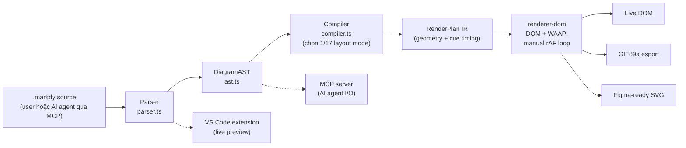
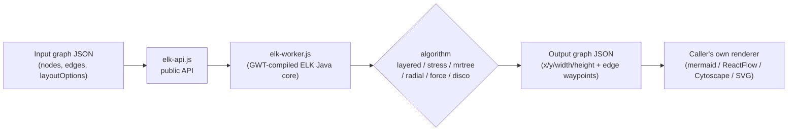
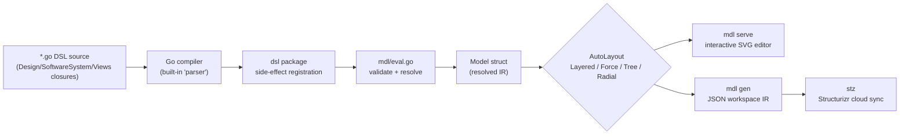

# Weekly Scan: Diagram Tooling — 2026-09-22

Phạm vi: repo mới publish hoặc update đáng kể trong 7 ngày qua (2026-09-15 → 2026-09-22), domain diagram-as-code / animation / layout / graph visualization. Nguồn: GitHub search API (`topic:diagram-as-code`, `topic:dsl`, `topic:svg-animation`, `topic:graph-visualization`, `topic:layout-algorithm`, tất cả `pushed:>2026-09-15`).

## Tóm tắt (executive summary)

- **Animation là mặt trận mới của "diagram-as-code"**: `markdy-com` (HoangYell) đóng gói đúng use-case kymostudio đang theo đuổi — DSL text → animated SVG/DOM, nhưng đi xa hơn với 17 layout engine chuyên biệt theo *loại* diagram (sequence/tree/swimlane/gantt…) và cơ chế "beat" cho narrative timing — đáng nghiên cứu sâu nhất tuần này.
- **Layout engine "nghiêm túc" vẫn nằm ngoài hệ sinh thái diagram-as-code truyền thống**: `elkjs` (Eclipse Layout Kernel, port sang JS) là thứ mermaid/ReactFlow đang dùng làm auto-layout backend — một tham chiếu tốt cho câu hỏi "kymostudio có nên tự viết layout hay cắm vào một layout kernel ngoài" mà `layout.py`/`alignment.py` hiện đang tự làm.
- **Embedded-DSL (Go closures) vẫn là một trường phái riêng biệt** so với text-DSL: `goadesign/model` (C4 diagrams, kế thừa tinh thần Structurizr) không parse text — nó *là* Go, biên dịch bằng chính Go compiler, error reporting đến free từ Go toolchain. Đối lập trực diện với cách tiếp cận line-oriented grammar của `dsl.py`.
- Một candidate thứ tư (`birdview`) hoá ra là JSON-schema + static-viewer chứ không có auto-layout thật — vẫn được giữ lại deep-dive vì minh hoạ rõ một anti-pattern đáng tránh (xem §4 của repo đó).

## Mục lục

1. [markdy-com (HoangYell/markdy-com)](#1-markdy-com-hoangyellmarkdy-com)
2. [elkjs (kieler/elkjs)](#2-elkjs-kielerelkjs)
3. [model (goadesign/model)](#3-model-goadesignmodel)
4. [birdview (Qiuner/birdview)](#4-birdview-qiunerbirdview)
5. [Cũng đã thấy nhưng không deep-dive](#5-cũng-đã-thấy-nhưng-không-deep-dive)

---

## 1. markdy-com (HoangYell/markdy-com)

### §1 — Quick context

DSL diagram động (`.markdy`) render ra DOM animation 60fps kiểu "narrated system walkthrough", khác Mermaid/D2 ở chỗ diagram *là* một timeline có beat, không chỉ là hình tĩnh. Tech stack: TypeScript monorepo (pnpm workspaces), parser ~14kB zero-dep, output DOM/GIF89a/Figma-SVG. Sức khoẻ repo: 95 stars, 3 forks, MIT, ~726 commit, có `ci.yml` + `release.yml` + `publish-vscode.yml` trong `.github/workflows`, có `tests/visual-baselines` (visual regression). Phân phối: npm (`@markdy/core`, `@markdy/renderer-dom`, `@markdy/cli`, `@markdy/mdx`, `@markdy/astro`), VS Code extension, MCP server cho AI agent, playground web.

### §2 — Architecture deep-dive

**A. Component inventory**
- `Parser` (`packages/core/src/parser.ts`) — line/indentation-aware state machine, sinh `DiagramAST` kèm `ParseError` có số dòng.
- `AST` (`packages/core/src/ast.ts`) — định nghĩa `DiagramAST` (scene metadata, styles, nodes, edges, groups, patterns, beats, diagnostics).
- `Compiler` (`packages/core/src/compiler.ts`) — biến `DiagramAST` thành `RenderPlan` (rank nodes, tính vị trí, route edge, schedule cue timing).
- `Diff` (`packages/core/src/diff.ts`) — "architectural evolution diff" giữa hai AST.
- `Router`/port-multiplexer (`packages/core/src/router.ts`) — orthogonal Manhattan routing + fillet connector cho parallel lane.
- `Symbols`/`Themes` (`packages/core/src/symbols.ts`, `themes.ts`, `theme-generator.ts`) — icon registry + 10 theme.
- `Renderer` (`packages/renderer-dom/src`) — nhận `RenderPlan`, materialize DOM node + Web Animations API, tự lái frame loop (không dùng WAAPI play trực tiếp).
- `MCP server` (`packages/mcp-server`) — expose DSL cho AI agent (Claude, Cursor…).
- `VS Code extension` (`packages/vscode`) — live preview.

**B. Pipeline / control flow** (theo `docs/ARCHITECTURE.md`, đọc trực tiếp):
1. User viết `.markdy` hoặc AI agent sinh ra qua MCP.
2. `parser.ts` đọc text → `DiagramAST` (line-numbered `ParseError` nếu sai grammar; có "soft-body fallback" khi host (MDX/JSX) làm mất indentation).
3. `compiler.ts`: `DiagramAST` → `RenderPlan` — chọn 1 trong 17 layout mode theo diagram kind (sequence/tree/constellation…), gán rank, route edge, tính canvas aspect ratio tự động từ rank depth/lifeline count/tree span.
4. `@markdy/renderer-dom` nhận `RenderPlan`, dựng DOM + inline style, khởi tạo animation ở trạng thái paused.
5. Frame loop tự set `anim.currentTime = sceneMs` mỗi rAF tick — chủ đích để playback **deterministic** giữa các browser thay vì để WAAPI tự chạy.
6. Output: DOM sống trong browser, hoặc export GIF89a / Figma-ready SVG qua CLI/playground.

**C. Data model / IR**: `DiagramAST` (bước 1) → `RenderPlan` (bước 2) là hai IR tách biệt — đúng khái niệm "compile xuống lower IR" giống D2/TALA, nhưng ở đây IR thứ hai đã bao gồm cả animation timing (cue schedule), không chỉ hình học. Không thấy bằng chứng IR immutable hay mutable qua các pass (không xác định — không đọc được source `compiler.ts` đầy đủ, chỉ có mô tả từ ARCHITECTURE.md).

**D. Input language design**: line-based, indentation + context recovery, không có BNF/EBNF chính thức trong `docs/SYNTAX.md` (chỉ ví dụ + bảng tham chiếu). Cú pháp chấp nhận nhiều biến thể tự do (`key value` / `key: value` / `key = value`, camelCase hay snake_case) — ưu tiên khoan dung hơn kymostudio's `dsl.py` (line-oriented nhưng "parsing thuần khai báo, không validate"). Error reporting: `ParseError` có số dòng, nhưng không có tài liệu về recovery/multi-error batching.

**E. Layout algorithm**: 17 layout engine chuyên biệt theo *loại sơ đồ* (không phải 1 engine tổng quát tham số hoá) — architecture, flowchart, tree, sequence, state, swimlane, gantt, radar, Venn, layer-stack... Routing: orthogonal Manhattan + "fillet" (bo góc) cho parallel lane, cộng "Route Pathfinder" tìm đường ngắn nhất giữa hai service để animate. Không có bằng chứng về crossing-minimization kiểu Sugiyama/barycentric — layout có vẻ rule-based theo rank/lifeline hơn là tối ưu hoá đồ thị tổng quát.

**F. Rendering/output**: single emitter chính (`@markdy/renderer-dom`, DOM + WAAPI), cộng backend phụ cho GIF89a và Figma SVG export. Animation cơ chế: WAAPI nhưng playback driven thủ công bằng rAF (không autoplay) để đảm bảo pixel-deterministic.

**G. Extensibility**: thêm node kind/cue type có "extension point" (theo ARCHITECTURE.md) nhưng không tài liệu hoá plugin API rõ ràng; theme qua `themes.ts`/`theme-generator.ts` (10 theme palette có sẵn).

**H. Dev experience**: playground web không cần cài đặt, VS Code extension với `Cmd+K V` live preview, MCP server cho agent workflow, CLI (`@markdy/cli`) cho CI. Có visual-regression baseline (`tests/visual-baselines`) — dấu hiệu tốt cho một renderer thay đổi byte thường xuyên (tương tự golden SVG test của kymostudio).

### §3 — Architecture diagram

### §4 — Verdict

**Bài học cụ thể cho kymostudio**: (1) tách IR thành hai tầng — `DiagramAST` (khai báo thuần, giống `dsl.py:parse()` output) và `RenderPlan` (đã có geometry + *timing*) — là mô hình đáng cân nhắc nếu kymostudio muốn animation phức tạp hơn hiện tại: `alignment.py:resolve_alignments()` đang gộp geometry-resolution vào một bước, có thể tách "cue schedule" thành pass riêng khi animate. (2) Route Pathfinder + fillet connector cho parallel lane là ý hay cho fan-in/trunk-lane staggering mà `alignment.py` đã có — đáng so sánh cách họ bo góc route. (3) Manual rAF-driven playback (thay vì để WAAPI tự chạy) để đảm bảo cross-browser deterministic là kỹ thuật đáng học cho `--animate` output của kymo. **Red flag**: 17 layout engine riêng biệt (thay vì 1 engine tham số hoá) là rủi ro bảo trì — mỗi loại diagram một thuật toán khác nhau, dễ phân kỳ hành vi; không có BNF chính thức cho DSL (khác kymostudio, nơi `docs/DSL.md` là normative). **Câu hỏi mở**: `compiler.ts` chọn layout mode dựa trên "diagram topology" — logic phân loại này chi tiết ra sao không đọc được từ tài liệu công khai. **Verdict: study deeper** — đặc biệt phần animation timing IR và route pathfinder.

---

## 2. elkjs (kieler/elkjs)

### §1 — Quick context

Port JavaScript (qua GWT) của Eclipse Layout Kernel — pure layout engine (không render), khác các "diagram tool" khác ở chỗ nó *chỉ* tính toán vị trí, để phần render cho caller (mermaid, ReactFlow, Cytoscape đều cắm nó làm backend). Tech stack: JavaScript/TypeScript wrapper quanh code Java compile-to-JS; input/output là JSON graph. Sức khoẻ: 2.8k stars, 124 forks, license EPL (kế thừa từ ELK/Eclipse), pushed 2026-09-17 (trong cửa sổ 7 ngày). Phân phối: npm (`elkjs`).

### §2 — Architecture deep-dive

**A. Component inventory**
- `elk-api.js` (`src/js` hoặc gói npm `lib/`) — public API: nhận graph JSON, trả Promise resolve positions.
- `elk-worker.js` — logic layout thực tế, sinh ra từ Java codebase của ELK qua GWT compiler (không phải tay viết JS).
- ELK Java core (`src/java/org/eclipse/elk`, `src/java-additional`) — nguồn thật của thuật toán, sống ở monorepo Eclipse ELK, được vendor/build vào JS ở đây.
- `typings/` — TypeScript type definitions cho API.

**B. Pipeline / control flow**:
1. Caller (vd. mermaid) `npm install elkjs`, `import ELK from 'elkjs'`.
2. Build đồ thị input dạng JSON: `{ id, layoutOptions, children: [...], edges: [...] }`.
3. `new ELK().layout(graph)` gọi `elk-api.js`.
4. `elk-api.js` forward request tới `elk-worker.js` (main thread hoặc Web Worker riêng nếu cấu hình).
5. `elk-worker.js` chạy thuật toán layout đã biên dịch từ Java (layered/stress/mrtree/radial/force/disco tuỳ `layoutOptions.algorithm`), trả về JSON đã gắn `x/y/width/height` cho từng node + waypoint cho edge.
6. Caller tự render JSON đó ra SVG/Canvas/DOM (elkjs không làm bước này).

**C. Data model/IR**: plain JSON graph, mutable in-place-ish (input graph object được "enrich" thêm toạ độ ở output) — không có AST hay ngôn ngữ text ở tầng này, elkjs chỉ là hàm thuần `graph → graph có toạ độ`. Không có khái niệm "lower IR" — input JSON gần như đã là IR.

**D. Input language design**: không có ngôn ngữ text/parser — input là cấu trúc dữ liệu JSON thuần (giống việc gọi trực tiếp `layout.py` với structure đã dựng sẵn, bỏ qua bước DSL). Không áp dụng error-reporting theo nghĩa parser.

**E. Layout algorithm**: đây là điểm mạnh nhất — multi-algorithm thật sự: `layered` (Sugiyama-style layer-based, có crossing minimization), `stress` (stress-majorization/force), `mrtree`, `radial`, `force`, `disco` (cho đồ thị rời rạc/disconnected). Đây là bộ thuật toán layout academic-grade, output qua `layoutOptions` cho phép fine-tune (spacing, direction, port constraints, edge routing orthogonal/spline).

**F. Rendering/output**: không có — elkjs cố tình đứng ngoài rendering, "pure layout engine". Đây là pattern pluggable-emitter ở mức cực đoan: tách hoàn toàn compute-layout khỏi draw.

**G. Extensibility**: thêm thuật toán layout mới nghĩa là đóng góp vào ELK Java core rồi build lại xuống JS — không phải việc làm ở tầng elkjs. Theme/styling: không có (ngoài phạm vi).

**H. Dev experience**: API đơn giản (Promise-based), hỗ trợ Web Worker để không block main thread, debug/logging execution time có sẵn. Không có CLI/watch mode/IDE preview riêng — nó là thư viện nhúng, không phải công cụ CLI.

### §3 — Architecture diagram

### §4 — Verdict

**Bài học cụ thể cho kymostudio**: elkjs là bằng chứng sống rằng tách "layout engine" thành một hàm thuần `graph JSON → graph JSON có toạ độ`, độc lập hoàn toàn với renderer, là kiến trúc bền vững — đúng tinh thần "renderer deliberately dumb" của kymostudio (`to_svg.py` chỉ vẽ data đã resolve), nhưng elkjs đẩy triết lý đó lên một tầng nữa: `layout.py`/`alignment.py` của kymostudio có thể học cách expose interface tương tự (nhận structure thuần, trả structure có toạ độ) để dễ test/so sánh độc lập với parser hay renderer. Đáng cân nhắc nghiêm túc: liệu kymostudio (cả Python lẫn JS impl) có nên offer một "escape hatch" cắm elkjs's `layered` algorithm cho các diagram không cần auto-layout tuỳ biến sâu, thay vì kymostudio phải tự nuôi toàn bộ logic Sugiyama nếu sau này cần? **Red flag**: không có, đây là dự án academic lâu năm, ổn định. **Câu hỏi mở**: chi phí runtime của việc chạy code Java-compiled-to-JS (qua GWT) so với native JS — có overhead bundle-size đáng kể không, chưa kiểm chứng. **Verdict: study deeper** (đặc biệt phần API contract giữa layout và render).

---

## 3. model (goadesign/model)

### §1 — Quick context

DSL C4-diagram nhúng trong Go (không phải text DSL) — khác Structurizr/PlantUML ở chỗ dùng chính Go compiler làm parser, không có cú pháp riêng để học. Tech stack: Go 1.23+, output SVG (qua `mdl` editor) hoặc JSON workspace upload lên Structurizr cloud (`stz`). Sức khoẻ: 467 stars, 23 forks, MIT, part của hệ sinh thái Goa framework (org lâu năm), pushed trong 7 ngày, có `svg_e2e_test.go` (test SVG output) trong `cmd/mdl`. Phân phối: `go install goa.design/model/cmd/mdl` / `cmd/stz`, dùng như Go library.

### §2 — Architecture deep-dive

**A. Component inventory**
- `dsl` package (`dsl/design.go`, `dsl/elements.go`, `dsl/relationship.go`, `dsl/views.go`, `dsl/styles.go`, `dsl/deployment.go`, `dsl/person.go`) — các hàm builder (`Design()`, `SoftwareSystem()`, `Container()`, `Person()`, `Views()`, `AutoLayout()`…) nhận closure lồng nhau, đây chính là "ngôn ngữ" — thực chất là Go.
- `mdl` package (`mdl/eval.go`, `mdl/model.go`, `mdl/views.go`, `mdl/elements.go`, `mdl/relationship.go`, `mdl/deployment.go`) — evaluate các closure DSL thành model struct thật + resolve.
- `cmd/mdl` (`main.go`, `serve.go`, `headless.go`, `watch.go`, `skill.go`) — CLI: `mdl serve` (editor tương tác), `mdl gen` (xuất JSON), headless render SVG, watch mode, "Cursor Agent Skill" tích hợp AI.
- `cmd/stz` — sync/upload workspace lên dịch vụ Structurizr cloud.
- `expr/` — expression evaluation phụ trợ (không xác định chi tiết — không đọc source).
- `plugin/` — plugin cho Goa framework (sinh diagram từ API/microservice design có sẵn).

**B. Pipeline / control flow**:
1. User viết file `.go` (vd. `examples/basic/model/model.go`) import `goa.design/model/dsl`, gọi `Design("...", "...", func() { ... })`.
2. `go run`/`mdl serve`/`mdl gen` compile file Go này bình thường bằng Go toolchain — không có bước "parse" riêng theo nghĩa text; các hàm DSL (`SoftwareSystem`, `Container`, `Views`...) tự đăng ký side-effect vào một package-level design object khi closure chạy.
3. `mdl/eval.go` evaluate + validate design đã đăng ký thành model struct hoàn chỉnh (check tên unique trong scope, merge nếu định nghĩa trùng).
4. Với mỗi `View` (SystemContextView/ContainerView…), áp dụng `AutoLayout(RankLeftRight)` hoặc thuật toán khác (Layered/Force/Tree/Radial) để tính vị trí.
5. `mdl serve` mở editor tương tác (pan/zoom/snap-to-grid/undo-redo) render SVG trực tiếp trong browser; hoặc `mdl gen` xuất JSON workspace.
6. `stz` (tuỳ chọn) upload JSON workspace lên Structurizr cloud để xem/chia sẻ.

**C. Data model/IR**: không có AST text — "IR" ở đây là chính Go struct được các closure DSL build dần (side-effect trong lúc closure chạy), sau đó `eval.go` "biên dịch" (validate + resolve) nó thành model hoàn chỉnh trước khi tính layout. Có khái niệm gần giống "compile xuống lower IR": design object (khai báo) → resolved model (đã validate, merge trùng lặp) → laid-out view (đã có toạ độ).

**D. Input language design**: **embedded DSL**, không phải parser độc lập — cú pháp = cú pháp Go (closures lồng nhau làm scope). Không có BNF/EBNF vì ngôn ngữ nền là Go, được đặc tả trong `DSL.md` dạng reference các hàm, không phải grammar hình thức. Error reporting: tận dụng Go compiler cho lỗi cú pháp (free), cộng validate riêng ở `eval.go` cho lỗi ngữ nghĩa (tên trùng, quan hệ không hợp lệ) — khác biệt lớn với parser tự viết của kymostudio.

**E. Layout algorithm**: `AutoLayout()` hỗ trợ nhiều thuật toán — Layered, Force, Tree, Radial (chọn qua tham số, vd. `RankLeftRight`) — cộng editor tương tác cho phép user chỉnh tay (drag, snap-to-grid, smart alignment) sau auto-layout ban đầu, tức là **hybrid**: auto-layout làm điểm khởi đầu, user override thủ công được lưu lại. Không thấy bằng chứng cụ thể về crossing-minimization (không đọc được source `mdl/eval.go` layout logic).

**F. Rendering/output**: `mdl serve`/headless render trực tiếp ra SVG trong browser (interactive editor, không chỉ static output); `mdl gen` xuất JSON workspace format (Structurizr-compatible) làm IR trung gian có thể tái sử dụng bởi tool khác. Đây là pluggable ở mức "hai backend chính": SVG editor cục bộ và JSON cho Structurizr cloud service.

**G. Extensibility**: `plugin/` cho phép Goa framework tự sinh model từ định nghĩa API/microservice có sẵn (tái dùng definition, không viết lại diagram). Style qua `ElementStyle()` trong `Styles()` block (background/color/shape) — theme mechanism nhúng ngay trong DSL, không phải file config riêng.

**H. Dev experience**: `mdl serve` có watch mode (`watch.go`) + editor tương tác pan/zoom/undo-redo ngay trong browser — hiếm thấy ở các diagram-as-code tool khác (đa số chỉ render tĩnh). Có "Cursor Agent Skill" (`skill.go`) tích hợp sẵn cho AI coding agent. CLI có test (`main_test.go`, `svg_e2e_test.go`) khá đầy đủ.

### §3 — Architecture diagram

### §4 — Verdict

**Bài học cụ thể cho kymostudio**: đây là phản đề thú vị cho `dsl.py`/`dsl.ts` — nếu kymostudio từng cân nhắc "có nên tự viết parser hay nhúng vào ngôn ngữ host", `goadesign/model` cho thấy cái giá phải trả (mất tính "diagram-as-plain-text", user phải biết Go, không thể chia sẻ file `.model` độc lập ngôn ngữ) đổi lấy cái được (free error reporting từ compiler, dễ mở rộng qua code thật). kymostudio đã chọn đúng hướng ngược lại (text DSL độc lập ngôn ngữ, `docs/DSL.md` normative) — nhưng chi tiết đáng học là **editor tương tác cho phép override auto-layout thủ công rồi persist lại** (`mdl serve`), một tính năng kymostudio hiện chưa có (DSL của kymo luôn định vị lại từ đầu qua `alignment.py`). **Red flag**: không có — dự án chững chạc, CI/test đầy đủ, org lâu năm (Goa). **Câu hỏi mở**: cơ chế merge khi "multiple definitions of the same element" trùng tên — điều gì xảy ra khi merge xung đột (style khác nhau)? không đọc được `eval.go` để xác nhận. **Verdict: glance only để lấy ý tưởng "hybrid auto+manual layout persist"**, không cần đọc sâu vì mô hình DSL-nhúng-Go không áp dụng trực tiếp cho kymostudio.

---

## 4. birdview (Qiuner/birdview)

### §1 — Quick context

Tool tạo "architecture map" HTML tĩnh từ JSON, dùng để AI coding agent trình bày phạm vi thay đổi trước khi sửa code — khác diagram tool truyền thống ở chỗ input là **JSON theo schema**, không phải DSL text, và mục đích là review/constraint-checking hơn là vẽ đẹp. Tech stack: TypeScript/ESM (Node ≥18), zero runtime dependency, output là một file HTML độc lập (self-contained viewer). Sức khoẻ: 579 stars, 53 forks, MIT, có `ci.yml` + `pages.yml`, có test browser-level (Playwright). Phân phối: npm CLI (`birdview` bin → `scripts/birdview.mjs`), cài qua "skills CLI" cho Claude Code/Codex/DeepSeek Harness.

### §2 — Architecture deep-dive

**A. Component inventory**
- `schemas/architecture.schema.json`, `schemas/activity.schema.json` — JSON Schema định nghĩa input (đây là "ngôn ngữ" — không phải text DSL mà là schema-validated JSON).
- `src/render.mts` — đọc trực tiếp: hàm `renderArchitecture(map, events, options)`, làm data-assembly + template substitution, **không tự tính layout/toạ độ**.
- `src/discover-constraints.mts`, `compile-constraint-rules.mts` — logic phát hiện + biên dịch rule kiến trúc (constraint engine).
- `src/validate.mts` — validate JSON input theo schema (dùng AJV).
- `assets/viewer` (không đọc được source trực tiếp, chỉ suy luận từ `render.mts`) — nơi thực sự vẽ/position node trên client-side, được nhúng nguyên khối vào HTML output.
- `scripts/birdview.mjs` — CLI entry point (bin).

**B. Pipeline / control flow**:
1. User/agent chạy `birdview` CLI hoặc slash command trong Claude Code/Codex.
2. Agent (hoặc người) viết/khai báo `architecture.json` theo `architecture.schema.json` (module, ownership, connection, evidence file).
3. `validate.mts` check JSON hợp lệ theo schema (AJV).
4. `render.mts::renderArchitecture()` load asset tĩnh (icon SVG từ lucide-static, CSS, JS bundle của viewer), base64-encode logo/favicon, nhúng JSON data + `constraintCatalog`/`events` vào template `architecture.html`.
5. Output là một file HTML độc lập — mở trực tiếp trong browser, không cần server; phần vẽ/vị trí node do JS bundle nhúng sẵn (`viewer.js`) xử lý ở client-side, ngoài tầm quan sát của `render.mts`.
6. Agent workflow: hiển thị scope thay đổi → chờ user confirm → agent code → ghi lại verification result (theo README).

**C. Data model/IR**: JSON đã được validate theo schema chính là IR — phẳng, do agent khai báo tay (không sinh tự động từ phân tích code thật; README nói rõ "relies on agent-declared activity rather than automatic observation"). Không có bước "compile xuống layout IR" ở tầng `render.mts` — công đoạn đó, nếu có, nằm hoàn toàn trong `viewer.js` không đọc được từ nguồn công khai đã fetch.

**D. Input language design**: JSON Schema, không phải parser text — validate qua AJV, lỗi là JSON Schema validation error (không có dòng/cột theo nghĩa text DSL). Không áp dụng khái niệm BNF/PEG.

**E. Layout algorithm**: **không xác định** — `render.mts` xác nhận không tự tính layout; layout thật (nếu có) nằm trong `assets/viewer` bundle chưa đọc được nguồn, và `package.json` devDependencies không lộ ra thư viện layout đồ thị nào (không có d3-force/dagre/elkjs trong danh sách đã xem). Rất có thể đây là view dạng list/card theo module, không phải graph layout tự động thật sự.

**F. Rendering/output**: single output — file HTML tự chứa (self-contained), không backend thứ hai. Không có animation.

**G. Extensibility**: constraint rule mới qua `compile-constraint-rules.mts`; không có plugin system tài liệu hoá cho format/icon mới ngoài chỉnh schema.

**H. Dev experience**: CLI đơn giản, tích hợp sẵn slash-command cho nhiều AI harness (Claude Code, Codex, DeepSeek Harness), song ngữ Anh/Trung trong output — điểm cộng UX hiếm gặp. Không có watch mode/IDE preview theo tài liệu đã đọc.

### §3 — Architecture diagram

Insufficient evidence — chỉ có 2 component có bằng chứng rõ ràng về pipeline thật (validate + render/template-substitution); phần layout/positioning quan trọng nhất nằm trong bundle client-side chưa đọc được nguồn, nên không đủ cơ sở vẽ pipeline layout đầy đủ như yêu cầu (cần ít nhất parser → IR → renderer đều có bằng chứng).

### §4 — Verdict

**Bài học cụ thể cho kymostudio**: bài học ở đây là một **cảnh báo**, không phải kỹ thuật để copy — birdview tự nhận input là "agent-declared", nghĩa là độ chính xác của "architecture map" phụ thuộc hoàn toàn vào agent khai đúng, không có nguồn xác thực từ static analysis thật; nếu kymostudio từng cân nhắc thêm một chế độ "AI tự sinh `.kymo` mô tả kiến trúc repo", cần tách rõ "agent-asserted" khỏi "verified from code" (kymostudio hiện tại là ngược lại — DSL là nguồn sự thật do người viết, `alignment.py` resolve xác định-luôn-đúng, không có tầng "agent tự khai rồi tin"). **Red flag**: README tự thừa nhận giới hạn ("uses file snapshots", "relies on agent-declared activity", "confirmation is conversational rather than enforced") — minh bạch nhưng cũng là dấu hiệu tool còn non; phần lõi (layout/rendering thật) nằm trong bundle không audit được từ nguồn công khai đã fetch, khó đánh giá chất lượng kỹ thuật thật. **Câu hỏi mở**: `assets/viewer` có dùng graph-layout algorithm nào không, hay chỉ là card/list theo module — chưa xác minh được. **Verdict: glance only** — hữu ích để hiểu xu hướng "diagram cho AI agent context", không có kỹ thuật layout/renderer đáng học sâu.

---

## 5. Cũng đã thấy nhưng không deep-dive

- **archdraw** (No1Joon/archdraw, TS) — sinh cloud architecture diagram (SVG/PNG) từ YAML, 793 icon AWS + 216 GCP, target AI CLI; đáng xem nếu cần tham khảo icon-catalogue pattern cho `icons.py`.
- **tlk-truss** (Talkdedsec/tlk-truss, JS) — "architecture diagrams bound to real code, CI fails when drawing drifts" — ý tưởng drift-detection giữa diagram và code thật thú vị nhưng repo 0 sao, quá non để đánh giá chất lượng.
- **dinghy** (dinghydev/dinghy, TS) — "Diagram and Infrastructure as Code with React" — diagram định nghĩa bằng JSX component, đáng liếc nếu kymostudio từng cân nhắc React-based front-end cho DSL thay vì text.
- **PinViz** (nordstad/PinViz, Python) — sinh sơ đồ đấu nối GPIO dạng SVG cho ESP32/RaspberryPi — niche nhưng minh hoạ tốt use-case "diagram-as-code cho hardware pinout".
- **Tiledesk/design-studio** (TS) — visual no-code designer cho conversation flow dạng graph, gần biên giới "workflow builder" hơn "diagram tool" nhưng có graph-visualization đáng chú ý.
- **OCI-draw.io-Architect** (sergio-farfan, Python) — Claude Code plugin sinh draw.io diagram từ Terraform config — pattern "IaC → diagram" đáng tham khảo cho hướng BPMN/cross-format import của kymostudio.

**Loại trừ đáng chú ý**: `plantuml/plantuml` xuất hiện trong kết quả search nhưng bị loại vì đây là hoạt động liên tục bình thường của một dự án 13k sao đã ổn định nhiều năm, không phải "cập nhật đáng kể trong tuần"; `tt-a1i/archify` bị loại vì stargazer count (69,157) bất thường so với tuổi/nội dung repo — nghi vấn fake-star, không đủ tin cậy để deep-dive; `networkx`, `pygraphviz`, `graphistry/pygraphistry` bị loại vì đây là graph-analysis/data-science library, không phải diagram-as-code tool theo tiêu chí loại trừ đã cho.
