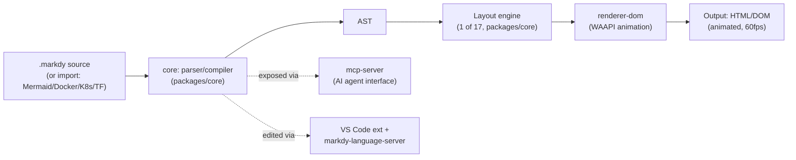
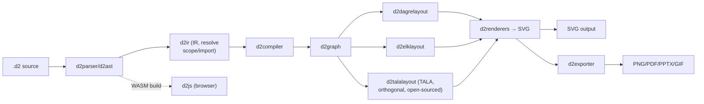
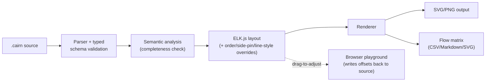
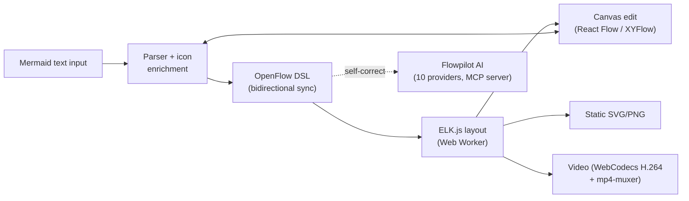

# Weekly Scan — Diagram-as-Code / Visual Tooling (2026-09-23)

## Tóm tắt điều hành

- Sự kiện lớn nhất trong domain tuần này không phải một repo mới, mà là **TALA — layout engine độc quyền đứng sau D2 — được Terrastruct mã nguồn mở (MPL-2.0) và bundle thẳng vào D2 v0.9.0** (ngày 7/9/2026), song song với việc D2 được chuyển giao cho Hack Club vận hành phi lợi nhuận và tổ chức GitHub đổi tên `terrastruct/d2` → `d2lang/d2`. Đây là nguồn tham khảo tốt nhất hiện có cho bài toán layout orthogonal cho architecture diagram — đúng thứ kymostudio cần cho `alignment.py`/`alignment.ts`.
- Hai dự án mới nổi rất gần với định vị của kymostudio (DSL → **animated SVG/DOM**, có MCP server cho AI agent): **Markdy** (TypeScript, 17 layout engine, Web Animations API, ingest Mermaid/Docker/K8s/Terraform) và **Chartado** (sản phẩm đóng, không có repo public, nhưng tài liệu ngôn ngữ đáng đọc vì cùng hướng "animate the data flow").
- Xu hướng chung của tuần: layout engine ngày càng dùng **ELK.js** làm nền (Cairn, OpenFlowKit) thay vì tự viết Sugiyama từ đầu, và nhiều tool đang thêm lớp **AI self-correcting / MCP server** làm giao diện chính cho coding agent thay vì con người gõ tay — kymostudio nên cân nhắc câu chuyện MCP tương tự cho `kymo` CLI.

## Mục lục

1. [Markdy (HoangYell/markdy-com)](#1-markdy-hoangyellmarkdy-com)
2. [D2 + TALA (d2lang/d2)](#2-d2--tala-d2langd2)
3. [Cairn (R0kshan/cairn)](#3-cairn-r0kshancairn)
4. [OpenFlowKit (Vrun-design/openflowkit)](#4-openflowkit-vrun-designopenflowkit)
5. [Các repo khác đã ghi nhận trong tuần](#5-các-repo-khác-đã-ghi-nhận-trong-tuần)

Tổng số ứng viên tìm được: **9** (4 deep-dive + 5 ghi nhận ngắn).

---

## 1. Markdy (HoangYell/markdy-com)

### §1 — Quick context

DSL diagram-as-code chuyên cho **animated system-behavior explainer** (không chỉ topology tĩnh), render bằng Web Animations API thay vì Canvas/GSAP. Stack: TypeScript monorepo, zero-dependency compiler (~14 kB), output HTML/DOM có animation (không phải SVG file tĩnh), VS Code extension + MCP server. Repo health: 95 sao, 726 commit, MIT, có CI (unit/integration + visual-regression baselines). Phân phối: npm (`@markdy/cli`, `@markdy/core`...), VS Code marketplace, website `markdy.com` có playground.

### §2 — Architecture deep-dive

**A. Component inventory** (monorepo `packages/`):
- `core` (`packages/core`) — parser + compiler → AST, tự nhận là "14 kB zero-dependency".
- `renderer-dom` (`packages/renderer-dom`) — engine animation dùng Web Animations API, thuần CSS/SVG transform, không Canvas.
- `cli` (`packages/cli`) — `markdy render`, `markdy lint`, `markdy import`.
- `mcp-server` (`packages/mcp-server`) — expose compiler cho AI agent (Claude, Cursor, Antigravity) qua Model Context Protocol.
- `compat` (`packages/compat`) — bộ chuyển đổi ingest từ Mermaid, Docker Compose, Kubernetes, Terraform, Draw.io sang `.markdy`.
- `vscode` (`packages/vscode`) — live preview, `markdy-language-server` — LSP riêng.
- `stdlib-systems` (`packages/stdlib-systems`) — thư viện icon/vocabulary ngữ nghĩa (giống `icons.py` của kymostudio).
- `astro`, `mdx` — nhúng diagram vào doc site (SSR islands).

**B. Pipeline** (happy path):
1. Người dùng viết `system.markdy` (hoặc `markdy import docker-compose.yml`).
2. `markdy lint` / `core` parse → AST.
3. AST được compile theo `layout <mode>` khai báo trong `scene` (1 trong 17 layout engine: architecture, flowchart, tree, sequence, swimlane, gantt, radar, venn...).
4. `beat` blocks (các bước tường thuật tuần tự) được biên dịch thành animation timeline (WAAPI keyframes) trong `renderer-dom`.
5. `markdy render system.markdy --out diagram.html` xuất DOM/CSS/SVG động, tự chạy ở 60fps trong trình duyệt.
6. (Tuỳ chọn) `mcp-server` cho phép agent tự sinh/sửa `.markdy` và preview trực tiếp.

**C. Data model / IR**: AST nội bộ trong `core`, không có tài liệu công khai mô tả có "lower IR" kiểu TALA hay không — **không xác định** mức độ mutable/immutable qua các pass; README chỉ khẳng định compiler zero-dependency và AST-based.

**D. Input language design**: cú pháp custom, dòng khai báo kiểu `type ID "Label"` cho node và operator `->` (request) / `<-` (response) / `~>` (async event) cho edge, cộng khối `beat name "..."` xác định animation step (tương tự khái niệm story-boarding). Không thấy EBNF/BNF chính thức trong nội dung đã đọc — tài liệu ngữ pháp nằm ở `docs/SYNTAX.md` (chưa fetch được nội dung chi tiết). Không xác định chiến lược báo lỗi cụ thể (parser combinator hay regex line-based) — chỉ biết compiler nhỏ, zero-dep.

**E. Layout algorithm**: 17 "layout engine" chuyên biệt theo thể loại diagram (architecture/flowchart/tree/state/sequence/layers/swimlane/gantt/quadrant/pyramid/medallion/timeline/flywheel/constellation/radar/venn/nested) — nghĩa là chọn template layout theo domain thay vì một thuật toán tổng quát duy nhất. Không có mô tả cụ thể về crossing-minimization hay orthogonal routing — **không xác định** chi tiết thuật toán bên trong từng engine.

**F. Rendering/output**: renderer duy nhất là DOM + WAAPI (không Canvas, không GIF) — animation là cơ chế trung tâm, khác kymostudio (SVG `<animate>`/CSS trong file tĩnh). Output chính là HTML nhúng animation, không phải file SVG portable.

**G. Extensibility**: thêm hệ thống mới qua `stdlib-systems` (vocabulary icon), thêm ingest format mới qua `compat`; theme qua 10 theme có sẵn (midnight, paper, blueprint, sketchy...).

**H. Dev experience**: có VS Code extension + LSP riêng (`markdy-language-server`), preview trực tiếp trong editor (`Cmd+K V`), CLI có `lint`/`watch`-style workflow, playground web. Đây là điểm mạnh nhất so với kymostudio hiện chưa có LSP.

### §3 — Architecture diagram

### §4 — Verdict

Đáng học nhất: **animation-as-narrative** — `beat` block coi animation là chuỗi bước tường thuật (giống storyboard) chứ không phải hiệu ứng trang trí; kymostudio's `--animate` có thể học ý tưởng "beat" để tách timeline animation khỏi topology tĩnh một cách tường minh trong DSL, thay vì suy ra animation implicit. `compat` layer (ingest Mermaid/Docker Compose/K8s/Terraform → DSL nội bộ) là mô hình hay để tham khảo cho việc mở rộng BPMN importer sang các nguồn khác. Red flag: output chính là HTML/DOM động, không phải SVG file — kém portable hơn cách tiếp cận SVG-native của kymostudio; "zero dependency 14kB" nhưng monorepo có LSP + MCP + 8 package — độ phức tạp vận hành cao cho một side-project non-mature (95 sao). Câu hỏi mở: engine chọn layout nào trong 17 loại — tự động hay bắt buộc khai báo `layout <mode>`? Verdict: **study deeper** (riêng phần `compat` ingest + khái niệm `beat`).

---

## 2. D2 + TALA (d2lang/d2)

### §1 — Quick context

D2 không phải repo mới, nhưng tuần này có thay đổi kiến trúc/tổ chức lớn nhất trong cả domain: layout engine độc quyền **TALA** được mã nguồn mở và bundle vào D2 v0.9.0, đồng thời tổ chức GitHub đổi từ `terrastruct/d2` sang `d2lang/d2` (D2 được chuyển giao cho Hack Club vận hành phi lợi nhuận, 8/2026). Stack: Go, MPL-2.0, output SVG/PNG/GIF/PDF/PPTX. Repo health: 25.5k sao, 5412 commit, CI đầy đủ (`ci/`, `e2etests/`). Phân phối: binary (Homebrew/shell installer/Docker `d2lang/d2`), npm wrapper (`@d2lang/d2` — trước là `@terrastruct/d2`), Go module.

### §2 — Architecture deep-dive

**A. Component inventory** (top-level Go packages, tên tự mô tả rõ ràng pipeline):
- `d2parser` — parser cú pháp `.d2`.
- `d2ast` — Abstract Syntax Tree.
- `d2ir` — **Intermediate Representation** (bước "compile xuống IR thấp hơn" giống ý D2 nổi tiếng, tách biệt cú pháp khỏi ngữ nghĩa scope/import).
- `d2compiler` — biên dịch IR → `d2graph` (graph resolved, có style/scope đã áp).
- `d2graph` — graph model dùng chung cho layout + render.
- `d2layouts` — điều phối layout, chứa các engine con: `d2dagrelayout` (Sugiyama/DAG qua dagre), `d2elklayout` (ELK), `d2talalayout` (TALA — orthogonal, aesthetic-objective), `d2grid`, `d2near`, `d2sequence` (layout riêng cho sequence diagram).
- `d2renderers` — sinh SVG/theme từ graph đã có toạ độ.
- `d2exporter` — xuất PNG/PDF/PPTX/GIF từ SVG.
- `d2cli`, `d2lib`, `d2oracle` (API chỉnh sửa AST theo intent), `d2lsp` (Language Server), `d2js` (WASM build cho JS/browser).

**B. Pipeline**: 1) user chạy `d2 in.d2 out.svg [--layout=tala]`; 2) `d2parser`/`d2ast` parse text → AST; 3) `d2ir` hạ AST xuống IR (resolve import, scope, substitution — có giới hạn "resource limits" mới: nesting depth, import chain, substitution budget theo changelog "next"); 4) `d2compiler` biên dịch IR → `d2graph`; 5) `d2layouts` chọn 1 trong 3 engine bundled (dagre/elk/tala) để gán toạ độ; 6) `d2renderers` → SVG, rồi `d2exporter` xuất thêm PNG/PDF/PPTX/GIF nếu được yêu cầu.

**C. Data model / IR**: có khái niệm IR tường minh (`d2ir`) tách biệt khỏi AST và khỏi graph cuối — đúng mô hình "compile xuống lower IR" mà câu hỏi gợi ý (giống TALA-style nhưng đây là compiler pipeline riêng của D2, không phải TALA). Không xác định chi tiết mutable/immutable giữa các pass từ nội dung đã đọc.

**D. Input language design**: `.d2` — ngôn ngữ khai báo dòng-lệnh (`shape.attr: value`, `a -> b: label`), có `d2format` (auto-formatter) và `d2lsp` — cho thấy grammar đủ hình thức để build LSP/formatter, nhưng nội dung EBNF cụ thể không xác định từ những gì đã fetch. Đáng chú ý: bản changelog "next" nhấn mạnh hardening chống input độc hại (giới hạn network fetch riêng `--allow-private-network`, giới hạn độ sâu lồng nhau) — cho thấy D2 coi input DSL là attack surface cần validate nghiêm ngặt, một góc nhìn kymostudio ít nhấn mạnh.
**E. Layout algorithm — trọng tâm nghiên cứu tuần này**: 3 engine bundled sẵn — `dagre` (Sugiyama/DAG kinh điển, một hướng), `elk` (Eclipse Layout Kernel, nhiều thuật toán con), và **TALA**: theo blog chính thức, TALA là orthogonal layout engine thiết kế riêng cho architecture diagram (không theo DAG một chiều như dagre), dùng **heuristic search có randomness/seed** để tối ưu đồng thời nhiều "aesthetic objective": symmetry, median distance, flow, clustering các node cùng loại. Trade-off đã công bố: kém hiệu quả hơn trên DAG lớn, scale phi tuyến khi diagram lớn. Edge routing: TALA orthogonal, dagre/elk theo phong cách riêng của từng thư viện.

**F. Rendering/output**: SVG là backend chính, `d2exporter` re-render sang PNG/PDF/PPTX/GIF — pattern **single internal graph model, nhiều emitter** giống kiến trúc `to_svg.py`/`to_figma.py`/`to_excalidraw.py` của kymostudio.

**G. Extensibility**: layout engine là pluggable qua `--layout=<name>`; theme qua `d2themes`; trước đây có "legacy plugin system" cho layout bên ngoài nhưng changelog "next" ghi rằng hệ thống đó đã bị gỡ, chỉ còn 3 engine built-in — một quyết định đáng chú ý (đơn giản hoá, giảm attack surface, đánh đổi mất khả năng cắm layout engine bên thứ ba).

**H. Dev experience**: có formatter, LSP, `d2oracle` (sửa AST theo "intent" — API để tool khác thao túng diagram theo ngữ nghĩa thay vì text thô), WASM build cho trình duyệt.

### §3 — Architecture diagram

### §4 — Verdict

Giá trị nghiên cứu lớn nhất tuần này: **đọc source `d2talalayout` và blog TALA** để lấy ý tưởng cho `alignment.py`/`alignment.ts` — đặc biệt cách TALA định nghĩa layout như bài toán multi-objective (symmetry + median distance + flow + clustering) thay vì thuần crossing-minimization kiểu Sugiyama, và cách nó dùng nhiều seed rồi chọn kết quả tốt nhất (kymostudio hiện dùng layout xác định/deterministic theo `layout.py`, nên đây là một trade-off có chủ đích cần cân nhắc trước khi bắt chước — random-seed search khó giữ golden-SVG byte-for-byte). Việc D2 gỡ bỏ "legacy plugin system" để chỉ giữ 3 engine built-in là tín hiệu: pluggable-everything có chi phí bảo trì thật, đáng cân nhắc khi kymostudio định mở rộng emitter/layout. `d2oracle` (sửa AST theo intent) là ý hay cho tool AI-agent chỉnh sửa `.kymo` an toàn thay vì text-diff thô. Verdict: **study deeper**, ưu tiên đọc `d2talalayout` + `d2ir`.

---

## 3. Cairn (R0kshan/cairn)

### §1 — Quick context

DSL diagram-as-code tập trung hẹp vào 3 loại "software architecture view" (logical/application/infrastructure) với mục tiêu chính là **zero label-overlap có CI gate**, khác các tool chung chung (D2/Mermaid) vốn không cam kết overlap=0. Stack: TypeScript/Node ≥22.6, layout dựa trên **ELK.js** (Eclipse Layout Kernel), output SVG/PNG + flow-matrix CSV/Markdown. Repo health: 49 sao, Apache-2.0, có `.github` CI + `/tests`, đang ở giai đoạn pre-release ("stable version sau khi hết issue mở"). Phân phối: npm/from-source, binary qua install script, Homebrew tap, Scoop; có browser playground riêng (Vercel).

### §2 — Architecture deep-dive

**A. Component inventory** (suy từ cấu trúc thư mục + README, không có access trực tiếp source code Go/TS bên trong `src/`):
- `bin/` — CLI executable.
- `src/` — chứa parser, validator, layout binding tới ELK.js, renderer SVG/PNG (không tách được path file cụ thể từ nội dung đã đọc — **không xác định** tên module chính xác bên trong `src/`).
- `tests/` — test suite (bao gồm đo overlap=0 mỗi build, theo README).
- `examples/` — sample `.cairn` files.
- `documentation/` — gồm `DSL_SPEC.md`, `ARCHITECTURE.md`, `DIAGNOSTICS.md`.
- `playground/` — browser playground với "drag-to-adjust" ghi ngược offset vào source text.
- `packaging/` — install script, Homebrew tap, Scoop manifest.

**B. Pipeline** (theo README, 5 lệnh CLI ánh xạ khá sát các stage kinh điển): 1) `cairn new -L/-A/-I` scaffold file `.cairn` theo 1 trong 3 view; 2) `cairn validate` — parse + schema-typed validation + phát hiện thiếu sót ngữ nghĩa (completeness check), lỗi có mã chẩn đoán (diagnostic code) và vị trí nguồn; 3) layout tự động qua ELK.js, có 3 override tường minh: `order:` (thứ tự dọc theo hướng đọc), attachment-side pinning (`.left/.right/.top/.bottom`), line-style glyph (`->`, `-->`, `..>`); 4) `cairn build` render SVG (đo & chặn overlap trong bước này); 5) `cairn matrix` xuất bảng flow riêng (CSV/Markdown/SVG) từ cùng model; 6) output SVG/PNG + matrix xuất hiện.

**C. Data model / IR**: không xác định rõ có tầng IR tách biệt hay không — README chỉ mô tả "parsing → semantic analysis → layout (ELK.js) → rendering" như 4 stage tuần tự, không nói rõ cấu trúc dữ liệu (class/dataclass/plain object).

**D. Input language design**: DSL khai báo phân cấp — `actor`, `block`, `system { layer { block } }` (nesting rõ ràng theo kiểu C4/khối lồng khối), flow dùng `A -> B : "label" [BUSINESS_OBJECT]` với glyph phân biệt nét liền/đứt/chấm, cộng cú pháp pin cạnh gắn (`FORM.right -> TRIAGE.left`). Có tài liệu ngữ pháp riêng `DSL_SPEC.md` (chưa fetch được nội dung chi tiết — chỉ biết nó tồn tại). Báo lỗi có mã chẩn đoán tra cứu được qua `cairn explain CODE`, xuất JSON cho CI — đây là điểm rất đáng học, tốt hơn free-text error phổ biến.

**E. Layout algorithm**: **không tự viết layout engine** — dùng thẳng ELK.js (thư viện Java/JS layout đã được port, cũng chính là engine đứng sau D2's `d2elklayout` và nhiều tool khác) làm nền, sau đó lớp riêng của Cairn thêm: reserve không gian cho label trong lúc layout, đo overlap sau mỗi build và fail CI nếu >0, cùng 3 override thủ công (order/side-pin/line-style) cho tác giả can thiệp cục bộ mà vẫn giữ layout tự động cho phần còn lại — mô hình "auto layout + escape hatch tối thiểu" khá gần triết lý `layout.py`/`alignment.py` của kymostudio (auto-layout frame + parent/child anchoring thủ công).

**F. Rendering/output**: SVG/PNG, cộng một output phụ đặc thù — flow matrix (bảng liệt kê toàn bộ flow, dùng cho tài liệu infra/security review) xuất CSV/Markdown/SVG từ cùng 1 model, không phải tính năng phổ biến ở Mermaid/D2/kymostudio.

**G. Extensibility**: 9 theme built-in, 37 logo công nghệ built-in (`cairn logos` liệt kê), localization qua `style { lang: fr }`. Không thấy plugin system cho layout/renderer ngoài override thủ công.

**H. Dev experience**: CLI có `explain CODE` tra lỗi, `validate` xuất JSON cho CI, `watch` mode rebuild khi lưu file, browser playground hỗ trợ kéo-thả rồi ghi ngược offset vào text nguồn (giữ nguồn versionable) — cơ chế "WYSIWYG ghi ngược vào DSL" đáng học cho một editor tương lai của kymostudio.

### §3 — Architecture diagram

### §4 — Verdict

Ý hay đáng cân nhắc cho kymostudio: (1) **overlap=0 làm CI gate tường minh** — kymostudio có golden-SVG test byte-for-byte nhưng không có metric "đo overlap mỗi build"; thêm một assertion tương tự (đặc biệt cho label cạnh) có thể bắt regression về layout mà golden test dạng byte-diff đôi khi bỏ sót nếu ai đó update golden mà không nhìn kỹ. (2) **Error code + `explain CODE`** là UX lỗi tốt hơn hẳn so với exception message tự do — đáng tham khảo cho `dsl.py`/`dsl.ts`. (3) **Flow matrix xuất từ cùng model** là ví dụ tốt về "một IR, nhiều emitter phi-hình-ảnh" (không chỉ SVG/PNG mà cả bảng dữ liệu) — kymostudio có thể học để export bảng edge/BPMN sang CSV cho review. Red flag: dự án còn rất non (49 sao, chưa có bản stable), không đọc được source code TS thật sự (đường dẫn `src/` không phân giải được nội dung chi tiết) nên nhiều nhận định ở mục D/C dựa hoàn toàn vào README, không xác nhận trực tiếp. Verdict: **study deeper** riêng 3 ý trên, phần còn lại **glance only**.

---

## 4. OpenFlowKit (Vrun-design/openflowkit)

### §1 — Quick context

Không phải một DSL compiler độc lập mà là **canvas editor local-first** đồng bộ 2 chiều giữa canvas (React Flow) và text (Mermaid + "OpenFlow DSL" riêng), có AI agent tự sửa DSL sai và xuất cả video (WebCodecs). Stack: React 19 + TypeScript 5 + Vite 6, layout ELK.js chạy trong Web Worker, state Zustand, lưu trữ IndexedDB, MCP server riêng. Repo health: ~500-760 sao (số liệu lệch giữa nguồn do có fork song song `alisoliman/openflowkit`), MIT (core), có Vitest + Playwright + "test:mermaid" quality gate. Phân phối: static SPA (Cloudflare Pages/Netlify/Vercel/Docker), không phải thư viện npm cài vào project khác.

### §2 — Architecture deep-dive

**A. Component inventory**: README không show cây thư mục chi tiết (chỉ liệt kê `dist/`, `mcp-server/`), nên inventory chủ yếu dựa vào bảng "Technology" trong README: UI framework React 19 + TypeScript, canvas engine **React Flow (XYFlow)**, layout **ELK.js chạy trong Web Worker** (tách khỏi main thread — khác Cairn dùng ELK.js đồng bộ), video export **WebCodecs H.264 + mp4-muxer**, `mcp-server/` — MCP implementation riêng cho Claude Desktop/Cursor/Windsurf. Không xác định tên file parser/renderer cụ thể.

**B. Pipeline** (suy từ mô tả "dual-format" + AI-assisted): 1) người dùng nhập Mermaid text hoặc vẽ trực tiếp trên canvas (React Flow); 2) engine parse Mermaid → enrich node bằng icon thương hiệu (semantic detection từ tên service, kho >1600 icon) → đồng bộ ngược thành "OpenFlow DSL" hiển thị ở code panel; 3) ELK.js (trong Web Worker, không block UI) tính toán vị trí node/cạnh; 4) React Flow render canvas; 5) (tuỳ chọn) "Flowpilot" — AI provider (10 lựa chọn, kể cả Ollama local) sinh/sửa DSL, có vòng self-correct: DSL lỗi → model tự đọc lại chính output của mình → tự sửa; 6) xuất SVG/PNG tĩnh hoặc video H.264 qua WebCodecs.

**C. Data model / IR**: không xác định — README không mô tả cấu trúc dữ liệu nội bộ, chỉ biết state quản lý qua Zustand và cache qua IndexedDB (client-side, không có server).

**D. Input language design**: chấp nhận **2 cú pháp đồng thời** — Mermaid chuẩn (để tương thích hệ sinh thái sẵn có) và "OpenFlow DSL" riêng đồng bộ 2 chiều với canvas; không có tài liệu ngữ pháp hình thức trong nội dung đã đọc — **không xác định** approach parser (regex/PEG/khác). Chiến lược báo lỗi đặc trưng: không cố "báo lỗi đúng" mà dựa vào AI tự phát hiện + tự sửa DSL sai ("bad DSL → AI sees its own output and repairs it") — một hướng đi khác biệt hẳn so với validate tường minh của Cairn.

**E. Layout algorithm**: ELK.js (giống Cairn), điểm khác biệt kỹ thuật là chạy trong **Web Worker** để không đứng UI khi diagram lớn — một chi tiết engineering đáng note dù không phải đổi mới thuật toán.

**F. Rendering/output**: canvas render qua React Flow (SVG-based dưới nền), xuất tĩnh SVG/PNG, và đặc biệt là **video H.264 qua WebCodecs API + mp4-muxer trực tiếp trong trình duyệt** — không cần server-side ffmpeg, khác hẳn cách kymostudio dùng `kymostudio-core`/resvg cho PNG/WebP. Đây là kỹ thuật rendering-craft đáng nghiên cứu riêng nếu kymostudio muốn thêm export video cho `--animate`.

**G. Extensibility**: >1600 icon với auto-detection theo tên service (giống `icons.py` nhưng theo hướng "đoán icon từ text" chứ không phải khai báo namespace tường minh như Chartado); AI provider pluggable (10 provider, kể cả local Ollama) qua settings runtime, không cần biến môi trường.

**H. Dev experience**: `npm run dev` (Vite, port 5173), test riêng `test:mermaid` để gate chất lượng parser Mermaid, e2e Playwright, không cần backend/API key bắt buộc (chạy hoàn toàn local-first).

### §3 — Architecture diagram

### §4 — Verdict

Kỹ thuật đáng steal nhất: **video export bằng WebCodecs H.264 trực tiếp trong trình duyệt (không cần ffmpeg server-side)** — nếu kymostudio muốn thêm output "animated video" cho playground web (`packages/website`) thay vì chỉ SVG animation, đây là con đường khả thi không cần đụng tới `kymostudio-core`. Ý tưởng "dual-format đồng bộ 2 chiều" (Mermaid text ↔ canvas ↔ OpenFlow DSL) cũng đáng cân nhắc dài hạn cho một editor trực quan của kymostudio, dù rủi ro lớn là giữ đồng bộ chính xác 2 chiều rất khó (không có bằng chứng cụ thể về cách họ giải quyết conflict). Red flag: đây về bản chất là **canvas editor + AI wrapper quanh Mermaid/ELK.js có sẵn**, không phải nghiên cứu layout/parser mới — phần lớn giá trị kỹ thuật nằm ở tích hợp (React Flow + ELK Web Worker + WebCodecs), không phải thuật toán gốc; số sao lệch giữa các nguồn (482 vs 763) và có fork song song (`alisoliman/openflowkit`) cần xác minh thêm ai là canonical repo trước khi trích dẫn lại. Verdict: **glance only** (trừ phần WebCodecs export nên **study deeper** riêng).

---

## 5. Các repo khác đã ghi nhận trong tuần

- **Chartado** (chartado.com, chưa tìm thấy repo GitHub public) — text-to-animated-diagram cho AWS/AI-stack, ngôn ngữ 8 ký hiệu (`->`, `{A,B}` fan-out, `|A,B|` choice), layout theo "column = độ sâu lồng arrow", triết lý "parser không bao giờ throw, luôn render ra box thay vì báo lỗi" — đáng đọc tài liệu ngôn ngữ dù không đọc được code.
- **awslabs/diagram-as-code** (Go, 1.6k sao, 330 commit) — YAML → AWS architecture diagram, tuân thủ AWS architecture icon guideline, đã ổn định lâu, không phải hàng mới nhưng vẫn là reference tốt cho "canonical icon/shape mapping".
- **k0tter/tech-diagram** — agent skill: JSON grid spec → draw.io diagram (AWS/Azure/GCP/ER/UML/flowchart), tự nhận "layout engine + validator, Python stdlib only" — nhỏ gọn, đáng xem cách validate layout chỉ bằng stdlib.
- **BV-Venky/excalidraw-architect-mcp** — biến kiến trúc hệ thống thành knowledge graph có thể query, rồi auto-layout ra Excalidraw — hướng "diagram từ graph model" khác cách kymostudio đi từ DSL tuyến tính.
- **mouadja02/arkitect** — agent vẽ kiến trúc trực tiếp ra Draw.io/Excalidraw editable cho nhiều coding agent (Claude Code, Codex, Cursor, Copilot...) — cùng nhóm xu hướng "agent-authored diagram" với Chartado/Markdy/OpenFlowKit.
