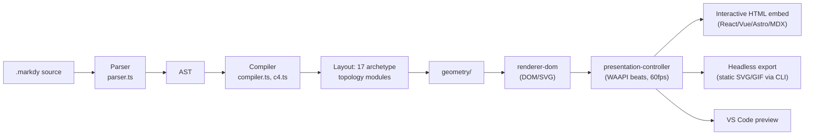
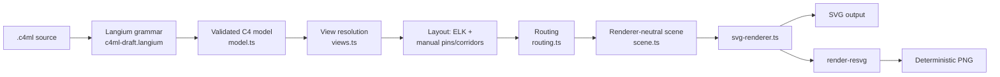
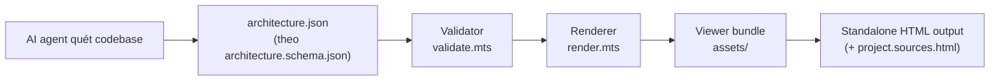
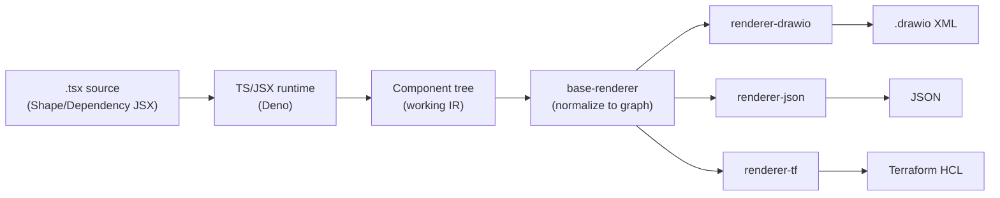

# Weekly Scan: Diagram Tooling — 2026-09-24

**Executive summary:**

- Nhiều repo "trending" tuần này trong domain diagram-as-code (`tt-a1i/archify` ~70.6k sao, `DeusData/codebase-memory-mcp` ~44.5k sao, cả hai là "agent skill" cài qua `npx skills add`) có star count bất thường so với số commit/fork — nhiều khả năng là star-inflation quen thuộc ở các gói "Claude/Codex skill". Đã loại khỏi deep-dive, chỉ ghi nhận như một tín hiệu cần cẩn trọng khi đọc bảng xếp hạng GitHub trong domain này.
- Ứng viên gần kymostudio nhất tuần này là **HoangYell/markdy-com** (DSL `.markdy` → 17 layout engine theo archetype → SVG/DOM animation 60fps qua WAAPI) và **indianerbande/c4ml** (Langium grammar + Eclipse Layout Kernel + **cùng resvg rasterizer** mà `kymostudio-core` đang dùng) — cả hai đáng nghiên cứu sâu.
- **Qiuner/birdview** (JSON Schema do AI agent generate thay cho text-DSL) và **dinghydev/dinghy** (JSX làm DSL, compile song song ra draw.io XML *và* Terraform) mở rộng góc nhìn nhưng thiếu bằng chứng về thuật toán layout thật — chỉ đáng lướt qua.

## Mục lục

1. [HoangYell/markdy-com](#1-hoangyellmarkdy-com)
2. [indianerbande/c4ml (C4thedral)](#2-indianerbandec4ml-c4thedral)
3. [Qiuner/birdview](#3-qiunerbirdview)
4. [dinghydev/dinghy](#4-dinghydevdinghy)

---

## 1. HoangYell/markdy-com

### §1 — Quick context

Markdy biến kiến trúc hệ thống thành **hoạt cảnh từng bước** (`.markdy` DSL → animation 60fps), khác kymostudio ở chỗ trọng tâm là "giải thích behavior theo trình tự thời gian" (beat-by-beat) chứ không chỉ vẽ topology tĩnh. Stack: TypeScript monorepo (pnpm workspaces), 17 "topology" module tự viết (không dùng elkjs/dagre), render DOM/SVG bằng Web Animations API (không Canvas, không GSAP). Repo health: 95 sao, 3 fork, 726 commit trên `main`, MIT, pushed 2026-09-22 — không thấy release tag/CI badge rõ trong nội dung thu thập được. Phân phối: npm packages (`@markdy/core`, `@markdy/cli`, `@markdy/mcp-server`...), VS Code extension, playground web tại markdy.com.

### §2 — Architecture deep-dive

**A. Component inventory**
- `Parser` (`packages/core/src/parser.ts`) — text `.markdy` → AST (`ast.ts`).
- `Compiler` (`packages/core/src/compiler.ts`, `c4.ts`) — AST → model đã resolve, tích hợp `symbols.ts`, `registry.ts`.
- `Diagnostics` (`packages/core/src/syntax-diagnostics.ts`, `ai-healing.ts`) — báo lỗi cú pháp và (đáng chú ý) có cơ chế LLM tự sửa lỗi.
- 17 layout/topology module (`packages/renderer-dom/src/{sequence,tree,swimlane,timeline,gantt,radar,quadrant,constellation,impact}.ts` …) — mỗi loại diagram có thuật toán định vị riêng thay vì một layout engine tổng quát.
- `geometry/` (trong `renderer-dom/src`) — tính toán vị trí node/edge dùng chung.
- `Renderer` (`renderer-dom/src/diagram.ts`, `edges.ts`, `nodes.ts`) — sinh DOM/SVG.
- `Animation controller` (`presentation-controller.ts`) — điều phối các "beat" thành keyframe WAAPI.
- `CLI`, `MCP server`, `language-server`, `vscode` — 4 package tooling riêng biệt trong `packages/`.

**B. Pipeline** (suy ra từ README + cấu trúc `packages/`):
1. User viết file `.markdy` (khai báo `scene`, node, và các khối `beat` mô tả luồng request/response).
2. `parser.ts` dựng AST.
3. `compiler.ts` resolve AST thành model, chọn 1 trong 17 thuật toán topology dựa trên loại diagram khai báo (`layout LR`, hoặc archetype ngầm định như `sequence`/`swimlane`).
4. `geometry/` + module topology tương ứng tính toạ độ node/edge.
5. `renderer-dom` sinh cây DOM/SVG; `presentation-controller.ts` sequences các `beat` thành animation WAAPI 60fps.
6. Output: diagram tương tác nhúng trực tiếp (React/Vue/Astro/MDX), hoặc xuất qua CLI/headless render cho CI (ảnh tĩnh/GIF).

**C. Data model / IR** — có AST riêng (`ast.ts`) và một bước resolve sang model trước khi vào renderer; cấu trúc IR cụ thể (class/dataclass hay plain object), mutable hay immutable giữa các pass: **không xác định** từ tên file thu thập được.

**D. Input language design** — parser tự viết, không dùng parser-generator (README tự mô tả "~14kB parser, no Canvas, no GSAP"), gợi ý cách tiếp cận hand-written/line-oriented tương tự `dsl.py` của kymostudio hơn là PEG/ANTLR. Không thấy file grammar EBNF riêng trong repo. Error reporting có 2 lớp: `syntax-diagnostics.ts` (chẩn đoán) + `ai-healing.ts` (đề xuất/tự sửa bằng AI) — khác biệt rõ với cách tiếp cận thuần deterministic của kymostudio.

**E. Layout algorithm** — auto-layout theo **archetype chuyên biệt** (17 "specialized topological algorithms": architecture/flowchart/tree/sequence/layers/swimlane/nested/medallion/timeline/gantt/flywheel...) thay vì 1 thuật toán tổng quát áp cho mọi loại diagram. Edge routing, crossing minimization: **không xác định** — không thấy tên file gợi ý (không có `sugiyama`/`barycentric`/`orthogonal-router`).

**F. Rendering/output** — 1 backend chính: DOM/SVG qua Web Animations API, không Canvas. `output-presets.ts` gợi ý nhiều preset xuất (kể cả GIF, theo mô tả README) nhưng renderer lõi vẫn là DOM. 10 theme dựng sẵn (`themes.ts`, `theme-generator.ts`).

**G. Extensibility** — `stdlib-systems` package = thư viện icon/vocabulary chuẩn; thêm loại diagram mới = thêm 1 file trong `renderer-dom` + đăng ký ở `registry.ts` (suy luận từ tên file, chưa xác nhận API cụ thể).

**H. Dev experience** — đầu tư tooling mạnh nhất trong 4 repo: CLI, language server, VS Code extension, MCP server cho AI agent (Claude/Cursor/Antigravity), playground web trực tiếp tại markdy.com. Có "self-healing" khi agent sinh cú pháp sai.

### §3 — Architecture diagram

### §4 — Verdict

Đáng học nhất: (1) chọn **17 thuật toán layout chuyên biệt theo archetype** thay vì một solver tổng quát — kymostudio hiện dùng 1 `alignment.py` chung cho mọi kiểu; có thể tham khảo cách Markdy đặt tên/tách archetype (`swimlane.ts`, `timeline.ts`...) nếu muốn thêm layout preset chuyên dụng. (2) Cú pháp `beat` + operator `->`/`<-`/`~>` cho request/response/async là một mô hình "choreography" đáng đối chiếu với target `--animate` hiện có của kymostudio. Red flag: repo nghiêng nặng về tooling cho AI agent (MCP server, `ai-healing.ts`, `prompts/`, `skills/` chiếm nhiều thư mục top-level) hơn là bằng chứng test suite/golden-render cho core engine; không thấy version/release rõ ràng để đánh giá độ ổn định. Câu hỏi mở: layout có deterministic/test được bằng golden output như kymostudio không? Verdict: **study deeper**, đặc biệt phần beat-DSL và tổ chức layout theo archetype.

---

## 2. indianerbande/c4ml (C4thedral)

### §1 — Quick context

C4thedral là desktop workbench biên dịch 1 nguồn C4ML thành cả 7 loại view C4 (Landscape/Context/Container/Component/Code/Dynamic/Deployment) — khác kymostudio ở việc gắn chặt với methodology C4 thay vì DSL tự do, nhưng pipeline nội bộ (Langium grammar → ELK layout → SVG → resvg) rất đáng đối chiếu. Stack: TypeScript monorepo (pnpm), Langium (grammar+LSP framework), Eclipse Layout Kernel (ELK) cho auto-layout, **resvg** để rasterize — cùng engine với `kymostudio-core`. Repo health: chỉ 1 sao, Apache-2.0, phiên bản `v0.1.0-beta.8`, tự nhận "syntax may still change", đã test trên macOS/Windows/Ubuntu nhưng chưa có installer ký. Phân phối: desktop app + CLI, chạy local hoàn toàn (Node 24.15+, pnpm), không có web playground.

### §2 — Architecture deep-dive

**A. Component inventory**
- `Grammar` (`packages/language-c4ml/src/c4ml-draft.langium`) — grammar Langium (draft, chưa đóng băng).
- `Language services` (`language.ts`, `services.ts`, `scope-provider.ts`, `completion.ts`, `highlighting.ts`) — bộ máy LSP đầy đủ (autocomplete, syntax highlight, scope resolution) sinh ra "miễn phí" từ Langium.
- `Authoring-edit helpers` (`authoring-edits.ts`, `placement-authoring-edits.ts`, `route-authoring-edits.ts`, `semantic-authoring-edits.ts`) — sinh text-edit để ghi ngược thao tác kéo-thả/pin trên UI về lại source `.c4ml`.
- `Compiler` (`packages/compiler-core/src/diagram-compiler.ts`, `diagram-preparation.ts`, `model.ts`) — model kiến trúc trung tâm.
- `Semantic validation` (`semantic-validation.ts`, `diagnostics.ts`).
- `View resolution` (`views.ts`, `view-resolution.ts`) — logic chọn 1 trong 7 view.
- `Layout` (`compiler-core/src/layout.ts`, `layout-stability.ts` + package riêng `packages/layout-elk`) — tích hợp ELK.
- `Routing/placement` (`routing.ts`, `route-labels.ts`, `placement.ts`).
- `Scene` (`scene.ts`, `comparison-scene.ts`) — một tầng "renderer-neutral scene" tách biệt giữa layout và render.
- `SVG renderer` (`svg-renderer.ts`, `shapes.ts`, `theme.ts`) + package `packages/render-resvg` (rasterize PNG qua resvg).
- `Desktop shell` (`apps/`, package `desktop-contract`).

**B. Pipeline** (mô tả gần như nguyên văn từ README):
1. User chạy desktop app hoặc CLI trên file `.c4ml`.
2. Langium grammar parse → validate thành **C4 model** (`semantic-validation.ts`).
3. User chọn 1 trong 7 view (`view-resolution.ts`).
4. `layout.ts` + `layout-elk` tính vị trí tự động, hợp nhất với "authored intent" — pin toạ độ tuyệt đối, corridor/lane cho route, avoid-zone — đọc thấy trực tiếp trong ví dụ `signal-garden.c4ml` (`520du,120du`, "corridor definitions with lanes", "orthogonal routing styles with avoid zones").
5. `routing.ts` sinh ra **"routed, renderer-neutral scene"** — một IR trung gian trước khi render.
6. `svg-renderer.ts` emit SVG; `render-resvg` rasterize sang PNG **deterministic** (README nhấn "reproducible geometry").
7. Desktop app hiển thị diagram với điều hướng 2 chiều source↔diagram.

**C. Data model / IR** — có **2 tầng IR rõ rệt**: `model.ts` (C4 model đã validate) → `scene.ts`/`comparison-scene.ts` (renderer-neutral scene sau layout+routing) — cùng ý tưởng "compile xuống lower IR" như TALA của D2. Mutable/immutable: không xác định.

**D. Input language design** — **có grammar hình thức thật sự**: file `.langium` (ngôn ngữ grammar riêng của Langium, tương đương EBNF). Đây là khác biệt lớn nhất so với parser tự viết của kymostudio/Markdy — đổi lấy autocomplete/hover/diagnostics chuẩn LSP ngay từ grammar, nhưng phụ thuộc framework ngoài.

**E. Layout algorithm** — **hybrid**: ELK (hỗ trợ layered/hierarchical, có thể cả force-directed tùy config — chi tiết config cụ thể không xác định) kết hợp override thủ công (pin toạ độ, corridor có lane, waypoint, avoid-zone) — mô hình rất gần với auto-layout frame + hint thủ công mà `alignment.py`/DSL của kymostudio đã có.

**F. Rendering/output** — SVG là định dạng gốc, PNG qua resvg (cùng công cụ `kymostudio-core` dùng). Không có animation (C4 chỉ có static views, kể cả "Dynamic view" vẫn export tĩnh).

**G. Extensibility** — có 2 package font riêng (`font-editor-mono`, `font-ibm-plex`) — gợi ý họ tự quản lý font-metrics cho text layout thay vì phụ thuộc font hệ thống, đáng chú ý vì kymostudio cũng cần đo text chính xác khi layout.

**H. Dev experience** — desktop-first (không phải VS Code extension), điều hướng 2 chiều source↔diagram, CLI để validate/render trong CI. Yêu cầu Node 24.15+ khá mới, có thể là rào cản.

### §3 — Architecture diagram

### §4 — Verdict

Đáng học nhất: (1) họ dùng **cùng resvg** mà `kymostudio-core` dùng để rasterize — đáng theo dõi cách họ đóng gói `render-resvg` thành package riêng, có thể có ý tưởng chéo về API. (2) Tầng **"renderer-neutral scene"** tách biệt rõ giữa layout/routing và emit-SVG là một mẫu thiết kế đáng tham khảo cho `to_svg.py`: hiện kymostudio để `layout.py`/`alignment.py` trả `Diagram` đã resolve thẳng cho từng emitter (`to_svg`, `to_figma`, `to_excalidraw`) — một scene-IR trung gian đặt tên rõ có thể giảm trùng lặp logic routing giữa các emitter. (3) Cú pháp override layout bằng corridor/lane/avoid-zone trong ví dụ `signal-garden.c4ml` đáng đọc kỹ để đối chiếu với cách kymostudio đặt tên hint layout trong DSL. Red flag: 1 sao, beta rất sớm (`v0.1.0-beta.8`), tự nhận "chưa có parser public", cài đặt nặng (Node 24.15+, desktop-only). Câu hỏi mở: ELK tích hợp override thủ công theo kiểu constraint-solve hay chỉ ghi đè hậu-layout? Không xác định từ bằng chứng thu thập được. Verdict: **study deeper**, tập trung vào tầng scene-IR và cách gọi ELK + resvg.

---

## 3. Qiuner/birdview

### §1 — Quick context

Birdview không phải công cụ diagram-as-code truyền thống mà là **"agent skill"**: một AI coding agent tự quét codebase rồi sinh ra bản đồ kiến trúc dạng JSON, sau đó render thành 1 file HTML tương tác — khác biệt căn bản với kymostudio là **không có DSL do người viết**. Stack: TypeScript (Node ≥18), JSON Schema làm "hợp đồng" dữ liệu, output là HTML tự chứa (không server). Repo health: 599 sao, 57 fork, MIT, pushed 2026-09-23 — không thấy CI badge/test suite trong nội dung thu thập được (có thư mục `test/` nhưng nội dung không đọc được). Phân phối: cài qua `npx skills add Qiuner/birdview --skill birdview` (skill-CLI cho agent), không phải package npm dùng trực tiếp.

### §2 — Architecture deep-dive

**A. Component inventory**
- `Contracts` (`src/contracts/`) + `schemas/architecture.schema.json`, `schemas/activity.schema.json` — JSON Schema định nghĩa cấu trúc dữ liệu đầu vào.
- `Agent skill definition` (`agents/`) — prompt/hướng dẫn để AI agent tự sinh `architecture.json` từ việc đọc codebase (không phải parser truyền thống).
- `Constraint engine` (`src/constraint-discovery*.mts`, `constraint-validation*.mts`, `constraint-rendering*.mts`, `constraint-rules*.mts`, `constraint-freshness*.mts` — tên file suy luận từ listing) — xử lý `constraints.reviewed.json`.
- `Validator` (`src/validate.mts`, `scripts/`) — validate input theo schema trước khi render.
- `Renderer` (`src/render.mts`, `render-constraints.mts`) — build ra HTML.
- `Viewer bundle` (`src/viewer/`, `assets/`) — JS/CSS đã build sẵn cho HTML tương tác.

**B. Pipeline** (đặc thù: input do AI agent sinh ra, không do người viết DSL):
1. User yêu cầu agent (Claude Code/Codex/DeepSeek Harness) "hiển thị kiến trúc dự án".
2. Agent quét codebase, sinh `architecture.json` (module, ownership, quan hệ, "source evidence") theo `architecture.schema.json`.
3. (Tuỳ chọn) sinh thêm `constraints.reviewed.json` (rule đã review) và `activity.jsonl` (tiến độ agent, mỗi dòng 1 event).
4. Chạy `node scripts/render.mjs architecture.json output.html [--constraints file.json]` — validate theo schema trước.
5. `render.mts` ghép dữ liệu vào viewer bundle (`assets/`) thành 1 file HTML tự chứa.
6. Output: HTML tương tác (theme sáng/tối, song ngữ Anh-Trung) + file phụ `project.sources.html`; mở trực tiếp bằng trình duyệt, không cần server, nhưng **không tự cập nhật** — phải render lại thủ công khi code đổi.

**C. Data model / IR** — dữ liệu là JSON được validate theo JSON Schema, không có AST/IR trung gian theo nghĩa compiler truyền thống; JSON Schema đóng vai trò "hợp đồng" giữa 3 nguồn input (agent quét code, người review rule, agent log hoạt động) và 1 renderer duy nhất.

**D. Input language design** — **không có DSL/parser văn bản**. Input được một AI agent generate trực tiếp thành JSON theo schema, không qua bước "viết code DSL rồi parse" như kymostudio/Markdy/C4thedral — đây là khác biệt lớn nhất so với 3 repo còn lại trong bài này.

**E. Layout algorithm** — **không xác định**: không thấy bằng chứng thuật toán auto-layout (không có tên file gợi ý force-directed/hierarchical/orthogonal) trong cấu trúc thư mục thu thập được; nhiều khả năng viewer hiển thị theo danh sách module/template cố định hơn là graph-layout thực sự.

**F. Rendering/output** — 1 backend duy nhất: HTML tương tác (JS-driven), không phải SVG tĩnh. Không thấy bằng chứng xuất PNG/PDF. Không có animation ngoài chuyển theme/view.

**G. Extensibility** — mở rộng chủ yếu qua sửa `schemas/*.json` (thêm field) và `references/` (hướng dẫn authoring cho agent), không phải qua plugin API truyền thống.

**H. Dev experience** — không có CLI độc lập theo nghĩa thông thường, dùng gián tiếp qua agent; không có watch-mode/live-preview — đúng như README tự nhận là limitation ("uses file snapshots; live updates require HTML regeneration").

### §3 — Architecture diagram

*Lưu ý: không có "parser" hay "layout algorithm" theo nghĩa truyền thống — JSON được AI agent generate trực tiếp, thay cho bước parse text-DSL.*

### §4 — Verdict

Đáng học: ý tưởng **JSON Schema làm "contract"** tách biệt nguồn sinh nội dung (ở đây là AI agent) khỏi renderer là một mô hình gọn — nếu kymostudio từng muốn một định dạng "architecture JSON" trung lập làm input thay thế (ngoài `.kymo`/BPMN), đây là ví dụ tham khảo về cách chia 3 loại tài liệu (architecture/constraints/activity) cùng validate qua schema. Tuy nhiên không có bằng chứng về thuật toán layout/rendering đáng học sâu. Red flag: 599 sao nhưng không thấy graph-layout thật; toàn bộ độ chính xác kiến trúc phụ thuộc agent tự quét đúng — không có cơ chế kiểm chứng độc lập ngoài "source evidence" tự khai; output tĩnh, không live-update. Câu hỏi mở: viewer có dùng thư viện graph-layout nào (d3-force, ELK...) hay chỉ list module theo layout cố định? Không xác định được từ cấu trúc thư mục. Verdict: **glance only**.

---

## 4. dinghydev/dinghy

### §1 — Quick context

Dinghy dùng **JSX/TSX làm chính DSL** (không phải text-DSL riêng) để mô tả diagram, rồi compile ra **cả ảnh (draw.io XML) lẫn hạ tầng thật (Terraform)** từ cùng 1 nguồn — khác biệt lớn nhất so với kymostudio là "diagram" và "infra-as-code" chia sẻ chung một cây component. Stack: TypeScript/TSX chạy trên **Deno** (không phải Node như 3 repo còn lại), pattern multi-emitter rõ ràng (`renderer-drawio`, `renderer-json`, `renderer-tf`). Repo health: rất sớm — 5 sao, 5 fork, 370 commit, 0 issue/PR mở, docs tại dinghy.dev. Phân phối: package Deno/npm theo workspace `core/*`, có docs site riêng.

### §2 — Architecture deep-dive

**A. Component inventory**
- `Base components` (`core/base-components`) — component JSX gốc: `Shape`, `Dependency` (props nội bộ đặt tên `_title`, `_dependsOn`).
- `Base renderer` (`core/base-renderer`) — chuẩn hoá cây component đã resolve thành graph diagram dùng chung cho mọi emitter.
- `Diagrams module` (`core/diagrams/src`: `composites/sequence-diagram`, `containers`, `dependencies`, `entities`) — composite component cho từng loại diagram (vd. sequence diagram).
- `Renderer-drawio` (`core/renderer-drawio`) — emit XML draw.io/mxGraph.
- `Renderer-json` (`core/renderer-json`) — emit JSON.
- `Renderer-tf` (`core/renderer-tf`) — emit Terraform HCL.
- `tf-aws`, `tf-common` (`core/`) — thư viện component hạ tầng AWS (node trong diagram *chính là* resource Terraform).
- `CLI` (root `cli/`), `docs site` (`sites/www`).

**B. Pipeline**:
1. User viết file `.tsx` dùng `<Shape>`/`<Dependency>` (và component `tf-aws` nếu muốn node vừa là hình vừa là resource hạ tầng) — ví dụ tối thiểu từ docs: `<Shape _title="..."><Shape _dependsOn="B">A</Shape><Shape>B</Shape></Shape>`.
2. Runtime Deno/TSX "parse" chính là trình biên dịch TypeScript/JSX chuẩn — không có parser DSL tự viết; cây component JSX đã resolve **là** IR làm việc.
3. `base-renderer` duyệt cây, chuẩn hoá thành graph diagram dùng chung (entities/containers/dependencies).
4. Graph được đưa vào 1 trong các renderer pluggable: `renderer-drawio` / `renderer-json` / `renderer-tf`.
5. Output: file `.drawio` (mở bằng draw.io/diagrams.net), file `.tf` (deploy được bằng Terraform), hoặc JSON thô — cùng 1 nguồn tạo ra cả bức tranh lẫn hạ tầng thật.

**C. Data model / IR** — cây JSX là IR khi runtime, `base-renderer` chuẩn hoá thành graph trước khi emit (một bước "compile xuống lower IR" tương tự ý tưởng TALA của D2, nhưng đơn giản hơn); cấu trúc dữ liệu cụ thể (class/interface) và tính mutable: **không xác định** vì chỉ đọc được tên thư mục, chưa đọc được source.

**D. Input language design** — không phải custom DSL: dùng thẳng **TSX**, "parser" thực chất là TypeScript compiler; không có file grammar riêng. Error reporting thừa hưởng type-checking của TypeScript (props như `_dependsOn` được gõ kiểu) — cách tiếp cận "ngôn ngữ chủ nhà" (host-language embedding) trái ngược hẳn với custom text-DSL của kymostudio/Markdy/C4thedral.

**E. Layout algorithm** — **không xác định**: không thấy package/tên file gợi ý thuật toán auto-layout (không có elk/dagre/force-directed trong cấu trúc quan sát được); nhiều khả năng vị trí node do draw.io tự sắp xếp khi mở file, hoặc dinghy chỉ xuất vị trí mặc định/grid — cần đọc source `base-renderer` để xác nhận.

**F. Rendering/output** — **pluggable emitter pattern rõ nhất trong 4 repo**: 3 package renderer riêng biệt (`renderer-drawio`, `renderer-json`, `renderer-tf`) cùng tiêu thụ 1 graph chuẩn hoá — gần với triết lý sibling-emitter (`to_svg.py`/`to_figma.py`/`to_excalidraw.py`) của kymostudio, chỉ khác định dạng đích. Không có animation.

**G. Extensibility** — thêm định dạng output mới = thêm package `renderer-*` mới cùng interface; thêm cloud provider mới = thêm package `tf-{provider}` (đã có sẵn `tf-aws`, `tf-common` làm khung, chừa chỗ rõ ràng cho `tf-gcp`/`tf-azure`).

**H. Dev experience** — chạy trên Deno (khác biệt so với 2 repo TypeScript/Node kia); có docs site với `guides/get-started/{diagram-as-code, infrastructure-as-code, builders}`; không thấy VS Code extension/LSP, không thấy watch-mode trong nội dung thu thập được.

### §3 — Architecture diagram

### §4 — Verdict

Đáng học: pattern **multi-emitter tách package** (`renderer-drawio`/`renderer-json`/`renderer-tf` cùng interface) là minh hoạ rõ ràng cho hướng kymostudio đã chọn (`to_svg`/`to_figma`/`to_excalidraw` là sibling emitters) — đáng đối chiếu cách họ định nghĩa "graph chuẩn hoá" chung. Ý tưởng đáng ghi nhớ dài hạn hơn: `renderer-tf` biến diagram thành **hạ tầng thực thi được**, gợi ý một hướng mở rộng khác cho kymostudio nếu muốn đi từ diagram sang artifact vận hành được (vd. BPMN → workflow config) thay vì chỉ dừng ở ảnh. Lựa chọn dùng JSX-as-DSL (thay vì text-DSL riêng như `.kymo`) đổi lấy tooling TS miễn phí nhưng mất tính "ngôn ngữ khai báo độc lập, dễ đọc với non-dev" — một điểm đối lập triết lý đáng ghi nhận. Red flag: dự án rất sớm (5 sao, 5 fork, 0 issue/PR mở), không có bằng chứng test suite/CI thực chất ngoài 1 badge; thiếu hẳn bằng chứng về thuật toán layout — rủi ro là vị trí node chỉ dựa vào draw.io tự sắp xếp chứ dinghy không tự layout. Câu hỏi mở: `base-renderer` có tính toán vị trí (x,y) trước khi emit, hay để định dạng đích (draw.io) tự lo? Không xác định từ bằng chứng thu thập được. Verdict: **glance only** — riêng ý tưởng "diagram cũng compile ra IaC" đáng ghi nhớ để tham khảo dài hạn, nhưng dự án còn quá non để học kỹ thuật layout/render sâu.
