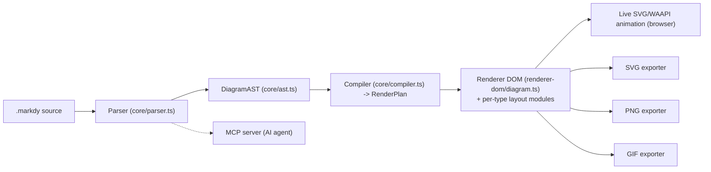
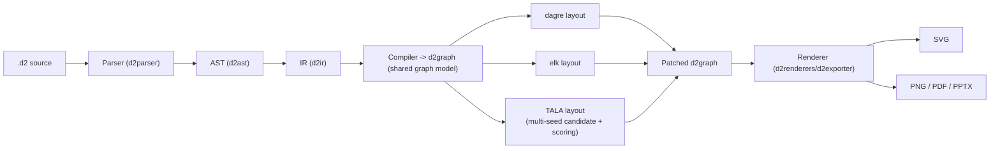
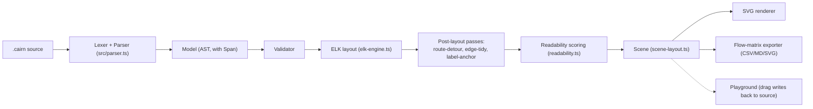

```mermaid
flowchart LR
    A[".c4ml source"] --> B["Langium parser\n(language-c4ml)"]
    B --> C["ArchitectureModel (IR)"]
    C --> D["View resolution + diagram-preparation"]
    D --> E["Layout adapter interface"]
    E --> F["ELK layout (layout-elk)"]
    F --> G["Placement constraints"]
    G --> H["Edge routing (routing.ts)"]
    H --> I["Scene (scene.ts)"]
    I --> J["resvg renderer (render-resvg)"]
    J --> K["SVG / PNG"]
```

# Weekly scan: diagram-tooling & visual-DSL (2026-09-25)

Phạm vi: repo mới hoặc cập nhật đáng kể trong 7 ngày qua (từ 2026-09-18), fallback 30 ngày cho repo mới tạo. Tất cả số liệu sao/contributor lấy qua WebSearch/WebFetch nên chỉ mang tính **gần đúng**, không phải ground truth.

## Tóm tắt điều hành

- **Markdy** (`HoangYell/markdy-com`, cập nhật 2026-09-25) là repo gần kymostudio nhất về mục tiêu — DSL cho diagram hoạt hình xuất SVG/WAAPI — và đáng nghiên cứu nhất cho mảng animation/render, dù layout của nó thực chất là 17 bộ layout chuyên biệt theo loại diagram (bespoke, không phải một graph-layout engine tổng quát).
- **TALA** (nay nằm trong `d2lang/d2` từ v0.9.0, cập nhật 2026-09-20) là sự kiện lớn nhất tuần này cho hướng layout algorithm: Terrastruct mã nguồn mở hoá engine layout kiến trúc độc quyền của họ — cách tiếp cận multi-seed candidate + scoring rất khác Sugiyama/ELK, đáng học nhất cho `alignment.py`.
- **C4thedral/C4ML** (`indianerbande/c4ml`, cập nhật 2026-09-23) tuy chỉ ~1 sao (rất mới) nhưng có kiến trúc pipeline rõ ràng nhất trong các repo được xem: Langium grammar hình thức, layout adapter pluggable (ELK), và render qua resvg — cùng họ công nghệ render với kymostudio.

## Mục lục

1. [Markdy](#1-markdy)
2. [TALA / D2 v0.9.0](#2-tala--d2-v090)
3. [C4thedral (C4ML)](#3-c4thedral-c4ml)
4. [Cairn](#4-cairn)
5. [Repo khác được tìm thấy nhưng không đào sâu](#repo-khác-được-tìm-thấy-nhưng-không-đào-sâu)

---

## 1. Markdy

### §1 — Quick context

DSL "diagram-native" biên dịch trực tiếp sang motion graphics 60fps chạy bằng Web Animations API trong trình duyệt, thay vì xuất ảnh tĩnh rồi mới animate. Stack: TypeScript monorepo (pnpm workspaces), core parser tuyên bố zero-dependency (~14kB), renderer DOM/SVG dùng WAAPI, xuất SVG/PNG/GIF/share-card. Sức khoẻ repo: ~95 sao, MIT, 1 tác giả chính (Hoang Yell), commit cuối 2026-09-25 (rất tích cực — 727 commit trên main), có CI gate gồm unit test + visual regression (`test:visual`, baseline ảnh) + `verify:examples`. Phân phối: npm (`@markdy/core`, `@markdy/cli`, `@markdy/renderer-dom`, `@markdy/mcp-server`, `@markdy/vscode`), VS Code extension, MCP server cho AI agent.

### §2 — Architecture deep-dive

**A. Component inventory**
- Parser + AST (`packages/core/src/parser.ts`, `ast.ts`) — parse `.markdy` text thành `DiagramAST`.
- Compiler (`packages/core/src/compiler.ts`) — tính kích thước node (`computeNodeDimensions`), bố cục, tạo `RenderPlan`.
- Router (`packages/core/src/router.ts`) — gán cổng/route cho edge ở mức plan.
- Renderer DOM (`packages/renderer-dom/src/diagram.ts` + các module theo loại diagram: `sequence.ts`, `gantt.ts`, `quadrant.ts`, `radar.ts`, `timeline.ts`, `tree.ts`, `constellation.ts`, `swimlane.ts`, `groups.ts`) — mount SVG/DOM và animation WAAPI.
- Edge routing hình học (`packages/renderer-dom/src/geometry/path.ts` — `routeOrthogonal`, `circleBoundaryRoute` trong `edges.ts`).
- Exporters (`packages/renderer-dom/src/export/{svg,png,gif,share-card}-exporter.ts`).
- CLI (`packages/cli/src/index.ts`) — orchestrates parse/compile/serve/export.
- MCP server (`packages/mcp-server`) — giao diện cho AI agent (Claude/Cursor/Cline).
- Compat layer (`packages/compat`) — ingest Mermaid/Docker Compose/K8s/Terraform.

**B. Pipeline** (đọc từ `cli.ts` + `@markdy/core` exports):
1. Người dùng chạy `markdy render foo.markdy` (hoặc mở trong playground/VS Code).
2. `parse()` (core/parser.ts) đọc text theo dòng, tách comment/string, dựng `DiagramAST`.
3. `compile()`/`compilePlan()` (core/compiler.ts) đo nhãn, tính kích thước node, bố cục theo loại diagram (flowchart/sequence/gantt/...), tạo `RenderPlan` bất biến.
4. `renderer-dom` mount `RenderPlan` vào DOM, dựng SVG/DOM nodes, route edge orthogonal, và tạo animation timeline theo `beat` (WAAPI).
5. Người dùng tương tác (playground) hoặc export tĩnh qua `svg-exporter`/`png-exporter`/`gif-exporter`.
6. Kết quả: trang animation trong trình duyệt, hoặc file SVG/PNG/GIF/share-card.

**C. Data model / IR** — `DiagramAST` (plain TS interfaces: `NodeDecl`, `EdgeDecl`, `BeatDecl`, `GroupDecl`...) rồi biên dịch xuống `RenderPlan` (positioned nodes, routed edges, timed cues) — đúng khái niệm "compile xuống lower IR" giống pipeline `Diagram` → resolved model của kymostudio. AST/RenderPlan là plain object, không thấy bằng chứng mutation xuyên pass (mỗi hàm compile trả object mới) — không xác định tuyệt đối vì chưa đọc toàn bộ `compiler.ts`.

**D. Input language design** — parser dòng-lệnh tự viết (không regex thuần, không PEG/ANTLR): tokenize theo dòng, xử lý string/comment thủ công (`stripComment`), nhận diện toán tử flow bằng regex cục bộ (`FLOW_OP_RE = /(->|<-|~>|--|\.\.>|<->)/`). Không thấy file grammar BNF/EBNF chính thức trong repo (cú pháp mô tả trong `docs/SYNTAX.md`, prose). Báo lỗi qua `ParseError` có `line`/`column`, cộng thêm module `syntax-diagnostics.ts` và `ai-healing.ts` (tự sửa lỗi cú pháp qua LLM) — điểm khác biệt: coi lỗi cú pháp là thứ agent tự sửa được, không chỉ báo cho người.

**E. Layout algorithm** — không phải một graph-layout engine tổng quát (không Sugiyama/ELK/force-directed chung); "17 layout engines" thực chất là 17 module bố cục **chuyên biệt theo loại diagram** (sequence, gantt, quadrant, radar, timeline, tree, constellation, swimlane, venn, pyramid, medallion, flywheel, loop, state...), mỗi loại có công thức riêng trong `compiler.ts`/`renderer-dom`. Edge routing: orthogonal (`routeOrthogonal`) cho box-diagram, boundary-circle route cho Venn. Không thấy thuật toán crossing-minimization (barycentric/ILP) — không xác định/không có bằng chứng.

**F. Rendering/output** — single backend chính: SVG-native DOM rendering + WAAPI cho animation (không dùng Canvas). Cùng IR xuất thêm PNG/GIF/share-card qua exporter riêng (pluggable emitter pattern rõ ràng, giống kiến trúc `to_svg.py`/`to_figma.py` của kymostudio).

**G. Extensibility** — thêm loại diagram mới = thêm 1 module trong `renderer-dom/src` + case trong `compiler.ts`/`registry.ts` (registry tập trung định nghĩa `NODE_KINDS`, `DIAGRAM_TYPES`). Theming qua `themes.ts`/`theme-generator.ts` (8 theme có sẵn + generator).

**H. Dev experience** — CLI với local server + playground, VS Code extension + `markdy-language-server` (LSP), MCP server cho AI agent, `AGENT.md` rất chi tiết (31KB) hướng dẫn agent viết `.markdy`. Watch mode có (`watch.ts` trong CLI).

### §3 — Architecture diagram

### §4 — Verdict

Đáng học nhất: (1) coi mỗi loại diagram (sequence/gantt/quadrant/venn...) là một layout module riêng thay vì ép tất cả qua một auto-layout chung — kymostudio hiện dồn hết vào `alignment.py` 5-pass, có thể tham khảo cách tách biệt theo "diagram archetype" nếu về sau muốn hỗ trợ Gantt/quadrant/radar. (2) `ai-healing.ts`/`syntax-diagnostics.ts` — coi lỗi cú pháp là thứ để agent MCP tự sửa, một hướng UX đáng cân nhắc cho `kymo-mcp`. (3) CI gate có visual-regression baseline bằng ảnh chụp trình duyệt thực (Chrome DevTools), khác với golden SVG byte-for-byte của kymostudio — đáng so sánh độ ổn định. Red flag: parser không có grammar hình thức, tài liệu cú pháp tách rời code (giống rủi ro mà kymostudio tránh bằng cách coi `dsl.py` + `DSL.md` là dual-sourced). Verdict: **study deeper** cho phần renderer/animation và MCP UX, layout thì không áp dụng trực tiếp.

---

## 2. TALA / D2 v0.9.0

### §1 — Quick context

Không phải repo mới — đây là sự kiện lớn nhất tuần: Terrastruct đóng cửa công ty và mã nguồn mở hoá TALA, engine layout độc quyền chuyên cho diagram kiến trúc phần mềm, gộp thẳng vào D2 từ v0.9.0 (`--layout=tala`). Stack: Go, MPL-2.0, ~25.500 sao (ước lượng) cho `d2lang/d2`, dự án được Hack Club fiscal-sponsor sau khi Terrastruct dừng hoạt động. Phân phối: Go install, npm, brew, binary release; CI đầy đủ (unit test, fuzz test riêng cho TALA — `.github/workflows/tala-fuzz.yml`, benchmark hiệu năng `ci/tala-performance`).

### §2 — Architecture deep-dive

**A. Component inventory** (trong monorepo `d2lang/d2`)
- Parser (`d2parser/`) + AST (`d2ast/`).
- IR (`d2ir/`) — intermediate representation trước compile.
- Compiler (`d2compiler/`) → `d2graph/` (graph model dùng chung cho mọi layout engine).
- Layout engines pluggable (`d2layouts/`): `d2dagrelayout` (Sugiyama/DAG, mặc định), `d2elklayout` (ELK), `d2talalayout` (TALA, mới mở nguồn), `d2sequence`, `d2grid`, `d2near`.
- Renderer (`d2renderers/`) → `d2exporter/` (SVG/PNG/PDF/PPTX).
- CLI (`d2cli/`, có `layout_tala.go` riêng để wire TALA vào CLI).

**B. Pipeline** — theo README + cấu trúc thư mục:
1. Người dùng chạy `d2 --layout=tala foo.d2 foo.svg`.
2. `d2parser` tokenize/parse `.d2` → AST (`d2ast`).
3. `d2compiler` biên dịch AST → `d2ir` rồi → `d2graph` (graph model chung, độc lập layout engine).
4. Layout engine được chọn (ở đây là TALA, `d2layouts/d2talalayout`) nhận `d2graph`, chạy thuật toán riêng, trả toạ độ + route đã tính.
5. `d2graph` được "patch" với kết quả layout đã chọn.
6. `d2renderers`/`d2exporter` render `d2graph` đã có toạ độ thành SVG (rồi PNG/PDF nếu cần).

**C. Data model / IR** — `d2ir` là một lớp IR tường minh giữa AST và graph model thực thi (đúng khái niệm "compile xuống lower IR" mà đề bài yêu cầu tìm bằng chứng). `d2graph` là graph model dùng chung, mutable, các layout engine (dagre/elk/tala) đều thao tác trên nó qua adapter — TALA cụ thể **không mutate `d2graph` trực tiếp**: nó clone sang graph nội bộ riêng (`layoutgraph.Clone`), tính toán độc lập, chỉ patch lại `d2graph` gốc sau khi đã chọn được kết quả tốt nhất (theo `ARCHITECTURE.md` của TALA: "A caller's D2 graph is mutated only after a completed graph has been validated and selected").

**D. Input language design** — không xác định chi tiết trong lần đọc này (không mở `d2parser` sâu); D2 nổi tiếng có ngữ pháp riêng nhưng không kiểm chứng BNF/EBNF trong phạm vi quét này.

**E. Layout algorithm — trọng tâm đáng học nhất tuần này.** TALA là engine **multi-seed, candidate-based**, khác hẳn Sugiyama/ELK truyền thống: theo `d2layouts/d2talalayout/ARCHITECTURE.md`, pipeline mỗi seed chạy độc lập trên một bản clone graph: *discover layout structures* (nhận diện cluster/hierarchy/tree/proximity — các package con `grouping/`, `hierarchy/`, `trees/`, `proximity/`) → *place + pack nodes* (`placement/`, `placementcost/` chứa objective function so sánh hình học ứng viên, `packing/` xếp các thành phần rời rạc) → *route edges + place labels* (`routing/` dùng visibility graph + path search, `labeling/`) → *validate + score* (`quality/`) → chọn graph điểm cao nhất trong các seed → patch vào `d2graph` gốc. Đây là kiểu tối ưu **multi-start + scoring heuristic** (gần giống thử nhiều lời giải rồi chấm điểm chọn tốt nhất) chứ không phải một thuật toán tất định một lượt. Edge routing: orthogonal, có xử lý self-loop riêng (`internal/loops/`). Không thấy bằng chứng ILP hay crossing-minimization kiểu barycentric cổ điển — điểm khác biệt là **cost-function-driven** thay vì rank-based.

**F. Rendering/output** — SVG là target chính, `d2exporter` xuất thêm PNG/PDF/PPTX; TALA chỉ là layout engine, không đụng tới rendering (`nodeshape` chỉ quyết định port/label-position policy, hình học vẽ nằm ở `d2renderers`).

**G. Extensibility** — pluggable layout engine architecture là điểm mạnh nhất: `d2graph` là interface chung, mỗi engine (dagre/elk/tala) là một adapter độc lập, chọn qua flag `--layout=`. TALA tự giới hạn ranh giới bằng Go `internal/` package (compiler từ chối truy cập trực tiếp các package con của TALA từ bên ngoài) — một kỷ luật kiến trúc đáng học để giữ "internal API được tự do tiến hoá".

**H. Dev experience** — CLI trưởng thành, LSP (`d2lsp/`), watch mode, playground online (d2lang.com), fuzz-test riêng cho TALA cho thấy mức đầu tư vào độ ổn định thuật toán layout.

### §3 — Architecture diagram

### §4 — Verdict

Đây là gợi ý layout-algorithm giá trị nhất tuần này cho kymostudio: `alignment.py` hiện là 5-pass tất định (auto-layout, anchoring, region bounds, fan-in staggering, canvas sizing) — TALA cho thấy một hướng khác là **sinh nhiều ứng viên bố cục (đổi thứ tự discover/seed), chấm điểm bằng objective function tường minh (`placementcost`), chọn ứng viên tốt nhất** — có thể áp dụng cục bộ cho bài toán khó nhất của kymo hiện nay là fan-in/trunk-lane edge staggering, thay vì luôn dùng một heuristic cố định. Cũng đáng học kỷ luật package-boundary bằng Go `internal/` để một thuật toán layout phức tạp không rò rỉ chi tiết ra ngoài adapter công khai — nguyên tắc tương tự "renderer dumb, đổi data không đổi renderer" của kymostudio nhưng áp cho layout engine. Không có red flag đáng kể (dự án trưởng thành, test kỹ). Verdict: **study deeper**, ưu tiên đọc `placementcost` và `quality` package nếu có thời gian follow-up.

---

## 3. C4thedral (C4ML)

### §1 — Quick context

Desktop workbench (Electron) biên dịch một DSL C4ML thành 7 loại view C4 (Context/Container/Component/Code/Dynamic/Deployment/Landscape) cùng lúc từ một model nguồn — khác Structurizr DSL ở chỗ dùng Langium (grammar hình thức, LSP built-in) thay vì parser tự viết. Stack: TypeScript monorepo (pnpm), Langium 4.3 (grammar + LSP), elkjs 0.12 (layout), `@resvg/resvg-js` (render — cùng họ resvg mà kymostudio dùng qua `kymostudio-core`). Sức khoẻ repo: rất mới, ~1 sao, tác giả đơn lẻ, beta (`beta.8`), commit cuối 2026-09-23, Apache-2.0. Phân phối: desktop app (macOS/Windows/Ubuntu, chưa ký cài đặt công khai) + CLI thử nghiệm, chưa phát hành npm chính thức.

### §2 — Architecture deep-dive

**A. Component inventory**
- Grammar (`packages/language-c4ml/src/c4ml-draft.langium`) — định nghĩa cú pháp bằng EBNF-like rules của Langium.
- Language services (`packages/language-c4ml/src/{scope-provider,completion,highlighting,services}.ts`) — sinh tự động bởi Langium (LSP: completion, scope resolution, syntax highlighting).
- Compiler core (`packages/compiler-core/src/`): `model.ts` (model kiến trúc), `view-resolution.ts`, `diagram-preparation.ts`, `layout.ts` (interface `LayoutAdapter`/`ContractSubject`), `placement.ts`, `routing.ts`, `scene.ts`, `svg-renderer.ts`, `diagram-compiler.ts` (orchestrator).
- Layout adapter cụ thể (`packages/layout-elk/src/`) — bọc elkjs.
- Render backend (`packages/render-resvg/src/index.ts`) — bọc `@resvg/resvg-js`.
- Apps: `apps/editor` (web editor), `apps/desktop` (Electron), `apps/cli`, `apps/reference-export`.

**B. Pipeline** (đọc trực tiếp từ `diagram-compiler.ts`):
1. Người dùng chạy CLI hoặc mở desktop app trên file `.c4ml`.
2. Langium parser (được generate từ `.langium` grammar) đọc source → AST + `ArchitectureModel`.
3. `resolveArchitectureView(model, view)` chọn 1 view cụ thể (vd Container view scoped vào 1 system) → `ResolvedView`.
4. `prepareDiagram()` chuẩn bị `layoutRequest` từ view đã resolve.
5. `layoutAdapter.layout(layoutRequest)` — ở bản hiện tại là adapter ELK (`layout-elk`) — trả `LayoutResult` (toạ độ thô).
6. `applyPlacementConstraints()` áp ràng buộc đặt chỗ thủ công lên kết quả layout.
7. `routeDiagram()` tính route cạnh cuối cùng, `createDiagramScene()` dựng scene, `renderDiagramSvg()` (qua `render-resvg`) xuất SVG cuối.

**C. Data model / IR** — `ArchitectureModel` (model C4 gốc: person/system/container/component/code, quan hệ) là nguồn sự thật duy nhất; `ResolvedView`/`PreparedDiagram`/`LayoutResult`/`PlacementResult`/`DiagramScene` là chuỗi IR **ngày càng cụ thể hơn** qua từng bước biên dịch (interface TS thuần, có vẻ immutable — mỗi hàm trả object mới thay vì mutate input, dựa trên chữ ký hàm `async function compileArchitectureDiagram` trả `DiagramCompileResult` gộp mọi giai đoạn trung gian). README nêu rõ triết lý: "C4ML source keeps model, views, presentation, layout, and routing distinct" — tách biệt model/view/layout tường minh hơn cả kymostudio (vốn gộp phần lớn vào `Diagram` dataclass).

**D. Input language design** — **grammar hình thức bằng Langium** (file `.langium`, cú pháp kiểu EBNF: `entry`, block với `'{' ... '}'`, tham chiếu chéo `[SoftwareSystemDeclaration:ID]` để bắt buộc `container X inside Y` trỏ tới system đã khai báo — resolve reference có kiểm tra tại parse-time). Đây là cách tiếp cận rất khác `dsl.py`/`markdy` (line-oriented tự viết): dùng parser-generator theo grammar khai báo, tự động có LSP (completion/scope/hover) đi kèm. Báo lỗi: chưa xác thực chi tiết chiến lược error-recovery (Langium mặc định có, nhưng chưa đọc code cụ thể) — không xác định.

**E. Layout algorithm** — auto-layout qua ELK (`elkjs`, thuật toán Sugiyama/layered mặc định của Eclipse Layout Kernel) — không tự phát triển thuật toán riêng, khác TALA. Đặt lại vị trí thủ công qua bước `applyPlacementConstraints` sau layout tự động (giống mô hình "auto-layout rồi override" của kymostudio). Routing cạnh nằm ở bước `routeDiagram` riêng biệt sau placement — kiến trúc pipeline rõ ràng nhưng thuật toán edge-routing cụ thể không xác định (chưa đọc `routing.ts` chi tiết).

**F. Rendering/output** — SVG qua `@resvg/resvg-js` (cùng công nghệ resvg mà kymostudio dùng cho PNG/WebP), xuất PNG cũng khả thi qua cùng thư viện. Không có animation. `apps/reference-export` gợi ý có chế độ xuất tham chiếu (dùng để test?) — không xác định mục đích chính xác.

**G. Extensibility** — `LayoutAdapter` là interface tường minh (evidenced bởi `packages/layout-elk` implement nó) — cắm layout engine khác chỉ cần implement interface này, giống ý tưởng pluggable emitter của D2. Theming: `architecture-theme-resource.ts` tồn tại nhưng chưa xác minh cơ chế cụ thể.

**H. Dev experience** — desktop app 2 cửa sổ (workbench + preview tách rời), Langium mang lại IDE features (completion, highlighting) miễn phí cho `apps/editor`; tích hợp Git để version control source. CLI còn thử nghiệm.

### §3 — Architecture diagram

### §4 — Verdict

Điểm đáng học nhất không phải layout (chỉ là ELK bọc lại) mà là **kỷ luật tách pipeline**: model → resolved view → prepared diagram → candidate layout → placement → routes → scene → SVG, mỗi bước một type TS riêng, và `LayoutAdapter` là interface thay vì lời gọi hàm cứng — đáng đối chiếu với `alignment.py` của kymostudio (hiện là 5 pass trong 1 module) để xem có nên tách `layout.py` thành interface tường minh hơn không, nhất là khi kymostudio cũng đang cân nhắc thêm layout engine. Dùng Langium cho grammar hình thức + LSP miễn phí là một lựa chọn đáng cân nhắc nếu `dsl.py`/`dsl.ts` của kymostudio muốn có completion/hover mà không tự viết LSP tay. Red flag: repo cực mới (~1 sao, "draft-1" grammar, README tự nhận "experimental executable... not a public or frozen grammar") — mọi thứ có thể đổi hoàn toàn, không nên copy chi tiết API, chỉ nên học ý tưởng kiến trúc. Verdict: **glance only** (theo dõi tiếp, chưa đủ chín để học chi tiết implementation).

---

## 4. Cairn

### §1 — Quick context

CLI diagram-as-code chuyên 3 view kiến trúc (logical/application/infrastructure) với layout ELK, đặt trọng tâm vào **"no label overlap"** bằng một hệ chấm điểm khả-đọc tường minh, khác các tool ELK khác ở chỗ playground ghi ngược thao tác kéo-thả vào source text. Stack: TypeScript (Node ≥22), `elkjs` cho layout, parser/tokenizer tự viết, xuất SVG. Sức khoẻ repo: ~49 sao (ước lượng, sát ngưỡng), Apache-2.0, có CI (`.github/`) + thư mục `tests/`, tác giả chính R0kshan, commit cuối 2026-09-20, bản `v1.0.0-RC18` (gần bản ổn định 1.0). Phân phối: npm (`@r0kshan/cairn`), CLI binary `cairn`, playground web riêng (Vercel).

### §2 — Architecture deep-dive

**A. Component inventory**
- Lexer/Parser (`src/lexer.ts`, `src/parser.ts`) — tokenizer + parser thủ công, sinh AST có `Span` cho từng node (phục vụ diagnostics chính xác vị trí).
- Model AST (`src/models/{ast,token,diagnostic,matrix}.ts`).
- Validator (`src/validator.ts`) — kiểm tra ngữ nghĩa (ví dụ tham chiếu tồn tại) trước khi layout.
- Layout (`src/scene-layout.ts` + `src/elk-engine.ts`/`elk-worker.ts`) — cầu nối tới elkjs.
- Chỉnh sửa hậu-layout: `src/route-detour.ts`, `src/edge-tidy.ts`, `src/label-anchor.ts` — các pass tinh chỉnh route/label sau khi ELK trả toạ độ thô.
- Readability scoring (`src/readability.ts`) — chấm điểm "khả đọc" của scene theo tier defect (crossing, jog, turn, arrow legibility...).
- Renderer (`src/svg-render.ts`) — xuất SVG.
- CLI (`src/cli.ts`) — dispatch `validate|build|matrix|watch|new|explain`.
- Playground (`playground/`) — editor web, ghi ngược thao tác kéo-thả vào DSL.

**B. Pipeline** (đọc trực tiếp `cli.ts`):
1. Người dùng chạy `cairn build app.cairn -A` (ví dụ view application).
2. `parse(src)` (lexer + parser) → `{ model, diags }` (AST có span).
3. `validate(model)` kiểm tra ngữ nghĩa, sinh diagnostics nếu lỗi.
4. `layout(model, ...)` (scene-layout.ts) gọi ELK qua `elk-engine.ts` để có toạ độ thô, sau đó áp `attachSideDiagnostics`/`offsetDiagnostics` và các pass tinh chỉnh (`route-detour`, `edge-tidy`, `label-anchor`) → `Scene`.
5. `readability.ts` chấm điểm scene qua "readability ladder" (một ranking + một acceptance rule: "A change is judged on the whole scene and may only trade downwards" — không cho phép sửa cục bộ làm tệ đi bức tranh tổng thể).
6. `render(scene)` xuất SVG; hoặc trong playground, thao tác kéo-thả ghi ngược toạ độ dưới dạng "hint" vào chính source `.cairn` để tái tạo y hệt khi build lại từ CLI.

**C. Data model / IR** — `Model` (AST ngữ nghĩa từ parser) → `Scene` (SceneNode/SceneEdge đã có toạ độ) là 2 tầng rõ rệt; `Scene` được biến đổi qua nhiều pass tuần tự (route-detour, edge-tidy, label-anchor đều nhận và trả `Scene`) — cho thấy mô hình "nhiều pass tinh chỉnh trên cùng một IR" giống triết lý `alignment.py` (5 pass) của kymostudio, nhưng ở đây có thêm một hàm chấm điểm tường minh (`Profile = Map<string, number>`, khoá theo *định danh defect* chứ không chỉ đếm tổng, để một pass không thể "giấu" một defect bị di chuyển sang chỗ khác).

**D. Input language design** — parser tự viết dạng tokenizer + parser đệ quy theo statement (không phải regex-per-line thuần như markdy; có khái niệm `Token`, `Span`, hỗ trợ diagnostics chính xác vị trí lỗi). Không thấy file grammar BNF/EBNF chính thức — cú pháp học qua template trong `cli.ts` (`TEMPLATE_LOGICAL` scaffold) và ví dụ. Error reporting qua `Diagnostic` với `renderHuman`/`renderJson`.

**E. Layout algorithm** — auto-layout qua ELK (layered/Sugiyama gia đình elkjs), nhưng điểm khác biệt là **hậu xử lý sau ELK**: `route-detour.ts` (tuyến đường vòng để tránh chồng nhãn), `edge-tidy.ts` (dọn route cho gọn), `label-anchor.ts` (đặt lại vị trí nhãn), tất cả được chấm điểm bởi `readability.ts` theo một "ladder" nhiều tier (Tier 1 = nhãn chưa gán, còn lại là crossing/jog/turn/arrow-legibility) với ngưỡng cụ thể bằng hằng số (`FAN_REACH=48`, `JOG_LIMIT=20`, `MAX_TURNS=2`, `ARROW_ROOM=14`). Đây là hình thức hoá tường minh nhất về "chất lượng bản vẽ" trong 4 repo được xem.

**F. Rendering/output** — SVG duy nhất (`svg-render.ts`), có thêm export ma trận (`matrix.ts`/`flow-matrix.ts` → CSV/Markdown/SVG) cho view "flow matrix" — một dạng output phụ khá riêng biệt (bảng luồng dữ liệu dạng ma trận thay vì graph).

**G. Extensibility** — theme qua file riêng (`theme-file.ts`, `loadThemeFile`, `registerTheme`), logo/icon nạp từ file (`logo-files.ts`, `resolveLogoFiles`) — cơ chế tương tự icon-scan của `icons.py` trong kymostudio (`ICONS` hard-coded trước, file-backed sau).

**H. Dev experience** — CLI có `validate|build|matrix|watch|new|explain` (subcommand `explain` khá hiếm gặp — có thể giải thích quyết định layout/diagnostic), `watch.ts` cho live-reload, playground web riêng với round-trip kéo-thả → ghi lại DSL — một hình mẫu UX đáng chú ý cho editor.kymo.studio.

### §3 — Architecture diagram

### §4 — Verdict

Ý tưởng đáng mượn nhất cho kymostudio: **hình thức hoá chất lượng bản vẽ thành một "readability ladder"** — định danh defect theo tier (không chỉ đếm tổng) và luật "chỉ được đổi nếu tổng thể tốt lên, không được đánh đổi cục bộ" — có thể áp trực tiếp cho fan-in/trunk-lane edge staggering của `alignment.py`, nơi hiện tại có thể chỉ dùng heuristic cố định mà không có cách đo "có tốt hơn không" một cách tường minh. Ý tưởng thứ hai đáng cân nhắc cho `packages/editor`: playground ghi ngược thao tác kéo-thả thành "hint" trong chính source DSL (giữ text là nguồn sự thật, không tách file layout riêng) — khác cách kymostudio tách `layout {}` khỏi phần khai báo. Red flag nhẹ: ~49 sao, dự án 1 tác giả, RC18 nghĩa là còn trước bản 1.0 ổn định, API có thể đổi. Verdict: **study deeper** cho riêng `readability.ts`, phần còn lại **glance only**.

---

## Repo khác được tìm thấy nhưng không đào sâu

| Repo | Vì sao được tìm thấy | Vì sao không deep-dive |
|---|---|---|
| `MarkovWangRR/iso-topology` (isotopo) | DSL agent-native cho diagram isometric 2.5D, layout "coordinate-free" (`place: {rightOf, behind}`), binary Go đơn lẻ, agent tự validate DSL qua machine-readable contract — rất khớp bộ lọc relevance | **Loại vì không đạt tiêu chí thời gian**: commit cuối xác nhận qua `git log` là 2026-07-04, không nằm trong 7 ngày lẫn 30 ngày yêu cầu. Đáng theo dõi lại ở lần quét sau nếu có cập nhật mới. |
| `No1Joon/archdraw` | Tool YAML → SVG/PNG cho AI CLI, dùng ELK layout, renderer chạy y hệt trên browser lẫn Node (không đụng DOM) | Sát ngưỡng thời gian (commit gần nhất 2026-09-17, ngoài mốc 2026-09-18) và giá trị kiến trúc chủ yếu ở catalog icon (793 AWS + 216 GCP + 3.453 brand icon) hơn là parser/layout — gần với nhóm "icon pack" bị loại trừ. |
| `feakin/feakin-web` | Xuất hiện nhiều trong tìm kiếm "diagram-as-code" topic, có vẻ đang bảo trì (CI badge, 1007 commit) | Kiểm tra `git log -1` cho thấy **commit cuối là 2022-11-20** — dự án đã ngừng cập nhật từ lâu; tóm tắt WebFetch ban đầu ("ongoing maintenance") gây hiểu lầm, đã xác minh lại bằng clone thực tế. |
| `Qiuner/birdview` | Xuất hiện trong tìm kiếm liên quan tới "map architecture" | Loại theo bộ lọc đề bài: đây là skill cho AI coding agent để hiển thị bản đồ kiến trúc **của một codebase có sẵn**, không phải một DSL/renderer diagram — gần với nhóm công cụ phân tích code hơn là diagram-as-code. |
| `structurizr/structurizr` (release `v2026.09.19`) | Ecosystem project được chỉ định theo dõi release note; có release trong 7 ngày qua | Nội dung release chỉ là cải thiện điều hướng UI + đổi Graphviz→Dagre cho renderer — không phải đổi mới kiến trúc/thuật toán đáng một bài deep-dive riêng. |
| `6297893596/lucid-diagram-toolbox` | Xuất hiện khi tìm "layout algorithm" + AI, tự quảng cáo 4 layout engine (Dagre/Elk/Grid/Force) tích hợp OpenAI/Claude | Nghi vấn repo SEO/spam (tên tài khoản toàn số, mô tả kiểu quảng cáo "Lucidchart Pro Plan Access") — không xác minh được chất lượng code thực, loại theo nguyên tắc thận trọng. |
| `terrastruct/TALA` (repo gốc) | Nguồn ban đầu công bố mã nguồn mở TALA | Repo đã bị **archive ngày 2026-09-07** ngay sau khi mở nguồn — mã hiện sống tiếp trong `d2lang/d2`, nên đã gộp phần deep-dive vào mục D2/TALA phía trên thay vì tách riêng. |

## Ghi chú về khoảng trống bằng chứng

- Với **C4thedral**: không xác minh được chiến lược error-recovery cụ thể của Langium trong dự án này (đánh dấu "không xác định" ở §2.D), và không mở `routing.ts` đủ sâu để mô tả thuật toán edge-routing cụ thể (§2.E một phần "không xác định").
- Với **D2/TALA**: không mở sâu `d2parser` nên không xác nhận được cách tiếp cận parser (regex/PEG/recursive descent) — để trống ở mục D thay vì suy đoán.
- Số liệu sao/contributor cho tất cả repo là **ước lượng từ WebFetch** (mô hình tóm tắt trang), đã đối chiếu chéo khi có thể (ví dụ phát hiện WebFetch tóm tắt sai về "feakin đang bảo trì tích cực" — đã sửa bằng `git log` thực tế) nhưng không coi là số liệu chính xác tuyệt đối.
