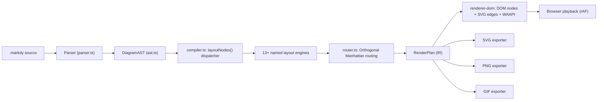
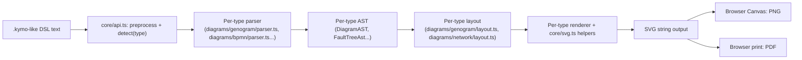
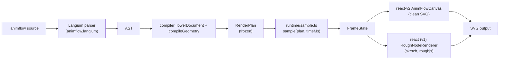
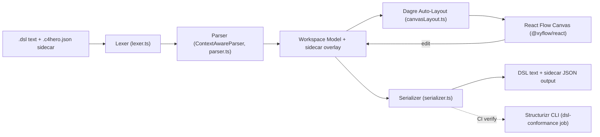

# Weekly scan — Diagram tooling & visual DSLs (19–26/09/2026)

**Tóm tắt (3 gạch đầu dòng):**

- Tuần này nổi bật nhất là **markdy** (`HoangYell/markdy-com`) — DSL diễn hoạt kiến trúc hệ thống theo "beat" thời gian bằng Web Animations API, có ≥13 layout engine chuyên biệt và một `RenderPlan` IR tường minh; gần với sứ mệnh của kymostudio (DSL → animated SVG) hơn bất kỳ repo nào khác tìm được tuần này, nhưng CLI/tính năng "AI" có vẻ phình to so với core 14KB — nên đọc lướt, không cần bắt chước nguyên khối.
- **animflow-dsl** (0 sao, rất non trẻ) có ý tưởng đáng nghiên cứu sâu nhất về mặt kỹ thuật: một `RenderPlan` bất biến (`deepFreeze()`) được *sample* thuần túy tại bất kỳ mốc thời gian nào (`sample(plan, timeMs) → FrameState`), tách hẳn "tính toán animation" khỏi "vẽ frame" — mô hình này giải quyết gọn vấn đề seek/scrub xác định mà kymostudio's `--animate` hiện chưa có.
- **c4hero** phơi bày một rủi ro đáng để tâm cho chính kymostudio: CI của họ chỉ verify **serializer output** đối chiếu Structurizr CLI thật, còn phần lớn test khác chỉ tự so sánh c4hero với chính nó — và một bug serializer đã lọt CI nhiều tháng vì vậy. Kymostudio's BPMN conformance hiện cũng mới chỉ đối chiếu Python↔JS với nhau, chưa đối chiếu với một BPMN engine thứ ba thực (Camunda/bpmn.io) — cùng một lớp rủi ro.

**Mục lục**

1. [Ecosystem note trong tuần](#ecosystem-note-trong-tuần)
2. [Danh sách 10 candidates](#danh-sách-10-candidates)
3. [markdy (HoangYell/markdy-com)](#markdy-hoangyellmarkdy-com)
4. [SchemaTex (SchemaTex/SchemaTex)](#schematex-schematexschematex)
5. [AnimFlow DSL (viviviviviid/animflow-dsl)](#animflow-dsl-viviviviviidanimflow-dsl)
6. [c4hero (c4hero/c4hero)](#c4hero-c4heroc4hero)

---

## Ecosystem note trong tuần

Không nằm trong cửa sổ 7 ngày nghiêm ngặt nhưng đủ quan trọng để ghi lại vì tác động trực tiếp tới cùng bài toán layout mà kymostudio đang giải:

- **Mermaid v12.0.0** (10/9/2026) — breaking release, **ELK trở thành layout engine mặc định** thay cho Dagre, thêm theme "neo", UML use-case diagrams, yêu cầu ES2024/Node 22.12+. Đáng chú ý vì đây là một dự án lớn từ bỏ layout engine tự viết để chuyển sang ELK — câu hỏi ngược lại cho kymostudio: `alignment.py`/`layout.py` tự viết có nên tiếp tục tự chủ, hay có điểm nào nên mượn ELK/dagre?
- **D2 v0.9.0** (7/9/2026) — Terrastruct giải thể công ty (~5/9/2026) và mở nguồn **TALA**, thuật toán auto-layout constraint-based của họ, tài trợ qua Hack Club (MPL-2.0), nay bundle thẳng vào D2; SVG rendering nhanh hơn ~10x, export PNG/GIF/PDF/PPTX built-in.
- **PlantUML v1.2026.8** (5/9/2026) — tối ưu hiệu năng (cache SkinParam, format SVG nhanh hơn qua TeaVM), sửa theme/object-diagram.
- **Structurizr**: các repo `lite`/`cli`/`java`/`onpremises` đã bị archive từ 2/2026; core `structurizr` (Java) và trang docs vẫn hoạt động — khoảng trống này có vẻ là lý do khiến các editor cộng đồng tương thích DSL Structurizr (c4hero, xem §c4hero) xuất hiện.
- Excalidraw, ELK, dagre, nomnoml: không có hoạt động release đáng chú ý trong 14 ngày qua.

## Danh sách 10 candidates

| # | Repo | Ngôn ngữ | Sao | Điểm nổi bật | Deep-dive? |
|---|------|----------|-----|--------------|:---:|
| 1 | [HoangYell/markdy-com](https://github.com/HoangYell/markdy-com) | TypeScript | 95 | DSL diễn hoạt kiến trúc, ≥13 layout engine, WAAPI, MCP server | ✅ |
| 2 | [SchemaTex/SchemaTex](https://github.com/SchemaTex/SchemaTex) | TypeScript | 78 | 52 họ diagram chuẩn ngành, mỗi loại 1 parser/layout riêng | ✅ |
| 3 | [viviviviviid/animflow-dsl](https://github.com/viviviviviid/animflow-dsl) | TypeScript | 0 | Langium grammar, `RenderPlan` bất biến + `sample(plan, t)` thuần | ✅ |
| 4 | [c4hero/c4hero](https://github.com/c4hero/c4hero) | TypeScript | 51 | Editor C4 đọc/ghi DSL Structurizr thật, verify bằng Structurizr CLI trong CI | ✅ |
| 5 | [ChanMeng666/archlang](https://github.com/ChanMeng666/archlang) | TypeScript | 12 | DSL → SVG floor plan, thiết kế cho AI consumption (deterministic + JSON diagnostics) | — |
| 6 | [indianerbande/c4ml](https://github.com/indianerbande/c4ml) | TypeScript | 1 | C4-as-code desktop workbench, compiler local, output SVG/PNG xác định | — |
| 7 | [baires/archlex](https://github.com/baires/archlex) | TypeScript | 2 | DSL ngữ nghĩa cho diagram AWS/GCP/K8s, icon SVG chính thức đã validate | — |
| 8 | [coldteadotai/pr-lens](https://github.com/coldteadotai/pr-lens) | TypeScript | ~1.6k | PR diff → animated architecture/data-flow diagram (code→diagram, không phải DSL) | — |
| 9 | [lazypay/Archscribe](https://github.com/lazypay/Archscribe) | Python | ~351 | Agent skill sinh diagram kiểu vẽ tay, xuất Excalidraw + PNG + GIF động | — |
| 10 | [bybit-exchange/svg-diagram](https://github.com/bybit-exchange/svg-diagram) | JavaScript | ~582 | Agent skill ép "house style" SVG đặt tay (lint 12 quy tắc) thay vì auto-layout | — |

Ghi chú: các mục #5–#10 được xác nhận tồn tại qua tìm kiếm nhưng không được đọc sâu mã nguồn (không đủ evidence để viết §2 đầy đủ trong giới hạn 4 repo/tuần); số sao là gần đúng, lấy từ WebSearch/WebFetch tại thời điểm scan.

---

## markdy (`HoangYell/markdy-com`)

**§1 — Quick Context**

Markdy biến kiến trúc hệ thống thành hoạt cảnh theo từng "beat" thời gian — animation là công dân hạng nhất (kể chuyện tuần tự request/response), khác kymostudio ở chỗ static SVG chỉ là export phụ, không phải artifact chính. Stack: TypeScript monorepo (pnpm workspaces), core zero-dependency (~14KB), Web Animations API. Sức khỏe: 95 sao, 3 fork, 727 commit, release dồn dập (v1.4.10→v1.5.0 cùng ngày 13/9), có `ci.yml`/`release.yml`. Phân phối: nhiều npm package (`@markdy/*`), VS Code Marketplace, web playground; không PyPI/cargo/binary.

**§2 — Architecture Deep-Dive**

**A. Component inventory** — `Parser` (`packages/core/src/parser.ts`) — quét dòng thành `Block[]`, dùng regex nhận diện statement, ném `ParseError(message, line, column)`. `AST/IR` (`packages/core/src/ast.ts`) — type alias discriminated-union (`NodeDecl`, `EdgeDecl`, `BeatDecl`, `Cue`…), immutable. `Compiler/layout dispatcher` (`packages/core/src/compiler.ts`, ~1850 dòng) — `layoutNodes()` chọn 1 trong ≥13 hàm `layoutXxx()` (ranked, tree, constellation, loop/flywheel, medallion, quadrant, swimlane, pyramid, radar, timeline, gantt, venn, layers, nested) — không có bằng chứng xác nhận đúng con số "17" như README quảng cáo. `Edge router` (`packages/core/src/router.ts`) — tự nhận "Collision-aware Orthogonal Manhattan Router with Dynamic Port Multiplexing". `DOM renderer` (`packages/renderer-dom/src/diagram.ts`) — node = HTML/DOM, edge = SVG, animate bằng `element.animate()` + rAF. `Exporters` (`packages/renderer-dom/src/export/{svg,png,gif}-exporter.ts`). `CLI` (`packages/cli/src/index.ts`, ~24 lệnh: lint/fmt/render/import/diff/share/verify/c4/drift). `MCP server` (`packages/mcp-server/src/index.ts`, 8 tools + 4 resources).

**B. Pipeline** — (1) user viết `.markdy` hoặc chạy `markdy render`; (2) `parse()` → `DiagramAST`; (3) `compiler.ts` gọi `layoutNodes()` chọn engine phù hợp + `router.ts` định tuyến cạnh → `RenderPlan` (IR thấp hơn); (4) `renderer-dom` dựng DOM nodes/SVG edges, lên lịch `element.animate()` theo từng beat; (5) browser phát bằng rAF tick loop, hoặc export tĩnh qua `export/*.ts` → SVG/PNG/GIF/share-card.

**C. Data model** — type alias TypeScript (không phải class), discriminated union, bất biến giữa các pass; có khái niệm "compile xuống IR thấp hơn" rõ ràng: `DiagramAST` → `RenderPlan` (gồm `PositionedNode`, `RoutedEdge`, `TimedCue`).

**D. Input language** — parser regex/line-based tự viết (không PEG/ANTLR/Langium), khối phân định bằng indentation + dấu `:`, `&` cho cue song song; không có file grammar hình thức. Báo lỗi có line/column qua `ParseError`, cộng `validateReferences()`/`detectFlowCycles()` sau parse.

**E. Layout** — không phải một solver tổng quát mà là thư viện ≥13 layout engine chuyên biệt theo loại diagram, chọn theo scene type. Routing: Manhattan orthogonal tự viết với port multiplexing động, tránh chồng cạnh bằng so sánh nhiều đường ứng viên (heuristic, không phải crossing-minimization hình thức).

**F. Rendering** — backend chính là DOM+SVG hybrid, animate bằng WAAPI gốc trình duyệt (không CSS/GIF làm chính); export phụ sang SVG tĩnh/PNG/GIF qua module riêng — dạng emitter tách rời nhưng animation chỉ chạy trong browser, không có đường headless-first.

**G. Extensibility** — `themes.ts`/`theme-generator.ts` (10 theme + generator), `recipes.ts`/`PatternDecl` cho blueprint tái dùng, `system-vocabulary.ts`/gói `stdlib-systems`; thêm layout mới = viết `layoutXxx()` rồi nối vào dispatcher — không có plugin API hình thức.

**H. Dev experience** — CLI giàu tính năng (`verify/doctor` quality gate, `drift/sync` phát hiện lệch kiến trúc, `c4`, `suggest`/`guide` hỗ trợ AI); VS Code/Cursor extension với `markdy-language-server` (gợi ý LSP) cho live preview; playground web không cần cài đặt. Watch mode: không xác định.

**§3 — Architecture Diagram**

**§4 — Verdict**

Đáng học: (1) tách "layout catalog theo archetype" (ranked/quadrant/swimlane/venn/radar…) thay vì một solver tổng quát — kymostudio có thể thêm layout chuyên biệt (quadrant, radar, timeline) bên cạnh `layout.py` hiện có; (2) router Manhattan tự viết với "dynamic port multiplexing" tránh cạnh chồng chéo tại cùng cạnh box — áp dụng được cho `alignment.py` khi nhiều edge cùng vào một node; (3) `RenderPlan` là IR trung gian tường minh, giống vai trò `Diagram` đã resolve của kymostudio. Red flag: parser regex/line-based không có grammar hình thức (rủi ro drift giữa code và tài liệu, giống cảnh báo trong `docs/DSL.md` của kymostudio); tính năng "AI" (drift, ai-healing) có vẻ phình to so với core 14KB — nghi ngờ độ chín thực tế; không thấy golden/snapshot test rõ ràng như kymostudio. Câu hỏi mở: WAAPI-only có hỗ trợ output tĩnh tốt cho tài liệu không, hay animation luôn bắt buộc? Kết luận: **glance only**, không cần study sâu.

---

## SchemaTex (`SchemaTex/SchemaTex`)

**§1 — Quick Context**

SchemaTex khác Mermaid/kymostudio ở chỗ nó không cố tổng quát hoá một layout engine cho mọi loại diagram, mà coi mỗi trong 52 họ diagram (genogram, P&ID, ladder logic IEC 61131-3, BPMN, fault tree, network topology…) là "first-class citizen" với parser/layout/renderer riêng, bám sát chuẩn ngành thay vì trực quan hoá chung chung. Tech stack: TypeScript strict, zero runtime deps, xuất SVG tĩnh (semantic, có a11y) + PNG/PDF qua Canvas trình duyệt; có React component và MCP server riêng (`packages/mcp`). Repo health: 78 sao, 373 commit trên `main`, có CI (`ci.yml`, `publish.yml`) nhưng số contributor/tests cụ thể không xác định qua trang HTML. Phân phối: npm (`schematex`, v1.1.0), tree-shakable per-diagram import (`schematex/genogram`), license AGPL-3.0 + license thương mại.

**§2 — Architecture Deep-Dive**

**A. Component inventory** — Mỗi diagram gồm 4-6 file trong `src/diagrams/<type>/`: ví dụ `genogram/parser.ts` (DSL→AST), `genogram/layout.ts` (sinh toạ độ), `genogram/renderer.ts` (AST+positions→SVG), `genogram/routing.ts` (route cạnh), `genogram/symbols.ts` (ký hiệu y khoa). `faulttree/` có thêm `analysis.ts` (thuật toán MOCUS) và `types.ts`. `bpmn/` chỉ có 4 file (index/layout/parser/renderer), không có analysis riêng. Hạ tầng dùng chung nằm ở `src/core/`: `logical-lines.ts` (tokenizer dòng-logic dùng chung, xử lý chuỗi có dấu ngoặc kép đa dòng), `dsl-preprocess.ts`, `svg.ts` (builder SVG an toàn), `api.ts` (entry point điều phối), `theme.ts`, `label-placement.ts`, `identifier.ts`. Registry 52 plugin nằm trong `src/index.ts`/`api.ts` dưới dạng mảng `plugins`, mỗi plugin implement interface `DiagramPlugin { type, altTypes?, detect(), parse()?, render(), lint()?, isDirective()? }`.

**B. Pipeline** — Từ `src/core/api.ts`: (1) preprocess DSL (chuẩn hoá quote, tách frontmatter, xử lý comment); (2) `detect(text)` chạy tuần tự qua từng plugin (hoặc dùng `config.type`) để xác định họ diagram; (3) chuẩn hoá riêng cho plugin; (4) gọi `parse()`/`render()` của plugin cụ thể; (5) `remapAstSourceRanges()` ánh xạ offset đã xử lý về offset gốc để báo lỗi đúng vị trí; (6) chạy `lint()` tuỳ chọn, chặn nếu có lỗi nghiêm trọng. Happy path: `render(text)` → preprocess → detect type → parser riêng → layout riêng → renderer riêng → chuỗi SVG.

**C. Data model/IR** — `api.ts` không có schema AST hợp nhất: `parse()` trả `unknown` (cấu trúc tuỳ plugin). Không tìm thấy khái niệm "compile xuống IR thấp hơn" dùng chung. Trong từng plugin, AST là bất biến, còn cấu trúc làm việc của layout (`LayoutGraph`, map toạ độ) là mutable, biến đổi qua nhiều pass rồi đóng gói thành `LayoutResult` bất biến trả ra.

**D. Input language design** — Không dùng PEG/ANTLR/parser-combinator; mỗi type viết parser thủ công nhưng dùng chung hạ tầng tokenize dòng-logic (`readLogicalLines()`) — tức là **lai**: có common infra cho "chẻ dòng, escape, dò comment" nhưng ngữ pháp/từ khoá từng type riêng biệt hoàn toàn. Báo lỗi qua `ParseError` có dòng/cột. Không thấy EBNF hình thức hoá tập trung.

**E. Layout algorithm** — Thực sự khác nhau theo từng họ. Genogram: layout phả hệ theo hàng thế hệ (BFS gán generation, sắp thứ tự cặp/đơn, nhiều pass giải chồng lấn). Network: 8 chế độ đặt vị trí theo topology (tree/star/ring/mesh/bus/spine-leaf/tiered/manual), rank theo vai trò thiết bị chứ không theo cha-con thuần. Không thấy force-directed hay crossing-minimization tổng quát (Sugiyama/barycenter) — mỗi layout tự viết heuristic riêng cho đặc thù chuẩn ngành.

**F. Rendering/output** — Không có renderer dùng chung, mỗi plugin tự viết `render()`, chỉ share `RenderConfig` và utility `core/svg.ts`. Không có cơ chế animation (không SMIL/`<animate>`/CSS keyframes) — output là SVG tĩnh; PNG/PDF qua Canvas trình duyệt.

**G. Extensibility** — Thêm diagram type mới = tạo thư mục theo "five-file pattern" (parser, symbols, layout, renderer, integration) rồi đăng ký vào mảng `plugins`.

**H. Dev experience** — có playground web, React component, MCP server cho AI integration, `llms.txt`; không xác định CLI/watch-mode/VSCode extension từ evidence thu thập được.

**§3 — Architecture Diagram**

**§4 — Verdict**

Đáng học: (1) `logical-lines.ts` — tokenizer dòng-logic dùng chung xử lý chuỗi đa dòng trong quote, tách biệt khỏi ngữ pháp riêng của từng DSL — kymostudio có thể tách phần này ra khỏi `dsl.py` để dùng chung khi thêm DSL front-end mới; (2) Network layout chọn thuật toán theo *vai trò topology* (spine-leaf, ring, tiered) thay vì một layout chung — gợi ý cho `layout.py`/`alignment.ts`: cân nhắc thêm chế độ layout chuyên biệt cho diagram không phải cây/luồng (network, ERD) thay vì ép vào cùng 5-pass resolver; (3) MOCUS trong `faulttree/analysis.ts` là ví dụ tốt về "diagram vừa vẽ vừa tính toán" — kymostudio hiện chỉ vẽ, chưa tính. Red flag: không có AST/IR thống nhất (`parse()` trả `unknown`) — khó kiểm tra parity chéo, dễ trôi dạt giữa 52 type; không có animation dù README quảng bá rầm rộ. Câu hỏi mở: test coverage/golden-test thực tế thế nào (không thấy nội dung `/tests`), quy mô cộng đồng thực. Kết luận: **study deeper** phần layout theo-topology và MOCUS/PERT-style analysis, còn kiến trúc tổng thể (52 parser độc lập, không IR chung) không nên copy nguyên khối.

---

## AnimFlow DSL (`viviviviviid/animflow-dsl`)

**§1 — Quick Context**

Điểm khác biệt cốt lõi: thay vì animate bằng CSS/JS keyframe trực tiếp trên DOM, AnimFlow biên dịch scene thành một `RenderPlan` bất biến rồi *sample* nó tại bất kỳ `timeMs` nào ra `FrameState` xác định — animation trở thành hàm thuần túy của thời gian. Stack: TypeScript monorepo (pnpm + turbo), Langium (grammar/LSP), React/SVG renderer, roughjs (sketch), dagre/gsap (legacy renderer). Sức khỏe repo: **0 sao, 0 fork, không release/tag**, ~87 commit, có CI (`verify.yml`, `performance.yml`) nhưng chưa rõ số contributor — dự án rất non trẻ. Phân phối: private npm packages (monorepo), web demo (`animflow-studio.vercel.app`), và một Agent Skill (`animflow-authoring-skill` trên npm).

**§2 — Architecture Deep-Dive**

**A. Component inventory** (13 packages dưới `packages/`) — `language/src/animflow.langium`: grammar Langium chính thức (Xtext-style EBNF), cùng `animflow-validator.ts`, `animflow-formatter.ts`, `animflow-completion-provider.ts`, `animflow-hover-provider.ts` — có LSP đầy đủ. `model/src/render-plan.ts`: interface `RenderPlan` (v2) + `freezeRenderPlan()`/`deepFreeze()`; `model/src/elements.ts`, `geometry.ts`, `animation.ts`, `invariants.ts`, `diagnostics.ts`. `compiler/src/compile.ts`: `compileAnimFlow()` → `lowerDocument()` → `compileGeometry()` → `createInitialState()` → `compileScenes()`; `compiler/src/geometry.ts`: layout engine (rank/BFS). `runtime/src/sample.ts`: hàm thuần `sample(plan, timeMs): FrameState`; `easing.ts`, `playback.ts`. `react/` (v1): renderer "sketch" cứng bằng roughjs. `react-v2/src/AnimFlowCanvas.tsx`: renderer SVG "sạch", chỉ phụ thuộc `@animflow-dsl/model`. `cli/src/{bin,run}.ts`: `validate`/`format`/`compile`/`migrate`/`import-mermaid`/`capabilities`.

**B. Pipeline** (5 bước) — (1) người dùng viết `.animflow`; (2) CLI `compile` → `parseAnimFlow(source)` sinh Langium AST; (3) `lowerDocument()` gán "handle" cho mọi element, resolve theme, rồi `compileGeometry()` tính layout ranks/tọa độ; (4) `compileScenes()` duyệt các "scene" trong `story` để sinh animation "track" (interpolation theo thời gian), đóng gói thành `RenderPlan` đã `deepFreeze()`; (5) CLI ghi ra JSON RenderPlan, hoặc React app gọi `sample(plan, timeMs)` mỗi khi cần vẽ 1 frame, rồi `AnimFlowCanvas` vẽ `FrameState` ra SVG.

**C. Data model/IR** — `RenderPlan` là **interface TypeScript thuần** (không phải class), version=2, chứa `documentId`, `sourceHash`, `canvas`, `theme`, `elements` (geometry đã compile), `initial`, `scenes[]` (mỗi scene có `tracks[]` nội suy). Bất biến được **thực thi thật bằng runtime** qua `deepFreeze()` (đệ quy `Object.freeze`), không chỉ là quy ước `readonly`. "Lower xuống IR thấp hơn" cụ thể: AST → geometry tuyệt đối (x/y/width/height, màu đã resolve RGBA) → `RenderPlan` đóng băng chứa toàn bộ track nội suy sẵn, không còn tham chiếu ngược AST.

**D. Input language** — có file grammar `.langium` chính thức (không phải parser tay): `AnimFlowDocument` → `canvas`/`graph`(node/edge)/`overlay`/`story`(scene, transition, sequence/stagger). Error-reporting qua `animflow-validator.ts` (validate trước compile) + LSP hover/completion.

**E. Layout** — `compiler/src/geometry.ts` cài rank-based hierarchical layout tự viết (`computeRanks` = BFS/topological từ node indegree=0, giống Sugiyama đơn giản), route cạnh có 3 kiểu `orthogonal`/`curve`/`straight` (orthogonal xác nhận có thật, dùng midpoint X làm góc L-shape); **không có crossing minimization** rõ ràng (chỉ "collision resolve" bằng shift tuyến tính, giới hạn 8×n+32 vòng lặp).

**F. Rendering/output** — 2 renderer song song: `react-v2` vẽ SVG path thuần "clean"; `react` (v1, cũ hơn) vẽ "sketch" bằng roughjs (roughness=0.8 cố định). Quan trọng: **không tìm thấy prop `mode`/`renderMode` chuyển đổi trong cùng 1 component** — "clean" và "sketch" thực chất là **hai package renderer khác nhau**, không phải 1 toggle runtime thống nhất. Cơ chế animation: `sample(plan, timeMs)` là hàm thuần, không side-effect, không phụ thuộc frame trước đó — khác CSS/JS keyframe ở chỗ seek ngược/tua nhanh/render song song nhiều frame đều cho kết quả *deterministic* y hệt.

**G. Extensibility** — thêm shape mới cần sửa cả `.langium` grammar, `model/elements.ts`, và renderer (switch-case shape) — không có plugin/registry rõ ràng cho shape. Theming qua token (`theme.ts`, `themeToken()`).

**H. Dev experience** — CLI có `validate`/`format --check|--write`/`compile`/`migrate`/`import-mermaid`/`capabilities`; Langium cung cấp LSP thật (completion/hover); có web demo và Playwright e2e. Watch mode: không xác định trong CLI.

**§3 — Architecture Diagram**

**§4 — Verdict**

Mô hình "immutable RenderPlan + pure `sample(plan, t)`" đáng để kymostudio nghiên cứu sâu cho `to_svg.py`/`--animate`: thay vì render animation bằng CSS keyframes gắn cứng, tách hẳn bước "compile toàn bộ track nội suy 1 lần" (tương tự `alignment.py` 5-pass) khỏi bước "sample tại t" — cho phép seek/scrub xác định, và test snapshot animation dễ hơn (so golden `FrameState` tại các mốc `t` cố định thay vì so CSS string). Rủi ro: 0 sao, không release, chỉ 87 commit — dự án giai đoạn rất sớm; và bản thân họ đã có 2 renderer không đồng bộ (v1 sketch roughjs cứng nhắc vs v2 clean chưa hoàn thiện mode-switch) — cho thấy chính AnimFlow cũng chưa giải xong bài toán "1 plan, nhiều style" mà kymostudio (SVG/Figma/Excalidraw/WebP từ cùng một `Diagram`) đã làm. Câu hỏi mở: layout có crossing-minimization thật không (không thấy bằng chứng), performance ở đồ thị lớn. Kết luận: **study deeper** riêng phần RenderPlan/sample, phần còn lại chỉ glance.

---

## c4hero (`c4hero/c4hero`)

**§1 — Quick Context**

c4hero là canvas C4 local-first trong trình duyệt, khác biệt nhờ đồng bộ hai chiều thời gian thực giữa DSL text và canvas kéo-thả, không cần server/tài khoản. Stack: React 19 + TypeScript + Vite, Zustand, React Flow (`@xyflow/react`), CodeMirror 6, Dagre; xuất PNG/SVG/HTML/OKF. Repo nhỏ nhưng khỏe: 51 sao, 10 fork, Apache-2.0, CI 8 job (lint/typecheck/unit/dsl-conformance/e2e/build/security/secret-scan). Phân phối: web app tĩnh/PWA, không CLI, không package npm/PyPI.

**§2 — Architecture Deep-Dive**

**A. Component inventory** — Lexer (`src/lib/dsl/lexer.ts`) — tokenizer hand-written, sinh `Token{type,value,line,column}`, gom `LexerError` không throw. Parser (`src/lib/dsl/parser.ts` + `parser-model.ts`, `parser-relationship.ts`, `parser-views.ts`, `parser-deployment.ts`, `parser-styles.ts`) — class `ContextAwareParser`, recursive-descent, dựng Workspace model, tích lũy `errors`/`warnings` kèm line/column. Serializer (`src/lib/dsl/serializer.ts`) — ghi model ngược lại DSL, đảm bảo idempotent. Sidecar (`src/lib/sidecar.ts`) — `SidecarData{version, elements, relationships, views}` lưu layout/pinned/locked tách khỏi DSL. Auto-layout (`src/lib/canvasLayout.ts`, `applyAutoLayout()`) dùng `@dagrejs/dagre`. Include resolver (`src/lib/dsl/includeResolver.ts`). Validation (`structurizrValidation.ts`, `scopeValidation.ts`, `modelIntegrity.ts`). Conformance test (`src/lib/dsl/structurizr-conformance.test.ts`), chạy trong CI job `dsl-conformance`.

**B. Pipeline** — (1) mở `.dsl` + sidecar `.c4hero.json` qua `fileIO.ts`/`folderIO.ts`; (2) `lexer.ts` tokenize → `ContextAwareParser` dựng Workspace model, gom errors/warnings; (3) `applySidecar()` overlay layout lên model; (4) model → React Flow nodes/edges (Zustand store); node chưa có toạ độ được `canvasLayout.ts` chạy Dagre; (5) người dùng sửa trên canvas hoặc CodeMirror, store cập nhật hai chiều; (6) `serialize()` ghi lại DSL, `extractSidecar()` tách layout ra JSON — vòng round-trip khép kín.

**C. Data model/IR** — Workspace là object graph mutable (Model + Views), không phải AST tổng quát. Positions/pinned/locked tách hẳn vào sidecar JSON theo id; DSL chỉ chứa dữ liệu Structurizr chuẩn.

**D. Input language design** — lexer/parser hand-written mô phỏng cú pháp Structurizr DSL thực; không thấy tham chiếu file grammar hình thức (BNF). Error reporting non-throwing, tích lũy kèm line/column. Điểm nổi bật nhất: job CI `dsl-conformance` tải Structurizr CLI chính thức (pin `STRUCTURIZR_VERSION=2025.11.09`, khớp `structurizr-java 5.0.2`), chạy verify **output của serializer** khớp parser thật của Structurizr — không phải verify parser của chính c4hero. Comment CI thừa nhận: "mọi test DSL khác chỉ so c4hero với chính nó", nguyên nhân khiến một bug serializer (GH #109) lọt CI nhiều tháng.

**E. Layout** — Dagre với cơ chế "frozen node" (giữ toạ độ đã lưu làm anchor), stitch offset theo từng connected component, "parking" node rời rạc dưới bounding box, collision-separation tối đa 24 pass. Edge routing cụ thể: không xác định.

**F. Rendering** — client-side qua React Flow (SVG); export PNG/SVG/HTML/OKF qua `htmlExport.ts`/`okfExport.ts`/`exportUtils.ts` dùng `html-to-image`. Không có animation.

**G. Extensibility** — `templates.ts`/thư mục `templates/` cho view types, `elementMeta.tsx` cho icon/theme. Tài liệu extensibility chính thức: không xác định.

**H. Dev experience** — thuần web app (Vite dev), không CLI/binary; `fileWatch.ts` theo dõi thay đổi file ngoài, PWA offline; đồng bộ hai chiều là live trong app qua store chung.

**§3 — Architecture Diagram**

**§4 — Verdict**

c4hero chỉ verify **output của serializer** đối chiếu Structurizr CLI thật (1 CLI version pin, 1 file test) — hẹp hơn nhiều so với kymostudio: Python-là-reference, JS reconcile toàn bộ golden JSON (model + BPMN export digest) qua corpus lớn (samples, conformance/corpus, ~120 file MIWG). Kymostudio rigor hơn về phạm vi. Nhưng kỹ thuật đáng học từ c4hero: pin đúng version upstream + diff với parser/CLI bên thứ ba thật, không chỉ self-consistency — kymostudio's BPMN conformance hiện đối chiếu Python↔JS với nhau, chưa thấy đối chiếu với một BPMN engine thứ ba thực (Camunda/bpmn.io), tức có nguy cơ tương tự bug GH #109 (round self-check pass nhưng output invalid với thế giới ngoài). Red flag: comment CI của c4hero tự thừa nhận thiên lệch self-test. Câu hỏi mở: liệu kymostudio có nên bổ sung một bước đối chiếu BPMN export với một engine BPMN thực bên ngoài Python/JS. Verdict: **study deeper** riêng pattern "verify against real upstream tool trong CI".
