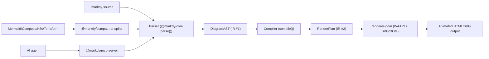
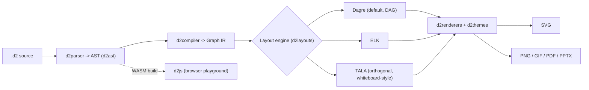
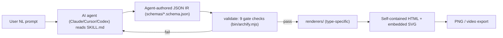
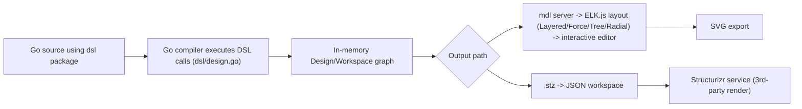

# Weekly Diagram-Tooling Scan — 2026-09-27

Phạm vi: repo diagram-as-code / animation / visual tooling được publish hoặc update đáng kể trong 7 ngày qua (20–27/09/2026), đối chiếu với kymostudio.

## Executive summary

- **TALA (layout engine của D2) chính thức open-source và merge vào `terrastruct/d2` v0.9.0** — một orthogonal layout engine chuyên cho whiteboard-style architecture diagram, hybrid positioning (fix `top`/`left` cho một số node, để engine tự route phần còn lại). Đây là tin tức layout-algorithm quan trọng nhất trong domain tuần này, trực tiếp liên quan đến `alignment.py`/`layout.py` của kymostudio.
- **`HoangYell/markdy-com` là repo gần nhất với kymostudio về triết lý**: DSL riêng (MarkdyScript) compile qua AST → RenderPlan → animated SVG/DOM bằng Web Animations API, có MCP server cho AI agent — gần như một "kymostudio cho animated sequence diagrams".
- **`tt-a1i/archify` là hiện tượng viral (72.3k sao, +5.3k/tuần) đi theo hướng ngược lại**: bỏ hẳn DSL/layout algorithm, để AI agent tự "phán đoán" layout và ghi thẳng JSON IR đã có toạ độ — một phản đề đáng suy ngẫm cho cách tiếp cận deterministic, declarative của kymostudio.

## Mục lục

1. [HoangYell/markdy-com](#hoangyellmarkdy-com)
2. [terrastruct/d2 (TALA v0.9.0)](#terrastructd2-tala-v090)
3. [tt-a1i/archify](#tt-a1iarchify)
4. [goadesign/model](#goadesignmodel)

---

## HoangYell/markdy-com

### §1 — Quick context

Một-dòng pitch: DSL riêng compile ra **animated sequence/architecture diagram** bằng Web Animations API thay vì static SVG — khác Mermaid/D2 ở chỗ diagram là *choreography theo thời gian*, không phải sơ đồ tĩnh.

Tech stack: TypeScript/JS monorepo (pnpm workspaces), `@markdy/core` compiler zero-dependency (~14kB), renderer dùng WAAPI + CSS/SVG transform. Output: DOM động (SVG/HTML), export PNG/video qua tooling đi kèm; có VS Code extension, Astro/MDX integration, MCP server.

Repo health: 96 sao, 3 fork, 727 commit, CI GitHub Actions passing (`pnpm test`, `pnpm test:visual`, `pnpm test:perf` sub-40ms), license MIT, cập nhật 2 ngày trước. Distribution: npm (`@markdy/core`, `@markdy/cli`, v.v.), VS Code Marketplace.

### §2 — Architecture deep-dive

**A. Component inventory:**
- `Parser` (`packages/core` — `parse()`) — chuyển MarkdyScript nguồn thành `DiagramAST`, indentation-aware, error có số dòng.
- `Compiler` (`packages/core` — `compile()`) — resolve kích thước, xếp rank node, route cạnh tránh vật cản, lên lịch animation cue theo "beat".
- `Renderer` (`packages/renderer-dom` — `nodes.ts`, `edges.ts`, `sequence.ts`, `tree.ts`, `groups.ts`, `geometry/`, `theme.ts`, `diagram.ts`) — sinh DOM/SVG thực tế và chạy vòng lặp `requestAnimationFrame`.
- `@markdy/compat` — transpile ngược từ Mermaid, Docker Compose, Kubernetes, Terraform, Draw.io.
- `@markdy/mcp-server` — expose `validate_markdy_code`, `diagnose_markdy_syntax`, `fix_markdy_code`, `transpile_to_markdy` cho AI agent.
- `@markdy/cli`, `@markdy/language-server`, `markdy-vscode` — tooling.

**B. Pipeline (happy path):**
1. Người dùng chạy `markdy render diagram.markdy` (hoặc mở VS Code preview).
2. `@markdy/core.parse()` đọc `.markdy` → `DiagramAST` (node/edge/group/beat/style).
3. `compile()` biến AST → `RenderPlan` (vị trí node đã resolve, route cạnh, cue animation theo beat).
4. `@markdy/renderer-dom` tiêu thụ `RenderPlan`, dựng DOM + WAAPI animation.
5. Vòng lặp rAF tự set `currentTime` (không dùng `startTime` của trình duyệt) để playback deterministic.
6. Output file HTML/SVG động xuất hiện (hoặc preview live trong VS Code/Astro).

**C. Data model/IR:** hai tầng IR tường minh — `DiagramAST` (cấu trúc cú pháp, gần input) rồi `RenderPlan` (đã có hình học + lịch animation). Cả hai đều là plain object/interface TypeScript, immutable giữa các pass (parse → compile → render là hàm thuần, không mutate ngược). Đây là mô hình "compile xuống IR thấp hơn" tương tự nhưng đơn giản hơn TALA của D2.

**D. Input language:** custom parser tay viết (không dùng parser-generator), "strict grammar" với indentation-aware block — gần giống line-oriented DSL của kymostudio (`dsl.py`) nhưng có thêm khái niệm thời gian (`beat`). Không có EBNF chính thức trong `SYNTAX.md` (chỉ ví dụ + bảng), nhưng có test file `.markdy` đóng vai trò golden/conformance corpus (31 file mẫu).

**E. Layout:** "17 layout engines" theo README (specialized cho distributed systems, security, data flow…) — không xác định chi tiết thuật toán từng engine (không đọc được source layout cụ thể). Edge routing: orthogonal, có "obstacle clearance"/dynamic port multiplexing để tránh cạnh chồng.

**F. Rendering:** single backend nhưng đa chế độ animation (WAAPI, không dùng CSS keyframes tĩnh hay GIF); hỗ trợ 10 theme editorial.

**G. Extensibility:** thêm node type qua "system vocabulary" (`stdlib-systems`), theme qua token; format mới qua `@markdy/compat` transpiler.

**H. DX:** VS Code extension với live side-by-side preview, MCP server để agent tự validate/fix/transpile code — devex hướng rất mạnh vào AI-agent workflow.

### §3 — Architecture diagram

### §4 — Verdict

Đáng học nhất cho kymostudio: (1) mô hình 2 tầng IR (AST → RenderPlan) tách rõ "cú pháp" khỏi "hình học đã resolve", gần với ranh giới `dsl.py` → `alignment.py` hiện có, có thể tham khảo cách họ định nghĩa `RenderPlan` tường minh làm interface ổn định cho renderer; (2) kỹ thuật rAF tự set `currentTime` để animation deterministic đáng xem lại nếu kymostudio mở rộng target `--animate` sang WAAPI thay vì SMIL/CSS thuần. Red flag: "17 layout engines" không có tài liệu thuật toán rõ ràng — nghi ngờ đây là marketing hơn là 17 thuật toán độc lập thật sự. Câu hỏi mở: golden test dùng 31 file `.markdy` là visual regression hay deep-equal IR — không xác định cơ chế so khớp chính xác. Verdict: **study deeper** (đặc biệt phần IR 2 tầng và animation engine).

---

## terrastruct/d2 (TALA v0.9.0)

### §1 — Quick context

Một-dòng pitch: D2 vừa open-source layout engine thương mại TALA — orthogonal layout tối ưu cho architecture diagram thay vì DAG hierarchical như Dagre — khác biệt ở chỗ tối ưu "cân đối thị giác" chứ không phải luồng hướng.

Tech stack: Go (core), có build JS/WASM riêng (`d2js`) cho browser playground (`play.d2lang.com`); output SVG/PNG/GIF/PDF/PPTX.

Repo health: ~25.5k sao, 753 fork, 476 issue mở, nhiều contributor, license MPL-2.0 (cả D2 lẫn TALA), release mới nhất v0.9.0 (07/09/2026), commit gần nhất pushed 20/09/2026 (trong 7 ngày) — vẫn active dù công ty chủ quản Terrastruct đang đóng cửa và D2 chuyển sang fiscal sponsorship của Hack Club. Distribution: Go install, npm (`@terrastruct/d2`), Homebrew, curl script, binary release.

### §2 — Architecture deep-dive

**A. Component inventory** (từ cây thư mục top-level):
- `d2ast/` — abstract syntax tree.
- `d2parser/` — lexer/parser sinh AST.
- `d2compiler/` — compile AST → graph IR (resolve reference, style, nested container).
- `d2layouts/` — cài đặt 3 layout engine: Dagre (mặc định), ELK, **TALA**.
- `d2renderers/` — sinh output theo theme.
- `d2themes/` — bộ theme.
- `d2cli/`, `main.go` — CLI entrypoint (`d2 --watch`, `--layout=tala`).

**B. Pipeline (happy path):**
1. User chạy `d2 diagram.d2` (hoặc `d2 --watch` cho live-reload).
2. `d2parser` đọc `.d2` → AST (`d2ast`).
3. `d2compiler` biên dịch AST → graph/IR nội bộ (node, edge, container lồng nhau đã resolve style/reference).
4. Chọn layout engine (`d2layouts`: Dagre mặc định, hoặc `--layout=elk`/`--layout=tala`) để gán toạ độ.
5. `d2renderers` áp theme, sinh SVG.
6. File `.svg` (hoặc PNG/GIF/PDF/PPTX qua export path) xuất hiện; browser tự refresh nếu dùng `--watch`.

**C. Data model/IR:** không đọc trực tiếp source `d2compiler`, nhưng theo README/kiến trúc thư mục, graph IR là struct Go trung gian giữa AST và layout — layout engine nhận IR này, gán toạ độ, rồi renderer tiêu thụ. Không xác định chi tiết mutable/immutable giữa các pass (không đọc source .go cụ thể).

**D. Input language:** custom recursive/hand-written parser (`d2parser` + `d2ast`), cú pháp rất tối giản (`x -> y -> z` là diagram hợp lệ) — triết lý "diagram scripting language" gần với DSL tối giản, khác cách tiếp cận block/keyword của `.kymo`. Không xác định có EBNF chính thức publish hay không (không đọc được `docs/`).

**E. Layout — trọng tâm tuần này:** TALA là **orthogonal layout engine**, khác Dagre/ELK (tối ưu DAG một hướng) ở chỗ tối ưu multi-directional network nhiều cạnh chéo, ưu tiên "symmetry và clustering". Cơ chế: thử 3 random seed mặc định, sinh nhiều candidate layout, chấm điểm theo aesthetic metric, giữ layout tốt nhất — nghĩa là **không deterministic tuyệt đối** giữa các lần chạy nếu không cố định seed, và thêm 1 node có thể đổi toàn bộ layout. Có **hybrid positioning**: fix `top`/`left` cho node cụ thể, để TALA tự route phần còn lại — feature này được thiết kế rõ ràng cho use-case AI đặt node theo toạ độ 2D rồi để engine lo phần routing (điều mà LLM làm kém).

**F. Rendering:** SVG là target chính, cộng export PNG/GIF/PDF/PPTX; renderer tách khỏi layout engine (pluggable), nên thêm output mới không đụng layout.

**G. Extensibility:** layout engine là plugin chọn qua flag (`--layout=`), không cần cài thêm gói riêng cho TALA nữa (trước đây TALA là proprietary plugin có license key).

**H. DX:** CLI có `--watch` live-reload, playground web, extension VS Code/Vim/Obsidian; theo README có so sánh chính thức tại `text-to-diagram.com`.

### §3 — Architecture diagram

### §4 — Verdict

Đáng học nhất cho kymostudio: TALA là bằng chứng sống rằng thị trường coi trọng layout "đẹp cho whiteboard-style architecture diagram" hơn là DAG hierarchical thuần — đúng use-case của kymostudio's `alignment.py` (auto-layout frame, fan-in/trunk-lane staggering). Cơ chế "multi-seed, chấm điểm aesthetic, giữ best" là một hướng nghiên cứu khả thi nếu kymostudio muốn auto-layout tổng quát hơn ngoài `layout { }` khai báo tường minh hiện tại — nhưng đánh đổi determinism (kymostudio đang có golden SVG test byte-for-byte, nên multi-seed non-deterministic sẽ phá vỡ contract này, cần cố định seed nếu áp dụng ý tưởng). Hybrid positioning (fix toạ độ một số node, để engine route phần còn lại) là ý tưởng trực tiếp áp dụng được cho DSL của kymostudio khi user muốn override auto-layout cục bộ. Red flag: TALA "scale phi tuyến tính" với số node — không hợp cho diagram lớn. Câu hỏi mở: license MPL-2.0 của TALA có tương thích để tham khảo thuật toán (không copy code) cho renderer Python/JS của kymostudio hay không — cần review pháp lý nếu định port ý tưởng cụ thể. Verdict: **study deeper**, riêng phần thuật toán TALA và hybrid positioning.

---

## tt-a1i/archify

### §1 — Quick context

Một-dòng pitch: bỏ hẳn DSL và layout algorithm — AI agent tự viết JSON IR đã có "layout judgment", khác kymostudio ở triết lý "generative" thay vì "declarative + solver".

Tech stack: Node.js/JavaScript, phân phối dưới dạng **agent skill** (không phải app/CLI độc lập truyền thống) — cài qua `npx skills add tt-a1i/archify -g` vào `~/.claude/skills/`, `~/.agents/skills/`, v.v. Output: file HTML tự chứa (embed SVG/HTML), export PNG/video.

Repo health: 72.3k sao (viral, +5.3k/tuần theo DEV Community), 4.9k fork, 271 commit, version `v2.17.0-dev.1`, license MIT, cập nhật vài phút trước khi scan (cực kỳ active). Distribution: npm-style skill installer (`npx skills add`), không có package npm truyền thống publish riêng lẻ để `import`.

### §2 — Architecture deep-dive

**A. Component inventory:**
- `bin/archify.mjs` — CLI dispatcher: `render`, `validate`, `preview`, `deliver`, `compare architecture`, `inspect`, `check`, `visual-check`, `guide`, `migrate workflow`.
- `schemas/*.schema.json` (`architecture.schema.json`, `workflow.schema.json`, `sequence.schema.json`, `dataflow.schema.json`, `lifecycle.schema.json`, `common.schema.json`) — định nghĩa JSON IR cho từng loại diagram.
- `renderers/` — renderer riêng theo từng loại diagram, tiêu thụ JSON IR đã validate.
- `delta/` — hệ thống so sánh "architecture delta" giữa 2 spec (freeze snapshot, canonicalize order, SHA-256 hash để đảm bảo idempotent).
- `SKILL.md` — "contract" hướng dẫn AI agent cách sinh/sửa diagram.
- `examples/` — ví dụ HTML đã render.

**B. Pipeline (happy path):**
1. User mô tả hệ thống bằng ngôn ngữ tự nhiên với AI agent (Claude Code, Cursor, Codex...) đã cài skill.
2. Agent đọc `SKILL.md` + schema tương ứng, tự viết JSON spec (`schema_version: 2`) — **agent tự quyết định hierarchy, spacing, route** thay vì gọi solver auto-layout.
3. `node bin/archify.mjs validate <type> <file.json> --quality showcase` — chạy 9 validation gate (schema, layout, HTML/SVG, route, label-to-route...).
4. Agent sửa lỗi dựa trên JSON diagnostic có mã lỗi + evidence (lặp bước 2-3 tới khi pass).
5. `node bin/archify.mjs deliver <type> <file.json> <output.html>` — freeze spec, render, ghi HTML atomically kèm SHA-256 evidence.
6. File `.html` tự chứa (embed SVG, theme, interaction) xuất hiện, có thể mở thẳng bằng browser.

**C. Data model/IR:** JSON IR tường minh, có 2 schema version (v1 "fixed geometry", v2 "readable layout" — nghĩa là v2 cho phép mô tả layout ở mức trừu tượng hơn, agent không cần tính toạ độ tuyệt đối). IR là plain JSON, immutable per artifact (một khi `deliver` freeze, spec được hash để verify không đổi).

**D. Input language:** **không có DSL/grammar hình thức** — input là JSON IR do agent (LLM) tự sinh dựa trên natural-language prompt, tuân theo JSON Schema strict (reject unknown field). Error reporting là "machine-readable JSON với rule code" để agent tự sửa vòng lặp — đây thực chất là "grammar-as-validation-loop" thay vì "grammar-as-parser".

**E. Layout:** README nói thẳng triết lý "**layout judgment over generic auto-layout**" — nghĩa là **không có thuật toán auto-layout truyền thống** (không force-directed, không Sugiyama). Agent (LLM) tự chọn hierarchy/spacing/route dựa trên hướng dẫn trong `SKILL.md`, hệ thống chỉ validate kết quả có hợp lệ không (không tự tính layout hộ). Đây là điểm khác biệt lớn nhất so với mọi tool khác trong list này.

**F. Rendering:** single backend — self-contained HTML với SVG/HTML embed, hỗ trợ theme sáng/tối, tương tác (focus/path-trace), export PNG/video qua post-processing riêng.

**G. Extensibility:** thêm loại diagram mới = thêm schema JSON + renderer + cập nhật `SKILL.md`; không có plugin runtime, mở rộng ở tầng "content" (schema) chứ không phải tầng engine.

**H. DX:** thiết kế hoàn toàn cho AI-agent-in-the-loop (Claude Code, Cursor, Codex, Windsurf...), không phải cho human viết tay; "guide"/"doctor" command hỗ trợ debug; không có VS Code preview truyền thống, không watch-mode cổ điển vì workflow là agent tự lặp validate/fix.

### §3 — Architecture diagram

### §4 — Verdict

Đáng học cho kymostudio: mô hình "validation-loop thay parser" — thay vì grammar chặt, dùng JSON Schema + diagnostic có rule-code để một agent (hoặc con người) tự sửa lặp lại — có thể tham khảo cho việc cải thiện error message của `dsl.py`/`dsl.ts` (hiện tại parser kymostudio "không validate gì" theo CLAUDE.md, khác hẳn triết lý archify). Ý tưởng "architecture delta" (so sánh 2 spec, hash để đảm bảo idempotent) đáng tham khảo cho quy trình golden-SVG-test của kymostudio. Red flag lớn: bỏ hẳn auto-layout algorithm nghĩa là chất lượng layout phụ thuộc hoàn toàn vào năng lực LLM tại thời điểm generate — không tái lập được nếu đổi model, và không có cơ chế nào đảm bảo layout tối ưu toán học (khác triết lý deterministic/testable của kymostudio). Câu hỏi mở: 72.3k sao có phản ánh chất lượng kỹ thuật hay chỉ do viral trong cộng đồng "agent skill" (skills marketplace) — cần thời gian kiểm chứng độ bền. Verdict: **glance only** — thú vị như phản đề triết lý, nhưng không có thuật toán cụ thể để port sang kymostudio.

---

## goadesign/model

### §1 — Quick context

Một-dòng pitch: DSL kiểu C4/Structurizr viết bằng chính Go (fluent builder, không phải text DSL riêng) — khác kymostudio ở chỗ "DSL" chính là ngôn ngữ chủ (Go), không phải cú pháp tự định nghĩa.

Tech stack: Go 1.23+, tích hợp ELK.js cho layout trong editor tương tác, có thể upload/sync với dịch vụ Structurizr. Output: SVG (qua tool `mdl`), JSON workspace (tương thích Structurizr).

Repo health: 467 sao, 23 fork, 13 issue mở, 15 PR mở, 1267 commit, license MIT, cập nhật 5 ngày trước (trong 7 ngày). Distribution: Go module (`go install`), 2 binary CLI (`mdl`, `stz`).

### §2 — Architecture deep-dive

**A. Component inventory:**
- `dsl/` (`design.go`, `elements.go`, `person.go`, `relationship.go`, `deployment.go`, `styles.go`, `views.go`, `doc.go`) — định nghĩa DSL bằng function Go (`SoftwareSystem()`, `Person()`, `Uses()`, `Views()`).
- `mdl/` — local HTTP server render SVG + editor tương tác (layout Layered/Force/Tree/Radial qua ELK.js, snap-to-grid, undo/redo).
- `stz/` — tool đồng bộ workspace JSON với dịch vụ Structurizr.
- `codegen/` — sinh code (không xác định chi tiết, không đọc source).
- `examples/` (basic, big_bank_plc, nested, shapes, label_collision, text_fit...) — ví dụ DSL thực tế.

**B. Pipeline (happy path):**
1. User viết file Go dùng package `dsl` (ví dụ `examples/basic/model/model.go`), gọi `SoftwareSystem()`, `Person()`, `Uses()`, `Views()` để khai báo model + view.
2. Chạy `go run main.go` — chính Go compiler build và **thực thi** các hàm DSL, side-effect dựng nên một object graph "design" trong bộ nhớ (không có parser riêng — DSL chính là code Go thật).
3. Từ object graph, `main.go` gọi `mdl` (serve local) hoặc `stz` (upload).
4. Với `mdl`: mở trình duyệt, editor tương tác dùng ELK.js tính toạ độ theo thuật toán chọn (Layered/Force/Tree/Radial), người dùng có thể chỉnh tay (auto-layout + manual override).
5. Xuất SVG từ editor, hoặc lấy JSON representation.
6. (Nhánh khác) `stz` đẩy workspace JSON lên dịch vụ Structurizr để lưu/chia sẻ.

**C. Data model/IR:** "Design"/"Workspace" là struct Go in-memory (không phải AST văn bản vì không có bước parse text — DSL được thực thi trực tiếp bằng Go runtime). Đây là điểm khác biệt lớn: **không có compile-from-text pass**, model được xây dựng qua side-effect của lời gọi hàm, sau đó "đóng băng" thành JSON để render/export.

**D. Input language:** không phải text DSL với grammar riêng — là **embedded DSL trong Go** (function-chaining/fluent builder). Không có EBNF (vì cú pháp = cú pháp Go). Error reporting dựa vào Go compiler (type error) + validate runtime (unique name/hierarchy rule được nêu trong README) — khác hẳn cách tiếp cận custom-grammar của `.kymo`.

**E. Layout:** auto-layout qua **ELK.js** với 4 thuật toán chọn được (Layered — tương tự Sugiyama, Force-directed, Tree, Radial), cộng editor tương tác cho phép override thủ công (align/distribute, snap-to-grid). Đây là ví dụ "auto-layout + manual escape hatch" khá gần với `layout {}` + absolute positioning override của `.kymo`.

**F. Rendering:** single primary backend (SVG qua `mdl`), cộng interop JSON để Structurizr (bên thứ 3) render lại — mô hình "cross-format qua service" hơn là multi-emitter nội bộ như `to_svg.py`/`to_figma.py` của kymostudio.

**G. Extensibility:** thêm shape/style qua `styles.go`; thêm output bằng cách viết thêm consumer đọc JSON workspace (giống cách BPMN import/export của kymostudio tách khỏi renderer).

**H. DX:** vì DSL = Go thật, được autocomplete/type-check bởi bất kỳ Go IDE nào miễn phí — không cần LSP riêng; có editor tương tác (`mdl`) đóng vai trò preview/hot-reload thực tế.

### §3 — Architecture diagram

### §4 — Verdict

Đáng học cho kymostudio: cách họ dùng **ngôn ngữ chủ (Go) làm DSL** thay vì tự viết parser loại bỏ hẳn rủi ro "grammar bug", đổi lại mất tính "diagram-as-plain-text-portable" mà `.kymo` đang có chủ đích giữ (dual Python/TS impl, dễ tool hoá) — đây là điểm đối lập đáng ghi chú khi đánh giá trade-off của kymostudio. Ý tưởng "auto-layout + editor tương tác override thủ công" (ELK.js, 4 thuật toán chọn được) là mẫu hình đáng tham khảo nếu kymostudio muốn thêm chế độ auto-layout tổng quát hơn `layout {}` hiện tại, đặc biệt việc cho phép chọn giữa nhiều thuật toán (Layered/Force/Tree/Radial) qua flag. Red flag: không có golden/regression test rõ ràng cho phần render (không xác định, không đọc được thư mục test). Câu hỏi mở: `codegen/` dùng để làm gì (không đọc được source) — cần xem thêm nếu muốn học sâu hơn. Verdict: **glance only** — hữu ích để đối chiếu triết lý DSL, nhưng ít thuật toán mới để port trực tiếp.
