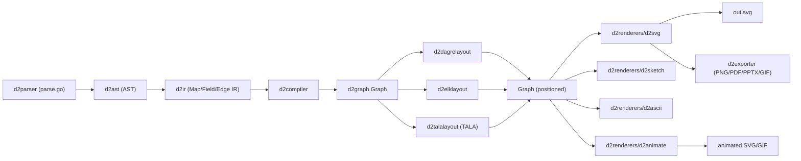
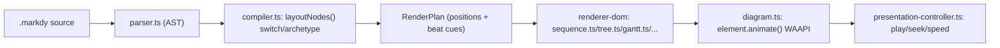
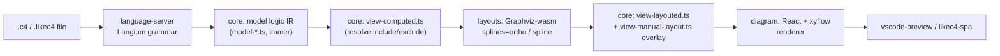
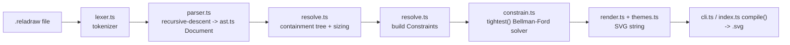

# Weekly scan: diagram-as-code & visual tooling — 2026-09-28

> Nguồn: web research (WebSearch/WebFetch trên trang GitHub công khai, blog, Show HN — không dùng GitHub API/`gh`). Vì vậy số sao/ngày commit là **gần đúng**, đã cố gắng verify chéo các fact quan trọng trước khi viết; chỗ nào không chắc đều ghi rõ.

**Tóm tắt 3 gạch đầu dòng:**

- Tin lớn nhất tuần này không phải một repo mới, mà là **D2 chuyển sang phi lợi nhuận (Hack Club, 5/9) và mở mã layout engine TALA** (7/9, MPL-2.0) — code TALA đã xác nhận nằm thật trong `d2lang/d2/d2layouts/d2talalayout/`, không phải chỉ tuyên bố suông; điểm đáng học nhất là interface `LayoutGraph` cho phép D2 cắm 3 layout engine (dagre/ELK/TALA) song song.
- Hai dự án nhỏ, rất mới (**markdy-com**, **reladraw**) đáng chú ý vì chạm trực diện vào hai trục kymostudio quan tâm nhất — animation (WAAPI "beats") và layout triết lý khác (relative-placement DSL với constraint solver longest-path) — nhưng cả hai đều non, ít review, một tác giả.
- **LikeC4** có một PR đang mở (#3278, chưa merge) thêm orthogonal edge routing kiểu Graphviz `splines=ortho` + module geometry riêng cho corner/track/label — mô hình tách "polyline geometry" khỏi layout resolver gần với bài toán fan-in/trunk-lane của `alignment.py`, đáng theo dõi khi PR merge.

**Mục lục**

1. [terrastruct/d2 (+ TALA)](#1-terrastructd2--tala)
2. [HoangYell/markdy-com](#2-hoangyellmarkdy-com)
3. [likec4/likec4](#3-likec4likec4)
4. [reladraw/reladraw](#4-reladrawreladraw)
5. [Candidate khác đã sàng lọc nhưng không deep-dive](#5-candidate-khác-đã-sàng-lọc-nhưng-không-deep-dive)

---

## 1. terrastruct/d2 (+ TALA)

**§1 — Quick Context.** D2 khác kymostudio ở chỗ nó là một ngôn ngữ độc lập trưởng thành (CLI + thư viện Go embeddable) với nhiều layout engine cắm được (dagre/ELK/TALA) thay vì một alignment-resolver tự viết, và xuất nhiều định dạng hơn (SVG/PNG/GIF/PDF/PPTX/ASCII) nhưng không có animation SVG liên tục kiểu kymostudio. Stack: Go 1.27, deps dagre-go/elk-go/rough-go/chroma/goldmark. 25.5k sao, 753 fork, 476 issue mở, CI xanh, MPL-2.0; vừa chuyển org terrastruct→d2lang, được Hack Club fiscal-sponsor (9/2026). Cài qua `install.sh`/`go install`.

**§2 — Architecture Deep-Dive.**

**A. Component inventory:** `d2ast/` — AST; `d2parser/parse.go` — parser; `d2ir/d2ir.go` — cây IR (`Map`/`Field`/`Edge`/`Scalar`); `d2compiler/` — hạ IR xuống Graph; `d2graph/d2graph.go` — struct `Graph`/`Object`/`Edge` dùng chung mọi pass; `d2layouts/{d2dagrelayout,d2elklayout,d2talalayout,d2sequence,d2grid,d2near}` — layout engine; `d2renderers/{d2svg,d2sketch,d2animate,d2ascii,d2latex,d2fonts}` — backend render; `d2exporter/` — PNG/PDF/PPTX/GIF; `d2cli/`; `d2lsp/`, `d2oracle/` — LSP/gợi ý IDE; `d2js/d2wasm` — biên dịch sang WASM cho playground.

**B. Pipeline** (`d2 foo.d2 out.svg`): (1) `d2cli` đọc file → `d2lib`; (2) `d2parser.Parse` → `d2ast.Map`, gom nhiều lỗi thay vì dừng sớm; (3) `d2ir.Compile` chuẩn hoá AST thành cây IR (resolve import/glob/pattern); (4) `d2compiler` hạ IR xuống `d2graph.Graph` (Objects/Edges + `geo.Box`); (5) layout engine được chọn (`--layout`, mặc định dagre) mutate trực tiếp `Object.Box`/`Edge.Route`; (6) `d2renderers/d2svg` render Graph → SVG (hoặc qua `d2exporter` cho PNG/PDF/PPTX).

**C. Data model/IR:** `Graph` là con trỏ mutable, bị ghi đè xuyên pha — cùng triết lý "renderer dumb" như kymostudio, nhưng D2 có thêm **một tầng IR trung gian riêng** (`d2ir.Map`) đứng giữa AST và Graph để xử lý import/glob-expansion/pattern trước khi phẳng hoá — kymostudio hiện không có tầng tương đương (`dsl.py` parse thẳng ra `Diagram`).

**D. Input language:** parser viết tay, không PEG/ANTLR; không có EBNF công khai. Error reporting: `d2parser.ParseError` gom **nhiều lỗi cùng lúc** (Range vị trí + AST node), không dừng ở lỗi đầu.

**E. Layout:** 3 engine qua interface `LayoutGraph func(ctx, *Graph) error`: Dagre (layered/hierarchical, mặc định), ELK (node-link, port hướng), **TALA** — orthogonal routing riêng, tối ưu symmetry/median-distance/flow/clustering, chạy nhiều seed (mặc định 3) rồi chọn kết quả tốt nhất → **non-deterministic mặc định**; theo tác giả TALA kém hơn dagre/ELK với DAG dài.

**F. Rendering:** pluggable — `d2svg` (chính), `d2sketch` (rough-go), `d2ascii`, `d2latex`, `d2animate`. Animation của D2 hoạt động bằng cách chuyển cảnh giữa các "board"/step/layer riêng biệt (`animate: true`) — khác cơ chế animate-SVG-liên-tục của kymostudio.

**G. Extensibility:** thêm layout = implement `LayoutGraph`; theme qua `d2themes`; icon dựa URL ngoài, không có icon-library nội bộ lớn như kymostudio.

**H. DevEx:** `--watch` (auto-reload trình duyệt), formatter, `d2lsp` (VS Code extension chính thức); `play.d2lang.com` biên dịch chính engine Go sang WASM chạy toàn bộ pipeline client-side.

**Xác nhận TALA:** đã kiểm chứng trực tiếp — code TALA nằm trong `d2lang/d2/d2layouts/d2talalayout/` (native Go, có `hierarchy/placement/packing/routing/labeling`, test bằng `go test`), và `d2cli/layout_tala.go`; repo `terrastruct/TALA` cũ chỉ còn README archived (Sep 7, 2026) ghi "closed-source" — README đó đã lỗi thời, mã thật đã chuyển vào monorepo d2.

**§3 — Architecture diagram**

**§4 — Verdict.** Đáng học nhất: interface `LayoutGraph func(ctx, *Graph) error` — tách layout thành plugin thay thế được; `alignment.py` có thể tham khảo cách bọc 5 pass thành interface tương tự để dễ test/hoán đổi thuật toán. Tầng IR riêng (`d2ir.Map`) tách "resolve giá trị/import/glob/pattern" khỏi Graph phẳng — đáng cân nhắc nếu DSL kymostudio thêm cú pháp glob/import phức tạp hơn. Red flag: TALA multi-seed mặc định **non-deterministic** — không nên bắt chước vì golden-SVG test byte-for-byte của kymostudio sẽ vỡ ngay. Cơ chế animate-bằng-chuyển-board của D2 không áp dụng trực tiếp cho animate-SVG-liên-tục của kymostudio. Đáng học phụ: multi-error parser cho DX tốt hơn. Open question: TALA có ổn định/production-ready ngay sau khi mở mã hay không, chưa rõ.

**Verdict: study deeper** (riêng phần layout-plugin interface + tầng IR).

---

## 2. HoangYell/markdy-com

**§1 — Quick Context.** Markdy là DSL "diagram-as-code" chuyên biệt cho *animated* sequence/architecture diagram (khác Mermaid ở chỗ built-in timeline "beats" + WAAPI thay vì static SVG). Stack: TypeScript thuần, monorepo pnpm (10 packages), zero runtime deps ở core, output DOM/SVG/CSS animate (không Canvas/GSAP). Sức khỏe repo: 96 sao, 3 fork, 727 commit nhưng ~140+ release (rất bất thường), tác giả gần như một mình, CI có `ci.yml`/`release.yml` nhưng không thấy badge coverage. Phân phối: npm scope `@markdy/*` (core, renderer-dom, cli, mcp-server, vscode, astro, mdx...).

**§2 — Architecture Deep-Dive.**

**A. Component inventory:** `packages/core/src/parser.ts` + `ast.ts` (parse), `compiler.ts` (layout + `RenderPlan`), `syntax-diagnostics.ts` (lỗi), `c4.ts`/`arch-lint.ts`/`classifier.ts` (phân tích kiến trúc), `theme-generator.ts`; `packages/renderer-dom/src/diagram.ts` (engine WAAPI), `presentation-controller.ts` (điều khiển beat/keyboard), cùng các file vẽ theo archetype (`sequence.ts, tree.ts, gantt.ts, quadrant.ts, radar.ts, swimlane.ts, timeline.ts, constellation.ts, groups.ts, nodes.ts, edges.ts`); `geometry/path.ts`, `geometry/rect.ts` là tiện ích hình học thuần, KHÔNG phải layout engine riêng. Ngoài ra: `packages/cli`, `mcp-server`, `markdy-language-server`, `vscode`, `astro`, `mdx`, `compat`, `stdlib-systems`.

**B. Pipeline:** 1) `.markdy` → `parser.ts` (hand-written, line/indent-based, regex tokenize) → `ast.ts` (mutable, không `readonly`). 2) `compiler.ts:layoutNodes()` — switch theo `dtype` (16 case đếm được) gọi hàm layout riêng (`layoutTree()`, `layoutMedallion()`, `layoutGantt()`...). 3) `compilePlan()` gộp thành `RenderPlan` (mô tả là "immutable compilation artifact" dù AST gốc bị mutate một phần). 4) `renderer-dom` nhận `RenderPlan` → dựng DOM/SVG theo archetype (mỗi file là renderer chuyên biệt, không phải plugin động). 5) `diagram.ts` sinh `Animation` qua `element.animate([...keyframes], {duration, delay, fill, easing})` cho mỗi cue/beat. 6) `presentation-controller.ts` điều khiển play/pause/seek/tốc độ bằng RAF loop + gán `Animation.currentTime` thủ công.

**C. Data model/IR:** AST là TypeScript `type` mutable (có field `line` debug); không có lớp IR trung gian tách biệt rõ ràng — `RenderPlan` đóng vai "lowered IR" (tọa độ tuyệt đối + cue thời gian) nhưng không thấy `readonly` rõ trong code đọc được.

**D. Input language:** parser hand-rolled regex + đệ quy theo khối thụt lề (giống `.kymo`), không EBNF/PEG/ANTLR. Lỗi dạng `line ${line}: ${message}` qua `ParseError`, cộng cảnh báo không chặn `{severity, message, line}` — đơn giản hơn parser hiện đại có cột/span.

**E. "17 layout engines":** switch trong `compiler.ts` liệt kê 16 case (flowchart, tree, sequence, constellation, loop, flywheel, medallion, quadrant, swimlane, pyramid, radar, timeline, gantt, venn, layers, nested, state) — thực chất là **16 archetype vẽ theo mẫu cố định** (công thức bố trí hard-code riêng), không phải "layout algorithm" tổng quát kiểu force-directed/dagre áp dụng chéo cho đồ thị bất kỳ. Không thấy crossing-minimization hay edge-routing tổng quát; README nhắc "Dynamic Port Multiplexing" nhưng không đọc được code chi tiết.

**F. Rendering/animation:** "beat" ánh xạ 1-1 sang `[start, end]` giây → `delay`/`duration` cho `element.animate()` với keyframes CSS — dùng WAAPI đúng nghĩa (browser-native interpolation), nhưng lớp play/seek lại tự quản lý bằng rAF + set `currentTime`, tức WAAPI chỉ nội suy khung hình, đồng bộ timeline vẫn thủ công. Không thấy emitter khác ngoài DOM/SVG.

**G. Extensibility:** thêm archetype = thêm case switch + viết hàm layout/render riêng, không có plugin API/registry động rõ ràng (`registry.ts` tồn tại nhưng nội dung chưa đọc được). Theme qua `theme-generator.ts`/`themes.ts`.

**H. Dev experience:** CLI (`@markdy/cli`) cho CI/CD; VS Code extension live preview; MCP server cho AI agent (validate/auto-repair/transpile); `markdy-language-server` riêng (gợi ý LSP thật).

**§3 — Architecture diagram**

**§4 — Verdict.** Mô hình "beat → `element.animate(keyframes, {delay, duration})`" đáng nghiên cứu: kymo hiện xuất SVG animate tĩnh; cách Markdy tách "cue thời gian" (từ DSL) khỏi "nội suy khung hình" (browser lo) rất gọn, có thể áp dụng cho `to_svg.py` khi sinh SMIL/CSS animation cho fan-in/trunk-lane. Cú pháp `beat name: A -> B "label" -> C` đáng xem cho cú pháp animation timeline trong `.kymo`. Cờ đỏ: "17 layout engines" thực chất là 16 archetype hard-code (gần với "diagram type" cố định hơn là thuật toán layout tổng quát) — đừng kỳ vọng học được crossing-minimization/edge-routing tổng quát nào mới; parser không có grammar hình thức; ~140 release cho 727 commit + gần như một tác giả là dấu hiệu dự án còn non, thiếu review. Câu hỏi mở: cơ chế "port multiplexing" thực sự ra sao, IR có thực sự immutable không.

**Verdict: glance only** (đọc kỹ phần beats-to-WAAPI, bỏ qua phần "layout engine").

---

## 3. likec4/likec4

**§1 — Quick Context.** LikeC4 (TypeScript, Langium + Graphviz-wasm + React/xyflow) là DSL kiến trúc kiểu C4 khác biệt cốt lõi ở mô hình "one model, many views" — một model logic duy nhất sinh nhiều view tương tác (SPA/VS Code), thay vì compile 1-file-ra-1-SVG tĩnh như kymostudio. ~5.8k sao, 392 fork, release mới nhất v1.59.4 (21/9/2026), test suite lớn (313 file/3203 test theo PR đang mở). Phân phối: npm `likec4`, VS Code extension (Marketplace + Open VSX), web playground likec4.dev, MCP server riêng.

**§2 — Architecture Deep-Dive.**

**A. Component inventory** (monorepo pnpm+turbo): `language-server` (grammar Langium `like-c4.langium` + LSP), `core` (IR: `model-*.ts` cho model logic; `view-parsed/computed/layouted/manual-layout.ts` cho view; module `geometry/` — `bbox.ts`, `segment.ts`, `spline.ts`, `label.ts`), `layouts` (Graphviz qua `@hpcc-js/wasm-graphviz` + `ts-graphviz`, constraint solver `@lume/kiwi`; `graphviz/ElementViewPrinter.ts`, `place-edge-label.ts`), `generators` (emit DSL ngược), `diagram` (React lib, `@xyflow/react` + `@dagrejs/dagre`, xstate; `edge-corners.ts`, `edge-tracks.ts`, `edge-path.ts`, `useControlPoints.ts`), `config`, `vscode`/`vscode-preview`, `likec4-spa`, `mcp`.

**B. Pipeline:** 1) `.c4` → Langium parser sinh AST + validate/diagnostics live trong editor. 2) language-server dựng model logic bất biến (immer). 3) mỗi view definition resolve include/exclude/predicate thành "computed view" IR. 4) `layouts` đẩy computed view vào Graphviz-wasm (dot engine) → "layouted view" IR (tọa độ node, route cạnh — spline hoặc, với PR mới, polyline ortho). 5) lớp override `view-manual-layout.ts` chồng lên vị trí/corner người dùng đã kéo tay, giữ nguyên khi đổi routing mode. 6) `diagram` (React+xyflow) render tương tác trong VS Code preview/SPA; `generators` có thể ghi ngược (`toDSL`).

**C. Data model/IR:** phân tầng IR rõ ràng và bất biến (immer): model logic → view-computed → view-layouted → view-manual-layout overlay — đúng mô hình "one model, many views" (chi tiết type nội bộ không xác định do chưa đọc source đầy đủ).

**D. Input language:** Langium — grammar hình thức (`like-c4.langium`) cho LSP miễn phí (diagnostics, hover, go-to-def) dùng chung giữa language-server và VS Code extension.

**E. Layout algorithm:** Graphviz qua WASM (dagre chỉ xuất hiện trong `diagram`, vai trò chính xác không xác định — có thể phụ trợ layout tương tác/minimap). PR ortho (#3278, đang mở, chưa merge): set `splines=ortho` trong Graphviz để sinh polyline vuông góc, nhãn đặt làm `xlabel` ngoài; `place-edge-label.ts` trượt nhãn dọc đoạn thẳng dài nhất, né va chạm. Module `geometry/` mới (bbox/segment/spline) tính polyline extraction, projection, box-intersection — dùng chung cho auto-layout lẫn edit tương tác. `edge-corners.ts`/`useControlPoints.ts` cho kéo-thả corner với snapping trục, right-click chèn corner; `edge-tracks.ts` tách track song song cách nhau 12 đơn vị khi nhiều cạnh ortho đã-edit chia sẻ trục, cộng port-spreading tại điểm thoát node.

**F. Rendering:** renderer tương tác chính là React/SVG qua `@xyflow/react` (DOM-based, pan/zoom, live edit), không phải canvas. Không có bằng chứng pluggable-renderer đa engine hay animated-SVG export như kymostudio.

**G. Extensibility:** ví dụ có `_spec.c4` (custom element kind/tag), theming qua `config/schema.theme.ts`; mở rộng cấp grammar đòi sửa Langium grammar (không phải plugin runtime).

**H. Dev experience:** CLI `npx likec4 start` (live-reload preview); VS Code extension với live preview, diagnostics, và write-back (kéo/sửa UI ghi ngược vào file DSL — xác nhận từ release note v1.59.4). Web playground likec4.dev.

**§3 — Architecture diagram**

**§4 — Verdict.** Cách tiếp cận ortho của LikeC4 (Graphviz `splines=ortho` + module geometry riêng cho corner/track/label) đáng tham khảo cho `alignment.py`: tách "polyline geometry" (segment, box-intersection) thành module dùng chung cho cả auto-layout lẫn user-edit là mô hình sạch hơn so với nhét fan-in/trunk-lane trực tiếp vào resolver 5-pass. Ý tưởng track-separation 12-unit khi nhiều cạnh trùng trục tương đồng trực tiếp với bài toán trunk-lane staggering — nên xem code thật khi PR merge. Langium đáng cân nhắc nếu kymostudio muốn LSP free, nhưng đánh đổi lớn: kymostudio ưu tiên "dumb renderer, plain dataclass" và 2 impl song song (Python/TS) — đưa Langium vào chỉ hợp cho impl TS, phá vỡ parity nếu Python không có tương đương. Cờ đỏ: PR #3278 còn open, 97 file/34 commit, có nit CodeRabbit chưa fix — rủi ro API đổi trước merge. LikeC4 không xuất animated-SVG/Figma — không có bài học trực tiếp về animation.

**Verdict: glance only** (theo dõi ortho-routing PR khi merge, không cần đọc sâu Langium ngay).

---

## 4. reladraw/reladraw

**§1 — Quick Context.** reladraw là DSL diagram-as-code (TypeScript, zero runtime deps) đi ngược triết lý auto-layout của Mermaid/kymostudio: tác giả khai báo vị trí *tương đối* (`right of`, `level with`, `above-left of`…), rồi một constraint solver suy ra tọa độ x/y — không tự đoán bố cục, không cần tọa độ tuyệt đối thủ công. Repo rất trẻ (Show HN 27/9/2026): ~806 sao, 86 commit, có vẻ 1 tác giả chính, v0.10.0 "early stage", không thấy CI hay thư mục test trong listing gốc. Phân phối qua npm (`npm install -g reladraw` + CLI `reladraw file.reladraw -o out.svg`), có gói "skill" cài cho Claude Code/Cursor/Codex.

**§2 — Architecture Deep-Dive.**

**A. Component inventory** (`src/`): `lexer.ts` (tokenizer), `parser.ts` (parser + AST builder), `ast.ts` (kiểu AST), `constrain.ts` (constraint graph + solver `tightest()`, `reachability()`), `resolve.ts` (3 pass: containment tree → sizing → constraint building/solving), `render.ts` (SVG string emitter), `themes.ts`, `measure.ts` (đo text), `icons.ts`, `errors.ts` (`SourceError`), `constants.ts` (bảng từ khóa cố định), `cli.ts`, `index.ts` (`compile()`).

**B. Pipeline:** 1) CLI đọc file `.reladraw`. 2) `lexer.ts` tách từng dòng thành token thủ công (chuỗi trong `"..."`, comment `//`, tiếp tục dòng qua thụt lề/ngoặc mở). 3) `parser.ts` (recursive-descent theo statement `node/edge/style/diagram/default`) dựng `Document` (AST). 4) `resolve.ts` pass 1-2: dựng cây containment (tên có dấu chấm = cha/con), đo & size node bottom-up. 5) `resolve.ts` pass 3 dịch mỗi placement + ràng buộc non-overlap thành `Constraint`, gọi `constrain.ts:tightest()` giải ra tọa độ tuyệt đối. 6) `render.ts` ghép chuỗi SVG (+ theme) → `cli.ts`/`compile()` xuất `.svg`.

**C. Data model/IR:** AST bất biến gồm `Placement` — `OffsetPlacement {kind:'offset', direction, targets, gap}`, `AlignPlacement {kind:'align', axis, side, targets}`, `OnPlacement` — là IR quan hệ *trước khi có số*. `resolve.ts` dịch chúng thành `Constraint` (bất đẳng thức khoảng cách có hướng) cho `constrain.ts` giải; cây containment/kích thước dùng cấu trúc trung gian (WeakMap) để relayout.

**D. Input language:** Parser hand-written recursive-descent theo dòng/statement, tokenizer ký tự thủ công — không regex thuần, không PEG generator, không parser-combinator lib. Ngữ pháp không hình thức hóa bằng EBNF (chỉ `SYNTAX.md` văn xuôi). Lỗi qua `SourceError{line, message}` → `"file:line: message"`, chỉ theo dòng, không cột. Triết lý rõ: "unknown attributes produce errors rather than silent failures" — chủ động **từ chối đoán** khi thiếu trục hoặc ràng buộc mâu thuẫn thay vì tự chọn cách sắp xếp.

**E. Layout algorithm (trọng tâm):** Không phải constraint-solver tổng quát (không Cassowary/simplex) mà là đồ thị bất đẳng thức khoảng cách tối thiểu theo *từng trục riêng* (x, y), giải bằng thuật toán longest-path kiểu Bellman-Ford: mỗi placement → cạnh `pos[to] ≥ pos[from] + weight`; `fix()` tạo ràng buộc "bằng nhau" bằng cặp bất đẳng thức hai chiều (cho `level with`/align). `tightest()` lặp cập nhật đến hội tụ hoặc phát hiện "positive cycle" (đòi khoảng cách tăng vô hạn) → báo contradiction, `loopFrom()` truy vết chuỗi placement gây lỗi. `reachability()` dùng Floyd-Warshall tính bao đóng bắc cầu để biết trục nào còn "tự do". Vì gap là khoảng cách *tối thiểu*, nghiệm luôn là bố cục compact nhất thỏa mãn — không search nhiều phương án, không force-directed, không Sugiyama-layering như `alignment.py`.

**F. Rendering:** Chỉ SVG, ghép bằng string/template literal (không DOM ảo). Theme system khá đầy đủ (dark/light/solarized/gruvbox/catppuccin/nord/dracula/vesper/high-contrast/print). Không có animation (không SMIL/CSS/JS).

**G. Extensibility:** Hướng đặt, side, gap size, text size, thickness đều là bảng hằng **đóng** trong `constants.ts`; không có cơ chế đăng ký relation keyword/shape mới từ ngoài — mở rộng phải sửa core.

**H. Dev experience:** CLI tối giản, không watch mode cho `.reladraw` (chỉ `tsc --watch` cho build TS). Có agent-skill cài cho Claude Code/Cursor/Codex, không thấy LSP/VS Code extension riêng, không thấy CI/test suite trong repo listing.

**§3 — Architecture diagram**

**§4 — Verdict.** Đáng học nhất là §D/E: ngôn ngữ ràng buộc quan hệ (`right of`/`level with`/`between`) + solver longest-path/Bellman-Ford theo trục, tách biệt "khoảng cách tối thiểu" khỏi "vị trí cố định", và triết lý **từ chối đoán khi thiếu trục hoặc mâu thuẫn** — thứ `dsl.py`/`resolve_alignments()` hiện chưa nhấn mạnh (`dsl.py` "validates nothing" ở bước parse). Một escape hatch tùy chọn kiểu "pin node X `right of` Y, `level with` Z" chồng lên các pass hiện có của `alignment.py` có thể hữu ích cho case auto-layout ra bố cục xấu, miễn kymostudio định nghĩa rõ nó tương tác thế nào với 5-pass hiện tại. Cú pháp attribute trong ngoặc (`size:`, `wrap:`, `align:`) giữ scope rõ ràng, đáng tham khảo cho DSL. Red flags: không CI/test công khai, một tác giả, cú pháp chưa ổn định, keyword đóng cứng — kém trưởng thành hơn nhiều so với hạ tầng golden/conformance test của kymostudio. Câu hỏi mở: khả năng mở rộng khi diagram lớn (Floyd-Warshall reachability + Bellman-Ford lặp theo n) chưa có bằng chứng benchmark.

**Verdict: study deeper.**

---

## 5. Candidate khác đã sàng lọc nhưng không deep-dive

Trong quá trình discovery, các repo/sự kiện sau cũng khớp tiêu chí nhưng bị loại khỏi vòng deep-dive (quá nhỏ/chưa vetted, hoặc trùng lặp về mặt kỹ thuật với 4 repo trên):

- **drawcms/drawcms** — editor diagram animated cho AI agent vẽ trực tiếp qua WebMCP (không screenshot/giả lập click), local-first, xuất GIF/PNG. Rất mới (~17 sao, 58 commit) — quá non để đánh giá kiến trúc, nhưng góc "agent vẽ trực tiếp" đáng theo dõi tiếp ở lần scan sau.
- **IdraDev/Diagrammer** — viewer local-first tối giản cho diagram do LLM sinh ra, dùng schema JSON nhỏ (nodes/edges + shape/color/emphasis) làm "hợp đồng" giữa model và renderer. ~11 sao, quá nhỏ để deep-dive nhưng ý tưởng "DSL tối giản, máy-kiểm-tra-được cho LLM" liên quan tới hướng agent-tooling của kymostudio.
- **SatyadipPaul/ascii2svg** — chuyển ASCII/Unicode box-diagram thành SVG sắc nét, có pass "sửa" cho diagram bị LLM vẽ lệch, cộng animation draw/flow. 0 sao (rất mới, chưa ai đánh giá) — kỹ thuật "repair + verify 1:1" cho rendering là góc lạ, đáng ngó lại nếu repo trưởng thành hơn.
- **iso-topology** (owner đúng: `MishaBear94/iso-topology`, **không phải** `MarkovWangRR` như agent tìm kiếm ban đầu báo nhầm — đã tự sửa khi verify) — DSL YAML/D2-syntax compile ra SVG isometric 2.5D, Go, single binary, ~68 sao. Góc "output isometric" khác hẳn kymostudio nhưng đáng note vì minh họa việc một style renderer khác biệt (2.5D) có thể tách hoàn toàn khỏi layout engine.
- **mermaid-js/mermaid** — bản 11.16.x thêm `icon()` annotation cho TreeView diagram; coi là baseline hệ sinh thái, không phải tin "mới" theo nghĩa 7 ngày.

**Lưu ý QA:** vòng discovery ban đầu (dựa trên WebSearch tổng hợp, không phải GitHub API) có 1 lỗi thực tế được phát hiện và sửa khi verify trực tiếp qua WebFetch — sai tên chủ sở hữu của `iso-topology`. Điều này củng cố lý do các fact quan trọng trong report này (trạng thái TALA, PR #3278, README reladraw) đều đã được WebFetch trực tiếp từ trang GitHub gốc trước khi viết, thay vì chỉ dựa vào kết quả tìm kiếm tổng hợp.
