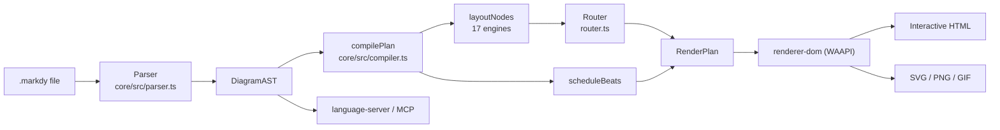
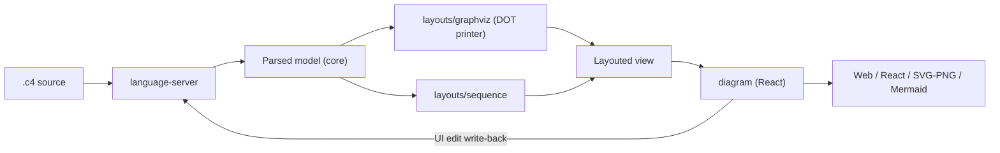
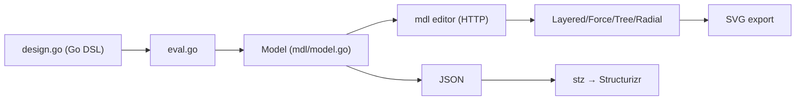

# Weekly scan — Diagram tooling (2026-10-07)

## Executive summary

- **Markdy** (`HoangYell/markdy-com`) là phát hiện đáng nhất tuần: DSL "diagram + animation timeline" (beats/cues), compile AST → `RenderPlan`, render bằng WAAPI, kèm router orthogonal có *port-lane multiplexing* — gần như trùng đúng không gian của kymo (animated SVG) nhưng đi theo hướng runtime-DOM thay vì SVG tĩnh/CSS.
- **LikeC4** có PR lớn (#3278, đang open) thêm orthogonal routing: dùng Graphviz `splines=ortho` cho auto-layout, còn phần manual edit (corner snap 8 unit, track separation 12 unit, label trượt theo segment dài nhất) tự viết — nguồn ý tưởng tốt cho `alignment.py` fan-in/trunk-lane.
- **goadesign/model** (Go, C4-as-Go-DSL, editor `mdl` + 4 layout algorithm) đáng "glance only"; các ứng viên khác (OpenDiagram, iso-topology, hyperweave, archinsight) được sàng nhưng không đào sâu.

**Mục lục**: [Phương pháp & giới hạn](#phương-pháp--giới-hạn) · [1. Markdy](#1-markdy-hoangyellmarkdy-com) · [2. LikeC4](#2-likec4-likec4likec4) · [3. goadesign/model](#3-goadesignmodel) · [Đã sàng, không chọn](#đã-sàng-không-chọn)

## Phương pháp & giới hạn

- `gh` CLI không có; GitHub MCP bị giới hạn scope vào repo kymostudio; `api.github.com` trả 403 cho nhiều endpoint. Nguồn dữ liệu thực tế: GitHub topic query (kết quả `pushed` ≥ 2026-09-30, `stars>50`), web search, và đọc trang/raw file qua WebFetch.
- Nội dung file được đọc qua bộ tóm tắt của WebFetch, không phải clone → mỗi dimension chỉ ghi khi có evidence; còn lại "không xác định". Chỉ chọn 3 repo (không đủ 8–10 có evidence đủ sâu; tối đa 4 theo yêu cầu).
- Ngày release do WebFetch trả về cho LikeC4/goadesign có năm lệch (2024) so với hiện tại — **chưa kiểm chứng**, đừng dựa vào.

---

## 1. Markdy (`HoangYell/markdy-com`)

### §1 — Quick context
**Pitch**: DSL mô tả *kịch bản chạy* của kiến trúc (beat/cue), không chỉ topology — khác D2/Mermaid ở chỗ animation là thành phần ngôn ngữ hạng nhất.
- **Stack**: TypeScript monorepo, `@markdy/core` v1.5.7 zero-dep (~14 kB), tsup + vitest; output interactive HTML (WAAPI), SVG, PNG/GIF.
- **Health**: 97★, 3 forks, 747 commits, có CI (badge) và gate `verify:examples`; release không xác định.
- **Distribution**: npm (`@markdy/*`), VS Code extension, playground markdy.com, MCP server.

### §2 — Architecture deep-dive
Nguồn đã đọc: README, `packages/` listing, `core/package.json`, `core/src/{parser,router,compiler}.ts` (qua tóm tắt), examples listing (31 file `.markdy`; chưa đọc nội dung — URL đoán sai 404).

**A. Components**
- `Parser` (`packages/core/src/parser.ts`) — text → `DiagramAST` + `RenderPlan`.
- `Compiler` (`core/src/compiler.ts`) — `compilePlan(ast, theme)`.
- `Router` (`core/src/router.ts`) — `routeOrthogonalEdge`, `selectOptimalPorts`, `routeAroundObstacles`, `allocatePortLanes`.
- `Themes` (`themes.ts`, `theme-generator.ts`), `Diff` (`diff.ts`), `Formatter` (`format.ts`), `Arch-lint` (`arch-lint.ts`), `Provenance` (`provenance.ts`, `@src="file#L10"` anchor), `Syntax-diagnostics`/`ai-healing` (`syntax-diagnostics.ts`, `ai-healing.ts`).
- Ngoài core: `renderer-dom`, `cli`, `compat` (import Mermaid/Compose/K8s/Terraform/Draw.io), `mcp-server`, `markdy-language-server`, `vscode`, `astro`, `mdx`, `stdlib-systems`.

**B. Happy path**
1. `markdy render x.markdy` (CLI) hoặc editor/playground gọi `parse()`.
2. `readBlocks()` → regex dispatch (scene/player/beat/node) → `DiagramAST` + `diagnostics`.
3. `compilePlan`: gom edges → `computeAdaptiveDimensions` → `layoutNodes` (dispatch 1 trong 17 layout) → bus/boundary → `scheduleBeats`.
4. Router gán port + lane cho từng edge → path SVG.
5. `renderer-dom` dựng SVG, phát timeline bằng WAAPI; export SVG/PNG/GIF.

**C. IR** — hai tầng: `DiagramAST` (meta, nodes Map, edges, groups, beats, diagnostics) rồi `RenderPlan` (positioned nodes, routed edges, timestamped cues). Immutability: không xác định. Có "lower IR" thực sự (AST → RenderPlan).

**D. Input language** — line-based, regex-driven, indent *hoặc* brace block, có fallback cho MDX làm mất indent. Flow operator `->`, `<-`, `~>`, `<->` parse bằng `parseFlowChain`. `ParseError{line,column}` + warnings không-fatal; `detectFlowCycles` (DFS) cảnh báo. Không thấy EBNF formal trong phần đã đọc.

**E. Layout** — 17 engine chuyên biệt theo *loại* diagram (architecture, tree, sequence, swimlane, medallion, venn…) thay vì một thuật toán chung. Routing orthogonal; `selectOptimalPorts` chọn cardinal port; `routeAroundObstacles` thử các candidate path (direct/diagonal/corridor) chọn ít giao + Manhattan ngắn nhất — heuristic, không phải visibility-graph/A*. `allocatePortLanes` gom edge theo `(nodeId:port)`, sort theo toạ độ tâm node đối diện, gán `PortLane{index,total}`. Crossing minimization: không thấy.

**F. Rendering** — DOM/SVG + CSS transforms + WAAPI (60fps); pluggable? Có renderer-dom riêng, export presets (`output-presets.ts`); các emitter khác không xác định.

**G. Extensibility** — theme tokens + theme generator, `stdlib-systems` vocabulary, `registry.ts`, `recipes.ts`/pattern cue (`expandPatternCues`). Plugin system: không xác định.

**H. DX** — LSP, VS Code (live preview), CLI lint/format/import, MCP tools (`validate/diagnose/fix/transpile`), Astro/MDX embed.

### §3 — Diagram

### §4 — Verdict
- **Học**: (1) `allocatePortLanes` — gán lane theo thứ tự toạ độ node đối diện, so với fan-in staggering của `alignment.py` pass 4; (2) tách `AST → RenderPlan` có timeline đã schedule sẵn, tương tự việc kymo giữ renderer "dumb"; (3) MCP tool `validate/diagnose/fix` cho agent; (4) `@src=` provenance và `verify:examples` gate giống golden của kymo.
- **Red flags**: repo 97★ nhưng scope rất rộng (blast radius, drift, evolution diff, Pro Blueprints) → dễ nông; 17 layout riêng = nhiều code lặp; parser regex-line.
- **Câu hỏi mở**: `routeAroundObstacles` có xử lý edge-edge overlap không? Chất lượng thật ngoài showcase? Timeline giữ ở runtime hay bake ra SVG/CSS?
- **Verdict: study deeper** (router + beat/cue syntax).

---

## 2. LikeC4 (`likec4/likec4`)

### §1 — Quick context
**Pitch**: C4/Structurizr-style DSL có language server, live preview và write-back chỉnh tay từ UI vào source.
- **Stack**: TypeScript pnpm monorepo, Graphviz layout, React diagram; output web/React/SVG-PNG, Mermaid/markdown export (theo release notes).
- **Health**: 5.8k★, 394 forks, MIT; PR #3278 cập nhật 2026-10-03 (open); CI/tests: không xác định.
- **Distribution**: npm (`npx likec4 start`), VS Code ext, playground.

### §2 — Architecture deep-dive
Đã đọc: README, `packages/` listing, `layouts/src` listing, PR #3278 (tóm tắt), releases. **Chưa đọc source parser/layout trực tiếp.**

**A. Components** — `packages/language-server` (DSL parse/validate/format), `packages/core` (model, geometry), `packages/layouts` (`src/graphviz/`, `src/sequence/`), `packages/diagram` (edge path, corner editing), `packages/generators`, `packages/react`, `packages/vite-plugin`, `packages/mcp`, `packages/vscode(-preview)`, `packages/config`.

**B. Pipeline** (suy từ listing + PR): DSL → language-server (parse/validate) → model → `layouts` (Graphviz DOT printer) → layouted view → `diagram` render (React) → export. Từng bước command-level: không xác định.

**C. IR** — "parsed model" và "computed/layouted view"; có `Builder.fromParsed()` và `LikeC4.toDSL()` để round-trip DSL (release notes). Mutability: không xác định.

**D. Language** — language-server ⇒ khả năng dùng Langium, **chưa xác nhận**. Có TextMate grammar. Có `<->`, dynamic view với `opt/loop/alt/try` frames.

**E. Layout** — Graphviz (dot) cho view tĩnh + một `sequence` layout riêng cho dynamic view. PR #3278: routing resolve theo thứ tự view property → autoLayout param → project default → spline; orthogonal dựa `splines=ortho` của Graphviz; **phần tự viết**: corner snap trong 8 flow units, track separation 12 units cho edge dùng chung trục, label đặt cạnh segment thẳng dài nhất và trượt tới khi qua hết leaf node, self-loop thoát dưới góc.

**F. Output** — React/web, MCP app render; PNG/SVG/Mermaid export có trong release notes. Animation: step walkthrough cho sequence (animated step nav), cơ chế không xác định.

**G. Extensibility** — `specification` block định nghĩa kind/tag/relationship kind; theme/notation tuỳ biến; plugin: `vite-plugin`, `leanix-bridge`.

**H. DX** — VS Code ext, LSP, `likec4 start` hot reload, MCP.

### §3 — Diagram

### §4 — Verdict
- **Học**: số liệu cụ thể của orthogonal editing (8/12 units) và quy tắc đặt label theo segment dài nhất — áp thẳng cho label edge trong `alignment.py`; *write-back* UI→source với formatting giữ nguyên là ý tưởng cho `packages/editor`; precedence chain cho routing option.
- **Red flags**: PR 97 files / 12 subsystems; phụ thuộc `splines=ortho` của Graphviz vốn nổi tiếng kém chất lượng.
- **Mở**: parser dùng gì? Graphviz chạy WASM hay binary?
- **Verdict: glance only** trừ PR #3278 → *study deeper* phần geometry.

---

## 3. goadesign/model

### §1 — Quick context
**Pitch**: C4 model viết bằng Go DSL (code Go, type-checked) kèm editor đồ hoạ `mdl` — khác Structurizr ở chỗ source *là* Go, tái dùng qua Go package.
- **Stack**: Go 1.23+, output SVG/JSON, Structurizr upload (`stz`).
- **Health**: 467★, 23 forks, MIT, 1,269 commits; push 2026-10-05; release v1.16.10 (ngày chưa kiểm chứng); CI: không xác định.
- **Distribution**: `go install goa.design/model/cmd/mdl`.

### §2 — Architecture deep-dive
Đã đọc: README, listing `mdl/` (`deployment.go, doc.go, elements.go, eval.go, model.go, relationship.go, views.go`), release notes. **Không đọc source file nào** → phần lớn dimension "không xác định".

**A.** `mdl/model.go`, `elements.go`, `relationship.go`, `views.go`, `deployment.go` — DSL functions + model; `eval.go` — evaluate DSL thành model; `cmd/mdl` (editor server), `cmd/stz` (Structurizr).
**B.** Go design file → chạy `eval` → JSON model → `mdl` serve local HTTP editor → layout → lưu SVG. (Từ README; chi tiết bước: không xác định.)
**C.** IR: struct Go trong `mdl` (chi tiết không xác định); có JSON serialization.
**D.** Không có parser riêng: DSL là Go function call dùng closure (`SoftwareSystem("..", "..", func(){ Tag("system") })`) — parse bởi compiler Go; error = Go compile error.
**E.** Editor cung cấp Layered, Force, Tree, Radial + alignment/distribution + nhiều style connection routing; chi tiết thuật toán: không xác định.
**F.** SVG (kể cả headless export; v1.16.8 sửa thiếu arrowhead `<defs>` trong export standalone), JSON.
**G.** Tái dùng qua Go package; theme: styles trong DSL; plugin: không xác định.
**H.** Editor: pan/zoom, multi-select, undo/redo, snap-to-grid; `mdl skill install` cho Cursor/Codex/Claude Code.

### §3 — Diagram

### §4 — Verdict
- **Học**: lỗi arrowhead mất `<defs>` khi export standalone — kiểm tra kymo `to_svg.py` luôn inline defs/markers (đã chủ trương inject có điều kiện → cần test mở SVG độc lập); ý tưởng "agent skill install" CLI.
- **Red flags**: DSL gắn chặt Go → không dùng được ngoài hệ Go; evidence layout rất thiếu.
- **Mở**: layout dùng thư viện nào (ELK?) và chạy ở client JS hay Go?
- **Verdict: glance only.**

---

## Đã sàng, không chọn

| Repo | Lý do |
|---|---|
| `Itz-Agasta/OpenDiagram` (50★, AGPL) | AI diagram generator; ELK; PR #84 thay ELK routing bằng in-house router "place → polish → route" — **theo dõi tuần sau** |
| `sparklabx/drawio-ai-kit` | declarative layout engine cho draw.io; chưa đọc |
| `MishaBear94/iso-topology` | isometric DSL → SVG; push cuối 2026-07, ngoài cửa sổ 7 ngày |
| `InnerAura/hyperweave`, `lonely-lockley/archinsight` | chưa đủ thời gian xác minh |
| `plantuml/plantuml`, `mingrammer/diagrams` | ecosystem lớn đã biết; không có thay đổi kiến trúc đáng chú ý trong evidence thu được |
