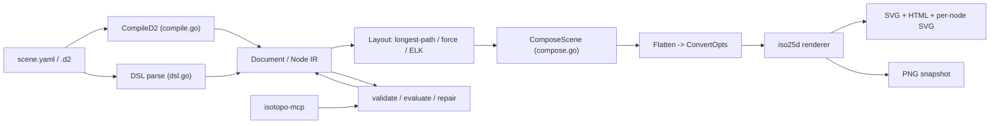
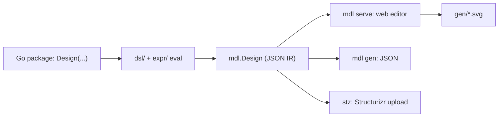

# Weekly scan — Diagram tooling (2026-10-13)

## Executive summary

- **Chỉ 3 repo đủ chuẩn** (< 4 → bước fallback đáng lẽ chạy). Search API của GitHub bị chặn trong session này (chỉ truy cập được `kymostudio/kymostudio`), nên nguồn dữ liệu là trang `github.com/topics/*` (sort by updated) + `raw.githubusercontent.com`. Bước 3 (scan releases mermaid/d2/plantuml/…) **chưa chạy** được; chỉ ghi nhận `elkjs` pushed 2026-10-06 và `plantuml/plantuml` pushed 2026-10-12 trên topic page, chưa xác minh release notes.
- **iso-topology** là phát hiện đáng nhất: YAML DSL → SVG isometric, có vòng lặp `validate → evaluate → repair → render` cho LLM agent, output byte-deterministic. Pattern `evaluate`/`repair --compose` (chấm điểm bố cục + auto-snap) áp dụng thẳng được cho kymo.
- **goadesign/model** (C4 trong Go DSL) và **kuiver** (Kotlin Multiplatform graph viewer) chỉ nên glance; không có ý tưởng layout mới, nhưng model cho thấy cách tách IR JSON khỏi DSL.

## Mục lục

1. [MishaBear94/iso-topology](#1-mishabear94iso-topology) — study deeper
2. [goadesign/model](#2-goadesignmodel) — glance only
3. [justdeko/kuiver](#3-justdekokuiver) — glance only (thiếu evidence)

**Ghi chú phạm vi:** `drawspec`, `penciled`, `PinViz`, `homelab-diagram-generator` xuất hiện trên topic `diagram-as-code` nhưng < 50 stars hoặc quá nhỏ → loại theo filter `stars:>50`. `aws/graph-explorer` (484★) là data explorer, không phải diagram-as-code → loại.

---

## 1. MishaBear94/iso-topology

### §1 — Quick context
- **Pitch:** DSL YAML sinh diagram kiến trúc *isometric 2.5D* "design-grade", có contract máy-kiểm-được để agent tự sửa — khác Mermaid/D2 (flat) ở chỗ output nhìn như Figma.
- **Stack:** Go 1.25; deps: `yaml.v3`, `goja` (JS runtime), `go-text/typesetting`, `d2 v0.7.1` (parse + dagre/ELK); output SVG/HTML/PNG.
- **Health:** 69★, 455 commits, Apache-2.0; Contributors/Releases trống trên trang; có nhiều `*_test.go` + golden samples; có `.goreleaser.yaml`.
- **Distribution:** `go install` (`isotopo`, `isotopo-mcp`), Claude Code skill, studio web local.

### §2 — Architecture deep-dive
*Đã đọc:* README, CLAUDE.md, go.mod, `cmd/isotopo/main.go` (đầu file), `dsl.go`, `compile.go`, `force_layout.go` (đầu), `compose.go`, `flatten.go` (doc comment), `iso25d/iso.go` (đầu). Chưa đọc: toàn bộ connector routing, `studio/`, `yamledit/`.

**A. Component inventory**
- CLI `isotopo` (`cmd/isotopo/main.go`) — subcommands `render/snapshot/capabilities/serve/repair/validate` (+ `evaluate`, `preview` theo README).
- `MCP server` (`cmd/isotopo-mcp`) — 7 tool bọc cùng vòng lặp (theo README; chưa đọc source).
- DSL model (`dsl.go`) — `Node{Shape, Geom, Style{Palette,Stroke,Text,Effects}, Label, Icon, Content}`, `Layout`, `Place`.
- D2 front-end (`compile.go`) — `CompileD2` gọi d2 parse+compile+layout (`dagre`|`elk`).
- Layout solver — built-in longest-path layering; `force_layout.go` cho graph có chu trình (`graphIsCyclic` DFS 3 màu); `Layout.Engine` có thể ủy quyền ELK/dagre.
- `Flatten` (`flatten.go`) — hạ `Node`+`Theme` thành `iso25d.ConvertOpts` (3 lớp: theme → shape default → node style).
- Renderer `iso25d/` — `iso.go` (`IsoBoxOpts`, hằng `Cos30/Sin30`), `shape_*.go` (cylinder, prism, rack, cloud…), `composite.go`, `projected_paint.go`.
- `ComposeScene` (`compose.go`) — snap part lệch grid vào alignment track hàng xóm.
- `textmetrics/`, `yamledit/` (ghi sửa lại YAML giữ comment — suy từ README "comments intact").

**B. Happy path:** (1) `isotopo render scene.yaml out` → (2) parse YAML hoặc `.d2` (D2 đi qua `CompileD2`) → (3) solver chuyển `place`/`layout` thành toạ độ (snap vào cell lattice) → (4) `Flatten` + iso projection, vòng repair projection chạy mặc định (`flagRepair=true`) → (5) emit `out/topology.svg`, `.html`, `nodes/<id>.svg`.

**C. IR:** struct Go (`Node`, `Document`, `CompositePart`, `Connector`); `ComposeScene` *mutate in place* `doc` (offsets). Có "lower IR": `Node → ConvertOpts`. Cờ `strokeGenerated`/`styleGenerated` đánh dấu style do translator D2 bịa ra để theme không đè nhầm style user viết.

**D. Input language:** YAML có JSON-schema; lỗi có JSONPath + "did you mean", exit code 0/2/3. Parser formal grammar: không xác định (dùng yaml.v3 + struct tags).

**E. Layout:** hybrid — built-in layered cho DAG, force-directed cho đồ thị cyclic/dày, ELK/dagre tuỳ chọn. Connector `orthogonal` "ride the iso grid" / straight / bezier. Crossing minimization trong solver built-in: không xác định; `evaluate` *đo* crossings/tunnelling thay vì tối ưu trực tiếp.

**F. Rendering:** SVG chính; HTML, PNG (snapshot). Có `--projection top` (2D plan view) cùng DSL. Animation: không thấy. Emitter: một backend SVG (không pluggable).

**G. Extensibility:** theme preset + `themes/`, 200+ icon `iso://si/...`; shape thêm bằng file `shape_*.go` (cần sửa code, không phải plugin).

**H. DX:** `capabilities` (JSON inventory), `serve` studio drag-drop :8731, MCP, skill; `llms.txt`, golden tests mỗi sample.

### §3 — Architecture diagram

### §4 — Verdict
- **Học được:** (1) `evaluate` scorecard (crossings/overlap/tunnelling + composition score) và `repair` có bảo đảm *bounded, idempotent, từ chối nếu tạo defect mới* — kymo có thể thêm bước `kymo lint` đo edge crossing sau `resolve_alignments()` trước khi dám đổi auto-layout. (2) Cờ `*Generated` để phân biệt style do importer sinh vs user viết — liên quan BPMN importer. (3) `capabilities` JSON cho agent/MCP (kymo đã có package mcp).
- **Red flags:** `dsl.go` khai báo `package isotopo` nhưng doc comment nói `nodedsl` (drift); install path owner khác repo URL (MarkovWangRR vs MishaBear94) — kiểm tra provenance; không release; phụ thuộc D2 lớn.
- **Câu hỏi mở:** routing orthogonal trên lưới iso xử lý thế nào? Solver built-in có barycenter không?
- **Verdict: study deeper** (đặc biệt `compose.go`, `evaluate`).

---

## 2. goadesign/model

### §1 — Quick context
- **Pitch:** DSL C4-model viết *bằng chính Go code* (compile được, import/tái sử dụng module) — khác Structurizr DSL ở chỗ dùng type-check của Go thay vì parser riêng.
- **Stack:** Go 1.26; deps `goa/v3`, `chromedp`, `fsnotify`, `lrserver`; output JSON, SVG, Structurizr upload.
- **Health:** 467★, MIT, CI `test.yml`, v1.16.10 (theo README); contributors/release date không xác định.
- **Distribution:** `go install goa.design/model/cmd/mdl|stz`.

### §2 — Architecture deep-dive
*Đã đọc:* README, `DSL.md` (đầu), `go.mod`, `mdl/doc.go`, danh sách hàm `mdl/views.go`, grep `cmd/mdl/main.go`. Chưa đọc: `codegen/`, `expr/`, editor frontend.

**A. Components:** `dsl/` (hàm DSL: `Design`, `SoftwareSystem`, `Person`, `Uses`, `Views`, `AutoLayout`), `expr/` (expression tree do DSL dựng), `mdl/` (`model.go`, `elements.go`, `relationship.go`, `views.go`, `deployment.go`, `eval.go` — data structure serializable JSON), `cmd/mdl` (`gen|serve|svg|skill|version`), `cmd/stz` (upload Structurizr), `codegen/`, `plugin/` (Goa plugin).

**B. Happy path:** (1) `mdl serve <go pkg>` → (2) tool biên dịch/chạy package Go chứa `Design(...)` → (3) `eval` dựng `mdl.Design` → (4) JSON → editor web (chromedp dùng cho `svg` export, suy từ go.mod + subcommand `svg`) → (5) SVG lưu vào `gen/`; fsnotify + livereload khi sửa DSL.

**C. IR:** `mdl.Design{Model, Views}` struct có `MarshalJSON/UnmarshalJSON` riêng cho enum (`ShapeKind`, `RoutingKind`, `RankDirectionKind`, `PaperSizeKind`). Hai tầng: `expr` (DSL) → `mdl` (IR JSON ổn định).

**D. Input:** Go embedded DSL (closure `func(){...}`); lỗi do Go compiler + eval. Không có grammar EBNF; `DSL.md` là reference dạng code.

**E. Layout:** `AutoLayout(RankLeftRight)` (rank-direction, theo Structurizr); thuật toán cụ thể: không xác định (có vẻ nằm ở editor). Hỗ trợ `Routing` kind (enum tồn tại); cho phép chỉnh tay vị trí và lưu lại.

**F. Rendering:** SVG do editor sinh; upload Structurizr; JSON. Không animation.

**G. Extensibility:** viết hàm Go để mở DSL; import style/model dùng chung qua Go module; plugin Goa.

**H. DX:** live reload, editor kéo-thả, subcommand `skill` (cho agent).

### §3 — Architecture diagram

### §4 — Verdict
- **Học được:** ranh giới rõ DSL-expr ↔ IR JSON với enum tự marshal — tương tự `Diagram` dataclass của kymo, hữu ích nếu kymo muốn JSON IR công khai cho cả Python/JS. Vị trí do người chỉnh được *lưu lại* và sống sót qua thay đổi DSL (stz giữ thay đổi đồ hoạ) — hướng cho hybrid auto/manual layout.
- **Red flags:** README ghi `Go 1.23` nhưng go.mod `1.26.0` (drift doc); layout bị nhốt trong editor.
- **Câu hỏi mở:** cách lưu toạ độ thủ công khớp lại với element sau khi DSL đổi?
- **Verdict: glance only.**

---

## 3. justdeko/kuiver

### §1 — Quick context
- **Pitch:** Thư viện Compose Multiplatform vẽ đồ thị có hướng tương tác (zoom, drag, animate layout) — là UI widget, không phải diagram-as-code.
- **Stack:** Kotlin Multiplatform (Android/iOS/JVM/wasm-js); render bằng Compose, không xuất file.
- **Health:** 83★, Apache-2.0, 120 commits, v0.4.2 alpha (README), CI workflows có tồn tại; Contributors không xác định.
- **Distribution:** Maven Central `io.github.justdeko:kuiver`.

### §2 — Architecture (evidence hạn chế)
Chỉ đọc README, `settings.gradle.kts` và cây thư mục mức đầu (`core/`, `sample/`, `docs/`). **Không đọc được source** layout (cây `core/src/commonMain/kotlin/com/dk/kuiver/` không liệt kê file) nên các mục A–E chi tiết: không xác định.
- Có evidence: 2 layout built-in (hierarchical, force-directed) + custom; xử lý graph cyclic; phân loại edge `FORWARD/BACK/CROSS/SELF_LOOP` (`StyledEdgeContent`); API `buildKuiver { nodes(...); edges(...) }`; `LayoutConfig.Hierarchical(direction=...)`; node/edge content là composable lambda; layout animation.
- Phân loại edge kiểu DFS (tree/back/cross) gợi ý có bước cycle handling — chi tiết: không xác định.

### §3 — Diagram
Insufficient evidence (< 3 component xác nhận từ code).

### §4 — Verdict
- **Học được:** edge phân loại FORWARD/BACK/CROSS để style khác nhau — kymo có thể tô back-edge (feedback loop) bằng dash/màu khác trong animated SVG.
- **Red flags:** alpha, API không ổn định; không phải DSL.
- **Câu hỏi mở:** thuật toán hierarchical có crossing minimization không?
- **Verdict: glance only.**
