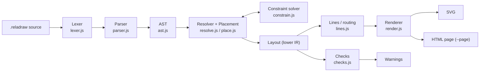
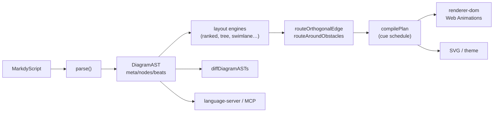
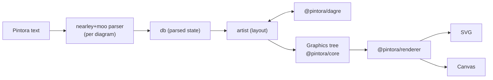
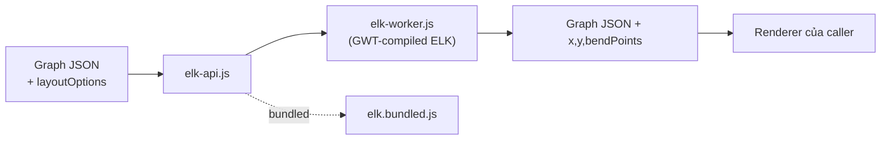

# Weekly scan — diagram tooling (2026-11-01)

## Executive summary

- **reladraw** (v0.21.0, cập nhật 2026-10-28) là phát hiện đáng chú ý nhất: DSL "chỉ nói *đặt ở đâu*" (relative placement), layout là hệ ràng buộc giải bằng Bellman-Ford, và renderer *không bao giờ tự sửa* bố cục mà chỉ phát cảnh báo. Gần với triết lý "renderer dumb" của kymo.
- **markdy** (`@markdy/core` 1.5.7, repo pushed 2026-10-30) là đối thủ trực tiếp về *animated architecture diagram as code*: DSL có `beat`/`cue`, 17 layout engine, orthogonal router tránh vật cản. **elkjs 0.12.1** (2026-10-28) là release ecosystem đáng theo dõi.
- **Hạn chế phương pháp**: session này chỉ có quyền GitHub trên `kymostudio/kymostudio`, nên **không đọc được repo upstream trực tiếp**. Toàn bộ §2 dựa trên **npm tarball** (code đã compile/bundle, không có `examples/`, test, CI). Dimension nào không thấy trong tarball ghi "không xác định".

## Mục lục

1. [reladraw](#1-reladraw)
2. [markdy (markdy-com)](#2-markdy-markdy-com)
3. [pintora](#3-pintora)
4. [elkjs](#4-elkjs)
5. [Đã loại / không chọn](#5-đã-loại--không-chọn)

---

## 1. reladraw

Repo: `reladraw/reladraw` · npm `reladraw@0.21.0` · Apache-2.0

### §1 — Quick context
- Pitch: Diagram language nơi bạn nói *vật nằm ở đâu* (relative placement) thay vì để auto-layout tự quyết như Mermaid/D2, hoặc nhập tọa độ như draw.io.
- Stack: TypeScript, **zero runtime deps**, output SVG (CLI + `<reladraw-diagram>` web component).
- Health: ~1.156 stars (search API); contributors/CI/tests: không xác định (không có trong tarball); không nhận PR (chỉ issue). Ngôn ngữ "thay đổi thường xuyên".
- Distribution: npm (CLI `reladraw`), playground web, agent skill (`npx skills add`).

### §2 — Architecture deep-dive
**A. Components** (đường dẫn trong `dist/` của tarball, tương ứng `src/` upstream):
- `Lexer` (`dist/lexer.js`) — tokenize từng dòng; `"""` string nhiều dòng xử lý bằng cách `parse` nối dòng rồi thử lại (`OpenString`).
- `Parser` (`dist/parser.js`, ~3000 dòng) + `ast.js` — statement `node/edge/style/diagram/default/icon/point/region/bundle/guide`.
- `Resolver` (`dist/resolve.js`) — AST → layout đã giải; `Placement` (`place.js`, ~2500 dòng); `Constraint solver` (`constrain.js`); `Outline` (`outline.js`, giao điểm với đường viền shape).
- `Lines` (`lines.js`, ~2000 dòng) — định tuyến edge: `directRoutes`, `laneRoutes`, `fanned`, "bundle".
- `Checks` (`checks.js`, ~1000 dòng) — findings/warnings.
- `Renderer` (`render.js`), `themes.js`, `icons.js`, `format.js` (formatter căn cột), `grammar.js` (highlighter), `page.js` (`--page`), `element.js`, `cli.js`.

**B. Pipeline (happy path)**: (1) `reladraw render d.reladraw -o d.svg` → `cli.js`; (2) `parse(text)` → AST; (3) `resolve(doc)` → layout (placement + constraint solve); (4) `render(layout)` → SVG; (5) `fileChecks`/`findings` in cảnh báo; (6) ghi file. `compile()`/`draw()` trong `index.js` gói toàn bộ.

**C. IR**: AST (`ast.js`) rồi layout object với node có `parent`, `joinWith`; truy hồi tới ancestor bằng pointer. Mutable hay immutable: không xác định rõ. Có lower IR (layout) tách khỏi AST.

**D. Input language**: lexer + parser tay (line-oriented, statement có thể tiếp dòng thụt lề). Có tài liệu `SYNTAX.md` (không nằm trong tarball đã đọc → chưa xác nhận có EBNF). Lỗi: `SourceError` kèm số dòng; `blame()` chạy lại để chỉ đúng dòng trong statement nhiều dòng. Ví dụ README: `node app.api "API" below app.ui (gap: tight)`.

**E. Layout**: không auto-layout đồ thị. Vị trí là **ràng buộc bất đẳng thức** `pos[to] >= pos[from] + weight`; `fix()` = 2 ràng buộc ngược chiều; `tightest()` = longest-path/Bellman-Ford đảo dấu, phát hiện chu trình mâu thuẫn và **trích dẫn lại đúng các placement xung đột**. Edge: thẳng trừ khi tác giả chỉ định; không tránh vật cản (README nói rõ).

**F. Rendering**: một backend SVG, theme (`themes.js`, có dark). Animation: không có evidence.

**G. Extensibility**: `icon` statement, theme, `default`/`style`; plugin system: không xác định.

**H. DX**: `check` (chỉ cảnh báo), `format`, `--page` (pan/zoom + warnings), web component, agent skill; VS Code/LSP: không xác định (highlighter trong `grammar.js` thiết kế để xuất sang Emacs/Vim/TextMate).

### §3 — Architecture diagram

### §4 — Verdict
- **Học được**: (1) ràng buộc dạng khoảng cách tối thiểu + phát hiện mâu thuẫn bằng Bellman-Ford, báo lỗi bằng *chính các placement xung đột* — áp dụng được cho `alignment.py` pass 2 (parent/child anchoring) để thay lỗi chung chung; (2) triết lý "vẽ đúng như viết, chỉ cảnh báo" → pass `checks` tách khỏi render, chạy được trong CLI/CI của kymo; (3) `blame()` định vị dòng lỗi trong statement nhiều dòng.
- **Red flags**: file khổng lồ (parser 3000 dòng); ngôn ngữ chưa ổn định; không PR.
- **Open questions**: có EBNF không? có animation không? hiệu năng solver với diagram lớn?
- **Verdict: study deeper.**

---

## 2. markdy (markdy-com)

Repo: `HoangYell/markdy-com` · npm `@markdy/core@1.5.7` (+ `cli`, `renderer-dom`, `language-server`, `mcp-server`, `mdx`, `astro`) · MIT

### §1 — Quick context
- Pitch: DSL cho *animated architecture diagram* với `beat`/`cue` như kịch bản, thiết kế cho AI agent sinh ra; khác Mermaid/D2 ở chỗ animation là first-class.
- Stack: TypeScript, core zero-dep (~14 KB minzipped theo README), output DOM (Web Animations API) / SVG.
- Health: ~105 stars (repo mới), contributors/CI/tests: không xác định; release gần nhất npm 1.5.7 (publish 2026-09-30).
- Distribution: npm (nhiều package), VS Code extension, MCP server, web playground.

### §2 — Architecture deep-dive
**A. Components** (`@markdy/core` là một file bundle `dist/index.js`, ~9.5k dòng, nên không có đường dẫn module riêng; tên hàm thay thế):
- `parse` (`dist/index.js:3995`) — parser; `parseFlowChain`, `parseCueLine`, `parseProps`.
- Layout engines: `layoutRanked`, `layoutTree`, `layoutNodes`, `layoutSwimlane`, `layoutTimeline`, `layoutGantt`, `layoutNested`, … (README: 17 engine).
- `routeOrthogonalEdge`, `routeAroundObstacles` — orthogonal router.
- `compilePlan`/`compile`/`parseAndCompile` — AST → plan (timeline).
- `renderSymbolSvg` — symbol registry; `parseCodeAnchor` (`@src="path#L10-L40"` gắn node với mã nguồn); `diffDiagramASTs`.
- Package ngoài: `renderer-dom`, `cli`, `language-server`, `mcp-server`: có trên npm, chưa đọc.

**B. Pipeline**: (1) viết `scene … layout LR`, node, `beat name:` + cue; (2) `parse()` → `DiagramAST` (`meta`, `nodes`, `beats`); (3) `layoutX` theo `layout`; (4) route edge; (5) `compilePlan` → lịch cue (`show … stagger=60ms`, flow segment); (6) renderer-dom phát animation / xuất SVG.

**C. IR**: `DiagramAST {meta, nodes{}, beats[{name,cues[]}]}`; cue có `kind` ("show", "parallel", "flow"). Mutability: không xác định. Có lower IR (plan).

**D. Input language**: parser **single-pass, line-by-line state machine**, tay viết; `ParseError` có số dòng. Cú pháp: `service Shortener "URL Service" icon=redis`, chuỗi `Client -> Gateway "GET" -> Shortener`. EBNF: không thấy.

**E. Layout**: nhiều engine theo loại diagram (ranked/tree/swimlane/…), không phải một engine tổng quát. Routing: orthogonal Manhattan tránh obstacle, multi-lane fan-in/out, fillet (theo README + tên hàm). Crossing minimization: không xác định.

**F. Rendering**: DOM + Web Animations API (README), 10 theme. Pluggable emitter: không xác định.

**G. Extensibility**: symbol registry (20+ icon), `stdlib-systems`, theme specification (`parseThemeSpecification`).

**H. DX**: CLI, language server, VS Code, MCP server, playground.

### §3 — Architecture diagram

### §4 — Verdict
- **Học được**: mô hình `beat` + `cue` (kịch bản animation tách khỏi topology) so với `--animate` của kymo; `diffDiagramASTs` → animated "migration storyboard" giữa 2 phiên bản diagram; `@src=` code provenance.
- **Red flags**: README nặng marketing/sponsor ("Pro Blueprints"); 17 layout engine trong một file ~9.5k dòng; claim "AI agents generate reliably" chưa kiểm chứng; ít sao.
- **Open questions**: chất lượng router thực tế? animation xuất được ra SVG tĩnh/SMIL hay chỉ DOM?
- **Verdict: study deeper** (riêng DSL animation + diff), phần còn lại glance only.

---

## 3. pintora

Repo: `hikerpig/pintora` · npm `@pintora/*@0.8.x` (core/diagrams/renderer/standalone/cli) · stars ~1.283

### §1 — Quick context
- Pitch: Thư viện text-to-diagram mở rộng được (kiểu Mermaid) với kiến trúc plugin cho từng loại diagram, render cả SVG lẫn Canvas.
- Stack: TypeScript; deps: `nearley` + `moo` (fork), `dagre` fork, d3-*; output SVG/Canvas.
- Health: repo pushed 2026-10-29; npm 0.8.1 publish 2025-12 (release npm chưa theo kịp repo); tests: có thư mục `__tests__` (jest) trong tarball; CI không xác định.
- Distribution: npm, browser, node CLI.

### §2 — Architecture deep-dive
**A. Components** (`lib/` trong tarball):
- `@pintora/core` — registry diagram, kiểu đồ họa trung lập (`lib/types/graphics`), `util/artist`, `text-metric`.
- `@pintora/diagrams` — mỗi loại một thư mục: `sequence`, `component`, `er`, `class`, `activity`, `gantt`, `mindmap`, `dot`; mỗi loại có `parser`, `db`, `artist`, `config`.
- `@pintora/renderer` (`lib/renderers`) — SVG/Canvas, event.
- `@antv/*` xuất hiện trong deps (`event-emitter`, `matrix-util`); dùng cho đồ họa — chi tiết không xác định.

**B. Pipeline**: (1) text → `parser` (nearley) của từng diagram; (2) `db` giữ state parse; (3) `artist` tính layout (component dùng `dagreWrapper.doLayout`; sequence tự tính); (4) artist trả về cây graphics item trung lập; (5) `renderer` vẽ ra SVG hoặc Canvas.

**C. IR**: mỗi diagram có `db` riêng; điểm chung là **graphics tree** từ `core` — tách "diagram semantic" khỏi "vẽ".

**D. Input language**: **parser generator (nearley/moo)** — ngữ pháp `.ne` biên dịch sang parser; đây là khác biệt so với kymo (line-oriented tay). EBNF-like sẵn trong file grammar (chưa đọc trực tiếp). Lỗi: không xác định.

**E. Layout**: component/ER/class dùng dagre (Sugiyama, fork `@pintora/dagre`), sequence/gantt/mindmap tự viết. Edge routing: do dagre (spline/polyline); chi tiết không xác định.

**F. Rendering**: pluggable renderer (SVG/Canvas) trên graphics tree trung lập → mô hình emitter đúng nghĩa. Animation: không xác định.

**G. Extensibility**: đăng ký diagram mới qua `pintora.diagramRegistry` (tên cụ thể: không xác định), theme/config có `config.js` mỗi diagram.

**H. DX**: CLI, standalone bundle; VS Code/LSP: không xác định.

### §3 — Architecture diagram

### §4 — Verdict
- **Học được**: graphics tree trung lập giữa artist và renderer ≈ thứ kymo đã có (`Diagram` + emitters) — đối chiếu để xem Canvas backend khả thi thế nào; cấu trúc plugin theo từng loại diagram (parser+db+artist) hữu ích nếu kymo thêm sequence/ER.
- **Red flags**: npm tụt hậu repo gần 11 tháng; nearley/moo là fork — rủi ro bảo trì; nhiều thứ phụ thuộc fork dagre.
- **Open questions**: chất lượng thông báo lỗi của nearley? hiệu năng parser lớn?
- **Verdict: glance only** (đọc phần graphics tree + registry).

---

## 4. elkjs

Repo: `kieler/elkjs` · npm `elkjs@0.12.1` (modified 2026-10-28) · ~2.870 stars

### §1 — Quick context
- Pitch: Port JS của Eclipse Layout Kernel — layout layered (Sugiyama) có **port**, nhóm lồng nhau và orthogonal routing; chỉ tính vị trí, không vẽ.
- Stack: ELK Java → GWT → JS; `lib/elk-api`, `elk-worker`, `elk.bundled`; output JSON tọa độ.
- Health: release mới 2026-10-28; bản đồng bộ minor với ELK; tests/CI: không xác định.
- Distribution: npm, browser (Web Worker), node.

### §2 — Architecture deep-dive
**A. Components** (`lib/`): `elk-api.js` (API `ELK.layout`), `elk-worker.js`/`.min.js` (thuật toán GWT-compiled), `elk.bundled.js` (API + worker), `main.js`.

**B. Pipeline**: (1) caller dựng graph JSON (children, edges, ports, `layoutOptions`); (2) `elk.layout(graph)` gửi sang worker (hoặc đồng bộ ở node); (3) ELK chạy layered phases; (4) trả graph có `x,y`, `sections`, `bendPoints`; (5) caller tự vẽ.

**C. IR**: plain JSON graph, input→output cùng cấu trúc (README mô tả; mutable/immutable: không xác định).

**D. Input language**: không có DSL; chỉ JSON + `layoutOptions` (`elk.algorithm`, …).

**E. Layout**: layered (Sugiyama) là "flagship" (README), kèm các thuật toán khác (stress, mrtree, radial, …: danh sách đầy đủ không đọc). Edge routing orthogonal/polyline/splines qua option; crossing minimization là một phase của layered (chi tiết cài đặt: không xác định vì bundle GWT).

**F. Rendering**: không có — chỉ tọa độ.

**G. Extensibility**: qua `layoutOptions`; thuật toán mới phải sửa ELK Java.

**H. DX**: có mục Debugging/Logging & execution time trong README.

### §3 — Architecture diagram

### §4 — Verdict
- **Học được**: model *port* + `layoutOptions` theo từng container là cách chuẩn để mô tả hierarchical layout có edge routing orthogonal; có thể dùng làm **oracle so sánh** cho phần `alignment` fan-in/trunk-lane của kymo. Tôi **chưa đọc changelog 0.12.1** nên không khẳng định tính năng mới.
- **Red flags**: bundle GWT 8 MB, đồng bộ nặng; khó tùy biến.
- **Open questions**: 0.12.1 thay đổi gì (cần đọc release notes — ngoài quyền truy cập của session)?
- **Verdict: glance only** (đã là kiến thức nền; theo dõi release).

---

## 5. Đã loại / không chọn

- `mingrammer/diagrams`, `plantuml/plantuml`: nổi tiếng, không có tín hiệu mới tuần này để đào sâu.
- `goadesign/model` (Go, C4 trong Go DSL; tag mới nhất v1.16.10, 2026-08): không có release trong 7 ngày.
- `dineug/erd-editor`, `tldraw`, `drawio`, `homelable`, `G6`, `vis-network`: editor/graph-viz generic, ngoài tiêu chí relevance.
- Các repo `topic:svg-animation` tuần này (pixel pet, avatar, `html-anime`): không phải diagram tooling.
- Bước fallback #2/#3 (keyword search, release mermaid/d2/…) **không chạy** vì bước #1 + bổ sung topic đã đủ ≥4 ứng viên và vì giới hạn quyền đọc repo ngoài.
