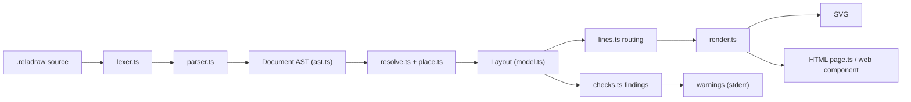
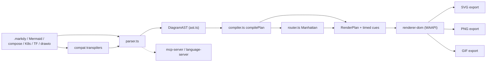
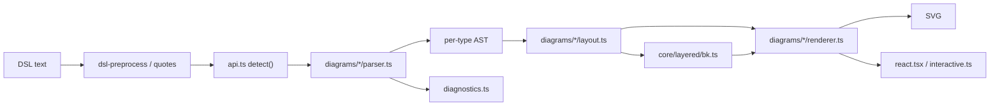
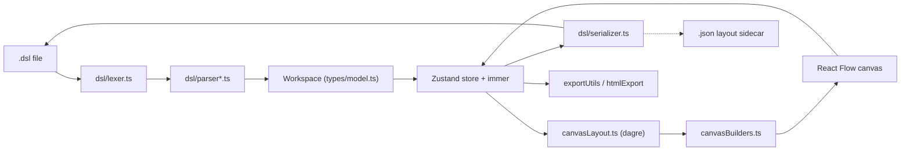

# Weekly scan — diagram tooling (2026-11-02)

Cửa sổ quét: 2026-10-26 → 2026-11-02. Nguồn: `gh api search/repositories` theo topic (`diagram-as-code`, `dsl`, `svg-animation`, `graph-visualization`, `layout-algorithm`, `pushed:>2026-10-26 stars:>50`). Đã clone shallow và đọc code của 4 repo bên dưới.

## Executive summary

- **reladraw** đi hướng ngược với auto-layout: *relative placement thuần túy* ("right of", "below", gap) và **không bao giờ tự di chuyển box hay route lại line**; thay vào đó phát `findings` (warning) sau khi vẽ. Đây là design stance rõ ràng nhất tuần này, đáng so với `alignment.py` của kymo.
- **markdy-com** là đối thủ trực tiếp nhất về animation: DSL → `RenderPlan` (timed cues) → Web Animations API, kèm orthogonal router riêng, Mermaid/draw.io/K8s/Terraform transpilers và MCP server. Output là DOM, không phải SVG animated tự chứa.
- **SchemaTex** (52 diagram families, zero deps, có BPMN text DSL + Brandes–Köpf tự viết) và **c4hero** (Structurizr DSL round-trip + dagre) cho thấy hai cách mở rộng: plugin-per-diagram-type và model-first editor.

## Mục lục

1. [reladraw](#1-reladraw)
2. [markdy-com](#2-markdy-com)
3. [SchemaTex](#3-schematex)
4. [c4hero](#4-c4hero)
5. [Ghi chú phương pháp & giới hạn](#5-ghi-chú-phương-pháp--giới-hạn)

---

## 1. reladraw

[github.com/reladraw/reladraw](https://github.com/reladraw/reladraw)

### §1 — Quick context

- Pitch: Ngôn ngữ diagram "nói vị trí ở đâu" (relative placement), nằm giữa Mermaid (auto) và draw.io (tọa độ tay); không bao giờ tự dời box.
- Stack: TypeScript, Node ≥18, zero runtime deps (devDeps chỉ `typescript`, `@types/node`); output SVG (+ HTML `--page` có pan/zoom, PNG/SVG save).
- Health: ~1.157★ (kết quả search), v0.21.0, Apache-2.0. **Không thấy thư mục test hay CI** (`tests/`, `.github/` không tồn tại); chỉ có `tools/stress.mjs`, `tools/compare.mjs`. Số contributor: không xác định (API GitHub bị chặn cho repo này; clone shallow chỉ có 1 tác giả).
- Distribution: npm (`reladraw`, CLI `reladraw`), web component `<reladraw-diagram>` qua CDN, playground.

### §2 — Architecture deep-dive

**A. Components** (`src/`):
`lexer.ts` — tokenize từng dòng (token có `start/end` để formatter không "respell"); `parser.ts` (3.5k LOC) — dòng → `Document` AST (`ast.ts`); `resolve.ts` (2.1k) — build containment tree, size bottom-up, solve vị trí; `place.ts` (2.8k) — placement on-demand + memo; `lines.ts` (2.3k) — edge routing/ports/lanes; `checks.ts` (1k) — findings; `render.ts` (1.6k) — SVG; `outline.ts`/`icons.ts`/`themes.ts` — shape, icon, theme; `format.ts` — formatter tại chỗ; `grammar.ts` — highlighter scanner tách riêng khỏi parser (comment đầu file giải thích để emit sang Emacs/Vim/TextMate); `page.ts`, `element.ts` — HTML page và web component; `cli.ts`.

**B. Pipeline** (`src/index.ts:draw`): (1) `reladraw render a.reladraw -o a.svg`; (2) `parse(text)` → `Document`; (3) `resolve(doc)` → `Layout` (3 pass: tree → size → positions, theo header `resolve.ts`); (4) `render(layout)` → SVG; (5) `findings(layout, checks)` chạy trên layout đã solve; (6) ghi file, in findings.

**C. IR**: `LayoutNode`/`LayoutEdge` (`model.ts`) với tọa độ tuyệt đối, có `parent/children`, `body` quyết định một lần để resolver và renderer không lệch nhau. Thiết kế là *derive-on-demand + memo*, không mutate nhiều pass; vòng phụ thuộc bị báo "circle in the file".

**D. Input language**: line-oriented, hand-written lexer + parser (không PEG/ANTLR). Có `SYNTAX.md` nhưng **không thấy EBNF** chính thức. Statement có thể kéo dài qua dòng thụt vào. Lỗi là `SourceError(message, line)`; `blame()` chạy lại để chỉ đúng dòng trong statement nhiều dòng. Ví dụ (`examples/flowchart.reladraw`): `node valid "valid?" below read shape: diamond`, `edge valid -> reject "no" from: right to: left`.

**E. Layout**: không auto-layout. Mỗi trục của mỗi box đến từ đúng một statement; gap là từ khóa (`tight`, `wide`) hoặc số. Edge: thẳng trừ khi khai báo `line: (path: square)`, `via`, ports `from:/to:`. Có planning cho fan/lane/copy sets (`lines.ts`: `fanned`, `directRoutes`, `laneRoutes`). Không có crossing minimization — cố ý.

**F. Rendering**: một backend SVG (+ HTML page). Không có animation. 

**G. Extensibility**: themes (`themes.ts`, `THEME_NAMES`), icons (`icons.ts`), `.reladraw-format` settings; plugin system: không xác định.

**H. DX**: CLI có `render|check|format`, `check` chỉ in findings (vòng lặp cho agent), `format -` đọc stdin cho editor, playground; `docs/llms.txt` + `llms-full.txt` cho LLM. LSP/VS Code: không thấy.

### §3 — Architecture diagram

### §4 — Verdict

- **Học được**: (1) *findings thay vì fix* — `check` chạy trên layout đã solve (line cắt box, text chồng) và in warning một dòng; kymo có thể thêm `kymo check` tương tự cho các pass trong `alignment.py` thay vì lặng lẽ stagger. (2) Tách `grammar.ts` (vocabulary highlight) khỏi parser — hợp với extension `packages/vscode-extension`. (3) `docs/llms.txt`.
- **Red flags**: không test/CI, `parser.ts` 3.5k LOC một file, cú pháp "thay đổi thường xuyên" (README tự cảnh báo).
- **Câu hỏi mở**: `draw()` ở `index.ts` chạy lại `run` trong `blame` — chi phí cho file lớn? Có golden test nào ngoài `tools/`?
- **Verdict: study deeper** (đặc biệt phần `checks.ts`).

---

## 2. markdy-com

[github.com/HoangYell/markdy-com](https://github.com/HoangYell/markdy-com)

### §1 — Quick context

- Pitch: DSL cho diagram kiến trúc *có animation theo "beat"*, render bằng Web Animations API trong DOM thay vì SVG tĩnh.
- Stack: TypeScript monorepo (pnpm, tsup, vitest), core "zero runtime deps" (~14 kB theo badge); output DOM + export SVG/PNG/GIF.
- Health: ~105★, v1.5.7, MIT, có CI (`.github/workflows/ci.yml`, `release.yml`) và test (`packages/core/tests`, `renderer-dom/tests`, `compat/snapshots`). Contributors: không xác định; git log shallow chỉ thấy tác giả "ya (Yell Agent)" — nhiều khả năng phần lớn do agent viết.
- Distribution: npm `@markdy/core`, `@markdy/mcp-server`, VS Code/Open VSX extension, Astro/MDX integrations.

### §2 — Architecture deep-dive

**A. Components** (`packages/`): `core/src/parser.ts` (1.3k) — `parse()` → `DiagramAST`; `core/src/compiler.ts` (2.4k) — `compilePlan(ast, theme)` → `RenderPlan` (node size, vị trí, routed edges, timed cues); `core/src/router.ts` — "collision-aware orthogonal Manhattan router với port multiplexing" (`routeOrthogonalEdge`, `allocatePortLanes`); `core/src/ast.ts` — types; `core/src/verifier.ts`, `arch-lint.ts`, `diff.ts` (diff hai kiến trúc → storyboard animation), `drift.ts`, `c4.ts`; `core/src/player.ts` — config player; `renderer-dom/src/*` — mỗi loại diagram một file (`sequence.ts`, `swimlane.ts`, `gantt.ts`, `radar.ts`, `quadrant.ts`, `tree.ts`…) + `export/{svg,png,gif}-exporter.ts`; `compat/src` — transpilers Mermaid, docker-compose, K8s, Terraform state, draw.io → Markdy; `markdy-language-server`, `vscode`, `mcp-server`, `cli`.

**B. Pipeline**: (1) viết `.markdy`; (2) `parse()` → AST; (3) `compile()`/`compilePlan()` → `RenderPlan` (`parser.ts:1332`); (4) renderer-dom dựng DOM/SVG node, edge dùng path từ router; (5) cue theo beat được play bằng `element.animate(...)` (WAAPI, ví dụ `renderer-dom/src/diagram.ts:202`); (6) exporter xuất SVG/PNG/GIF.

**C. IR**: hai tầng rõ ràng — `DiagramAST` (declarative) và `RenderPlan` (đã layout + timed cues) — gần "lower IR" nhất trong 4 repo. Mutable/immutable: không xác định.

**D. Input language**: line-based, indentation + block header (`beat flows:`, `player:`), operators `->`, `<-`, `~>`, `--` mỗi loại một edge style (`examples/02-flow-operators.markdy`). Parser viết tay; EBNF: không thấy. Có `syntax-diagnostics.ts`, `ai-healing.ts` (sửa lỗi cho output LLM).

**E. Layout**: hybrid — hướng `LR/RL/TB/BT` + `layoutMode auto`, nhiều layout theo loại diagram (description nói 17 layout engines; chưa kiểm chứng đủ 17 trong code). Router Manhattan tự viết. Crossing minimization: không xác định. Renderer thử relayout theo orientation (`layoutForDirection` có cache).

**F. Rendering**: DOM + WAAPI; pluggable theo loại diagram, không phải emitter interface thống nhất. Animation là điểm chính (beat → cue → timeline).

**G. Extensibility**: `registry.ts`, `stdlib-systems`, `theme-generator.ts`, `output-presets.ts`, `recipes.ts`; plugin: không xác định.

**H. DX**: VS Code, language server, MCP server, Astro/MDX, playground, `AGENT.md`/`skills/`/`prompts/` cho agent.

### §3 — Architecture diagram

### §4 — Verdict

- **Học được**: (1) tách `RenderPlan` có *timed cues* khỏi AST — kymo đang animate bằng CSS trong SVG; một "timeline IR" sẽ cho phép export WebP/GIF nhất quán. (2) `diff.ts`: diff hai model → animated migration storyboard; ý tưởng áp được cho `.kymo` git-diff. (3) Port multiplexing trong `allocatePortLanes` so với fan-in/trunk-lane stagger của `alignment.py`.
- **Red flags**: `compiler.ts` 2.4k LOC; output DOM-only (không SVG tự chứa); repo trông do agent sinh nhiều ("17 engines", nhiều module "Evolution/Drift") — claims cần kiểm chứng; 105★.
- **Câu hỏi mở**: SVG export có giữ animation không? Router có test golden không?
- **Verdict: study deeper** (router + RenderPlan).

---

## 3. SchemaTex

[github.com/SchemaTex/SchemaTex](https://github.com/SchemaTex/SchemaTex)

### §1 — Quick context

- Pitch: Text DSL → SVG cho ~52 loại diagram chuyên ngành (genogram, ladder logic, SLD, BPMN, UML…) theo chuẩn công bố, thay vì chỉ flowchart.
- Stack: TypeScript strict, tsup/vitest, **zero runtime deps** (README: không D3/dagre/parser generator); output SVG (+ React editor, MCP, AI tools).
- Health: ~93★, v1.1.6, **AGPL-3.0** (+ dual license thương mại theo CLAUDE.md), CI (`ci.yml`, `publish.yml`), thư mục `tests/`, `eval/`, `visual-eval/`. Contributors: không xác định.
- Distribution: npm `schematex` với subpath exports theo từng diagram (`schematex/genogram`…), CJS+ESM.

### §2 — Architecture deep-dive

**A. Components**: `src/core/api.ts` (687 LOC) — registry `DiagramPlugin` + detect/parse/render; `src/core/dsl-preprocess.ts`, `quotes.ts` (chuẩn hóa CJK quote cho LLM), `diagnostics.ts`, `dsl-suggest.ts`, `format.ts`, `editing.ts`, `source-range.ts` (source→scene mapping cho interactive edit); `src/core/layered/bk.ts` — Brandes–Köpf horizontal assignment (port từ dagre-d3-es, viết lại TS); `src/core/svg.ts`, `text-metrics.ts`, `theme.ts`; `src/diagrams/<type>/{parser,layout,renderer,index}.ts` × 50 thư mục (ví dụ `bpmn/`); `src/ai/*` — tool manifest, prompt context, profiles; `src/react.tsx`, `interactive.ts`, `export.ts`.

**B. Pipeline**: (1) `render(text)` ở `api.ts`; (2) `normalizeDslInput` + strip comment; (3) `plugin.detect(text)` chọn diagram type; (4) `plugin.parse` → AST riêng từng loại (`BpmnAst`); (5) tùy chọn validate; (6) `layoutBpmn(ast)` → `BpmnLayoutResult`; (7) `renderer.ts` → SVG string; lỗi → `renderDiagnosticSvg`.

**C. IR**: mỗi plugin có AST + layout result riêng (không IR chung); `SceneItem`/`SourceRange` làm cầu nối cho editing. Mutability: không xác định.

**D. Input language**: mỗi loại một DSL riêng, line-based, parser viết tay (header comment `parser.ts` có grammar dạng ví dụ, không phải EBNF). BPMN: `pool "Bank" { lane "Clerk" { id: task user "label" } }`, flows `A --> B`, `G1 --? "yes" --> C`, `"Customer" ~~> A : "Submit"`. Docs chuẩn `docs/reference/NN-*-STANDARD.md` kèm test case. Lỗi: `SchematexDiagnostic` có vị trí, thiết kế "AI-readable".

**E. Layout**: theo loại — BPMN: longest-path layering theo pool/lane, xếp cột, orthogonal routing với feedback route đi vòng (`bpmn/layout.ts` header); flowchart/ER/block dùng `layered/bk.ts`. Crossing minimization chung: không thấy ở `core/layered` (chỉ có `bk.ts`) — không xác định cho từng diagram.

**F. Rendering**: backend SVG string duy nhất + React interactive; animation: không thấy `keyframes`/`<animate>` trong `src`.

**G. Extensibility**: thêm diagram = thêm plugin implement `DiagramPlugin` (`types.ts:831`: `detect`, `render`, `parse`, `isDirective`…); theme có `theme.ts`.

**H. DX**: playground, React editor, MCP (`src/diagrams/mcp` là diagram type, MCP server riêng: không xác định vị trí), `CLAUDE.md` nghiêm ngặt về "vision là tiêu chuẩn nghiệm thu" và cấm special-case theo case ID.

### §3 — Architecture diagram

### §4 — Verdict

- **Học được**: (1) `BpmnAst → layered layout` cho text-DSL BPMN là điểm so sánh trực tiếp với importer `from_bpmn.py` của kymo (kymo đọc DI geometry; SchemaTex tự layout) — hữu ích khi kymo muốn *export* `.kymo → BPMN* có layout. (2) Plugin `detect/parse/render` là mẫu nếu kymo muốn thêm diagram family. (3) Chuẩn hóa quote CJK/LLM-friendly diagnostics.
- **Red flags**: AGPL (không copy code); 50 diagram trong một package → rủi ro chất lượng không đều; `bk.ts` là port từ dagre (license MIT nhưng cần attribution).
- **Câu hỏi mở**: crossing minimization nằm ở đâu? Test visual-eval chạy ra sao?
- **Verdict: glance only** (riêng `bpmn/` và `bk.ts` đáng xem).

---

## 4. c4hero

[github.com/c4hero/c4hero](https://github.com/c4hero/c4hero)

### §1 — Quick context

- Pitch: Editor C4 local-first, canvas kéo-thả nhưng lưu thẳng thành Structurizr DSL (round-trip), không backend.
- Stack: React 19 + TS strict, Vite, Zustand+immer, `@xyflow/react`, `@dagrejs/dagre` 3.1.3; output Structurizr `.dsl` + export (`exportUtils.ts`, `htmlExport.ts`, `okfExport.ts`).
- Health: ~62★, v0.7.0, Apache-2.0, CI (`ci.yml`), Vitest + Playwright e2e, nhiều `*.test.ts` đi kèm. Contributors: không xác định.
- Distribution: web app (app.c4hero.com), static deploy; không có npm lib.

### §2 — Architecture deep-dive

**A. Components**: `src/lib/dsl/lexer.ts` (426) → `parser.ts` (860) + `parser-{model,relationship,styles,views,deployment}.ts` → `Workspace`; `serializer.ts` (1.8k) ngược lại; `auto-views.ts`, `includeResolver.ts`, `wildcard.ts`; `src/types/model.ts` — domain; `src/store/workspace.ts` + 11 slices; `src/lib/canvasLayout.ts` (616) — dagre + cluster; `src/components/canvas/canvasBuilders.ts` — view → React Flow nodes/edges; `src/lib/impactAnalysis.ts`, `impliedRelationships.ts`; `src/lib/ai/` BYOK.

**B. Pipeline** (ARCHITECTURE.md): (1) mở `.dsl`; (2) lexer→parser→`Workspace`; (3) `auto-views` bổ sung view thiếu; (4) `canvasBuilders` + `canvasLayout` (dagre) → React Flow; (5) sửa trên canvas → immer draft + undo snapshot; (6) `serializer` ghi lại DSL; sidecar `.json` giữ layout mà DSL không biểu diễn được.

**C. IR**: `Workspace { model, views }`, view là *projection* của model. Mutation qua immer (immutable update); undo = snapshot.

**D. Input language**: Structurizr DSL (có sẵn, không tự thiết kế); lexer/parser tay, tách file theo mục; có `fuzz/` và `__fixtures__`. EBNF: không (theo spec Structurizr). Lỗi: không xác định chi tiết.

**E. Layout**: auto bằng dagre (hierarchical, Sugiyama bên trong dagre), thêm cluster separation (`MAX_CLUSTER_SEPARATION_PASSES = 24`), padding boundary/group; edge routing do React Flow; layout được bảo toàn (`layout-preservation.test.ts`, `layoutIdentity.ts`).

**F. Rendering**: canvas React Flow (DOM/SVG); export HTML/ảnh; không animation diagram.

**G. Extensibility**: templates (`lib/templates`), tag styles; plugin: không thấy.

**H. DX**: command palette, File System Access watch (`useDiskWatch`), autosave, impact analysis, a11y hooks.

### §3 — Architecture diagram

### §4 — Verdict

- **Học được**: (1) *model-as-source-of-truth, view-as-projection* + serializer round-trip + sidecar cho layout mà text không giữ được — liên quan trực tiếp đến `packages/editor` của kymo khi cần sửa visual mà vẫn ghi lại `.kymo`. (2) Layout-preservation tests cho việc re-layout không làm nhảy node.
- **Red flags**: phụ thuộc dagre (đã ít bảo trì theo forks), serializer 1.8k LOC; scope là C4 hẹp.
- **Câu hỏi mở**: cách merge sidecar khi DSL bị sửa tay ngoài app?
- **Verdict: glance only** (tập trung `serializer` + sidecar).

---

## 5. Ghi chú phương pháp & giới hạn

- Search topic cho 5 topic trả về ~25 repo; loại: chart/dashboard, desktop pet, `networkx`, `d3-cloud`, `G6`/`elkjs`/`plantuml`/`mingrammer/diagrams` (library đã quen, chỉ có commit thường nhật — không có release notable được xác minh tuần này), `pintora` (commit mặc định gần nhất 2026-06, push gần đây chỉ ở branch khác). Chưa chạy fallback 2/3 vì bước 1 đủ ≥4 ứng viên.
- `gh api repos/<owner>/<repo>` (stars chính xác, contributors, releases) **bị từ chối** cho 4 repo (ngoài scope session), nên số sao lấy từ kết quả search và số contributor ghi "không xác định". Version lấy từ `package.json`.
- Đọc code qua clone shallow; không chạy các tool. Các nhận định về hiệu năng/chất lượng chưa được kiểm chứng bằng chạy thật.
