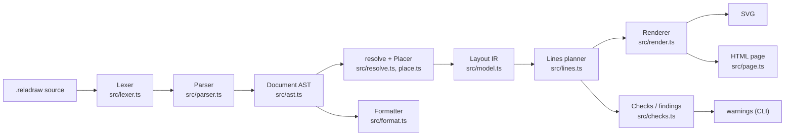
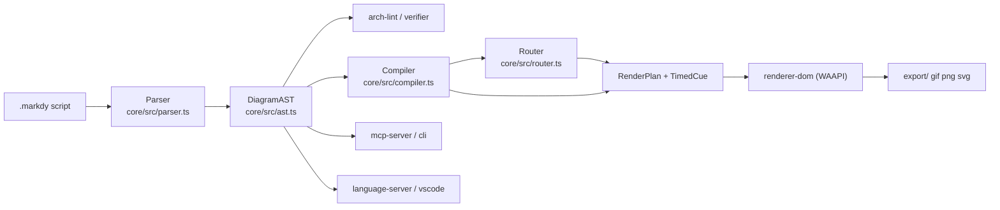
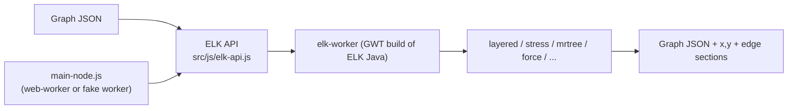
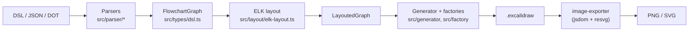

# Weekly scan — diagram tooling (2026-11-03)

Cửa sổ quét: 2026-10-27 → 2026-11-03. Nguồn: `search/repositories` (topic `diagram-as-code`, `dsl`, `svg-animation`, `graph-visualization`, `layout-algorithm`, `pushed:>7d`, `stars>50`), sau đó đọc trực tiếp source (shallow clone).

## Executive summary

- **reladraw** (v0.21.0) đề xuất một điểm mới thật sự trong DSL: *relative placement* ("say where things go") — không auto-layout, không toạ độ tuyệt đối — kèm hệ thống **findings** (lint hình học) thay vì tự sửa layout. Đáng study nhất tuần này.
- **markdy-com** là animated architecture DSL (beats/cues, Web Animations API) có orthogonal router với *port-lane multiplexing* và AI-governance tooling (MCP, arch-lint, diff) — gần kymo nhất về mục tiêu "animated diagram", nhưng code có dấu hiệu feature-sprawl.
- **elkjs** (0.13.0) và **excalidraw-cli** (1.5.1) cho thấy pattern "ELK layered + emitter riêng": elkjs là GWT-transpile của ELK Java; excalidraw-cli dùng nó làm layout rồi tự sinh Excalidraw JSON với arrow binding.

Ghi chú phương pháp: GitHub API của session bị scope chỉ cho `kymostudio/kymostudio`, nên **contributors / release mới nhất không xác định** cho 4 repo (chỉ có stars từ search + version từ `package.json`). Pintora (pushed 11-02) bị loại vì commit mặc định cuối là 2026-06-12, không có thay đổi đáng kể trong cửa sổ.

## Mục lục

1. [reladraw](#1-reladraw)
2. [markdy-com](#2-markdy-com)
3. [elkjs](#3-elkjs)
4. [swiftlysingh/excalidraw-cli](#4-excalidraw-cli)

---

## 1. reladraw

### §1 — Quick context
- **Pitch:** DSL diagram nơi bạn khai báo *vị trí tương đối* (`right of`, `below`, `even with`) — nằm giữa Mermaid (auto-layout) và draw.io (toạ độ tay).
- **Stack:** TypeScript, zero runtime deps; output SVG (+ HTML page viewer, `<reladraw-diagram>` web component).
- **Health:** 1161★ (search); contributors/release không xác định; không thấy thư mục `test/` hay `.github/` trong repo (chỉ `tools/stress.mjs`, `compare.mjs`); CONTRIBUTING: không nhận PR.
- **Distribution:** npm `reladraw` (CLI `reladraw`), playground web, agent skill (`npx skills add`).

### §2 — Architecture deep-dive
**A. Component inventory** (≈20k LOC trong `src/`)
- `Lexer` (`src/lexer.ts`) — tokenizer theo dòng, giữ `start/end` để formatter copy lại nguyên văn.
- `Parser` (`src/parser.ts`, 3.5k LOC) → `Document` AST (`src/ast.ts`); `Grammar` (`src/grammar.ts`).
- `Resolver` (`src/resolve.ts`) — `resolve(doc)` → `Layout`; `Placer` (`src/place.ts`) — vị trí box/container; `Lines` (`src/lines.ts`) — routing edge; `Outline` (`src/outline.ts`) — hình học shape.
- `Checks` (`src/checks.ts`) — findings; `Renderer` (`src/render.ts`); `Format` (`src/format.ts`); `Themes`, `Icons`; `Page` (`src/page.ts`) — HTML viewer; `CLI` (`src/cli.ts`).

**B. Pipeline (happy path)**
1. `reladraw render d.reladraw -o d.svg` → `cli.ts`.
2. `parse(text)` → `Document` (record trung thực của source, chưa có hình học).
3. `resolve(doc)` → `Layout` (đặt box theo placement, size container = outline children + padding).
4. `planLines` tính route mọi edge (`lines.ts`), dùng chung cho renderer *và* checks để "không thể bất đồng".
5. `render(layout)` → SVG; song song `findings(layout, checks)` in warning.
6. Ghi file.

**C. IR:** `Document` (AST, `ast.ts`: "faithful record of what the author wrote") → `Layout`/`LayoutNode`/`LayoutEdge` (`model.ts`). Hai tầng IR rõ ràng. Mutability: không xác định.

**D. Input language:** line-oriented, tokenizer tự viết + parser tay; có `SYNTAX.md`, không thấy EBNF hình thức. Lỗi: `SourceError(message, line)`; `blame()` re-run để chỉ đúng dòng trong statement nhiều dòng.

**E. Layout:** *không* auto-layout. Mỗi trục của mỗi box đến từ đúng một statement; giải theo on-demand + memo, phát hiện vòng (circular placement) và báo kèm chuỗi placement. Edge: thẳng trừ khi nói rõ bend/via; "never routes round a box". Không có crossing minimization.

**F. Rendering:** chỉ SVG (+ page HTML có pan/zoom/save PNG). Animation: không có.

**G. Extensibility:** themes (`themes.ts`, có token `theme-primary-subtle`), `style`/`default` statements, icon set tích hợp; không có plugin system.

**H. DX:** CLI có `render/check/format`, `.reladraw-format` settings; `--page` viewer; web component; skill cho agent; playground. LSP/VS Code: không xác định.

### §3 — Architecture diagram

### §4 — Verdict
- **Học được:** (1) *Findings thay vì auto-fix*: `checks.ts` đo từ layout đã giải (text-overlap, edge-node-overlap, crossings…) và chỉ cảnh báo — kymo có thể thêm `kymo check` dùng chung model sau `resolve_alignments()`, rất hợp workflow agent. (2) Renderer và checks dùng chung một `planLines` → golden test không lệch. (3) `blame()` re-run để định vị lỗi statement nhiều dòng. (4) Placement vocabulary đóng (9 điểm neo + `gap: tight`) so với anchor/align của kymo.
- **Red flags:** `parser.ts` 3.5k LOC, `place.ts`/`lines.ts` >2k LOC một file; không thấy test suite; ngôn ngữ "changing frequently"; license không cấp quyền tên/logo.
- **Open questions:** có test hồi quy ở đâu không (`tools/stress.mjs`?); formatter giữ comment thế nào.
- **Verdict: study deeper.**

---

## 2. markdy-com

### §1 — Quick context
- **Pitch:** DSL "scene/beat/cue" để dựng architecture diagram *có hoạt cảnh* chạy trên Web Animations API; khác Mermaid ở chỗ animation là first-class.
- **Stack:** TypeScript monorepo (pnpm, tsup, vitest), zero deps ở core (~14 kB); output DOM/SVG animate, GIF/PNG/SVG export.
- **Health:** 105★; `@markdy/core` 1.5.7; có CI (`ci.yml`) và tests; contributors không xác định.
- **Distribution:** npm (`core`, `cli`, `mcp-server`, `astro`, `mdx`, `renderer-dom`), VS Code ext, MCP.

### §2 — Architecture deep-dive
**A. Components** (`packages/`)
- `Parser` (`core/src/parser.ts`, 1.3k LOC) → `DiagramAST` (`core/src/ast.ts`).
- `Compiler` (`core/src/compiler.ts`, 2.4k LOC) — `compilePlan(ast, theme)` → `RenderPlan` (node size, layout, cue timeline).
- `Router` (`core/src/router.ts`) — `routeOrthogonalEdge`, `allocatePortLanes`, `buildSmoothSvgPath`.
- Governance: `arch-lint.ts`, `verifier.ts` (9-point quality gate), `diff.ts`, `drift.ts`, `c4.ts`, `provenance.ts`.
- DX: `syntax-diagnostics.ts`, `intellicode.ts`, `format.ts`, `ai-healing.ts`.
- `renderer-dom` (`packages/renderer-dom/src/*.ts`: `diagram`, `edges`, `sequence`, `swimlane`, `gantt`, `radar`…), `export/` (gif, png, svg), `cli`, `mcp-server`, `markdy-language-server`, `vscode`.

**B. Pipeline**
1. Agent/user viết `.markdy`.
2. `parse()` → `DiagramAST` kèm `Diagnostic[]`.
3. `compilePlan()` → `RenderPlan` (vị trí, `RoutedEdge`, `TimedCue`, `BeatRange`).
4. `renderer-dom` dựng DOM/SVG và gọi `element.animate()` (`edges.ts`, `sequence.ts`) theo cue.
5. Export GIF/PNG/SVG từ `export/`.

**C. IR:** AST (`NodeDecl`, `EdgeDecl`, `GroupDecl`, `BeatDecl`, `Cue`) → `RenderPlan` — có lower IR tường minh; `DiagramType` gồm architecture/flowchart/tree/state/sequence/swimlane/quadrant/pyramid…

**D. Language:** line-based, regex + helper tách ngoài dấu ngoặc (`splitOutsideQuotes`, `&` = parallel cue); `key=value` với duration `500ms`. Không thấy grammar hình thức. Error: `ParseError` + `syntax-diagnostics.ts` + auto-repair.

**E. Layout:** `layout LR|TB|auto` + layout chuyên theo từng loại diagram (constellation, tree, swimlane…). Edge: orthogonal Manhattan có collision-aware, `selectOptimalPorts`, *port-lane multiplexing* để fan-in/out và cặp request/response không chồng. Crossing minimization: không xác định.

**F. Rendering:** DOM/WAAPI là chính; SVG/PNG/GIF là export. Animation bằng WAAPI theo beats (`show … stagger=60ms`, `frame … zoom`, `glow`, `focus`). Một compiler, nhiều renderer theo loại diagram.

**G. Extensibility:** `registry.ts` (node kinds/roles), `themes.ts`/`theme-generator.ts`, `recipes.ts`, `stdlib-systems`; plugin system chính thức: không xác định.

**H. DX:** CLI, VS Code ext, language server, MCP server, Astro/MDX integration, playground; URL-hash codec (`url-codec.ts`) để share.

### §3 — Architecture diagram

### §4 — Verdict
- **Học được:** (1) `allocatePortLanes`: gom mọi attachment theo `(node:port)`, sắp theo toạ độ đối đầu rồi chia lane — so với fan-in/trunk-lane stagger trong `alignment.py` pass 4 của kymo, đáng đối chiếu cho case bidirectional request/response. (2) Beat/cue + `&` parallel: ngôn ngữ timeline cho animation, kymo hiện chủ yếu animate theo edge flow. (3) `verifier` 9-point gate + `diff`/`drift` (diff hai AST thành storyboard) — ý tưởng "diagram diff animation".
- **Red flags:** feature sprawl (c4, drift, ai-healing, recommend-pattern trong core); `compiler.ts` 2.4k LOC; README marketing-heavy; 105★ nên độ trưởng thành thấp.
- **Open questions:** edge routing có kiểm thử golden không; "17 layout engines" thực chất là bao nhiêu thuật toán độc lập.
- **Verdict: study deeper (router + beat model), bỏ qua phần AI-governance.**

---

## 3. elkjs

### §1 — Quick context
- **Pitch:** Eclipse Layout Kernel biên dịch sang JS — layered (Sugiyama) layout có *ports* và orthogonal routing, thứ mà dagre/graphviz-js không làm tốt.
- **Stack:** Java (ELK) → GWT → JS; wrapper JS nhỏ; không render, chỉ trả toạ độ + edge sections.
- **Health:** 2875★; v0.13.0; CI chạy nightly (cron) trên Node 24/26, Java 17; mocha tests (14 file); commit cuối 2026-10-28; contributors không xác định.
- **Distribution:** npm `elkjs` (`elk.bundled.js`, `elk-api.js` + `elk-worker.js`); license EPL-2.0 OR GPL-3.0+.

### §2 — Architecture deep-dive
**A. Components**
- `ELK` API class (`src/js/elk-api.js`) — `layout(graph, {layoutOptions})`, `knownLayoutAlgorithms()`, `knownLayoutOptions()`; giao tiếp worker qua `postMessage({cmd:'layout'|'register'|'algorithms'…})`.
- `ELKNode` (`src/js/main-node.js`) — dùng `web-worker` nếu có, không thì "fake worker" in-process.
- `elk-worker` — sinh từ Java bằng GWT (`build.gradle`, thư mục `src/elkjs`, `src/melk`), không đọc được như JS thủ công.
- Typings `typings/*.d.ts`; tests `test/mocha/*`.

**B. Pipeline:** `new ELK()` → `elk.layout(graphJSON, options)` → message sang worker → thuật toán chọn theo `elk.algorithm` → trả graph JSON có `x,y`, `sections` cho edge.

**C. IR:** plain JSON graph (`id, width, height, children, edges, ports, labels, layoutOptions`) — vào và ra cùng shape; mutable-in-place ở phía Java, JSON ở biên.

**D. Language:** không có DSL (graph JSON; `.elkt` text ở Java side nhưng không xác định trong repo này).

**E. Layout:** `layered`, `stress`, `mrtree`, `radial`, `force`, `disco`, `sporeOverlap`, `sporeCompaction`, `rectpacking`. Layered có crossing minimization (`LAYER_SWEEP`) và node placement (`NETWORK_SIMPLEX`) — các giá trị này được excalidraw-cli truyền vào, xác nhận tồn tại. Edge routing: orthogonal / polyline / splines.

**F. Rendering:** không có (README: "layout engine only"). **G.** Mọi tuỳ chỉnh qua `layoutOptions` string-keyed. **H.** Có demo `elk-live`; FAQ ghi các lỗi bundler (`g is not defined`, worker resolve).

### §3 — Architecture diagram

### §4 — Verdict
- **Học được:** ports + `layoutOptions` per-node/edge là mô hình để kymo diễn đạt "edge attaches at side X"; có thể làm *optional* `layout: elk` backend (chỉ ở package JS, vì Python không chạy được GWT bundle) và dùng nó làm baseline so sánh crossing/length cho `alignment` golden.
- **Red flags:** bundle lớn, build chuỗi Java→GWT→browserify mong manh, issues về bundler; dual license gây vướng nếu nhúng; API async-only qua worker.
- **Open questions:** kích thước `elk.bundled.js` hiện tại (không đo); có WASM thay GWT trong roadmap không.
- **Verdict: glance only** (đã là kiến thức nền; chỉ đáng xem nếu cân nhắc ELK backend).

---

## 4. excalidraw-cli

### §1 — Quick context
- **Pitch:** DSL một dòng (`[A] -> {B?}`), JSON hoặc DOT → file `.excalidraw` *chỉnh sửa được* với arrow binding, layout bằng ELK.
- **Stack:** TypeScript; deps `elkjs`, `ts-graphviz`, `@resvg/resvg-js`, `jsdom`, `@excalidraw/utils`, `commander`; output `.excalidraw`, PNG, SVG.
- **Health:** 315★; v1.5.1; có `tests/` (unit/integration/e2e) + CI/release workflow; contributors không xác định.
- **Distribution:** npm `@swiftlysingh/excalidraw-cli`, Homebrew tap, Claude Code plugin/skill.

### §2 — Architecture deep-dive
**A. Components** (`src/`)
- Parsers: `parser/dsl-parser.ts` (906 LOC), `json-parser.ts`, `dot-parser.ts` (`ts-graphviz`).
- `layout/elk-layout.ts` — gọi ELK; `layout/arrow-router.ts` — `calculateBindingPoint` (toạ độ chuẩn hoá [0–1] cho binding).
- `generator/excalidraw-generator.ts` — ráp file; `factory/{node,connection,text,image,element}-factory.ts` — tạo element.
- `exporter/image-exporter.ts` + `dom-polyfill.ts` — PNG/SVG headless (jsdom + resvg).
- `cli.ts` — `create`, `convert`.

**B. Pipeline:** `excalidraw-cli create f.dsl -o x.excalidraw` → chọn parser theo `--format` → `FlowchartGraph` → `elk-layout` → `LayoutedGraph` → `generator` dùng factories → ghi JSON; `convert` → export PNG/SVG.

**C. IR:** `FlowchartGraph` → `LayoutedGraph` (`types/dsl.ts`), tách khỏi schema Excalidraw (`types/excalidraw.ts`) — hai tầng.

**D. Language:** bracket-shape DSL (`[ ]`, `{ }`, `( )`, `[[ ]]`), chuỗi mũi tên `->`/`-->`/`<->`, directive `@direction`, `@spacing`, `@image … near (Node)`; parser tay. Grammar hình thức: không có. Error strategy: không xác định.

**E. Layout:** ELK `layered`, `edgeRouting: ORTHOGONAL`, `LAYER_SWEEP`, `NETWORK_SIMPLEX` (`elk-layout.ts:117-125`); direction TB/BT/LR/RL. Subgraph DOT bị flatten.

**F. Rendering:** emitter Excalidraw JSON, rồi PNG/SVG qua `@excalidraw/utils`; không animation. **G.** Style qua `@fillStyle:`, `@backgroundColor:`; sticker library. **H.** CLI + man page + `--stdin`; không có watch/LSP.

### §3 — Architecture diagram

### §4 — Verdict
- **Học được:** `calculateBindingPoint` — arrow binding chuẩn hoá để file Excalidraw vẫn "sống" khi người dùng kéo node; đối chiếu với `to_excalidraw.py` của kymo xem đã emit `startBinding/endBinding` chưa. Chuỗi `A -> "label" -> B` là cú pháp edge-label gọn đáng cân nhắc cho DSL kymo.
- **Red flags:** DSL không có grammar/error spec; `elkjs ^0.9.3` đã cũ so với 0.13.0; jsdom polyfill nặng (257 LOC); DOT subgraph bị flatten.
- **Open questions:** hỗ trợ container/group thế nào (DSL không có); chất lượng route ELK sau khi Excalidraw re-bind.
- **Verdict: glance only** (chỉ phần binding + edge-label syntax).

---

## Phụ lục — loại bỏ
`mingrammer/diagrams`, `plantuml/plantuml` (đã biết, không có thay đổi kiến trúc đáng chú ý trong cửa sổ — chưa đọc release notes do scope API); `pintora` (xem ghi chú đầu file); `kuiver` (Compose lib, ngoài domain); `codebase-memory-mcp`, `networkx` (graph analysis ≠ diagram).
