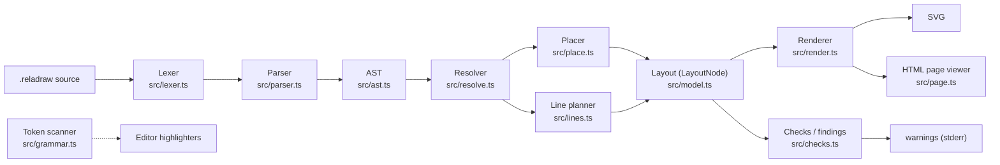
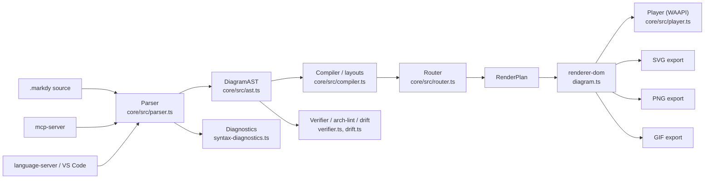
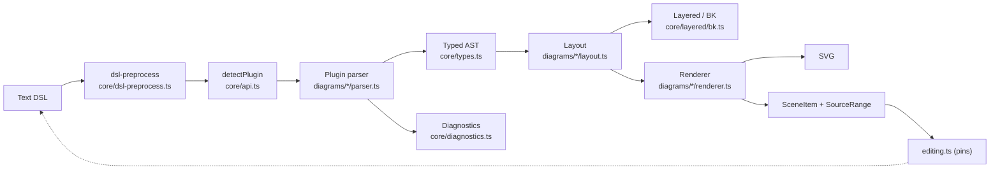
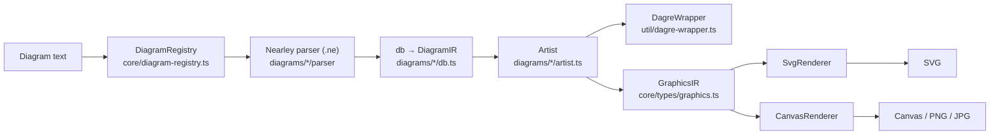

# Weekly Scan — Diagram Tooling (2026-11-04)

Cửa sổ quét: 2026-10-28 → 2026-11-04. Nguồn: GitHub topic search (`diagram-as-code`, `dsl`, `svg-animation`, `graph-visualization`, `layout-algorithm`), đủ ≥4 kết quả nên không cần fallback. Mỗi repo được `git clone --depth 1` và đọc README, cấu trúc thư mục, entry point, core module, package.json, ví dụ.

## Executive summary

- **reladraw** là phát hiện đáng giá nhất: DSL "relative placement" (`right of`, `below`, `even with`) nằm giữa auto-layout (Mermaid/D2) và absolute (draw.io), cố tình *không* tự di chuyển box hay route quanh vật cản, mà in **findings** (warning) thay vì sửa. Đối nghịch hẳn triết lý kymo hiện tại, rất đáng đối chiếu.
- **markdy-com** là đối thủ trực tiếp về "animated diagram-as-code": DSL có `beat`/cue (timeline), orthogonal router có port-lane multiplexing, và pipeline *verifier / arch-lint / drift detection* cho AI agent. Animation bằng Web Animations API (DOM), không phải SVG thuần như kymo.
- **SchemaTex** (52 diagram families, zero-dep, có BPMN DSL) và **pintora** (plugin registry + Nearley grammar) cho hai mẫu kiến trúc đa-diagram đối lập; SchemaTex có Sugiyama tự viết (Greedy-FAS, Barth-Jünger-Mutzel crossing count, Brandes-Köpf) đáng so với `alignment`/`layout` của kymo.

**Lưu ý phương pháp:** token GitHub của session chỉ cấp cho `kymostudio/kymostudio`, nên API `releases`/`contributors` của 4 repo trả 403 → các trường đó ghi "không xác định". Stars/ngày push lấy từ search API. Bước fallback 3 (release của mermaid/d2/…) không chạy vì không cần.

## Mục lục

1. [reladraw](#1-reladraw) — relative-placement DSL
2. [markdy-com](#2-markdy-com) — animated architecture DSL
3. [SchemaTex](#3-schematex) — 52 domain diagram DSL
4. [pintora](#4-pintora) — plugin-based text-to-diagram

---

## 1. reladraw

`reladraw/reladraw` — https://github.com/reladraw/reladraw

### §1 Quick context
- **Pitch:** DSL nơi bạn nói "đặt cái gì ở đâu" bằng quan hệ tương đối; không auto-layout, không tự né vật cản, chỉ cảnh báo.
- **Stack:** TypeScript, ESM, không runtime dep nào đáng kể (`package.json`), output SVG (+ `--page` HTML viewer, web component `<reladraw-diagram>`).
- **Health:** ~1.165★, v0.22.0, push 2026-11-02; contributors/release date: không xác định. **Không có CI workflow, không có thư mục test** (có `tools/stress.mjs`, `tools/compare.mjs`).
- **Phân phối:** npm (`reladraw`, bin `reladraw`), CDN `element.js`, playground web.

### §2 Architecture deep-dive
**A. Component inventory** (≈20k LOC TS trong `src/`):
`Lexer` (`src/lexer.ts`) — tách token theo dòng; `Parser` (`src/parser.ts`, 3.5k LOC) → `AST` (`src/ast.ts`); `Resolver` (`src/resolve.ts`) — dựng cây `LayoutNode` (`src/model.ts`); `Placer` (`src/place.ts`) — giải vị trí; `Line planner` (`src/lines.ts`, 2.3k LOC) — route cạnh; `Checks` (`src/checks.ts`) — sinh findings; `Renderer` (`src/render.ts`) + `themes.ts`/`icons.ts`; `Formatter` (`src/format.ts`); `Highlighter scan` (`src/grammar.ts`); CLI (`src/cli.ts`).

**B. Pipeline** (`src/index.ts: draw()`):
1. `reladraw render arch.reladraw -o out.svg` → `cli.ts` đọc file.
2. `parse(text)` → `Document` (AST).
3. `resolve(doc)` → `Layout` (cây node, size, style đã giải).
4. Place + plan lines (gọi trong resolve) → toạ độ tuyệt đối, `Route` cho mỗi edge.
5. `render(layout)` → SVG string.
6. `findings(layout, checks)` chạy *song song*, không chặn output.

**C. IR:** interface TS (`LayoutNode`, `LayoutEdge`, `Route`); toạ độ "per frame" – origin là anchor của container, đổi sang page-absolute sau. Mỗi trục của mỗi box do *đúng một* statement quyết định; giá trị được tính lazy + memoize, phát hiện vòng (circular placement) báo lỗi kèm danh sách placement gây vòng (`place.ts` header). Không có "lower IR" riêng.

**D. Ngôn ngữ:** line-based, statement mở đầu bằng keyword (`node`, `edge`, `style`, `bundle`, `default edge`…), tên có dấu chấm = parent/child (`app.ui`). Lexer riêng (`OpenString` cho `"""` nhiều dòng); `grammar.ts` là **bộ phân loại token một-dòng-regex tách khỏi parser** có chủ đích để xuất sang TextMate/Vim/Emacs. Có `SYNTAX.md` (prose spec, không EBNF). Lỗi: `SourceError(message, line)` format `file:line: msg`, có `nearMatch` gợi ý gõ gần đúng (`checks.ts`).

**E. Layout:** *không* auto-layout. Vị trí = `right of X (gap: tight|12) even with Y`. Container = bao của con + padding. Edge: thẳng trừ khi khai `path: curved`, `via`, `from/to` side, `step-out`, `turn`. "Copies" (nhiều line cùng cặp box/side) tự fan thành lane song song không cắt nhau; `bundle` = đường trục chung. Không crossing minimization (không cần).

**F. Render:** một backend SVG; animation: chỉ CSS glow trong page viewer (`page.ts`), không có animated diagram.

**G. Extensibility:** theme (`themes.ts`, `theme-primary`… token), `style` bundle, icon (`icons.ts`, cho phép file path). Không plugin system.

**H. DX:** `render`/`check`/`format` subcommand, `--page` viewer có pan/zoom, web component, playground, `.claude/skills` được publish kèm package, `llms.txt` trong docs.

### §3 Architecture diagram

### §4 Verdict
- **Học được:** (1) "Findings thay vì auto-fix" — hợp với kymo vốn *renderer dumb*; có thể thêm `kymo check` báo line cắt box/text chồng nhau mà không đổi output golden. (2) Quy tắc "mỗi trục một statement + lazy memoized + báo vòng" là mô hình sạch cho alignment resolver 5-pass của kymo. (3) Scanner token tách riêng parser để sinh TextMate grammar — liên quan `packages/vscode-extension`. (4) "Copies fan as lanes" ≈ fan-in/trunk-lane staggering của kymo; so sánh quy tắc.
- **Red flags:** không CI, không test dir; README tự cảnh báo syntax đổi liên tục; file 2–3k LOC.
- **Câu hỏi mở:** hành vi `lines.ts` khi hai route đè nhau? Chi phí layout memoize ở đồ thị lớn?
- **Verdict: STUDY DEEPER.**

---

## 2. markdy-com

`HoangYell/markdy-com` — https://github.com/HoangYell/markdy-com

### §1 Quick context
- **Pitch:** DSL "MarkdyScript" cho diagram kiến trúc *có hoạt họa theo beat/cue*, sinh bởi AI agent, render bằng Web Animations API.
- **Stack:** TypeScript pnpm monorepo (`core`, `renderer-dom`, `cli`, `mcp-server`, `vscode`, `markdy-language-server`, `astro`, `mdx`…); core "zero runtime dependency"; output DOM/SVG/PNG/GIF.
- **Health:** ~106★, v1.5.7 (package.json), push 2026-11-02; **có CI** (`ci.yml`, `release.yml`) và test (vitest) ở core/cli/mcp/renderer-dom; contributors: không xác định.
- **Phân phối:** npm `@markdy/core`, `@markdy/mcp-server`, VS Code/Open VSX, web studio.

### §2 Architecture deep-dive
**A. Components:** `parser` (`packages/core/src/parser.ts`, 1.3k LOC) → `DiagramAST` (`ast.ts`); `registry` (`registry.ts`) — NODE_KINDS/EDGE_OPERATORS/DIAGRAM_TYPES; `compiler` (`compiler.ts`, 2.4k LOC, `compilePlan`) — layout + `RenderPlan`; `router` (`router.ts`) — Manhattan router; `themes`; `verifier` (`verifier.ts`, "9-point quality gate"); `arch-lint`, `drift` (so khớp diagram với codebase qua code anchors, `provenance.ts`); `player` (`player.ts`); DOM renderer (`packages/renderer-dom/src/diagram.ts`, 3k LOC; `edges.ts`, `nodes.ts`, `geometry/path.ts`); exporter (`export/svg-exporter.ts`, `gif-encoder.ts`, `png-exporter.ts`); `mcp-server` (`src/tools.ts`).

**B. Pipeline:**
1. User/agent viết `.markdy` (xem `examples/01-first-diagram.markdy`).
2. `parse()` → `DiagramAST` + `Diagnostic[]` (`syntax-diagnostics.ts`).
3. `compilePlan(ast, theme)` → chọn layout theo `DiagramType` (`layoutRanked`, `layoutTree`, `layoutLoop`, `layoutSwimlane`, `layoutTimeline`… trong `compiler.ts`), định tuyến cạnh.
4. `RenderPlan` (positioned nodes + routed edges + cue schedule) → renderer-dom dựng DOM/SVG.
5. Animation: Web Animations API (`.animate(` trong `diagram.ts`) điều khiển bởi `player.ts`.
6. Export SVG/PNG/GIF từ renderer-dom.

**C. IR:** hai tầng rõ ràng: `DiagramAST` (declarative) → `RenderPlan` (đã layout + cue). Kiểu TS thuần, có `snapGrid` làm tròn về bội 4.

**D. Ngôn ngữ:** hand-written, theo dòng/indent (`beat main:` + khối thụt lề, `A -> B "label" -> C` flow chain, `scene theme=paper`). Không thấy EBNF trong phần đã đọc (chỉ `registry.ts` làm nguồn từ vựng — *chưa đọc sâu parser*). Lỗi: module diagnostics riêng ~1.1k LOC + `intellicode.ts`/`ai-healing.ts`.

**E. Layout:** 18 `DiagramType` (architecture, flowchart, tree, state, sequence, swimlane, gantt, venn…), mỗi loại một hàm layout riêng; `layoutRanked` dùng `assignRanks` + `byRank` (hierarchical, chưa xác minh crossing minimization). Router (`router.ts`): "collision-aware orthogonal Manhattan router với dynamic port multiplexing": `selectOptimalPorts`, `allocatePortLanes`, `obstacles`, bo góc `cornerRadius` → `svgPathData`.

**F. Render:** DOM-based (không phải SVG tĩnh có CSS keyframe), exporter riêng cho SVG/PNG/GIF/share-card. Animation là tính năng hạng nhất.

**G. Extensibility:** `stdlib-systems` package, `symbols.ts` (vector symbol), `recipes.ts`, theme generator; không plugin API công khai rõ ràng.

**H. DX:** CLI 2k LOC, MCP server cho agent, VS Code ext + language server, intellicode, playground; có thư mục `agents/ rules/ skills/ prompts/` cho AI.

### §3 Architecture diagram

### §4 Verdict
- **Học được:** (1) `beat`/cue làm *timeline khai báo* — đối chiếu với `--animate` của kymo; có thể thành cú pháp sequencing thay vì animate toàn cục. (2) Port-lane multiplexing + `obstacles` trong router: so với trunk-lane staggering của kymo. (3) Verifier "quality gate" + code-anchor drift: ý tưởng CI cho diagram (`kymo verify`).  (4) MCP server cho agent — kymo đã có `packages/mcp`, so tool surface.
- **Red flags:** file 2–3k LOC; header "clean-room re-engineered" lặp ở nhiều file (cần xem nguồn gốc); marketing nhiều ("17 layout engines" — thực tế là hàm layout per-type).
- **Open:** crossing minimization ở `layoutRanked`? parser có grammar chính thức?
- **Verdict: STUDY DEEPER** (router + beat/cue).

---

## 3. SchemaTex

`SchemaTex/SchemaTex` — https://github.com/SchemaTex/SchemaTex

### §1 Quick context
- **Pitch:** một engine text-DSL → SVG cho 52 loại diagram chuyên ngành (genogram, ladder logic, P&ID, BPMN…), không dùng dagre/d3.
- **Stack:** TypeScript strict, zero runtime dep, tsup, vitest, React wrapper; output SVG + scene metadata cho editing.
- **Health:** ~96★, v1.1.6, push 2026-10-30; CI (`ci.yml`, `publish.yml`), test `test/unit`; contributors: không xác định. **Giấy phép AGPL-3.0** (README) — lưu ý khi tham khảo code.
- **Phân phối:** npm `schematex`, MCP package (`packages/mcp`), website/playground.

### §2 Architecture deep-dive
**A. Components:** `api` (`src/core/api.ts`) — `render/parse/renderResult`, `detectPlugin()` theo `plugin.detect(text)`; `diagnostics` (`src/core/diagnostics.ts`); `Layered core` (`src/core/layered/bk.ts` — Brandes-Köpf); plugin mỗi diagram dưới `src/diagrams/<name>/{parser,layout,renderer,index}.ts` (345 file .ts); `editing.ts` (applyPins/setPosition – ghi ngược vị trí vào source); `format.ts`, `dsl-suggest.ts`, `source-range.ts`, `theme.ts`, `svg.ts`, `symbols-catalog.ts`; `src/ai/` (profiles sinh tự động cho LLM).

**B. Pipeline:**
1. `render(text)` → `dsl-preprocess` (chuẩn hoá, ví dụ CJK quotes).
2. `detectPlugin()` quét danh sách plugin, header đầu văn bản (`bpmn`, `flowchart`…) quyết định.
3. `plugin.parse` → AST riêng từng diagram + `diagnostics` (status `valid|partial|invalid`).
4. `layout.ts` riêng.
5. `renderer.ts` → SVG (`svgRoot`, helper trong `core/svg.ts`); tuỳ chọn `scene` (SceneItem[] + SourceRange) cho editor tương tác.

**C. IR:** AST typed khổng lồ trong `core/types.ts` (2.6k LOC); `SceneItem` gắn `SourceRange` → *round-trip edit* (kéo thả cập nhật source qua pins).

**D. Ngôn ngữ:** parser hand-written per-diagram (vd `bpmn/parser.ts` ghi grammar trong comment: `pool "Bank" { lane "Clerk" { id: task user "label" } }`, `flows` block `A --> B`, `--?` conditional, `--*` default, `~~>` message). Validation ngữ nghĩa ngay ở parser (sequence flow không vượt pool, message flow phải vượt pool, tối đa một default/gateway). Spec dạng prose trong `docs/reference/NN-*-STANDARD.md`; không EBNF chính thức. Lỗi cấu trúc hoá (`SchematexDiagnostic`) có gợi ý (`dsl-suggest.ts`).

**E. Layout:** `flowchart/layout.ts` là Sugiyama tự viết: Greedy-FAS (Eades-Lin-Smyth) bỏ chu trình → longest-path layering → dummy nodes → weighted barycenter sweep 24 vòng, đếm crossing chính xác bằng Barth-Jünger-Mutzel → x-coord bằng `bkXCoords`. Routing flowchart: Manhattan đơn giản (`routing.ts` ghi "M1", A* để sau). Các diagram khác dùng layout riêng (genogram, floorplan 2.2k LOC, circuit schematic).

**F. Render:** một backend SVG; CSS class riêng mỗi loại (`.schematex-bd-*`); không animation.

**G. Extensibility:** `DiagramPlugin` (detect/parse/layout/render) và `config.plugins`; theme tập trung (`core/theme.ts`).

**H. DX:** diagnostics partial-render (vẫn render khi lỗi một phần), MCP, React component, visual-eval và `CLAUDE.md` có quy tắc "Vision là tiêu chí nghiệm thu".

### §3 Architecture diagram

### §4 Verdict
- **Học được:** (1) `parse()` trả `valid|partial|invalid` + render từng phần — tốt cho LLM/editor. (2) Pins/`SourceRange`: kéo thả trong editor → sửa source (liên quan `packages/editor`). (3) BPMN DSL có validation ngữ nghĩa ở parse-time — đối chiếu `from_bpmn` ↔ DSL của kymo. (4) Bộ đếm crossing BJM + BK có thể tham khảo cho auto-layout.
- **Red flags:** AGPL-3.0 (không copy code); `types.ts` 2.6k LOC, `_generated.ts` 4.5k LOC; routing flowchart còn "M1"; độ rộng 52 loại có thể nông.
- **Open:** chất lượng BPMN layout so với DI geometry thật?
- **Verdict: GLANCE ONLY** (đọc `bpmn/` và `editing.ts`, `layout.ts` flowchart).

---

## 4. pintora

`hikerpig/pintora` — https://github.com/hikerpig/pintora

### §1 Quick context
- **Pitch:** thư viện text-to-diagram *mở rộng được*: mỗi diagram là plugin (parser + artist) đăng ký vào registry, xuất SVG/Canvas.
- **Stack:** TypeScript monorepo (pnpm/turbo/jest), Nearley grammar (`.ne`), dagre fork `@pintora/dagre`; output SVG, Canvas, PNG/JPG (Node).
- **Health:** ~1.282★, push 2026-11-03 (search) — **nhưng commit mới nhất trên `master` là 2026-06-12**; push gần đây có vẻ là nhánh dependabot/chore; tag mới nhất thấy được: `v0.8.2`. CI: `ci-check.yml`; test jest. Contributors: không xác định.
- **Phân phối:** npm `@pintora/standalone`, `@pintora/cli`, live editor web.

⚠️ Không đạt đúng tiêu chí "cập nhật đáng kể trong 7 ngày"; giữ lại vì đây là baseline kiến trúc plugin tốt.

### §2 Architecture deep-dive
**A. Components:** `DiagramRegistry` (`packages/pintora-core/src/diagram-registry.ts`) — `registerDiagram/detectDiagram`; `IDiagram` interface (`pintora-core/src/type.ts`); diagrams (`packages/pintora-diagrams/src/{sequence,er,component,activity,class,gantt,mindmap,dot}`) mỗi loại gồm `parser/*.ne`, `db.ts`, `artist.ts`, `config.ts`, `index.ts`; `DagreWrapper` (`diagrams/src/util/dagre-wrapper.ts`); renderer (`packages/pintora-renderer/src/renderers/{SvgRenderer,CanvasRenderer}.ts`); `pintora-cli`, `pintora-harness`, `pintora-target-wintercg`, `pintora-standalone`.

**B. Pipeline:**
1. Text vào; `detectDiagram(text)` thử `pattern` regex của từng diagram (mặc định sequenceDiagram).
2. `parser.parse(text)` (Nearley+moo lexer) đẩy vào `db` (singleton mutable) → `DiagramIR`.
3. `artist.draw(ir, config)` → `GraphicsIR` (kiểu trong `pintora-core/src/types/graphics.ts`).
4. Renderer (SVG hoặc Canvas) dựng output từ GraphicsIR.
5. CLI Node ghi PNG/JPG/SVG.

**C. IR:** hai tầng chính thức: *DiagramIR* (mỗi diagram tự định nghĩa, thông qua `db`) → *GraphicsIR* chung (marks: rect/text/path/group…). `db` là singleton có `clear()` → mutable, state global (đáng lưu ý).

**D. Ngôn ngữ:** Nearley grammar `.ne` + `@hikerpig/moo` lexer (`componentDiagram.ne`, `@include` các phần dùng chung: config, comment, whitespace); là grammar hình thức (BNF-like) — khác DSL hand-rolled. Cú pháp bắt đầu bằng header (`componentDiagram`). Lỗi: do Nearley/moo, không đánh giá thêm.

**E. Layout:** dagre (hierarchical Sugiyama) cho component/class/ER/activity; sequence/gantt có layout tự viết. Edge: line đa điểm → `getPointsCurvePath` / `getPointsLinearPath` (curve hoặc polyline). Crossing minimization do dagre.

**F. Render:** pluggable renderer sau GraphicsIR (SVG, Canvas, target WinterCG) — kiến trúc "artist → graphics IR → renderer" đúng như emitter pattern. Không animation.

**G. Extensibility:** mạnh nhất nhóm: `registerDiagram` + tutorial "Write a custom diagram"; theme (`pintora-core/src/themes`), `config-engine`, `diagram-event` recognizer (tương tác).

**H. DX:** CLI, live editor, harness (`pintora-harness` CLI); percy visual snapshot; AGENTS.md/`ai:lint`. Không thấy LSP trong phần đã đọc.

### §3 Architecture diagram

### §4 Verdict
- **Học được:** (1) Tầng **GraphicsIR chung** giữa artist và renderer — kymo hiện có `Diagram` model ở trên layout; một IR "marks" thấp hơn sẽ giúp dùng chung giữa SVG/Figma/Excalidraw/WebP emitter. (2) Registry + `pattern` regex phát hiện loại diagram: mẫu cho việc kymo mở rộng sang sequence/state DSL. (3) Percy visual regression bổ sung cho golden byte-for-byte.
- **Red flags:** `db` singleton mutable; dagre nặng, route cong không orthogonal; master không có commit từ tháng 6.
- **Open:** GraphicsIR có đủ ổn định để làm target trung gian?
- **Verdict: GLANCE ONLY.**

---

## Loại trừ / không chọn
`birdview` (code-architecture mapping cho AI, không phải DSL), `excalidraw-cli` (generator, 315★ — có thể xem sau cho đường Excalidraw), `c4hero` (Structurizr DSL editor, 62★), `mingrammer/diagrams`, `plantuml` (đã biết; không có thay đổi cần xét), các repo svg-animation (pet/avatar, không phải diagram).
