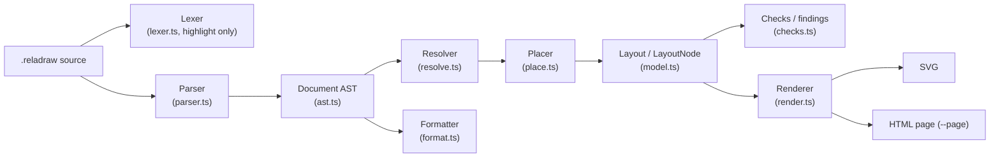
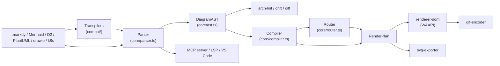
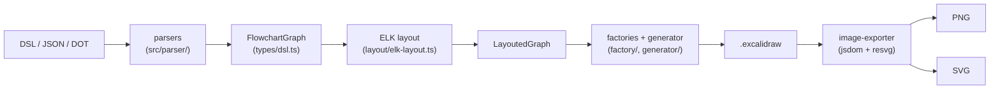
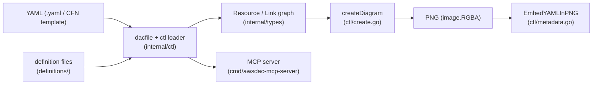

# Weekly scan — diagram tooling (2026-11-05)

Cửa sổ: push từ 2026-10-29. Nguồn: `gh api search/repositories` (topic-based; fallback #2/#3 không cần dùng). Chọn 4 repo (trần cho phép), đã `git clone --depth 1` và đọc code/README/example. Ghi chú giới hạn: GitHub API chỉ mở cho repo kymostudio nên **contributors / release mới nhất không xác định** cho 4 repo dưới (clone shallow, `git log` chỉ có 1 commit); stars lấy từ kết quả search.

## Executive summary

- **reladraw** là phát hiện đáng nhất tuần: DSL *relative placement* (không auto-layout, không solver, "never moves a box") + hệ thống *findings* thay cho "tự sửa" — gần như đối cực triết lý với kymo auto-layout, nên rất đáng so sánh.
- **markdy-com** là đối thủ trực tiếp nhất của kymo ở mảng *animated diagram-as-code* (Web Animations API, 17 layout, MCP, transpiler Mermaid/D2/PlantUML/draw.io→DSL) — nhưng code ồn ào/AI-generated, chọn lọc kỹ trước khi học.
- **excalidraw-cli** và **awslabs/diagram-as-code** là hai mẫu "pipeline mỏng": một cái dựa ELK.js → Excalidraw, một cái tự vẽ PNG bằng Go + embed YAML nguồn vào PNG metadata (ý tưởng nhỏ, áp dụng được ngay).

## Mục lục

1. [reladraw](#1-reladraw) — study deeper
2. [markdy-com](#2-markdy-com) — study deeper (chọn lọc)
3. [excalidraw-cli](#3-excalidraw-cli) — glance only
4. [awslabs/diagram-as-code](#4-awslabsdiagram-as-code) — glance only

---

## 1. reladraw

### §1 Quick context
- **Pitch:** DSL diagram mà bạn *nói rõ box nằm ở đâu* (`below`, `right of`, `even with`) thay vì để engine tự layout như Mermaid/D2.
- **Stack:** TypeScript (ESM), output SVG (+ `--page` HTML viewer, custom element `<reladraw-diagram>`).
- **Health:** ~1.2k★, v0.22.0 (`package.json`), CI/GitHub workflows: không thấy; có `checks.ts` + examples nhưng **không có file `*.test.*`** nào trong repo.
- **Distribution:** npm `reladraw` (CLI `reladraw`), web playground, Claude skill (`.claude/skills`).

### §2 Architecture
**A. Components** — `Lexer` (`src/lexer.ts`) chỉ phục vụ highlight, tách khỏi parser; `Parser` (`src/parser.ts`, 3.5k LOC) → `Document` AST (`src/ast.ts`); `Resolver` (`src/resolve.ts`) tính size/kind/body từng node; `Placer` (`src/place.ts`) tính vị trí; `Checks` (`src/checks.ts`, ~1k LOC) sinh findings; `Renderer` (`src/render.ts`); `Formatter` (`src/format.ts`); model `src/model.ts`; theme `src/themes.ts`; CLI `src/cli.ts`.

**B. Happy path** — (1) `reladraw render d.reladraw -o d.svg` → `cli.ts`; (2) `draw()` trong `src/index.ts` gọi `parse` → AST; (3) `resolve` dựng cây `LayoutNode` (size từ text/icon); (4) `Placer` giải vị trí theo cây phụ thuộc; (5) `findings()` in cảnh báo một dòng; (6) `render()` ra SVG.

**C. IR** — `Document` (AST) → `Layout`/`LayoutNode` (`model.ts`, tọa độ tuyệt đối, origin top-left). Comment trong `resolve.ts`: body được quyết định *một lần* để resolver và renderer không thể bất đồng. Mutability: không xác định rõ.

**D. Input language** — parser tay, theo dòng + continuation bằng indent (`parser.ts`); `SYNTAX.md` mô tả ngữ pháp bằng prose (không thấy EBNF). Lỗi là `SourceError(message, line)`, có `blame` để chỉ đúng dòng trong statement nhiều dòng, và `nearMatch` gợi ý từ gần đúng.

**E. Layout** — Không auto-layout. `place.ts` header: "Nothing here is solved and nothing is pushed"; mỗi trục của mỗi box đến từ đúng một statement, tính lazy + memo, vòng tham chiếu bị báo. Edge: thẳng trừ khi khai `path: square|curved` và `via:` (điểm/region/part đặt tên). Không có crossing minimization, không route né box.

**F. Rendering** — SVG duy nhất; không animation. Có `renderTagged` (SVG gắn tag từng phần cho viewer).

**G. Extensibility** — `style`/`default` statement, theme, `icon` statement (`icons.ts`); không có plugin system.

**H. DX** — CLI có `render`/`check`/`format`/`install-skill`; `check` không ghi SVG; formatter dạng "căn cột"; playground; lexer thiết kế để xuất ra TextMate/Vim/Emacs grammar.

### §3 Diagram

### §4 Verdict
- **Học được:** (1) *findings thay vì tự sửa* — kymo có thể thêm `kymo check` in cảnh báo "edge xuyên box / text chồng" thay vì âm thầm stagger trong `alignment.py`; (2) `via:` + named `point`/`region` làm waypoint cho edge — đối chiếu với trunk-lane của kymo; (3) lexer tách riêng, chỉ regex-từng-dòng → xuất TextMate grammar cho `packages/vscode-extension`.
- **Smell:** file khổng lồ (parser 3.5k, place 2.8k), không test/CI thấy được, ngôn ngữ "changing frequently".
- **Open:** triết lý "không bao giờ di chuyển box" có scale được với diagram lớn không?
- **Verdict: study deeper.**

---

## 2. markdy-com

### §1 Quick context
- **Pitch:** DSL "MarkdyScript" cho diagram kiến trúc *có animation theo beat*, render trực tiếp trên DOM bằng Web Animations API thay vì SVG/SMIL tĩnh.
- **Stack:** TypeScript pnpm monorepo, zero-dep core; output DOM/SVG export/GIF encoder tự viết (`export/gif-encoder.ts`).
- **Health:** 106★, v1.5.7 (`package.json`), có `ci.yml`/`release.yml`, thư mục `tests` + test trong `renderer-dom/tests`.
- **Distribution:** npm `@markdy/core`, `@markdy/mcp-server`, VS Code (+Open VSX), Astro/MDX plugin, web playground.

### §2 Architecture
**A. Components** — `Parser` (`packages/core/src/parser.ts`, 1.3k LOC); `Compiler` → `RenderPlan` (`core/src/compiler.ts`, 2.4k LOC); `Router` (`core/src/router.ts`) orthogonal Manhattan + "port multiplexing" (`allocatePortLanes`, `routeOrthogonalEdge`, `routeAroundObstacles`); `Registry` (`core/src/registry.ts`) node kinds/operators; `Diagnostics` (`syntax-diagnostics.ts`); `arch-lint.ts` (rule `cannot-connect`/`must-connect`/`forbidden-cycle`); `drift.ts` (đối chiếu diagram với code thật); `diff.ts` (`diffDiagramASTs`); DOM renderer (`packages/renderer-dom/src/diagram.ts`, 3k LOC) + `edges.ts`, `nodes.ts`; `svg-exporter.ts`; transpilers `packages/compat/src/{mermaid,infra}/` (d2, plantuml, drawio, k8s, terraform, docker-compose); `mcp-server`, `markdy-language-server`, `vscode`.

**B. Happy path** — (1) viết `.markdy` (ví dụ `examples/01-first-diagram.markdy`); (2) `parser.ts` → `DiagramAST`; (3) `compiler.ts` tính vị trí + route + timeline cue → `RenderPlan`; (4) `renderer-dom` dựng DOM và gọi `.animate()` (WAAPI) theo beat; (5) tuỳ chọn export SVG/GIF.

**C. IR** — `DiagramAST` → `RenderPlan` (`PositionedNode`, `RoutedEdge`, `TimedCue`, `BeatRange` trong `ast.ts`). Đây đúng là "lower IR" tách layout khỏi timing. Mutability: không xác định.

**D. Input language** — line-based, khối thụt lề (`scene`, `beat main:`, `player:`), flow chain `A -> B "label" -> C`. Không thấy EBNF; có `syntax-diagnostics.ts` + `ai-healing.ts` (tự sửa lỗi cho agent).

**E. Layout** — hierarchical theo `direction` (TB/LR/BT/RL) với relayout theo orientation viewport (`layoutForDirection`, `diagram.ts`); README quảng cáo "17 layout engines" nhưng tôi chỉ xác nhận các module `sequence/swimlane/tree/gantt/radar/quadrant/timeline/constellation`. Thuật toán crossing minimization: không xác định.

**F. Rendering** — DOM + WAAPI chính; SVG export riêng; GIF. Emitter không "pluggable" thật mà là nhiều file cho từng diagram type.

**G. Extensibility** — registry kind/operator, `theme-generator.ts`, `stdlib-systems`, `recipes.ts`; theme tokens.

**H. DX** — CLI 2k LOC, VS Code preview webview, LSP, MCP, Astro/MDX.

### §3 Diagram

### §4 Verdict
- **Học được:** (1) *beat* = nhóm cue có timeline là mô hình animation khai báo cao hơn SMIL/CSS thủ công; (2) `RenderPlan` tách rõ lower IR có thời gian — kymo hiện nhét animation vào `to_svg.py`; (3) `drift.ts`/`arch-lint.ts`: kiểm diagram so với repo — hướng sản phẩm khác lạ.
- **Smell:** file 2–3k LOC, nhiều module tính năng ngoài lề (`ai-healing`, `intellicode`, `impact`), claim marketing ("17 layout engines") khó kiểm chứng, 1 contributor có vẻ chính.
- **Open:** animation chỉ chạy trong browser — không có SVG animated độc lập như kymo?
- **Verdict: study deeper (chọn lọc: `router.ts`, `RenderPlan`).**

---

## 3. excalidraw-cli

### §1 Quick context
- **Pitch:** CLI biến DSL flowchart / JSON / Graphviz DOT thành file `.excalidraw` *editable* (bind arrow vào shape), thiết kế cho agent.
- **Stack:** TypeScript, `elkjs`, `ts-graphviz`, `@resvg/resvg-js`, `jsdom` + `@excalidraw/utils`; output `.excalidraw`, PNG, SVG.
- **Health:** 315★, có `ci.yml`/`release.yml`, tests unit/integration/e2e (`tests/`); release mới nhất không xác định.
- **Distribution:** npm `@swiftlysingh/excalidraw-cli`, Homebrew tap, Claude/Cursor/Codex skill, Gemini extension.

### §2 Architecture
**A. Components** — `parseDSL` (`src/parser/dsl-parser.ts`, 906 LOC), `parseJSON` (`json-parser.ts`), DOT parser (`dot-parser.ts`); `layoutGraph` (`src/layout/elk-layout.ts`); `arrow-router` (`src/layout/arrow-router.ts`, tính binding point [0–1]); factories (`src/factory/{node,connection,text,image}-factory.ts`); `excalidraw-generator.ts`; `image-exporter.ts` (+ `dom-polyfill.ts`); CLI `src/cli.ts` (commander).

**B. Happy path** — (1) `excalidraw-cli create --inline "[A] -> [B]" -o d.excalidraw`; (2) `parseDSL` → `FlowchartGraph`; (3) `layoutGraph` gọi ELK → `LayoutedGraph`; (4) generator + factories tạo `ExcalidrawElement[]`; (5) ghi file; (6) `-o x.png/svg` chạy `image-exporter` qua jsdom polyfill + resvg.

**C. IR** — `FlowchartGraph` → `LayoutedGraph` (`types/dsl.ts`) → `ExcalidrawFile` (`types/excalidraw.ts`). Chuỗi IR rõ ràng, 3 tầng.

**D. Input language** — regex/line-based (header comment: `[Label]` rect, `{Label}` diamond, `(Label)` ellipse, `[[Label]]` database, `A -> "label" -> B`, directive `@direction`, `@image … near (Node)`). Không grammar chính thức.

**E. Layout** — ELK `layered`, `edgeRouting: ORTHOGONAL`, `crossingMinimization.strategy: LAYER_SWEEP` (`elk-layout.ts:118-124`).

**F. Rendering** — backend chính là Excalidraw JSON; raster/SVG là bước sau, dùng chính engine Excalidraw trong jsdom. Không animation.

**G. Extensibility** — sticker library, decorations, input format mới = thêm parser; không plugin.

**H. DX** — man page (`man/`), skill cho agent, `npx` được; không có watch/LSP (không xác định).

### §3 Diagram

### §4 Verdict
- **Học được:** (1) cách bind arrow ↔ shape (`calculateBindingPoint`) để Excalidraw output vẫn *chỉnh sửa được* — kiểm tra xem `to_excalidraw.py` của kymo đã làm chưa; (2) ELK cấu hình `LAYER_SWEEP` + ORTHOGONAL là baseline so sánh cho layout engine của kymo.
- **Smell:** nhúng jsdom + `dom-polyfill.ts` 257 LOC chỉ để export — nặng và dễ vỡ.
- **Open:** font/hand-drawn style có giữ khi export PNG không?
- **Verdict: glance only.**

---

## 4. awslabs/diagram-as-code

### §1 Quick context
- **Pitch:** YAML mô tả kiến trúc AWS, tự vẽ PNG bằng Go thuần (không headless browser), group tự co giãn theo children.
- **Stack:** Go 1.25, `cobra`, `golang.org/x/image`, `freetype`, `yaml.v3`, `mcp-go`, `rain` (CFN); output PNG.
- **Health:** 1.6k★, Apache-2.0; workflows `unit_test.yaml`, `func_test.yaml`, `fmt-check.yml`, `release.yml`; release không xác định.
- **Distribution:** `go install`, Homebrew (`awsdac`), thư viện Go, MCP server (`cmd/awsdac-mcp-server`).

### §2 Architecture
**A. Components** — CLI `cmd/awsdac/main.go`; `ctl` (`internal/ctl/create.go` — `loadResources`, `associateChildren`, `loadLinks`, `createDiagram`); `Resource` (`internal/types/resource.go`); `Link` (`internal/types/link.go`, 2.4k LOC: vẽ line, `calculateOrthogonalPath`, label); definition loader (`internal/definition/`, `definitions/definition-for-aws-icons-light.yaml`); CFN→DaC (`internal/ctl/cfntemplate.go`); PNG metadata (`internal/ctl/metadata.go`); MCP server.

**B. Happy path** — (1) `awsdac alb.yaml -o out.png`; (2) `dacfile.go` đọc YAML (tuỳ chọn `-t` Go template); (3) `loadDefinitionFiles` (URL allowlist `url_allowlist.go`) nạp icon/type; (4) `loadResources` → `associateChildren` → `loadLinks`; (5) `createDiagram` layout + vẽ `image.RGBA`; (6) tuỳ chọn `--embed-yaml` nhét YAML vào chunk PNG `tEXt` `awsdac.yaml`.

**C. IR** — `map[string]*types.Resource` + `Link` (struct Go, mutable; `SetMargin/SetPadding/SetDirection…`). Không có "lower IR".

**D. Input language** — YAML (`Diagram.Resources`, `Type`, `Direction`, `Children`, `BorderChildren`), không parser riêng; lỗi qua error Go. Không schema formal xác định.

**E. Layout** — container-based stack (`Direction` vertical/horizontal, `Align`), kích thước group từ children; edge theo "windrose" 16 hướng + `AUTO` (`types.go`) và `calculateOrthogonalPath`; có biến toàn cục `allConvergenceSegments` để gộp điểm hội tụ. Crossing minimization: không thấy.

**F. Rendering** — raster PNG trực tiếp (không SVG); không animation.

**G. Extensibility** — definition file YAML (icon/type mới, kể cả non-AWS) qua URL hoặc local.

**H. DX** — cobra `--help`, hỏi xác nhận overwrite, CFN import; không IDE/watch (không xác định).

### §3 Diagram

### §4 Verdict
- **Học được:** (1) *embed source vào output* (PNG `tEXt`) → kymo có thể nhúng `.kymo` vào `<metadata>` của SVG/PNG để round-trip "mở lại để sửa"; (2) `BorderChildren` (đặt node trên viền group, vd IGW trên VPC) — kymo có sẵn tương đương không?
- **Smell:** global mutable state trong `link.go`, file 2.4k LOC, không SVG.
- **Open:** vì sao chọn raster-only?
- **Verdict: glance only.**

---

*Loại bỏ có chủ ý:* `mingrammer/diagrams` và `plantuml/plantuml` (mature, đã biết), `pintora` (pushed trong cửa sổ nhưng commit default-branch cuối là 2026-06-12), `birdview`/`drawio-skill`/`tldraw` (không phải DSL/layout novel hoặc canvas SDK).
