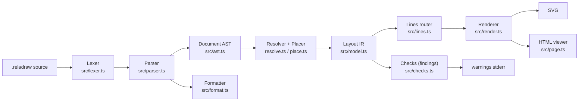
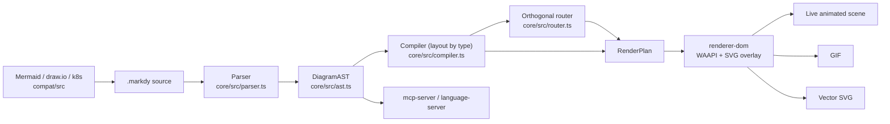
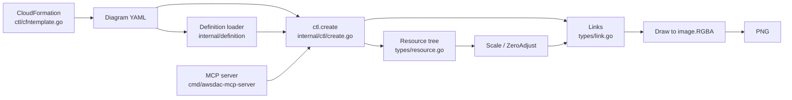
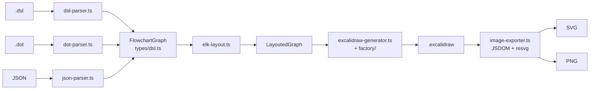

# Weekly scan — Diagram tooling (2026-11-06)

Phạm vi: repo push/update trong 7 ngày (từ 2026-10-30). Nguồn: GitHub topic search (`diagram-as-code`, `dsl`, `svg-animation`, `graph-visualization`) → đủ ≥4 ứng viên nên không cần fallback. Đã clone `--depth 1` và đọc README, cây thư mục, entry point, module lõi, manifest, ví dụ DSL. Mục nào không có evidence trong code ghi "không xác định".

## Executive summary

- **reladraw** là phát hiện đáng chú ý nhất: DSL *relative placement* (không auto-layout, không route tránh vật cản; "vẽ đúng như file nói" + `findings` cảnh báo). Triết lý ngược hoàn toàn với Mermaid/D2 và gần với bài toán `alignment.py` của kymo.
- **markdy-com** biến diagram thành *animated storyboard* (beats/cues → WAAPI, playhead điều khiển thủ công), có Orthogonal router với port multiplexing và layout theo diagram-type. Tiếp cận animation khác SVG/CSS của kymo; nhưng nhiều marketing, độ tin cậy kiến trúc cần dè chừng.
- **awslabs/diagram-as-code** và **excalidraw-cli** là tham chiếu cho hướng "agent-first": MCP server (Go), LCA-based link auto-position, và pipeline DSL → ELK → Excalidraw JSON → SVG/PNG (resvg). Hữu ích cho cross-format của kymo.

## Mục lục

1. [reladraw/reladraw](#1-reladrawreladraw)
2. [HoangYell/markdy-com](#2-hoangyellmarkdy-com)
3. [awslabs/diagram-as-code](#3-awslabsdiagram-as-code)
4. [swiftlysingh/excalidraw-cli](#4-swiftlysinghexcalidraw-cli)

Loại khỏi danh sách (tìm thấy nhưng không đạt filter): `mingrammer/diagrams`, `plantuml/plantuml` (đã nổi tiếng, không phải phát hiện mới), `hikerpig/pintora` (push gần đây chỉ là nhánh dependabot; commit mặc định cuối 2026-06-12), `Qiuner/birdview` (code-map, không phải DSL), các repo svg-animation là desktop pet/avatar.

---

## 1. reladraw/reladraw

### §1 Quick context
- **Pitch:** Ngôn ngữ diagram "nói rõ đặt ở đâu" — vị trí tương đối, không auto-layout, không tự né vật cản; khác Mermaid/D2 (máy quyết định vị trí) và draw.io (tọa độ tuyệt đối).
- **Stack:** TypeScript (Node ≥18), không runtime dep (chỉ devDeps `typescript`, `@types/node`), output SVG (+ trang HTML viewer, web component).
- **Health:** ~1.168 sao (search API); version 0.22.1, release commit 2026-11-05; Apache-2.0. Contributors: không xác định (clone shallow). **Không thấy CI workflow hay thư mục tests** trong repo.
- **Distribution:** npm (`reladraw`, bin `reladraw`), CDN `<reladraw-diagram>`, playground web, agent skill (`install-skill`).

### §2 Architecture deep-dive

**A. Component inventory** (~20k LOC trong `src/`)
- `Lexer` (`src/lexer.ts`) — tokenize từng dòng, giữ `start/end` để formatter không respell.
- `Parser` (`src/parser.ts`, 3.5k LOC) — `parse()` → `Document` (AST ở `src/ast.ts`).
- `Resolver` (`src/resolve.ts`) — dựng `LayoutNode` tree; `Placer` (`src/place.ts`) — giải vị trí.
- `Lines` (`src/lines.ts`) — route cạnh; `Linetexts` (`src/linetexts.ts`) — đặt nhãn cạnh.
- `Checks` (`src/checks.ts`) — findings; `Renderer` (`src/render.ts`); `Themes` (`src/themes.ts`); `Icons` (`src/icons.ts`, path inline).
- `Format` (`src/format.ts`) — formatter; `Grammar` (`src/grammar.ts`) — vocabulary cho highlighter; `Page` (`src/page.ts`), `Element` (`src/element.ts`), `CLI` (`src/cli.ts`).

**B. Pipeline (happy path)**
1. `reladraw render d.reladraw -o d.svg` → `cli.ts` đọc file.
2. `draw()` trong `src/index.ts`: `parse` → `Document`.
3. `resolve` → `Layout` (tree `LayoutNode`/`LayoutEdge`, tọa độ tuyệt đối, origin top-left).
4. `render` → chuỗi SVG; đồng thời `findings` đo từ layout đã giải.
5. Ghi SVG, in findings dạng `file:line: message`.

**C. Data model.** Interface TypeScript (`LayoutNode` có `body`, `corners`, `lines`, `parent`, `children`, `heading`, `joinWith`…). Comment trong `place.ts`: mọi đại lượng được tính *on demand + memoize*, phát hiện vòng (circle) khi một box được hỏi trong lúc đang tính → báo lỗi kèm các placement gây vòng. Không có "lower IR" riêng ngoài AST → Layout.

**D. Input language.** Line-based, tokenizer tự viết + parser đệ quy thủ công; statement có thể nối dòng thụt lề. Ví dụ (`examples/flowchart.reladraw`): `node valid "valid?" below read shape: diamond`, `edge valid -> reject "no" from: right to: left line: (path: square)`. Có `SYNTAX.md`; không thấy EBNF hình thức. Lỗi: `SourceError(message, line)`, `blame()` chỉ đúng dòng trong statement nhiều dòng. Highlighter tách riêng khỏi parser (regex theo dòng, không bao giờ fail) để xuất sang Emacs/Vim/TextMate.

**E. Layout.** Không auto-layout. Mỗi trục của mỗi box đến từ đúng *một* statement (`below`, `right of … (gap: tight)`, `even with`). Container = outline của children + padding. Edge: thẳng trừ khi khai báo `via`/`path`; không tránh vật cản — comment `lines.ts`: "Nothing is avoided and nothing is searched for", nên thêm box chỗ khác không bao giờ làm đường khác đi. Chia sẻ cạnh: nhiều đầu mút trải đều trên một side.

**F. Rendering.** Một backend SVG; không animation trong output (chỉ CSS highlight trong viewer `page.ts`). `--page` cho HTML pan/zoom/export PNG. Theme là bảng màu có tên.

**G. Extensibility.** Thêm shape/icon bằng sửa `outline.ts`/`icons.ts` (không có plugin). Theme có sẵn qua `diagram theme:`. `.reladraw-format` cho cấu hình formatter.

**H. DX.** CLI có `render/check/format`, `format -` cho editor stdin, `--checks` bật/tắt từng loại finding, web component, skill cho agent. LSP/VS Code: không xác định.

### §3 Architecture diagram

### §4 Verdict
- **Đáng học:** (1) *Findings thay vì auto-fix* — đo từ layout đã giải (text-overlap, edge-node-overlap, text-overflow…) rồi cảnh báo; áp dụng được thành lint pass sau `resolve_alignments()` của kymo, tiện cho agent tự sửa. (2) Memoize-on-demand + circle detection cho placement phụ thuộc lẫn nhau — so với 5 pass cố định của kymo. (3) Tách highlighter vocabulary khỏi parser để sinh TextMate/Vim.
- **Red flags:** không thấy tests/CI; `parser.ts` 3.5k LOC; ngôn ngữ "changing frequently" (README tự cảnh báo).
- **Open questions:** có golden test ở đâu không? Density của placement words có làm file dài hơn D2 bao nhiêu?
- **Verdict: study deeper.**

---

## 2. HoangYell/markdy-com

### §1 Quick context
- **Pitch:** Diagram-as-code *động*: kịch bản beats/cues chạy bằng WAAPI, thay vì SVG tĩnh; khác Mermaid/D2 ở chỗ animation là cú pháp hạng nhất.
- **Stack:** TypeScript monorepo (pnpm, tsup, vitest), `@markdy/core` zero-dep; output DOM + SVG overlay, GIF, SVG vector export.
- **Health:** ~106 sao; core v1.5.7; commit cuối 2026-10-30; có CI (`.github/workflows/ci.yml`) và tests ở core/cli/compat/mcp-server/renderer-dom; MIT. Contributors: không xác định.
- **Distribution:** npm (`@markdy/core`, `@markdy/mcp-server`, `@markdy/cli`…), VS Code extension, Astro/MDX integration, web playground.

### §2 Architecture deep-dive

**A. Component inventory**
- `Parser` (`packages/core/src/parser.ts`, 1.3k LOC), `Registry` (`registry.ts`: từ khóa cue/edge/diagram type), `AST` (`ast.ts`).
- `Compiler` (`packages/core/src/compiler.ts`, 2.4k LOC) — `compilePlan(ast, theme)` → `RenderPlan`; chứa các hàm `layoutRanked/Tree/Loop/Swimlane/Pyramid/Venn/Radar/Gantt/…`.
- `Router` (`router.ts`) — `routeOrthogonalEdge`; `Verifier`/`arch-lint.ts`/`syntax-diagnostics.ts`; `diff.ts`, `ai-healing.ts`.
- `renderer-dom` (`packages/renderer-dom/src/`: `nodes.ts`, `edges.ts`, `diagram.ts`…); `compat` (`packages/compat/src/mermaid/mermaid-transpiler.ts`, drawio/docker/k8s/terraform); `mcp-server`, `markdy-language-server`, `astro`, `cli`.

**B. Pipeline**
1. Viết `.markdy` (hoặc import Mermaid/draw.io qua `@markdy/compat`).
2. `parse(source)` → `DiagramAST` (hoặc `ParseError` có số dòng).
3. `compilePlan(ast)` → ranks, vị trí, route cạnh, lịch cue → `RenderPlan`.
4. `createDiagram()` dựng DOM + SVG overlay, tạo WAAPI animations.
5. rAF loop đặt `anim.currentTime = sceneMs`.
6. Tùy chọn: GIF encode / export SVG vector.

**C. IR.** `DiagramAST` (meta, styles, nodes, edges, groups, patterns, annotations, beats, diagnostics) → `RenderPlan` (positioned nodes, routed edges, timed cues). Docs nói immutable theo hướng "compile-time layout; renderer chỉ playback".

**D. Language.** Indentation-aware line grammar, ví dụ `examples/03-beats-and-groups.markdy`: `beat checkout "…":` + `Visitor -> ApiGateway "POST /order" -> OrderService`, `show X & glow Y` (toán tử `&` = song song). Strict `ParseError(line)`, có "indent recovery" cho MDX. Grammar hình thức (EBNF): không xác định (có `docs/SYNTAX.md`).

**E. Layout.** Theo *diagram type*: ranked (layered), tree, constellation, loop, medallion, swimlane, pyramid, venn, radar… (hàm riêng trong `compiler.ts`). Router `router.ts` header: "Collision-aware Orthogonal Manhattan Router with Dynamic Port Multiplexing"; tham số `sourceLane/targetLane {index,total}` để trải nhiều cạnh trên một cổng. Crossing minimization: không thấy bằng chứng rõ. `computeAdaptiveDimensions` tự suy canvas theo topology.

**F. Rendering.** DOM `
` node + `<svg>` overlay edge, không phải SVG thuần. Animation: WAAPI luôn *paused*, playhead set thủ công mỗi frame (lý do ghi trong docs: `startTime` và `fill:"both"` không ổn định giữa browser; dùng `fill:"forwards"` + pre-init inline style). Camera layer cho cue `frame`.

**G. Extensibility.** Docs mô tả 4 bước thêm node kind / cue / edge operator qua `registry.ts`, `themes.ts`. Theme tokens + generator.

**H. DX.** CLI, language server, VS Code, MCP server, `AGENT.md` spec cho agent, self-healing prompt (`ai-healing.ts`), URL-hash state.

### §3 Architecture diagram

### §4 Verdict
- **Đáng học:** (1) Mô hình *beats/cues* làm timeline khai báo + `&` song song — có thể ánh xạ sang `<animate>`/CSS delay trong SVG animation của kymo. (2) Port multiplexing `{index,total}` cho fan-in: so với fan-in/trunk-lane staggering của `alignment.py`. (3) Tách playback thủ công qua `currentTime` để deterministic (cho export frame/WebP).
- **Red flags:** docs thiên marketing (launch plan, PH draft); `compiler.ts` 2.4k LOC dồn nhiều layout; output là DOM không phải SVG độc lập; tuyên bố "17 layout engines" thực chất là hàm trong một file.
- **Open questions:** router có thật sự tránh obstacle hay chỉ clearance? Chất lượng transpile Mermaid?
- **Verdict: glance only** (đọc phần WAAPI playhead + router).

---

## 3. awslabs/diagram-as-code

### §1 Quick context
- **Pitch:** YAML cây Resource/Links để vẽ kiến trúc AWS theo guideline chính thức, không cần headless browser; khác D2/Mermaid ở icon definition file + auto-position link.
- **Stack:** Go 1.25, `golang/freetype`, `x/image`, cobra, `mcp-go`, `rain` (CFN); output **PNG** (raster, tự vẽ vào `image.RGBA`).
- **Health:** ~1.594 sao; tag mới nhất thấy được v0.24; commit cuối 2026-11-04; có CI (unit/functional/fmt/release) và test dày (`link_test.go` ~4k dòng); Apache-2.0.
- **Distribution:** `go install`, Homebrew (`awsdac`), MCP server binary (`cmd/awsdac-mcp-server`).

### §2 Architecture deep-dive

**A. Component inventory**
- CLI (`cmd/awsdac/main.go`, 120 LOC), MCP server (`cmd/awsdac-mcp-server/main.go`).
- `ctl` (`internal/ctl/create.go`) — orchestration: load definition → `loadResources` → `associateChildren` → `loadLinks` → `createDiagram`.
- `definition` (`internal/definition/definition.go`, `url_allowlist.go`) — định nghĩa type→icon/preset từ YAML, allowlist URL tin cậy.
- `types` (`internal/types/resource.go` 1.2k LOC, `link.go` 2.4k LOC, `horizontal_stack.go`, `vertical_stack.go`), `vector`, `font`, `cache`; `ctl/cfntemplate.go` (CloudFormation → DAC).

**B. Pipeline**
1. `awsdac examples/alb-ec2.yaml -o out.png`.
2. Load `DefinitionFiles` (URL allowlisted/LocalFile, cache) + parse YAML.
3. Dựng cây `Resource`, gắn `Children`/`BorderChildren`, `Links`.
4. `canvas.Scale()` (đo bottom-up, phát hiện cycle) → `ZeroAdjust()`.
5. `ResolveAutoPositions()` cho link, `Draw()` vào `image.RGBA`, vẽ overlay span.
6. Ghi PNG (tùy chọn nhúng YAML vào metadata `--embed-yaml`).

**C. IR.** Struct Go mutable (`Resource`, `Link`), cây parent/children; `Windrose` 16 hướng (N…NNW + AUTO). Không có lower IR.

**D. Language.** YAML (`yaml.v3`) theo schema `Diagram: {DefinitionFiles, Resources, Links}`; hỗ trợ `text/template` (`-t`). Không có grammar riêng; lỗi theo lỗi YAML/validation.

**E. Layout.** Container layout dạng stack: `Direction: vertical|horizontal`, `Align`, `Preset`; `UnorderedChildren` + `ReorderChildrenByLinks` (sắp lại con theo links dựa trên LCA). Link: `calculateOrthogonalPath` "convergent", `AutoCalculatePositions` dùng *lowest common ancestor* và đếm số resource theo hướng (`countResourcesInDirections`, `selectOptimalPosition`). Link grouping để các đường hội tụ về một điểm (`ResetConvergencePointSegments`). Không thấy Sugiyama/barycentric.

**F. Rendering.** Chỉ raster PNG tự vẽ (không SVG). Không animation. Một backend.

**G. Extensibility.** Definition file YAML thêm type/icon (kể cả non-AWS); zip icon từ CDN AWS với prefix allowlist.

**H. DX.** CLI cobra, MCP server cho AI, CFN → diagram, doc nhiều (`doc/advanced/*`). Watch/LSP: không xác định.

### §3 Architecture diagram

### §4 Verdict
- **Đáng học:** (1) Chọn cổng ra/vào của edge dựa trên **LCA + đếm resource mỗi hướng** — ý tưởng áp được cho auto-anchor trong `alignment.py`. (2) `BorderChildren` (node bám viền container, ví dụ IGW trên viền VPC) — kymo có tương đương không? (3) Embed source YAML vào metadata PNG để round-trip; kymo có thể nhúng `.kymo` vào SVG `<metadata>`.
- **Red flags:** `link.go` 2.4k LOC logic heuristic; chỉ PNG; coupling với AWS icon set.
- **Open questions:** chất lượng khi nhiều link chồng; có test golden ảnh không (`testdata` có nhưng chưa kiểm).
- **Verdict: glance only** (đọc `AutoCalculatePositions` + LCA).

---

## 4. swiftlysingh/excalidraw-cli

### §1 Quick context
- **Pitch:** Sinh file Excalidraw *chỉnh sửa được* từ DSL/DOT/JSON bằng layout ELK, thay vì ảnh tĩnh; khác Mermaid ở output editable và export PNG/SVG headless.
- **Stack:** TypeScript, `elkjs`, `ts-graphviz`, `jsdom`, `@resvg/resvg-js`, commander, vitest; output `.excalidraw` JSON, SVG, PNG.
- **Health:** ~315 sao; v1.5.1; commit cuối 2026-11-03; có CI + release workflow; test unit/integration/e2e (`tests/`). Contributors: không xác định.
- **Distribution:** npm CLI, Claude plugin (`.claude-plugin`), Gemini extension, skill.

### §2 Architecture deep-dive

**A. Component inventory** (~4.4k LOC)
- Parsers: `dsl-parser.ts` (906), `dot-parser.ts`, `json-parser.ts` (`src/parser/`).
- Layout: `elk-layout.ts` (ELK), `arrow-router.ts` (binding point).
- Factory: `node-factory.ts`, `connection-factory.ts`, `text-factory.ts`, `image-factory.ts`.
- `generateExcalidraw` (`src/generator/excalidraw-generator.ts`); exporter (`src/exporter/image-exporter.ts`, `dom-polyfill.ts`); CLI `src/cli.ts`; types `src/types/dsl.ts`, `excalidraw.ts`.

**B. Pipeline**
1. `excalidraw-cli create flow.dsl`.
2. `parseDSL` / DOT / JSON → `FlowchartGraph`.
3. `elk-layout` → `LayoutedGraph` (node + edge sections).
4. `generateExcalidraw(graph)` dùng factory → `ExcalidrawFile`, `serializeExcalidraw`.
5. Export: JSDOM polyfill + `@excalidraw/utils exportToSvg` → SVG; resvg → PNG.

**C. IR.** Interface TS: `FlowchartGraph` → `LayoutedGraph`; kiểu Excalidraw mirror format đích. Giữa các pass tạo object mới (xu hướng immutable); lower IR: không có.

**D. Language.** DSL ký hiệu bao: `[Label]` process, `{Label}` decision, `(Label)` ellipse, `[[Label]]` DB, `A -> "yes" -> B`, `A --> B` đứt, directive `@direction`, `@image`, `@sticker`. Ví dụ `skills/excalidraw-cli/examples/decision-tree.dsl`. Parser line-based thủ công; EBNF: không xác định.

**E. Layout.** Hierarchical/layered qua ELK (thư viện ngoài, gồm crossing minimization); edge dùng section từ ELK; `calculateBindingPoint` tính điểm bind chuẩn hoá [0,1] cho mode `orbit`.

**F. Rendering.** Output chính là Excalidraw JSON (editable); SVG/PNG qua exporter. Không animation.

**G. Extensibility.** Thêm parser mới trong `src/parser/`; sticker library tùy chỉnh `@library`. Plugin system: không có.

**H. DX.** Commander CLI + man page, skill cho Claude/Gemini, `tests/integration/skill-examples.test.ts` kiểm các ví dụ trong skill.

### §3 Architecture diagram

### §4 Verdict
- **Đáng học:** (1) Kiểm thử *ví dụ trong skill* như test (`skill-examples.test.ts`) — áp cho `samples/` + skill docs của kymo. (2) Chiến lược binding `orbit` + fixedPoint để arrow dính shape khi chỉnh sửa trong Excalidraw — đối chiếu với `to_excalidraw.py`. (3) Nhận DOT làm input.
- **Red flags:** phụ thuộc nặng (jsdom + polyfill DOM để export); layout là ELK nên ít thứ học về thuật toán.
- **Open questions:** font/render PNG có khớp Excalidraw web không?
- **Verdict: glance only.**

---

## Ghi chú phương pháp
- Số sao lấy từ search API; contributors/releases không lấy được qua API (repo ngoài scope session) nên đánh dấu "không xác định" hoặc suy từ tag/manifest.
- Mỗi repo ~500–800 từ theo spec; chỉ sử dụng evidence đọc từ code/README/docs đã clone.
