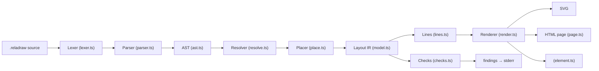
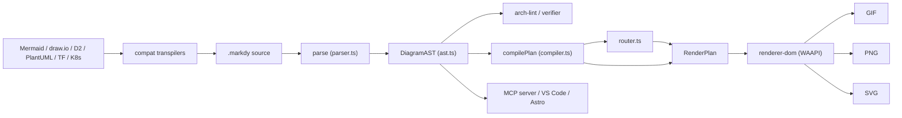
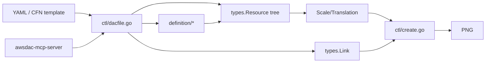
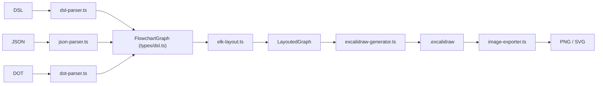

# Weekly scan — diagram tooling — 2026-11-07

## Executive summary

- **reladraw** là phát hiện đáng giá nhất tuần: DSL *relative-placement, không auto-layout* ("`node b right of a`"), kèm cơ chế *findings* (cảnh báo overlap/crossing thay vì tự sửa). Đây là hướng ngược hẳn Sugiyama/ELK — liên quan trực tiếp tới `alignment.py` của kymo.
- **markdy-com** (diagram + animation bằng WAAPI) là đối thủ gần kymo nhất về "animated architecture diagram": có router orthogonal + port lane allocation + transpiler Mermaid/draw.io/D2/PlantUML. Nhưng code có nhiều dấu hiệu "AI-generated feature sprawl".
- **diagram-as-code (AWS)** và **excalidraw-cli** là tham khảo hẹp: một cái là constraint-by-hierarchy + windrose port 16 hướng (PNG only); cái còn lại là pipeline DSL → ELK.js → Excalidraw JSON, chỉ để so sánh cho target Excalidraw của kymo.

> **Phương pháp / giới hạn của lần scan này.** Topic search (`diagram-as-code`, `dsl`, `svg-animation`, `graph-visualization`, `layout-algorithm`, `pushed:>2026-10-31 stars:>50`) trả về ít repo liên quan, nên đã chọn tay từ kết quả. Session chỉ được cấp quyền GitHub API cho `kymostudio/kymostudio`, nên **không lấy được** contributors / release / stars chính xác ngoài số stars từ search; mọi nội dung dưới đây đọc từ `git clone --depth 1` (không có lịch sử commit). `hikerpig/pintora` (1.2k★) xuất hiện trong search nhưng commit mới nhất trên default branch là 2026-06-12 → bỏ. `markdy-com` commit cuối 2026-10-30 (sát mép cửa sổ 7 ngày). Chưa chạy được code (không build) — mọi nhận định là từ đọc source.

## Mục lục

1. [reladraw](#1-reladraw) — study deeper
2. [markdy-com](#2-markdy-com) — study deeper (chọn lọc)
3. [awslabs/diagram-as-code](#3-awslabsdiagram-as-code) — glance only
4. [swiftlysingh/excalidraw-cli](#4-swiftlysinghexcalidraw-cli) — glance only

---

## 1. reladraw

### §1 — Quick context
- **Pitch:** DSL diagram nơi *bạn nói box nằm đâu* (relative placement), không để engine tự chọn layout như Mermaid/D2/Graphviz, cũng không phải kéo thả tọa độ như draw.io.
- **Stack:** TypeScript, **0 runtime deps**, Node ≥18; output SVG (+ HTML page tự chứa, custom element `<reladraw-diagram>`).
- **Health:** ~1.17k★ (từ search); v0.22.1, Apache-2.0, ~20k LOC `src/`; **không nhận PR** (tác giả duy nhất). CI/tests: không thấy thư mục tests/workflow trong clone — không xác định.
- **Distribution:** npm (`reladraw`, bin `reladraw`), playground web, skill cho agent (`install-skill`).

### §2 — Architecture deep-dive

**A. Components** (`src/`): `Lexer` (`lexer.ts`) — tokenizer từng dòng; `Parser` (`parser.ts`, 3.5k LOC) → `ast.ts`; `Resolver` (`resolve.ts`) — gộp style/default/theme, dựng `Layout`; `Placer` (`place.ts`, 2.8k LOC) — tính vị trí; `Lines` (`lines.ts`, 2.3k LOC) — route edge; `Checks` (`checks.ts`) — findings; `Renderer` (`render.ts`); `Formatter` (`format.ts`); `Measurer` (`measure.ts`) — interface đo text; `Grammar` (`grammar.ts`) — scanner highlight tách riêng; `Page/Viewer/Element` (`page.ts`, `viewer.ts`, `element.ts`).

**B. Happy path** (`index.ts: draw()`):
1. `reladraw render foo.reladraw -o out.svg` (`cli.ts`).
2. `parse(text)` → `Document` (list of statements).
3. `resolve(doc, opts)` → `Layout` (nodes có geometry tuyệt đối).
4. `render(layout)` → SVG string.
5. `fileChecks/findings(layout)` đo trên layout đã solve, in cảnh báo.
6. Ghi file.

**C. IR:** `LayoutNode`/`LayoutEdge`/`Rect` (`model.ts`) — interface TS, tọa độ absolute, gốc top-left. Doc trong `place.ts` nói rõ: mỗi đại lượng (start, size, frame) được tính *on demand + memoize*, phát hiện vòng tham chiếu thì báo lỗi kèm chuỗi placement. Không có "lower IR" riêng.

**D. Input language:** line-oriented, statement bắt đầu ở cột 0, dòng thụt vào là continuation ("nothing nests"); tên có dấu chấm (`server.docker`) biểu diễn cha-con. Parser tay (không dùng generator). Có spec văn xuôi `SYNTAX.md` (1.6k dòng) kèm changelog nhưng **không có EBNF**. Lỗi: `SourceError` có từ chối-theo-tên ("`below of a` → dùng `below a`") — chính sách *một cách viết cho mỗi thứ*.

**E. Layout:** *không auto-layout.* "Nothing is solved and nothing is pushed" (`place.ts`): mỗi trục của mỗi box đến từ đúng một statement; khoảng cách theo đơn vị file (`tight=2, normal=4, wide=8`, 1 unit = 12px). Edge: thẳng trừ khi khai báo `path:`/`via`/waypoint; **không né box** (`lines.ts`: "Nothing is avoided and nothing is searched for"). Không có crossing minimization.

**F. Rendering:** một backend SVG; không animation (không xác định có trong repo). Theme qua `themes.ts`.

**G. Extensibility:** `style`/`default` statement, `icon` với SVG tự cung cấp (`"""` string), theme có tên. Không có plugin system.

**H. DX:** `render`, `check` (chỉ in findings), `format` (formatter có file settings `.reladraw-format`, `--check`, stdin cho editor), playground, `.claude/skills` cho agent, `llms.txt`. Không thấy LSP.

### §3 — Architecture diagram

### §4 — Verdict
- **Học được:** (1) *findings thay vì auto-fix* — kymo đã có auto-layout/stagger trong `alignment.py`; một chế độ `kymo check` đo overlap/edge-through-node trên model đã resolve sẽ rẻ và hữu ích cho agent. (2) Phrase-based placement (`right of`, `between … and …`, `even with`) — so với anchor/align của kymo DSL (`docs/DSL.md`, `DSL-LANG-001`). (3) Chính sách "refused by name, pointing to the one spelling". (4) Tách `grammar.ts` (scanner highlight) khỏi parser để sinh TextMate/Vim.
- **Red flags:** file 2–3.5k LOC; không nhận PR; syntax "changing frequently"; không thấy test.
- **Open questions:** có tests ở đâu không? Edge không né box thì scale thế nào với diagram lớn?
- **Verdict: study deeper** (đọc `SYNTAX.md` phần Placement + `checks.ts`).

---

## 2. markdy-com

### §1 — Quick context
- **Pitch:** DSL "MarkdyScript" cho *animated architecture explainer* — diagram + timeline cue (beats) trong cùng một file, phát bằng Web Animations API thay vì SVG/CSS tĩnh.
- **Stack:** TypeScript monorepo (pnpm), core ~12k LOC zero-dep; output DOM/WAAPI, GIF89a, PNG, SVG "Figma-ready".
- **Health:** ~105★; `@markdy/core` v1.5.7 (CHANGELOG 2026-09-30); MIT; có CI/publish workflows và thư mục `tests/`; số contributors — không xác định.
- **Distribution:** npm (`@markdy/core`, `@markdy/mcp-server`, …), VS Code extension (+Open VSX), Astro/MDX integration, web playground.

### §2 — Architecture deep-dive

**A. Components:** `parse` (`packages/core/src/parser.ts`); `compilePlan` (`compiler.ts`, 2.4k LOC) — rank, layout, schedule; `Router` (`router.ts`) — orthogonal router + `allocatePortLanes`; `Verifier` (`verifier.ts`, "9-point quality gate"); `arch-lint.ts`, `drift.ts`, `diff.ts`; renderer `createDiagram` (`packages/renderer-dom/src/diagram.ts`) + module theo kiểu diagram (`sequence.ts`, `swimlane.ts`, `gantt.ts`, `radar.ts`…); exporters (`renderer-dom/src/export/{gif-encoder,png-exporter,svg-exporter}.ts`); `compat` transpilers (`packages/compat/src/{mermaid,infra/*}`); `mcp-server`, `vscode`, `astro`.

**B. Happy path:**
1. Người dùng viết `.markdy` (hoặc transpile từ Mermaid/draw.io/D2/PlantUML/Terraform/K8s).
2. `parse(source)` → `DiagramAST`.
3. `compilePlan(ast, theme)` → `RenderPlan` (node có vị trí, edge đã route, cue có thời gian).
4. `createDiagram` dựng DOM/SVG và phát bằng WAAPI, điều khiển `currentTime` thủ công.
5. Export GIF/PNG/SVG từ frame.

**C. IR:** `DiagramAST` (`meta, styles, nodes, edges, groups, patterns, annotations, beats, diagnostics`) rồi **lower** sang `RenderPlan` — đúng kiểu "compile to lower IR"; renderer "just plays it back" (ARCHITECTURE.md). Kiểu dữ liệu: interface TS + Record.

**D. Language:** indentation-aware, nhận dạng statement theo pattern, `ParseError(lineNumber)` khi lạ; có "indent recovery" cho MDX. Flow operator: `->`, `<-`, `~>`, `--`. Có `syntax-diagnostics.ts` (1.1k LOC) và `ai-healing.ts` sinh repair prompt cho LLM. Grammar hình thức: không thấy EBNF (`docs/SYNTAX.md` là prose).

**E. Layout:** *nhiều engine theo loại diagram* (`layoutRanked`, `layoutTree`, `layoutSwimlane`, `layoutVenn`, `layoutRadar`…). `layoutRanked` (`compiler.ts:330`): longest-path ranking, sắp xếp trong rank theo **barycenter** của parent + giữ thứ tự khai báo, rồi 4 sweep adjacent-swap giảm crossing (heuristic cục bộ, không phải full Sugiyama). Edge: orthogonal Manhattan có né obstacle và cấp phát *port lane* khi nhiều edge vào một cạnh (`router.ts:405`).

**F. Rendering:** DOM/WAAPI là backend chính; export SVG/PNG/GIF là phụ — không pluggable emitter chuẩn (là các exporter rời). Animation = WAAPI + cue schedule (`scheduleBeats`).

**G. Extensibility:** `recipes.ts`, `registry.ts`, `symbols.ts`, `theme-generator.ts`, `pattern` (cue template) trong DSL; không rõ plugin API công khai.

**H. DX:** VS Code ext + language server (`packages/markdy-language-server`), CLI, MCP server, `skills/` cho agent, playground, presentation controller (key-nav).

### §3 — Architecture diagram

### §4 — Verdict
- **Học được:** (1) tách rõ `AST → RenderPlan` có timeline, renderer chỉ playback — gần triết lý "renderer dumb" của kymo; nếu kymo muốn animation nâng cao (beats/cue thay vì CSS thuần), đây là mô hình tham chiếu. (2) `allocatePortLanes` + port selection — so với fan-in/trunk-lane staggering ở pass 4 của `alignment.py`. (3) `verifier`/quality-gate + `ai-healing` (repair prompt) cho workflow agent. (4) Transpiler từ nhiều format vào DSL.
- **Red flags:** feature sprawl (arch-lint, drift, provenance, c4…) trong cùng core; `compiler.ts` 2.4k LOC; CHANGELOG nặng marketing; "clean-room re-engineered" lặp lại trong header file; layout là heuristic cục bộ.
- **Open questions:** chất lượng thực tế của transpiler Mermaid (có snapshot ở `compat/snapshots` — chưa kiểm); WAAPI cần JS runtime, không có SVG-only animated output?
- **Verdict: study deeper** — chỉ `router.ts` và tách AST/RenderPlan; bỏ qua phần governance.

---

## 3. awslabs/diagram-as-code

### §1 — Quick context
- **Pitch:** YAML → PNG kiến trúc AWS đúng guideline icon, *không cần headless browser*, vẽ bằng Go image lib; layout theo cây lồng nhau + windrose 16 hướng cho link.
- **Stack:** Go 1.25, `cobra`, `golang/freetype`, `x/image`, `mcp-go`, `rain` (CloudFormation); output **PNG** (có thể nhúng YAML vào metadata `tEXt`).
- **Health:** ~1.6k★; Apache-2.0; CI: unit_test, func_test, fmt-check, release; commit cuối 2026-11-04. Số release / contributors — không xác định (không truy cập API).
- **Distribution:** `go install`, Homebrew (`awsdac`), MCP server binary (`cmd/awsdac-mcp-server`).

### §2 — Architecture deep-dive

**A. Components:** CLI (`cmd/awsdac/main.go`); `ctl` — `dacfile.go` (load/template YAML), `create.go` (build resources + links + vẽ), `cfntemplate.go` (CloudFormation → diagram); `definition` (`internal/definition/*`) — bảng type → icon/preset, nạp từ URL (có allowlist `url_allowlist.go`); `types.Resource` (`resource.go`, 1.2k LOC) — node + `Scale/Translation`; `types.Link` (`link.go`, 2.4k LOC) — vẽ & route; `cache`, `font`, `vector`.

**B. Happy path:** `awsdac examples/alb-ec2.yaml` → `getTemplate` (file/URL, tùy chọn `text/template`) → unmarshal YAML → `loadDefinitionFiles` → `loadResources` → `associateChildren` → `loadLinks` → `Scale()` rồi `Translation()` → `createDiagram` vẽ vào `image.RGBA` → `png.Encode` → ghi file.

**C. IR:** struct `Resource` (cây cha-con, có margin/padding/bindings) và `Link` (source/target + `Windrose`); **mutable** — `Scale`/`Translation` sửa tại chỗ.

**D. Language:** YAML schema `Diagram.Resources.<Name>.{Type, Direction, Children, BorderChildren, Preset, Align}` + `Links`. Parser = `yaml.v3`; lỗi là lỗi YAML/semantic, không formal grammar.

**E. Layout:** *constraint theo cây*: `Direction` vertical/horizontal, `HorizontalStack/VerticalStack`, `BorderChildren` gắn node lên viền (ví dụ IGW ở cạnh S của VPC). Link: `SourcePosition/TargetPosition` windrose (N, NNE, … 16 hướng + `auto`), `AutoCalculatePositions` dùng lowest common ancestor và đếm resource theo hướng (`link.go`), `calculateOrthogonalPath` + segment-overlap offset. Không có crossing minimization.

**F. Rendering:** chỉ raster PNG; không SVG, không animation.

**G. Extensibility:** "definition files" YAML thêm type/icon ngoài AWS; `Preset`; MCP tools.

**H. DX:** CLI cobra, `--verbose`, `-t` template, `-c/-d` từ CloudFormation; docs trong `doc/`; MCP server; không thấy watch mode / IDE ext.

### §3 — Architecture diagram

### §4 — Verdict
- **Học được:** windrose-16 + `BorderChildren` (node gắn lên viền container — kymo có trường hợp tương tự cho BPMN boundary event / gateway?); heuristic chọn port theo LCA. Embed source vào PNG metadata (`--embed-yaml`) → so với việc nhúng `.kymo` source vào SVG `<metadata>`.
- **Red flags:** `link.go` 2.4k LOC một file; raster-only; mutable tree.
- **Open questions:** chất lượng routing khi dày edge?
- **Verdict: glance only.**

---

## 4. swiftlysingh/excalidraw-cli

### §1 — Quick context
- **Pitch:** DSL một dòng (`[A] -> {B?} -> (C)`) hoặc JSON/DOT → file `.excalidraw` chỉnh sửa được, layout bằng ELK.js; nhắm vào agent.
- **Stack:** TypeScript, `elkjs`, `ts-graphviz`, `@excalidraw/utils`, `@resvg/resvg-js`, `jsdom`; output `.excalidraw`, PNG, SVG.
- **Health:** ~316★; v1.5.1, MIT, ~4.4k LOC; có `tests/{unit,integration,e2e}` và vitest; commit cuối 2026-11-03.
- **Distribution:** npm (`@swiftlysingh/excalidraw-cli`), Homebrew tap, Gemini extension manifest, agent skills.

### §2 — Architecture deep-dive

**A. Components:** `parseDSL` (`src/parser/dsl-parser.ts`), `parseJSONString` (`json-parser.ts`), `parseDOT` (`dot-parser.ts`); `layoutGraph` (`src/layout/elk-layout.ts`); `arrow-router` (`layout/arrow-router.ts`) — binding point; `generateExcalidraw` (`generator/excalidraw-generator.ts`) + factories (`factory/*`); exporter PNG/SVG (`exporter/image-exporter.ts`, dùng jsdom polyfill); CLI commander (`cli.ts`).

**B. Happy path:** `excalidraw-cli create --inline "[A] -> [B]" -o d.excalidraw` → chọn parser theo `-f` → `FlowchartGraph` → `layoutGraph` (ELK) → `LayoutedGraph` → `generateExcalidraw` → `serializeExcalidraw` → ghi; `.png/.svg` thì thêm bước convert.

**C. IR:** `FlowchartGraph` → `LayoutedGraph` (`types/dsl.ts`), tách input/layouted; ba front-end hội tụ về một IR.

**D. Language:** syntax theo bracket (`[]` rect, `{}` diamond, `()` ellipse, `[[ ]]` database), directive `@direction/@spacing/@image…`; parser dòng/regex tay (906 LOC), không grammar hình thức.

**E. Layout:** ELK (layered) qua `elkjs`; hướng TB/BT/LR/RL; bendPoints lấy từ ELK `sections`.

**F. Rendering:** Excalidraw JSON (mục tiêu chính, arrow có binding `orbit` + `fixedPoint`), PNG/SVG qua Excalidraw utils/resvg. Animation: không.

**G. Extensibility:** sticker library, `@library`; không plugin.

**H. DX:** man page, `--inline/--stdin`, skill/manifest cho agent; không IDE ext.

### §3 — Architecture diagram

### §4 — Verdict
- **Học được:** cách `ExcalidrawArrowBinding` (`mode: orbit`, `fixedPoint` chuẩn hóa 0–1) gắn arrow vào shape — đối chiếu với `to_excalidraw.py` của kymo để xem arrow có "dính" khi người dùng kéo node không. Mô hình 3 front-end → 1 IR.
- **Red flags:** kéo `jsdom` + `@excalidraw/utils` chỉ để export ảnh (nặng); layout giao cho ELK nên không có gì mới.
- **Open questions:** không có.
- **Verdict: glance only** (chỉ phần binding).
