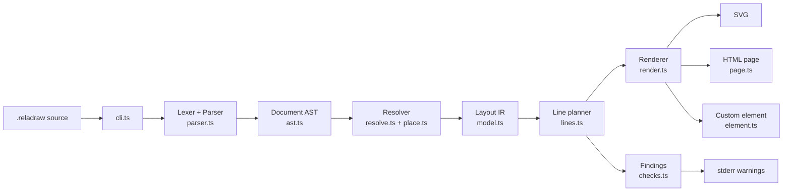
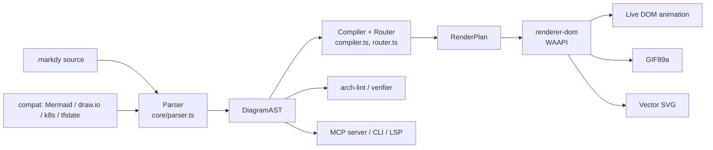
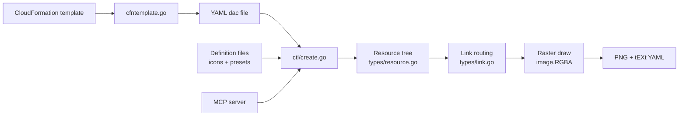
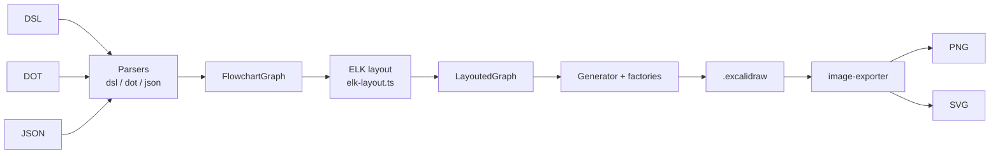

# Weekly Scan — Diagram Tooling (2026-11-09)

Phạm vi: repo push/update trong 7 ngày (2026-11-02 → 2026-11-09), nguồn: GitHub search theo topic (`diagram-as-code`, `dsl`, `svg-animation`, `graph-visualization`, `layout-algorithm`). Đã clone shallow và đọc README, cấu trúc thư mục, entry point, module lõi, manifest, example.

> Giới hạn của lần chạy này: quyền GitHub API của session chỉ gồm `kymostudio/kymostudio`, nên số contributors và release gần nhất của 4 repo bên dưới ghi "không xác định". Stars và ngày push lấy từ search API. Các repo nằm ngoài top 4 được liệt kê ở cuối.

## Executive summary

- **reladraw** là phát hiện đáng chú ý nhất. Nó đi ngược xu hướng auto-layout: tác giả khai báo vị trí tương đối (`right of`, `below`, `even with`), solver chỉ giải khoảng cách, không search và không tự né vật cản. Cách làm này bổ sung trực tiếp cho `alignment.py` của kymo.
- **markdy** cho thấy hướng "DSL + animation + governance": một AST/RenderPlan chung, router orthogonal có port-multiplexing, ingestion từ Mermaid/draw.io/k8s/Terraform. Mức độ hype về AI-agent cao, nên phần có giá trị là `router.ts` và `compiler.ts`.
- **awslabs/diagram-as-code** và **excalidraw-cli** là hai ví dụ cross-format/IR thực dụng. Cái đầu vẽ PNG bằng Go thuần theo cây resource, kèm cơ chế chọn cổng link theo LCA. Cái sau chạy DSL → ELK → Excalidraw JSON → SVG/PNG, và là bản tham chiếu gần nhất cho `to_excalidraw.py`.

## Mục lục

1. [reladraw](#1-reladraw)
2. [markdy-com (MarkdyScript)](#2-markdy-com)
3. [awslabs/diagram-as-code](#3-awslabsdiagram-as-code)
4. [swiftlysingh/excalidraw-cli](#4-swiftlysinghexcalidraw-cli)
5. [Đã xem nhưng không chọn](#5-đã-xem-nhưng-không-chọn)

---

## 1. reladraw

**Repo:** https://github.com/reladraw/reladraw

### §1 — Quick context

- **Pitch:** DSL khai báo vị trí tương đối giữa các node, nằm giữa Mermaid (auto-layout) và draw.io (tọa độ tuyệt đối).
- **Stack:** TypeScript, thư viện/CLI Node ≥18, gần như không có runtime dep. Output SVG, HTML page (pan/zoom), custom element `<reladraw-diagram>`.
- **Health:** ★1172, v0.23.1, Apache-2.0. Contributors/release: không xác định. Chưa thấy test script trong `package.json`; kiểm tra nằm ở `dev.sh` (`check-version` và các pipe test). Không có workflow trong `.github/`.
- **Distribution:** npm (`reladraw`), playground web, kèm agent skill (`.claude/skills`).

### §2 — Architecture deep-dive

**A. Component inventory**
- `Lexer` (`src/lexer.ts`), `Parser` (`src/parser.ts`, 3674 dòng) — tokenize và parse statement.
- `AST` (`src/ast.ts`) — kiểu `Document`, `Stmt`, `Placement`.
- `Resolver` (`src/resolve.ts`) — dựng cây containment, đo kích thước, giải constraint.
- `Placement helpers` (`src/place.ts`) — đổi placement thành khoảng cách tối thiểu.
- `Line planner` (`src/lines.ts`, 2267 dòng) — định tuyến đường nối.
- `Checks` (`src/checks.ts`) — sinh "findings" (line cắt box, chữ chồng nhau).
- `Renderer` (`src/render.ts`) và `Page` (`src/page.ts`) — SVG và HTML viewer.
- `Formatter` (`src/format.ts`) — căn cột cho source; `grammar.ts` — highlighter regex một dòng.
- `Themes` (`src/themes.ts`), `Icons` (`src/icons.ts`).

**B. Pipeline (happy path)**
1. `reladraw render a.reladraw -o a.svg` vào `src/cli.ts`.
2. `parse()` tách statement theo thụt lề (dòng không thụt = statement mới).
3. `resolve(doc)` dựng cây, đo text bottom-up, giải constraint thành `Layout`.
4. `planLines(layout)` tính route cho từng edge.
5. `render(layout)` sinh SVG; `checks` in cảnh báo ra stderr.
6. Ghi file `.svg`.

**C. IR:** `Document` → `Layout` (`LayoutNode` có `x,y,width,height`, `children`, `heading`, `joinWith`; `LayoutEdge`). Kiểu TypeScript interface; `resolve` tạo `Layout` mới từ AST. Không có "lower IR" riêng ngoài `Layout`. Ghi chú trong `lines.ts` nói renderer và `checks` dùng chung kết quả `planLines` để "không thể bất đồng nhau về vị trí đường".

**D. Input language:** parser viết tay, line/statement-based. Comment trong `parser.ts` mô tả quy tắc continuation: chỉ cần có thụt lề hay không, độ sâu không quan trọng. Có `"""` string nhiều dòng. Có tài liệu cú pháp (`SYNTAX.md`, `docs/llms-full.txt`); EBNF hình thức: không xác định. Lỗi là `SourceError` có số dòng; có `blame()` để quy lỗi về đúng statement.

**E. Layout:** không auto layout kiểu Sugiyama. Comment đầu `resolve.ts`: "a constraint solve, of the kind that computes rather than searches". Placement → khoảng cách tối thiểu → giải sắp xếp chặt nhất, rồi thêm ràng buộc tách box và giải lại đến khi hết chồng. Edge: thẳng trừ khi người viết khai báo `via`, `way`, `from:`/`to:`; `lines.ts` ghi rõ "Nothing is avoided and nothing is searched for". Crossing minimization: không có (người viết quyết định).

**F. Rendering:** một backend SVG (+ HTML page bọc ngoài, PNG phía viewer). Không thấy animation. Có `renderTagged` (SVG kèm bản tagged, mục đích cần đọc thêm).

**G. Extensibility:** `style` và `default` trong DSL, theme có tên (`themes.ts`), icon thêm bằng file (`readIconFile`). Plugin system: không xác định.

**H. Dev experience:** CLI có `render`, `check`, `format` (+ `--check`, stdin), `install-skill`. Có `--page` để xem trong browser. Chưa thấy watch mode (chỉ `tsc --watch` cho dev). VS Code/LSP: không xác định; `grammar.ts` được thiết kế để xuất sang TextMate/Vim/Emacs.

### §3 — Architecture diagram

### §4 — Verdict

- **Đáng học cho kymo:** (1) Tách "findings" (`checks.ts`) khỏi renderer nhưng dùng chung route đã tính — kymo có thể thêm bước lint đo line-cắt-box và chữ chồng nhau trên `Diagram` đã resolve, in cảnh báo thay vì tự sửa. (2) Quy tắc "route chỉ phụ thuộc statement của nó, thêm box chỗ khác không làm đường dịch chuyển" cho output ổn định, rất hợp với golden SVG byte-for-byte của kymo. (3) `format` căn cột cho DSL mà không đổi chữ nào.
- **Red flags:** `parser.ts`/`place.ts`/`lines.ts` mỗi file 2–3k dòng; README cảnh báo cú pháp đổi liên tục; chưa thấy test suite trong repo.
- **Câu hỏi mở:** solver "tightest arrangement" dùng thuật toán gì (longest-path? LP?) và độ phức tạp ở diagram lớn? `renderTagged` dùng để làm gì?
- **Verdict: study deeper.**

---

## 2. markdy-com

**Repo:** https://github.com/HoangYell/markdy-com

### §1 — Quick context

- **Pitch:** DSL cho diagram kiến trúc có animation (cue/beat) trên Web Animations API, kèm MCP server và ingest từ nhiều định dạng.
- **Stack:** TypeScript monorepo pnpm; `@markdy/core` zero dep (~14 kB). Output DOM/WAAPI, GIF89a, SVG vector xuất sang Figma.
- **Health:** ★105, v1.5.7, MIT, có `ci.yml`, `release.yml`, test trong `packages/*/tests`. Contributors: không xác định. Repo mới, đa số commit nghi do một tác giả.
- **Distribution:** npm (`@markdy/core`, `@markdy/mcp-server`), VS Code/Open VSX extension, Astro/MDX integration.

### §2 — Architecture deep-dive

**A. Component inventory**
- `Parser` (`packages/core/src/parser.ts`) — text → `DiagramAST`.
- `Compiler` (`packages/core/src/compiler.ts`, 2371 dòng) — AST → `RenderPlan` (rank, vị trí, route, lịch cue).
- `Router` (`packages/core/src/router.ts`) — orthogonal Manhattan router.
- `Registry/Themes` (`registry.ts`, `themes.ts`), `Diagnostics` (`syntax-diagnostics.ts`), `Verifier` (`verifier.ts`), `Arch-lint` (`arch-lint.ts`), `Diff` (`diff.ts`).
- `Compat` (`packages/compat/src/{mermaid,infra}`) — transpile Mermaid, draw.io, Compose, k8s, tfstate sang MarkdyScript (theo `ARCHITECTURE.md`).
- `Renderer` (`packages/renderer-dom/src/diagram.ts`, 3088 dòng), `edges.ts`, `export/svg-exporter.ts`, `export/gif-encoder.ts`.
- `CLI` (`packages/cli/src/index.ts`), `MCP server` (`packages/mcp-server/src/tools.ts`), `Language server` (`packages/markdy-language-server`), `vscode`.

**B. Pipeline**
1. Người dùng viết `.markdy` (hoặc compat chuyển từ nguồn khác).
2. `parse(source)` → `DiagramAST`.
3. `compilePlan(ast, theme)` tính kích thước thích ứng, rank, vị trí, route cạnh, lịch cue.
4. `createDiagram(opts)` trong `renderer-dom` phát lại plan bằng WAAPI.
5. Export: GIF (`gif-encoder.ts`) hoặc SVG vector (`svg-exporter.ts`).

**C. IR:** hai tầng rõ ràng: `DiagramAST` (`meta, styles, nodes, edges, groups, patterns, annotations, beats, diagnostics`) rồi `RenderPlan` (đã có toạ độ, route, thời gian). Renderer chỉ phát lại. Đây là kiểu "compile to lower IR". Mutability: không xác định.

**D. Input language:** parser viết tay theo block thụt lề; tài liệu nói "strict grammar" ném `ParseError` kèm số dòng, có "indent recovery" cho MDX. Có `SYNTAX.md`; EBNF: không xác định. Ví dụ: `WebApp -> ApiServer "GET /users" -> Postgres "query"` (chuỗi flow), `beat main:` để nhóm cue animation, `scene theme=paper`.

**E. Layout:** auto layout theo rank (tree/sequence/constellation riêng), canvas tự co theo topology và snap lưới 16px (`computeAdaptiveDimensions`). Edge: orthogonal; `routeOrthogonalEdge` có obstacle (`Box[]`), `margin`, self-loop, bo góc; `allocatePortLanes` chia lane khi nhiều cạnh chung một cổng. Thuật toán minimize crossing (Sugiyama/barycentric): không xác định, chưa đọc `compiler.ts` đủ sâu để khẳng định.

**F. Rendering:** DOM + WAAPI với `currentTime` điều khiển thủ công để playback xác định; không dùng Canvas/GSAP. Backend không pluggable theo emitter; có thêm export riêng (GIF, SVG).

**G. Extensibility:** theme (`theme-generator.ts`), `pattern` tái sử dụng cue trong DSL, registry loại node, symbols. Plugin: không xác định.

**H. Dev experience:** CLI (1991 dòng), language server, VS Code extension, playground, MCP server, `syntax-diagnostics` + `ai-healing` (sinh prompt sửa lỗi cho agent).

### §3 — Architecture diagram

### §4 — Verdict

- **Đáng học cho kymo:** (1) Ranh giới `DiagramAST` → `RenderPlan` với thời gian cue đã tính sẵn trong plan: renderer SVG animation của kymo có thể tách "lịch animation" thành data thay vì sinh CSS rải trong renderer. (2) `allocatePortLanes` chia lane theo số cạnh trên mỗi cổng, đối chiếu với pass fan-in/trunk-lane stagger trong `alignment.py`. (3) `computeAdaptiveDimensions` cho auto-canvas. (4) Diff hai AST (`diff.ts`) để tạo animation "evolution" giữa hai phiên bản diagram.
- **Red flags:** file 2–3k dòng; phạm vi rộng (governance, drift, C4, MCP, GIF) so với số sao; tài liệu nhiều marketing.
- **Câu hỏi mở:** chất lượng routing so với ELK khi có nhiều obstacle? Hiệu năng WAAPI với diagram lớn?
- **Verdict: study deeper** (`router.ts`, `diff.ts`, ranh giới AST/RenderPlan); phần còn lại glance only.

---

## 3. awslabs/diagram-as-code

**Repo:** https://github.com/awslabs/diagram-as-code

### §1 — Quick context

- **Pitch:** YAML mô tả cây resource AWS, vẽ PNG theo icon chuẩn AWS mà không cần headless browser hay thư viện ảnh ngoài.
- **Stack:** Go 1.25, `cobra`, `freetype`, `x/image`, `mcp-go`, `rain` (CloudFormation). Output PNG (kèm YAML nhúng trong chunk `tEXt`).
- **Health:** ★1596, Apache-2.0, có workflow `unit_test`, `func_test`, `fmt-check`, `release`. Release/contributors: không xác định.
- **Distribution:** `go install`, Homebrew (`awsdac`), Go library, MCP server (`cmd/awsdac-mcp-server`).

### §2 — Architecture deep-dive

**A. Component inventory**
- `CLI` (`cmd/awsdac/main.go`), `MCP server` (`cmd/awsdac-mcp-server/main.go`).
- `ctl` (`internal/ctl/create.go`) — điều phối: đọc YAML, dựng cây, vẽ.
- `dacfile` (`internal/ctl/dacfile.go`), `cfntemplate` (`internal/ctl/cfntemplate.go`) — đọc CloudFormation template và sinh YAML dac.
- `Resource` (`internal/types/resource.go`) — node của cây, giữ `parent`, `bindings` (hình chữ nhật), icon.
- `Link` (`internal/types/link.go`, 2429 dòng) — cạnh, chọn cổng, route trực giao, nhãn, mũi tên.
- `definition` (`internal/definition/`) — nạp definition file (icon + preset) từ URL hoặc file local, có allowlist URL.
- `cache` (`internal/cache/`), `metadata` (`internal/ctl/metadata.go`) — nhúng YAML vào PNG.

**B. Pipeline**
1. `awsdac examples/alb-ec2.yaml`.
2. Nạp `DefinitionFiles` (mặc định URL raw GitHub, có cache).
3. Dựng cây `Resource` theo `Children` / `BorderChildren` / `Direction`.
4. Tính kích thước và vị trí nhóm (auto-size theo con), rồi `Link.ResolveAutoPositions` chọn hướng gắn (Windrose) cho từng đầu cạnh.
5. Vẽ `image.RGBA` bằng Go: resource rồi link.
6. Ghi PNG, tùy chọn nhúng YAML vào chunk `tEXt`.

**C. IR:** struct Go có con trỏ (`Resource` có `parent`, `Link` trỏ tới hai `Resource`), mutable, có hàm reset trạng thái toàn cục (`ResetConvergencePointSegments`). Không có lower IR.

**D. Input language:** YAML (`Diagram.Resources.<Name>.{Type, Direction, Children, Preset, Align, BorderChildren}`), không tự viết parser. Có chế độ `--template` (`text/template`) và import CloudFormation (beta). Không có grammar riêng; schema nằm trong tài liệu `doc/`. Lỗi: từ `yaml.v3` và logrus; chất lượng message: không xác định.

**E. Layout:** bán tự động: container xếp con theo `Direction` (vertical/horizontal/stack), `Align`, rồi co theo nội dung. Edge: orthogonal (`calculateOrthogonalPath`), chọn cổng tự động theo `findLowestCommonAncestor` và đếm số resource theo từng hướng (`countResourcesInDirections`, `selectOptimalPosition`); có `calculateLCABasedMidpoint` và offset theo segment để tránh chồng nhau (`segmentsOverlap`). Crossing minimization: không thấy thuật toán tổng quát. `doc/advanced/` có `auto-positioning.md`, `link-grouping.md`.

**F. Rendering:** chỉ raster PNG, vẽ pixel-level trong Go (`drawLine`, `drawArrowHead`, `drawLabel`). Không có SVG, không animation. Một backend.

**G. Extensibility:** thêm loại resource/icon bằng definition file YAML; `tools/make-definition-from-pptx-reimp.go` và workflow `get-aws-icons.yml` sinh definition từ nguồn icon AWS. Có `Preset`.

**H. Dev experience:** CLI cobra với cờ `-v`, `--force`/overwrite mode, MCP server dùng được từ agent. Không thấy watch mode hay IDE plugin.

### §3 — Architecture diagram

### §4 — Verdict

- **Đáng học cho kymo:** (1) Nhúng source vào metadata của output (PNG `tEXt`) giúp ảnh thành round-trippable; kymo có thể làm tương tự bằng `<metadata>` trong SVG hoặc chunk PNG khi xuất qua `kymostudio-core`. (2) Chọn cổng cạnh bằng LCA của hai resource cộng với việc đếm resource theo hướng — gợi ý cho cải thiện pass fan-in/trunk-lane. (3) Kiểm tra allowlist cho URL definition (`url_allowlist.go`) là mẫu tốt khi kymo nhận icon từ ngoài.
- **Red flags:** `link.go` ~2.4k dòng và test 4k dòng; vẽ raster tự viết nên không scale được; phụ thuộc URL ngoài lúc chạy mặc định; domain AWS cố định.
- **Câu hỏi mở:** quy tắc chia lane khi nhiều link cùng cổng (`getLinkIndexAndCount`) có xử lý được cluster lớn không?
- **Verdict: glance only** (đọc `doc/advanced/auto-positioning.md` và phần chọn cổng trong `link.go`).

---

## 4. swiftlysingh/excalidraw-cli

**Repo:** https://github.com/swiftlysingh/excalidraw-cli

### §1 — Quick context

- **Pitch:** DSL một dòng, JSON hoặc DOT sang file Excalidraw chỉnh sửa được, auto-layout bằng ELK, dành cho agent/script.
- **Stack:** TypeScript (~4.4k dòng), `elkjs`, `nanoid`, vitest. Output `.excalidraw`, PNG, SVG.
- **Health:** ★316, v1.5.1, MIT, CI (`ci.yml`, `release.yml`), có `tests/e2e`, `fixtures`. Contributors: không xác định.
- **Distribution:** npm, Homebrew tap, Claude Code plugin/skill, Gemini CLI extension.

### §2 — Architecture deep-dive

**A. Component inventory**
- `DSL parser` (`src/parser/dsl-parser.ts`, 906 dòng), `DOT parser` (`src/parser/dot-parser.ts`), `JSON parser` (`src/parser/json-parser.ts`).
- `ELK layout` (`src/layout/elk-layout.ts`) — gọi `elkjs`.
- `Arrow router` (`src/layout/arrow-router.ts`) — tính binding point cho mũi tên.
- `Generator` (`src/generator/excalidraw-generator.ts`) và `factory/` (`node-factory.ts`, `text-factory.ts`, `connection-factory.ts`, `image-factory.ts`).
- `Exporter` (`src/exporter/image-exporter.ts`, `dom-polyfill.ts`) — PNG/SVG.
- `Types` (`src/types/dsl.ts`, `src/types/excalidraw.ts`), `CLI` (`src/cli.ts`).

**B. Pipeline**
1. `excalidraw-cli create --inline "[A] -> [B]" -o d.excalidraw` (lệnh `create`, `parse`, `convert`).
2. Parser tương ứng (DSL/DOT/JSON) tạo `FlowchartGraph`.
3. `elk-layout.ts` đổi sang `ElkGraph`, chạy ELK, nhận `sections` với `bendPoints`.
4. Kết quả thành `LayoutedGraph` (node/edge/image có toạ độ).
5. `excalidraw-generator.ts` gọi các factory tạo element Excalidraw, gắn binding mũi tên.
6. Ghi `.excalidraw`, hoặc `image-exporter.ts` xuất PNG/SVG.

**C. IR:** `FlowchartGraph` rồi `LayoutedGraph` (`src/types/dsl.ts`); các interface TypeScript, tách pass rõ ràng. Mutability: không xác định.

**D. Input language:** parser viết tay theo từng dòng. Cú pháp trong comment đầu file: `[Label]` chữ nhật, `{Label}` thoi, `(Label)` ellipse, `[[Label]]` database, `A -> "label" -> B`, `-->` đứt nét; directive `@direction`, `@spacing`, `@image ... at X,Y`, `@sticker`, `@scatter`. Có parser DOT riêng. EBNF: không xác định. Lỗi: không xác định.

**E. Layout:** auto bằng ELK.js (Eclipse Layout Kernel), hướng TB/BT/LR/RL. Edge routing lấy từ ELK sections (orthogonal mặc định của ELK; cấu hình cụ thể: không xác định). Crossing minimization do ELK (layered) đảm nhiệm, repo không tự cài.

**F. Rendering:** backend là định dạng Excalidraw (JSON), từ đó xuất PNG/SVG qua exporter dùng DOM polyfill. Không animation. Một đường chính, các exporter bên sau.

**G. Extensibility:** thêm shape bằng factory; thư viện sticker/ảnh qua `@library`. Theme: style per node (fill/stroke). Plugin: không có.

**H. Dev experience:** CLI commander-style, man page, skill cho agent. Chưa thấy watch/IDE.

### §3 — Architecture diagram

### §4 — Verdict

- **Đáng học cho kymo:** (1) Cách tạo `fixedPoint` binding (toạ độ chuẩn hoá 0–1 trên node) để mũi tên Excalidraw vẫn dính khi người dùng kéo node — kiểm tra xem `to_excalidraw.py` có xuất binding tương đương chưa. (2) Parser DOT để mở đường nhập từ Graphviz, tương tự đường nhập BPMN. (3) Phân phối qua skill/plugin cho agent đang ngày càng phổ biến.
- **Red flags:** exporter phải polyfill DOM để chạy ở Node (dễ vỡ khi Excalidraw đổi); DSL không có grammar chính thức; layout hoàn toàn phụ thuộc ELK.
- **Câu hỏi mở:** cấu hình ELK nào được dùng cho routing, và có xử lý nhãn cạnh không?
- **Verdict: glance only.**

---

## 5. Đã xem nhưng không chọn

- `plantuml/plantuml` (★13.4k, push hằng ngày): đã quen thuộc, phù hợp tracking release hơn là deep-dive.
- `hikerpig/pintora` (★1282): đã clone nhưng commit trên nhánh mặc định là 2026-06-12 nên không có thay đổi mới trong tuần dù `pushed_at` là 2026-11-06; để dành cho lần quét sau nếu có release.
- `Qiuner/birdview`: định hướng "map kiến trúc cho AI", chưa đọc, nghi nặng về marketing.
- `DeusData/codebase-memory-mcp`, `networkx`, `pygraphviz`: graph analysis/binding, không phải diagram DSL.
- Bước 3 của fallback (release mermaid/d2/graphviz/elkjs/dagre…) không chạy vì đã có đủ ≥4 kết quả ở bước 1.
