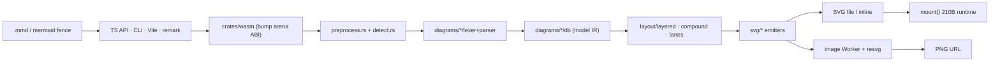
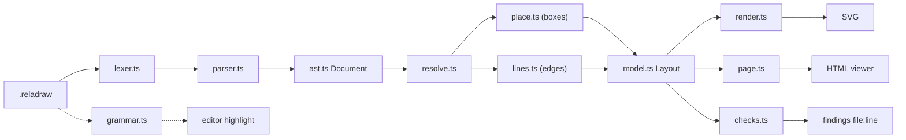
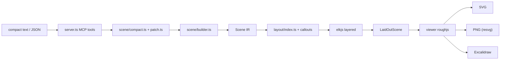
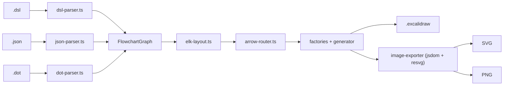

# Weekly scan — diagram tooling (2026-11-11)

Cửa sổ quét: push trong 7 ngày (2026-11-04 → 2026-11-11). Nguồn: GitHub search theo topic
(`diagram-as-code`, `dsl`, `svg-animation`, `graph-visualization`, `layout-algorithm`)
và theo keyword (`diagram`, `layout-engine`, `mermaid`, `topic:diagrams`). Mọi nhận định dưới đây
dựa trên shallow clone (50 commit gần nhất) tại HEAD ngày 2026-11-10/11; số contributor là đếm
author trong 50 commit đó, không phải con số tuyệt đối.

## Executive summary

- **Ondine (`wevm/ondine`) là đối thủ/tham chiếu trực tiếp nhất cho mảng Mermaid của kymo**: Rust
  compiler Mermaid → SVG monochrome, có oracle test so với `mermaid@12.1.0` về accept/reject + model,
  layout Sugiyama tự viết (port từ Pele) với "aims" xếp hạng tường minh. Nên đặt cạnh merman trong
  `benches/mermaid-format`.
- **reladraw** đi đúng hướng "relative placement" mà kymo DSL đã chọn — nhưng cực đoan hơn: không
  solver, không né vật cản, mỗi trục của mỗi box đến từ đúng một statement, và thay vì sửa layout
  thì phát "findings" (warning có toạ độ). Ý tưởng `check`/findings đáng mượn nguyên xi.
- **sketchy** và **excalidraw-cli** là hai tool "agent-first" dùng ELK layered + orthogonal; giá trị
  cho kymo nằm ở chi tiết nhỏ (stable layout qua follow-up, patch syntax, binding Excalidraw), không
  ở kiến trúc tổng.

Ứng viên đã xem nhưng không chọn: `penrose/penrose`, `likec4/likec4`, `fletcher-package/fletcher`
(lâu đời, chỉ là activity thường), `kieler/elkjs` (push nhưng không có release mới đáng kể),
`goadesign/model`, `openflowkit/openflowkit` (canvas editor), các "agent skill" vẽ diagram
(`archify`, `diagram-design`, `stack-diagram`, …) — prompt pack, không có engine.

## Table of contents

1. [wevm/ondine — Mermaid compiled with Rust](#1-wevmondine)
2. [reladraw/reladraw — diagram language "say where things go"](#2-reladrawreladraw)
3. [ddkbs/sketchy — layout engine cho AI diagram](#3-ddkbssketchy)
4. [swiftlysingh/excalidraw-cli — DSL/JSON/DOT → Excalidraw](#4-swiftlysinghexcalidraw-cli)

---

## 1. wevm/ondine

### §1 — Quick context

- **Pitch:** Compile Mermaid sang SVG tĩnh lúc build bằng Rust, chỉ ship runtime 210 byte — không
  phải renderer chạy trong browser như mermaid.js.
- **Stack:** Rust (`crates/compiler`, `crates/wasm`) + TypeScript API/Vite/remark plugin; output SVG
  (PNG qua resvg-wasm trong image Worker).
- **Health:** ★446, tạo 2026-10-18, ~6 contributor, npm `ondine@0.0.3`, 7 workflow CI (verify,
  screenshots, benchmarks, …), insta snapshot + oracle tests.
- **Distribution:** npm (`ondine`, `ondine/compiler`, `ondine/compiler/wasm`, `ondine/vite`,
  `ondine/remark`), CLI `ondine`, Cloudflare image Worker.

### §2 — Architecture deep-dive

**A. Component inventory**
- `Preprocess` (`crates/compiler/src/preprocess.rs`) — bỏ front matter, directive, comment.
- `Detect` (`crates/compiler/src/detect.rs`) — chọn diagram type.
- Per-diagram `lexer/parser/db/render` (`crates/compiler/src/diagrams/flowchart/{lexer,parser,db,graph,render}.rs`,
  tương tự cho `sequence/`, `requirement/`, …) — ~35 diagram type, mỗi type là một Cargo feature.
- `Layered layout` (`crates/compiler/src/layout/layered.rs`, 5.5k LOC) — Sugiyama; kèm
  `compound.rs` (subgraph/cluster) và `lanes.rs` (swimlane).
- `SVG emitters` (`crates/compiler/src/svg/{builder,edges,shapes,cluster,theme,root}.rs`).
- `Text measure` (`crates/compiler/src/text/measure.rs`) — monospace advance cố định.
- `WASM adapter` (`crates/wasm/src/lib.rs`) — bump-arena allocator, ABI length-prefixed buffer.
- TS: `src/compiler/{index,wasm,all}.ts`, `src/Mount.ts`, `src/vite/`, `src/remark/`, `src/cli/bin.ts`
  (có `Ascii.ts`, `Terminal.ts`).

**B. Pipeline (happy path)**
1. User chạy `ondine flow.mmd` (hoặc Vite import `./flow.mmd`).
2. TS load module WASM `all` (profile tối ưu tốc độ cho Node), copy source vào memory từ `alloc`.
3. Rust: preprocess → detect → parser theo type → "db" (model) → layout (`layered`/`compound`/`lanes`).
4. `svg/*` emit SVG dùng `--ondine-*` CSS custom properties.
5. Trả buffer `status | type | width | height | links | svg`; TS ghi file / inline vào bundle, runtime
   `mount()` chỉ `innerHTML`.

**C. Data model / IR** — Struct Rust theo type (`flowchart/types.rs`, `db.rs`), mô phỏng "database"
của Mermaid; layout dùng IR riêng `LNode`/`LEdge` với `Kind::{Node, Dummy, Label, StartPort, EndPort}`
— tức edge label và bend được hạ thành node giả (lower IR kiểu dagre). Pass layout mutate
`Graph` tại chỗ. Feature `model` export model JSON cho test.

**D. Input language** — Không thiết kế DSL mới: target 100% cú pháp `mermaid@12.1.0`. Parser
hand-written (lexer + parser riêng mỗi type), được kiểm bằng **oracle**: vendored 19 jison grammar
gốc của Mermaid (`test/oracles/grammars/`) + fuzz mutation (`FUZZ`, `SEED`) — cùng quyết định
accept/reject, cùng type, cùng model cho 31 type; mọi khác biệt phải ghi trong `Divergences.ts`.
Error: enum `Code::{Syntax, Semantic, Limit, UnsupportedDiagram}`, vị trí UTF-16, message là
"public contract".

**E. Layout** — Sugiyama tự viết: `rank` → `reduce_crossings` (barycenter sweep chạy 2 lần
down-first/up-first, đếm crossing bằng Fenwick/accumulator tree, tie-break bằng "giữ thứ tự viết")
→ `assign_tracks` (edge gần nhau rẽ ở level riêng) → `straighten`/`settle`/`snap`. Header
`layered.rs` liệt kê 7 "aims" xếp hạng ưu tiên (phân biệt line > ít crossing > đường ngắn > vào
giữa cạnh > cân đối > giữ thứ tự nguồn > compact). Edge routing orthogonal bo góc.

**F. Rendering** — Single backend SVG, monochrome, monospace; theme đổi bằng CSS variable không
cần compile lại. Không animation. Output byte-identical giữa Node và browser vì không đo font thật.

**G. Extensibility** — Diagram type = Cargo feature + module; CLAUDE.md cấm "general plugin
frameworks" và global registration. Theme chỉ qua `--ondine-*`.

**H. Dev experience** — CLI (có ASCII/terminal output, `--check` để CI so sánh), Vite plugin, remark
plugin thay fence ` ```mermaid ` bằng `<picture>` light/dark, playground site. Không thấy LSP.

### §3 — Architecture diagram



### §4 — Verdict

- **Học cho kymo:** (1) oracle test với grammar gốc của Mermaid + fuzz là bản nâng cấp đáng
  copy cho phần Mermaid import của kymo — hiện ta so ảnh (`accuracy.py`), Ondine so *model*.
  (2) Danh sách "aims" xếp hạng ở đầu `layered.rs` là cách viết spec layout rõ ràng — `alignment.py`
  nên có header tương tự. (3) Text đo bằng monospace advance → output deterministic tuyệt đối,
  cùng tinh thần golden byte-for-byte của kymo.
- **Red flags:** comment "Floating-point expressions keep Pele's operation order" — phụ thuộc mạnh
  vào một reference ngoài; `#![expect(dead_code)]` ở crate root; v0.0.3.
- **Open questions:** Pele là gì/license ra sao? Chất lượng layout thật so với merman trên bench
  worst-10?
- **Verdict:** **study deeper** — thêm vào `benches/mermaid-format` như engine thứ tư.

---

## 2. reladraw/reladraw

### §1 — Quick context

- **Pitch:** DSL nơi bạn tự nói box nằm ở đâu (relative placement), engine không tự di chuyển gì —
  nằm giữa Mermaid (auto) và draw.io (absolute).
- **Stack:** TypeScript thuần, **zero runtime deps**; output SVG, trang HTML viewer (`--page`),
  custom element `<reladraw-diagram>`.
- **Health:** ★1183 (lên HN), tạo 2026-09-07, v0.26.1, 1 author, **không có CI và không có test
  trong repo**, không nhận PR.
- **Distribution:** npm `reladraw` (CLI + lib), CDN jsDelivr cho web element, kèm agent skill
  (`reladraw install-skill`).

### §2 — Architecture deep-dive

**A. Component inventory**
- `Lexer` (`src/lexer.ts`) — token hoá theo dòng.
- `Grammar` (`src/grammar.ts`) — scanner regex *chỉ để highlight*, không phải parser thứ hai.
- `Parser` (`src/parser.ts`, 3.9k LOC) — `clausesOf` → `parseStatement` → `parseNode/parseEdge/...`.
- `AST` (`src/ast.ts`) — `NodeStmt`, `EdgeStmt`, `Placement`, `ViaStop`, …
- `Resolve` (`src/resolve.ts`) — AST → `Layout` (đo text, sizing).
- `Place` (`src/place.ts`, 2.8k LOC) — vị trí box.
- `Lines` (`src/lines.ts`, 2.3k LOC) — vị trí đường nối.
- `Model` (`src/model.ts`) — `LayoutNode`, `LayoutEdge`, `Rect`.
- `Render` (`src/render.ts`) — SVG; `Page` (`src/page.ts`) — HTML pan/zoom.
- `Checks` (`src/checks.ts`, 1k LOC) — "findings" (line cắt box, text chồng nhau…).
- `Format` (`src/format.ts`) — formatter căn cột.
- `CLI` (`src/cli.ts`), `Element` (`src/element.ts`).

**B. Pipeline**
1. `reladraw render arch.reladraw -o arch.svg`.
2. `parse()` gom statement (cho phép continuation bằng indent) → `Document` AST.
3. `resolve()` dựng cây node, đo text (`measure.ts`, monospace measurer), gọi `Placer` và `lines`.
4. `render()` vẽ `Layout` ra SVG.
5. `findings()` chạy trên cùng `Layout`, in warning `file:line: message`; SVG vẫn được ghi.

**C. IR** — AST (`Document` của `Stmt`) → `Layout` (interfaces TS, plain object). Placer tính
"on demand and remembered" (memo per axis) — một vòng lặp tham chiếu được báo là lỗi "circle in the
file". Không có lower IR riêng.

**D. Input language** — Hand-written recursive descent theo statement, line-oriented
(`node`, `edge`, `style`, `default`, `region`, `point`, `bundle`…). Placement:
`right of app (gap: 12) even with app.api`, `above-left of cluster.hub (gap: tight)`. Không có
EBNF chính thức; spec là `SYNTAX.md` (1.7k dòng). Error: `SourceError(message, line)`, và `blame()`
tìm *đúng dòng con* gây lỗi trong statement nhiều dòng bằng cách chạy lại pipeline.

**E. Layout** — **User-specified relative**, không solver, không crossing minimization: "each axis
of each box comes from exactly one statement". Edge: thẳng mặc định, hoặc `path: curved` (cubic),
`via` waypoint, ends tự trải đều trên một side. Không né vật cản — thay vào đó findings đo khoảng
chồng lấn.

**F. Rendering** — Single SVG emitter + HTML page wrapper; themes (`themes.ts`, có dark), inline
markup `[dim]…[/dim]`. Không animation.

**G. Extensibility** — Icon built-in (`icons.ts`, badge), `style` tên và `default edge …`. Không
plugin system.

**H. DX** — `check` (chỉ findings), `format --check` (CI-friendly), `--page` browser preview, web
element, grammar tách riêng để sinh TextMate/Vim/Emacs. Không thấy watch mode/LSP.

### §3 — Architecture diagram



### §4 — Verdict

- **Học cho kymo:** (1) **findings thay vì auto-fix** — `kymo check` in "edge X cắt box Y 14px tại
  line N" là feedback loop cực tốt cho agent viết `.kymo`. (2) `blame()` — chạy lại để xác định
  dòng con có lỗi trong statement nhiều dòng. (3) Vocab placement `even with`, `above-left of`,
  `(gap: tight|wide|N)` đáng đối chiếu với `DSL-LANG-001`. (4) Tách highlighter khỏi parser nhưng
  import cùng vocabulary → không drift.
- **Red flags:** không test, không CI, file 2–4k LOC, "language is changing frequently".
- **Open question:** strict "one axis one statement" có scale cho diagram 50+ node không?
- **Verdict:** **study deeper** (DSL design + checks), không phải code.

---

## 3. ddkbs/sketchy

### §1 — Quick context

- **Pitch:** MCP server/skill để AI "vẽ khi giải thích": AI chỉ nói *cái gì*, engine lo *ở đâu*,
  kèm step-walkthrough highlight và mạch Arduino/ESP32.
- **Stack:** TypeScript; `elkjs` (layout), `roughjs` (nét tay, viewer), `@resvg/resvg-js` + `sharp`
  (raster), `@modelcontextprotocol/sdk` + `ext-apps`, `zod`; output SVG/PNG/Excalidraw.
- **Health:** ★272, tạo 2026-10-08, v0.1.8, 1 author, CI (`ci.yml`), ~17 file vitest.
- **Distribution:** npm `@ddkbs/sketchy`, `.mcpb` desktop extension, skill zip (CDN jsDelivr).

### §2 — Architecture deep-dive

**A. Component inventory**
- `MCP server` (`src/server.ts`) — `registerAppTool` cho `sketch`, patch, photos…
- `Scene types` (`src/scene/types.ts`) — "what, never where".
- `Compact syntax` (`src/scene/compact.ts`) — DSL dòng, ~½ token so với JSON.
- `Patch` (`src/scene/patch.ts`) — follow-up edit (`remove <id>`, replace theo id).
- `Builder` (`src/scene/builder.ts`) — validate + dựng `Scene`.
- `Layout` (`src/layout/index.ts`) — ELK; `callouts.ts`, `text.ts`, `links.ts` (mở file trong editor).
- `Figures` (`src/figures/*`) — seq, plot, chart, map, molecule (SMILES), templates.
- `Viewer` (`viewer/src/draw.ts`, `annotate.ts`, `excalidraw.ts`, `raster.ts`) — vẽ roughjs, annotate,
  export.

**B. Pipeline**
1. Agent gọi tool `sketch` với compact text hoặc JSON.
2. `parseCompact` → `builder` → `Scene`.
3. `layoutScene()`: đo node, *lập kế hoạch callout trước* để cộng vào kích thước target, layout
   figures ở mọi step-state rồi lấy max; dựng ELK graph → `elk.layout()`.
4. `LaidOutScene` (toạ độ tuyệt đối) gửi sang viewer (MCP App resource `ui://sketchy/viewer.html`).
5. Viewer vẽ bằng roughjs với seed ổn định theo id; export SVG/PNG/Excalidraw.

**C. IR** — Hai tầng type rõ: `Scene` (structure) → `LaidOutScene` (geometry). Plain TS types;
patch dùng `structuredClone` (immutable-ish giữa follow-up).

**D. Input language** — Compact syntax regex line-based
(`dns DNS @book-open in net !accent ~ desc`, `a --> b`, `step Title | ids`). Không EBNF; lỗi
`SceneError`. Đầu vào song song là JSON schema (zod).

**E. Layout** — ELK `layered`, `ORTHOGONAL`, `INCLUDE_CHILDREN`,
`considerModelOrder: NODES_AND_EDGES`, spacing hằng số; port cho pin linh kiện. `PreviousLayout`
giữ thứ tự/vị trí phần tử chung khi follow-up. Crossing min: mặc định của ELK.

**F. Rendering** — Viewer HTML (roughjs SVG) + raster qua resvg; Excalidraw export. "Animation" là
step walkthrough (khoanh đỏ + fade phần còn lại), không phải SVG animation.

**G. Extensibility** — Part catalog sinh từ wokwi-elements (`scripts/extract-parts.mjs`), icon
Iconify (`lucide:*`, `simple-icons:*`), templates. Không plugin API.

**H. DX** — MCP-native; click node mở file trong VS Code/Cursor/Zed; vẽ tay lên sketch rồi "Send
to AI". Không CLI độc lập.

### §3 — Architecture diagram



### §4 — Verdict

- **Học cho kymo:** (1) **plan callouts trước layout** rồi gộp vào kích thước node → không bao giờ
  chồng label; đáng so với cách kymo đặt label sau khi đã có vị trí node. (2) Layout figure ở mọi step-state, lấy bbox max →
  "stepping never moves the rest" — trực tiếp áp dụng cho animated SVG nhiều step của kymo.
  (3) `PreviousLayout` cho incremental re-layout ổn định. (4) Patch syntax ngắn cho agent.
- **Red flags:** scope rất rộng (photo labeling Florence-2, map, molecule) cho 1 người; spacing
  hard-code.
- **Verdict:** **glance only** — mượn 2–3 technique, không cần đọc sâu.

---

## 4. swiftlysingh/excalidraw-cli

### §1 — Quick context

- **Pitch:** CLI sinh file `.excalidraw` *editable* từ DSL, JSON hoặc Graphviz DOT, tối ưu cho agent
  — khác Mermaid-to-Excalidraw ở chỗ nhận DOT và có auto-layout ELK riêng.
- **Stack:** TypeScript; `elkjs`, `ts-graphviz`, `@excalidraw/utils` + `jsdom` (export SVG),
  `@resvg/resvg-js` (PNG), `commander`.
- **Health:** ★319, tạo 2026-01-09, v1.5.1, ~5 contributor, CI + release workflow, test
  unit/integration/e2e.
- **Distribution:** npm `@swiftlysingh/excalidraw-cli`, Homebrew tap, Claude/Gemini plugin.

### §2 — Architecture deep-dive

**A. Component inventory**
- `CLI` (`src/cli.ts`) — commander, lệnh `create`, `--inline`, export flags.
- `Parsers` (`src/parser/{dsl-parser,json-parser,dot-parser}.ts`) — 3 front-end → `FlowchartGraph`.
- `Types` (`src/types/dsl.ts`, `excalidraw.ts`).
- `Layout` (`src/layout/elk-layout.ts`) + `Arrow router` (`src/layout/arrow-router.ts`).
- `Factories` (`src/factory/{node,connection,text,image,element}-factory.ts`) — tạo element Excalidraw.
- `Generator` (`src/generator/excalidraw-generator.ts`).
- `Exporter` (`src/exporter/image-exporter.ts`, `dom-polyfill.ts`).

**B. Pipeline**
1. `excalidraw-cli create flow.dsl -o flow.excalidraw`.
2. Chọn parser theo input → `FlowchartGraph` (nodes, edges, options).
3. `elk-layout.ts`: ELK `layered`, `ORTHOGONAL`, `LAYER_SWEEP`, `NETWORK_SIMPLEX` → `LayoutedNode`.
4. `arrow-router.ts` tính binding `fixedPoint` [0–1] (mode `orbit`) để arrow vẫn dính khi user kéo.
5. Factories + generator ghi JSON Excalidraw; tuỳ chọn export SVG (jsdom polyfill) / PNG (resvg).

**C. IR** — `FlowchartGraph` (interfaces TS) → `LayoutedGraph` → Excalidraw elements. Không lower IR.

**D. Input language** — DSL kiểu ASCII-art: `[Rect]`, `{Diamond}`, `(Ellipse)`, `[[DB]]`,
`A -> "label" -> B`, `-->` dashed, directive `@direction LR`, `@sticker`, `@scatter`. Tokenizer
hand-written + preprocess style block. Không grammar formal.

**E. Layout** — ELK layered + orthogonal; enum có `tree`/`force` nhưng chỉ thấy `layered` dùng.
Crossing min = ELK `LAYER_SWEEP`.

**F. Rendering** — Primary output là Excalidraw JSON; SVG/PNG là emitter phụ. Không animation.

**G. Extensibility** — Thêm front-end = thêm parser trả `FlowchartGraph` (pattern sạch); sticker
library cho asset.

**H. DX** — man page (`man/excalidraw-cli.1`), `--inline`, npx, brew. Không watch/preview.

### §3 — Architecture diagram



### §4 — Verdict

- **Học cho kymo:** binding arrow bằng `fixedPoint` + `mode: 'orbit'` — kiểm tra `to_excalidraw.py`
  có emit binding để diagram còn editable sau khi mở ở excalidraw.com không. DOT front-end là
  candidate cross-format rẻ cho kymo (ts-graphviz/pydot).
- **Red flags:** DSL ad-hoc, enum `force`/`tree` chưa có implementation tương ứng; export SVG phụ
  thuộc jsdom.
- **Verdict:** **glance only**.
