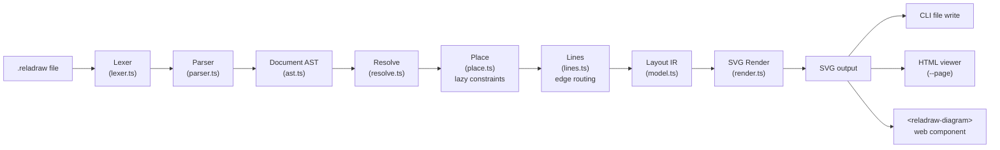
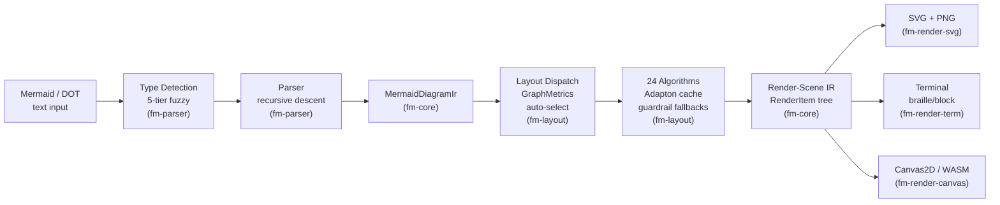
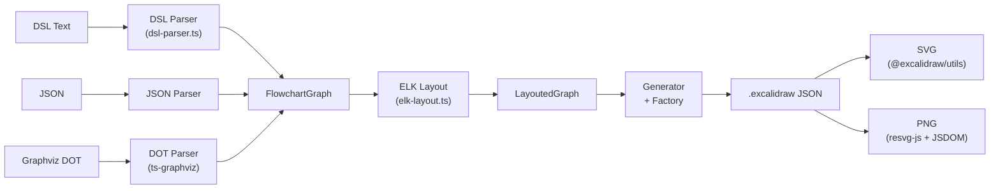
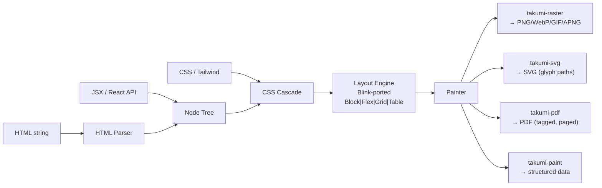

# Weekly Scan: Diagram Tooling — 2026-11-12

## Executive Summary

- **reladraw** (⭐1.2k, TS) nổi lên như DSL đối thủ trực tiếp: relative positioning thay vì auto-layout, kèm `blame()` error attribution technique và web component distribution model đáng study.
- **frankenmermaid** (⭐61, Rust) kiến trúc multi-renderer qua render-scene IR layer, guardrail fallback chains cho large diagrams, và ParseLens round-trip editing — 3 pattern cụ thể áp dụng được cho kymo.
- **Ecosystem notable:** Terrastruct shutdown, TALA layout engine open-sourced (MPL-2.0) và bundled vào D2 v0.9.0; mermaider (.NET) nổi lên với standalone Sugiyama package + sophisticated design system; excalidraw-cli cung cấp reference implementation cho Excalidraw element factory pattern relevant cho `to_excalidraw.py`.

## Table of Contents

1. [reladraw/reladraw](#1-reladrawreladraw) — DSL relative positioning
2. [Dicklesworthstone/frankenmermaid](#2-dicklesworthstonefrankenmermaid) — Rust multi-renderer Mermaid engine
3. [swiftlysingh/excalidraw-cli](#3-swiftlysinghexcalidraw-cli) — Text → Excalidraw conversion
4. [kane50613/takumi](#4-kane50613takumi) — Rust layout engine JSX/HTML → SVG/PDF
5. [Ecosystem Notes](#5-ecosystem-notes) — D2/TALA, mermaider, line-art-animation

---

## 1. reladraw/reladraw

### §1 — Quick Context

**Pitch:** Ngôn ngữ diagram text-based cho phép user chỉ định vị trí tương đối — nằm giữa draw.io (absolute coords) và Mermaid/D2 (auto-layout hoàn toàn).

- **Tech stack:** TypeScript thuần, zero runtime dependencies, output SVG
- **Repo health:** ⭐1,192 · v0.27.0 · Apache-2.0 · Single author · 262 commits
- **Distribution:** npm (`reladraw`), web component via jsDelivr (`<reladraw-diagram>`), playground tại reladraw.github.io/reladraw

### §2 — Architecture Deep-Dive

**A. Component inventory**

28 source files trong flat `src/` directory:

- `Parser` (`src/parser.ts`, 3,897 LOC) — hand-written recursive-descent, line-oriented tokenizer
- `Lexer` (`src/lexer.ts`) — tokenization per line, bracket depth tracking, triple-quoted strings
- `AST` (`src/ast.ts`) — syntax tree: `Document`, `NodeStmt`, `EdgeStmt`, `StyleStmt`
- `Model` (`src/model.ts`, 355 LOC) — layout IR: `LayoutNode`, `LayoutEdge`, `LayoutMark`, `Layout`
- `Resolve` (`src/resolve.ts`, 2,361 LOC) — AST → Layout: containment tree, sizing, placement
- `Place` (`src/place.ts`, 2,790 LOC) — constraint placer: lazy per-axis evaluation, memoized, cycle detection
- `Lines` (`src/lines.ts`) — edge routing: straight/orthogonal/curved, bundle routing, waypoints, fan-out
- `Render` (`src/render.ts`, 1,706 LOC) — SVG emitter: template-literal string concatenation
- `Checks` (`src/checks.ts`) — post-render warnings: overlaps, crossings, clipping
- `Themes` (`src/themes.ts`) — 14 built-in themes (dark, light, solarized, gruvbox, catppuccin, nord, dracula...)
- `Element` (`src/element.ts`) — `<reladraw-diagram>` web component
- `CLI` (`src/cli.ts`) — `render`, `check`, `format`, `install-skill` commands

**B. Pipeline / control flow**

1. User chạy `reladraw render diagram.reladraw -o out.svg` → CLI đọc file
2. `parse(source)` tokenize line-by-line, group thành statements, dispatch theo keyword → trả về `Document` (AST)
3. `resolve(document)` chạy 3 passes:
   - **Pass 1 — Containment tree:** `buildTree` xây node hierarchy từ dotted names, expand fan-out edges
   - **Pass 2 — Sizing:** `factsFor` tính kích thước bottom-up (text measurement → padding → container)
   - **Pass 3 — Placement:** `Placer.run()` giải relative constraints lazy per-axis + `planLines` route edges
4. `render(layout)` emit SVG: draw nodes recursively, draw edges, apply crossing masks, compute arrow markers → SVG string
5. CLI ghi file (hoặc `--page` sinh HTML viewer với pan/zoom)

**C. Data model / IR**

- `Document` chứa `Stmt[]` (union of statement types). Mỗi stmt có `attrs: Attrs` + `placements: Placement[]`
- `Layout` IR chứa `LayoutNode[]` (~35 mutable fields), `LayoutEdge[]`, `LayoutMark[]`
- Hoàn toàn mutable object graph với cross-references (parent ↔ children)
- Không có multi-level IR lowering — AST → Layout trực tiếp

**D. Input language design**

- Hand-written recursive descent, line-oriented. Không PEG/ANTLR.
- Không có formal EBNF — grammar documented bằng prose trong `SYNTAX.md` (~160K chars)
- **`blame()` function đặc biệt hay**: khi error xảy ra trong multi-line statement, re-run parser cắt sau mỗi line để tìm line thực sự gây lỗi

**E. Layout algorithm**

- **Không phải auto-layout** — user chỉ định relative positions (`below app.ui (gap: tight)`), engine giải constraints
- Lazy constraint evaluation per-axis, memoized, cycle detection
- Container layouts: `column`, `row`, `venn`, `deck`
- Edge routing: straight, orthogonal, curved (cubic Bézier). Bundle routing + fan-out
- **Không có crossing minimization** — draw order = write order

**F. Rendering**

- Single backend: SVG only (string concatenation + template literals)
- FNV-1a hash prefix cho mọi `id` → multiple SVGs on same page không conflict
- 14 themes, CSS-driven via semantic tokens
- Không có animation

**G. Extensibility**

- Custom icons inline SVG, reusable styles, per-kind defaults
- Không có plugin system hay pluggable emitter
- Agent skill installer: `reladraw install-skill` cho Claude Code / Codex agents

### §3 — Architecture Diagram

### §4 — Verdict

**Đáng học cho kymostudio:**
- **`blame()` error attribution** — re-run parser cắt multi-line statement để tìm exact culprit line. Technique rất hay cho kymo's DSL error reporting.
- **Relative placement syntax** (`below X`, `even with Y`) — expressive mà deterministic. Đáng study cho kymo nếu muốn mở rộng user-controlled positioning.
- **FNV-1a ID prefixing** — giải quyết multiple SVGs on same page, relevant cho playground/docs embedding.
- **Web component + agent skill distribution** — interesting go-to-market channels.

**Red flags:** Single author, bus factor = 1. Zero deps = monospace-only text measurement. Không test files visible. Mutable object graph khó reason correctness.

**Open questions:** Place.ts cycle detection — khi nào fail? Performance large diagrams?

**Verdict: study deeper** — DSL design, `blame()` technique, web component pattern đều đáng nghiên cứu kỹ.

---

## 2. Dicklesworthstone/frankenmermaid

### §1 — Quick Context

**Pitch:** Engine Rust thay thế Mermaid.js — parse 32 diagram types qua shared IR, render SVG/terminal/Canvas2D/WASM, 24 layout algorithms với auto-selection và fallback chain.

- **Tech stack:** Rust (edition 2024, nightly), 9 workspace crates. Sugiyama + force + radial + 20 specialized layouts. SVG/terminal/Canvas2D renderers. WASM via wasm-bindgen
- **Repo health:** ⭐61 · v0.5.0 · 3,644 commits · Clippy pedantic CI, golden snapshots, proptest, cargo-fuzz
- **Distribution:** Binary via install script, WASM local build. Chưa publish crates.io/npm

### §2 — Architecture Deep-Dive

**A. Component inventory**

| Module | Path | Vai trò |
|--------|------|---------|
| `fm-core` | `crates/fm-core/` | Shared IR (`MermaidDiagramIr`, `IrNode`, `IrEdge`), 27+ node shapes, render-scene IR (`RenderItem`), font metrics heuristic |
| `fm-parser` | `crates/fm-parser/` | Mermaid parser (recursive descent + line-oriented), DOT bridge, 5-tier type detection, error recovery, `ParseLens` round-trip API |
| `fm-layout` | `crates/fm-layout/` | 24 layout algorithms, Adapton incremental cache, guardrail fallback chains, constraint solver (microlp/HiGHS) |
| `fm-render-svg` | `crates/fm-render-svg/` | SVG emitter: 10 themes, CSS custom properties, ARIA, optional resvg PNG |
| `fm-render-term` | `crates/fm-render-term/` | Terminal: braille/block/half-block modes, diff engine, minimap |
| `fm-render-canvas` | `crates/fm-render-canvas/` | Canvas2D trait (~40 methods), web_sys impl |
| `fm-wasm` | `crates/fm-wasm/` | WASM bindings |
| `fm-cli` | `crates/fm-cli/` | CLI: render, parse, detect, validate, diff, watch, serve, interactive |

**B. Pipeline / control flow**

1. `frankenmermaid render diagram.mmd` → CLI đọc file, gọi `fm-parser`
2. **Type detection** (5 tiers: exact keyword → fuzzy Levenshtein → content heuristic → DOT probe → flowchart fallback) → chọn parser family
3. **Parse → `MermaidDiagramIr`**: recursive descent cho containers, line-oriented cho items. Recovery: auto-create placeholder nodes, merge duplicate IDs, auto-close delimiters. Output kèm `ParseLens` snapshot
4. **Layout dispatch**: `GraphMetrics::from_ir` phân tích topology → auto-select algorithm. Guardrails: time budget 250ms, fallback chains (Sugiyama→Tree→Grid). Adapton cache cho incremental relayout
5. **Render-scene IR**: layout → backend-agnostic `RenderItem` tree (Group/Path/Text với `RenderSource` tags)
6. **Backend emit**: SVG (+PNG), terminal (braille/block), hoặc Canvas2D/WASM → output

**C. Data model / IR**

- **Parsing IR** (`MermaidDiagramIr`): nodes, edges, interned labels (`IrLabelId`), clusters, spans (u32 positions). Mutable qua layout (thêm positions).
- **Render-scene IR** (`RenderItem`): `Group`/`Path`/`Text`, mỗi item tagged `RenderSource` (Node/Edge/Cluster/Label). Immutable tree — backend-agnostic layer giữa layout và renderers.
- Tương tự D2's TALA concept nhưng ở render level thay vì layout level.

**D. Input language design**

- Recursive descent cho containers, line-oriented cho elements. Mermaid syntax compatibility target.
- Error recovery sophisticated: placeholder nodes, duplicate merge, auto-close delimiters, 3 parse modes (Strict/Compat/Recover)
- **ParseLens**: source map + format complement → byte-range splice edits, reparse-and-verify. Designed cho editor integration.

**E. Layout algorithm**

- 24 algorithms: Auto + 23 concrete (Sugiyama, Force, Tree, Radial, + specialized per diagram type)
- **Auto selection**: `GraphMetrics` topology analysis → posterior weights → chọn algorithm tối ưu
- **Guardrail fallback chains**: time budget 250ms, degrade Sugiyama→Tree→Grid. Pressure tiers: none/low/medium/high. Degradation: disable shadows, straight-line edges, drop minor labels
- Edge routing: orthogonal (default) hoặc spline. CGA-based routing
- Crossing minimization: Sugiyama pipeline (cycle break → ranking → crossing min → coordinates)
- **Incremental cache**: Adapton-style dependency graph, partition IR thành regions (max 64 nodes), dirty-set propagation

**F. Rendering**

- SVG: 23+ shapes, 30 arrow variants, 10 themes, ARIA markup, CSS custom properties. Optional PNG via resvg.
- Terminal: braille (2×4), block (2×2), half-block modes. Diff engine, minimap.
- Canvas2D: trait-based, web_sys impl.
- **Pluggable emitter pattern**: render-scene IR là abstraction layer chung.

### §3 — Architecture Diagram

### §4 — Verdict

**Đáng học cho kymostudio:**
- **Render-scene IR pattern** — layer trung gian giữa layout và render backends. Kymo hiện để renderers đọc trực tiếp model; thêm layer này sẽ giúp pluggable emitters sạch hơn.
- **Guardrail fallback chains** — time-budgeted layout với degradation tự động. Kymo chưa có mechanism cho large diagrams.
- **ParseLens round-trip editing** — source map preservation cho editor integration. Đáng tham khảo cho VS Code extension.

**Red flags:** 3,644 commits / 61 stars — ratio bất thường, likely AI-generated code. Chưa publish artifact. License MIT+rider cần kiểm tra. One-person, no outside PRs.

**Verdict: study deeper** — 3 patterns cụ thể (render-scene IR, guardrail fallbacks, ParseLens) worth reading source chi tiết.

---

## 3. swiftlysingh/excalidraw-cli

### §1 — Quick Context

**Pitch:** CLI chuyển text DSL / JSON / Graphviz DOT thành file Excalidraw editable, thiết kế cho AI agent workflow.

- **Tech stack:** TypeScript (ESM), ELK.js layout, `@excalidraw/utils` + `@resvg/resvg-js`, Commander CLI
- **Repo health:** ⭐319 · 104 commits · MIT · CI + Vitest test suite
- **Distribution:** npm `@swiftlysingh/excalidraw-cli`, Homebrew, Claude Code plugin, Gemini CLI extension

### §2 — Architecture Deep-Dive

**A. Component inventory**

- `Parser` — DSL (`src/parser/dsl-parser.ts`, 906 LOC): character-by-character tokenizer + state machine; JSON (`json-parser.ts`): JSON.parse + validation; DOT (`dot-parser.ts`): delegates to `ts-graphviz`
- `Types` (`src/types/dsl.ts`, 218 LOC) — `FlowchartGraph`, `GraphNode`, `GraphEdge`, `LayoutOptions`
- `Layout` (`src/layout/elk-layout.ts`, ~367 LOC) — ELK.js layered layout wrapper
- `Generator` (`src/generator/excalidraw-generator.ts`, 241 LOC) — `LayoutedGraph` → Excalidraw JSON
- `Factory` (`src/factory/`) — element construction: base element + nanoid IDs, shape-specific factories (node/connection/text/image)
- `Exporter` (`src/exporter/image-exporter.ts`) — SVG via `@excalidraw/utils`, PNG via `@resvg/resvg-js`

**B. Pipeline / control flow**

1. `excalidraw-cli create flow.dsl -o flow.excalidraw` → detect format
2. `parseDSL(input)` tokenize character-by-character → state-machine loop → `FlowchartGraph`
3. `layoutGraph(graph)` map nodes/edges → ELK graph (layered, orthogonal routing, LAYER_SWEEP crossing min, NETWORK_SIMPLEX node placement) → `LayoutedGraph`
4. `generateExcalidraw(layoutedGraph)` build arrow bindings, tạo elements qua factory functions (nanoid IDs, base style, shape-specific props) → `ExcalidrawFile`
5. `JSON.stringify` → write `.excalidraw`
6. (Optional) `convert`: `.excalidraw` → SVG (via exportToSvg) hoặc PNG (via resvg-js + JSDOM normalization)

**C. Data model / IR**

- `FlowchartGraph`: plain TS interfaces — `GraphNode[]`, `GraphEdge[]`, `LayoutOptions`
- Post-layout: `LayoutedGraph` extends thêm positions. Mutable giữa passes.
- 2 levels only: parsed graph → layouted graph → Excalidraw JSON

**D. Input language / layout**

- Character-by-character tokenizer + state-machine parser. Không formal grammar.
- Node syntax: `[rect]`, `{diamond}`, `(ellipse)`, `[[database]]`, ``
- ELK.js layered: LAYER_SWEEP crossing min, NETWORK_SIMPLEX node placement, orthogonal routing

**E. Rendering**

- Primary output: Excalidraw JSON (`.excalidraw`) — editable
- SVG/PNG exports derived từ Excalidraw output qua official utils
- PNG pipeline: SVG → JSDOM normalization (replace `<use>` → `<image>`) → resvg-js rasterization

**F. Excalidraw element factory pattern (đáng note)**

- `element-factory.ts`: base element với nanoid ID, seed, index, versioning
- `node-factory.ts`: rectangle/diamond/ellipse shape-specific
- `connection-factory.ts`: arrows + **bidirectional bindings** (node giữ `boundElements`, arrow giữ endpoint refs)
- Pattern tách biệt base element lifecycle khỏi shape-specific logic

### §3 — Architecture Diagram

### §4 — Verdict

**Đáng học cho kymostudio:**
- **Excalidraw element factory pattern** trực tiếp relevant cho `to_excalidraw.py` — tách base element (nanoid ID, seed, versioning) khỏi shape logic. Worth adopting.
- **Arrow binding mechanism** — bidirectional refs giữa nodes và arrows. Verify kymostudio's `to_excalidraw.py` làm đúng pattern này.
- **SVG→PNG JSDOM normalization** (replace `<use>` refs) — useful nếu kymo gặp rasterization issues tương tự.
- **ELK config reference:** LAYER_SWEEP + NETWORK_SIMPLEX — benchmark points.

**Red flags:** Parser 906 LOC không formal grammar — fragile. No error recovery. Magic numbers (diamond 1.4× scale).

**Verdict: study deeper** — factory pattern và binding mechanism trực tiếp applicable cho `to_excalidraw.py`.

---

## 4. kane50613/takumi

### §1 — Quick Context

**Pitch:** Layout engine Rust render JSX/HTML/CSS thành image/SVG/PDF không cần headless browser — thay thế Satori/Puppeteer.

- **Tech stack:** Rust (edition 2024), tiny-skia, HarfRust, cssparser. Node.js bindings (NAPI) + WASM
- **Repo health:** ⭐3,191 · ~3,870 commits · MIT/Apache-2.0 · 13 benchmarks + WPT reftests
- **Distribution:** npm (`takumi-js`, `takumi-pdf`), crates.io (`takumi`), WASM

### §2 — Architecture Deep-Dive

**A. Component inventory**

- `takumi-core` (`takumi-core/src/`) — Layout engine ported từ Chromium Blink: block/inline/flex/grid/table. CSS cascade, text shaping (HarfRust), Tailwind v4 native
- `takumi-raster` — tiny-skia rasterizer → PNG/JPEG/WebP/ICO/GIF/APNG. CSS `@keyframes` → animated image
- `takumi-svg` — SVG output. Text as glyph outline paths (không `<text>` elements)
- `takumi-pdf` — PDF backend: font subsetting, tagged PDF, PDF/A-3, pagination
- `takumi-paint` — Paint tree IR cho inspection/custom rendering
- `takumi-napi` / `takumi-wasm` — Node.js và WASM bindings

**B. Pipeline**

1. JSX/HTML input → Node tree (HTML parser hoặc JSX API trực tiếp)
2. CSS cascade + style resolution (var(), calc(), media queries, @keyframes, Tailwind v4)
3. Layout engine (Blink-ported): block → inline → flex → grid → table. Constraint space propagation
4. Painter → paint commands (z-order sorted)
5. Fan-out: raster (tiny-skia), SVG (quick-xml), PDF (pdf-writer), paint tree

**C. Key technical details**

- **Pluggable emitter architecture**: mỗi backend là separate crate, optional Cargo feature. Pattern rất sạch.
- **SVG text as glyph paths**: loại bỏ font rendering inconsistency — portable output không phụ thuộc font availability
- **CSS @keyframes → animated images**: `renderAnimation()` multi-frame pipeline
- **Fragmentation**: break tokens, page breaks cho PDF pagination

### §3 — Architecture Diagram

### §4 — Verdict

**Đáng học cho kymostudio:**
- **Pluggable emitter qua separate crates + optional features** — architecture cleaner hơn kymo's `to_*.py` sibling pattern.
- **SVG text as glyph outline paths** — loại bỏ font inconsistency, đáng xem xét cho portable SVG.
- **CSS @keyframes → animated image pipeline** — reference cho kymo's animated output.

**Red flags:** Forked 3 core deps (maintenance burden). Blink-port layout quá heavy cho diagram use case.

**Verdict: glance only** — domain khác (document rendering), nhưng emitter architecture và glyph-path SVG technique đáng reference.

---

## 5. Ecosystem Notes

### D2 / Terrastruct — TALA Open-Sourced

Terrastruct (Alexander Wang) đã shutdown business vào **Sep 7, 2026**, open-sourced proprietary TALA layout engine dưới **MPL-2.0** và bundled vào **D2 v0.9.0** (`--layout=tala`). D2 tiếp tục dưới nonprofit stewardship. TALA là architecture-focused layout engine — relevant cho kymo vì đây là first open-source constraint-based diagram layout engine ở cấp độ production quality. D2 repo (⭐25.8k) last pushed Oct 11, 2026.

**Kymo relevance:** TALA source code bây giờ readable — worth studying layout approach cho complex architecture diagrams. MPL-2.0 license cho phép integration nhưng cần file-level copyleft.

### nullean/mermaider — .NET Mermaid Parser + Sugiyama

Pure C# Mermaid parser, layout engine AND renderer (⭐57, MIT, .NET 10, AOT-compatible). Điểm đáng chú ý:

- **Standalone `Sugiyama` package** — separate project, reusable: NetworkSimplexRanker, CrossingMinimizer, BkCoordinateAssigner, obstacle-aware orthogonal EdgeRouter. Đây là **một Sugiyama reference implementation hoàn chỉnh** viết sạch.
- **Design system approach**: `StyleSpec` + `ColorFamily` (11 stages: Top/Bot/Flat/Band/Soft/Tint/Edge/Stroke/Ink) + 3 presets (Quiet/Blueprint/Tonal). Geometry independent of style. Single `DesignSystem.For(context)` entry point. **Pattern này đáng study cho kymo's theming.**
- **Text measurement via type roles** (Title/Heading/Body/Caption + 4 size tiers) — layout và render agree on sizes.
- Downstream: elastic/docs-builder, tig/winprint.

### JDhruv14/line-art-animation — SVG Animation Technique

TypeScript library + Claude skill cho animated line-art SVG (⭐447). **Gait solver** (minimum-jerk walk/run), spring/pendulum physics (`motion.ts`), day/night palette system (`daynight.ts`). Dependency-free `lib/` (4 modules: ink, gait, motion, daynight). Deterministic frame capture qua headless Chrome → ffmpeg.

**Kymo relevance:** `gait()` solver approach (analytical, không keyframe) đáng tham khảo cho kymo's animated output. Day/night palette pattern (`currentColor` + class-based swap) tương tự kymo's theme architecture.

### Mermaid.js — v11.17.2

Mermaid đang ở v11.17.2 (cdn.jsdelivr.net READMEs confirm). Obsidian v1.15.0 (Nov 2, 2026) notes "faster Mermaid diagrams that match your theme" — nhưng cũng nói Obsidian no longer bundles Mermaid, dùng renderer riêng.

### Excalidraw+ — Canvas Workflows

Excalidraw+ changelog entry Nov 1, 2026: Canvas Workflows & Navigation, layering fix for frames. Presentation animation engine (Sep 2026), bucket fill tool + overhauled export engine (Aug 2026).
