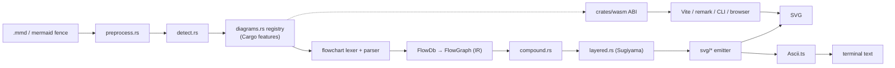
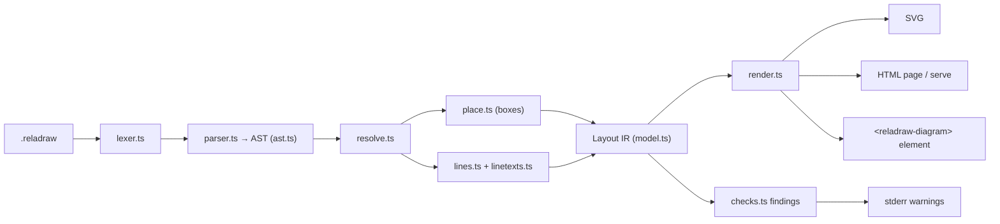
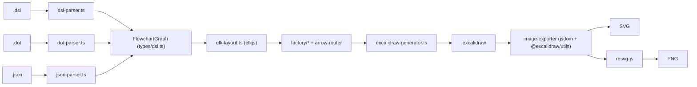
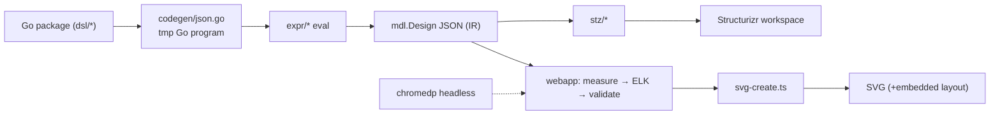

# Weekly scan — diagram tooling (2026-11-13)

Cửa sổ quét: push/release từ **2026-11-06**, repo mới từ **2026-10-14**. Mọi nhận định ở §2 đều lấy từ việc đọc mã nguồn (shallow clone ngày 2026-11-13), không lấy từ README marketing. Chỗ nào không có evidence thì ghi *không xác định*.

## Executive summary

- **`wevm/ondine`** là phát hiện lớn nhất tuần này: một Mermaid compiler viết bằng Rust → SVG/WASM, tương thích với Mermaid 12.1.0 nhờ **oracle test** chạy chung với parser của Mermaid, layout Sugiyama tự viết, và text measurement monospace hoàn toàn deterministic. Đây là đối thủ trực tiếp của kymo trên `benches/mermaid-format`, và là bản mẫu cho conformance-suite kiểu "differential oracle".
- **`reladraw/reladraw`** (★1.2k, lên HN) đi đúng con đường mà `alignment.py` của kymo đang đi: **relative placement** (`below x (gap: tight)`, `even with y`), không auto-route, và một lớp **findings** đo trên layout đã solve (overlap, overflow) thay cho việc tự sửa. Rất đáng học thiết kế cú pháp và triết lý "draw as written + warn".
- **`excalidraw-cli`** và **`goadesign/model`** trưởng thành hơn nhưng ít mới lạ: một bên là pipeline DSL/DOT → ELK → `.excalidraw` → resvg, bên kia là Go-embedded C4 DSL + ELK chạy trong headless Chrome, **lưu manual layout ngay bên trong file SVG**. Hai repo này chủ yếu là tham chiếu cho emitter Excalidraw của kymo và cho câu chuyện "manual override trên auto layout".

## Table of contents

0. [Shortlist (9 repo) & loại trừ](#0-shortlist--loại-trừ)
1. [wevm/ondine](#1-wevmondine) — study deeper
2. [reladraw/reladraw](#2-reladrawreladraw) — study deeper
3. [swiftlysingh/excalidraw-cli](#3-swiftlysinghexcalidraw-cli) — glance only
4. [goadesign/model](#4-goadesignmodel) — glance only

---

## 0. Shortlist & loại trừ

Nguồn: bước 1 (topic search) trả về 3 kết quả cho `diagram-as-code`, nhiều kết quả cho `dsl` nhưng phần lớn không liên quan; bước 2 (keyword, created > 2026-10-14) bổ sung ondine và homelab-diagram. Không cần tới bước 3.

| # | Repo | ★ | Tín hiệu | Lý do giữ lại | Mức đọc |
|---|---|---|---|---|---|
| 1 | `wevm/ondine` | 448 | tạo 2026-10-18, push 11-11 | Mermaid → SVG bằng Rust, layout + WASM | deep-dive |
| 2 | `reladraw/reladraw` | 1195 | tạo 2026-09-07, v0.29.0, push 11-11 | DSL relative-placement | deep-dive |
| 3 | `swiftlysingh/excalidraw-cli` | 319 | v1.5.1, push 11-09 | DSL/DOT → Excalidraw | deep-dive |
| 4 | `goadesign/model` | 468 | release v1.16.11 ngày 11-09 | C4 as Go code, ELK | deep-dive |
| 5 | `plantuml/plantuml` | 13.4k | push 11-13 | ecosystem; chưa đọc changelog | chỉ metadata |
| 6 | `kieler/elkjs` | 2.9k | push trong tuần | engine layout mà #3/#4 đều dùng | chỉ metadata |
| 7 | `Goblinmine/homelab-diagram` | 940 | tạo 11-07 | YAML → SVG, tự đo font bằng Pillow | đã đọc README: README tự nhận *"not a general tool"*, layout hardcode → loại khỏi deep-dive |
| 8 | `iiwish/kgdiff` | 55 | tạo 11-01 | visual semantic diff cho graph (RDF/JSON) | chỉ metadata, chưa đọc code |
| 9 | `JDhruv14/line-art-animation` | 593 | tạo 11-10 | thư viện TS animated line-art SVG | chỉ metadata, gần với renderer animation |

**Đã loại:** một loạt repo ★102 cùng tạo ngày 2026-11-10 (`lanflow-*`, `maple-math-*`, `disk-space-fan-*`…), có pattern giống spam "for Windows"; các Claude/Codex *skill* chỉ wrap prompt (`stack-diagram`, `arch-diagram-skill`); dashboard/viz chung chung (`haloflux`, `graph-explorer`); các DSL ngoài domain (Halide, Ash, Numscript…).

---

## 1. wevm/ondine

### §1 — Quick context
- **Pitch:** Compiler Mermaid → SVG viết bằng Rust, chạy ở build-time, nên page chỉ ship SVG và runtime 210 B, không cần mermaid.js.
- **Stack:** Rust 2024 (crate `compiler`, không có dependency runtime nào) + `crates/wasm`; TypeScript wrapper (CLI, Vite plugin, remark plugin). Output: SVG, ASCII (CLI).
- **Health:** ★448, khoảng 6 author trong 58 commit gần nhất, npm `0.0.3`, 7 workflow CI (`main`, `verify`, `screenshots`, `benchmarks`…).
- **Distribution:** npm `ondine` (bin `ondine`), WASM theo từng loại diagram.

### §2 — Architecture deep-dive

**A. Component inventory**
- `Preprocess` (`crates/compiler/src/preprocess.rs`): bỏ front matter, directive, comment.
- `Detect` (`crates/compiler/src/detect.rs`): nhận diện loại diagram.
- `YAML` (`crates/compiler/src/yaml.rs`, 1.7k LOC): parser YAML tự viết cho config.
- `Diagram registry` (`crates/compiler/src/diagrams.rs`): 33 loại, mỗi loại là một **Cargo feature**.
- `Flowchart lexer/parser/db/graph/render` (`diagrams/flowchart/{lexer,parser,db,graph,render}.rs`).
- `Layered layout` (`layout/layered.rs`, 5.5k LOC), `Compound layout` (`layout/compound.rs`), `Lanes` (`layout/lanes.rs`).
- `SVG emit` (`svg/{builder,shapes,edges,cluster,theme,root}.rs`).
- `Text` (`text/measure.rs`, `text/label.rs` 6.5k LOC).
- `WASM ABI` (`crates/wasm/src/lib.rs`); `Mount` (`src/Mount.ts`); `CLI` (`src/cli/bin.ts`, `Ascii.ts`).

**B. Pipeline (happy path)**
1. User chạy `ondine flow.mmd` (hoặc `import x from './flow.mmd'` qua Vite).
2. `render()` (`lib.rs`) kiểm tra các limit: source 50k ký tự, output 4 MB, 5k edge.
3. `preprocess` → `detect` → `diagrams::find(type)`.
4. Diagram parse ra model (`FlowDb`) → `graph.rs` resolve subgraph/class → `compound_layout` (mỗi group một hướng) → `layered`.
5. `svg::*` emit SVG đơn sắc, theme bằng CSS var → trả về struct `Rendered {svg, width, height, links, type}`.

**C. IR.** Dùng Rust struct có `pub(crate)` (`FlowNode`, `FlowEdge`, `FlowSubgraph`, `CNode`, `CEdge`, `LNode`). IR được mutate theo từng pass, ví dụ `shift_layout(&mut nodes…)`. Có hạ cấp IR: `FlowDb` → `FlowGraph` → `CNode/CEdge` → `LNode/LEdge`. Feature `model` serialize model ra JSON để chạy parity test.

**D. Input language.** Không thiết kế DSL mới. Lexer là state machine viết tay, tương đương với lexer Jison của Mermaid; parser viết tay *"reports the same errors at the same tokens"*. Grammar formal ở đây chính là **19 file Jison của Mermaid, vendored byte-for-byte** (`test/oracles/grammars/`). Error có `Code`, line, column, snippet.

**E. Layout.** Hierarchical (Sugiyama): rank bằng longest-path (`rank()`), crossing minimization bằng **barycenter sweep, giữ lại order tốt nhất** (`reduce_crossings`), cộng thêm bước median. Edge routing dạng **orthogonal bo góc**, có `assign_tracks` để các đoạn edge song song không đè lên nhau, và `spread` để rải endpoint theo cạnh node. Header của `layered.rs` liệt kê thứ tự ưu tiên mục tiêu thẩm mỹ (1–7), và đây là tài liệu thiết kế đáng đọc.

**F. Rendering.** Chỉ có SVG; ASCII được suy ra *từ SVG* (`Ascii.fromSvg`). Không có animation. Theme là CSS custom property `--ondine-bg/fg/line/...`, nên đổi theme không cần compile lại. Text width tính bằng **0.6 em cố định** (Geist Mono), không cần font table hay DOM, nên kết quả deterministic trên mọi host.

**G. Extensibility.** Thêm diagram mới bằng một module trong `diagrams/` cộng một feature Cargo. Không có plugin runtime. Icon: `text/icons.rs`.

**H. DX.** CLI có `--ascii`, `--json`; có MCP (comment trong `bin.ts`). Vite và remark plugin, browser WASM opt-in, image Worker cho README GitHub. Screenshot test bằng Playwright.

### §3 — Architecture diagram



### §4 — Verdict
- **Đáng học:** (1) *Differential oracle*: chạy cùng corpus qua parser của Mermaid và qua model của Ondine, kèm fuzz có seed (`FUZZ`, `SEED`) và file `Divergences.ts` ghi lại lý do của từng khác biệt. Cách này giống hệt `known_divergences.json` của kymo, nhưng Ondine còn **mutate input**; kymo có thể áp dụng cho Python↔JS conformance. (2) Mỗi diagram type là một feature, nên WASM bundle được tách theo loại; áp dụng được cho `kymostudio-core`. (3) Text measurement monospace là một trade-off rõ ràng để có parity tuyệt đối. (4) Danh sách aim 1–7 trong `layered.rs` có thể dùng làm checklist cho edge staggering của kymo.
- **Red flags:** comment *"Port of Pele"* xuất hiện ở khắp nơi, tức Ondine phụ thuộc thiết kế vào một codebase TS khác; `#![expect(dead_code)]` ở cấp crate; output chỉ có monochrome.
- **Open questions:** Ondine đạt Δ bao nhiêu trên worst-10 của bench kymo?
- **Verdict: study deeper.** Nên thêm Ondine làm engine thứ tư trong `benches/mermaid-format`.

---

## 2. reladraw/reladraw

### §1 — Quick context
- **Pitch:** DSL đặt vị trí *tương đối* (`below`, `right of`, `even with`), không auto-layout và không auto-route, nằm giữa Mermaid và draw.io.
- **Stack:** TypeScript, zero runtime dependency. Output: SVG, HTML page (`--page`), custom element `<reladraw-diagram>`.
- **Health:** ★1195, 1 author, v0.29.0, **không có test và không có CI** trong repo (không có `.github/`, không có file `*.test.*`). Không nhận PR.
- **Distribution:** npm `reladraw`, CDN `dist/element.js`.

### §2 — Architecture deep-dive

**A. Component inventory**
- `Lexer` (`src/lexer.ts`): tokenize từng line, giữ `start/end` để formatter copy lại nguyên văn.
- `Parser` (`src/parser.ts`, 3.9k LOC) cùng `AST` (`src/ast.ts`).
- `Grammar vocab` (`src/grammar.ts`): scanner regex một dòng phục vụ highlight; tác giả tách nó khỏi parser một cách có chủ đích để có thể sinh ra TextMate/Vim/Emacs grammar.
- `Resolve` (`src/resolve.ts`): AST → `Layout`.
- `Place` (`src/place.ts`, 2.8k): vị trí box và frame của container.
- `Lines` (`src/lines.ts`, 2.3k): đường đi của edge; `Linetexts` (`src/linetexts.ts`): đặt label cho edge.
- `Outline` (`src/outline.ts`): hình học của shape.
- `Checks` (`src/checks.ts`): findings.
- `Render` (`src/render.ts`); `Format` (`src/format.ts`); `Serve/Page/Viewer` (`src/serve.ts`, `page.ts`); `CLI` (`src/cli.ts`).

**B. Pipeline**
1. `reladraw render a.reladraw -o a.svg`.
2. `parse(text)` → `Document` AST.
3. `resolve(ast)` → `Layout`, trong đó `place.ts` tính tọa độ và `lines.ts` tính route.
4. `render(layout)` → SVG string.
5. `findings(layout, checks)` in warning một dòng ra stderr; findings không bao giờ chặn việc vẽ.

**C. IR.** Dùng TS `interface` (`LayoutNode`, `LayoutEdge`, `Layout` trong `model.ts`). `place.ts` mô tả cách tính *"worked out on demand and remembered"*: lazy memoization theo từng axis, và phát hiện vòng (cycle) thành lỗi kèm danh sách placement gây ra nó. Không có IR thấp hơn.

**D. Input language.** Parser recursive descent viết tay trên token theo dòng; một statement có thể kéo dài qua nhiều dòng, và hàm `blame` chỉ đúng *dòng lỗi* chứ không chỉ dòng bắt đầu statement. `SYNTAX.md` có 1.8k dòng nhưng không phải EBNF. CLI gợi ý *"did you mean …"*. Ví dụ:
```
node valid  "valid?"  below read  shape: diamond
node handle "handle"  below valid (gap: wide)  shape: flow-subprocess
edge valid -> reject "no"  from: right  to: left
```

**E. Layout.** Tọa độ do user chỉ định theo kiểu tương đối: mỗi axis của mỗi box đến từ **đúng một statement**, nên không có solver. Edge mặc định thẳng; có `path: square, corners: rounded`, `via: a top, b top` (waypoint), `from/to: side`. Các edge song song giữa cùng hai cạnh được *fan out* thành "copies never cross". **Không có crossing minimization, và đây là lựa chọn có chủ đích.**

**F. Rendering.** SVG, kèm theme (`themes.ts`, có dark). Không có animation. Một backend duy nhất.

**G. Extensibility.** Có `style` và `default` statement, icon set (`icons.ts`), `shape: flow-*`. Không có plugin system.

**H. DX.** Tốt nhất trong 4 repo: `check` (chỉ in findings), `format` (căn cột), `serve` (live reload, pan/zoom, sửa và lưu ngay trên trang), `install-skill` cho agent, custom element dùng trong HTML.

### §3 — Architecture diagram



### §4 — Verdict
- **Đáng học:** (1) **Findings layer** đo trên layout đã solve (`text-overlap`, `edge-node-overlap`…), cho phép bật/tắt bằng `diagram checks: (…)`. Kymo có thể thêm một `kymo check` tương tự sau bước `resolve_alignments()` mà không phải sửa renderer. (2) Quy tắc *"mỗi axis từ đúng một statement"* cộng với phát hiện cycle là một mô hình rõ ràng cho anchoring parent/child của kymo. (3) `via:` và `from/to:` theo side là cú pháp routing gọn. (4) Token giữ offset để làm formatter lossless.
- **Red flags:** không test, không CI, 1 author, syntax *"changing frequently"*.
- **Open questions:** cách tiếp cận này scale được tới 100+ node không?
- **Verdict: study deeper**, phần DSL ergonomics và findings.

---

## 3. swiftlysingh/excalidraw-cli

### §1 — Quick context
- **Pitch:** Sinh file `.excalidraw` từ một DSL kiểu ký hiệu (`[A] -> {B?}`), từ JSON hoặc Graphviz DOT, rồi export ra PNG/SVG. Hướng tới agent.
- **Stack:** TypeScript; dependency gồm `elkjs`, `ts-graphviz`, `@excalidraw/utils`, `jsdom`, `@resvg/resvg-js`, `commander`.
- **Health:** ★319, 4 author, v1.5.1, có CI (`ci.yml`, `release.yml`) và vitest.
- **Distribution:** npm `@swiftlysingh/excalidraw-cli`, Homebrew tap, Claude Code plugin, Gemini extension.

### §2 — Architecture deep-dive

**A. Component inventory**
- `DSL parser` (`src/parser/dsl-parser.ts`); `DOT parser` (`src/parser/dot-parser.ts`); `JSON parser` (`src/parser/json-parser.ts`).
- `Types/IR` (`src/types/dsl.ts`: `FlowchartGraph`, `GraphNode`, `GraphEdge`).
- `ELK layout` (`src/layout/elk-layout.ts`); `Arrow router` (`src/layout/arrow-router.ts`).
- `Factories` (`src/factory/{node,connection,text,image,element}-factory.ts`).
- `Generator` (`src/generator/excalidraw-generator.ts`).
- `Exporter` (`src/exporter/image-exporter.ts`, `dom-polyfill.ts`).
- `CLI` (`src/cli.ts`, man page `man/excalidraw-cli.1`).

**B. Pipeline**
1. `excalidraw-cli create flow.dsl -o f.excalidraw`.
2. `parseDSL` (hoặc DOT/JSON) → `FlowchartGraph`.
3. `elk.layout()` với `layered` + `ORTHOGONAL` + `LAYER_SWEEP` + `NETWORK_SIMPLEX`.
4. Các factory chuyển kết quả thành element Excalidraw; `arrow-router` tính binding point đã chuẩn hóa về [0..1].
5. `convert --format png` chạy `@excalidraw/utils.exportToSvg` trong jsdom polyfill, sau đó resvg ra PNG.

**C. IR.** Dùng TS interface thuần (`FlowchartGraph` → `LayoutedNode` → element Excalidraw). Có hạ cấp IR: graph → layouted → JSON scene của Excalidraw.

**D. Input language.** Tokenizer viết tay (`tokenize`), dùng regex cho style inline (`@key:value`) và các directive (`@direction`, `@image … near (X)`, `@scatter`). Không có grammar formal; bảng syntax nằm trong README. Error là `throw new Error(...)`, không có line/column.

**E. Layout.** Dùng ELK layered, orthogonal routing, crossing minimization bằng layer sweep. Ảnh có thể đặt tuyệt đối (`at X,Y`) hoặc tương đối (`near`). Type `LayoutAlgorithm` khai báo `tree | force`, nhưng code chỉ thấy cấu hình `layered`, nên phần này *không xác định*.

**F. Rendering.** Output chính là Excalidraw JSON; SVG/PNG đi qua renderer chính thức của Excalidraw trên DOM giả lập. Không có animation.

**G. Extensibility.** Thêm parser mới dưới `src/parser/`. Sticker library (`@library`). Style theo thuộc tính native của Excalidraw (`fillStyle: hachure`…).

**H. DX.** Có man page, đọc từ `--stdin`/`--inline`, có skill cho agent. Không có watch mode, không có LSP.

### §3 — Architecture diagram



### §4 — Verdict
- **Đáng học:** dùng renderer chính thức của Excalidraw (trên jsdom) để xuất SVG/PNG, nhờ đó so pixel được với cách Excalidraw thật vẽ file. Có thể dùng làm oracle kiểm thử `to_excalidraw.py` của kymo. Binding point chuẩn hóa về [0..1] là chi tiết cần đúng khi emit arrow có `binding`. Nhập DOT là một front-end rẻ mà kymo chưa có.
- **Red flags:** error không có vị trí; `tree/force` mới chỉ khai báo ở type.
- **Verdict: glance only.**

---

## 4. goadesign/model

### §1 — Quick context
- **Pitch:** Mô hình C4 viết bằng *Go code* (DSL nhúng kiểu Goa), xem trong editor web có auto layout ELK cộng chỉnh tay, rồi xuất SVG.
- **Stack:** Go (`goa/v3`, `chromedp`, `fsnotify`, `lrserver`) cùng webapp TS/React (`elkjs`). Output: JSON, SVG, workspace Structurizr.
- **Health:** ★468, 3 author trong 40 commit gần nhất (một phần là dependabot), release **v1.16.11 ngày 2026-11-09**, có CI `test.yml`.
- **Distribution:** `go install` (`cmd/mdl`, `cmd/stz`).

### §2 — Architecture deep-dive

**A. Component inventory**
- `DSL` (`dsl/*.go`): các hàm `Design`, `SoftwareSystem`, `Uses`, `Views`…
- `Expr` (`expr/*.go`): expression tree sinh ra khi eval DSL.
- `MDL model` (`mdl/*.go`): struct có thể serialize.
- `Codegen` (`codegen/json.go`): sinh một chương trình Go tạm để eval package của user.
- `stz` (`stz/*.go`): chuyển sang workspace và client Structurizr.
- `mdl CLI` (`cmd/mdl/main.go`, `serve.go`, `watch.go`, `headless.go`).
- `Webapp` (`cmd/mdl/webapp/src/graph-view/{automatic-layout,manual-layout,geometry,svg-create}.ts`).

**B. Pipeline**
1. `mdl svg ./design` (hoặc `mdl serve`).
2. `codegen.JSON` ghi chương trình vào thư mục `mdl--*`, `go run` nó, eval DSL ra `expr` rồi `mdl.Design` JSON.
3. Webapp vẽ từng node một lần để **đo text bằng browser thật**.
4. ELK `layered` + `ORTHOGONAL` + `INCLUDE_CHILDREN` đặt toàn bộ diagram, rồi bước validate sinh ra `ValidatedLayout` (`GEOMETRY.md`).
5. `svg-create.ts` vẽ; chế độ headless dùng chromedp để lưu `.svg` của từng view.

**C. IR.** Có ba tầng: Go `expr` (mutable khi eval) → `mdl` (serializable) → TS `ValidatedLayout`. Kiểu `ValidatedLayout` chỉ có thể được tạo qua geometry check, nghĩa là bất biến được enforce bằng type.

**D. Input language.** Không có parser riêng: Go compiler đóng vai parser, nên error chính là compile error của Go. Grammar là API (`DSL.md`).

**E. Layout.** ELK hierarchical cho auto layout. Manual layout tách riêng (`manual-layout.ts`), và *"never fills missing manual values with automatic ones"*. Vị trí chỉnh tay được **lưu ngay trong file SVG output** (`loadLayoutsFromSVGs`), `layout.json` chỉ còn là fallback.

**F. Rendering.** Có SVG (qua browser) và JSON Structurizr. Không có animation.

**G. Extensibility.** `Styles`/`ElementStyle`/`Shape`; `plugin/generate.go` là plugin cho Goa.

**H. DX.** `mdl serve` có watch bằng fsnotify cộng live reload, undo, shortcut, và có skill `editing-model-diagrams`.

### §3 — Architecture diagram



### §4 — Verdict
- **Đáng học:** nhúng layout đã chỉnh tay vào chính SVG output, nhờ đó có round-trip mà không cần sidecar file. Kymo có thể nhúng `<metadata>` chứa resolved positions để editor (`packages/editor`) đọc lại. Kiểu `ValidatedLayout` là một ý hay cho bước cuối của `resolve_alignments()`.
- **Red flags:** cần Chrome headless chỉ để xuất SVG; eval DSL bằng `go run` nên chậm và buộc có toolchain.
- **Verdict: glance only.**
