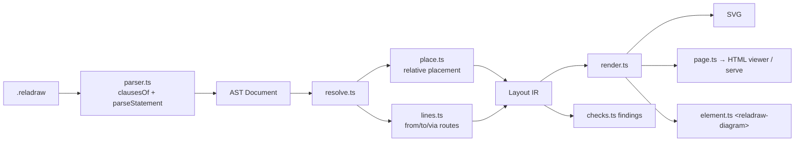
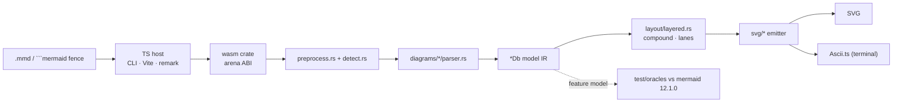
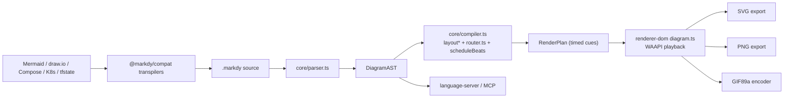
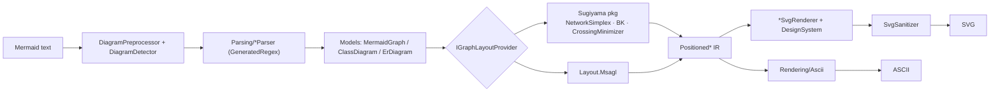

# Weekly scan — diagram tooling (2026-11-15)

Cửa sổ quét: push trong khoảng 2026-11-08 → 2026-11-15. Nguồn: GitHub search theo topic (`diagram-as-code`, `dsl`, `svg-animation`, `graph-visualization`, `layout-algorithm`, `graph-layout`, `mermaid`) và keyword (`diagram`, `layout-engine`, created trong 30 ngày qua). Bốn repo được deep-dive dưới đây đều đã được clone và đọc code (README, cây thư mục, entry point, các module core, manifest, ít nhất 1 example).

## Executive summary

- **Tuần này nổi lên hai repo tái hiện Mermaid ở mức production**: **Ondine** (Rust → WASM, kiểm tra parser bằng *oracle* so với chính Mermaid 12.1.0 kèm fuzz) và **Mermaider** (.NET thuần, AOT, layout provider thay được). Cả hai nên vào bench `benches/mermaid-format` bên cạnh merman, và cách Ondine làm oracle cùng ghi divergence gần như trùng với conformance suite của kymo, đáng học theo.
- **reladraw** là DSL đáng đọc nhất về thiết kế ngôn ngữ. Vị trí được viết tương đối (`below a (gap: tight)`, `even with b`), engine không tự sắp xếp cũng không tự route. Khi có overlap, nó chỉ in *findings* chứ không sửa. Triết lý "vẽ đúng như viết, cảnh báo khi trông sai" có thể đem dùng cho `kymo check`.
- **markdy** là đối thủ trực tiếp gần nhất với kymo (architecture diagram có animation). Mô hình `beat` (storyboard) được compile thành `RenderPlan` với cue có timing rồi phát bằng WAAPI. Repo phình tính năng khá nhiều (AI-healing, drift, provenance…) nên nên học mô hình animation hơn là học kiến trúc.

## Table of contents

1. [Candidate shortlist](#candidate-shortlist)
2. [reladraw/reladraw](#1-reladrawreladraw)
3. [wevm/ondine](#2-wevmondine)
4. [HoangYell/markdy-com](#3-hoangyellmarkdy-com)
5. [nullean/mermaider](#4-nulleanmermaider)

## Candidate shortlist

| Repo | ★ | Push gần nhất | Lý do | Quyết định |
|---|---|---|---|---|
| reladraw/reladraw | 1197 | 11-13 | DSL vị trí tương đối, không auto-layout | **deep-dive** |
| wevm/ondine | 450 | 11-11 | Mermaid → SVG bằng Rust/WASM, oracle-tested | **deep-dive** |
| HoangYell/markdy-com | 106 | 11-14 | DSL architecture có animation (WAAPI) | **deep-dive** |
| nullean/mermaider | 60 | 11-12 | Mermaid thuần .NET, Sugiyama tách package | **deep-dive** |
| Latias94/merman | 666 | 11-14 | Mermaid headless bằng Rust, đã có trong bench kymo | theo dõi |
| swiftlysingh/excalidraw-cli | 321 | 11-09 | Text/JSON → `.excalidraw`, cross-format | glance |
| ythx-101/live-panel-skill | 859 | 11-12 | JSON/Excalidraw → animated architecture mp4/web | glance |
| Goblinmine/homelab-diagram | 1067 | mới (11-07) | YAML inventory → SVG/PNG | glance |
| kieler/elkjs | 2897 | 11-09 | Có commit, chưa thấy release đáng chú ý | ignore tuần này |
| plantuml/plantuml | 13418 | 11-14 | Hoạt động thường lệ | ignore |

Bị loại: agent-skill "beautiful diagram" (archify, diagram-design, stack-diagram: chủ yếu là prompt), graph-viz/analytics (G6, pygraphistry, networkx), markdown editor có nhúng Mermaid.

---

## 1. reladraw/reladraw

### §1 Quick context

- **Pitch:** DSL diagram mà người viết *tự nói vật nào nằm đâu* theo kiểu tương đối, đứng giữa Mermaid (auto-layout) và draw.io (tọa độ tuyệt đối).
- **Stack:** TypeScript, không có runtime dependency (devDeps chỉ có `typescript`, `@types/node`). Output là SVG, cùng một trang HTML viewer.
- **Health:** 1197★, 1 contributor. Release `v0.30.1` (2026-11-12), nhịp release dày. Repo không có workflow CI và không có file test được track. Không nhận PR.
- **Distribution:** npm `reladraw` (bin `reladraw`), web component qua jsDelivr, có playground.

### §2 Architecture deep-dive

**A. Component inventory** (~25k LOC trong `src/`)
- `Lexer` (`src/lexer.ts`): bộ lexer chỉ dùng regex trên từng dòng để highlight. Comment ghi rõ đây "không phải parser thứ hai". Vocabulary của nó import từ `ast.ts`, nhờ vậy sinh được TextMate/Vim grammar.
- `Parser` (`src/parser.ts`, 3.9k dòng): `clausesOf` gom các statement (cho phép statement trải nhiều dòng thụt lề), `parseStatement` dispatch sang `parseNode/parseEdge/parseBundle/parseRegion/parseStyle/...`.
- `AST` (`src/ast.ts`): định nghĩa `Placement`, `PlacementTarget`, `Side`, `Part`.
- `Resolve` (`src/resolve.ts`, 2.4k): áp `default`/style và dựng cây `LayoutNode`.
- `Place` (`src/place.ts`, 2.8k): tính vị trí từng box.
- `Lines` (`src/lines.ts`, 2.3k): dựng hình học edge từ `from:/to:/via:`.
- `Checks` (`src/checks.ts`): sinh *findings* (`text-overlap`, `edge-node-overlap`…).
- `Render` (`src/render.ts`): emit SVG. `Page`/`Serve`/`Viewer` (`src/page.ts`, `serve.ts`) lo trang viewer và live reload.
- `Element` (`src/element.ts`): custom element `<reladraw-diagram>`.
- `Format` (`src/format.ts`): formatter căn statement thành cột.

**B. Pipeline** (`src/index.ts:draw`)
1. User chạy `reladraw render a.reladraw -o a.svg` (`src/cli.ts`).
2. `parse(text)` trả về `Document`, tức danh sách `Stmt`.
3. `resolve(doc, opts)` trả về `Layout`. Bước này gọi `place` để giải vị trí và `lines` để dựng route.
4. `render(layout)` trả về chuỗi SVG.
5. `findings(layout, checks)`: cảnh báo được in ra nhưng **không chặn** việc render.
6. SVG được ghi ra file. Nếu lỗi nằm trong một statement nhiều dòng, `blame()` chỉ đúng dòng gây lỗi.

**C. IR.** Gồm hai tầng: AST (`Stmt` union) và `Layout`/`LayoutNode` (`src/model.ts`) với tọa độ tuyệt đối. `LayoutNode` lưu sẵn `body` để resolver và renderer "không thể bất đồng". Mỗi đại lượng được tính lười rồi memo lại, nên trên thực tế IR được xây dần chứ không qua nhiều pass mutate.

**D. Input language.** Parser recursive descent viết tay trên token. Grammar không có EBNF, `SYNTAX.md` (1272 dòng) là spec bằng văn xuôi. Lỗi ném ra `SourceError` kèm số dòng. Example:
```
node app.api "API"  below app.ui (gap: tight)
node store "Database"  right of app (gap: 12)  even with app.api
edge parser -> renderer "HN" from: left to: right via: parser top, renderer top
```

**E. Layout.** **Không có auto layout.** Theo comment của `place.ts`: "Nothing here is solved and nothing is pushed". Mỗi trục của mỗi box đến từ đúng một statement, phụ thuộc được giải theo thứ tự topo, và vòng lặp phụ thuộc thì báo lỗi kèm danh sách placement gây ra nó. Container lấy kích thước theo outline của con cộng padding. Edge mặc định là đường thẳng; muốn đường vuông góc thì khai báo `path: square, corners: rounded` cùng waypoint `via:`. Không có crossing minimization, vì đó là chủ đích thiết kế.

**F. Rendering.** Chỉ có một backend SVG. Diagram tĩnh không có animation; viewer dùng CSS `@keyframes` (dash chạy) để tô sáng luồng upstream/downstream khi click vào node (`src/page.ts:319`). Có `--page` để xuất HTML một file.

**G. Extensibility.** Không có plugin system. Theme khai báo trong `src/themes.ts`, icon trong `src/icons.ts` (có letter-icon). Có `default node/edge` để override style.

**H. DX.** Đây là điểm mạnh nhất: `check`, `format`, `serve` (trang source cạnh diagram, live reload, click box thì highlight statement) và `install-skill` (cài skill cho agent đúng phiên bản đang dùng).

### §3 Architecture diagram



### §4 Verdict

- **Học cho kymo:** (1) *Findings mà không auto-fix*. kymo đã có `alignment.py` resolve; có thể thêm `kymo check` chạy trên `Diagram` đã resolve, báo overlap text/edge-node mà không đổi output, và golden không bị ảnh hưởng. (2) Lexer dùng chung vocabulary với parser để sinh TextMate grammar giúp extension VS Code của kymo không bị lệch. (3) `blame()` cho statement nhiều dòng. (4) `install-skill` đi kèm phiên bản.
- **Red flags:** không CI, không test, một tác giả, syntax đổi liên tục (README tự cảnh báo).
- **Open question:** placement hoàn toàn tường minh còn chịu nổi khi diagram vượt ~50 node không?
- **Verdict:** **study deeper** (thiết kế DSL và DX).

---

## 2. wevm/ondine

### §1 Quick context

- **Pitch:** compile Mermaid sang SVG ngay lúc build bằng Rust. Trang web chỉ ship SVG và một runtime 210 byte, không kèm renderer.
- **Stack:** Rust (crate `compiler` khoảng 125k LOC, crate `wasm`), TypeScript wrapper (CLI, Vite plugin, remark). Output là SVG monochrome theo CSS vars, cùng ASCII cho terminal.
- **Health:** 450★, tác giả wevm (jxom, tmm), phần lớn commit gắn nhãn "Claude". Version npm `0.0.3`, có changesets. CI đầy đủ (`main.yml`, `verify.yml`, `benchmarks.yml`, `screenshots.yml`).
- **Distribution:** npm `ondine` (bin, `ondine/compiler`, `ondine/compiler/wasm`, `ondine/remark`, plugin Vite).

### §2 Architecture deep-dive

**A. Component inventory**
- `Preprocess` (`crates/compiler/src/preprocess.rs`): bỏ front matter, directive và comment. `yaml.rs` là YAML parser tự viết.
- `Detect` (`src/detect.rs`): nhận diện loại diagram.
- Mỗi loại diagram có `lexer.rs / parser.rs / db.rs / render.rs`, ví dụ `diagrams/flowchart/`. Có 33 loại, mỗi loại là một **cargo feature**.
- `Layout` (`src/layout/layered.rs` 5.5k, `compound.rs`, `lanes.rs`).
- `SVG` (`src/svg/{builder,edges,shapes,cluster,theme}.rs`).
- `Text` (`src/text/{measure,label}.rs`): đo chữ theo font monospace (600/1000 em, glyph rộng là 1200), không cần font table hay DOM.
- `WASM ABI` (`crates/wasm/src/lib.rs`): bump arena, `alloc/reset/render`, buffer kết quả được length-prefix.
- `CLI` (`src/cli/bin.ts`, `Ascii.ts`, `Markdown.ts`).
- `Oracles` (`test/oracles/*`).

**B. Pipeline**
1. User chạy `ondine diagram.mmd` (hoặc import `.mmd` qua Vite).
2. TS host nạp module WASM (mỗi loại diagram một module, hoặc `all`), rồi `alloc` và copy source vào.
3. `render`: preprocess, detect, `parser.rs` (hand-written, tái hiện Jison grammar và báo *đúng lỗi tại đúng token*), `db.rs` (model), `layout` rồi emit SVG.
4. Buffer trả về gồm `type, width, height, links, svg`, hoặc khi lỗi là `code, line, column, snippet`.
5. Host ghi file `.svg`. Trên trang web, `mount` chỉ chèn SVG đã compile sẵn.

**C. IR.** Mỗi loại diagram có một `*Db` struct riêng (mô phỏng "database" của Mermaid). Layout dùng các vector `LNode/LEdge` có index. Mutable theo pass (`spread`, `assign_tracks`, `straighten`, `settle`, `snap`). Không có lower IR chung; feature `model` serialize Db ra JSON để test parity.

**D. Input language.** Đây là Mermaid. Parser recursive descent viết tay, *port của "Pele"* (một dự án MIT, không xác định rõ là gì). 19 grammar jison của Mermaid được vendor ở `test/oracles/grammars/` để làm oracle.

**E. Layout.** Sugiyama layered (`layered.rs`), với thứ tự mục tiêu được ghi rõ: (1) các line phân biệt được, nhờ port spread và `assign_tracks`; (2) `reduce_crossings` bằng sweep cộng `count_crossings`; (3) đường ngắn và đơn giản; (4) edge chạm giữa cạnh; (5) cân bằng; (6) giữ thứ tự khai báo; (7) gọn. Edge vuông góc có góc bo. Có `compound.rs` cho subgraph và `lanes.rs` cho swimlane.

**F. Rendering.** Chỉ có backend SVG (cộng ASCII trong CLI, cộng Worker render ảnh cho README). Theme dùng `--ondine-*` CSS custom properties, đổi theme không cần compile lại. Không có animation.

**G. Extensibility.** Thêm loại diagram tức là thêm module dưới `diagrams/` cộng một cargo feature. Không có plugin runtime.

**H. DX.** CLI dùng `incur` (zod schema). Có remark plugin, Vite plugin, CLI render được Mermaid fence trong Markdown, và screenshot test.

### §3 Architecture diagram



### §4 Verdict

- **Học cho kymo:** (1) **Oracle testing**: so accept/reject, detected type và model với *chính Mermaid* trên corpus cộng seeded mutation (`FUZZ`, `SEED`), mỗi divergence bắt buộc phải có record giải thích (`Divergences.ts`), mà record đó cũng được test. Mô hình này giống `conformance/known_divergences.json` của kymo nhưng thêm fuzz; kymo có thể fuzz `.kymo` corpus để soi parity Python↔JS. (2) Mỗi loại diagram là một cargo feature, cho ra nhiều WASM nhỏ. Hướng này áp được cho `kymostudio-core` nếu sau này core phải gánh parse/layout. (3) Đo chữ bằng monospace cố định nên output giống hệt nhau trên mọi host.
- **Red flags:** v0.0.3; nhiều code là "port of Pele" mà không có link upstream rõ ràng; đo chữ monospace sẽ lệch với font proportional.
- **Verdict:** **study deeper**, và thêm ngay vào bench Mermaid như engine thứ 4.

---

## 3. HoangYell/markdy-com

### §1 Quick context

- **Pitch:** DSL cho architecture diagram *có kịch bản animation* (`beat`), compile ra `RenderPlan` rồi phát 60fps bằng Web Animations API.
- **Stack:** TypeScript monorepo (pnpm): `core` không có dependency, cùng `renderer-dom`, `compat`, `cli`, `mcp-server`, `language-server`, `vscode`, `astro`, `mdx`. Output là DOM/SVG live, SVG vector, PNG, GIF89a.
- **Health:** 106★, khoảng 4 contributor (một phần là "Yell Agent"), v1.5.8 (2026-11-14). CI chạy typecheck, lint, test, `gate`, `verify:examples` và visual baseline.
- **Distribution:** npm `@markdy/*`, VS Code Marketplace / Open VSX, MCP server.

### §2 Architecture deep-dive

**A. Component inventory**
- `Parser` (`packages/core/src/parser.ts`, 1.3k): dựa trên regex và indentation block.
- `Compiler` (`packages/core/src/compiler.ts`, 2.4k): `compilePlan(ast, theme)`, cộng 17 hàm `layout*` (ranked, tree, constellation, swimlane, gantt, venn, radar…).
- `Router` (`packages/core/src/router.ts`): Manhattan router có `allocatePortLanes`.
- `Player` (`packages/core/src/player.ts`).
- `Syntax diagnostics` / `ai-healing.ts` / `arch-lint.ts` / `diff.ts` / `drift.ts`.
- `Renderer` (`packages/renderer-dom/src/diagram.ts` 3k, `edges.ts`, `nodes.ts`, `sequence.ts`…).
- `Export` (`renderer-dom/src/export/{svg,png,gif}-exporter.ts`, `gif-encoder.ts`).
- `Compat` (`packages/compat/src/mermaid/mermaid-transpiler.ts`, `infra/`): Mermaid, draw.io, Compose, K8s, tfstate, tất cả transpile sang *source MarkdyScript*.
- `LSP` (`packages/markdy-language-server/src/index.ts`).

**B. Pipeline**
1. User chạy `markdy render system.markdy` (`packages/cli/src/index.ts`, có các lệnh `lint/fmt/render/import/diff/verify/doctor…`).
2. `parse(source)` trả về `DiagramAST`; lỗi là `ParseError(line)`, warning nằm trong `diagnostics`.
3. `compilePlan(ast, theme)`: tính kích thước adaptive, `assignRanks`, `layout*` theo loại diagram, route edge, rồi `scheduleBeats` cho ra `TimedCue[]` và `BeatRange[]`.
4. `createDiagram(plan)` dựng DOM, mỗi cue là một `element.animate()`. Playback được điều khiển bằng `anim.currentTime = sceneMs` nên deterministic.
5. Exporter cho ra SVG/PNG/GIF.

**C. IR.** Hai tầng rõ ràng: `DiagramAST` (record `nodes/edges/groups/patterns/beats/diagnostics`) và `RenderPlan` (node có vị trí, edge đã route, cue có timing). Đây đúng là kiểu "compile to lower IR"; renderer chỉ playback.

**D. Input language.** Parser dùng regex theo block thụt lề (`TOP_LEVEL_KEYWORDS_RE`, …) với "soft-body recovery" khi MDX làm mất indent, cộng biến `$name` thay thế bằng chuỗi. Không có EBNF (spec nằm trong `docs/SYNTAX.md`). Example:
```
layout LR
cache Redis "Redis Cluster"
beat cache_hit "1. Cache Hit Path":
  show $nodes stagger=60ms
  frame Client Gateway Svc Redis zoom=1.12
  Client -> Gateway "GET /link" -> Svc "resolve"
```

**E. Layout.** Hierarchical rank đơn giản: ranking, sắp thứ tự trong rank bằng barycenter theo cha, gom theo group (`compiler.ts:355`), snap grid 4. Router orthogonal có port lane và tránh vật cản bằng cách đếm số giao cắt của các route ứng viên (`routeAroundObstacles`). Không có network simplex hay BK.

**F. Rendering.** Renderer chính là DOM với animation qua WAAPI (CSS keyframe không được dùng). Static export là SVG/PNG/GIF. Mỗi exporter là một module riêng, không phải interface emitter chung.

**G. Extensibility.** Có `stdlib-systems` (vocabulary node kind), `recipes.ts`, `theme-generator.ts`. Không có plugin API chính thức.

**H. DX.** LSP, VS Code extension, playground "Studio", MCP server, lệnh `fmt`, `lint`, `doctor`.

### §3 Architecture diagram



### §4 Verdict

- **Học cho kymo:** (1) Mô hình **beat**: các bước `show / frame zoom / flow` được compile thành cue có timing ngay từ lúc compile. Nếu kymo có timeline animation dạng khai báo thì nên sinh lịch trong resolver, để `to_svg.py` vẫn "dumb". (2) **Importer ra source DSL** (chứ không ra model), giúp user sửa tiếp được; đáng cân nhắc cho BPMN → `.kymo`. (3) `currentTime` deterministic sẽ có ích khi kymo render animation ra WebP.
- **Red flags:** tính năng phình to (AI-healing, provenance, drift, C4…), 17 layout dồn trong một file, parser regex, router dựa trên heuristic.
- **Verdict:** **study deeper** riêng phần animation/beat; phần còn lại chỉ glance.

---

## 4. nullean/mermaider

### §1 Quick context

- **Pitch:** parser, layout và SVG renderer cho Mermaid viết hoàn toàn bằng .NET: không browser, không JS, hỗ trợ Native AOT, layout engine thay được.
- **Stack:** C# (168 file `.cs` dưới `src/`), các package `Mermaider`, `Mermaider.Cli`, `Sugiyama`, `Mermaider.Layout.Msagl`. Output là SVG (đã sanitize theo allowlist) và ASCII.
- **Health:** 60★, 3 contributor (chủ yếu Martijn Laarman). Release `0.17.0` (2026-11-12). CI chạy đa OS, có benchmarks và test (`tests/Mermaider.Tests`, `Sugiyama.Tests`).
- **Distribution:** NuGet `Mermaider`, dotnet tool `Mermaider.Cli` (lệnh `mermaid`).

### §2 Architecture deep-dive

**A. Component inventory**
- `MermaidRenderer` (`src/Mermaider/MermaidRenderer.cs`): facade gồm `RenderSvg`, `RenderSvgAsync` (Stream/PipeWriter), `Parse`, `RenderAscii`, `SetLayoutProvider`.
- `Parsing/*` (`DiagramDetector.cs`, `DiagramPreprocessor.cs`, `FlowchartParser.cs`, … khoảng 28 parser).
- `Models/*`: `MermaidGraph`, `ClassDiagram`, `ErDiagram`.
- `Layout/IGraphLayoutProvider.cs` cùng `DefaultLayoutProvider.cs`, `SequenceLayout.cs`, `ArchitectureLayout.cs`.
- `Sugiyama` (`src/Sugiyama/Internal/`): `CycleRemover`, `NetworkSimplexRanker`, `NestingGraphRanker`, `CrossingMinimizer`, `BkCoordinateAssigner`, `FlowEdgeRouter`, `DirectionTransform`.
- `Mermaider.Layout.Msagl`: provider dùng Microsoft MSAGL.
- `Rendering/*SvgRenderer.cs` và `DesignSystem.*.cs`, `Rendering/Ascii/`.
- `SvgSanitizer.cs`, `SvgValueAllowlist.cs`.

**B. Pipeline**
1. User chạy `mermaid diagram.mmd` (CLI), hoặc gọi `MermaidRenderer.RenderSvg(text)`.
2. `MermaidRenderPipeline.Execute` gồm preprocess rồi `DiagramDetector`.
3. Gọi `*Parser` tương ứng, trả về model (`MermaidGraph`, …).
4. `IGraphLayoutProvider.LayoutFlowchart/Class/Er` trả về `PositionedGraph`.
5. `*SvgRenderer` cộng `DesignSystem` cho ra SVG, rồi `SvgSanitizer` lọc theo allowlist trước khi xuất.

**C. IR.** C# class theo từng loại: model đã parse, sau đó là `Positioned*` (tọa độ). Đây là kiểu lowering từ model xuống bản positioned; mức mutable/immutable giữa các pass chưa xác định.

**D. Input language.** Mermaid. Parser là các `[GeneratedRegex]` theo dòng, có **timeout regex** (chống ReDoS), cộng `MermaidResourceLimitException` khi vượt giới hạn tài nguyên. Không có grammar formal.

**E. Layout.** Sugiyama "đủ bộ" như dagre/ELK: network simplex ranking, nesting-graph cho subgraph, crossing minimizer, Brandes-Köpf coordinate assignment, router orthogonal. Có MSAGL làm provider thay thế. Sequence và architecture có layout riêng.

**F. Rendering.** Backend gồm SVG và ASCII. Theme sinh từ chỉ `--bg`/`--fg`, mọi token được tính bằng `color-mix()` theo tỷ lệ đảm bảo contrast ≥4.5:1 (`DESIGN.md`). Có 3 preset `Quiet/Blueprint/Tonal`. Không có animation.

**G. Extensibility.** Layout provider là interface. Theme qua `RenderOptions`. Có `StrictStylingValidator` để giới hạn style người dùng.

**H. DX.** dotnet tool CLI, gallery playground có query params, skill cho agent đi kèm từng package.

### §3 Architecture diagram



### §4 Verdict

- **Học cho kymo:** (1) Theme **chỉ từ 2 màu** cộng `color-mix()` theo tỷ lệ đã kiểm contrast, kèm bảng token được tài liệu hóa trong `DESIGN.md`. Áp được cho theme SVG của kymo mà không phải nhân bản palette. (2) Tách Sugiyama thành package riêng sau một interface provider, đúng hướng nếu `layout.py` của kymo muốn cắm ELK/MSAGL. (3) SVG sanitizer allowlist, cần thiết nếu MCP worker của kymo trả SVG cho bên thứ ba.
- **Red flags:** parser regex khó đạt parity lỗi với Mermaid (khác với Ondine); ít người đóng góp.
- **Verdict:** **glance only**, ngoại trừ `DESIGN.md` thì đáng đọc kỹ.
