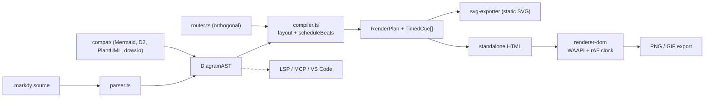
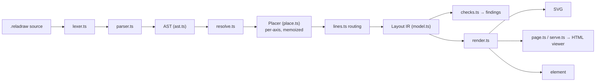
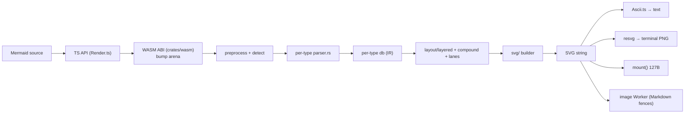
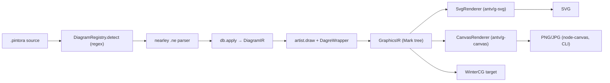

# Weekly scan — diagram tooling (2026-11-16)

Cửa sổ quét: 2026-11-09 → 2026-11-16. Nguồn: GitHub search theo topic (`diagram-as-code`, `dsl`, `svg-animation`, `graph-visualization`, `layout-algorithm`, `pushed:>2026-11-09 stars:>50`) và theo keyword (`diagram created:>2026-10-17 stars:>100`). Tìm đủ ≥4 ứng viên nên không cần fallback 3 (scan release ecosystem). Mỗi repo được shallow-clone và đọc trực tiếp (README, cây thư mục, manifest, entry point, core modules, example, CI). File path trích dẫn tương đối theo root của repo đó.

## Executive summary

- **markdy-com là đối thủ trực tiếp nhất của kymo**: DSL kiến trúc *có animation* với `beat`/cue storyboard → Web Animations API (WAAPI), orthogonal router riêng, importer Mermaid/D2/PlantUML, LSP + MCP. Nhưng **SVG export là static** (animation chỉ chạy trong DOM/HTML), và con số "17 layout engines" bị thổi phồng. Đây chính là khoảng trống kymo đang lấp: animated SVG thuần, không cần JS.
- **reladraw và ondine là hai thái cực về layout, cả hai đáng học**: reladraw *không auto-layout*. Mỗi axis của mỗi box có đúng một câu lệnh định nghĩa, và mọi vấn đề trả về dưới dạng *findings* có số đo. ondine là một bản Rust→WASM chạy Mermaid nhanh hơn Mermaid 328–563×, mỗi diagram type là một Cargo feature. ondine kiểm parity bằng differential oracle (jison thật + fuzz), mô hình rất gần conformance suite của kymo.
- **pintora (trưởng thành, 1.3k★) là reference tốt về IR hai tầng**: DiagramIR → GraphicsIR (Mark tree) → SVG/Canvas, cộng một diagram registry dạng plugin. Tuần này repo chỉ có bugfix. Đáng tham khảo cho kiến trúc, không phải cho tính mới.

## Table of contents

1. [HoangYell/markdy-com](#1-hoangyellmarkdy-com) — animated architecture DSL (study deeper)
2. [reladraw/reladraw](#2-reladrawreladraw) — relative-placement DSL, no solver (study deeper)
3. [wevm/ondine](#3-wevmondine) — Mermaid → SVG compiled in Rust/WASM (study deeper)
4. [hikerpig/pintora](#4-hikerpigpintora) — extensible text-to-diagram lib (glance only)
5. [Ứng viên đã loại](#ung-vien-da-loai)

---

## 1. HoangYell/markdy-com

### §1 — Quick context
- **Pitch:** DSL "MarkdyScript" cho architecture explainer có *storyboard animation theo beat*. Khác Mermaid/D2 ở chỗ thời gian là thành phần first-class của ngôn ngữ.
- **Stack:** TypeScript pnpm monorepo (tsup, vitest). `@markdy/core` không có runtime dep. Output: DOM+SVG có WAAPI, standalone HTML, static SVG, PNG (html2canvas), GIF (encoder tự viết).
- **Health:** 106★, khoảng 4 committer (1 người + agent "Yell Agent"), v1.5.8, có CI (typecheck, unit, headless Chrome layout/animation tests), 37 test files.
- **Distribution:** npm `@markdy/*`, VS Code Marketplace/Open VSX, web markdy.com.

### §2 — Architecture deep-dive

**A. Component inventory**
- `Parser` (`packages/core/src/parser.ts`, 1347 LOC): source → `DiagramAST`.
- `Compiler` (`packages/core/src/compiler.ts`, 2371 LOC): sizing, toàn bộ layout, beat scheduling, rồi tạo `RenderPlan`.
- `Router` (`packages/core/src/router.ts`): orthogonal Manhattan có obstacle avoidance và port lanes.
- `Diagnostics / arch-lint / ai-healing` (`packages/core/src/syntax-diagnostics.ts`, …): lint governance kiến trúc và prompt sửa lỗi cho LLM.
- `Renderer-dom` (`packages/renderer-dom/src/diagram.ts` 3088 LOC, `edges.ts`, `nodes.ts`): dựng DOM scene và WAAPI player.
- `SVG exporter` (`packages/renderer-dom/src/export/svg-exporter.ts`): static vector SVG.
- `Compat` (`packages/compat/src/`): transpiler Mermaid, D2, PlantUML, draw.io, compose, k8s, tfstate (khoảng 200–260 LOC mỗi cái).
- `CLI` (`packages/cli/src/index.ts`), `MCP server` (`packages/mcp-server/src/tools.ts`), `LSP` (`packages/markdy-language-server`), `VS Code` (`packages/vscode`).

**B. Happy path**
1. User chạy `markdy render x.markdy --out y.html`, vào `renderCommand` (`cli/src/index.ts:109`).
2. `parse(source)` trả về `DiagramAST` (`parser.ts:895`).
3. `compilePlan(ast, theme)` chạy adaptive sizing → `layoutNodes` → group bounds → `scheduleBeats`, tạo `RenderPlan` (`compiler.ts:2323`).
4. Với `.svg`, `renderPureVectorSvg(plan)` ghi file static. Ngược lại, `buildStandaloneHtml` nhúng runtime (`cli/src/index.ts:334-343`).
5. Trong browser, `createDiagram` tạo các WAAPI animation ở trạng thái paused, và một vòng rAF set `anim.currentTime = sceneMs` (`diagram.ts:1739-1749`).

**C. IR.** Hai tầng: `DiagramAST` (nodes, edges, groups, beats, diagnostics) và `RenderPlan` (node đã có vị trí, edge đã route, `TimedCue[]{start,duration,kind}`) (`core/src/ast.ts:292-400`). Cả hai là plain type mutable (không có `readonly`). `compilePlan` mutate `ast.meta.width/height`. `TimedCue` chính là "animation IR".

**D. Input language.** Parser viết tay, line/indent-based, match statement bằng regex, có soft recovery. Không có EBNF ("Formal Grammar" trong `AGENT.md` thực chất là TS IDL của AST). Lỗi: `ParseError` với prefix `line N:`, ví dụ `unknown cue '${head}'; use show, hide, glow, focus, frame, or use` (`parser.ts:470`).

```
scene theme=paper
user Visitor
gateway ApiGateway
service OrderService
cache Redis
database OrdersDb
group storage: Redis OrdersDb
beat checkout "Follow the checkout request":
  frame ApiGateway OrderService storage zoom=1.12 dur=500ms
  Visitor -> ApiGateway "POST /order" -> OrderService
  OrderService -> Redis "cache write" & OrderService -> OrdersDb "persist"
```
(`examples/03-beats-and-groups.markdy`)

**E. Layout.** "17/18 engines" thực ra là các giá trị `type=` dispatch qua một `switch` (`compiler.ts:1640-1681`), quy về khoảng 14 hàm. `architecture`/`flowchart`/`state`/`sequence` dùng chung `layoutRanked`. Phần lớn còn lại là template hình học cố định 50–150 LOC (pyramid, venn, radar…). `layoutRanked` gồm: longest-path ranking qua Kahn (`assignRanks`, `compiler.ts:282`), barycenter một pass có tôn trọng group, và 4 sweep adjacent-swap để giảm crossing. Không dùng elk/dagre. Edge routing là orthogonal, bo góc (`renderer-dom/src/geometry/path.ts`).

**F. Rendering.** Cue `show/hide/glow/focus/frame` và flow chain `->`/`~>` được map sang `element.animate()` (25 call site): dash reveal, packet dot (`edges.ts:531,593`). `frame` transform một camera layer. `&` cho chạy song song, `stagger=`/`dur=` chỉnh timing. Default durations là hằng số (show 0.35s, flow 0.55s; `compiler.ts:179-189`). Không có pluggable emitter. **SVG export không có animation** (không SMIL, không `@keyframes`).

**G. Extensibility.** Node kinds và diagram types hard-code (`core/src/registry.ts`, `system-vocabulary.ts`). Theme dạng token table (`themes.ts`, `theme-generator.ts`). Không có plugin API.

**H. DevEx.** Khoảng 20 subcommand (lint, fmt, render, import, diff, drift, verify…), LSP + VS Code live preview, playground web, MCP server, Astro/MDX integration. Không có `watch`.

### §3 — Architecture diagram


### §4 — Verdict
- **Học cho kymo:**
  - *beat/cue* như một tầng timeline riêng (`TimedCue[]` trong IR) thay vì nhúng animation vào từng edge. Có thể map sang CSS `animation-delay` trong SVG của kymo.
  - Camera cue `frame … zoom=` (mỗi beat focus vào một vùng) là feature mà animated SVG làm được bằng `viewBox` animation.
  - Dùng `&` để chạy song song trong một dòng.
- **Red flags:**
  - Phần lớn code do AI viết.
  - God-files 2–3k LOC.
  - `annotations.slice(0, 2)` lặng lẽ bỏ mọi annotation sau cái thứ hai.
  - Claim layout bị thổi phồng.
  - Importer nông.
- **Open question:** họ có định làm animated SVG thuần không? Nếu có, kymo mất lợi thế khác biệt.
- **Verdict: study deeper**, chủ yếu về DSL animation và theo dõi như competitor.

---

## 2. reladraw/reladraw

### §1 — Quick context
- **Pitch:** DSL "nói box nằm ở đâu" (relative placement), không solver, không tự né. Nằm giữa D2 (auto) và draw.io (tọa độ tuyệt đối).
- **Stack:** TypeScript, zero runtime dep, Node ≥18. Output: SVG, HTML viewer page, `<reladraw-diagram>` web component.
- **Health:** 1197★ (tạo 2026-09), 1 maintainer, **không nhận PR**, v0.31.1. **Không CI, không test** trên khoảng 28k LOC. 50 commit trong 7 ngày (0.24 → 0.31.1, khoảng 1 release/ngày).
- **Distribution:** npm `reladraw`, jsDelivr, playground GitHub Pages.

### §2 — Architecture deep-dive

**A. Component inventory**
- `Lexer` (`src/lexer.ts`): tokenize một dòng, giữ position.
- `Parser` (`src/parser.ts`, 3.9k LOC): statements → AST (`src/ast.ts`). `blame` map lỗi về đúng dòng vật lý.
- `Grammar highlighter` (`src/grammar.ts`): regex scanner không bao giờ fail, dùng lại cho editor.
- `Resolver` (`src/resolve.ts`): styles, defaults, icons, node tree, edges, rồi gọi Placer.
- `Placer` (`src/place.ts`, `class Placer` dòng 204): tính position/size theo từng axis.
- `Lines` (`src/lines.ts`) + `src/linetexts.ts`: edge routing và edge label.
- `Checks` (`src/checks.ts`): "findings" (overlap, crossing).
- `Renderer` (`src/render.ts`), `Page/serve` (`src/page.ts`, `src/serve.ts`), `Formatter` (`src/format.ts`).

**B. Happy path**
1. `reladraw render x.reladraw -o x.svg` (`src/cli.ts:84`).
2. `parse(text)`: `clausesOf` gộp các dòng continuation thụt lề, rồi chạy `parseStatement` (`src/parser.ts:111,138,262`).
3. `resolve(doc)`: tree + edges → `new Placer(...).run()` → edge stops → `normalize`/`bounds` (`src/resolve.ts:401-478`).
4. `render(layout)` tạo SVG string (`src/index.ts`).
5. `findings(layout, checks)` in warning một dòng, rồi ghi file.

**C. IR.** AST là plain TS interfaces (`Document{statements}`, `NodeStmt`, `Placement`). AST được viết lại theo kiểu functional (`expandEach`). Lower IR là `Layout/LayoutNode/LayoutEdge` (`src/model.ts`) với tọa độ tuyệt đối, được Placer mutate in-place và memoize từng quantity.

**D. Input language.** Lexer viết tay + recursive descent theo từng statement, không lồng nhau. "A value ends when its own shape is complete", nên thứ tự từ là tự do. Không có EBNF, chỉ có prose `SYNTAX.md` (1901 dòng). `design.org` được cite 121 lần trong code nhưng **không có trong repo**. Lỗi là `SourceError` dạng `file:line: msg`, fail-fast. Spelling cũ bị từ chối kèm gợi ý thay thế, ví dụ: `"a distance is never negative, so … is not one — to overlap, place it inside or on the other"` (`src/place.ts:181`).

```
node app "Web app"
node app.ui  "Interface"
node app.api "API"  below app.ui (gap: tight)

node store "Database"  right of app (gap: 12)  even with app.api

edge app.api -> store  "queries"
```
(`README.md`)

**E. Layout.** "Nothing here is solved and nothing is pushed" (`src/place.ts:1-20`).
- Mỗi quantity được tính theo dependency, memoize. Vòng lặp → lỗi *circular placement*.
- Từ vựng:
  - `right of`, `below-left of`
  - gap `none/tight/normal/wide` = 0/2/4/8 unit (1 unit = 12px)
  - `even with`, `top even with a bottom`, phân số `3/4 down a`
  - nhiều target (`right of a, b and c`, đặt theo bbox chung)
  - `inside/outside/on`
- Bị từ chối theo luật: một axis nói 2 lần, kích thước âm ("inside out"), axis bỏ ngỏ.
- Container: box = outline con + padding; có layout `column`/`venn`/`deck`.
- Edge: mặc định straight, opt-in `square`/`curved`, có `via:` waypoints, bundle.
- Không crossing minimization. Crossing được vẽ *jump* (`crossing: gap|arc|square`).

**F. Rendering.** Một backend SVG, không pluggable. Diagram không có animation. Viewer page chỉ có CSS keyframes (pulse khi select, dash chảy upstream/downstream; `src/page.ts:451-469`).

**G. Extensibility.** Shape built-in cố định (gồm `flow-*`). Icon tự định nghĩa qua `icon` với inline `"""svg"""` (`src/resolve.ts:880`). Theme qua `style`/`default`, named theme (`src/themes.ts`). Không plugin.

**H. DevEx.**
- CLI `render/check/format/serve/note/install-skill`, có help (`src/cli.ts:30-55`).
- `serve` watch + live reload, kèm Versions menu.
- `format` căn statement thành cột.
- Không LSP.
- Agent là first-class user: skill, `llms-full.txt`, `note`.

### §3 — Architecture diagram


### §4 — Verdict
- **Học cho kymo:**
  - Kymo đã có parent/child anchoring trong `alignment.py`. Từ vựng của reladraw (`even with`, `3/4 down a`, multi-target bbox, gap token 0/2/4/8) là một bộ chuẩn hóa đáng tham khảo cho DSL placement.
  - Quy tắc "mỗi axis đúng một nguồn" giúp loại bỏ xung đột constraint mà không cần solver.
  - *Findings* có số đo (`text-overlap … 3 units wide`) tách khỏi error, tương tự hướng `bpmn-lint`.
  - Crossing được vẽ bằng jump thay vì tối ưu.
- **Red flags:** không test/CI, breaking change mỗi minor, doc thiết kế bị thiếu, text đo bằng monospace mặc định.
- **Open question:** mô hình này còn scale được với diagram trên 50 node không?
- **Verdict: study deeper** (`SYNTAX.md` + `place.ts`).

---

## 3. wevm/ondine

### §1 — Quick context
- **Pitch:** compile Mermaid → SVG ahead-of-time bằng Rust/WASM, nên trang web ship SVG chứ không ship renderer. Monochrome, monospace.
- **Stack:** Rust 2024 (compiler crate zero dep) + TS wrapper (vite, zod CLI). Output: SVG, ASCII, terminal image (resvg).
- **Health:** 450★ (tạo 2026-10-18), khoảng 4 người + bot (37/58 commit do Claude), v0.0.3. CI mạnh: fmt, clippy `-D warnings`, cargo test, vitest + Playwright screenshot.
- **Distribution:** npm `ondine` (crates không publish), image Worker ondine.sh.

### §2 — Architecture deep-dive

**A. Component inventory**
- `compiler` (`crates/compiler`): pipeline thuần. Clippy cấm fs/env/time/HashMap để đảm bảo determinism (`AGENTS.md`).
- `wasm` (`crates/wasm/src/lib.rs`): cdylib ABI viết tay, bump-arena allocator reset mỗi render.
- `Preprocess/detect` (`crates/compiler/src/preprocess.rs`, `detect.rs`, `yaml.rs`): front matter, directive, nhận diện type. YAML parse tay.
- `Diagram modules` (`crates/compiler/src/diagrams/<type>/`): 33 type, mỗi type có lexer/parser/db/render riêng, **mỗi type là một Cargo feature**.
- `Layout` (`crates/compiler/src/layout/{layered,compound,lanes}.rs`).
- `SVG` (`crates/compiler/src/svg/{edges,shapes,cluster,theme}.rs`), `Text` (`crates/compiler/src/text/measure.rs`: monospace cố định 0.6em).
- `TS API` (`src/Render.ts`, `src/internal/Wasm.ts`), `Mount` (`src/Mount.ts`), plugin `src/vite`, `src/remark`, `src/cli`.

**B. Happy path**
1. `render(src)` từ `ondine/compiler` lazy-load `all.fast.generated.wasm` (`src/compiler/index.ts`).
2. JS copy source + options JSON vào wasm memory, gọi `render` (`src/internal/Wasm.ts`).
3. Rust kiểm limit → preprocess → detect → `diagrams::find` (`crates/compiler/src/lib.rs`).
4. `render` của từng type: parse → db → layout → SVG string.
5. Trả `{svg,width,height,links,type}`. Browser `mount(el, svg)` chỉ set `innerHTML` (runtime 127 B gzip).

**C. IR.** Không có IR chung. Mỗi type có db/model riêng (`diagrams/flowchart/db.rs`). Lower graph IR `LNode/LEdge` (layered) và `CNode/CEdge` (compound) bị các pass mutate in-place. JSON model export chỉ có sau feature `model` (test-only).

**D. Input language.** Chính là cú pháp Mermaid, mục tiêu "accept and reject the same input as Mermaid 12.1.0". Parser viết tay, tương đương Jison grammar "that reports the same errors at the same tokens" (`diagrams/flowchart/parser.rs`). Không có grammar riêng: 19 file jison của Mermaid được vendor về làm **test oracle + fuzzing** (`test/oracles/README.md`). Error có code (`syntax/semantic/limit/unsupported-diagram`) và vị trí UTF-16, ví dụ `Expecting 'SPACELINE', 'MINDMAP', got 'NODE_ID'`.

```
sequenceDiagram
  participant Browser
  participant Server
  Browser->>Server: GET /orders
  alt cached
    Server-->>Browser: 304 Not Modified
  else fresh
    Server-->>Browser: 200 OK
  end
```

**E. Layout.** Sugiyama port tay trong `layered.rs` (5.5k LOC):
- DFS cycle breaking, longest-path ranking.
- Barycenter sweeps giữ best order (`reduce_crossings`, dòng 2536), median alignment.
- Edge pass: `spread` (port theo cạnh), `assign_tracks`, `straighten`, `snap`.
- `compound.rs` layout group lồng nhau đệ quy với border port; `lanes.rs` cho swimlane.
- Float được tính đúng thứ tự phép toán JS (kể cả copy `Math.hypot` của V8) để byte-match với Pele.
- Edge thực tế vẫn là cubic curve. "Rounded orthogonal" trong README chưa được làm (`.agents/design.md`).

**F. Rendering.** Chỉ SVG (string builder `svg/builder.rs`). Theme là CSS custom properties `--ondine-*`, đổi scheme không cần re-render. Không có animation. ASCII/PNG là post-processor đi từ SVG.

**G. Extensibility.** Thêm type = module + Cargo feature + entry trong `diagrams::find`. **Cố ý không có plugin** ("Avoid global registration, mutable singletons…", `AGENTS.md`).

**H. DevEx.** CLI `--ascii/--print/--check`. Rewrite fence mermaid trong Markdown thành `<picture>` trỏ tới image Worker (chạy được trên GitHub README). Có Vite plugin `.mmd`, remark plugin, playground. Không LSP, không watch.

**Bench** (`bench/comparison.md`, 33 type, 612 vector), so với Pele 1.6 và Mermaid 12.1:

| Đo | Kết quả |
|---|---|
| Chrome warm, `all` speed module | 1.99× nhanh hơn Pele, **563×** nhanh hơn Mermaid |
| Mount runtime | 127 B, so với 1.5 MB của Mermaid |

### §3 — Architecture diagram


### §4 — Verdict
- **Học cho kymo:**
  - (1) Differential oracle: chạy jison/Mermaid thật + fuzz làm golden. Kymo đang làm conformance Python↔JS bằng golden tĩnh; có thể thêm fuzz cho `.kymo` parser.
  - (2) Ép determinism bằng clippy ban (HashMap/time/fs) cho `packages/rust/kymostudio`.
  - (3) Feature-gated wasm per diagram type kèm size log (`bench/size.md`) cho `kymostudio-core`.
  - (4) Theme bằng CSS variables trong SVG output.
  - (5) Markdown fence → image Worker.
  - Kymo đã build trên merman (dugong), nên ondine là benchmark đáng chạy so sánh trong `benches/mermaid-format`.
- **Red flags:** port từng dòng của Pele (không phải engine gốc), README hứa hơn code, `#![expect(dead_code)]`, v0.0.x.
- **Verdict: study deeper** (oracle + bench methodology).

---

## 4. hikerpig/pintora

### §1 — Quick context
- **Pitch:** thư viện text-to-diagram mở rộng được kiểu plugin (8 type), có IR đồ họa trung gian nên render được cả SVG lẫn Canvas, chạy trên browser, Node và edge runtime.
- **Stack:** TS monorepo (pnpm, turbo, jest). Parser nearley + moo. Layout `@pintora/dagre` (fork, ngoài repo). Render `@antv/g-svg`/`g-canvas` 0.5.
- **Health:** 1282★, khoảng 3 contributor, v0.8.x. CI: jest, codecov, Percy visual. Tuần này chỉ có fix NaN cho sequence block rỗng và build Node 26.
- **Distribution:** npm `@pintora/*`, UMD standalone, CLI, WinterCG target.

### §2 — Architecture deep-dive

**A. Component inventory**
- `@pintora/core` (`packages/pintora-core/src`): GraphicsIR/Mark types (`types/graphics.ts`), registries, config engine, `parseAndDraw`.
- `DiagramRegistry` (`packages/pintora-core/src/diagram-registry.ts`): đăng ký diagram, detect type bằng regex.
- `Diagrams` (`packages/pintora-diagrams/src/*`): mỗi type có `parser/*.ne` + `db.ts` + `artist.ts` + `config.ts`.
- `Shared grammars` (`packages/pintora-diagrams/shared-grammars/*.ne`): `@config`, `@param`, comment, style.
- `DagreWrapper` (`packages/pintora-diagrams/src/util/dagre-wrapper.ts`).
- `Renderer` (`packages/pintora-renderer/src/renderers/{SvgRenderer,CanvasRenderer}.ts`).
- `Standalone` (`packages/pintora-standalone/src/index.ts`), `CLI` (`packages/pintora-cli/src/cli.ts`), `Harness` (`packages/pintora-harness`, dùng để review output do AI tạo).

**B. Happy path**
1. `pintora render -i x.pintora -o x.png` gọi `handleRenderCommand` (`pintora-cli/src/cli.ts`), có thể fork subprocess.
2. `render-impl.ts` patch global bằng jsdom/node-canvas, gọi `renderTo`.
3. `parseAndDraw` (`pintora-core/src/index.ts`): pre-block, rồi `detectDiagram` (regex đầu tiên khớp thì thắng, mặc định là sequence), rồi `clear()`, rồi `parser.parse`.
4. nearley sinh action, `db.apply()` gom lại thành DiagramIR (`er/db.ts`).
5. `artist.draw(ir)` layout (dagre) và trả về GraphicsIR Mark tree.
6. Renderer duyệt các mark lên antv/g, rồi serialize ra SVG/PNG.

**C. IR.** Hai tầng rõ ràng (`pintora-core/src/type.ts`):
- DiagramIR theo type.
- GraphicsIR (`Figure{mark,width,height}`; mark gồm group/rect/text/path/marker/symbol…, mỗi mark có `attrs`, `matrix`, `itemId`).

Về mutability: db là module-singleton reset bằng `clear()`; layout trả kết quả qua callback `onLayout` mutate; hook `enhanceGraphicIR` cho phép sửa IR sau artist.

**D. Input language.** Grammar nearley (`.ne`) per type + `@include` shared grammar, compile sang TS (`scripts/build-grammar.js`). Ambiguity xử lý bằng cách lấy kết quả đầu tiên (`dedupeAmbigousResults`). Có preprocessing "hack" (xóa dòng trống; `util/parser-util.ts`). Lỗi cú pháp dùng nguyên message của nearley.

```
erDiagram
  CUSTOMER ||--o{ ORDER : places
  ORDER ||--|{ LINE-ITEM : contains
  ORDER {
    int orderNumber PK
    string deliveryAddress
  }
```
(`packages/test-shared/example-files/er-1.pintora`)

**E. Layout.**
- Sugiyama qua dagre fork cho activity/class/component/er/mindmap/dot.
- Sequence/gantt layout tự viết trong artist.
- `splines: polyline | ortho` (`util/graph.ts`). `curved` được vẽ sau bằng d3 `curveBasis`.
- Crossing minimization nằm trong fork ngoài repo, nên không xác định được.

**F. Rendering.** SVG + Canvas qua antv/g. `rendererRegistry.register` tồn tại nhưng type chỉ có `'svg'|'canvas'`. Không có animation. Có `eventRecognizer` map event đồ họa về diagram item.

**G. Extensibility.** `diagramRegistry.registerDiagram(name, {pattern, parser, artist, eventRecognizer?, configKey?, clear})`. Có `themeRegistry` (default/dark/lark), `symbolRegistry`, config deep-merge + `@config` trong DSL.

**H. DevEx.** CLI chỉ có `render`. Có React live editor (PWA), docs site, script `watch`, Percy visual test. Không LSP.

### §3 — Architecture diagram


### §4 — Verdict
- **Học cho kymo:**
  - Một Mark-tree IR giữa layout và emitter sẽ khiến `to_svg`/`to_figma`/`to_excalidraw` dùng chung một tầng primitive. Hiện mỗi emitter của kymo đi thẳng từ `Diagram`.
  - `itemId` trên mỗi mark + event recognizer hữu ích cho editor.kymo.studio (click shape → nhảy về source line).
  - Có WinterCG target.
- **Red flags:** singleton db (không re-entrant), CLI patch `globalThis.window`, detect type bằng regex rồi fallback im lặng, antv/g 0.5 đã cũ, layout core nằm ngoài repo.
- **Verdict: glance only.** Không có gì mới trong tuần; giá trị chủ yếu là reference kiến trúc.

---

## Ứng viên đã loại

| Repo | Lý do |
|---|---|
| plantuml/plantuml, goadesign/model | Repo lâu năm, tuần này chỉ có commit thường lệ, không có release notable |
| ythx-101/live-panel-skill (860★) | Agent skill + renderer JSON → mp4/web loop, khoảng 4.6k LOC. Gần chủ đề animated architecture nhưng chủ yếu là template video, không phải DSL/layout |
| Goblinmine/homelab-diagram (1.1k★) | YAML → SVG, khoảng 1k LOC một file `build.py`, layout cố định theo inventory |
| caru-ini/stack-diagram, bassnova42/arch-diagram-skill | Agent skill/prompt pack, không phải engine |
| Qiuner/birdview | Map kiến trúc code cho AI, không phải diagram tooling |
| Các repo Windows "LanFlow", "Visio 2026 desktop" | Có dấu hiệu repo spam/phát tán binary. Loại |
| antvis/G6, networkx, codebase-memory-mcp | Graph-vis/analysis library, không phải text-to-diagram |
