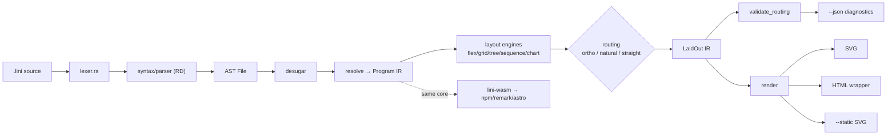
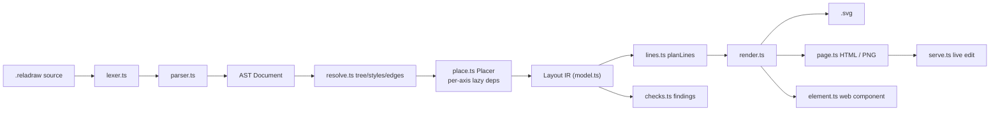
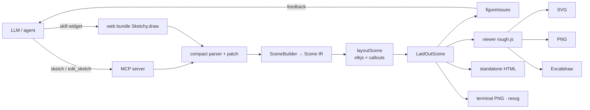
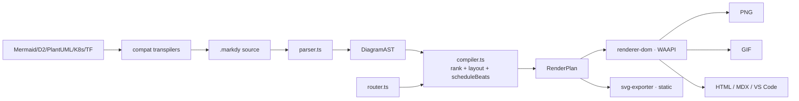

# Weekly scan — diagram tooling · 2026-11-17

> Cửa sổ quét: `pushed:>2026-11-10` (topic-based) + `created:>2026-10-18` (keyword-based). Deep-dive 4 repo (đã clone shallow, đọc source); 6 repo khác ghi ở mục *Honorable mentions*.

## Executive summary

- **Routing có "luật" là chủ đề nổi bật tuần này.** `monfa-red/lini` (Rust) có orthogonal router viết rõ thành spec. Nó dùng Dijkstra trên channel decomposition, cost = `length + 2·clearance/turn + 4·clearance/crossing`, đặt track bằng isotonic regression (PAV) và có validator luật độc lập. Đây là ứng viên tốt nhất để thay heuristic fan-in/trunk staggering trong `alignment.py`.
- **Ngoài auto-layout còn hai hướng khác.** `reladraw` đặt vị trí *tương đối* theo từng trục và cấm nói một trục hai lần. `sketchy` thì giao cho ELK hoàn toàn, nhưng có vòng feedback hậu-render gửi lỗi về LLM và giữ layout ổn định khi sửa. Cả hai đều tách *error* (không vẽ) khỏi *finding/warning* (vẫn vẽ, kèm cảnh báo). Pattern này nên đưa vào kymo CLI/MCP.
- **Animated architecture DSL đã có đối thủ trực tiếp.** `markdy-com` có cú pháp `beat` storyboard và chạy animation bằng WAAPI scrub (paused animation + rAF set `currentTime`). Tuy nhiên SVG export của nó là tĩnh. Lợi thế "animated SVG portable" của kymo vẫn còn nguyên. Đáng mượn: bỏ edge `response` (`<-`) khỏi bước ranking, và line-hop tại giao điểm.

## Table of contents

1. [monfa-red/lini](#1-monfa-redlini) — study deeper
2. [reladraw/reladraw](#2-reladrawreladraw) — study deeper
3. [ddkbs/sketchy](#3-ddkbssketchy) — study deeper
4. [HoangYell/markdy-com](#4-hoangyellmarkdy-com) — glance only
5. [Honorable mentions](#honorable-mentions)
6. [Phương pháp & giới hạn](#phương-pháp--giới-hạn)

---

## 1. monfa-red/lini

### §1 — Quick context
- **Pitch:** Một ngôn ngữ (một grammar) cho mọi loại hình: flowchart, chart, sequence, ER, bản vẽ kỹ thuật, schematic. SVG xuất ra dùng CSS var `light-dark()` nên vẫn đổi theme được sau export. Router orthogonal tuân theo các luật kiểm chứng được.
- **Stack:** Rust 2024. Runtime deps: `clap`, `libm`, `ttf-parser` (optional). Output: SVG, HTML wrapper (`--format html`), `--static` (bake var + outline text).
- **Health:** 161★. Thực tế ~1 dev (+1 commit ngoài). Tag `v1.1.1` (2026-11-14). CI (`.github/workflows/ci.yml`) chạy fmt, clippy, doc, test và wasm byte-parity. Snapshot test bằng `insta`.
- **Distribution:** crates.io (`cargo install lini`); npm `lini-wasm`, `remark-lini-lang`, `rehype-lini`, `astro-lini`; playground web.

### §2 — Architecture deep-dive
**A. Component inventory**
- `Lexer` (`src/lexer.rs`): tách source thành token.
- `Parser` (`src/syntax/parser/mod.rs`): recursive descent, sinh `syntax::ast::File`.
- `Desugar` (`src/desugar/`): hạ template/`define` xuống primitive, gắn class `.lini-*`.
- `Resolve` (`src/resolve/ir.rs`): xử lý cascade/vars, sinh `Program`.
- `Layout` (`src/layout/`): các engine flex, grid, stack, tree, sequence, chart, drawing, schematic, floorplan; sinh `LaidOut`.
- `Routing` (`src/routing/{ortho,natural,straight.rs,validate.rs}`): chọn strategy theo scope, sau đó validate theo luật.
- `Render` (`src/render/`): sinh SVG + stylesheet.
- `Fmt`, `Grammar` gen, `Serve` (`src/fmt.rs`, `src/grammar/`, `src/serve/`).
- `lini-wasm` (`crates/lini-wasm/src/lib.rs`): bản chạy trên browser.

**B. Pipeline** (`src/lib.rs`: `parse_stage` → `resolve_pipeline` → `compile_program`)
1. `lini foo.lini`: `main.rs` (clap) đọc file, gọi `compile_str_checked`.
2. `lexer::lex` → `parser::parse` → AST.
3. `desugar` → `resolve::resolve_with_env` → `Program`.
4. `layout::layout`: các engine đặt node; routing chạy trên layout đã xong → `LaidOut`.
5. `validate_routing` + `layout_hints` sinh diagnostics; `render::render` sinh SVG.
6. Bọc HTML nếu cần, rồi ghi ra `-o` hoặc stdout.

**C. Data model / IR.** Có 3 tầng: AST (`syntax/ast.rs`) → `resolve::Program` (`scene`, `links: Vec<ResolvedLink>`, `vars`, `sheet`) → `layout::LaidOut` (`nodes: Vec<PlacedNode>`, `links: Vec<RoutedLink>`, `link_report`, `strays`). Mỗi pass dựng struct mới; riêng `render::lower_paints(&mut laid_out)` mutate tại chỗ. Các engine sequence/chart/drawing tự lower xuống cây primitive ngay trong layout (SPEC, mục "Three seams").

**D. Input language.** Parser recursive descent viết tay, 1-token lookahead. **Có EBNF** trong SPEC §22. Cú pháp: `{}` cho style, `[]` cho children, `|type#id|` cho node. Diagnostics mang `Span`, `Code` ổn định theo `Phase`, kèm `Suggestion` máy áp dụng được; xuất JSON qua `--json` (`src/error/mod.rs`).
```
{ |svc::box| { fill: --teal-wash; stroke: --teal-ink } }
|group| "Services" [ |svc#api| "API"; |svc#auth| "Auth" ]
|svc#db| "Postgres"
api  -> db "read"
auth -> db "write"
```

**E. Layout.** Node đặt theo kiểu CSS (flex/grid/stack/tree), do tác giả khai báo, không có auto hierarchical và không có crossing minimization. Phần đáng giá là **routing** (`ROUTING.md`). Router chạy trên layout bất biến và phải thỏa 4 luật kiểm được trên output: Clearance, Contact, Economy, Determinism.
- **Bước 1 — Keep-out:** bbox nở thêm `clearance` (16).
- **Bước 2 — Channel:** sweep decomposition không gian trống thành channel H/V có capacity.
- **Bước 3 — Bundle:** gom link theo thứ tự khai báo.
- **Bước 4 — Tìm đường:** Dijkstra trên cell với cost `len + 2c·turn + 4c·crossing`. Route đã commit không bao giờ dời.
- **Bước 5 — Đặt track:** giải isotonic regression bằng pool-adjacent-violators quanh midline.
- **Bước 6 — Bo góc:** bo đồng tâm cho các wire rẽ cùng nhau.

Fan `a -> b & c` chọn side theo tổng cost cả nhóm. Link không route được thành "stray" và gây lỗi khi chạy `--strict`.

**F. Rendering.** Một backend SVG (+ HTML wrapper). Không có animation. Paint đi qua CSS class/var; output byte-deterministic.

**G. Extensibility.** `define` (`|name::base|`), template built-in (`desugar/types.rs`), theme CSS `--lini-*`, palette OKLCH. Không có plugin system.

**H. Dev experience.** Các lệnh `fmt`, `serve` (live reload), `--watch`, `--check`, `--json`. Grammar TextMate (VS Code) và tree-sitter (Zed) đều được generate từ một "ledger" chung, `schema/lini.schema.json` cũng vậy. LSP mới ở ROADMAP.

### §3 — Architecture diagram


### §4 — Verdict
- **Takeaways cho kymo:**
  - Cost function và channel capacity + PAV track placement là mô hình có nguyên tắc, thay được heuristic fan-in/trunk-lane staggering trong `alignment.py`/`alignment.ts`.
  - "Fan priced as fan" áp dụng thẳng cho fan-in.
  - Một **rule validator độc lập với router** dùng được làm test oracle, bổ sung cho golden SVG byte-for-byte.
  - Editor grammar sinh từ một ledger, rất hợp khi kymo phải giữ đồng bộ hai parser Py/JS.
- **Red flags:** bus factor ~1; SPEC 5.4k dòng với phạm vi rất rộng; router greedy theo thứ tự khai báo nên kết quả phụ thuộc thứ tự đó.
- **Open questions:** hiệu năng Dijkstra khi diagram lớn? Vì sao layout không có crossing minimization?
- **Verdict:** **study deeper**. Đọc `ROUTING.md` + `src/routing/ortho/`.

---

## 2. reladraw/reladraw

### §1 — Quick context
- **Pitch:** Diagram dạng text, mỗi box được đặt *tương đối* bằng lời (`right of a`, `even with b`). Không auto-layout như Mermaid/D2, cũng không dùng toạ độ tuyệt đối như draw.io.
- **Stack:** TypeScript thuần, 0 runtime deps. Output: SVG, HTML tự chứa (`--page`, có nút tải PNG phía client), web component `<reladraw-diagram>`.
- **Health:** 1.200★ (repo tạo 2026-09). 1 contributor. `v0.31.2` (2026-11-15), khoảng 50 commit trong tuần. **Không có CI, không có test.**
- **Distribution:** npm `reladraw` (CLI), jsDelivr (`dist/element.js`), playground GitHub Pages.

### §2 — Architecture deep-dive
**A. Component inventory**
- `Lexer` (`src/lexer.ts`): tokenizer theo dòng, dùng chung regex highlighter với playground.
- `Parser` (`src/parser.ts`, 3.9k LOC): statement → AST.
- `AST` (`src/ast.ts`): bản ghi trung thực những gì tác giả viết, chưa có hình học.
- `Resolver` (`src/resolve.ts`): dựng cây node, áp style/default, dựng edge.
- `Placer` (`src/place.ts`, 2.8k LOC): tính toạ độ.
- `Lines` (`src/lines.ts`): route cho line.
- `Checks` (`src/checks.ts`): sinh "findings" (cảnh báo hình học).
- `Render` (`src/render.ts`): xuất SVG.
- `Page`/`Serve` (`src/page.ts`, `src/serve.ts`): viewer HTML và live server.
- `Format` (`src/format.ts`): formatter.
- `Element` (`src/element.ts`): custom element.

**B. Pipeline** (`src/index.ts:draw`)
1. `reladraw render foo.reladraw`: `cli.ts` đọc file.
2. `parse()` gom các dòng thụt lề thành statement → `Document`.
3. `resolve()` chạy `buildTree` → `buildEdges` → `Placer.run()` → `normalize` (dịch theo margin), ra `Layout`.
4. `render(layout)` gọi `planLines` rồi ghép chuỗi SVG.
5. `findings()` in cảnh báo dạng `file:line: warning(kind): …`.
6. Ghi ra `.svg`, hoặc `.html` nếu dùng `--page`.

**C. Data model / IR.** AST là immutable. `Layout`/`LayoutNode` (`src/model.ts`) là mutable: Placer ghi thẳng `x/y/width/height`, memo theo từng trục trong `Map`, toạ độ tính theo frame của container. Không có IR thấp hơn; SVG được build bằng string.

**D. Input language.** Parser viết tay, line-oriented, có reader đệ quy cho từng keyword (`parseNode`, `parseEdge`…). Thụt lề chỉ dùng để nối dòng; phân cấp đi qua tên có dấu chấm (`cluster.hub`). Không có EBNF; `SYNTAX.md` viết bằng văn xuôi. Lỗi là `SourceError(line)`, và `blame()` chỉ đúng dòng trong statement nhiều dòng. Message thường kèm gợi ý cách viết đúng.
```
style synced  fill: theme-primary-subtle  border: theme-primary
default edge  line: (path: curved)
node cluster.hub "Cloud sync"  badge: package  style: synced
node cluster.desktop1 "Desktop 1 / Linux" (inside top, align: left)  above-left of cluster.hub (gap: tight)
edge cluster.desktop1.files <-> cluster.hub  style: synced  from: right  to: top
```

**E. Layout (điểm cốt lõi).** Không có solver và không đẩy box. Mô hình là **đồ thị phụ thuộc theo từng trục, đánh giá lazy** (header của `place.ts`):
- Mỗi trục x/y của mỗi box do **đúng một** placement quyết định. Nói hai lần là lỗi, kể cả khi hai giá trị trùng nhau.
- `extentOf` đệ quy có memo, dùng tập `working`/`trail` để phát hiện vòng phụ thuộc và in vòng đó ra.
- Gap là các hằng rời rạc (`none/tight/normal/wide` = 0/2u/4u/8u).
- `right of a` định gap trên trục chính và căn giữa trục kia; phần căn giữa nhường cho pin `even with` trên cùng trục.
- Container ôm các con; có `layout: row|column|deck|venn`.

Routing (`lines.ts`): mặc định straight. `square` có một "free leg" chỉnh bằng `turn:`, ngoài ra có `curved`, waypoint `via:` và bundle. Edge trùng nhau được fan thành làn song song, bước `FAN_STEP = 16` (`lines.ts:117`). **Không có crossing minimization, không né obstacle**; chỗ chồng lấn chỉ được báo qua 9 loại finding (`checks.ts`).

**F. Rendering.** Một emitter SVG (+ `renderTagged` cho viewer). Không có animation trong SVG; `@keyframes` chỉ dùng để highlight trong page viewer.

**G. Extensibility.** Không có plugin system. Icon built-in (`icons.ts`); icon custom bằng SVG inline hoặc file. Theme chỉ đổi màu, không đổi hình học. Có `style`/`default`.

**H. Dev experience.** Lệnh `render/check/format/serve`. `serve` live-reload bằng `fs.watch`, sửa ngay trong trang; click box thì dòng nguồn được highlight. Có agent skill + `docs/llms*.txt`. Không có LSP.

### §3 — Architecture diagram


### §4 — Verdict
- **Takeaways cho kymo:**
  1. Luật "mỗi trục chỉ nói một lần" + phát hiện vòng phụ thuộc khi đánh giá lazy là mô hình rõ ràng hơn so với 5-pass resolver hiện tại. Đáng thử cho parent/child anchoring.
  2. Tách **error** khỏi **findings** (`file:line: warning(kind)`) giúp agent tự sửa.
  3. Gap là từ vựng rời rạc (tight/normal/wide), hợp với DSL hướng LLM.
  4. Click-to-source trong `serve` đáng làm cho kymo editor.
- **Red flags:** không có test, không có CI; 1 tác giả; grammar thay đổi liên tục; file 4–5k LOC; `design.org` được trích trong comment nhưng không có trong repo.
- **Open questions:** hiệu năng khi diagram lớn chưa rõ. Viral 1.2k★ trong 2 tháng nhưng adoption thực tế ra sao?
- **Verdict:** **study deeper**. Đọc `place.ts`, `lines.ts`.

---

## 3. ddkbs/sketchy

### §1 — Quick context
- **Pitch:** MCP server/skill: LLM chỉ khai báo *cái gì* bằng line syntax gọn; Sketchy tự lo layout (ELK), callout và vẽ hand-drawn, có step walkthrough.
- **Stack:** TypeScript (Node ≥20). Deps: `elkjs`, `roughjs`, `zod`, `@modelcontextprotocol/sdk`, `@resvg/resvg-js`, `sharp`. Output: SVG, PNG, Excalidraw, HTML standalone.
- **Health:** 442★. 1 contributor. Tag `v0.2.0` (2026-11-12). Có CI (build, typecheck, vitest, prettier) và 17 file test.
- **Distribution:** npm `@ddkbs/sketchy` (bin `sketchy`), bundle `.mcpb`, skill zip (load bundle qua jsDelivr), plugin cho Claude Code và Cursor.

### §2 — Architecture deep-dive
**A. Component inventory**
- `MCP server` (`src/index.ts`, `src/server.ts`): các tool `sketch`, `edit_sketch`, `search_parts`.
- `Compact parser` (`src/scene/compact.ts`): line syntax → `CompactScene`.
- `Patch` (`src/scene/patch.ts`): diff/merge cho `edit_sketch`.
- `Zod schemas` (`src/tools/schemas.ts`): đường JSON legacy.
- `SceneBuilder` (`src/scene/builder.ts`, `fill.ts`): validate tham chiếu, ném `SceneError`.
- `Layout` (`src/layout/index.ts`, `callouts.ts`, `text.ts`): ELK + callout planner.
- `Figures` (`src/figures/*`): chart, plot, molecule, map.
- `Viewer` (`viewer/src/render.ts`, `export.ts`, `excalidraw.ts`): render rough.js và export.
- `Standalone` (`src/standalone.ts`, `src/terminal.ts`): HTML offline, PNG qua resvg.
- `Web bundle` (`web/sketchy.ts`): `Sketchy.draw()` trên browser.

**B. Pipeline**
1. Agent gọi tool `sketch({scene})`.
2. `parseCompact` → `CompactScene`, rồi `fillScene`/`SceneBuilder` → `Scene`.
3. `layoutScene` đo text, plan callout, dựng ELK graph và gọi `elk.layout`. Nếu không chỉ định `dir`, nó chạy cả RIGHT lẫn DOWN và chọn theo `readability()` (`layout/index.ts:171`).
4. `collect` → `LaidOutScene` (toạ độ tuyệt đối); `figureIssues` kiểm tra overlap và tràn canvas.
5. Server trả text kèm feedback và structuredContent; viewer MCP App vẽ SVG bằng rough.js.

**C. Data model / IR.** `Scene` (`src/scene/types.ts`, "what, never where", không có toạ độ) được hạ xuống `LaidOutScene` (`src/scene/laid-out.ts`, mọi element có `Rect`/`points`). Patch dùng `structuredClone` (copy-on-write). Server giữ `lastScene`/`lastLayout` để xử lý follow-up.

**D. Input language.** Line DSL (mỗi dòng một element) + block `draw … end`. Parser regex viết tay, không có grammar formal. Lỗi dạng `Line N ("…"): why`. Sau render, server gửi thêm "Sketchy noticed: …" để LLM tự sửa qua `edit_sketch`.
```
title How a web request works
dir right
group net The internet
browser Browser @globe ~ Shown on hover
server Server @server in net !accent
server --> db query
step Request: The browser asks the server | browser server browser->server
```

**E. Layout.** Hoàn toàn tự động bằng `elkjs` layered: `ORTHOGONAL` routing, `NETWORK_SIMPLEX` placement (`layout/index.ts:365,377`), `INCLUDE_CHILDREN` cho group lồng nhau, port `FIXED_POS`. Callout được plan **trước** ELK thành margin của node, xếp 2 cột theo độ cao anchor để leader không cắt nhau. Với follow-up, `followUpHints` truyền vị trí cũ vào cycleBreaking/layering `INTERACTIVE` và tắt crossing minimization để giữ **layout ổn định qua các lần sửa**.

**F. Rendering.** Một renderer trong viewer (rough.js, `roughness` 0.4–0.9). Export SVG, PNG, Excalidraw; PNG cho terminal qua resvg. "Animation" chỉ là step highlight + slider, không xuất SMIL/CSS animation.

**G. Extensibility.** Icon qua Iconify (`lucide:`, `simple-icons:`). Parts sinh tự động từ wokwi. Template hard-code. Không có plugin system; theme cố định.

**H. Dev experience.** `npm run preview` (Vite), `--http` mode, script `token-benchmark.mjs`. Không có watch CLI hay IDE extension; preview inline trong MCP Apps.

### §3 — Architecture diagram


### §4 — Verdict
- **Takeaways cho kymo:**
  1. Vòng feedback hậu-render (overlap/tràn → text gửi về LLM), áp dụng được vào `kymo-mcp` worker.
  2. `edit_sketch` patch theo id + ELK interactive hints để giữ vị trí cũ, đáng làm cho editor/MCP.
  3. Thử 2 hướng layout rồi chọn theo điểm `readability()`, rẻ và hiệu quả.
  4. Callout được plan thành margin trước khi layout.
  5. Token benchmark: line DSL tốn khoảng 500 token so với 4.1k của JSON tool schema. Đây là số liệu ủng hộ việc expose `.kymo` (thay vì JSON) cho agent.
- **Red flags:** bus factor 1; parser regex không có grammar; state theo session trong `server.ts`; skill load CDN theo minor-range.
- **Open questions:** ELK có deterministic giữa các lần chạy không? Có định export animation không?
- **Verdict:** **study deeper**, tập trung vào thiết kế input hướng LLM + feedback loop, không phải layout.

---

## 4. HoangYell/markdy-com

### §1 — Quick context
- **Pitch:** DSL kiến trúc với các "beat" storyboard. Khác Mermaid/D2 ở chỗ diagram là animation WAAPI 60fps chạy theo timeline (request/response/event), chứ không phải SVG tĩnh.
- **Stack:** TypeScript pnpm monorepo (tsup, vitest). `@markdy/core` không có deps; renderer chỉ cần `html2canvas`. Output: DOM/HTML live, SVG tĩnh, PNG, GIF.
- **Health:** 106★. Thực tế 1 dev + bot agent commit. `v1.5.8` (2026-11-14). Có CI và tests. Tuần này có 9 commit (CAD themes, blueprints, offline export).
- **Distribution:** 9 package npm `@markdy/*`, VS Code/Open VSX, MCP server, playground.

### §2 — Architecture deep-dive
**A. Component inventory**
- `Parser` (`packages/core/src/parser.ts`, 1.3k LOC): source → `DiagramAST`, kiểm tra reference và cycle.
- `AST` (`core/src/ast.ts`): `DiagramAST`/`Cue`/`EdgeKind`.
- `Compiler` (`core/src/compiler.ts`, 2.4k LOC): rank, layout theo `type`, schedule cue → `RenderPlan`.
- `Router` (`core/src/router.ts`): Manhattan + port lanes.
- `Geometry` (`renderer-dom/src/geometry/path.ts`): `routeOrthogonal` thử nhiều candidate, line-hop (`findSegmentHops`), đặt label.
- `DOM renderer` (`renderer-dom/src/diagram.ts`, `nodes.ts`, `edges.ts`): node là `<div>`, edge là overlay `<svg>`, animation bằng WAAPI.
- `Exporters` (`renderer-dom/src/export/`): `svg-exporter.ts`, `png-exporter.ts`, `gif-encoder.ts` (GIF89a tự viết).
- `Compat` (`packages/compat/src/`): transpile Mermaid/D2/PlantUML/Compose/K8s/Terraform/Draw.io → `.markdy`.
- `CLI`, `LSP`, `MCP` (`packages/cli`, `markdy-language-server`, `mcp-server`).

**B. Pipeline**
1. `markdy render foo.markdy --out x.svg|x.html`.
2. `parse()`: chia block theo indent, khớp regex theo keyword, thay `var`, expand `pattern` → `DiagramAST`.
3. `compilePlan(ast, theme)`: sizing → `layoutNodes` (dispatch theo `type`) → `scheduleBeats` → `RenderPlan`.
4. Ra `.svg` thì gọi `renderPureVectorSvg(plan)` (tĩnh); ra `.html` thì nhúng renderer (`--offline` nếu cần).
5. Trên browser, `createDiagram()` dựng DOM rồi scrub WAAPI theo `currentTime`.

**C. Data model / IR.** `DiagramAST` (khai báo) được hạ xuống `RenderPlan` (node đã có vị trí, edge đã route, `TimedCue`, `BeatRange`). Đều là plain object dựng mới mỗi pass, không mutate chéo (`docs/ARCHITECTURE.md`).

**D. Input language.** Parser viết tay theo kiểu line/indent + regex (`FLOW_OP_RE`), có tokenizer riêng cho flow chain `A -> B "x" -> C`. Không có EBNF; grammar mô tả bằng văn xuôi (`docs/SYNTAX.md`). `ParseError` có line/col. `ai-healing.ts` sửa lỗi theo heuristic và sinh repair prompt.
```
queue PriorityQueue "Constrained Buffer Queue" focal=true
worker BatchProcessor "Worker Pool (concurrency=4)"
beat fanin_convergence "1. High-Concurrency Fan-In":
  show ProducerA ProducerB PriorityQueue stagger=30ms
  ProducerA ~> PriorityQueue "5,000 tx/sec"
  PriorityQueue -> BatchProcessor "pull batch"
```

**E. Layout.** Tự động, khoảng 16 hàm `layout*` theo `type` (ranked, tree, swimlane, gantt…). `assignRanks` là longest-path kiểu Kahn, **bỏ qua edge `response` (`<-`)** để edge chiều trả về không làm méo rank. Crossing minimization: barycenter + 4 sweep adjacent-swap, giữ cluster theo group (`compiler.ts:330-420`). Route orthogonal né obstacle, có port lanes cho fan-in và line-hop tại giao điểm.

**F. Rendering.** Mọi WAAPI animation để paused; một vòng rAF gán `currentTime = sceneMs`, tức seek deterministic. Edge có dash-reveal + packet dot; camera zoom theo beat. **SVG export mất animation**; không có emitter pluggable.

**G. Extensibility.** Thêm node kind/cue phải sửa tay 4–5 file (`system-vocabulary.ts` → `registry.ts` → `ast.ts` → `compiler.ts` → `edges.ts`). Có 12 theme và `theme-generator.ts`. Không có plugin API.

**H. Dev experience.** Khoảng 20 subcommand (lint/fmt/render/import/diff/verify…), preview server, LSP, extension VS Code có QuickFix, playground có timeline scrub, MCP tools.

### §3 — Architecture diagram


### §4 — Verdict
- **Takeaways cho kymo:**
  1. Loại edge kiểu `response` khỏi bước ranking, áp dụng trực tiếp được trong `layout.py`/`layout.ts`.
  2. Line-hop tại giao điểm orthogonal bổ sung tốt cho trunk-lane staggering.
  3. Cú pháp `beat … show … stagger=` cùng flow chain `A -> B "lbl" -> C` là tham chiếu hay cho phần animation DSL.
  4. Paused-WAAPI + rAF scrub chỉ dùng cho editor preview; output chính của kymo vẫn nên là SMIL/CSS.
- **Red flags:** `compiler.ts`/`diagram.ts` 2–3k LOC; hai router song song (bản trong core gần như không dùng); không có grammar formal; README nặng marketing; phần lớn commit do agent tạo.
- **Open questions:** Compat transpiler trung thực đến đâu? Có golden test layout hay chỉ snapshot DOM?
- **Verdict:** **glance only**. Chỉ đọc `assignRanks`/`layoutRanked` và `geometry/path.ts`.

---

## Honorable mentions

| Repo | ★ | Lang | Pushed | Vì sao chưa deep-dive |
|---|---|---|---|---|
| `hikerpig/pintora` | 1.3k | TS | 2026-11-16 | Text-to-diagram cho browser + node, đã ổn định; không có thay đổi kiến trúc đáng kể trong cửa sổ quét. |
| `Latias94/merman` | 668 | Rust | 2026-11-17 | Mermaid headless bằng Rust; đã là engine so sánh trong `benches/mermaid-format`. Đáng theo dõi delta độ chính xác. |
| `nullean/mermaider` | 62 | C# | 2026-11-12 | Mermaid parser + layout + renderer thuần .NET, AOT. Thêm một reimplementation để bench. |
| `ythx-101/live-panel-skill` | 862 | JS | 2026-11-12 | JSON/Excalidraw → animated architecture (mp4/web loop). Gần mảng animation của kymo nhưng là agent-skill, input không phải DSL. |
| `likec4/likec4` | 6.1k | TS | 2026-11-17 | Architecture-as-code (C4) đã trưởng thành; nên đọc theo release, không cần quét theo tuần. |
| `fletcher-package/fletcher` | 1.2k | Typst | 2026-11-17 | Diagram có mũi tên trong Typst/CeTZ. Đáng tham khảo cho DSL kề cận (math/typesetting). |

Đã loại: agent-skill "describe stack → diagram" (archify, diagram-design, stack-diagram, arch-diagram-skill), markdown editors, chart libs, spam repo "Windows tool" (★102 hàng loạt, tạo 2026-11-10).

## Phương pháp & giới hạn

- **Search:** `gh api search/repositories` cho từng topic (`diagram-as-code`, `dsl`, `svg-animation`, `graph-visualization`, `layout-algorithm`, `graph-layout`, `mermaid`, `diagrams`) với `pushed:>2026-11-10 stars:>50`, cộng keyword `created:>2026-10-18 stars:>100`. Search API trả kết quả đầy đủ; bước fallback 3 (ecosystem releases) không cần thiết.
- **Đọc source:** API per-repo (`repos/…`, `releases`) bị chặn cho repo ngoài scope, nên 4 repo được `git clone --depth 50` rồi đọc trực tiếp. Số contributor đếm trên lịch sử shallow nên có thể thiếu.
- Một vài claim then chốt đã được spot-check lại trên source: `FAN_STEP=16`, `readability()`, ELK options, cost function và PAV trong `ROUTING.md`, reladraw không có test.
